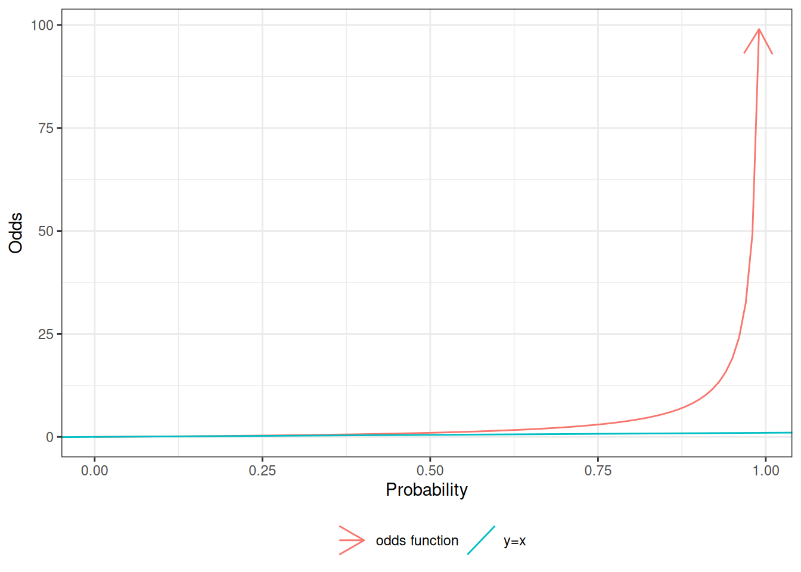
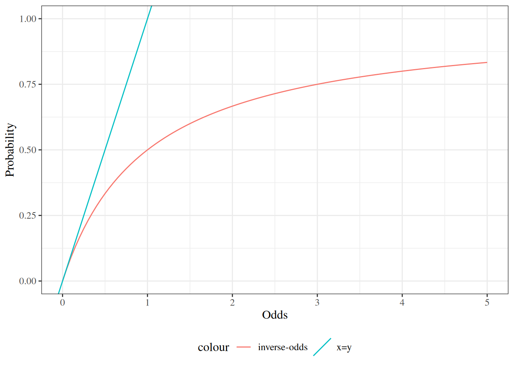
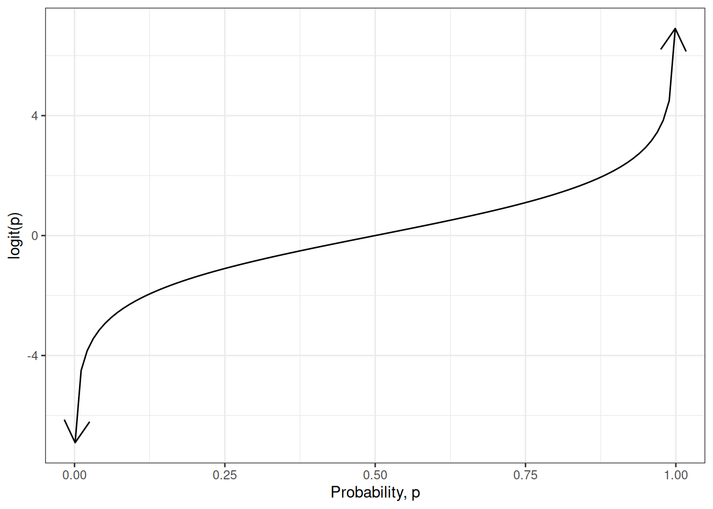
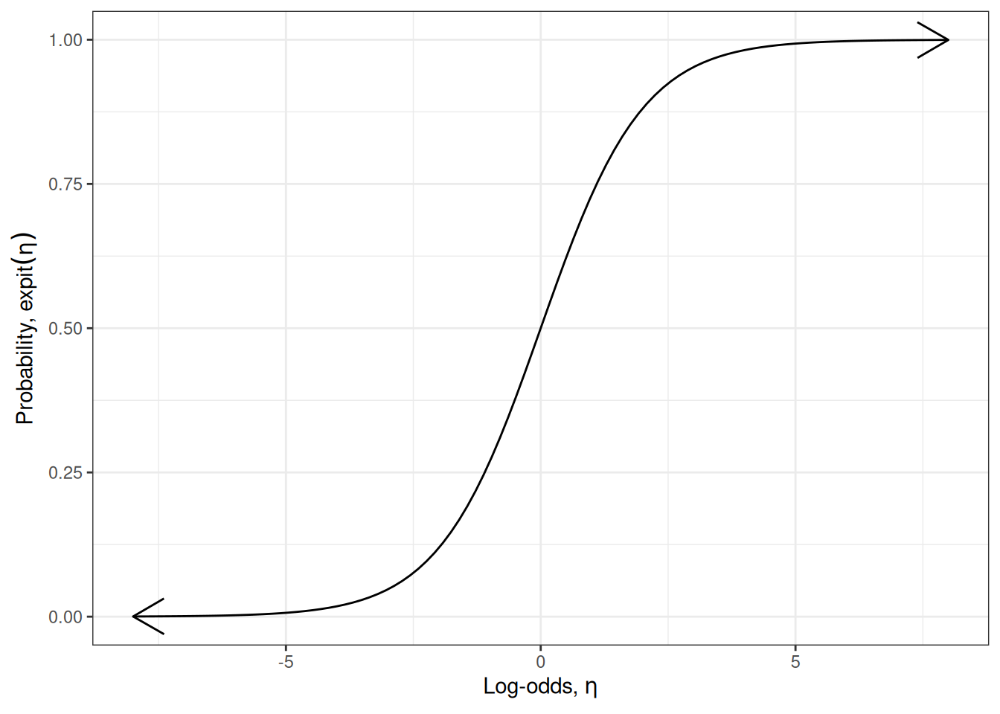

# Measures of Association for Binary Outcomes

Code

- [Show All Code](javascript:void(0))

- [Hide All Code](javascript:void(0))

- 

  ------------------------------------------------------------------------

- [View Source](javascript:void(0))

Risks, odds, odds ratios, and the logit and expit functions

Published

Last modified: 2026-11-12: 2:39:08 (UTC)

------------------------------------------------------------------------

# Configuring R

Functions from these packages will be used throughout this document:

Show R code

``` downlit
library(conflicted) # check for conflicting function definitions
# printr is not loaded here: it inserts help-file output into markdown output
library(rmarkdown) # Convert R Markdown documents into a variety of formats.
library(pander) # format tables for markdown
library(ggplot2) # graphics
library(ggfortify) # help with graphics
library(dplyr) # manipulate data
library(tibble) # `tibble`s extend `data.frame`s
library(magrittr) # `%>%` and other additional piping tools
library(haven) # import Stata files
library(knitr) # format R output for markdown
library(tidyr) # Tools to help to create tidy data
library(plotly) # interactive graphics
library(dobson) # datasets from Dobson and Barnett 2018
library(parameters) # format model output tables for markdown
library(haven) # import Stata files
library(latex2exp) # use LaTeX in R code (for figures and tables)
library(fs) # filesystem path manipulations
library(survival) # survival analysis
library(survminer) # survival analysis graphics
library(KMsurv) # datasets from Klein and Moeschberger
library(parameters) # format model output tables for
library(webshot2) # convert interactive content to static for pdf
library(forcats) # functions for categorical variables ("factors")
library(stringr) # functions for dealing with strings
library(lubridate) # functions for dealing with dates and times
# Summarizes key information about statistical objects in tidy tibbles
library(broom)
# Provides suite of functions to work with regression model
# `broom::tidy()` tibbles
library(broom.helpers)
```

Here are some R settings I use in this document:

Show R code

``` downlit
rm(list = ls()) # delete any data that's already loaded into R

conflicts_prefer(dplyr::filter)
ggplot2::theme_set(
  ggplot2::theme_bw() +
    # ggplot2::labs(col = "") +
    ggplot2::theme(
      legend.position = "bottom",
      text = ggplot2::element_text(size = 12, family = "serif")
    )
)

knitr::opts_chunk$set(message = FALSE)
options(digits = 6)

panderOptions("big.mark", ",")
pander::panderOptions("table.emphasize.rownames", FALSE)
pander::panderOptions("table.split.table", Inf)
# use the `filter()` function from dplyr() by default
conflicts_prefer(dplyr::filter)
legend_text_size <- 9
run_graphs <- TRUE
```

Show R code

``` downlit
options(digits = 6)
```

# Acknowledgements

This content is adapted from:

- Dobson and Barnett [\[1\]](#ref-dobson4e), Chapter 7
- Vittinghoff et al. [\[2\]](#ref-vittinghoff2e), Chapter 5
- [David Rocke](https://dmrocke.ucdavis.edu/)’s materials from the [2021 edition of Epi 204](https://dmrocke.ucdavis.edu/Class/EPI204-Spring-2021/EPI204-Spring-2021.html)
- Nahhas [\[3\]](#ref-NahhasIRMPHR) [Chapter 6](https://www.bookdown.org/rwnahhas/RMPH/blr.html)

# 1 Introduction

> **TIP:**
>
> David Rocke’s Epi 204 lecture [*Introduction to Logistic Regression*](https://dmrocke.ucdavis.edu/Class/EPI204-Spring-2021/EPI204-2021-03-30.mp4) ([slides](https://dmrocke.ucdavis.edu/Class/EPI204-Spring-2021/EPI204-1%20Introduction%20to%20Logistic%20Regression.pdf)) opens with this chapter’s material: risk estimation, [risk ratios](#def-RR) versus [odds ratios](#def-OR), and which of them each study design can estimate [\[4\]](#ref-rocke2021epi204).

This chapter reviews measures of association for [binary outcomes](https://morrison-lab.github.io/sds/data.html#def-binary-var): risks, [risk differences](#def-RD), risk ratios, [odds](#def-odds), and odds ratios, along with the [logit](#def-logit-fn) and [expit](#def-expit) functions that connect probabilities, odds, and [log-odds](#def-logodds). These concepts are the vocabulary for [regression models](../chapters/Intro-to-GLMs.llms.md#def-regression-model) of binary outcomes; the [logistic regression chapter](../chapters/logistic-regression.llms.md) builds on them.

## 1.1 Risk estimation and prediction

In Epi 203, you have already seen methods for modeling [binary outcomes](https://morrison-lab.github.io/sds/data.html#def-binary-var) using one covariate that is also binary (such as exposure/non-exposure). In this section, we review one-covariate analyses, with a special focus on [risk ratios](#def-RR) and [odds ratios](#def-OR), which are important concepts for interpreting [logistic regression](../chapters/logistic-regression.llms.md#def-logistic-regression).

> **NOTE:**
>
> **Definition 1 (Risk (incidence proportion, cumulative incidence))** In epidemiology, the **risk** of an outcome event in a population (or a subgroup of a population) over a specified time period is the probability that a member of that population experiences the event during that period [\[5, Ch. 4\]](#ref-me4):
>
> $$\pi \stackrel{\text{def}}{=}{\Pr\mathopen{}\left(\text{the event occurs during the period}\right)\mathclose{}}$$
>
> Risk is also called **incidence proportion** or **cumulative incidence** [\[5, Ch. 4\]](#ref-me4).

A risk is a probability, so it is unitless and lies between 0 and 1. A risk is only fully specified once its population and time period are stated: “the risk of MI” means nothing until we say *whose* risk, and over *how long*.

> **NOTE:**
>
> **Example 1 (One-year risk of influenza)** Suppose we follow 2000 people for one year, nobody is lost to follow-up, and 30 of them develop influenza during that year. The estimated one-year risk of influenza in this population is the proportion who developed influenza:
>
> $$\begin{aligned}
> \hat\pi
> &= \frac{\text{number who developed influenza}}{\text{number followed}}
> && \text{(sample proportion estimates the probability)}\\
> &= \frac{30}{2000}
> && \text{(substitute the counts)}\\
> &= 0.015
> && \text{(divide)}
> \end{aligned}$$

> **NOTE:**
>
> **Example 2 (A case count is not a risk)** The count of 30 influenza cases from [Example 1](#exm-risk-epi) is not a risk: it is not a probability, and it does not account for how many people were at risk. If instead 4000 people had been followed for the same year, with the same 30 cases, the estimated risk would be:
>
> $$\begin{aligned}
> \hat\pi
> &= \frac{30}{4000}
> && \text{(substitute the counts)}\\
> &= 0.0075
> && \text{(divide)}
> \end{aligned}$$
>
> which is half the risk from [Example 1](#exm-risk-epi), even though the case count is identical.

> **NOTE:**
>
> *Remark 1* (Cumulative incidence has a second meaning). The name [cumulative incidence](#def-risk-epi) is used for the [risk](#def-risk-epi) when the [population](https://morrison-lab.github.io/sds/exploratory-descriptive.html#def-population) is closed, meaning that no one enters or leaves after the start of the time period [\[5, Ch. 4\]](#ref-me4). The same name is also used for a different quantity: when several [event](https://morrison-lab.github.io/pds/probability-basics.html#def-event) types compete, the [cumulative incidence function](../chapters/proportional-hazards-models.llms.md#def-cumulative-incidence) of one event type at time $t$ is the probability that this type of event occurs by time $t$ [\[5, Ch. 22\]](#ref-me4). This chapter uses the name only for the risk of a [binary outcome](https://morrison-lab.github.io/sds/data.html#def-binary-var).

> **NOTE:**
>
> **Example 3 (Oral Contraceptive Use and Heart Attack)**  
>
> - Research question: how does oral contraceptive (OC) use affect the risk of myocardial infarction (MI; a.k.a. heart attack)?
>
> This potential risk increase was a concern when oral contraceptives were first developed, because the original formulations used much higher doses of estrogen than are used today. Cardiovascular risk from combined oral contraceptives increases with estrogen dose, and the dose has been reduced substantially since those early formulations, so modern low-dose formulations carry much lower risk [\[6\]](#ref-roach2015combined).
>
> [Table 1](#tbl-oc-mi) contains simulated data for an imaginary follow-up (a.k.a. *prospective*) study in which two groups are identified, one using OCs and another not using OCs, and both groups are tracked for three years to determine how many in each groups have MIs.
>
> > **NOTE:**
> >
> > Show R code
> >
> > ``` downlit
> > library(dplyr)
> > oc_mi <-
> >   tribble(
> >     ~OC, ~MI, ~Total,
> >     "OC use", 13, 5000,
> >     "No OC use", 7, 10000
> >   ) |>
> >   mutate(`No MI` = Total - MI) |>
> >   relocate(`No MI`, .after = MI)
> >
> > totals <-
> >   oc_mi |>
> >   summarize(across(c(MI, `No MI`, Total), sum)) |>
> >   mutate(OC = "Total")
> >
> > tbl_oc_mi <- bind_rows(oc_mi, totals)
> >
> > tbl_oc_mi |> pander::pander()
> > ```
> >
> > |    OC     | MI  | No MI  | Total  |
> > |:---------:|:---:|:------:|:------:|
> > |  OC use   | 13  | 4,987  | 5,000  |
> > | No OC use |  7  | 9,993  | 10,000 |
> > |   Total   | 20  | 14,980 | 15,000 |
> >
> > Table 1: Simulated data from study of oral contraceptive use and heart attack risk

> **NOTE:**
>
> **Exercise 1** Let $\pi(OC) \stackrel{\text{def}}{=}\Pr(MI|OC)$ and $\pi(\neg OC) \stackrel{\text{def}}{=}\Pr(MI|\neg OC)$ be the probabilities of MI for OC users and non-OC users. Estimate them from [Example 3](#exm-oc-mi).

> **NOTE:**
>
> *Solution 1*. $$\mathop{\hat{\operatorname{p}}}\nolimits(MI|OC) = \frac{13}{5000} = 0.0026$$
>
> $$\mathop{\hat{\operatorname{p}}}\nolimits(MI|\neg OC) = \frac{7}{10000} = 7\times 10^{-4}$$

> **NOTE:**
>
> **Exercise 2** What does the term “controls” mean in the context of study design?

> **NOTE:**
>
> *Solution 2*. See [Definition 2](#def-controls).

> **NOTE:**
>
> **Definition 2 (Two meanings of “controls”)** Depending on context, “controls” can mean either:
>
> - individuals who don’t experience an *exposure* of interest,
> - or individuals who don’t experience an *outcome* of interest.

> **NOTE:**
>
> **Exercise 3** What types of studies do the two definitions of controls correspond to?

> **NOTE:**
>
> *Solution 3*. [Controls](#def-controls) lack the [outcome](../chapters/Intro-to-GLMs.llms.md#def-outcome) in retrospective case-control studies ([Definition 3](#def-cases-retrospective)), and lack the exposure or treatment in prospective studies ([Definition 4](#def-cases-prospective)).

> **NOTE:**
>
> **Definition 3 (cases and controls in retrospective studies)** In *retrospective [case-control studies](#sec-CC-studies)*, participants who experience the outcome of interest are called **cases**, while participants who don’t experience that outcome are called **controls** [\[5, Ch. 8\]](#ref-me4).

> **NOTE:**
>
> **Definition 4 (treatment groups and control groups in prospective studies)** In *prospective studies*, the group of participants who experience the treatment or exposure of interest is called the **treatment group**, while the participants who receive the baseline or comparison treatment (for example, clinical trial participants who receive a placebo or a standard-of-care treatment rather than an experimental treatment) are called **controls** [\[5, Ch. 6\]](#ref-me4).

> **NOTE:**
>
> **Example 4 (Cases and controls in the OC-MI study)** [Example 3](#exm-oc-mi) describes a *prospective* (follow-up) study: participants were enrolled based on their exposure status (OC use versus no OC use) and then followed for three years to observe MI outcomes.
>
> Therefore, [Definition 4](#def-cases-prospective) applies: the 5000 OC users form the treatment (exposed) group, and the 10,000 OC non-users are the **controls**.
>
> [Definition 3](#def-cases-retrospective) does not apply to this study design, because participants were not selected based on their outcomes. If we had instead recruited participants by outcome status — enrolling the 20 participants who experienced MIs, along with a sample of participants who did not — the study would have been a *retrospective [case-control study](#sec-CC-studies)*: the 20 participants with MIs would be the **cases**, and the sampled MI-free participants would be the **controls**.

## 1.2 Comparing probabilities

### 1.2.1 Risk differences

The simplest comparison of two probabilities, $\pi_1$, and $\pi_2$, is the difference of their values:

> **NOTE:**
>
> **Definition 5 (Risk difference)** The **risk difference** of two probabilities, $\pi_1$, and $\pi_2$, is the difference of their values: $$\delta(\pi_1,\pi_2) \stackrel{\text{def}}{=}\pi_1 - \pi_2$$

> **NOTE:**
>
> **Example 5 (Difference in MI risk)** Recall the shorthand $\pi(OC)$ and $\pi(\neg OC)$ from [Exercise 1](#exr-probs) for the probability of MI given OC use and given OC non-use, respectively.
>
> In [Example 3](#exm-oc-mi), the [maximum likelihood estimate](https://morrison-lab.github.io/sds/intro-MLEs.html#def-mle) of the difference in MI [risk](#def-risk-epi) between OC users and OC non-users is:
>
> $$\begin{aligned}
> \hat\delta(\pi(OC), \pi(\neg OC))
> &= \delta(\hat\pi(OC), \hat\pi(\neg OC))\\
> &= \hat\pi(OC) - \hat\pi(\neg OC)\\
> &= 0.0026 - 7\times 10^{-4}\\
> &= 0.0019
> \end{aligned}$$

> **NOTE:**
>
> **Exercise 4 (interpreting risk differences)** How can we interpret the preceding [risk difference](#def-RD) estimate in prose?

> **NOTE:**
>
> *Solution 4* (interpreting risk differences). “The difference in risk of MI between OC users and non-users was 0.0019.”
>
> or
>
> “The difference in risk of MI between OC users and non-users was 0.19 [percentage points](https://en.wikipedia.org/wiki/Percentage_point).”

See the note about working with percentages in the [algebra page of the lab’s math notes](https://morrison-lab.github.io/mds/algebra-basics.html#sec-percent).

### 1.2.2 Risk ratios

> **NOTE:**
>
> **Exercise 5** If $\pi_1$ and $\pi_2$ are two probabilities, what do we call the following ratio?
>
> $$\rho(\pi_1,\pi_2) = \frac{\pi_1}{\pi_2}$$

> **NOTE:**
>
> *Solution 5*. See [Definition 6](#def-RR).

> **NOTE:**
>
> **Definition 6 (Relative risk ratio (risk ratio, probability ratio))** The ratio of two probabilities $\pi_1$ and $\pi_2$,
>
> $$\rho(\pi_1,\pi_2) \stackrel{\text{def}}{=}\frac{\pi_1}{\pi_2}$$
>
> is called the:
>
> - **risk ratio**,
> - **relative risk ratio**,
> - **probability ratio**,
> - or, in some texts, rate ratio (a different quantity in count regression)
>
> of $\pi_1$ compared to $\pi_2$.

> **NOTE:**
>
> **Exercise 6**  
>
> In [Solution 1](#sol-compute-probs), we estimated that:
>
> $$\mathop{\hat{\operatorname{p}}}\nolimits(MI|OC) = 0.0026$$
>
> $$\mathop{\hat{\operatorname{p}}}\nolimits(MI|\neg OC) = 7\times 10^{-4}$$
>
> Now, estimate the *[relative risk](#def-RR)* of MI for OC versus non-OC.

> **NOTE:**
>
> *Solution 6*.
>
> The *relative risk* of MI for OC versus non-OC is:
>
> Show R code
>
> ``` downlit
> rr <- (13 / 5000) / (7 / 10000)
> ```
>
> $$\begin{aligned}
> \hat\rho(OC, \neg OC)
> &=\frac{\mathop{\hat{\operatorname{p}}}\nolimits(MI|OC)}{\mathop{\hat{\operatorname{p}}}\nolimits(MI|\neg OC)}\\
> &= \frac{0.0026}{7\times 10^{-4}}\\
> &= 3.714286
> \end{aligned}$$

> **NOTE:**
>
> **Exercise 7** How can we interpret the preceding relative risk estimate in prose?

> **NOTE:**
>
> *Solution 7*.
>
> We might summarize this result by saying that:
>
> - “The estimated probability of MI among OC users was 3.714286 *times as high as* the estimated probability among OC non-users.”
>
> or
>
> - “The estimated probability of MI among OC users was 2.714286 *times higher than*, the estimated probability among OC non-users.”
>
> see also Vittinghoff et al. [\[2, Sec. 8.1.4\]](#ref-vittinghoff2e), which uses similar phrasing.

### 1.2.3 Relative risk differences

The second approach in [Solution 7](#sol-interpret-rr), where we subtract 1 from the [risk ratio](#def-RR), is actually reporting a slightly different metric:

> **NOTE:**
>
> **Definition 7 (Relative risk difference)**  
>
> Sometimes, we divide the [risk difference](#def-RD) by the comparison probability; the result is called the **relative risk difference**:
>
> $$\xi(\pi_1,\pi_2) \stackrel{\text{def}}{=}\frac{\delta(\pi_1,\pi_2)}{\pi_2}$$

> **NOTE:**
>
> **Theorem 1 (Relative risk difference equals risk ratio minus 1)** $$\xi(\pi_1,\pi_2) = \rho(\pi_1,\pi_2) - 1$$

> **NOTE:**
>
> *Proof*. $$\begin{aligned}
> \xi(\pi_1,\pi_2)
> &\stackrel{\text{def}}{=}\frac{\delta(\pi_1,\pi_2)}{\pi_2}
> \\&= \frac{\pi_1-\pi_2}{\pi_2}
> \\&= \frac{\pi_1}{\pi_2} - 1
> \\&= \rho(\pi_1,\pi_2) - 1
> \end{aligned}$$

> **NOTE:**
>
> **Example 6 (Relative difference in MI risk)** In [Example 3](#exm-oc-mi), the [maximum likelihood estimate](https://morrison-lab.github.io/sds/intro-MLEs.html#def-mle) of the relative risk difference in MI risk between OC users and OC non-users is:
>
> $$\begin{aligned}
> \hat\xi(\pi(OC), \pi(\neg OC))
> &= \xi(\hat\pi(OC), \hat\pi(\neg OC))
> && \text{(invariance property of MLEs)}
> \\ &\stackrel{\text{def}}{=}\frac{\delta(\hat\pi(OC), \hat\pi(\neg OC))}{\hat\pi(\neg OC)}
> && \text{(definition of relative risk difference)}
> \\ &= \frac{0.0019}{7\times 10^{-4}}
> && \text{(substituting the estimates)}
> \\ &= 2.714286
> && \text{(dividing)}
> \end{aligned}$$
>
> The numerator 0.0019 is the [risk difference](#def-RD) estimate from [Example 5](#exm-RD), and the denominator 7^{-4} is the estimate $\hat\pi(\neg OC)$ from [Solution 1](#sol-compute-probs).
>
> We can check this estimate using [Theorem 1](#thm-rrd-vs-rr) and the [risk ratio](#def-RR) estimate from [Solution 6](#sol-exr-RR):
>
> $$\begin{aligned}
> \hat\xi(\pi(OC), \pi(\neg OC))
> &= \hat\rho(OC, \neg OC) - 1
> && \text{(relative risk difference as risk ratio minus 1)}
> \\ &= 3.714286 - 1
> && \text{(substituting the risk ratio estimate)}
> \\ &= 2.714286
> && \text{(subtracting)}
> \end{aligned}$$
>
> The two calculations agree.

### 1.2.4 Changing reference groups in risk comparisons

[Risk differences](#def-RD), [risk ratios](#def-RR), and relative risk differences are defined by two probabilities, plus a choice of which probability is the **baseline** or **reference** probability (i.e., which probability is the subtrahend of the risk difference or the denominator of the risk ratio).

$$\delta(\pi_2,\pi_1) = -\delta(\pi_1, \pi_2) \tag{1}$$

$$\rho(\pi_2,\pi_1) = {\mathopen{}\left(\rho(\pi_1,\pi_2)\right)\mathclose{}}^{-1} \tag{2}$$

$$\xi(\pi_2,\pi_1) = {\mathopen{}\left(\xi(\pi_1,\pi_2) + 1\right)\mathclose{}}^{-1} - 1 \tag{3}$$

> **NOTE:**
>
> **Exercise 8** Prove [Equation 1](#eq-rd-switch-ref), [Equation 2](#eq-rr-switch-ref), and [Equation 3](#eq-rrd-switch-ref).

> **NOTE:**
>
> *Solution 8*. To prove [Equation 1](#eq-rd-switch-ref):
>
> $$\begin{aligned}
> \delta(\pi_2,\pi_1)
> &\stackrel{\text{def}}{=}\pi_2 - \pi_1
> && \text{(definition of risk difference)}
> \\ &= -(\pi_1 - \pi_2)
> && \text{(factoring out } -1 \text{)}
> \\ &= -\delta(\pi_1, \pi_2)
> && \text{(definition of risk difference)}
> \end{aligned}$$
>
> To prove [Equation 2](#eq-rr-switch-ref):
>
> $$\begin{aligned}
> \rho(\pi_2,\pi_1)
> &\stackrel{\text{def}}{=}\frac{\pi_2}{\pi_1}
> && \text{(definition of risk ratio)}
> \\ &= {\mathopen{}\left(\frac{\pi_1}{\pi_2}\right)\mathclose{}}^{-1}
> && \text{(inverse of the inverted fraction)}
> \\ &= {\mathopen{}\left(\rho(\pi_1,\pi_2)\right)\mathclose{}}^{-1}
> && \text{(definition of risk ratio)}
> \end{aligned}$$
>
> To prove [Equation 3](#eq-rrd-switch-ref), first rearrange [Theorem 1](#thm-rrd-vs-rr) to express the risk ratio in terms of the relative risk difference:
>
> $$\begin{aligned}
> \xi(\pi_1,\pi_2)
> &= \rho(\pi_1,\pi_2) - 1
> && \text{(relative risk difference as risk ratio minus 1)}
> \\ \xi(\pi_1,\pi_2) + 1
> &= \rho(\pi_1,\pi_2)
> && \text{(adding 1 to both sides)}
> \end{aligned}$$
>
> Then apply [Theorem 1](#thm-rrd-vs-rr) to the switched-reference pair $(\pi_2, \pi_1)$, substitute [Equation 2](#eq-rr-switch-ref), and substitute the rearranged form of [Theorem 1](#thm-rrd-vs-rr):
>
> $$\begin{aligned}
> \xi(\pi_2,\pi_1)
> &= \rho(\pi_2,\pi_1) - 1
> && \text{(relative risk difference as risk ratio minus 1)}
> \\ &= {\mathopen{}\left(\rho(\pi_1,\pi_2)\right)\mathclose{}}^{-1} - 1
> && \text{(risk ratio with switched reference group)}
> \\ &= {\mathopen{}\left(\xi(\pi_1,\pi_2) + 1\right)\mathclose{}}^{-1} - 1
> && \text{(substituting } \rho(\pi_1,\pi_2) = \xi(\pi_1,\pi_2) + 1 \text{)}
> \end{aligned}$$

> **NOTE:**
>
> **Theorem 2 (Switching the reference group in a risk difference)** For probabilities $\pi_1$ and $\pi_2$, the [risk difference](#def-RD) with the reference group switched is the negative of the original:
>
> $$\delta(\pi_2,\pi_1) = -\delta(\pi_1, \pi_2)$$

> **NOTE:**
>
> *Proof*. This proof is the solution to [Exercise 8](#exr-change-ref-group), worked in [Solution 8](#sol-change-ref-group).

> **NOTE:**
>
> **Example 7 (Switching the reference group in a risk difference)** In [Example 5](#exm-RD), we estimated that the [risk difference](#def-RD) of MI for OC versus non-OC is:
>
> $$\begin{aligned}
> \delta(OC, \neg OC)
> &= 0.0019
> \end{aligned}$$
>
> In comparison, the risk difference for non-OC versus OC is:
>
> $$\begin{aligned}
> \delta(\neg OC, OC)
> &= \mathop{\hat{\operatorname{p}}}\nolimits(MI|\neg OC) - \mathop{\hat{\operatorname{p}}}\nolimits(MI|OC)\\
> &= 7\times 10^{-4} - 0.0026\\
> &= -0.0019\\
> &= -\delta(OC, \neg OC)
> \end{aligned}$$
>
> as [Theorem 2](#thm-rd-switch-ref) states.

> **NOTE:**
>
> **Theorem 3 (Switching the reference group in a risk ratio)** For nonzero probabilities $\pi_1$ and $\pi_2$, the [risk ratio](#def-RR) with the reference group switched is the reciprocal of the original:
>
> $$\rho(\pi_2,\pi_1) = {\mathopen{}\left(\rho(\pi_1,\pi_2)\right)\mathclose{}}^{-1}$$

> **NOTE:**
>
> *Proof*. This proof is the solution to [Exercise 8](#exr-change-ref-group), worked in [Solution 8](#sol-change-ref-group).

> **NOTE:**
>
> **Example 8 (Switching the reference group in a risk ratio)** In [Solution 6](#sol-exr-RR), we estimated that the [risk ratio](#def-RR) of OC versus non-OC is:
>
> $$\begin{aligned}
> \rho(OC, \neg OC)
> &= 3.714286
> \end{aligned}$$
>
> In comparison, the risk ratio for non-OC versus OC is:
>
> $$\begin{aligned}
> \rho(\neg OC, OC)
> &=\frac{\mathop{\hat{\operatorname{p}}}\nolimits(MI|\neg OC)}{\mathop{\hat{\operatorname{p}}}\nolimits(MI|OC)}\\
> &= \frac{7\times 10^{-4}}{0.0026}\\
> &= 0.269231\\
> &= \frac{1}{\rho(OC, \neg OC)}
> \end{aligned}$$
>
> as [Theorem 3](#thm-rr-switch-ref) states.

> **NOTE:**
>
> **Theorem 4 (Switching the reference group in a relative risk difference)** For nonzero probabilities $\pi_1$ and $\pi_2$, the relative risk difference with the reference group switched is:
>
> $$\xi(\pi_2,\pi_1) = {\mathopen{}\left(\xi(\pi_1,\pi_2) + 1\right)\mathclose{}}^{-1} - 1$$

> **NOTE:**
>
> *Proof*. This proof is the solution to [Exercise 8](#exr-change-ref-group), worked in [Solution 8](#sol-change-ref-group).

> **NOTE:**
>
> **Example 9 (Switching the reference group in a relative risk difference)** In [Example 6](#exm-RRD), we estimated that the relative risk difference of MI for OC versus non-OC is:
>
> $$\begin{aligned}
> \xi(OC, \neg OC)
> &= 2.714286
> \end{aligned}$$
>
> In comparison, the relative risk difference for non-OC versus OC is:
>
> $$\begin{aligned}
> \xi(\neg OC, OC)
> &= \frac{\mathop{\hat{\operatorname{p}}}\nolimits(MI|\neg OC) - \mathop{\hat{\operatorname{p}}}\nolimits(MI|OC)}{\mathop{\hat{\operatorname{p}}}\nolimits(MI|OC)}\\
> &= \frac{-0.0019}{0.0026}\\
> &= -0.730769
> \end{aligned}$$
>
> We can check this value against the switched-reference identity [Theorem 4](#thm-rrd-switch-ref):
>
> $$\begin{aligned}
> \frac{1}{\xi(OC, \neg OC) + 1} - 1
> &= \frac{1}{2.714286 + 1} - 1\\
> &= -0.730769
> \end{aligned}$$
>
> The two calculations agree.

## 1.3 Odds and odds ratios

### 1.3.1 Odds and probabilities

> **TIP:**
>
> Josh Starmer’s StatQuest video [*Odds and Log(Odds), Clearly Explained!!!*](https://www.youtube.com/watch?v=ARfXDSkQf1Y) explains how [odds](#def-odds) differ from probabilities and why the log of the odds is a useful scale [\[7\]](#ref-starmer-statquest).

In [logistic regression](../chapters/logistic-regression.llms.md#def-logistic-regression), we will make use of a mathematically-convenient transformation of probability, called *odds*:

> **NOTE:**
>
> **Definition 8 (Odds)**  
>
> The **odds** of an event $A$, is the probability that the event occurs, divided by the probability that it doesn’t occur. We can represent odds with the Greek letter $\omega$ (“omega”). [^1] Thus, in mathematical notation:
>
> $$\omega\stackrel{\text{def}}{=}\frac{\Pr(A)}{\Pr(\neg A)} \tag{4}$$

This course is about regression models, which are [conditional probability](https://morrison-lab.github.io/pds/probability-basics.html#def-conditional-prob) models ([regression models](../chapters/Intro-to-GLMs.llms.md#def-regression-model)). Accordingly, we define conditional odds in terms of conditional probabilities:

> **NOTE:**
>
> **Definition 9 (Conditional odds)**  
>
> The **conditional odds** of an event $A$ given a condition $B$, is the (conditional) probability that event $A$ occurs (given condition $B$), divided by the (conditional) probability that it doesn’t occur (given condition $B$). In mathematical notation:
>
> $$\omega(A|B) \stackrel{\text{def}}{=}\frac{\Pr(A|B)}{\Pr(\neg A|B)} \tag{5}$$
>
> When the event $A$ is clear from context, we abbreviate $\omega(A|B)$ as $\omega(B)$ or $\omega_B$ (“omega bee”).

> **NOTE:**
>
> **Example 10 (Computing odds from probabilities)** In [Exercise 1](#exr-probs), we estimated that $\pi(OC) = 0.0026$. If this estimate is correct, then the [odds](#def-odds) of MI, given OC use, is:
>
> $$\begin{aligned}
> \omega(OC)
> &\stackrel{\text{def}}{=}\frac{\Pr(MI|OC)}{\Pr(\neg MI|OC)}\\
> &=\frac{\Pr(MI|OC)}{1-\Pr(MI|OC)}\\
> &=\frac{\pi(OC)}{1-\pi(OC)}\\
> &=\frac{0.0026}{1-0.0026}\\
> &\approx 0.002607
> \end{aligned}$$

> **NOTE:**
>
> **Exercise 9 (Computing odds from probabilities)** Estimate the [odds](#def-odds) of MI, for non-OC users.

> **NOTE:**
>
> *Solution 9*. $$\omega(\neg OC) = 7.004903\times 10^{-4}$$

> **NOTE:**
>
> **Exercise 10** Find a general formula for converting probabilities into [odds](#def-odds).

> **NOTE:**
>
> *Solution 10*. Using [Definition 8](#def-odds) and [the complementary probability](https://morrison-lab.github.io/pds/probability-basics.html#cor-p-neg):
>
> $$\begin{aligned}
> \omega&\stackrel{\text{def}}{=}\frac{\Pr(A)}{\Pr(\neg A)}
> \\ &= \frac{\pi}{1-\pi}
> \end{aligned}$$

> **NOTE:**
>
> **Theorem 5 (Odds as a function of probability)** If $\pi$ is the probability of an event $A$ and $\omega$ is the corresponding [odds](#def-odds) of $A$, then:
>
> $$\omega= \frac{\pi}{1-\pi} \tag{6}$$

> **NOTE:**
>
> *Proof*. By [Solution 10](#sol-prob-to-odds).

The mathematical relationship between odds $\omega$ and probabilities $\pi$, which is represented in [Equation 6](#eq-odds-prob), is a core component of [logistic regression models](../chapters/logistic-regression.llms.md#def-logistic-regression), as we will see in the rest of this chapter. Let’s give the expression on the righthand side of [Equation 6](#eq-odds-prob) its own name and symbol, so that we can refer to it concisely:

> **NOTE:**
>
> **Definition 10 (Odds function)** The **odds function** is defined as: $${\operatorname{odds}\mathopen{}\left\{\pi\right\}\mathclose{}} \stackrel{\text{def}}{=}\frac{\pi}{1-\pi} \tag{7}$$

We can use the odds function ([Definition 10](#def-odds-fn)) to simplify [Equation 6](#eq-odds-prob) (in [Theorem 5](#thm-prob-to-odds)) into a more concise expression, which is easier to remember and manipulate:

> **NOTE:**
>
> **Corollary 1 (Odds via the odds function)** If $\pi$ is the probability of an outcome $A$ and $\omega$ is the corresponding [odds](#def-odds) of $A$, then:
>
> $$\omega= {\operatorname{odds}\mathopen{}\left\{\pi\right\}\mathclose{}} \tag{8}$$

In other words, the [odds function](#def-odds-fn) rescales probabilities into odds.

> **NOTE:**
>
> *Proof*. By [Theorem 5](#thm-prob-to-odds) and [Definition 10](#def-odds-fn).

> **NOTE:**
>
> **Exercise 11** Graph the odds function.

> **NOTE:**
>
> *Solution 11*.
>
> [Figure 1](#fig-odds-probs) graphs the odds function.
>
> Show R code
>
> ``` downlit
> odds <- function(pi) pi / (1 - pi)
> library(ggplot2)
> ggplot() +
>   geom_function(
>     fun = odds,
>     arrow = arrow(ends = "last"),
>     mapping = aes(col = "odds function")
>   ) +
>   xlim(0, .99) +
>   xlab("Probability") +
>   ylab("Odds") +
>   geom_abline(aes(
>     intercept = 0,
>     slope = 1,
>     col = "y=x"
>   )) +
>   theme_bw() +
>   labs(colour = "") +
>   theme(legend.position = "bottom")
> ```
>
> > **NOTE:**
> >
> > [](binary-outcome-associations_files/figure-revealjs/fig-odds-probs-1.png "Figure 1: Odds versus probability")
> >
> > Figure 1: Odds versus probability

> **NOTE:**
>
> **Theorem 6 (One-sample MLE for odds)** Let $X_1,...X_n$ be a set of $n$ $\operatorname{iid}$ [Bernoulli](https://morrison-lab.github.io/pds/random-variables.html#def-bernoulli) trials, and let $X = \sum_{i=1}^nX_i$ be their sum.
>
> Then the [maximum likelihood estimate](https://morrison-lab.github.io/sds/intro-MLEs.html#def-mle) of the common per-trial success [odds](#def-odds) $\omega$ (specifically, the odds of $X_i=1$) is:
>
> $$\hat{\omega}= \frac{x}{n-x}$$

> **NOTE:**
>
> *Proof*. $$\begin{aligned}
> 1-\hat\pi
> &= 1-\frac{x}{n}\\
> &= \frac{n}{n} - \frac{x}{n}\\
> &= \frac{n - x}{n}
> \end{aligned}$$
>
> Thus, the estimated odds is:
>
> $$\begin{aligned}
> \frac{\hat\pi}{1-\hat\pi}
> &= \frac{\mathopen{}\left(\frac{x}{n}\right)\mathclose{}}{\mathopen{}\left(\frac{n-x}{n}\right)\mathclose{}}\\
> &= \frac{x}{n-x}
> \end{aligned}
> \tag{9}$$
>
> This calculation shows that the odds estimate can be computed directly as “# events” divided by “# nonevents”, without needing to compute $\hat\pi$ and $1-\hat\pi$ first.

> **NOTE:**
>
> **Example 11 (Calculating odds using the shortcut)** In [Example 10](#exm-odds), we calculated $$\begin{aligned}
> \omega(OC)
> &=0.002607
> \end{aligned}$$
>
> Let’s recalculate $\omega(OC)$ using our shortcut.

> **NOTE:**
>
> *Solution 12*. $$\begin{aligned}
> \omega(OC)
> &=\frac{13}{5000-13}\\
> &=0.002607
> \end{aligned}$$
>
> Same answer as in [Example 10](#exm-odds)!

> **NOTE:**
>
> **Theorem 7 (Simplified expressions for odds function)**  
>
> Two equivalent expressions for the [odds function](#def-odds-fn) are:
>
> For $0 < \pi < 1$,
>
> $$\begin{aligned}
> {\operatorname{odds}\mathopen{}\left\{\pi\right\}\mathclose{}} &= \frac{1}{\pi^{-1}-1}
> \\ &= {\mathopen{}\left(\pi^{-1}-1\right)\mathclose{}}^{-1}
> \end{aligned}
> \tag{10}$$

> **NOTE:**
>
> **Exercise 12** Prove [Theorem 7](#thm-odds-simplified).

> **NOTE:**
>
> *Solution 13*. Let $0 < \pi < 1$, so that $\pi^{-1}$ exists. Starting from [Definition 10](#def-odds-fn):
>
> $$\begin{aligned}
> {\operatorname{odds}\mathopen{}\left\{\pi\right\}\mathclose{}} &\stackrel{\text{def}}{=}\frac{\pi}{1-\pi}
> && \text{(definition of the odds function)}
> \\
> &= \frac{\pi}{1-\pi}\cdot\frac{\pi^{-1}}{\pi^{-1}}
> && \text{(multiply numerator and denominator by } \pi^{-1} \text{)}
> \\
> &= \frac{\pi\pi^{-1}}{(1-\pi)\pi^{-1}}
> && \text{(distribute multiplication across fraction)}
> \\
> &= \frac{1}{(1-\pi)\pi^{-1}}
> && \text{(simplify numerator: } \pi\pi^{-1}=1 \text{)}
> \\
> &= \frac{1}{\pi^{-1}-\pi\pi^{-1}}
> && \text{(distribute } \pi^{-1} \text{ in denominator)}
> \\
> &= \frac{1}{\pi^{-1}-1}
> && \text{(simplify } \pi\pi^{-1}=1 \text{ in denominator)}
> \\
> &= {\mathopen{}\left(\pi^{-1}-1\right)\mathclose{}}^{-1}
> && \text{(notation for reciprocal function)}
> \end{aligned}
> \tag{11}$$

> **NOTE:**
>
> **Example 12 (Computing odds using the simplified expression)** Suppose an event has probability $\pi = 0.25$.
>
> Using the simplified expression from [Theorem 7](#thm-odds-simplified):
>
> $$\begin{aligned}
> {\operatorname{odds}\mathopen{}\left\{0.25\right\}\mathclose{}} &= {\mathopen{}\left(0.25^{-1} - 1\right)\mathclose{}}^{-1}
> && \text{(simplified odds expression)}
> \\
> &= {\mathopen{}\left(4 - 1\right)\mathclose{}}^{-1}
> && \text{(reciprocal: } 0.25^{-1} = 4 \text{)}
> \\
> &= {\mathopen{}\left(3\right)\mathclose{}}^{-1}
> && \text{(subtraction)}
> \\
> &= \frac{1}{3}
> && \text{(reciprocal)}
> \end{aligned}
> \tag{12}$$
>
> Checking against the standard [odds](#def-odds) definition:
>
> $$\begin{aligned}
> {\operatorname{odds}\mathopen{}\left\{0.25\right\}\mathclose{}} &= \frac{0.25}{1 - 0.25}
> && \text{(definition of the odds function)}
> \\
> &= \frac{0.25}{0.75}
> && \text{(subtraction)}
> \\
> &= \frac{1}{3}
> && \text{(divide numerator and denominator by 0.25)}
> \end{aligned}
> \tag{13}$$
>
> Both formulas yield identical odds of $1/3$.

> **NOTE:**
>
> **Corollary 2 (Odds of a non-event)** If $\pi$ is the probability of event $A$ and $\omega$ is the corresponding [odds](#def-odds) of $A$, then the odds of $\neg A$ are:
>
> $$\begin{aligned}
> \omega(\neg A) &= \frac{1-\pi}{\pi}
> \\&= \pi^{-1}-1
> \end{aligned}$$

> **NOTE:**
>
> *Proof*. Using [Definition 8](#def-odds) (applied to the event $\neg A$) and the [complement rule](https://morrison-lab.github.io/pds/probability-basics.html#cor-p-neg):
>
> $$\begin{aligned}
> \omega(\neg A)
> &\stackrel{\text{def}}{=}\frac{\Pr(\neg A)}{\Pr(\neg \neg A)}
> && \text{(definition of odds, applied to } \neg A\text{)}
> \\ &= \frac{\Pr(\neg A)}{\Pr(A)}
> && \text{(double negation: } \neg \neg A = A\text{)}
> \\ &= \frac{1-\pi}{\Pr(A)}
> && \text{(complement rule: } \Pr(\neg A) = 1-\pi\text{)}
> \\ &= \frac{1-\pi}{\pi}
> && \text{(} \Pr(A) = \pi \text{ by definition)}
> \\ &= \frac{1}{\pi} - \frac{\pi}{\pi}
> && \text{(distribute the division over the difference)}
> \\ &= \frac{1}{\pi} - 1
> && \text{(cancel: } \pi/\pi = 1\text{)}
> \\ &= \pi^{-1} - 1
> && \text{(rewrite the reciprocal as a } -1 \text{ power)}
> \end{aligned}$$

#### Odds of rare events

> **NOTE:**
>
> **Exercise 13** What [odds](#def-odds) value corresponds to the probability $\pi = 0.2$, and what is the numerical difference between these two values?

> **NOTE:**
>
> *Solution 14*. The odds value corresponding to $\pi = 0.2$ is:
>
> $$\omega= \frac{\pi}{1-\pi}
> =\frac{.2}{.8}
> = .25$$
>
> The numerical difference between the odds and the probability is:
>
> $$\omega- \pi = .25 - .2 = .05$$

> **NOTE:**
>
> **Exercise 14** Find the difference between an odds $\omega$ and its corresponding probability $\pi$, as a function of $\pi$.

> **NOTE:**
>
> *Solution 15*. $$\begin{aligned}
> \omega- \pi
> &= \frac{\pi}{1-\pi} - \pi
> \\ &= \frac{\pi}{1-\pi} - \frac{\pi(1-\pi)}{1-\pi}
> \\ &= \frac{\pi}{1-\pi} - \frac{\pi - \pi^2}{1-\pi}
> \\ &= \frac{\pi - (\pi - \pi^2)}{1-\pi}
> \\ &= \frac{\pi - \pi + \pi^2}{1-\pi}
> \\ &= \frac{\pi^2}{1-\pi}
> \\ &= \frac{\pi}{1-\pi} \pi
> \\ &= \omega\pi
> \end{aligned}$$

> **NOTE:**
>
> **Theorem 8 (Difference between odds and probability)** Let $\omega= \frac{\pi}{1-\pi}$. Then:
>
> $$\omega- \pi = \frac{\pi^2}{1-\pi}$$

> **NOTE:**
>
> *Proof*. By [Solution 15](#sol-odds-minus-probs).

For rare events (small $\pi$), [odds](#def-odds) and probabilities are nearly equal (see [Figure 1](#fig-odds-probs)), because $1-\pi \approx 1$ and $\pi^2 \approx 0$.

For example, in [Example 10](#exm-odds), the probability and odds differ by $6.777622\times 10^{-6}$.

### 1.3.2 The inverse odds function

> **NOTE:**
>
> **Exercise 15** If $\pi$ is the probability of an event $A$ and $\omega$ is the corresponding [odds](#def-odds) of $A$, how can we compute $\pi$ from $\omega$?
>
> For example, if $\omega= 3/2$, what is $\pi$?

> **NOTE:**
>
> *Solution 16*. Starting from [Theorem 5](#thm-prob-to-odds), we can solve [Equation 6](#eq-odds-prob) for $\pi$ in terms of $\omega$:
>
> $$\begin{aligned}
> \omega&= \frac{\pi}{1-\pi}
> \\
> (1-\pi) \omega&= \pi
> \\
> \omega-\pi\omega&= \pi
> \\
> \omega&= \pi + \pi\omega
> \\
> \omega&= (1 + \omega)\pi
> \\
> \pi &= \frac{\omega}{1 + \omega}
> \end{aligned}$$ So if $\omega= 3/2$,
>
> $$\begin{aligned}
> \pi
> &= \frac{3/2}{1 + 3/2}
> \\
> &= \frac{3/2}{5/2}
> \\
> &= \frac{3}{5}
> \end{aligned}$$

> **NOTE:**
>
> **Theorem 9 (Probability as a function of odds)** If $\pi$ is the probability of an event and $\omega$ is the corresponding [odds](#def-odds) of that event, then:
>
> $$\pi = \frac{\omega}{1+\omega} \tag{14}$$

> **NOTE:**
>
> *Proof*. By [Theorem 5](#thm-prob-to-odds) and [Solution 16](#sol-odds-to-prob).

> **NOTE:**
>
> **Definition 11 (inverse odds function)** $${\operatorname{invodds}\mathopen{}\left\{\omega\right\}\mathclose{}} \stackrel{\text{def}}{=}\frac{\omega}{1 + \omega}
> \tag{15}$$
>
> can be called the **inverse-odds function**.

> **NOTE:**
>
> **Corollary 3 (Probability via the inverse-odds function)** $$\pi= {\operatorname{invodds}\mathopen{}\left\{\omega\right\}\mathclose{}}$$

> **NOTE:**
>
> *Proof*. By [Definition 11](#def-inv-odds) and [Theorem 9](#thm-odds-to-prob).

> **NOTE:**
>
> **Corollary 4 (Inverse-odds function inverts the odds function)** $${\operatorname{invodds}\mathopen{}\left\{\omega\right\}\mathclose{}} = {\operatorname{odds}^{-1}\mathopen{}\left\{\omega\right\}\mathclose{}}$$

> **NOTE:**
>
> *Proof*. Using [Corollary 1](#cor-oddsf-to-odds) and [Theorem 9](#thm-odds-to-prob):
>
> $$\begin{aligned}
> {\operatorname{invodds}\mathopen{}\left\{{\operatorname{odds}\mathopen{}\left\{\pi\right\}\mathclose{}}\right\}\mathclose{}}
> &= {\operatorname{invodds}\mathopen{}\left\{\omega\right\}\mathclose{}}
> \\
> &= \frac
> {\omega}
> {1 + \omega}
> \\
> &= \pi
> \end{aligned}$$
>
> Likewise (not shown):
>
> $${\operatorname{odds}\mathopen{}\left\{{\operatorname{invodds}\mathopen{}\left\{\omega\right\}\mathclose{}}\right\}\mathclose{}} = \omega$$

The [inverse-odds function](#def-inv-odds) converts [odds](#def-odds) into their corresponding probabilities ([Figure 2](#fig-inv-odds)). Its domain of inputs is $\omega\in [0,\infty)$ and its range of outputs is $\pi\in [0,1]$.

I haven’t seen anyone give the inverse-odds function a concise name; maybe $\operatorname{prob}()$ or $\operatorname{prob}()$ or $\operatorname{risk}()$?

> **NOTE:**
>
> Show R code
>
> ``` downlit
> odds_inv <- function(omega) (1 + omega^-1)^-1
> library(ggplot2)
> ggplot() +
>   geom_function(fun = odds_inv, aes(col = "inverse-odds")) +
>   xlab("Odds") +
>   ylab("Probability") +
>   xlim(0, 5) +
>   ylim(0, 1) +
>   geom_abline(aes(intercept = 0, slope = 1, col = "x=y"))
> ```
>
> [](binary-outcome-associations_files/figure-revealjs/unnamed-chunk-4-1.png "Figure 2: The inverse odds function, {\operatorname{invodds}\mathopen{}\left\{\omega\right\}\mathclose{}}")
>
> Figure 2: The inverse odds function, ${\operatorname{invodds}\mathopen{}\left\{\omega\right\}\mathclose{}}$

> **NOTE:**
>
> **Exercise 16** What probability corresponds to an odds of $\omega= 1$, and what is the numerical difference between these two values?

> **NOTE:**
>
> *Solution*. $$\begin{aligned}
> \pi
> &= {\operatorname{invodds}\mathopen{}\left\{1\right\}\mathclose{}}
> \\
> &= \frac{1}{1+1}
> \\
> &=\frac{1}{2}
> \\
> &= .5
> \end{aligned}$$ $$\begin{aligned}
> \omega- \pi&= 1 - .5
> \\
> &= .5
> \end{aligned}$$

> **NOTE:**
>
> **Lemma 1 (Simplified expression for inverse odds function)**  
>
> Equivalent expressions for the [inverse odds function](#def-inv-odds) are:
>
> $$\begin{aligned}
> {\operatorname{invodds}\mathopen{}\left\{\omega\right\}\mathclose{}}
> &= \frac{1}{1+\omega^{-1}}
> \\
> &= (1+\omega^{-1})^{-1}
> \end{aligned}
> \tag{16}$$

> **NOTE:**
>
> **Exercise 17** Prove that [Equation 16](#eq-inv-odds-reduced) is equivalent to [Definition 11](#def-inv-odds).

> **NOTE:**
>
> *Solution 17*. Analogous to [Solution 13](#sol-odds2).

> **NOTE:**
>
> **Lemma 2 (One minus inverse-odds)** $$1 - \pi= \frac{1}{1+\omega}$$

> **NOTE:**
>
> *Proof*. By [Theorem 9](#thm-odds-to-prob):
>
> $$\begin{aligned}
> 1 - \pi&= 1 - \frac{\omega}{1 + \omega}
> \\ &= \frac{{\color{red}{1+\omega}}}{1 + \omega} - \frac{{\color{teal}{\omega}}}{1 + \omega}
> \\ &= \frac{{\color{red}{(1+\omega)}} - {\color{teal}{\omega}}}{1 + \omega}
> \\ &= \frac{1 + \omega- \omega}{1 + \omega}
> \\ &= \frac{1}{1 + \omega}
> \end{aligned}$$

> **NOTE:**
>
> **Corollary 5 (One plus odds in terms of non-event probability)** $$1+\omega= \frac{1}{1-\pi}$$

### 1.3.3 Odds ratios

> **TIP:**
>
> Josh Starmer’s StatQuest video [*Odds Ratios and Log(Odds Ratios), Clearly Explained!!!*](https://www.youtube.com/watch?v=8nm0G-1uJzA) explains [odds ratios](#def-OR) and log odds ratios and how to test whether an odds ratio differs from 1 [\[7\]](#ref-starmer-statquest).

Now that we have defined [odds](#def-odds), we can introduce another way of comparing event probabilities: [odds ratios](#def-OR).

> **NOTE:**
>
> **Definition 12 (Odds ratio)** The **odds ratio** for two [conditional odds](#def-c-odds), $\omega_1$ and $\omega_2$, is the ratio of those [odds](#def-odds):
>
> $$\text{ϙ}(\omega_1, \omega_2) \stackrel{\text{def}}{=}\frac{\omega_1}{\omega_2}$$

There’s a 1:1 mapping between probability and odds, and according to that mapping, the odds are equal between two covariate patterns IF and ONLY IF the probabilities are also equal between those patterns.

An *[odds ratio](#def-OR)* is a *ratio of [odds](#def-odds)*. An odds is a ratio of probabilities, so odds ratios are ratios of ratios:

> **NOTE:**
>
> **Theorem 10 (Odds ratio as a ratio of ratios)** $$\begin{aligned}
> \text{ϙ}(\omega_1, \omega_2)
> &= \frac{\omega_1}{\omega_2}
> \\
> &= \frac{\mathopen{}\left(\frac{\pi_1}{1-\pi_1}\right)\mathclose{}}{\mathopen{}\left(\frac{\pi_2}{1-\pi_2}\right)\mathclose{}}
> \end{aligned}$$

> **NOTE:**
>
> *Proof*. This proof uses [Definition 12](#def-OR) and [Theorem 5](#thm-prob-to-odds):
>
> $$\begin{aligned}
> \text{ϙ}(\omega_1, \omega_2)
> &\stackrel{\text{def}}{=}\frac{\omega_1}{\omega_2}
> && \text{(definition of odds ratio)}
> \\ &= \frac{\mathopen{}\left(\frac{\pi_1}{1-\pi_1}\right)\mathclose{}}{\mathopen{}\left(\frac{\pi_2}{1-\pi_2}\right)\mathclose{}}
> && \text{(odds as a function of probability, applied to each odds)}
> \end{aligned}$$

> **NOTE:**
>
> **Example 13 (The OC-MI odds ratio as a ratio of ratios)** Using the MI [risk](#def-risk-epi) estimates from [Solution 1](#sol-compute-probs), $\hat\pi(OC) = 13/5000$ and $\hat\pi(\neg OC) = 7/10000$, [Theorem 10](#thm-or-ratio-ratio) expresses the [odds ratio](#def-OR) as a ratio of the two [odds](#def-odds), each of which is itself a ratio of probabilities. The steps use [Definition 12](#def-OR) and [Theorem 5](#thm-prob-to-odds):
>
> $$\begin{aligned}
> \text{ϙ}(\omega(OC), \omega(\neg OC))
> &\stackrel{\text{def}}{=}\frac{\omega(OC)}{\omega(\neg OC)}
> && \text{(definition of odds ratio)}
> \\ &= \frac{\mathopen{}\left(\frac{\pi(OC)}{1-\pi(OC)}\right)\mathclose{}}{\mathopen{}\left(\frac{\pi(\neg OC)}{1-\pi(\neg OC)}\right)\mathclose{}}
> && \text{(odds as a function of probability, applied to each odds)}
> \\ &= \frac{\mathopen{}\left(\frac{13/5000}{1 - 13/5000}\right)\mathclose{}}{\mathopen{}\left(\frac{7/10000}{1 - 7/10000}\right)\mathclose{}}
> && \text{(substituting the risk estimates)}
> \\ &= \frac{0.002607}{7.004903\times 10^{-4}}
> && \text{(computing each odds)}
> \\ &= 3.721361
> && \text{(dividing)}
> \end{aligned}$$

> **NOTE:**
>
> **Example 14 (Calculating odds ratios)** In [Example 3](#exm-oc-mi), the [odds ratio](#def-OR) for OC users versus OC-non-users is:
>
> $$\begin{aligned}
> \text{ϙ}(\omega(OC), \omega(\neg OC))
> &= \frac{\omega(OC)}{\omega(\neg OC)}\\
> &= \frac{0.0026}{7\times 10^{-4}}\\
> &= 3.714286\\
> \end{aligned}$$

#### A shortcut for calculating odds ratio estimates

The general form of a two-by-two table is shown in [Table 2](#tbl-2x2-generic).

> **NOTE:**
>
> |             | Event | Non-Event | Total   |
> |-------------|-------|-----------|---------|
> | Exposed     | a     | b         | a+b     |
> | Non-exposed | c     | d         | c+d     |
> | Total       | a+c   | b+d       | a+b+c+d |
>
> Table 2: A generic 2x2 table

From this table, we have:

- $\hat{\pi}(Event|Exposed) = a/(a+b)$

- $\hat{\pi}(\neg Event|Exposed) = b/(a+b)$

- $\hat{\omega}(Event|Exposed) = \frac{\frac{a}{a+b}}{\frac{b}{a+b}}=\frac{a}{b}$

- $\hat{\omega}(Event|\neg Exposed) = \frac{c}{d}$ (see [Exercise 18](#exr-odds-generic))

- $\text{ϙ}_{\omega}(Exposed,\neg Exposed) = \frac{\frac{a}{b}}{\frac{c}{d}} = \frac{ad}{bc}$

> **NOTE:**
>
> **Exercise 18** Given [Table 2](#tbl-2x2-generic), show that $\hat{\omega}(Event|\neg Exposed) = \frac{c}{d}$.

#### Properties of odds ratios

[Odds ratios](#def-OR) have a special property: we can swap a covariate with the outcome, and the odds ratio remains the same.

> **NOTE:**
>
> **Theorem 11 (Odds ratios are reversible)** For any two events $A$, $B$:
>
> $$\text{ϙ}_{\omega}(A|B) = \text{ϙ}_{\omega}(B|A)$$

> **NOTE:**
>
> *Proof*. Using [Definition 12](#def-OR), [Definition 9](#def-c-odds), the [law of conditional probability](https://morrison-lab.github.io/pds/probability-basics.html#thm-law-conditional-prob), and the [definition of conditional probability](https://morrison-lab.github.io/pds/probability-basics.html#def-conditional-prob):
>
> $$\begin{aligned}
> \text{ϙ}_{\omega}(A|B) &\stackrel{\text{def}}{=}\frac{\omega(A|B)}{\omega(A|\neg B)}
> && \text{(definition of odds ratio)}
> \\ &= \frac
> {\mathopen{}\left(\frac{\operatorname{p}(A|B)}{\operatorname{p}(\neg A|B)}\right)\mathclose{}}
> {\mathopen{}\left(\frac{\operatorname{p}(A|\neg B)}{\operatorname{p}(\neg A| \neg B)}\right)\mathclose{}}
> && \text{(definition of conditional odds)}
> \\ &=
> \mathopen{}\left(\frac{\operatorname{p}(A|B)}{\operatorname{p}(\neg A|B)}\right)\mathclose{}
> {\mathopen{}\left(\frac{\operatorname{p}(A|\neg B)}{\operatorname{p}(\neg A| \neg B)}\right)\mathclose{}}^{-1}
> && \text{(division is multiplication by the reciprocal)}
> \\ &=
> \mathopen{}\left(\frac{\operatorname{p}(A|B)}{\operatorname{p}(\neg A|B)}\right)\mathclose{}
> \mathopen{}\left(\frac{\operatorname{p}(\neg A| \neg B)}{\operatorname{p}(A|\neg B)}\right)\mathclose{}
> && \text{(the reciprocal of a fraction flips it)}
> \\ &=
> \mathopen{}\left(\frac{\operatorname{p}(A|B)}{\operatorname{p}(\neg A|B)} \cdot\frac{\operatorname{p}(B)}{\operatorname{p}(B)}\right)\mathclose{}
> \mathopen{}\left(\frac{\operatorname{p}(\neg A| \neg B)}{\operatorname{p}(A|\neg B)} \cdot\frac{\operatorname{p}(\neg B)}{\operatorname{p}(\neg B)}\right)\mathclose{}
> && \text{(multiply each factor by 1)}
> \\ &=
> \mathopen{}\left(\frac{\operatorname{p}(A,B)}{\operatorname{p}(\neg A,B)}\right)\mathclose{}
> \mathopen{}\left(\frac{\operatorname{p}(\neg A, \neg B)}{\operatorname{p}(A, \neg B)}\right)\mathclose{}
> && \text{(law of conditional probability, in each of the four terms)}
> \\ &=
> \mathopen{}\left(\frac{\operatorname{p}(B,A)}{{\color{red}{\operatorname{p}(B,\neg A)}}}\right)\mathclose{}
> \mathopen{}\left(\frac{\operatorname{p}(\neg B, \neg A)}{{\color{teal}{\operatorname{p}(\neg B, A)}}}\right)\mathclose{}
> && \text{(joint probabilities are symmetric in their arguments)}
> \\ &=
> \mathopen{}\left(\frac{\operatorname{p}(B,A)}{{\color{teal}{\operatorname{p}(\neg B, A)}}}\right)\mathclose{}
> \mathopen{}\left(\frac{\operatorname{p}(\neg B, \neg A)}{{\color{red}{\operatorname{p}(B,\neg A)}}}\right)\mathclose{}
> && \text{(swap the two highlighted denominators)}
> \\ &=
> \mathopen{}\left(\frac{\operatorname{p}(B,A) / \operatorname{p}(A)}{\operatorname{p}(\neg B, A) / \operatorname{p}(A)}\right)\mathclose{}
> \mathopen{}\left(\frac{\operatorname{p}(\neg B, \neg A) / \operatorname{p}(\neg A)}{\operatorname{p}(B,\neg A) / \operatorname{p}(\neg A)}\right)\mathclose{}
> && \text{(divide the top and bottom of each factor by the same quantity)}
> \\ &=
> \mathopen{}\left(\frac{\operatorname{p}(B|A)}{\operatorname{p}(\neg B|A)}\right)\mathclose{}
> \mathopen{}\left(\frac{\operatorname{p}(\neg B| \neg A)}{\operatorname{p}(B|\neg A)}\right)\mathclose{}
> && \text{(definition of conditional probability, in each of the four terms)}
> \\ &=
> \mathopen{}\left(\frac{\operatorname{p}(B|A)}{\operatorname{p}(\neg B|A)}\right)\mathclose{}
> {\mathopen{}\left(\frac{\operatorname{p}(B|\neg A)}{\operatorname{p}(\neg B| \neg A)}\right)\mathclose{}}^{-1}
> && \text{(a flipped fraction is the reciprocal of the original)}
> \\ &= \frac
> {\mathopen{}\left(\frac{\operatorname{p}(B|A)}{\operatorname{p}(\neg B|A)}\right)\mathclose{}}
> {\mathopen{}\left(\frac{\operatorname{p}(B|\neg A)}{\operatorname{p}(\neg B| \neg A)}\right)\mathclose{}}
> && \text{(multiplication by the reciprocal is division)}
> \\ &= \frac{\omega(B|A)}{\omega(B|\neg A)}
> && \text{(definition of conditional odds)}
> \\ &\stackrel{\text{def}}{=}\text{ϙ}_{\omega}(B|A)
> && \text{(definition of odds ratio)}
> \end{aligned}$$

> **NOTE:**
>
> **Example 15 (Reversibility of the OC-MI odds ratio)** [Theorem 11](#thm-or-swap) says $\text{ϙ}_{\omega}(MI|OC) = \text{ϙ}_{\omega}(OC|MI)$: we can swap the roles of the outcome (MI) and the covariate (OC use) without changing the [odds ratio](#def-OR). We can confirm this equality numerically using the counts from [Example 3](#exm-oc-mi).
>
> The **disease** odds ratio (the [odds](#def-odds) of MI, comparing OC users to non-users) is, using [Definition 12](#def-OR) and [Theorem 6](#thm-est-odds):
>
> $$\begin{aligned}
> \hat{\text{ϙ}}_{\omega}(MI|OC)
> &\stackrel{\text{def}}{=}\frac{\hat{\omega}(MI|OC)}{\hat{\omega}(MI|\neg OC)}
> && \text{(definition of odds ratio, applied to the estimated odds)}
> \\ &= \frac{13/4987}{7/9993}
> && \text{(one-sample MLE for odds: events/non-events)}
> \\ &= \frac{0.002607}{7.004903\times 10^{-4}}
> && \text{(dividing within each OC-use group)}
> \\ &= 3.721361
> && \text{(dividing)}
> \end{aligned}$$
>
> The **exposure** odds ratio (the odds of OC use, comparing MI cases to non-cases) is, using [Definition 12](#def-OR) and [Theorem 6](#thm-est-odds):
>
> $$\begin{aligned}
> \hat{\text{ϙ}}_{\omega}(OC|MI)
> &\stackrel{\text{def}}{=}\frac{\hat{\omega}(OC|MI)}{\hat{\omega}(OC|\neg MI)}
> && \text{(definition of odds ratio, applied to the estimated odds)}
> \\ &= \frac{13/7}{4987/9993}
> && \text{(one-sample MLE for odds: events/non-events)}
> \\ &= \frac{1.857143}{0.499049}
> && \text{(dividing within each MI-status group)}
> \\ &= 3.721361
> && \text{(dividing)}
> \end{aligned}$$
>
> Both equal 3.721361, confirming [Theorem 11](#thm-or-swap).

> **NOTE:**
>
> **Exercise 19** For [Table 2](#tbl-2x2-generic), show that $\hat{\text{ϙ}}_{\omega}(Exposed, Unexposed) = \hat{\text{ϙ}}_{\omega}(Event, \neg Event)$.

Conditional odds ratios have the same reversibility property:

> **NOTE:**
>
> **Theorem 12 (Conditional odds ratios are reversible)** For any three events $A$, $B$, $C$:
>
> $$\text{ϙ}_{\omega}(A|B,C) = \text{ϙ}_{\omega}(B|A,C)$$

> **NOTE:**
>
> *Proof*. Condition every probability, [odds](#def-odds) and [odds ratio](#def-OR) on $C$. The probabilities given $C$ obey the same rules as unconditional probabilities, so the steps in the proof of [Theorem 11](#thm-or-swap) apply to them. Using [Definition 12](#def-OR), [Definition 9](#def-c-odds), the [law of conditional probability](https://morrison-lab.github.io/pds/probability-basics.html#thm-law-conditional-prob), and the [definition of conditional probability](https://morrison-lab.github.io/pds/probability-basics.html#def-conditional-prob), each for the distribution given $C$:
>
> $$\begin{aligned}
> \text{ϙ}_{\omega}(A|B, C) &\stackrel{\text{def}}{=}\frac{\omega(A|B, C)}{\omega(A|\neg B, C)}
> && \text{(definition of odds ratio)}
> \\ &= \frac
> {\mathopen{}\left(\frac{\operatorname{p}(A|B, C)}{\operatorname{p}(\neg A|B, C)}\right)\mathclose{}}
> {\mathopen{}\left(\frac{\operatorname{p}(A|\neg B, C)}{\operatorname{p}(\neg A| \neg B, C)}\right)\mathclose{}}
> && \text{(definition of conditional odds)}
> \\ &=
> \mathopen{}\left(\frac{\operatorname{p}(A|B, C)}{\operatorname{p}(\neg A|B, C)}\right)\mathclose{}
> {\mathopen{}\left(\frac{\operatorname{p}(A|\neg B, C)}{\operatorname{p}(\neg A| \neg B, C)}\right)\mathclose{}}^{-1}
> && \text{(division is multiplication by the reciprocal)}
> \\ &=
> \mathopen{}\left(\frac{\operatorname{p}(A|B, C)}{\operatorname{p}(\neg A|B, C)}\right)\mathclose{}
> \mathopen{}\left(\frac{\operatorname{p}(\neg A| \neg B, C)}{\operatorname{p}(A|\neg B, C)}\right)\mathclose{}
> && \text{(the reciprocal of a fraction flips it)}
> \\ &=
> \mathopen{}\left(\frac{\operatorname{p}(A|B, C)}{\operatorname{p}(\neg A|B, C)} \cdot\frac{\operatorname{p}(B \mid C)}{\operatorname{p}(B \mid C)}\right)\mathclose{}
> \mathopen{}\left(\frac{\operatorname{p}(\neg A| \neg B, C)}{\operatorname{p}(A|\neg B, C)} \cdot\frac{\operatorname{p}(\neg B \mid C)}{\operatorname{p}(\neg B \mid C)}\right)\mathclose{}
> && \text{(multiply each factor by 1)}
> \\ &=
> \mathopen{}\left(\frac{\operatorname{p}(A,B \mid C)}{\operatorname{p}(\neg A,B \mid C)}\right)\mathclose{}
> \mathopen{}\left(\frac{\operatorname{p}(\neg A, \neg B \mid C)}{\operatorname{p}(A, \neg B \mid C)}\right)\mathclose{}
> && \text{(law of conditional probability, in each of the four terms)}
> \\ &=
> \mathopen{}\left(\frac{\operatorname{p}(B,A \mid C)}{{\color{red}{\operatorname{p}(B,\neg A \mid C)}}}\right)\mathclose{}
> \mathopen{}\left(\frac{\operatorname{p}(\neg B, \neg A \mid C)}{{\color{teal}{\operatorname{p}(\neg B, A \mid C)}}}\right)\mathclose{}
> && \text{(joint probabilities are symmetric in their arguments)}
> \\ &=
> \mathopen{}\left(\frac{\operatorname{p}(B,A \mid C)}{{\color{teal}{\operatorname{p}(\neg B, A \mid C)}}}\right)\mathclose{}
> \mathopen{}\left(\frac{\operatorname{p}(\neg B, \neg A \mid C)}{{\color{red}{\operatorname{p}(B,\neg A \mid C)}}}\right)\mathclose{}
> && \text{(swap the two highlighted denominators)}
> \\ &=
> \mathopen{}\left(\frac{\operatorname{p}(B,A \mid C) / \operatorname{p}(A \mid C)}{\operatorname{p}(\neg B, A \mid C) / \operatorname{p}(A \mid C)}\right)\mathclose{}
> \mathopen{}\left(\frac{\operatorname{p}(\neg B, \neg A \mid C) / \operatorname{p}(\neg A \mid C)}{\operatorname{p}(B,\neg A \mid C) / \operatorname{p}(\neg A \mid C)}\right)\mathclose{}
> && \text{(divide the top and bottom of each factor by the same quantity)}
> \\ &=
> \mathopen{}\left(\frac{\operatorname{p}(B|A, C)}{\operatorname{p}(\neg B|A, C)}\right)\mathclose{}
> \mathopen{}\left(\frac{\operatorname{p}(\neg B| \neg A, C)}{\operatorname{p}(B|\neg A, C)}\right)\mathclose{}
> && \text{(definition of conditional probability, in each of the four terms)}
> \\ &=
> \mathopen{}\left(\frac{\operatorname{p}(B|A, C)}{\operatorname{p}(\neg B|A, C)}\right)\mathclose{}
> {\mathopen{}\left(\frac{\operatorname{p}(B|\neg A, C)}{\operatorname{p}(\neg B| \neg A, C)}\right)\mathclose{}}^{-1}
> && \text{(a flipped fraction is the reciprocal of the original)}
> \\ &= \frac
> {\mathopen{}\left(\frac{\operatorname{p}(B|A, C)}{\operatorname{p}(\neg B|A, C)}\right)\mathclose{}}
> {\mathopen{}\left(\frac{\operatorname{p}(B|\neg A, C)}{\operatorname{p}(\neg B| \neg A, C)}\right)\mathclose{}}
> && \text{(multiplication by the reciprocal is division)}
> \\ &= \frac{\omega(B|A, C)}{\omega(B|\neg A, C)}
> && \text{(definition of conditional odds)}
> \\ &\stackrel{\text{def}}{=}\text{ϙ}_{\omega}(B|A, C)
> && \text{(definition of odds ratio)}
> \end{aligned}$$

> **NOTE:**
>
> **Example 16 (Reversibility within age strata in the WCGS data)** [Theorem 12](#thm-conditional-OR-swap) says a [conditional odds ratio](#def-OR) is also reversible: $\text{ϙ}_{\omega}(A|B,C) = \text{ϙ}_{\omega}(B|A,C)$. We can illustrate this equality using data from the Western Collaborative Group Study (`wcgs`) [\[8\]](#ref-rosenman1975coronary), a prospective cohort study of coronary heart disease (CHD) in 3,154 men aged 39–59, which classified each participant’s behavioral pattern as Type A (urgent, competitive) or Type B (relaxed). For this example, we take the covariate $B$ to be behavioral pattern (Type A versus Type B), the outcome $A$ to be CHD by 1969, and the conditioning event $C$ to be an age stratum.
>
> Among participants under 50, the [disease odds ratio](#def-disease-OR) (the [odds](#def-odds) of CHD, comparing Type A to Type B) is 2.212757, and the [exposure odds ratio](#def-exposure-OR) (the odds of Type A, comparing CHD cases to non-cases) is 2.212757; the two agree, as [Theorem 12](#thm-conditional-OR-swap) requires.
>
> Among participants aged 50 or older, the disease and exposure odds ratios are 2.30791 and 2.30791, which likewise agree.

#### Odds Ratios vs Probability (Risk) Ratios

When the outcome is rare (i.e., its probability is small) for both groups being compared in an [odds ratio](#def-OR), the [odds](#def-odds) of the outcome will be similar to the probability of the outcome, and thus the [risk ratio](#def-RR) will be similar to the odds ratio.

##### Case 1: rare events

For rare events, [odds ratios](#def-OR) and probability (a.k.a. risk, a.k.a. [prevalence](https://morrison-lab.github.io/sds/classification.html#def-prevalence)) ratios will be close:

$$\pi_1 = .01$$ $$\pi_2 = .02$$

Show R code

``` downlit
pi1 <- .01
pi2 <- .02
pi2 / pi1
#> [1] 2
odds(pi2) / odds(pi1)
#> [1] 2.02041
```

> **NOTE:**
>
> **Example 17** In [Example 3](#exm-oc-mi), the outcome is rare for both OC and non-OC participants, so the [odds](#def-odds) for both groups are similar to the corresponding probabilities, and the odds ratio is similar the [risk ratio](#def-RR).

##### Case 2: frequent events

$$\pi_1 = .4$$

$$\pi_2 = .5$$

For more frequently-occurring outcomes, this won’t be the case:

Show R code

``` downlit
pi1 <- .4
pi2 <- .5
pi2 / pi1
#> [1] 1.25
odds(pi2) / odds(pi1)
#> [1] 1.5
```

The relationship between the two spot-checks is captured by a simple algebraic identity:

> **NOTE:**
>
> **Theorem 13 (Odds ratio as risk ratio times a correction factor)** For two probabilities $\pi_1$ and $\pi_2$, the [odds ratio](#def-OR) equals the [risk ratio](#def-RR) times a correction factor:
>
> $$\text{ϙ}(\omega_1, \omega_2)
> = \rho(\pi_1, \pi_2) \cdot \frac{1-\pi_2}{1-\pi_1} \tag{17}$$
>
> When $\pi_1$ and $\pi_2$ are both small, the correction factor $\frac{1-\pi_2}{1-\pi_1}$ is close to 1, so the odds ratio is close to the risk ratio.

> **NOTE:**
>
> *Proof*. This proof uses [Definition 12](#def-OR), [Theorem 5](#thm-prob-to-odds), and [Definition 6](#def-RR):
>
> $$\begin{aligned}
> \text{ϙ}(\omega_1, \omega_2)
> &\stackrel{\text{def}}{=}\frac{\omega_1}{\omega_2}
> && \text{(definition of odds ratio)}
> \\ &= \frac{\mathopen{}\left(\frac{\pi_1}{1-\pi_1}\right)\mathclose{}}{\mathopen{}\left(\frac{\pi_2}{1-\pi_2}\right)\mathclose{}}
> && \text{(odds as a function of probability, applied to each odds)}
> \\ &= \frac{\pi_1}{\pi_2} \cdot \frac{1-\pi_2}{1-\pi_1}
> && \text{(rearranging the compound fraction)}
> \\ &= \rho(\pi_1, \pi_2) \cdot \frac{1-\pi_2}{1-\pi_1}
> && \text{(definition of risk ratio)}
> \end{aligned}$$

> **NOTE:**
>
> **Example 18 (The correction factor in the two spot-checks)** [Theorem 13](#thm-rare-disease-or-rr) explains the two spot-checks preceding it.
>
> In **Case 1** (rare events), take $\pi_1 = 0.02$ and $\pi_2 = 0.01$. The correction factor $\frac{1-\pi_2}{1-\pi_1} = 1.010204$ is close to 1, so the [odds ratio](#def-OR) (2.020408) is close to the [risk ratio](#def-RR) (2).
>
> In **Case 2** (frequent events), take $\pi_1 = 0.5$ and $\pi_2 = 0.4$. The correction factor $\frac{1-\pi_2}{1-\pi_1} = 1.2$ is farther from 1, so the odds ratio (1.5) and risk ratio (1.25) diverge.

[Figure 3](#fig-rd-rr-or) compares [risk differences](#def-RD), [risk ratios](#def-RR), and [odds ratios](#def-OR) as functions of the underlying probabilities being compared.

> **NOTE:**
>
> Show R code
>
> ``` downlit
> if (run_graphs) {
>   RD <- function(p1, p2) p2 - p1
>   RR <- function(p1, p2) p2 / p1
>   odds <- function(p) p / (1 - p)
>   OR <- function(p1, p2) odds(p2) / odds(p1)
>   OR_minus_RR <- function(p1, p2) OR(p2, p1) - RR(p2, p1)
>
>   n_ticks <- 201
>   probs <- seq(.001, .99, length.out = n_ticks)
>   RD_mat <- outer(probs, probs, RD)
>   RR_mat <- outer(probs, probs, RR)
>   OR_mat <- outer(probs, probs, OR)
>
>   opacity <- .3
>   z_min <- -1
>   z_max <- 5
>   plotly::plot_ly(
>     x = ~probs,
>     y = ~probs
>   ) |>
>     plotly::add_surface(
>       z = ~ t(RD_mat),
>       contours = list(
>         z = list(
>           show = TRUE,
>           start = -1,
>           end = 1,
>           size = .1
>         )
>       ),
>       name = "Risk Difference",
>       showscale = FALSE,
>       opacity = opacity,
>       colorscale = list(c(0, 1), c("green", "green"))
>     ) |>
>     plotly::add_surface(
>       opacity = opacity,
>       colorscale = list(c(0, 1), c("red", "red")),
>       z = ~ t(RR_mat),
>       contours = list(
>         z = list(
>           show = TRUE,
>           start = z_min,
>           end = z_max,
>           size = .2
>         )
>       ),
>       showscale = FALSE,
>       name = "Risk Ratio"
>     ) |>
>     plotly::add_surface(
>       opacity = opacity,
>       colorscale = list(c(0, 1), c("blue", "blue")),
>       z = ~ t(OR_mat),
>       contours = list(
>         z = list(
>           show = TRUE,
>           start = z_min,
>           end = z_max,
>           size = .2
>         )
>       ),
>       showscale = FALSE,
>       name = "Odds Ratio"
>     ) |>
>     # highlight the x = y line, where the two probabilities are equal:
>     # there, the risk difference is 0 and the risk and odds ratios are 1
>     plotly::add_trace(
>       type = "scatter3d",
>       mode = "lines",
>       x = c(probs, NA, probs),
>       y = c(probs, NA, probs),
>       z = c(rep(0, n_ticks), NA, rep(1, n_ticks)),
>       line = list(color = "black", width = 8),
>       name = "equal probabilities (x = y)",
>       inherit = FALSE
>     ) |>
>     plotly::layout(
>       scene = list(
>         xaxis = list(
>           # type = "log",
>           title = "reference group probability"
>         ),
>         yaxis = list(
>           # type = "log",
>           title = "comparison group probability"
>         ),
>         zaxis = list(
>           # type = "log",
>           range = c(z_min, z_max),
>           title = "comparison metric"
>         ),
>         camera = list(eye = list(x = -1.25, y = -1.25, z = 0.5)),
>         aspectratio = list(x = .9, y = .8, z = 0.7)
>       )
>     )
> }
> ```
>
> Figure 3: Graph of risk difference, risk ratio, and odds ratio. The black lines mark where the two probabilities are equal (the $x = y$ line): there, the risk difference is 0 and the risk ratio and odds ratio are both 1.

Testing whether an odds ratio = 1 is equivalent to testing whether the corresponding risk ratio = 1, and also equivalent to testing whether the [risk difference](#def-RD) = 0. Therefore, in **hypothesis testing**, if the [null hypothesis](https://morrison-lab.github.io/sds/inference.html#def-null-hypothesis) is no effect, then we can shift between RD, RR, and OR. But when we’re talking about **point estimates** and **CIs**, we need to limit our conclusions to the effect measure(s) that we actually estimated, because the *sizes* of RDs, RRs, and ORs don’t have a simple relationship to each other, except when $\pi_1=\pi_2$ (as shown by [Figure 3](#fig-rd-rr-or)).

#### Odds Ratios in Case-Control Studies

[Table 1](#tbl-oc-mi) simulates a follow-up study in which two populations were followed and the number of MI’s was observed. The risks are $P(MI|OC)$ and $P(MI|\neg OC)$ and we can estimate these risks from the data.

But suppose we had a [case-control study](#sec-CC-studies) in which we had 100 women with MI and selected a comparison group of 100 women without MI (matched as groups on age, etc.). Then MI is not random, and we cannot compute P(MI\|OC) and we cannot compute the [risk ratio](#def-RR). However, the [odds ratio](#def-OR) can be computed.

> **NOTE:**
>
> **Definition 13 (Disease odds ratio)** For a disease $D$ and an exposure $E$, the **disease odds ratio** is the [odds](#def-odds) of disease in the exposed group divided by the odds of disease in the unexposed group:
>
> $$\text{ϙ}_{\omega}(D|E) \stackrel{\text{def}}{=}\frac{\omega(D|E)}{\omega(D|\neg E)}$$

In a [case-control study](#sec-CC-studies), disease status is not random, so we cannot validly compute or use the separate parts $\omega(D|E)$ and $\omega(D|\neg E)$ of the [disease odds ratio](#def-disease-OR).

> **NOTE:**
>
> **Definition 14 (Exposure odds ratio)** For a disease $D$ and an exposure $E$, the **exposure odds ratio** is the [odds](#def-odds) of exposure in the diseased group divided by the odds of exposure in the non-diseased group:
>
> $$\text{ϙ}_{\omega}(E|D) \stackrel{\text{def}}{=}\frac{\omega(E|D)}{\omega(E|\neg D)}$$

We can still validly compute and use the [exposure odds ratio](#def-exposure-OR), because exposure can be treated as random.

> **NOTE:**
>
> **Example 19 (Exposure odds ratio in the OC-MI study)** For the OC-MI study, the estimated [exposure odds ratio](#def-exposure-OR) is:
>
> $$\hat{\text{ϙ}}_{\omega}(OC|MI) =
> \frac{\hat{\omega}(OC|MI)}{\hat{\omega}(OC|\neg MI)}$$
>
> And these two [odds ratios](#def-OR), $\hat{\text{ϙ}}_{\omega}(MI|OC)$ and $\hat{\text{ϙ}}_{\omega}(OC|MI)$, are mathematically equivalent, as we saw in [Section 1.3.3.2](#sec-OR-props):
>
> $$\hat{\text{ϙ}}_{\omega}(MI|OC) = \hat{\text{ϙ}}_{\omega}(OC|MI)$$

> **NOTE:**
>
> **Exercise 20** Calculate the odds ratio of MI with respect to OC use, assuming that [Table 1](#tbl-oc-mi) comes from a [case-control study](#sec-CC-studies). Confirm that the result is the same as in [Example 14](#exm-OR).

> **NOTE:**
>
> *Solution*.
>
> > **NOTE:**
> >
> > Show R code
> >
> > ``` downlit
> > tbl_oc_mi |> pander::pander()
> > ```
> >
> > |    OC     | MI  | No MI  | Total  |
> > |:---------:|:---:|:------:|:------:|
> > |  OC use   | 13  | 4,987  | 5,000  |
> > | No OC use |  7  | 9,993  | 10,000 |
> > |   Total   | 20  | 14,980 | 15,000 |
> >
> > Table 3: Simulated data from study of oral contraceptive use and heart attack risk
>
> - $\omega(OC|MI) = P(OC|MI)/(1 - P(OC|MI)) = \frac{13}{7} = 1.857143$
>
> - $\omega(OC|\neg MI) = P(OC|\neg MI)/(1 - P(OC|\neg MI)) = \frac{4987}{9993} = 0.499049$
>
> - $\text{ϙ}_{\omega}(OC|MI) = \frac{\omega(OC|MI)}{\omega(OC|\neg MI)} = \frac{13/7}{4987/9993} = 3.721361$
>
> This odds-ratio estimate is the same one we calculated in [Example 14](#exm-OR).

#### Odds Ratios in Cross-Sectional Studies

- If a cross-sectional study is a uniform probability sample of a population (which it rarely is), then we can estimate [prevalence](https://morrison-lab.github.io/sds/classification.html#def-prevalence) (sometimes called “prevalence risk” or just “risk”) using standard methods [\[9\]](#ref-LEEJAMES1994ORoR), and we can thus also estimate prevalence differences, [prevalence ratios](#def-RR), and prevalence [odds ratios](#def-OR) comparing sub-populations.

- If the cross-sectional study is a stratified probability sample, then we can estimate prevalence, prevalence differences, prevalence ratios, and prevalence odds ratios using specialized methods for complex surveys [\[10\]](#ref-lumleyComplexSurveys2010).

- If the study has sampling biases that we cannot adjust for with survey weights, such as in a convenience sample, then we need to treat it in the same way as a [case-control study](#sec-CC-studies), and we cannot validly estimate prevalence, prevalence differences, or prevalence ratios; we can only validly estimate prevalence *[odds](#def-odds)* ratios.

## 1.4 The logit and expit functions

### 1.4.1 The logit function

> **NOTE:**
>
> **Definition 15 (log-odds)**  
>
> If $\omega$ is the [odds](#def-odds) of an event $A$, then the **log-odds** of $A$, which we will represent by $\eta$ (“eta”), is the [natural logarithm](https://morrison-lab.github.io/mds/algebra-exponentials.html#def-natural-log) of the odds of $A$:
>
> $$\eta\stackrel{\text{def}}{=}{\operatorname{log}\mathopen{}\left\{\omega\right\}\mathclose{}} \tag{18}$$

> **NOTE:**
>
> **Theorem 14 (Log-odds as a function of probability)** If $\pi$ is the probability of an event $A$, $\omega$ is the corresponding [odds](#def-odds) of $A$, and $\eta$ is the corresponding [log-odds](#def-logodds) of $A$, then:
>
> $$\eta= {\operatorname{log}\mathopen{}\left\{\frac{\pi}{1-\pi}\right\}\mathclose{}} \tag{19}$$

> **NOTE:**
>
> *Proof*. Using [Definition 15](#def-logodds) and [Theorem 5](#thm-prob-to-odds):
>
> $$\begin{aligned}
> \eta&\stackrel{\text{def}}{=}{\operatorname{log}\mathopen{}\left\{\omega\right\}\mathclose{}}
> && \text{(definition of log-odds)}
> \\ &= {\operatorname{log}\mathopen{}\left\{\frac{\pi}{1-\pi}\right\}\mathclose{}}
> && \text{(odds as a function of probability)}
> \end{aligned}$$

> **NOTE:**
>
> **Definition 16 (logit function)**  
>
> The **logit function** of a probability $\pi$ is the [natural logarithm](https://morrison-lab.github.io/mds/algebra-exponentials.html#def-natural-log) of the [odds function](#def-odds-fn) of $\pi$:
>
> $$\operatorname{logit}(\pi) \stackrel{\text{def}}{=}{\operatorname{log}\mathopen{}\left\{{\operatorname{odds}\mathopen{}\left\{\pi\right\}\mathclose{}}\right\}\mathclose{}}$$

The logit function is a [composite function](https://en.wikipedia.org/wiki/Function_composition).

> **NOTE:**
>
> **Exercise 21 (Compose the logit function)** Mathematically expand the definition of the [logit function](#def-logit-fn).

> **NOTE:**
>
> *Solution 18* (Compose the logit function). Using [Definition 16](#def-logit-fn) and [Definition 10](#def-odds-fn):
>
> $$\begin{aligned}
> \operatorname{logit}(\pi)
> &\stackrel{\text{def}}{=}{\operatorname{log}\mathopen{}\left\{{\operatorname{odds}\mathopen{}\left\{\pi\right\}\mathclose{}}\right\}\mathclose{}}
> && \text{(definition of logit)}
> \\ &= {\operatorname{log}\mathopen{}\left\{\frac{\pi}{1-\pi}\right\}\mathclose{}}
> && \text{(definition of the odds function)}
> \end{aligned}$$

> **NOTE:**
>
> **Theorem 15 (Expanded expression for logit)** $$\operatorname{logit}(\pi) = {\operatorname{log}\mathopen{}\left\{\frac{\pi}{1-\pi}\right\}\mathclose{}} \tag{20}$$

> **NOTE:**
>
> *Proof*. This proof is the solution to [Exercise 21](#exr-prove-eq-logit), worked in [Solution 18](#sol-prove-eq-logit).

> **NOTE:**
>
> **Corollary 6 (Log-odds via the logit function)** If $\pi$ is the probability of an event $A$ and $\eta$ is the corresponding [log-odds](#def-logodds) of $A$, then:
>
> $$\eta= {\operatorname{logit}\mathopen{}\left\{\pi\right\}\mathclose{}}$$

> **NOTE:**
>
> *Proof*. Using [Theorem 14](#thm-logodds-pi) and [Theorem 15](#thm-logit-function):
>
> $$\begin{aligned}
> \eta&= {\operatorname{log}\mathopen{}\left\{\frac{\pi}{1-\pi}\right\}\mathclose{}}
> && \text{(log-odds as a function of probability)}
> \\ &= {\operatorname{logit}\mathopen{}\left\{\pi\right\}\mathclose{}}
> && \text{(expanded expression for logit, read right-to-left)}
> \end{aligned}$$

> **NOTE:**
>
> **Example 20 (Log-odds of an event with probability 0.75)** Suppose the probability of an event $A$ is $\pi= 0.75$. Then, by [Theorem 5](#thm-prob-to-odds), the corresponding [odds](#def-odds) of $A$ are $\omega= \frac{0.75}{1-0.75} = \frac{0.75}{0.25} = 3$, and by [Corollary 6](#cor-logodds-logit) and [Theorem 15](#thm-logit-function), the corresponding [log-odds](#def-logodds) of $A$ are:
>
> $$\begin{aligned}
> \eta= {\operatorname{logit}\mathopen{}\left\{0.75\right\}\mathclose{}}
> &= {\operatorname{log}\mathopen{}\left\{\frac{0.75}{1-0.75}\right\}\mathclose{}}
> && \text{(expanded expression for logit)}
> \\ &= {\operatorname{log}\mathopen{}\left\{\frac{0.75}{0.25}\right\}\mathclose{}}
> && \text{(subtract: } 1 - 0.75 = 0.25\text{)}
> \\ &= {\operatorname{log}\mathopen{}\left\{3\right\}\mathclose{}}
> && \text{(divide: } 0.75 / 0.25 = 3\text{)}
> \\ &\approx 1.0986
> && \text{(evaluate the natural logarithm)}
> \end{aligned}$$

[Figure 4](#fig-logit) shows the shape of the $\operatorname{logit}()$ function.

> **NOTE:**
>
> Show R code
>
> ``` downlit
> odds <- function(pi) pi / (1 - pi)
>
> logit <- function(p) log(odds(p))
>
> library(ggplot2)
> logit_plot <-
>   ggplot() +
>   geom_function(
>     fun = logit,
>     arrow = arrow(ends = "both")
>   ) +
>   xlim(.001, .999) +
>   ylab("logit(p)") +
>   xlab("Probability, p") +
>   theme_bw()
> print(logit_plot)
> ```
>
> [](binary-outcome-associations_files/figure-revealjs/unnamed-chunk-8-1.png "Figure 4: The logit function")
>
> Figure 4: The [logit function](#def-logit-fn)

### 1.4.2 The expit function

> **NOTE:**
>
> **Lemma 3 (Odds from log-odds)**  
>
> If $\omega$ is the [odds](#def-odds) of an event $A$ and $\eta$ is the corresponding [log-odds](#def-logodds) of $A$, then:
>
> $$\omega= {\operatorname{exp}\mathopen{}\left\{\eta\right\}\mathclose{}}$$

> **NOTE:**
>
> *Proof*. Starting from [Definition 15](#def-logodds), we solve for $\omega$:
>
> $$\begin{aligned}
> \eta&\stackrel{\text{def}}{=}{\operatorname{log}\mathopen{}\left\{\omega\right\}\mathclose{}}
> && \text{(definition of log-odds)}
> \\ {\operatorname{exp}\mathopen{}\left\{\eta\right\}\mathclose{}} &= {\operatorname{exp}\mathopen{}\left\{{\operatorname{log}\mathopen{}\left\{\omega\right\}\mathclose{}}\right\}\mathclose{}}
> && \text{(exponentiate both sides)}
> \\ {\operatorname{exp}\mathopen{}\left\{\eta\right\}\mathclose{}} &= \omega
> && \text{(the exponential function inverts the natural logarithm)}
> \\ \omega&= {\operatorname{exp}\mathopen{}\left\{\eta\right\}\mathclose{}}
> && \text{(swap the two sides of the equation)}
> \end{aligned}$$

> **NOTE:**
>
> **Theorem 16 (Probability as a function of log-odds)**  
>
> If $\pi$ is the probability of an event $A$, $\omega$ is the corresponding [odds](#def-odds) of $A$, and $\eta$ is the corresponding [log-odds](#def-logodds) of $A$, then:
>
> $$\pi= \frac{{\operatorname{exp}\mathopen{}\left\{\eta\right\}\mathclose{}}}{1+{\operatorname{exp}\mathopen{}\left\{\eta\right\}\mathclose{}}}$$

> **NOTE:**
>
> *Proof*. Using [Theorem 9](#thm-odds-to-prob) and [Lemma 3](#lem-odds-from-logodds):
>
> $$\begin{aligned}
> \pi&= \frac{\omega}{1+\omega}
> && \text{(probability as a function of odds)}
> \\ &= \frac{{\operatorname{exp}\mathopen{}\left\{\eta\right\}\mathclose{}}}{1+{\operatorname{exp}\mathopen{}\left\{\eta\right\}\mathclose{}}}
> && \text{(substitute } \omega= {\operatorname{exp}\mathopen{}\left\{\eta\right\}\mathclose{}} \text{ in both places)}
> \end{aligned}$$

> **NOTE:**
>
> **Definition 17 (expit function (logistic function, inverse-logit function))** The **expit function** of a [log-odds](#def-logodds) $\eta$, also known as the **inverse-logit function** or **logistic function**, is the [inverse-odds](#def-inv-odds) of the exponential of $\eta$:
>
> $$\operatorname{expit}(\eta) \stackrel{\text{def}}{=}{\operatorname{invodds}\mathopen{}\left\{{\operatorname{exp}\mathopen{}\left\{\eta\right\}\mathclose{}}\right\}\mathclose{}}$$

> **NOTE:**
>
> **Theorem 17 (Expressions for expit function)** $$\begin{aligned}
> \operatorname{expit}(\eta)
>    &= \frac{{\operatorname{exp}\mathopen{}\left\{\eta\right\}\mathclose{}}}{1+{\operatorname{exp}\mathopen{}\left\{\eta\right\}\mathclose{}}}
> \\ &= \frac{1}{1 + {\operatorname{exp}\mathopen{}\left\{-\eta\right\}\mathclose{}}}
> \\ &= (1 + {\operatorname{exp}\mathopen{}\left\{-\eta\right\}\mathclose{}})^{-1}
> \end{aligned}$$

> **NOTE:**
>
> *Proof*. For the first expression, apply [Definition 17](#def-expit) and then [Definition 11](#def-inv-odds):
>
> $$\begin{aligned}
> \operatorname{expit}(\eta)
> &\stackrel{\text{def}}{=}{\operatorname{invodds}\mathopen{}\left\{{\operatorname{exp}\mathopen{}\left\{\eta\right\}\mathclose{}}\right\}\mathclose{}}
> && \text{(definition of expit)}
> \\ &= \frac{{\operatorname{exp}\mathopen{}\left\{\eta\right\}\mathclose{}}}{1+{\operatorname{exp}\mathopen{}\left\{\eta\right\}\mathclose{}}}
> && \text{(definition of inverse-odds, applied to } \omega= {\operatorname{exp}\mathopen{}\left\{\eta\right\}\mathclose{}}\text{)}
> \end{aligned}$$
>
> For the second and third expressions, apply [Definition 17](#def-expit) and then [Lemma 1](#lem-invodds-simplified):
>
> $$\begin{aligned}
> \operatorname{expit}(\eta)
> &\stackrel{\text{def}}{=}{\operatorname{invodds}\mathopen{}\left\{{\operatorname{exp}\mathopen{}\left\{\eta\right\}\mathclose{}}\right\}\mathclose{}}
> && \text{(definition of expit)}
> \\ &= \frac{1}{1+{\mathopen{}\left({\operatorname{exp}\mathopen{}\left\{\eta\right\}\mathclose{}}\right)\mathclose{}}^{-1}}
> && \text{(simplified inverse-odds, applied to } \omega= {\operatorname{exp}\mathopen{}\left\{\eta\right\}\mathclose{}}\text{)}
> \\ &= \frac{1}{1 + {\operatorname{exp}\mathopen{}\left\{-\eta\right\}\mathclose{}}}
> && \text{(negative-exponent rule: } {\mathopen{}\left({\operatorname{exp}\mathopen{}\left\{x\right\}\mathclose{}}\right)\mathclose{}}^{-1} = {\operatorname{exp}\mathopen{}\left\{-x\right\}\mathclose{}}\text{)}
> \\ &= {\mathopen{}\left(1 + {\operatorname{exp}\mathopen{}\left\{-\eta\right\}\mathclose{}}\right)\mathclose{}}^{-1}
> && \text{(rewrite the reciprocal as a } -1 \text{ power)}
> \end{aligned}$$

> **NOTE:**
>
> **Theorem 18 (Probability via the expit function)** If $\pi$ is the probability of an event $A$, $\omega$ is the corresponding [odds](#def-odds) of $A$, and $\eta$ is the corresponding [log-odds](#def-logodds) of $A$, then:
>
> $$\pi= {\operatorname{expit}\mathopen{}\left\{\eta\right\}\mathclose{}}$$

> **NOTE:**
>
> *Proof*. Using [Theorem 16](#thm-prob-from-logodds) and [Theorem 17](#thm-expit-expressions):
>
> $$\begin{aligned}
> \pi&= \frac{{\operatorname{exp}\mathopen{}\left\{\eta\right\}\mathclose{}}}{1+{\operatorname{exp}\mathopen{}\left\{\eta\right\}\mathclose{}}}
> && \text{(probability as a function of log-odds)}
> \\ &= {\operatorname{expit}\mathopen{}\left\{\eta\right\}\mathclose{}}
> && \text{(first expression for expit, read right-to-left)}
> \end{aligned}$$

> **NOTE:**
>
> **Example 21 (Probability of an event with log-odds** ${\operatorname{log}\mathopen{}\left\{3\right\}\mathclose{}}$) In [Example 20](#exm-logit-numeric), a probability of $\pi= 0.75$ corresponded to a [log-odds](#def-logodds) of $\eta= {\operatorname{log}\mathopen{}\left\{3\right\}\mathclose{}} \approx 1.0986$. By [Theorem 18](#thm-expit-prob-logodds) and [Theorem 17](#thm-expit-expressions), the [expit function](#def-expit) recovers the probability from that log-odds:
>
> $$\begin{aligned}
> \pi= {\operatorname{expit}\mathopen{}\left\{{\operatorname{log}\mathopen{}\left\{3\right\}\mathclose{}}\right\}\mathclose{}}
> &= \frac{{\operatorname{exp}\mathopen{}\left\{{\operatorname{log}\mathopen{}\left\{3\right\}\mathclose{}}\right\}\mathclose{}}}{1+{\operatorname{exp}\mathopen{}\left\{{\operatorname{log}\mathopen{}\left\{3\right\}\mathclose{}}\right\}\mathclose{}}}
> && \text{(first expression for expit)}
> \\ &= \frac{3}{1 + 3}
> && \text{(the exponential inverts the natural logarithm: } {\operatorname{exp}\mathopen{}\left\{{\operatorname{log}\mathopen{}\left\{3\right\}\mathclose{}}\right\}\mathclose{}} = 3\text{)}
> \\ &= \frac{3}{4}
> && \text{(add: } 1 + 3 = 4\text{)}
> \\ &= 0.75
> && \text{(divide: } 3/4 = 0.75\text{)}
> \end{aligned}$$

[Figure 5](#fig-expit-plot) graphs the expit function.

> **NOTE:**
>
> Show R code
>
> ``` downlit
> expit <- function(eta) {
>   exp(eta) / (1 + exp(eta))
> }
> library(ggplot2)
> expit_plot <-
>   ggplot() +
>   geom_function(
>     fun = expit,
>     arrow = arrow(ends = "both")
>   ) +
>   xlim(-8, 8) +
>   ylim(0, 1) +
>   ylab(expression("Probability, " * expit(eta))) +
>   xlab(expression("Log-odds, " * eta)) +
>   theme_bw()
> print(expit_plot)
> ```
>
> [](binary-outcome-associations_files/figure-revealjs/unnamed-chunk-9-1.png "Figure 5: The expit function")
>
> Figure 5: The expit function

> **NOTE:**
>
> **Theorem 19 (logit and expit are each others’ inverses)** $${\operatorname{logit}\mathopen{}\left\{{\operatorname{expit}\mathopen{}\left\{\eta\right\}\mathclose{}}\right\}\mathclose{}} = \eta$$
>
> $${\operatorname{expit}\mathopen{}\left\{{\operatorname{logit}\mathopen{}\left\{\pi\right\}\mathclose{}}\right\}\mathclose{}} = \pi$$

> **NOTE:**
>
> *Proof*. First, we show that ${\operatorname{logit}\mathopen{}\left\{{\operatorname{expit}\mathopen{}\left\{\eta\right\}\mathclose{}}\right\}\mathclose{}} = \eta$, using [Definition 16](#def-logit-fn), [Definition 17](#def-expit), and [Corollary 4](#cor-invodds-odds-inv):
>
> $$\begin{aligned}
> {\operatorname{logit}\mathopen{}\left\{{\operatorname{expit}\mathopen{}\left\{\eta\right\}\mathclose{}}\right\}\mathclose{}}
> &\stackrel{\text{def}}{=}{\operatorname{log}\mathopen{}\left\{{\operatorname{odds}\mathopen{}\left\{{\operatorname{expit}\mathopen{}\left\{\eta\right\}\mathclose{}}\right\}\mathclose{}}\right\}\mathclose{}}
> && \text{(definition of logit, applied to } \pi= {\operatorname{expit}\mathopen{}\left\{\eta\right\}\mathclose{}}\text{)}
> \\ &= {\operatorname{log}\mathopen{}\left\{{\operatorname{odds}\mathopen{}\left\{{\operatorname{invodds}\mathopen{}\left\{{\operatorname{exp}\mathopen{}\left\{\eta\right\}\mathclose{}}\right\}\mathclose{}}\right\}\mathclose{}}\right\}\mathclose{}}
> && \text{(definition of expit)}
> \\ &= {\operatorname{log}\mathopen{}\left\{{\operatorname{exp}\mathopen{}\left\{\eta\right\}\mathclose{}}\right\}\mathclose{}}
> && \text{(the odds function inverts the inverse-odds function)}
> \\ &= \eta
> && \text{(the natural logarithm inverts the exponential function)}
> \end{aligned}$$
>
> Next, we show that ${\operatorname{expit}\mathopen{}\left\{{\operatorname{logit}\mathopen{}\left\{\pi\right\}\mathclose{}}\right\}\mathclose{}} = \pi$, using [Definition 17](#def-expit), [Definition 16](#def-logit-fn), and [Corollary 4](#cor-invodds-odds-inv):
>
> $$\begin{aligned}
> {\operatorname{expit}\mathopen{}\left\{{\operatorname{logit}\mathopen{}\left\{\pi\right\}\mathclose{}}\right\}\mathclose{}}
> &\stackrel{\text{def}}{=}{\operatorname{invodds}\mathopen{}\left\{{\operatorname{exp}\mathopen{}\left\{{\operatorname{logit}\mathopen{}\left\{\pi\right\}\mathclose{}}\right\}\mathclose{}}\right\}\mathclose{}}
> && \text{(definition of expit, applied to } \eta= {\operatorname{logit}\mathopen{}\left\{\pi\right\}\mathclose{}}\text{)}
> \\ &= {\operatorname{invodds}\mathopen{}\left\{{\operatorname{exp}\mathopen{}\left\{{\operatorname{log}\mathopen{}\left\{{\operatorname{odds}\mathopen{}\left\{\pi\right\}\mathclose{}}\right\}\mathclose{}}\right\}\mathclose{}}\right\}\mathclose{}}
> && \text{(definition of logit)}
> \\ &= {\operatorname{invodds}\mathopen{}\left\{{\operatorname{odds}\mathopen{}\left\{\pi\right\}\mathclose{}}\right\}\mathclose{}}
> && \text{(the exponential function inverts the natural logarithm)}
> \\ &= \pi
> && \text{(the inverse-odds function inverts the odds function)}
> \end{aligned}$$

> **NOTE:**
>
> **Example 22 (Numeric confirmation of the inverse relationship)** Combining [Example 20](#exm-logit-numeric) and [Example 21](#exm-expit-numeric) confirms [Theorem 19](#thm-logit-expit) numerically: ${\operatorname{expit}\mathopen{}\left\{{\operatorname{logit}\mathopen{}\left\{0.75\right\}\mathclose{}}\right\}\mathclose{}} = {\operatorname{expit}\mathopen{}\left\{{\operatorname{log}\mathopen{}\left\{3\right\}\mathclose{}}\right\}\mathclose{}} = 0.75$.

### 1.4.3 Diagram of expit and logit

> **NOTE:**
>
> $$\underbrace{\pi}_{{\Pr\mathopen{}\left(Y=1\right)\mathclose{}}}
> \overbrace{
> \underbrace{
> \underset{
> \xleftarrow[\frac{\omega}{1+\omega}]{}
> }
> {
> \xrightarrow{\frac{\pi}{1-\pi}}
> }
> \underbrace{\omega}_{{\operatorname{odds}\mathopen{}\left\{Y=1\right\}\mathclose{}}}
> \underset{
> \xleftarrow[{\operatorname{exp}\mathopen{}\left\{\eta\right\}\mathclose{}}]{}
> }
> {
> \xrightarrow{{\operatorname{log}\mathopen{}\left\{\omega\right\}\mathclose{}}}
> }
> }_{{\operatorname{expit}\mathopen{}\left\{\eta\right\}\mathclose{}}}
> }^{{\operatorname{logit}\mathopen{}\left\{\pi\right\}\mathclose{}}}
> \underbrace{\eta}_{{\eta\mathopen{}\left(Y=1\right)\mathclose{}}}$$
>
> Figure 6: Diagram of [logistic regression](../chapters/logistic-regression.llms.md#def-logistic-regression) link and inverse [link functions](../chapters/Intro-to-GLMs.llms.md#sec-why-link)

# References

\[1\]

A. J. Dobson and A. G. Barnett, *An introduction to generalized linear models*, 4th ed. CRC press, 2018. Available: <https://doi.org/10.1201/9781315182780>

\[2\]

E. Vittinghoff, D. V. Glidden, S. C. Shiboski, and C. E. McCulloch, *Regression methods in biostatistics: Linear, logistic, survival, and repeated measures models*, 2nd ed. Springer, 2012. Available: <https://doi.org/10.1007/978-1-4614-1353-0>

\[3\]

R. W. Nahhas, *Introduction to regression methods for public health using R*. CRC Press, 2024. Available: <https://www.bookdown.org/rwnahhas/RMPH/>

\[4\]

D. M. Rocke, “Epi 204 lecture notes, Spring 2021.” University of California, Davis, 2021. Available: <https://dmrocke.ucdavis.edu/Class/EPI204-Spring-2021/EPI204-Spring-2021.html>

\[5\]

K. J. Rothman, T. L. Lash, T. J. VanderWeele, and S. Haneuse, *Modern epidemiology*, Fourth edition. Philadelphia: Wolters Kluwer, 2021.

\[6\]

R. E. J. Roach, F. M. Helmerhorst, W. M. Lijfering, T. Stijnen, A. Algra, and O. M. Dekkers, “Combined oral contraceptives: The risk of myocardial infarction and ischemic stroke,” *Cochrane Database of Systematic Reviews*, no. 8, p. CD011054, 2015, Available: <https://doi.org/10.1002/14651858.CD011054.pub2>

\[7\]

J. Starmer, “StatQuest with Josh Starmer.” YouTube channel. Available: <https://statquest.org/>

\[8\]

R. H. Rosenman, R. J. Brand, C. D. Jenkins, M. Friedman, R. Straus, and M. Wurm, “Coronary heart disease in the Western Collaborative Group Study: Final follow-up experience of 8 1/2 years,” *JAMA*, vol. 233, no. 8, pp. 872–877, 1975, doi: [10.1001/jama.1975.03260080034016](https://doi.org/10.1001/jama.1975.03260080034016).

\[9\]

J. Lee, “Odds ratio or relative risk for cross-sectional data?” *International journal of epidemiology*, vol. 23, no. 1, pp. 201–203, 1994, doi: [10.1093/ije/23.1.201](https://doi.org/10.1093/ije/23.1.201).

\[10\]

T. Lumley, *Complex surveys : A guide to analysis using R*. in Wiley series in survey methodology. Hoboken, N.J: John Wiley, 2010. doi: [10.1002/9780470580066](https://doi.org/10.1002/9780470580066).

Back to top

## Footnotes

[^1]: The name “omega” is a contraction of “o mega”, which means “long o” in Greek, in contrast with “omicron” ($\omicron$, “short o”). See <https://www.etymonline.com/search?q=omega> and <https://en.wikipedia.org/wiki/Omega> for more details.
