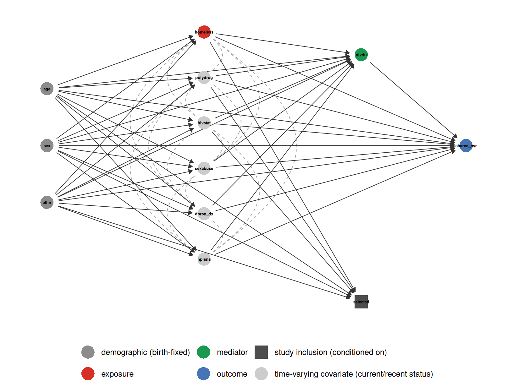
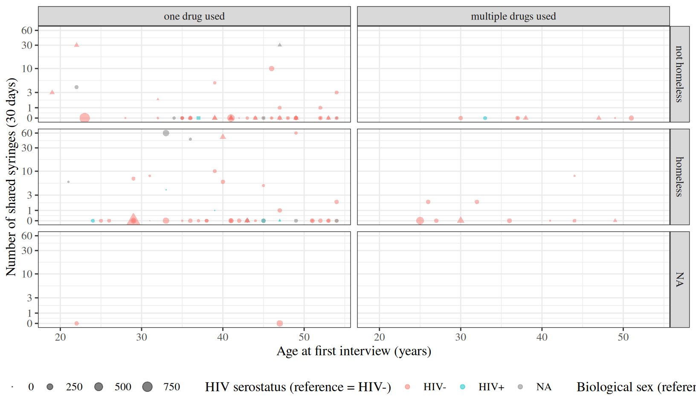
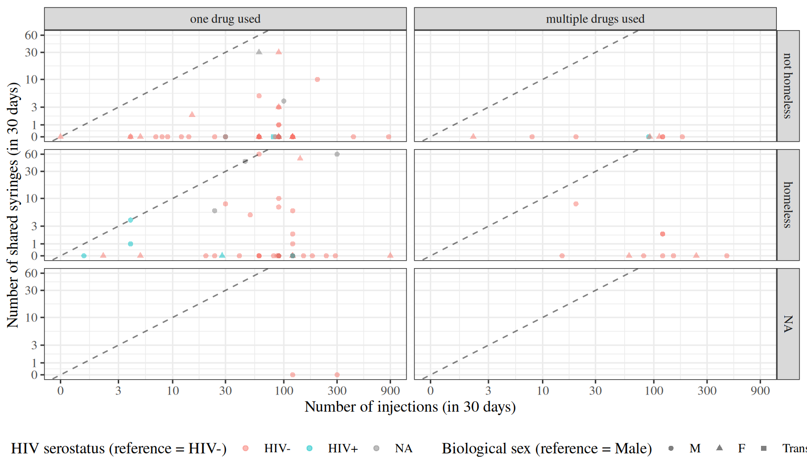
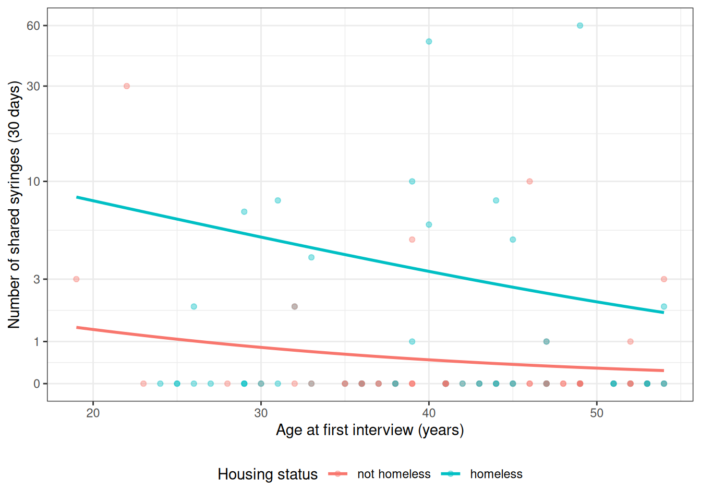
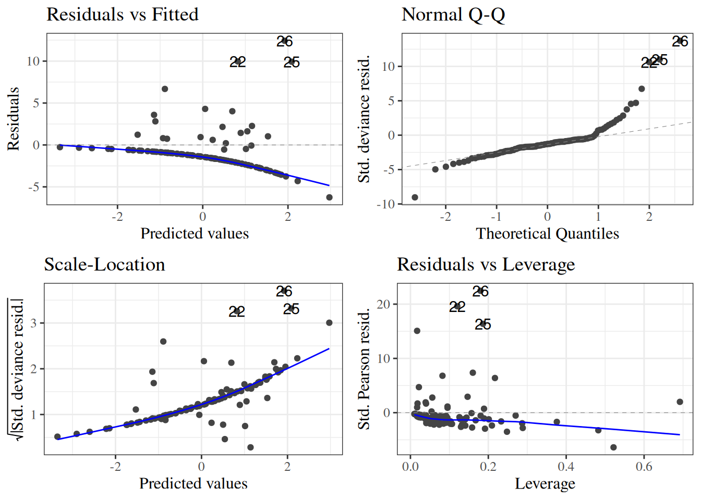

# Models for Count Outcomes

Code

- [Show All Code](javascript:void(0))

- [Hide All Code](javascript:void(0))

- 

  ------------------------------------------------------------------------

- [View Source](javascript:void(0))

Poisson regression and variations

Published

Last modified: 2026-11-12: 2:39:08 (UTC)

# Acknowledgements

This content is adapted from:

- Dobson and Barnett [\[1\]](#ref-dobson4e), Chapter 9
- Vittinghoff et al. [\[2\]](#ref-vittinghoff2e), Chapter 8

------------------------------------------------------------------------

------------------------------------------------------------------------

# Configuring R

Functions from these packages will be used throughout this document:

Show R code

``` downlit
library(conflicted) # check for conflicting function definitions
# printr is not loaded here: it inserts help-file output into markdown output
library(rmarkdown) # Convert R Markdown documents into a variety of formats.
library(pander) # format tables for markdown
library(ggplot2) # graphics
library(ggfortify) # help with graphics
library(dplyr) # manipulate data
library(tibble) # `tibble`s extend `data.frame`s
library(magrittr) # `%>%` and other additional piping tools
library(haven) # import Stata files
library(knitr) # format R output for markdown
library(tidyr) # Tools to help to create tidy data
library(plotly) # interactive graphics
library(dobson) # datasets from Dobson and Barnett 2018
library(parameters) # format model output tables for markdown
library(haven) # import Stata files
library(latex2exp) # use LaTeX in R code (for figures and tables)
library(fs) # filesystem path manipulations
library(survival) # survival analysis
library(survminer) # survival analysis graphics
library(KMsurv) # datasets from Klein and Moeschberger
library(parameters) # format model output tables for
library(webshot2) # convert interactive content to static for pdf
library(forcats) # functions for categorical variables ("factors")
library(stringr) # functions for dealing with strings
library(lubridate) # functions for dealing with dates and times
# Summarizes key information about statistical objects in tidy tibbles
library(broom)
# Provides suite of functions to work with regression model
# `broom::tidy()` tibbles
library(broom.helpers)
```

Here are some R settings I use in this document:

Show R code

``` downlit
rm(list = ls()) # delete any data that's already loaded into R

conflicts_prefer(dplyr::filter)
ggplot2::theme_set(
  ggplot2::theme_bw() +
    # ggplot2::labs(col = "") +
    ggplot2::theme(
      legend.position = "bottom",
      text = ggplot2::element_text(size = 12, family = "serif")
    )
)

knitr::opts_chunk$set(message = FALSE)
options(digits = 6)

panderOptions("big.mark", ",")
pander::panderOptions("table.emphasize.rownames", FALSE)
pander::panderOptions("table.split.table", Inf)
# use the `filter()` function from dplyr() by default
conflicts_prefer(dplyr::filter)
legend_text_size <- 9
run_graphs <- TRUE
```

# 1 Introduction

> **TIP:**
>
> David Rocke’s Epi 204 lecture [*Poisson Regression*](https://dmrocke.ucdavis.edu/Class/EPI204-Spring-2021/EPI204-2021-04-22.mp4) ([slides](https://dmrocke.ucdavis.edu/Class/EPI204-Spring-2021/EPI204-8%20Poisson%20Regression.pdf)) covers Poisson regression with a log link and a population [offset](https://morrison-lab.github.io/pds/distributions.html#def-offset), rate ratios, residual diagnostics, goodness of fit, and [overdispersion](#def-overdispersion), using Danish lung cancer incidence data [\[3\]](#ref-rocke2021epi204).

> **TIP:**
>
> Richard McElreath’s [*Modeling Events*](https://www.youtube.com/watch?v=RuBUVQELw-c) (Statistical Rethinking 2026, Lecture A09) accompanies Chapters 10 and 11 of McElreath [\[4\]](#ref-statrethink2e), which cover generalized linear models for binary and count outcomes, including Poisson regression. The lecture fits these models using [Bayesian inference](https://morrison-lab.github.io/sds/bayesian-inference.html#def-bayesian-paradigm) rather than the [maximum likelihood estimation](https://morrison-lab.github.io/sds/intro-MLEs.html#def-mle) used in this chapter [\[5\]](#ref-mcelreath2026rethinking).

This chapter presents models for [count data](https://morrison-lab.github.io/sds/data.html#sec-count-vars) outcomes. With covariates, the [event rate](https://morrison-lab.github.io/pds/distributions.html#def-event-rate) $\lambda$ becomes a function of the covariate vector $\mathord{\smash[b]{\underset{\raise.3ex\hbox{$\scriptstyle\sim$}}{X}}\vphantom{X}}= {(X_1, \dots, X_p)}^{\top} \in \mathbb{R}^p$. Typically, count data models use a ${\operatorname{log}\mathopen{}\left\{\right\}\mathclose{}}$ [link function](../chapters/Intro-to-GLMs.llms.md#sec-why-link), and thus an ${\operatorname{exp}\mathopen{}\left\{\right\}\mathclose{}}$ inverse-link function.

> **NOTE:**
>
> **Definition 1 (Poisson regression model)** Let $Y$ be a count outcome, $\mathord{\smash[b]{\underset{\raise.3ex\hbox{$\scriptstyle\sim$}}{X}}\vphantom{X}}$ a covariate vector, and $T$ the [exposure magnitude](https://morrison-lab.github.io/pds/distributions.html#def-exposure) (such as [person-years](https://morrison-lab.github.io/mds/algebra-sums.html#def-person-years) or observation time) over which the events in $Y$ are counted. A **Poisson regression model** assumes that, given $\mathord{\smash[b]{\underset{\raise.3ex\hbox{$\scriptstyle\sim$}}{X}}\vphantom{X}}= \mathord{\smash[b]{\underset{\raise.3ex\hbox{$\scriptstyle\sim$}}{x}}\vphantom{x}}$ and $T = t$, $Y$ has a [Poisson distribution](https://morrison-lab.github.io/pds/distributions.html#def-poisson)
>
> $$Y \mid \mathord{\smash[b]{\underset{\raise.3ex\hbox{$\scriptstyle\sim$}}{X}}\vphantom{X}}= \mathord{\smash[b]{\underset{\raise.3ex\hbox{$\scriptstyle\sim$}}{x}}\vphantom{x}}, T = t \sim \operatorname{Pois}(\mu(\mathord{\smash[b]{\underset{\raise.3ex\hbox{$\scriptstyle\sim$}}{x}}\vphantom{x}}, t))$$
>
> whose mean is the event rate $\lambda(\mathord{\smash[b]{\underset{\raise.3ex\hbox{$\scriptstyle\sim$}}{x}}\vphantom{x}})$ multiplied by the exposure, with the log of the event rate equal to a [linear predictor](../chapters/Intro-to-GLMs.llms.md#def-linear-predictor):
>
> $$\begin{aligned}
> {\mathbb{E}\mathopen{}\left[Y \mid \mathord{\smash[b]{\underset{\raise.3ex\hbox{$\scriptstyle\sim$}}{X}}\vphantom{X}}= \mathord{\smash[b]{\underset{\raise.3ex\hbox{$\scriptstyle\sim$}}{x}}\vphantom{x}}, T = t\right]\mathclose{}} &= \mu(\mathord{\smash[b]{\underset{\raise.3ex\hbox{$\scriptstyle\sim$}}{x}}\vphantom{x}},t) \\
> \mu(\mathord{\smash[b]{\underset{\raise.3ex\hbox{$\scriptstyle\sim$}}{x}}\vphantom{x}},t) &\stackrel{\text{def}}{=}\lambda(\mathord{\smash[b]{\underset{\raise.3ex\hbox{$\scriptstyle\sim$}}{x}}\vphantom{x}})\cdot t \\
> \lambda(\mathord{\smash[b]{\underset{\raise.3ex\hbox{$\scriptstyle\sim$}}{x}}\vphantom{x}}) &\stackrel{\text{def}}{=}{\operatorname{exp}\mathopen{}\left\{\eta(\mathord{\smash[b]{\underset{\raise.3ex\hbox{$\scriptstyle\sim$}}{x}}\vphantom{x}})\right\}\mathclose{}} \\
> \eta(\mathord{\smash[b]{\underset{\raise.3ex\hbox{$\scriptstyle\sim$}}{x}}\vphantom{x}}) &\stackrel{\text{def}}{=}\beta_0 + \beta_1 x_1 + \dots + \beta_p x_p
> \end{aligned}
> \tag{1}$$

> **NOTE:**
>
> **Example 1 (Poisson regression with one binary covariate)** Let $x_1 = 1$ for smokers and $x_1 = 0$ for non-smokers, and suppose a Poisson regression model for hospitalizations has $\beta_0 = {\operatorname{log}\mathopen{}\left\{0.002\right\}\mathclose{}}$ and $\beta_1 = {\operatorname{log}\mathopen{}\left\{1.5\right\}\mathclose{}}$, with exposure measured in person-years. By [Equation 1](#eq-mean-poisson), the event rates are:
>
> $$\begin{aligned}
> \lambda(x_1 = 0)
> &= {\operatorname{exp}\mathopen{}\left\{\beta_0\right\}\mathclose{}}
> && \text{(rate function with } x_1 = 0 \text{)} \\
> &= 0.002
> && \text{(} {\operatorname{exp}\mathopen{}\left\{{\operatorname{log}\mathopen{}\left\{0.002\right\}\mathclose{}}\right\}\mathclose{}} = 0.002 \text{)} \\
> \lambda(x_1 = 1)
> &= {\operatorname{exp}\mathopen{}\left\{\beta_0 + \beta_1\right\}\mathclose{}}
> && \text{(rate function with } x_1 = 1 \text{)} \\
> &= {\operatorname{exp}\mathopen{}\left\{\beta_0\right\}\mathclose{}} \cdot {\operatorname{exp}\mathopen{}\left\{\beta_1\right\}\mathclose{}}
> && \text{(product rule for exponentials)} \\
> &= 0.002 \cdot 1.5
> && \text{(evaluate each factor)} \\
> &= 0.003
> && \text{(multiply)}
> \end{aligned}$$
>
> For a group of non-smokers followed for $t = 500$ person-years, the expected number of hospitalizations is
>
> $$\begin{aligned}
> \mu(x_1 = 0, t = 500)
> &= \lambda(x_1 = 0) \cdot 500
> && \text{(mean = rate} \times \text{exposure)} \\
> &= 0.002 \cdot 500
> && \text{(substitute the rate)} \\
> &= 1
> && \text{(multiply)}
> \end{aligned}$$
>
> and the probability that this group has no hospitalizations is
>
> $$\begin{aligned}
> \mathbb{P}(Y = 0 \mid x_1 = 0, t = 500)
> &= \frac{1^0 {\operatorname{exp}\mathopen{}\left\{-1\right\}\mathclose{}}}{0!}
> && \text{(Poisson PMF with mean 1)} \\
> &= {\operatorname{exp}\mathopen{}\left\{-1\right\}\mathclose{}}
> && \text{(} 1^0 = 0! = 1 \text{)} \\
> &\approx 0.368
> && \text{(evaluate)}
> \end{aligned}$$
>
> The same follow-up time for smokers gives $\mu(x_1 = 1, t = 500) = 0.003 \cdot 500 = 1.5$ expected hospitalizations.

> **NOTE:**
>
> **Exercise 1** Where have we seen a relationship like $$\mu = \lambda \cdot t$$ before?

> **NOTE:**
>
> *Solution 1*. The relationship $$\mu = \lambda \cdot t$$ in count regression models is analogous to the relationship $$\mu = n \pi$$ in Binomial models.

------------------------------------------------------------------------

We can also express the exposure magnitude $t$ directly as a component of the linear predictor:

$$\begin{aligned}
{\operatorname{log}\mathopen{}\left\{{\mathbb{E}\mathopen{}\left[Y \mid \mathord{\smash[b]{\underset{\raise.3ex\hbox{$\scriptstyle\sim$}}{X}}\vphantom{X}}= \mathord{\smash[b]{\underset{\raise.3ex\hbox{$\scriptstyle\sim$}}{x}}\vphantom{x}}, T = t\right]\mathclose{}}\right\}\mathclose{}}
&= {\operatorname{log}\mathopen{}\left\{\mu(\mathord{\smash[b]{\underset{\raise.3ex\hbox{$\scriptstyle\sim$}}{x}}\vphantom{x}}, t)\right\}\mathclose{}} \\
&\quad \text{(definition of the conditional mean)} \\
&= {\operatorname{log}\mathopen{}\left\{\lambda(\mathord{\smash[b]{\underset{\raise.3ex\hbox{$\scriptstyle\sim$}}{x}}\vphantom{x}}) \cdot t\right\}\mathclose{}} \\
&\quad \text{(substituting the rate relationship)} \\
&= {\operatorname{log}\mathopen{}\left\{\lambda(\mathord{\smash[b]{\underset{\raise.3ex\hbox{$\scriptstyle\sim$}}{x}}\vphantom{x}})\right\}\mathclose{}} + {\operatorname{log}\mathopen{}\left\{t\right\}\mathclose{}} \\
&\quad \text{(logarithmic product rule)} \\
&= {\operatorname{log}\mathopen{}\left\{{\operatorname{exp}\mathopen{}\left\{\eta(\mathord{\smash[b]{\underset{\raise.3ex\hbox{$\scriptstyle\sim$}}{x}}\vphantom{x}})\right\}\mathclose{}}\right\}\mathclose{}} + {\operatorname{log}\mathopen{}\left\{t\right\}\mathclose{}} \\
&\quad \text{(substituting the rate function)} \\
&= \eta(\mathord{\smash[b]{\underset{\raise.3ex\hbox{$\scriptstyle\sim$}}{x}}\vphantom{x}}) + {\operatorname{log}\mathopen{}\left\{t\right\}\mathclose{}} \\
&\quad \text{(by inverse relationship of log and exp)} \\
&= (\beta_0 + \beta_1 x_1 + \dots + \beta_p x_p) + {\operatorname{log}\mathopen{}\left\{t\right\}\mathclose{}} \\
&\quad \text{(expanding the linear predictor } \eta(\mathord{\smash[b]{\underset{\raise.3ex\hbox{$\scriptstyle\sim$}}{x}}\vphantom{x}})\text{)}
\end{aligned}$$

In contrast with the other covariates (represented by $\mathord{\smash[b]{\underset{\raise.3ex\hbox{$\scriptstyle\sim$}}{X}}\vphantom{X}}$), $t$ enters this expression with a $\log{}$ transformation and without an estimated $\beta$ coefficient; in other words, ${\operatorname{log}\mathopen{}\left\{t\right\}\mathclose{}}$ is an [offset term](https://morrison-lab.github.io/pds/distributions.html#def-offset).

> **NOTE:**
>
> **Exercise 2** What are the units of $\mu$ in [Equation 1](#eq-mean-poisson)?

> **NOTE:**
>
> *Solution 2*. $\mu$ is the [expected value](https://morrison-lab.github.io/pds/expectation.html#def-expectation) of $Y$. Because $Y$ represents a count of events, $\mu$ is expressed in units of event counts; for example:
>
> - 3.1 cyclones,
> - 10.23 ER visits,
> - 15.01 infections.

> **NOTE:**
>
> **Exercise 3** What are the units of $\lambda$ in [Equation 1](#eq-mean-poisson)?

> **NOTE:**
>
> *Solution 3*. $\lambda = \mu/t$, so $\lambda$ is an event rate per unit of exposure $t$. For example:
>
> - 3.1 cyclones *per year*,
> - 2.023 ER visits per 10 person-years,
> - 15.01 infections per 1000 person-years at risk.

# 2 Interpreting Poisson regression models

Applying the [general procedure for interpreting a regression coefficient](../chapters/Linear-models-overview.llms.md#def-coef-interp-procedure) to the log-rate linear predictor $\eta(\mathord{\smash[b]{\underset{\raise.3ex\hbox{$\scriptstyle\sim$}}{x}}\vphantom{x}}) = {\operatorname{log}\mathopen{}\left\{\lambda(\mathord{\smash[b]{\underset{\raise.3ex\hbox{$\scriptstyle\sim$}}{x}}\vphantom{x}})\right\}\mathclose{}}$ shows that $\beta_j$ is the difference in log-rates per one-unit increase in $x_j$, holding all other covariates fixed (and equal to their reference values when interactions are present).

Differences on the log-rate scale become ratios on the rate scale, because exponentiating a difference yields a quotient:

$${\operatorname{exp}\mathopen{}\left\{a-b\right\}\mathclose{}} = \frac{{\operatorname{exp}\mathopen{}\left\{a\right\}\mathclose{}}}{{\operatorname{exp}\mathopen{}\left\{b\right\}\mathclose{}}}$$

(recall from [Algebra 2](https://morrison-lab.github.io/mds/algebra-exponentials.html#cor-exp-sum))

So Poisson regression coefficients are naturally interpreted through rate ratios.

> **NOTE:**
>
> **Definition 2 (Rate ratio between covariate patterns)** In a model for the [event rate](https://morrison-lab.github.io/pds/distributions.html#def-event-rate) $\lambda(\mathord{\smash[b]{\underset{\raise.3ex\hbox{$\scriptstyle\sim$}}{x}}\vphantom{x}})$ as a function of the covariate pattern $\mathord{\smash[b]{\underset{\raise.3ex\hbox{$\scriptstyle\sim$}}{x}}\vphantom{x}}$, the **rate ratio** comparing covariate pattern $\mathord{\smash[b]{\underset{\raise.3ex\hbox{$\scriptstyle\sim$}}{x}}\vphantom{x}}$ to covariate pattern $\mathord{{\mathord{\smash[b]{\underset{\raise.3ex\hbox{$\scriptstyle\sim$}}{x}}\vphantom{x}}^*}}$ is
>
> $$\text{ϙ}_{{\lambda}}(\mathord{\smash[b]{\underset{\raise.3ex\hbox{$\scriptstyle\sim$}}{x}}\vphantom{x}}: \mathord{{\mathord{\smash[b]{\underset{\raise.3ex\hbox{$\scriptstyle\sim$}}{x}}\vphantom{x}}^*}}) \stackrel{\text{def}}{=}\frac{\lambda(\mathord{\smash[b]{\underset{\raise.3ex\hbox{$\scriptstyle\sim$}}{x}}\vphantom{x}})}{\lambda(\mathord{{\mathord{\smash[b]{\underset{\raise.3ex\hbox{$\scriptstyle\sim$}}{x}}\vphantom{x}}^*}})}$$

> **NOTE:**
>
> **Example 2 (Rate ratio for smoking)** In [Example 1](#exm-poisson-reg), smokers ($x_1 = 1$) have hospitalization rate $0.003$ per person-year and non-smokers ($x_1 = 0$) have rate $0.002$ per person-year, so by [Definition 2](#def-rate-ratio-patterns):
>
> $$\begin{aligned}
> \text{ϙ}_{{\lambda}}(x_1 = 1 : x_1 = 0)
> &= \frac{\lambda(x_1 = 1)}{\lambda(x_1 = 0)}
> && \text{(definition of rate ratio)} \\
> &= \frac{0.003}{0.002}
> && \text{(substitute the two rates)} \\
> &= 1.5
> && \text{(divide)}
> \end{aligned}$$
>
> Smokers are hospitalized at 1.5 times the rate of non-smokers.

> **NOTE:**
>
> **Theorem 1 (Rate ratios in Poisson regression)** In a Poisson regression model ([Definition 1](#def-poisson-reg)), suppose covariate $x_j$ enters the linear predictor $\eta(\mathord{\smash[b]{\underset{\raise.3ex\hbox{$\scriptstyle\sim$}}{x}}\vphantom{x}})$ only through the single term $\beta_j x_j$ (no interactions or transformations involving $x_j$). Let $\mathord{\smash[b]{\underset{\raise.3ex\hbox{$\scriptstyle\sim$}}{x}}\vphantom{x}}$ and $\mathord{{\mathord{\smash[b]{\underset{\raise.3ex\hbox{$\scriptstyle\sim$}}{x}}\vphantom{x}}^*}}$ be two covariate patterns that are identical except that $x_j = a$ and $x^*_j = b$. Then
>
> $$\text{ϙ}_{{\lambda}}(\mathord{\smash[b]{\underset{\raise.3ex\hbox{$\scriptstyle\sim$}}{x}}\vphantom{x}}: \mathord{{\mathord{\smash[b]{\underset{\raise.3ex\hbox{$\scriptstyle\sim$}}{x}}\vphantom{x}}^*}}) = {\operatorname{exp}\mathopen{}\left\{\beta_j (a - b)\right\}\mathclose{}} \tag{2}$$
>
> and for any common exposure magnitude $t > 0$, the ratio of expected counts equals the same rate ratio:
>
> $$\frac{\mu(\mathord{\smash[b]{\underset{\raise.3ex\hbox{$\scriptstyle\sim$}}{x}}\vphantom{x}}, t)}{\mu(\mathord{{\mathord{\smash[b]{\underset{\raise.3ex\hbox{$\scriptstyle\sim$}}{x}}\vphantom{x}}^*}}, t)} = \text{ϙ}_{{\lambda}}(\mathord{\smash[b]{\underset{\raise.3ex\hbox{$\scriptstyle\sim$}}{x}}\vphantom{x}}: \mathord{{\mathord{\smash[b]{\underset{\raise.3ex\hbox{$\scriptstyle\sim$}}{x}}\vphantom{x}}^*}})$$

> **NOTE:**
>
> *Proof*. Because $\mathord{\smash[b]{\underset{\raise.3ex\hbox{$\scriptstyle\sim$}}{x}}\vphantom{x}}$ and $\mathord{{\mathord{\smash[b]{\underset{\raise.3ex\hbox{$\scriptstyle\sim$}}{x}}\vphantom{x}}^*}}$ agree on every covariate except $x_j$, every term of $\eta(\mathord{\smash[b]{\underset{\raise.3ex\hbox{$\scriptstyle\sim$}}{x}}\vphantom{x}})$ except $\beta_j x_j$ is shared with $\eta(\mathord{{\mathord{\smash[b]{\underset{\raise.3ex\hbox{$\scriptstyle\sim$}}{x}}\vphantom{x}}^*}})$:
>
> $$\begin{aligned}
> \eta(\mathord{\smash[b]{\underset{\raise.3ex\hbox{$\scriptstyle\sim$}}{x}}\vphantom{x}}) - \eta(\mathord{{\mathord{\smash[b]{\underset{\raise.3ex\hbox{$\scriptstyle\sim$}}{x}}\vphantom{x}}^*}})
> &= \mathopen{}\left(\beta_0 + \beta_1 x_1 + \ldots+ {\color{red}{\beta_j a}} + \ldots+ \beta_p x_p\right)\mathclose{} \\
> &\phantom{={}} - \mathopen{}\left(\beta_0 + \beta_1 x_1 + \ldots+ {\color{red}{\beta_j b}} + \ldots+ \beta_p x_p\right)\mathclose{}
> && \text{(substitute the linear predictor)} \\
> &= {\color{red}{\beta_j a}} - {\color{red}{\beta_j b}}
> && \text{(cancel the shared terms)} \\
> &= {\color{red}{\beta_j (a - b)}}
> && \text{(factor out } \beta_j \text{)}
> \end{aligned}$$
>
> Then the rate ratio is:
>
> $$\begin{aligned}
> \text{ϙ}_{{\lambda}}(\mathord{\smash[b]{\underset{\raise.3ex\hbox{$\scriptstyle\sim$}}{x}}\vphantom{x}}: \mathord{{\mathord{\smash[b]{\underset{\raise.3ex\hbox{$\scriptstyle\sim$}}{x}}\vphantom{x}}^*}})
> &= \frac{\lambda(\mathord{\smash[b]{\underset{\raise.3ex\hbox{$\scriptstyle\sim$}}{x}}\vphantom{x}})}{\lambda(\mathord{{\mathord{\smash[b]{\underset{\raise.3ex\hbox{$\scriptstyle\sim$}}{x}}\vphantom{x}}^*}})}
> && \text{(definition of rate ratio)} \\
> &= \frac{{\operatorname{exp}\mathopen{}\left\{\eta(\mathord{\smash[b]{\underset{\raise.3ex\hbox{$\scriptstyle\sim$}}{x}}\vphantom{x}})\right\}\mathclose{}}}{{\operatorname{exp}\mathopen{}\left\{\eta(\mathord{{\mathord{\smash[b]{\underset{\raise.3ex\hbox{$\scriptstyle\sim$}}{x}}\vphantom{x}}^*}})\right\}\mathclose{}}}
> && \text{(Poisson regression rate function)} \\
> &= {\operatorname{exp}\mathopen{}\left\{\eta(\mathord{\smash[b]{\underset{\raise.3ex\hbox{$\scriptstyle\sim$}}{x}}\vphantom{x}}) - \eta(\mathord{{\mathord{\smash[b]{\underset{\raise.3ex\hbox{$\scriptstyle\sim$}}{x}}\vphantom{x}}^*}})\right\}\mathclose{}}
> && \text{(quotient rule for exponentials)} \\
> &= {\operatorname{exp}\mathopen{}\left\{\beta_j (a - b)\right\}\mathclose{}}
> && \text{(substitute the difference of linear predictors)}
> \end{aligned}$$
>
> For the expected counts at a common exposure $t > 0$:
>
> $$\begin{aligned}
> \frac{\mu(\mathord{\smash[b]{\underset{\raise.3ex\hbox{$\scriptstyle\sim$}}{x}}\vphantom{x}}, t)}{\mu(\mathord{{\mathord{\smash[b]{\underset{\raise.3ex\hbox{$\scriptstyle\sim$}}{x}}\vphantom{x}}^*}}, t)}
> &= \frac{\lambda(\mathord{\smash[b]{\underset{\raise.3ex\hbox{$\scriptstyle\sim$}}{x}}\vphantom{x}}) \cdot t}{\lambda(\mathord{{\mathord{\smash[b]{\underset{\raise.3ex\hbox{$\scriptstyle\sim$}}{x}}\vphantom{x}}^*}}) \cdot t}
> && \text{(Poisson regression mean function)} \\
> &= \frac{\lambda(\mathord{\smash[b]{\underset{\raise.3ex\hbox{$\scriptstyle\sim$}}{x}}\vphantom{x}})}{\lambda(\mathord{{\mathord{\smash[b]{\underset{\raise.3ex\hbox{$\scriptstyle\sim$}}{x}}\vphantom{x}}^*}})}
> && \text{(cancel } t > 0 \text{)} \\
> &= \text{ϙ}_{{\lambda}}(\mathord{\smash[b]{\underset{\raise.3ex\hbox{$\scriptstyle\sim$}}{x}}\vphantom{x}}: \mathord{{\mathord{\smash[b]{\underset{\raise.3ex\hbox{$\scriptstyle\sim$}}{x}}\vphantom{x}}^*}})
> && \text{(definition of rate ratio)}
> \end{aligned}$$

> **NOTE:**
>
> **Example 3 (Rate ratio for a ten-year age difference)** Suppose a Poisson regression model for emergency-room visits includes age in years, $x_1$, with coefficient $\beta_1 = 0.03$ and no interactions involving age. By [Theorem 1](#thm-poisson-rate-ratio) with $a = 60$ and $b = 50$, the rate ratio comparing a 60-year-old to a 50-year-old with the same values of every other covariate is:
>
> $$\begin{aligned}
> \text{ϙ}_{{\lambda}}(x_1 = 60 : x_1 = 50)
> &= {\operatorname{exp}\mathopen{}\left\{\beta_1 (60 - 50)\right\}\mathclose{}}
> && \text{(rate ratio theorem)} \\
> &= {\operatorname{exp}\mathopen{}\left\{0.03 \cdot 10\right\}\mathclose{}}
> && \text{(substitute } \beta_1 \text{ and subtract)} \\
> &= {\operatorname{exp}\mathopen{}\left\{0.3\right\}\mathclose{}}
> && \text{(multiply)} \\
> &\approx 1.350
> && \text{(evaluate)}
> \end{aligned}$$
>
> A one-year age difference instead gives ${\operatorname{exp}\mathopen{}\left\{0.03\right\}\mathclose{}} \approx 1.030$, a 3% higher rate per year of age. The ten-year rate ratio is not ten times the one-year excess: ${\operatorname{exp}\mathopen{}\left\{0.3\right\}\mathclose{}} = \mathopen{}\left({\operatorname{exp}\mathopen{}\left\{0.03\right\}\mathclose{}}\right)\mathclose{}^{10}$, because rate ratios multiply across successive one-year steps.

# 3 Example: needle-sharing

(adapted from Vittinghoff et al. [\[2\]](#ref-vittinghoff2e), §8)

------------------------------------------------------------------------

Show R code

``` downlit
library(tidyverse)
library(haven)
needles <-
  here::here("inst/extdata/needle_sharing.dta") |>
  read_dta() |>
  as_tibble() |>
  mutate(
    hivstat = hivstat |>
      case_match(1 ~ "HIV+", 0 ~ "HIV-") |>
      factor() |>
      relevel(ref = "HIV-"),
    polydrug = polydrug |>
      case_match(1 ~ "multiple drugs used", 0 ~ "one drug used") |>
      factor() |>
      relevel(ref = "one drug used"),
    homeless = homeless |>
      case_match(1 ~ "homeless", 0 ~ "not homeless") |>
      factor() |>
      relevel(ref = "not homeless"),
    sexabuse = sexabuse |>
      case_match(1 ~ "yes", 0 ~ "no") |>
      factor() |>
      relevel(ref = "no"),
    ethn = ethn |>
      factor() |>
      forcats::fct_lump_min(min = 5, other_level = "Other") |>
      relevel(ref = "White"),
    sex = sex |> factor() |> relevel(ref = "M")
  ) |>
  labelled::set_variable_labels(
    "id" = "Participant identifier",
    "sex" = "Biological sex (reference = Male)",
    "ethn" = "Self-reported ethnicity (reference = White; n<5 lumped to Other)",
    "age" = "Age at first interview (years)",
    "dprsn_dx" = "Depression diagnosis indicator",
    "sexabuse" = "History of sexual abuse (1 = yes, 0 = no)",
    "shared_syr" = "Number of shared syringes (in 30 days)",
    "hivstat" = "HIV serostatus (reference = HIV-)",
    "hplsns" = "Hopelessness score",
    "nivdu" = "Number of injections (in 30 days)",
    "shsyryn" = "Shared syringe? (1 = yes, 0 = no)",
    "sqrtnivd" = "sqrt(No. of injections in 30 days)",
    "logshsyr" = "log(No. of shared needles)",
    "polydrug" = "Multiple non-injection drugs used?",
    "sqrtninj" = "sqrt(No. of injections in 30 days); duplicate of sqrtnivd",
    "homeless" = "Homeless? (reference = not homeless)",
    "shsyr" = "Shared needles (30 days); sparse duplicate of shared_syr"
  )
```

## 3.1 Introduction

This example, from Vittinghoff et al. [\[2, Sec. 8.3.1\]](#ref-vittinghoff2e), models *risky drug-use behavior* — needle sharing — among injection drug users (IDUs), a behavior of public-health interest because shared syringes can transmit blood-borne infections. We examine how needle-sharing frequency relates to participants’ age, sex, ethnicity, housing status (homelessness), drug-use patterns, HIV serostatus, sexual-abuse history, and hopelessness score; injection frequency reflects how often each participant has the opportunity to share a syringe.

These data are a sample of injection drug users distributed with Vittinghoff et al. [\[2, Sec. 8.3.1\]](#ref-vittinghoff2e) via the [UCSF companion website](https://regression.ucsf.edu/second-edition/data-examples-and-problems); the original study is not documented in the textbook or the companion materials. One possible (though unconfirmed) source is Tsui et al. [\[6\]](#ref-tsui2009hcv), a study of injection-drug-using participants in San Francisco co-authored by one of the textbook’s authors (E. Vittinghoff). There are $n = 128$ participants and 17 variables. Our outcome is `shared_syr`, the number of times a participant shared a syringe in the past 30 days.

> **NOTE:**
>
> Show R code
>
> ``` downlit
> dict <- tibble(
>   variable = names(needles),
>   description = labelled::get_variable_labels(needles) |> 
>     sapply(function(x) ifelse(is.null(x), "", x)),
> )
> dict |> pander::pander()
> ```
>
> | variable | description |
> |:--:|:--:|
> | id | Participant identifier |
> | sex | Biological sex (reference = Male) |
> | ethn | Self-reported ethnicity (reference = White; n\<5 lumped to Other) |
> | age | Age at first interview (years) |
> | dprsn_dx | Depression diagnosis indicator |
> | sexabuse | History of sexual abuse (1 = yes, 0 = no) |
> | shared_syr | Number of shared syringes (in 30 days) |
> | hivstat | HIV serostatus (reference = HIV-) |
> | hplsns | Hopelessness score |
> | nivdu | Number of injections (in 30 days) |
> | shsyryn | Shared syringe? (1 = yes, 0 = no) |
> | sqrtnivd | sqrt(No. of injections in 30 days) |
> | logshsyr | log(No. of shared needles) |
> | polydrug | Multiple non-injection drugs used? |
> | sqrtninj | sqrt(No. of injections in 30 days); duplicate of sqrtnivd |
> | homeless | Homeless? (reference = not homeless) |
> | shsyr | Shared needles (30 days); sparse duplicate of shared_syr |
>
> Table 1: Data dictionary for `needles` data

------------------------------------------------------------------------

[Table 2](#tbl-needles-demographics) summarizes the demographic and behavioural variables for the participants.

> **NOTE:**
>
> Show R code
>
> ``` downlit
> needles |>
>   dplyr::select(-id) |>
>   gtsummary::tbl_summary()
> ```
>
> [TABLE]
>
> Table 2: Demographics and behavioural variables for the needle-sharing dataset (all participants).

Before modeling, we sketch a hypothesized causal structure for these variables.

> **NOTE:**
>
> Show R code
>
> ``` downlit
> library(dagitty)
> library(ggdag)
> library(dplyr)
>
> # This design is a cross-sectional study: every covariate is measured at a
> # single interview, so we cannot causally order time-varying covariates among
> # themselves. We draw their mutual associations -- from shared, unobserved
> # earlier circumstances -- as non-directional (bidirected) edges, instead of
> # giving each covariate its own separate latent "past state" node.
> demographics <- c("age", "sex", "ethn") # fixed at (or determined by) birth
> covariates <- c(
>   "homeless", "polydrug", "hivstat", "sexabuse", "dprsn_dx", "hplsns"
> )
>
> # every unordered pair of time-varying covariates gets a bidirected edge
> covariate_pairs <- utils::combn(covariates, 2)
> bidirected_edges <- paste(covariate_pairs[1, ], "<->", covariate_pairs[2, ])
> demographic_edges <- as.vector(
>   outer(demographics, covariates, function(a, b) paste(a, "->", b))
> )
>
> needles_dag <- dagitty(paste0("dag {", paste(c(
>   # birth-fixed demographics cause the current states, injection frequency,
>   # and the outcome
>   demographic_edges,
>   paste(demographics, "-> nivdu"),
>   paste(demographics, "-> shared_syr"),
>   # time-varying covariates are mutually associated, with no causal ordering
>   bidirected_edges,
>   # each time-varying covariate can affect injection frequency and the outcome
>   paste(covariates, "-> nivdu"),
>   paste(covariates, "-> shared_syr"),
>   # injecting is the only mediator: sharing a syringe requires injecting
>   "nivdu -> shared_syr",
>   # study inclusion is conditioned on; several covariates affect being sampled,
>   # so conditioning on `selected` induces associations (selection bias)
>   paste(c(demographics, "homeless", "polydrug", "hivstat"), "-> selected")
> ), collapse = "; "), "}"))
>
> # layout: time flows left -> right (birth-fixed demographics -> current
> # covariates -> injection frequency -> shared syringes)
> y_cov <- seq(4, -4, length.out = length(covariates))
> coordinates(needles_dag) <- list(
>   x = c(
>     age = -1, sex = -1, ethn = -1,
>     setNames(rep(2, length(covariates)), covariates),
>     nivdu = 5, shared_syr = 7, selected = 5
>   ),
>   y = c(
>     age = 2, sex = 0, ethn = -2,
>     setNames(y_cov, covariates),
>     nivdu = 3.2, shared_syr = 0, selected = -5.5
>   )
> )
>
> needles_tidy <- needles_dag |>
>   tidy_dagitty() |>
>   mutate(role = case_when(
>     name == "homeless" ~ "exposure",
>     name == "shared_syr" ~ "outcome",
>     name == "nivdu" ~ "mediator",
>     name == "selected" ~ "study inclusion (conditioned on)",
>     name %in% demographics ~ "demographic (birth-fixed)",
>     TRUE ~ "time-varying covariate (current/recent status)"
>   ))
>
> # split edges so associations and causal arrows can be styled separately
> directed_edges <- function(d) dplyr::filter(d, .data$direction == "->")
> association_edges <- function(d) dplyr::filter(d, .data$direction == "<->")
>
> needles_tidy |>
>   ggplot() +
>   aes(x = x, y = y, xend = xend, yend = yend) +
>   # non-directional associations among time-varying covariates: dashed grey arcs
>   geom_dag_edges_arc(
>     data = association_edges, curvature = 0.4, arrow = NULL,
>     edge_colour = "grey65", edge_linetype = "dashed", edge_width = 0.4,
>     start_cap = ggraph::circle(5, "mm"), end_cap = ggraph::circle(5, "mm")
>   ) +
>   # causal (directed) edges: solid arrows
>   geom_dag_edges_link(
>     data = directed_edges, edge_width = 0.35, edge_colour = "grey20",
>     start_cap = ggraph::circle(5, "mm"), end_cap = ggraph::circle(5, "mm")
>   ) +
>   geom_dag_point(aes(colour = role, shape = role), size = 7) +
>   geom_dag_text(colour = "black", size = 1.7) +
>   scale_shape_manual(values = c(
>     "exposure" = 16, "outcome" = 16, "mediator" = 16,
>     "study inclusion (conditioned on)" = 15,
>     "demographic (birth-fixed)" = 16,
>     "time-varying covariate (current/recent status)" = 16
>   )) +
>   scale_colour_manual(values = c(
>     "exposure" = "#d73027", "outcome" = "#4575b4", "mediator" = "#1a9850",
>     "study inclusion (conditioned on)" = "grey30",
>     "demographic (birth-fixed)" = "grey55",
>     "time-varying covariate (current/recent status)" = "grey80"
>   )) +
>   guides(colour = guide_legend(nrow = 2), shape = guide_legend(nrow = 2)) +
>   theme_dag() +
>   theme(legend.position = "bottom", legend.title = element_blank())
> ```
>
> [](count-regression_files/figure-revealjs/unnamed-chunk-4-1.png "Figure 1: Hypothesized causal structure for the needle-sharing example, drawn for a cross-sectional study. The exposure of interest is homelessness (homeless, red) and the outcome is the count of shared syringes (shared_syr, blue). Injection frequency (nivdu, green) is the one genuine mediator: sharing a syringe requires injecting. Demographic variables (age, sex, ethn, darker grey) are fixed at (or determined by) birth, so they sit upstream of every other variable, with arrows into the time-varying covariates, injection frequency, and the outcome. Because every other covariate is measured at the same single interview, we cannot order the time-varying covariates (lighter grey) causally among themselves; their mutual associations — from shared, unobserved earlier circumstances — are drawn as dashed, non-directional edges. Each time-varying covariate may still affect injection frequency and the 30-day outcome, shown as solid arrows into nivdu and shared_syr. The study-inclusion indicator (selected, square) is conditioned on by design; because several covariates influence who is sampled, conditioning on it can induce associations among them (selection bias).")
>
> Figure 1: Hypothesized causal structure for the needle-sharing example, drawn for a **cross-sectional** study. The exposure of interest is homelessness (`homeless`, red) and the outcome is the count of shared syringes (`shared_syr`, blue). Injection frequency (`nivdu`, green) is the one genuine mediator: sharing a syringe requires injecting. Demographic variables (`age`, `sex`, `ethn`, darker grey) are fixed at (or determined by) birth, so they sit upstream of every other variable, with arrows into the time-varying covariates, injection frequency, and the outcome. Because every other covariate is measured at the same single interview, we cannot order the time-varying covariates (lighter grey) causally among themselves; their mutual associations — from shared, unobserved earlier circumstances — are drawn as dashed, non-directional edges. Each time-varying covariate may still affect injection frequency and the 30-day outcome, shown as solid arrows into `nivdu` and `shared_syr`. The study-inclusion indicator (`selected`, square) is conditioned on by design; because several covariates influence who is sampled, conditioning on it can induce associations among them (selection bias).

We treat **homelessness as the exposure of interest** and ask how it affects the number of shared syringes — following Vittinghoff et al. [\[2, Sec. 8.3.1\]](#ref-vittinghoff2e), who model this outcome on `homeless`.

Injection frequency `nivdu` is a **[mediator](../chapters/causal-inference.llms.md#def-mediator)**: a shared syringe is necessarily one of the injections, so homelessness can raise sharing partly by raising how often a person injects. Because `nivdu` lies *on* the causal path from `homeless` to `shared_syr`, we do **not** adjust for it (neither as a covariate nor as an [offset](https://morrison-lab.github.io/pds/distributions.html#def-offset)); doing so would block that path and estimate only a partial effect. We want the **total** effect of homelessness on needle-sharing.

Because the study is **cross-sectional**, the remaining covariates are measured at the same interview as the exposure, so we cannot order them causally relative to `homeless` or to one another. We draw their mutual associations as non-directional (bidirected) edges and adjust for the measured covariates to control the [confounding](../chapters/causal-inference.llms.md#def-confounding-obs) they carry. A single fitted coefficient is therefore an **adjusted association**, not an isolated causal effect.

Conditioning on study inclusion (`selected`) is unavoidable — we only observe people who were sampled — but because several covariates influence who is sampled, it can induce **selection bias** that no covariate adjustment removes.

Show R code

``` downlit
needles
```

> **NOTE:**
>
> Table 3: Needle-sharing data

------------------------------------------------------------------------

[Figure 2](#fig-needles) plots the shared-syringe counts against age, split by the covariate subgroups (point size shows injection frequency).

Show R code

``` downlit
library(ggplot2)

needles |>
  ggplot() +
  aes(
    x = age,
    y = shared_syr,
    shape = sex,
    col = hivstat
  ) +
  geom_point(aes(size = nivdu), alpha = .5) +
  scale_size_area(max_size = 4) +
  scale_y_continuous(
    transform = "pseudo_log",
    breaks = c(0, 1, 3, 10, 30, 60)
  ) +
  facet_grid(cols = vars(polydrug), rows = vars(homeless)) +
  labs(y = "Number of shared syringes (30 days)") +
  theme(legend.position = "bottom")
```

> **NOTE:**
>
> [](count-regression_files/figure-revealjs/fig-needles-1.png "Figure 2: Needle-sharing counts by age")
>
> Figure 2: Needle-sharing counts by age

[Figure 3](#fig-needles-raw) shows the underlying counts: the number of shared syringes against the number of injections, with a dashed $y = x$ line marking the ceiling where every injection involves a shared syringe.

> **NOTE:**
>
> Show R code
>
> ``` downlit
> library(ggplot2)
>
> needles |>
>   ggplot() +
>   aes(
>     x = nivdu,
>     y = shared_syr,
>     shape = sex,
>     col = hivstat
>   ) +
>   geom_point(alpha = .5) +
>   geom_abline(slope = 1, intercept = 0, linetype = "dashed", alpha = .5) +
>   # both axes are counts, so pseudo-log both: a shared transform keeps the
>   # y = x reference line straight (data diagonal -> panel diagonal)
>   scale_x_continuous(
>     transform = "pseudo_log",
>     breaks = c(0, 3, 10, 30, 100, 300, 900)
>   ) +
>   scale_y_continuous(
>     transform = "pseudo_log",
>     breaks = c(0, 1, 3, 10, 30, 60)
>   ) +
>   facet_grid(cols = vars(polydrug), rows = vars(homeless)) +
>   labs(
>     x = "Number of injections (in 30 days)",
>     y = "Number of shared syringes (in 30 days)"
>   ) +
>   theme(legend.position = "bottom")
> ```
>
> [](count-regression_files/figure-revealjs/unnamed-chunk-5-1.png "Figure 3: Number of shared syringes versus number of injections (raw counts, 30-day window). The dashed line marks y = x (every injection involves a shared syringe).")
>
> Figure 3: Number of shared syringes versus number of injections (raw counts, 30-day window). The dashed line marks $y = x$ (every injection involves a shared syringe).

------------------------------------------------------------------------

## 3.2 Covariate counts

> **NOTE:**
>
> Show R code
>
> ``` downlit
> needles |>
>   dplyr::select(sex, homeless, polydrug) |>
>   summary()
> #>     sex             homeless                 polydrug  
> #>  M    :97   not homeless:63   one drug used      :109  
> #>  F    :30   homeless    :61   multiple drugs used: 19  
> #>  Trans: 1   NAs         : 4
> ```
>
> Table 4: Counts in `needles` by sex, housing status, and multiple drug use

------------------------------------------------------------------------

There’s only one individual with `sex = Trans`, which unfortunately isn’t enough data to analyze. We will remove that individual:

remove singleton observation with sex == Trans

``` downlit
needles <- needles |> filter(sex != "Trans")
```

------------------------------------------------------------------------

## 3.3 Model

Following Vittinghoff et al. [\[2, Sec. 8.3.1\]](#ref-vittinghoff2e), we take **homelessness as the exposure of interest** and ask how it affects the **count** of shared syringes, using a Poisson regression (log link) rather than modeling a rate. The remaining covariates enter as adjustments for [confounding](../chapters/causal-inference.llms.md#def-confounding-obs) ([Figure 1](#fig-needles-dag)): because the study is cross-sectional, they are mutually associated with homelessness through shared, unobserved earlier circumstances, which we cannot resolve into a causal order.

> **NOTE:**
>
> **Exercise 4** A Poisson *rate* model would add `offset(log(nivdu))`, forcing the expected count to be proportional to injection frequency (the coefficient of `log(nivdu)` fixed at exactly 1). Why not use `nivdu` as an [offset](https://morrison-lab.github.io/pds/distributions.html#def-offset) here?

> **NOTE:**
>
> *Solution 4*. We avoid an offset here for two reasons:
>
> - **`nivdu` is a [mediator](../chapters/causal-inference.llms.md#def-mediator), not an exposure window.** An offset is appropriate when its variable is a known denominator — person-time or population at risk — that is external to the causal question. Injection frequency is instead on the causal path from homelessness to sharing ([Figure 1](#fig-needles-dag)): being homeless can raise sharing partly by raising how often a person injects. Conditioning on it (whether as an offset or as a covariate) would block that path and estimate only a partial effect. We want the *total* effect of homelessness on needle-sharing.
> - **It imposes an untested proportionality assumption.** Fixing the `log(nivdu)` coefficient at 1 assumes sharing scales one-for-one with injecting, which the data need not support.

Vittinghoff’s analysis uses neither an offset nor `nivdu` as a covariate.

> **TIP:**
>
> An offset’s exposure is usually something fixed by the *study design* — person-time of follow-up, population at risk, area surveyed, number of trials — a known denominator that remains *exogenous* to the question (not caused by the predictors of interest). When the candidate denominator is instead something the participants *did*, and the predictors also influence it (here, how often they inject), it is a mediator rather than an exposure window, and we model the count directly instead of dividing by it.

We adjust for the measured covariates to control the confounding they carry in [Figure 1](#fig-needles-dag) — demographic (`age`, `sex`, `ethn`), social (`polydrug`), serostatus (`hivstat`), and trauma/mental-health (`sexabuse`, hopelessness score `hplsns`) — using **main effects only**. We exclude the mediator `nivdu` (discussed in [Exercise 4](#exr-nivdu-offset)) and the depression indicator `dprsn_dx`, whose `1`/`5` coding is undocumented in the source data and so cannot be interpreted.

Show R code

``` downlit
glm1 <- glm(
  formula = shared_syr ~ homeless +
    age + sex + ethn + polydrug + hivstat + sexabuse + hplsns,
  family = stats::poisson,
  data = needles
)
library(equatiomatic)
equatiomatic::extract_eq(glm1)
```

$$\log ({ E( \operatorname{shared_syr} ) })  = \alpha + \beta_{1}(\operatorname{homeless}) + \beta_{2}(\operatorname{age}) + \beta_{3}(\operatorname{sex}_{\operatorname{F}}) + \beta_{4}(\operatorname{ethn}_{\operatorname{AA}}) + \beta_{5}(\operatorname{ethn}_{\operatorname{Hispanic}}) + \beta_{6}(\operatorname{ethn}_{\operatorname{Other}}) + \beta_{7}(\operatorname{polydrug}) + \beta_{8}(\operatorname{hivstat}_{\operatorname{HIV+}}) + \beta_{9}(\operatorname{sex}_{\operatorname{abuseyes}} \times \operatorname{sexabuse}_{\operatorname{yes}}) + \beta_{10}(\operatorname{hplsns})$$

------------------------------------------------------------------------

Show R code

``` downlit

library(parameters)
glm1 |>
  parameters(exponentiate = TRUE) |>
  print_md()
```

> **NOTE:**
>
> | Parameter                      | IRR  |    SE    |    95% CI    |   z   |    p    |
> |:-------------------------------|:----:|:--------:|:------------:|:-----:|:-------:|
> | (Intercept)                    | 3.69 |   1.35   | (1.78, 7.46) | 3.58  | \< .001 |
> | homeless (homeless)            | 6.04 |   1.01   | (4.38, 8.45) | 10.73 | \< .001 |
> | age                            | 0.96 | 8.79e-03 | (0.94, 0.97) | -4.75 | \< .001 |
> | sex (F)                        | 2.42 |   0.36   | (1.81, 3.23) | 5.97  | \< .001 |
> | ethn (AA)                      | 2.59 |   0.48   | (1.80, 3.74) | 5.13  | \< .001 |
> | ethn (Hispanic)                | 1.78 |   0.57   | (0.91, 3.20) | 1.81  |  0.070  |
> | ethn (Other)                   | 1.04 |   0.41   | (0.44, 2.08) | 0.09  |  0.927  |
> | polydrug (multiple drugs used) | 0.19 |   0.06   | (0.10, 0.33) | -5.48 | \< .001 |
> | hivstat (HIV+)                 | 0.11 |   0.05   | (0.04, 0.25) | -4.72 | \< .001 |
> | sexabuse (yes)                 | 0.23 |   0.07   | (0.12, 0.40) | -4.71 | \< .001 |
> | hplsns                         | 0.97 |   0.01   | (0.94, 1.00) | -2.21 |  0.027  |
>
> Table 5: Poisson count model for needle-sharing data

------------------------------------------------------------------------

Show R code

``` downlit
library(ggplot2)

# Predicted expected counts across age for the two homelessness groups,
# holding the other covariates at their reference levels (hplsns at its
# median). The model has no offset, so predict(type = "response") returns
# the expected number of shared syringes directly.
ref_lvl <- function(v) levels(glm1$model[[v]])[1]
pred_grid <- expand.grid(
  age = seq(min(glm1$model$age), max(glm1$model$age), length.out = 100),
  homeless = levels(glm1$model$homeless),
  sex = ref_lvl("sex"),
  ethn = ref_lvl("ethn"),
  polydrug = ref_lvl("polydrug"),
  hivstat = ref_lvl("hivstat"),
  sexabuse = ref_lvl("sexabuse"),
  hplsns = median(glm1$model$hplsns)
)
pred_grid$shared_syr <- predict(glm1, newdata = pred_grid, type = "response")

ggplot(glm1$model) +
  aes(x = age, y = shared_syr, colour = homeless) +
  geom_point(alpha = 0.4) +
  geom_line(data = pred_grid, linewidth = 1) +
  scale_y_continuous(
    transform = "pseudo_log",
    breaks = c(0, 1, 3, 10, 30, 60)
  ) +
  labs(
    y = "Number of shared syringes (30 days)",
    colour = "Housing status"
  ) +
  theme_bw() +
  theme(legend.position = "bottom")
```

> **NOTE:**
>
> [](count-regression_files/figure-revealjs/fig-needles-pois-1.png "Figure 4: Fitted Poisson model: expected sharing by age and housing status")
>
> Figure 4: Fitted Poisson model: expected sharing by age and housing status

## 3.4 Interpreting the coefficients

For a Poisson model with a log link, exponentiating a coefficient turns it into a *ratio of expected counts* (an **incidence rate ratio**, IRR, in Vittinghoff et al. [\[2\]](#ref-vittinghoff2e)’s terminology): ${\operatorname{exp}\mathopen{}\left\{\beta_j\right\}\mathclose{}}$ is the multiplicative change in the expected number of shared syringes per one-unit increase in $x_j$, holding the other covariates fixed. Our **focal estimate is the IRR for homelessness**; the remaining coefficients are adjustments for [confounding](../chapters/causal-inference.llms.md#def-confounding-obs), not effects of separate interest. Because we do not condition on the [mediator](../chapters/causal-inference.llms.md#def-mediator) `nivdu`, the homelessness IRR is a *total* effect. The fitted ratios are reported in [Table 5](#tbl-needles-pois).

Show R code

``` downlit
irr <- exp(coef(glm1))
```

**Baseline (intercept).** ${\operatorname{exp}\mathopen{}\left\{\hat\beta_0\right\}\mathclose{}} = 3.69$ is the expected count of shared syringes for the reference participant (male, not homeless, White, one drug used, HIV-negative, no sexual-abuse history, hopelessness score 0), extrapolated to age 0. Age 0 is outside the data, so the intercept is a mathematical anchor rather than a directly interpretable quantity.

**Age.** ${\operatorname{exp}\mathopen{}\left\{\hat\beta_{\text{age}}\right\}\mathclose{}} = 0.957$ per year: essentially no association between age and the expected count.

**Sex.** ${\operatorname{exp}\mathopen{}\left\{\hat\beta_{\text{sexF}}\right\}\mathclose{}} = 2.42$: women’s expected count of shared syringes is about 2.42 times men’s, adjusting for the other covariates.

**Homelessness (the focal exposure).** ${\operatorname{exp}\mathopen{}\left\{\hat\beta_{\text{homeless}}\right\}\mathclose{}} = 6.04$: homeless participants share syringes about 6.04 times as often as the non-homeless, adjusting for the other covariates. Vittinghoff et al. [\[2, Sec. 8.3.1\]](#ref-vittinghoff2e) reports an *unadjusted* IRR of about 3.3 for homelessness in a single-predictor model; adjusting for the confounder-proxies here moves the estimate to about 6.

**Multiple-drug use.** ${\operatorname{exp}\mathopen{}\left\{\hat\beta_{\text{polydrug}}\right\}\mathclose{}} = 0.19$: multiple-drug users have a *lower* expected count than single-drug users, though only 19 participants used multiple drugs, so this estimate is imprecise.

**HIV serostatus.** ${\operatorname{exp}\mathopen{}\left\{\hat\beta_{\text{hivstatHIV+}}\right\}\mathclose{}} = 0.11$: HIV-positive participants have a lower expected count of shared syringes than HIV-negative participants, adjusting for the other covariates. Only 8 participants are HIV+ in this sample, so this estimate is imprecise.

**Ethnicity.** The `ethn` coefficients compare each retained group to the White reference (small groups were lumped into “Other”); they adjust for any confounding of the homelessness effect by ethnicity but are not of separate interest.

**Sexual-abuse history.** ${\operatorname{exp}\mathopen{}\left\{\hat\beta_{\text{sexabuse}}\right\}\mathclose{}} = 0.23$: participants with a history of sexual abuse share syringes about 0.23 times as often as those without, adjusting for the other covariates.

**Hopelessness.** ${\operatorname{exp}\mathopen{}\left\{\hat\beta_{\text{hplsns}}\right\}\mathclose{}} = 0.97$ per point: each one-point increase in the hopelessness score multiplies the expected count by 0.97, adjusting for the other covariates.

> **WARNING:**
>
> These data are highly [overdispersed](#def-overdispersion) — the variance far exceeds the mean — so the model-based Poisson [standard errors](https://morrison-lab.github.io/sds/estimation.html#def-SE) are too small. Vittinghoff et al. [\[2, Sec. 8.3.1\]](#ref-vittinghoff2e) recommends robust standard errors or a [negative-binomial](https://morrison-lab.github.io/pds/distributions.html#def-nb) model for this example.

# 4 Inference for count regression models

## 4.1 Maximum likelihood estimates for two groups

> **NOTE:**
>
> **Theorem 2 (Poisson regression estimates for two groups)** Suppose we fit the Poisson regression model ([Definition 1](#def-poisson-reg)) $\eta(x) = \beta_0 + \beta_1 x$ with a single binary covariate $x \in \mathopen{}\left\{0, 1\right\}\mathclose{}$ to independent observations $(y_i, x_i, t_i)$, $i = 1, \ldots, n$. For each group $k \in \mathopen{}\left\{0, 1\right\}\mathclose{}$, let
>
> $$D_k \stackrel{\text{def}}{=}\sum_{i: x_i = k} y_i,
> \qquad
> T_k \stackrel{\text{def}}{=}\sum_{i: x_i = k} t_i$$
>
> be the group’s total event count and total exposure, and suppose $D_0 > 0$, $D_1 > 0$, $T_0 > 0$, and $T_1 > 0$. Then the [maximum likelihood estimates](https://morrison-lab.github.io/sds/intro-MLEs.html#def-mle) of the two event rates are the groups’ crude event rates:
>
> $$\hat{\lambda}(0) = {\operatorname{exp}\mathopen{}\left\{\hat{\beta}_0\right\}\mathclose{}} = \frac{D_0}{T_0},
> \qquad
> \hat{\lambda}(1) = {\operatorname{exp}\mathopen{}\left\{\hat{\beta}_0 + \hat{\beta}_1\right\}\mathclose{}} = \frac{D_1}{T_1}$$
>
> so the estimated rate ratio is the ratio of the crude rates:
>
> $$\hat{\text{ϙ}}_{{\lambda}}(1 : 0) = {\operatorname{exp}\mathopen{}\left\{\hat{\beta}_1\right\}\mathclose{}} = \frac{D_1 / T_1}{D_0 / T_0}
> \tag{3}$$

> **NOTE:**
>
> *Proof*. Write $\mu_i \stackrel{\text{def}}{=}t_i {\operatorname{exp}\mathopen{}\left\{\beta_0 + \beta_1 x_i\right\}\mathclose{}}$ for observation $i$’s mean. Each $y_i$ has a Poisson distribution with mean $\mu_i$, so the [log-likelihood](https://morrison-lab.github.io/sds/intro-MLEs.html#def-loglik) is
>
> $$\begin{aligned}
> \ell(\beta_0, \beta_1)
> &= \sum_{i=1}^n{\operatorname{log}\mathopen{}\left\{\frac{\mu_i^{y_i} {\operatorname{exp}\mathopen{}\left\{-\mu_i\right\}\mathclose{}}}{y_i!}\right\}\mathclose{}}
> && \text{(independence; Poisson PMF)} \\
> &= \sum_{i=1}^n\mathopen{}\left(y_i {\operatorname{log}\mathopen{}\left\{\mu_i\right\}\mathclose{}} - \mu_i - {\operatorname{log}\mathopen{}\left\{y_i!\right\}\mathclose{}}\right)\mathclose{}
> && \text{(log of a product and quotient)} \\
> &= \sum_{i=1}^n\mathopen{}\left(y_i \mathopen{}\left({\operatorname{log}\mathopen{}\left\{t_i\right\}\mathclose{}} + \beta_0 + \beta_1 x_i\right)\mathclose{} - \mu_i - {\operatorname{log}\mathopen{}\left\{y_i!\right\}\mathclose{}}\right)\mathclose{}
> && \text{(} {\operatorname{log}\mathopen{}\left\{\mu_i\right\}\mathclose{}} = {\operatorname{log}\mathopen{}\left\{t_i\right\}\mathclose{}} + \beta_0 + \beta_1 x_i \text{)}
> \end{aligned}$$
>
> Each mean has derivatives $\frac{\partial}{\partial \beta_0} \mu_i = \mu_i$ and $\frac{\partial}{\partial \beta_1} \mu_i = \mu_i x_i$ (chain rule for ${\operatorname{exp}\mathopen{}\left\{\cdot\right\}\mathclose{}}$), so the [score equations](https://morrison-lab.github.io/sds/intro-MLEs.html#def-score-equation) are:
>
> $$\begin{aligned}
> 0 = \frac{\partial}{\partial \beta_0} \ell
> &= \sum_{i=1}^n\mathopen{}\left(y_i - \mu_i\right)\mathclose{}
> && \text{(differentiate term by term)} \\
> 0 = \frac{\partial}{\partial \beta_1} \ell
> &= \sum_{i=1}^nx_i \mathopen{}\left(y_i - \mu_i\right)\mathclose{}
> && \text{(differentiate term by term)}
> \end{aligned}$$
>
> In the second score equation, the terms with $x_i = 0$ vanish, and every remaining term has mean $\mu_i = t_i {\operatorname{exp}\mathopen{}\left\{\beta_0 + \beta_1\right\}\mathclose{}}$:
>
> $$\begin{aligned}
> 0
> &= \sum_{i: x_i = 1} \mathopen{}\left(y_i - t_i {\operatorname{exp}\mathopen{}\left\{\beta_0 + \beta_1\right\}\mathclose{}}\right)\mathclose{}
> && \text{(drop the } x_i = 0 \text{ terms)} \\
> &= D_1 - T_1 {\operatorname{exp}\mathopen{}\left\{\beta_0 + \beta_1\right\}\mathclose{}}
> && \text{(definitions of } D_1 \text{ and } T_1 \text{)} \\
> {\operatorname{exp}\mathopen{}\left\{\beta_0 + \beta_1\right\}\mathclose{}}
> &= \frac{D_1}{T_1}
> && \text{(solve for } {\operatorname{exp}\mathopen{}\left\{\beta_0 + \beta_1\right\}\mathclose{}} \text{)}
> \end{aligned}$$
>
> Subtracting the second score equation from the first leaves the terms with $x_i = 0$, whose means are $\mu_i = t_i {\operatorname{exp}\mathopen{}\left\{\beta_0\right\}\mathclose{}}$:
>
> $$\begin{aligned}
> 0
> &= \sum_{i: x_i = 0} \mathopen{}\left(y_i - t_i {\operatorname{exp}\mathopen{}\left\{\beta_0\right\}\mathclose{}}\right)\mathclose{}
> && \text{(first equation minus second)} \\
> &= D_0 - T_0 {\operatorname{exp}\mathopen{}\left\{\beta_0\right\}\mathclose{}}
> && \text{(definitions of } D_0 \text{ and } T_0 \text{)} \\
> {\operatorname{exp}\mathopen{}\left\{\beta_0\right\}\mathclose{}}
> &= \frac{D_0}{T_0}
> && \text{(solve for } {\operatorname{exp}\mathopen{}\left\{\beta_0\right\}\mathclose{}} \text{)}
> \end{aligned}$$
>
> Both solutions are positive because $D_k > 0$, so the logarithm gives a unique stationary point $(\hat{\beta}_0, \hat{\beta}_1)$. That stationary point is the maximum, because $\ell$ is strictly concave. To see this concavity, write $x_{i0} \stackrel{\text{def}}{=}1$ and $x_{i1} \stackrel{\text{def}}{=}x_i$, so that both score equations read $\frac{\partial}{\partial \beta_j} \ell= \sum_{i=1}^nx_{ij} \mathopen{}\left(y_i - \mu_i\right)\mathclose{}$. Differentiating again:
>
> $$\begin{aligned}
> \frac{\partial^2 \ell}{\partial \beta_j \, \partial \beta_k}
> &= \frac{\partial}{\partial \beta_k} \sum_{i=1}^nx_{ij} \mathopen{}\left(y_i - \mu_i\right)\mathclose{}
> && \text{(differentiate the score)} \\
> &= -\sum_{i=1}^nx_{ij} \frac{\partial}{\partial \beta_k} \mu_i
> && \text{(} y_i \text{ and } x_{ij} \text{ do not depend on } \beta_k \text{)} \\
> &= -\sum_{i=1}^nx_{ij} x_{ik} \mu_i
> && \text{(} \frac{\partial}{\partial \beta_k} \mu_i = \mu_i x_{ik} \text{)}
> \end{aligned}$$
>
> Let $\mu_{\cdot k} \stackrel{\text{def}}{=}\sum_{i: x_i = k} \mu_i > 0$ be group $k$’s total mean. Because $x_i^2 = x_i$ for $x_i \in \mathopen{}\left\{0, 1\right\}\mathclose{}$, $\sum_{i=1}^nx_i^2 \mu_i = \sum_{i=1}^nx_i \mu_i = \mu_{\cdot 1}$ and $\sum_{i=1}^n\mu_i = \mu_{\cdot 0} + \mu_{\cdot 1}$, so the [Hessian](https://morrison-lab.github.io/mds/vector-calculus.html#def-hessian) of $\ell$ is
>
> $$\underbrace{\ell''}_{2 \times 2}
> = -\underbrace{\begin{bmatrix}
> \sum_{i=1}^n\mu_i & \sum_{i=1}^nx_i \mu_i \\
> \sum_{i=1}^nx_i \mu_i & \sum_{i=1}^nx_i^2 \mu_i
> \end{bmatrix}}_{2 \times 2}
> = -\underbrace{\begin{bmatrix}
> \mu_{\cdot 0} + \mu_{\cdot 1} & \mu_{\cdot 1} \\
> \mu_{\cdot 1} & \mu_{\cdot 1}
> \end{bmatrix}}_{2 \times 2}
> \tag{4}$$
>
> Its upper-left entry $-(\mu_{\cdot 0} + \mu_{\cdot 1})$ is negative and its determinant is
>
> $$\begin{aligned}
> \det \ell''
> &= (-1)^2 \det \begin{bmatrix}
> \mu_{\cdot 0} + \mu_{\cdot 1} & \mu_{\cdot 1} \\
> \mu_{\cdot 1} & \mu_{\cdot 1}
> \end{bmatrix}
> && \text{(} \det(-\mathbf{A}) = (-1)^2 \det \mathbf{A} \text{ for a } 2 \times 2 \text{ matrix)} \\
> &= (\mu_{\cdot 0} + \mu_{\cdot 1}) \mu_{\cdot 1} - \mu_{\cdot 1}^2
> && \text{(} 2 \times 2 \text{ determinant formula; } (-1)^2 = 1 \text{)} \\
> &= \mu_{\cdot 0} \mu_{\cdot 1} + \mu_{\cdot 1}^2 - \mu_{\cdot 1}^2
> && \text{(distribute)} \\
> &= \mu_{\cdot 0} \mu_{\cdot 1}
> && \text{(cancel)} \\
> &> 0
> && \text{(both group totals are positive)}
> \end{aligned}$$
>
> so $\ell''$ is negative definite at every $(\beta_0, \beta_1)$, which makes $\ell$ strictly concave.
>
> Finally, the rate ratio estimate follows by division:
>
> $$\begin{aligned}
> \hat{\text{ϙ}}_{{\lambda}}(1 : 0)
> &= \frac{\hat{\lambda}(1)}{\hat{\lambda}(0)}
> && \text{(definition of rate ratio)} \\
> &= \frac{{\operatorname{exp}\mathopen{}\left\{\hat{\beta}_0 + \hat{\beta}_1\right\}\mathclose{}}}{{\operatorname{exp}\mathopen{}\left\{\hat{\beta}_0\right\}\mathclose{}}}
> && \text{(fitted rate function)} \\
> &= {\operatorname{exp}\mathopen{}\left\{\hat{\beta}_1\right\}\mathclose{}}
> && \text{(quotient rule for exponentials)} \\
> &= \frac{D_1 / T_1}{D_0 / T_0}
> && \text{(substitute the two solutions)}
> \end{aligned}$$

> **NOTE:**
>
> **Example 4 (Estimating a rate ratio from two cohorts)** An unexposed cohort contributes $D_0 = 12$ events over $T_0 = 4000$ person-years, and an exposed cohort contributes $D_1 = 15$ events over $T_1 = 2500$ person-years. By [Theorem 2](#thm-pois-two-group-mle), the Poisson regression estimates are:
>
> $$\begin{aligned}
> \hat{\lambda}(0)
> &= \frac{D_0}{T_0}
> && \text{(crude rate, unexposed)} \\
> &= \frac{12}{4000}
> && \text{(substitute)} \\
> &= 0.003
> && \text{(divide)} \\
> \hat{\lambda}(1)
> &= \frac{D_1}{T_1}
> && \text{(crude rate, exposed)} \\
> &= \frac{15}{2500}
> && \text{(substitute)} \\
> &= 0.006
> && \text{(divide)} \\
> \hat{\text{ϙ}}_{{\lambda}}(1 : 0)
> &= \frac{0.006}{0.003}
> && \text{(ratio of crude rates)} \\
> &= 2
> && \text{(divide)}
> \end{aligned}$$
>
> so $\hat{\beta}_0 = {\operatorname{log}\mathopen{}\left\{0.003\right\}\mathclose{}} \approx -5.809$ and $\hat{\beta}_1 = {\operatorname{log}\mathopen{}\left\{2\right\}\mathclose{}} \approx 0.693$. Fitting the same model in R (with ${\operatorname{log}\mathopen{}\left\{t_i\right\}\mathclose{}}$ as an [offset](https://morrison-lab.github.io/pds/distributions.html#def-offset)) gives the same estimates:
>
> Show R code
>
> ``` downlit
> two_cohorts <- data.frame(
>   exposed = c(0, 1),
>   events = c(12, 15),
>   person_years = c(4000, 2500)
> )
> fit_two_cohorts <- glm(
>   events ~ exposed + offset(log(person_years)),
>   family = poisson(),
>   data = two_cohorts
> )
> coef(fit_two_cohorts)
> #> (Intercept)     exposed 
> #>   -5.809143    0.693147
> exp(coef(fit_two_cohorts))
> #> (Intercept)     exposed 
> #>       0.003       2.000
> ```

## 4.2 Fitted totals

> **NOTE:**
>
> **Theorem 3 (Poisson regression reproduces observed totals)** Suppose we fit the Poisson regression model ([Definition 1](#def-poisson-reg)) with linear predictor $\eta(\mathord{\smash[b]{\underset{\raise.3ex\hbox{$\scriptstyle\sim$}}{x}}\vphantom{x}}) = \beta_0 + \beta_1 x_1 + \dots + \beta_p x_p$ to independent observations $(y_i, \mathord{\smash[b]{\underset{\raise.3ex\hbox{$\scriptstyle\sim$}}{x}}\vphantom{x}}_i, t_i)$, $i = 1, \ldots, n$, and that the [maximum likelihood estimate](https://morrison-lab.github.io/sds/intro-MLEs.html#def-mle) $\hat{\mathord{\smash[b]{\underset{\raise.3ex\hbox{$\scriptstyle\sim$}}{\beta}}\vphantom{\beta}}}$ exists. Write $x_{i0} \stackrel{\text{def}}{=}1$ for the intercept’s covariate, and $\hat{\mu}_i \stackrel{\text{def}}{=}t_i {\operatorname{exp}\mathopen{}\left\{\eta(\mathord{\smash[b]{\underset{\raise.3ex\hbox{$\scriptstyle\sim$}}{x}}\vphantom{x}}_i)\right\}\mathclose{}}$ evaluated at $\mathord{\smash[b]{\underset{\raise.3ex\hbox{$\scriptstyle\sim$}}{\beta}}\vphantom{\beta}}= \hat{\mathord{\smash[b]{\underset{\raise.3ex\hbox{$\scriptstyle\sim$}}{\beta}}\vphantom{\beta}}}$ for the fitted mean of observation $i$. Then, for every $j \in \mathopen{}\left\{0, 1, \ldots, p\right\}\mathclose{}$:
>
> $$\sum_{i=1}^nx_{ij} \, y_i = \sum_{i=1}^nx_{ij} \, \hat{\mu}_i
> \tag{5}$$
>
> In particular, taking $j = 0$, the fitted event counts add up to the observed event count: $\sum_{i=1}^ny_i = \sum_{i=1}^n\hat{\mu}_i$. If $x_j$ is the [indicator variable](https://morrison-lab.github.io/sds/data.html#def-indicator-variable) for a group, then the fitted event counts in that group add up to the group’s observed event count.

> **NOTE:**
>
> *Proof*. Write $\mu_i \stackrel{\text{def}}{=}t_i {\operatorname{exp}\mathopen{}\left\{\eta(\mathord{\smash[b]{\underset{\raise.3ex\hbox{$\scriptstyle\sim$}}{x}}\vphantom{x}}_i)\right\}\mathclose{}}$ for observation $i$’s mean. Each $y_i$ has a Poisson distribution with mean $\mu_i$, so the [log-likelihood](https://morrison-lab.github.io/sds/intro-MLEs.html#def-loglik) is
>
> $$\begin{aligned}
> \ell(\mathord{\smash[b]{\underset{\raise.3ex\hbox{$\scriptstyle\sim$}}{\beta}}\vphantom{\beta}})
> &= \sum_{i=1}^n{\operatorname{log}\mathopen{}\left\{\frac{\mu_i^{y_i} {\operatorname{exp}\mathopen{}\left\{-\mu_i\right\}\mathclose{}}}{y_i!}\right\}\mathclose{}}
> && \text{(independence; Poisson PMF)} \\
> &= \sum_{i=1}^n\mathopen{}\left(y_i {\operatorname{log}\mathopen{}\left\{\mu_i\right\}\mathclose{}} - \mu_i - {\operatorname{log}\mathopen{}\left\{y_i!\right\}\mathclose{}}\right)\mathclose{}
> && \text{(log of a product and quotient)} \\
> &= \sum_{i=1}^n\mathopen{}\left(y_i \mathopen{}\left({\operatorname{log}\mathopen{}\left\{t_i\right\}\mathclose{}} + \sum_{k=0}^p x_{ik} \beta_k\right)\mathclose{} - \mu_i - {\operatorname{log}\mathopen{}\left\{y_i!\right\}\mathclose{}}\right)\mathclose{}
> && \text{(substitute } {\operatorname{log}\mathopen{}\left\{\mu_i\right\}\mathclose{}} \text{)}
> \end{aligned}$$
>
> Each mean has derivative $\frac{\partial}{\partial \beta_j} \mu_i = \mu_i x_{ij}$ (chain rule for the exponential), so the partial derivative of $\ell$ with respect to $\beta_j$ is:
>
> $$\begin{aligned}
> \frac{\partial}{\partial \beta_j} \ell(\mathord{\smash[b]{\underset{\raise.3ex\hbox{$\scriptstyle\sim$}}{\beta}}\vphantom{\beta}})
> &= \sum_{i=1}^n\mathopen{}\left(y_i x_{ij} - \mu_i x_{ij}\right)\mathclose{}
> && \text{(differentiate term by term)} \\
> &= \sum_{i=1}^nx_{ij} \, y_i - \sum_{i=1}^nx_{ij} \, \mu_i
> && \text{(distribute the sum over the terms)}
> \end{aligned}$$
>
> The maximum likelihood estimate $\hat{\mathord{\smash[b]{\underset{\raise.3ex\hbox{$\scriptstyle\sim$}}{\beta}}\vphantom{\beta}}}$ maximizes $\ell$ over all of $\mathbb{R}^{p+1}$, so it solves the [score equations](https://morrison-lab.github.io/sds/intro-MLEs.html#def-score-equation) $\frac{\partial}{\partial \beta_j} \ell(\hat{\mathord{\smash[b]{\underset{\raise.3ex\hbox{$\scriptstyle\sim$}}{\beta}}\vphantom{\beta}}}) = 0$ for every $j$. At $\mathord{\smash[b]{\underset{\raise.3ex\hbox{$\scriptstyle\sim$}}{\beta}}\vphantom{\beta}}= \hat{\mathord{\smash[b]{\underset{\raise.3ex\hbox{$\scriptstyle\sim$}}{\beta}}\vphantom{\beta}}}$, each $\mu_i$ equals $\hat{\mu}_i$, so:
>
> $$\begin{aligned}
> 0
> &= \sum_{i=1}^nx_{ij} \, y_i - \sum_{i=1}^nx_{ij} \, \hat{\mu}_i
> && \text{(score equation at } \hat{\mathord{\smash[b]{\underset{\raise.3ex\hbox{$\scriptstyle\sim$}}{\beta}}\vphantom{\beta}}}\text{)} \\
> \sum_{i=1}^nx_{ij} \, \hat{\mu}_i
> &= \sum_{i=1}^nx_{ij} \, y_i
> && \text{(add } \textstyle\sum_{i=1}^nx_{ij} \, \hat{\mu}_i \text{ to both sides)}
> \end{aligned}$$
>
> For $j = 0$, every $x_{i0} = 1$, which gives $\sum_{i=1}^ny_i = \sum_{i=1}^n\hat{\mu}_i$. If $x_j$ is a group indicator, the terms with $x_{ij} = 0$ vanish from both sides, and the terms with $x_{ij} = 1$ are exactly the group’s observations.

> **NOTE:**
>
> **Example 5 (Fitted totals for automobile insurance claims)** The `Insurance` data distributed with the `MASS` R package [\[7\]](#ref-venables2002modern) count the automobile insurance claims (`Claims`) among the policyholders (`Holders`) in each combination of `District` (4 levels), car `Group`, and driver `Age` (4 levels). We fit a Poisson regression model for the claim rate per policyholder, with district and age as categorical covariates and ${\operatorname{log}\mathopen{}\left\{\text{Holders}\right\}\mathclose{}}$ as the offset:
>
> Show R code
>
> ``` downlit
> ins <- MASS::Insurance
> ins$Age <- factor(ins$Age, ordered = FALSE)
> ins_glm <- glm(
>   Claims ~ District + Age + offset(log(Holders)),
>   family = stats::poisson(),
>   data = ins
> )
> c(observed = sum(ins$Claims), fitted = sum(fitted(ins_glm)))
> #> observed   fitted 
> #>     3151     3151
> cbind(
>   observed = tapply(ins$Claims, ins$District, sum),
>   fitted = tapply(fitted(ins_glm), ins$District, sum)
> )
> #>   observed fitted
> #> 1     1381   1381
> #> 2      891    891
> #> 3      553    553
> #> 4      326    326
> cbind(
>   observed = tapply(ins$Claims, ins$Age, sum),
>   fitted = tapply(fitted(ins_glm), ins$Age, sum)
> )
> #>       observed fitted
> #> <25        229    229
> #> 25-29      404    404
> #> 30-35      453    453
> #> >35       2065   2065
> ```
>
> As [Theorem 3](#thm-pois-fitted-totals) guarantees, the fitted claim counts add up to the 3151 observed claims, and they also reproduce the observed total in each district and in each age group, because each non-reference group has an indicator variable in the model, and each reference group’s total is the overall total minus the other groups’ totals. The fitted counts do not match the individual rows, though:
>
> Show R code
>
> ``` downlit
> head(cbind(ins[c("District", "Age")], observed = ins$Claims,
>            fitted = round(fitted(ins_glm), 1)), 4)
> ```
>
> The first four rows have 38, 35, 20, and 156 observed claims, but fitted counts of about 38.4, 44.0, 35.6, and 196.9: the model has no indicator for each row, so [Theorem 3](#thm-pois-fitted-totals) says nothing about individual rows.

> **NOTE:**
>
> **Example 6 (Without an intercept, the totals need not match)** [Theorem 3](#thm-pois-fitted-totals) only matches totals for the covariates that are in the model. If we drop the intercept from the model in [Example 5](#exm-pois-fitted-totals) and use only a numeric age-group score $x_i \in \mathopen{}\left\{1, 2, 3, 4\right\}\mathclose{}$ as the covariate, the $j = 0$ equation no longer applies:
>
> Show R code
>
> ``` downlit
> ins$age_num <- as.integer(ins$Age)
> ins_glm0 <- glm(
>   Claims ~ 0 + age_num + offset(log(Holders)),
>   family = stats::poisson(),
>   data = ins
> )
> c(observed = sum(ins$Claims), fitted = sum(fitted(ins_glm0)))
> #> observed   fitted 
> #>  3151.00  3655.34
> c(
>   observed = sum(ins$age_num * ins$Claims),
>   fitted = sum(ins$age_num * fitted(ins_glm0))
> )
> #> observed   fitted 
> #>    10656    10656
> ```
>
> The fitted counts add up to about 3655, not the 3151 observed claims. The only score equation this model has is the one for the age score, so only the weighted total $\sum_{i=1}^nx_i y_i = 10656$ is reproduced.

## 4.3 Confidence intervals for regression coefficients and rate ratios

A [Wald 95% confidence interval](https://morrison-lab.github.io/sds/intro-MLEs.html#def-wald-ci) for a single coefficient $\beta_j$ is:

$$\beta_j \in \mathopen{}\left[\hat{\beta}_j \pm z_{1 - \frac{\alpha}{2}}\cdot {\mathop{\widehat{\operatorname{se}}}\nolimits\mathopen{}\left(\hat{\beta}_j\right)\mathclose{}}\right]\mathclose{}$$

where $z_{1-\alpha/2} \approx 1.96$ for $\alpha = 0.05$.

Because the log-rate scale is related to the rate scale by exponentiation, we obtain a confidence interval for the rate ratio ${\operatorname{exp}\mathopen{}\left\{\beta_j\right\}\mathclose{}}$ by exponentiating both endpoints:

$${\operatorname{exp}\mathopen{}\left\{\beta_j\right\}\mathclose{}} \in
  \mathopen{}\left[
    {\operatorname{exp}\mathopen{}\left\{\hat{\beta}_j - z_{1 - \frac{\alpha}{2}}\cdot {\mathop{\widehat{\operatorname{se}}}\nolimits\mathopen{}\left(\hat{\beta}_j\right)\mathclose{}}\right\}\mathclose{}},\;
    {\operatorname{exp}\mathopen{}\left\{\hat{\beta}_j + z_{1 - \frac{\alpha}{2}}\cdot {\mathop{\widehat{\operatorname{se}}}\nolimits\mathopen{}\left(\hat{\beta}_j\right)\mathclose{}}\right\}\mathclose{}}
  \right]\mathclose{}$$

> **NOTE:**
>
> **Theorem 4 (Standard error of a two-group log rate ratio)** Under the conditions of [Theorem 2](#thm-pois-two-group-mle), the standard error of $\hat{\beta}_1$ estimated from the inverse of the [observed information matrix](https://morrison-lab.github.io/sds/intro-MLEs.html#def-oinf) at $\hat{\mathord{\smash[b]{\underset{\raise.3ex\hbox{$\scriptstyle\sim$}}{\beta}}\vphantom{\beta}}}$ is
>
> $${\mathop{\widehat{\operatorname{se}}}\nolimits\mathopen{}\left(\hat{\beta}_1\right)\mathclose{}} = \sqrt{\frac{1}{D_0} + \frac{1}{D_1}}
> \tag{6}$$

> **NOTE:**
>
> *Proof*. The observed information matrix is the negative Hessian of $\ell$, so by [Equation 4](#eq-pois-two-group-hessian), evaluated at $\hat{\mathord{\smash[b]{\underset{\raise.3ex\hbox{$\scriptstyle\sim$}}{\beta}}\vphantom{\beta}}}$:
>
> $$\underbrace{{I\mathopen{}\left(\hat{\mathord{\smash[b]{\underset{\raise.3ex\hbox{$\scriptstyle\sim$}}{\beta}}\vphantom{\beta}}}\right)\mathclose{}}}_{2 \times 2}
> = \underbrace{\begin{bmatrix}
> \hat{\mu}_{\cdot 0} + \hat{\mu}_{\cdot 1} & \hat{\mu}_{\cdot 1} \\
> \hat{\mu}_{\cdot 1} & \hat{\mu}_{\cdot 1}
> \end{bmatrix}}_{2 \times 2}$$
>
> where $\hat{\mu}_{\cdot k} \stackrel{\text{def}}{=}\sum_{i: x_i = k} t_i \hat{\lambda}(k)$ is group $k$’s total fitted count. By [Theorem 2](#thm-pois-two-group-mle), each group’s total fitted count equals its observed count:
>
> $$\begin{aligned}
> \hat{\mu}_{\cdot k}
> &= \hat{\lambda}(k) \sum_{i: x_i = k} t_i
> && \text{(factor out the common rate)} \\
> &= \frac{D_k}{T_k} \cdot T_k
> && \text{(fitted rate equals crude rate; definition of } T_k \text{)} \\
> &= D_k
> && \text{(cancel } T_k \text{)}
> \end{aligned}$$
>
> so
>
> $$\underbrace{{I\mathopen{}\left(\hat{\mathord{\smash[b]{\underset{\raise.3ex\hbox{$\scriptstyle\sim$}}{\beta}}\vphantom{\beta}}}\right)\mathclose{}}}_{2 \times 2}
> = \underbrace{\begin{bmatrix}
> D_0 + D_1 & D_1 \\
> D_1 & D_1
> \end{bmatrix}}_{2 \times 2}$$
>
> Its determinant is
>
> $$\begin{aligned}
> \det {I\mathopen{}\left(\hat{\mathord{\smash[b]{\underset{\raise.3ex\hbox{$\scriptstyle\sim$}}{\beta}}\vphantom{\beta}}}\right)\mathclose{}}
> &= (D_0 + D_1) D_1 - D_1^2
> && \text{(} 2 \times 2 \text{ determinant formula)} \\
> &= D_0 D_1 + D_1^2 - D_1^2
> && \text{(distribute)} \\
> &= D_0 D_1
> && \text{(cancel)}
> \end{aligned}$$
>
> and the $2 \times 2$ inverse formula ${\mathopen{}\left(\begin{bmatrix} a & b \\ c & d \end{bmatrix}\right)\mathclose{}}^{-1}
> = \frac{1}{ad - bc} \begin{bmatrix} d & -b \\ -c & a \end{bmatrix}$ gives
>
> $$\underbrace{{\mathopen{}\left({I\mathopen{}\left(\hat{\mathord{\smash[b]{\underset{\raise.3ex\hbox{$\scriptstyle\sim$}}{\beta}}\vphantom{\beta}}}\right)\mathclose{}}\right)\mathclose{}}^{-1}}_{2 \times 2}
> = \frac{1}{D_0 D_1}
> \underbrace{\begin{bmatrix}
> D_1 & -D_1 \\
> -D_1 & D_0 + D_1
> \end{bmatrix}}_{2 \times 2}$$
>
> The estimated variance of $\hat{\beta}_1$ is the lower-right entry:
>
> $$\begin{aligned}
> {\mathop{\widehat{\operatorname{se}}}\nolimits\mathopen{}\left(\hat{\beta}_1\right)\mathclose{}}^2
> &= \frac{D_0 + D_1}{D_0 D_1}
> && \text{(lower-right entry of the inverse)} \\
> &= \frac{D_0}{D_0 D_1} + \frac{D_1}{D_0 D_1}
> && \text{(distribute the division over the sum in the numerator)} \\
> &= \frac{1}{D_1} + \frac{1}{D_0}
> && \text{(cancel)}
> \end{aligned}$$
>
> Taking the square root gives [Equation 6](#eq-pois-two-group-se).

> **NOTE:**
>
> **Example 7 (Confidence interval for a two-cohort rate ratio)** In [Example 4](#exm-pois-two-group-mle), $D_0 = 12$, $D_1 = 15$, and $\hat{\beta}_1 = {\operatorname{log}\mathopen{}\left\{2\right\}\mathclose{}} \approx 0.693$. By [Theorem 4](#thm-pois-two-group-se):
>
> $$\begin{aligned}
> {\mathop{\widehat{\operatorname{se}}}\nolimits\mathopen{}\left(\hat{\beta}_1\right)\mathclose{}}
> &= \sqrt{\frac{1}{12} + \frac{1}{15}}
> && \text{(two-group standard error formula)} \\
> &= \sqrt{0.0833 + 0.0667}
> && \text{(evaluate each fraction)} \\
> &= \sqrt{0.15}
> && \text{(add)} \\
> &\approx 0.387
> && \text{(square root)}
> \end{aligned}$$
>
> The Wald 95% confidence interval for $\beta_1$ is then
>
> $$\begin{aligned}
> \hat{\beta}_1 \pm 1.96 \cdot {\mathop{\widehat{\operatorname{se}}}\nolimits\mathopen{}\left(\hat{\beta}_1\right)\mathclose{}}
> &= 0.693 \pm 1.96 \cdot 0.387
> && \text{(substitute)} \\
> &= 0.693 \pm 0.759
> && \text{(multiply)} \\
> &= \mathopen{}\left[-0.066, 1.452\right]\mathclose{}
> && \text{(add and subtract)}
> \end{aligned}$$
>
> and exponentiating both endpoints gives a 95% confidence interval for the rate ratio of $\mathopen{}\left[{\operatorname{exp}\mathopen{}\left\{-0.066\right\}\mathclose{}}, {\operatorname{exp}\mathopen{}\left\{1.452\right\}\mathclose{}}\right]\mathclose{} \approx \mathopen{}\left[0.94, 4.27\right]\mathclose{}$. The point estimate doubles the rate, but with only 27 events in total the interval still includes 1.
>
> R’s [`confint.default()`](https://rdrr.io/r/stats/confint.html), which computes Wald intervals from the observed information, reproduces this interval:
>
> Show R code
>
> ``` downlit
> exp(confint.default(fit_two_cohorts, parm = "exposed"))
> #>            2.5 %  97.5 %
> #> exposed 0.936184 4.27267
> ```

### 4.3.1 Hypothesis tests for regression coefficients

To test $H_0: \beta_j = \beta_{j,0}$ against a one- or [two-sided alternative](https://morrison-lab.github.io/sds/inference.html#def-two-sided-alternative), compute the [Wald](https://morrison-lab.github.io/sds/intro-MLEs.html#def-wald-test) $z$-statistic:

$$z = \frac{\hat{\beta}_j - \beta_{j,0}}{{\mathop{\widehat{\operatorname{se}}}\nolimits\mathopen{}\left(\hat{\beta}_j\right)\mathclose{}}}$$

and compare $z$ (one-sided) or $|z|$ (two-sided) to the tails of the [standard Gaussian distribution](https://morrison-lab.github.io/pds/random-variables.html#def-std-normal). The most common [null hypothesis](https://morrison-lab.github.io/sds/inference.html#def-null-hypothesis) is $H_0: \beta_j = 0$, i.e., that covariate $j$ has no association with the outcome rate.

> **NOTE:**
>
> **Example 8 (Wald test for a two-cohort rate ratio)** To test $H_0: \beta_1 = 0$ (equal event rates in the two cohorts of [Example 4](#exm-pois-two-group-mle)), use $\hat{\beta}_1 \approx 0.693$ and ${\mathop{\widehat{\operatorname{se}}}\nolimits\mathopen{}\left(\hat{\beta}_1\right)\mathclose{}} \approx 0.387$ from [Example 7](#exm-pois-two-group-ci):
>
> $$\begin{aligned}
> z
> &= \frac{\hat{\beta}_1 - 0}{{\mathop{\widehat{\operatorname{se}}}\nolimits\mathopen{}\left(\hat{\beta}_1\right)\mathclose{}}}
> && \text{(Wald } z \text{-statistic with } \beta_{1,0} = 0 \text{)} \\
> &= \frac{0.693}{0.387}
> && \text{(substitute)} \\
> &\approx 1.79
> && \text{(divide)}
> \end{aligned}$$
>
> The two-sided $p$-value is $2 \cdot \mathbb{P}(Z > 1.79) \approx 0.074$, where $Z$ has a standard Gaussian distribution, so at the 5% level these data do not reject equal rates. That conclusion agrees with the 95% confidence interval for the rate ratio in [Example 7](#exm-pois-two-group-ci), which includes 1.

### 4.3.2 Comparing nested models

To compare a smaller model $M_0$ (with $p_0$ parameters) to a larger model $M_1$ (with $p_1 > p_0$ parameters), use the [likelihood ratio test statistic](../chapters/logistic-regression.llms.md#def-lrt-statistic):

$$G^2 = 2\mathopen{}\left[\hat{\ell}_1 - \hat{\ell}_0\right]\mathclose{}$$

where $\hat{\ell}_1$ and $\hat{\ell}_0$ are the maximized [log-likelihoods](https://morrison-lab.github.io/sds/intro-MLEs.html#def-loglik) of $M_1$ and $M_0$ respectively.

Under $H_0$ that the additional $p_1 - p_0$ parameters are all zero, $G^2 \ \dot{\sim} \ \chi^2_{p_1 - p_0}$.

See Dobson and Barnett [\[1, Ch. 9\]](#ref-dobson4e) and Vittinghoff et al. [\[2, Sec. 8.1\]](#ref-vittinghoff2e) for details.

# 5 Prediction

$$\begin{aligned}
\hat{y}
&\stackrel{\text{def}}{=}{\mathop{\hat{\mathbb{E}}}\nolimits\mathopen{}\left[Y \mid \mathord{\smash[b]{\underset{\raise.3ex\hbox{$\scriptstyle\sim$}}{X}}\vphantom{X}}= \mathord{\smash[b]{\underset{\raise.3ex\hbox{$\scriptstyle\sim$}}{x}}\vphantom{x}}, T = t\right]\mathclose{}} \\
&\quad \text{(definition of estimated conditional expectation)} \\
&= \hat{\mu}(\mathord{\smash[b]{\underset{\raise.3ex\hbox{$\scriptstyle\sim$}}{x}}\vphantom{x}}, t) \\
&\quad \text{(estimated mean count function)} \\
&= \hat{\lambda}(\mathord{\smash[b]{\underset{\raise.3ex\hbox{$\scriptstyle\sim$}}{x}}\vphantom{x}}) \cdot t \\
&\quad \text{(substituting the estimated rate relation)} \\
&= {\operatorname{exp}\mathopen{}\left\{\hat{\eta}(\mathord{\smash[b]{\underset{\raise.3ex\hbox{$\scriptstyle\sim$}}{x}}\vphantom{x}})\right\}\mathclose{}} \cdot t \\
&\quad \text{(substituting the inverse link function)} \\
&= {\operatorname{exp}\mathopen{}\left\{\hat{\beta}_0 + \hat{\beta}_1 x_1 + \dots + \hat{\beta}_p x_p\right\}\mathclose{}} \cdot t \\
&\quad \text{(substituting estimated linear predictor } \hat{\eta}(\mathord{\smash[b]{\underset{\raise.3ex\hbox{$\scriptstyle\sim$}}{x}}\vphantom{x}})\text{)}
\end{aligned}$$

> **NOTE:**
>
> **Example 9 (Predicted count for a new exposed cohort)** Using the two-cohort fit from [Example 4](#exm-pois-two-group-mle), the predicted number of events for a new exposed cohort ($x = 1$) followed for $t = 1000$ person-years is:
>
> $$\begin{aligned}
> \hat{y}
> &= {\operatorname{exp}\mathopen{}\left\{\hat{\beta}_0 + \hat{\beta}_1\right\}\mathclose{}} \cdot t
> && \text{(fitted mean function)} \\
> &= \hat{\lambda}(1) \cdot 1000
> && \text{(fitted rate for } x = 1 \text{)} \\
> &= 0.006 \cdot 1000
> && \text{(substitute the fitted rate)} \\
> &= 6
> && \text{(multiply)}
> \end{aligned}$$
>
> Show R code
>
> ``` downlit
> predict(
>   fit_two_cohorts,
>   newdata = data.frame(exposed = 1, person_years = 1000),
>   type = "response"
> )
> #> 1 
> #> 6
> ```

# 6 Diagnostics

## 6.1 Residuals

#### Observation residuals

$$e_i \stackrel{\text{def}}{=}y_i - \hat{y}_i$$

#### Pearson residuals

$$r_i \stackrel{\text{def}}{=}\frac{e_i}{{\mathop{\widehat{\operatorname{se}}}\nolimits\mathopen{}\left(e_i\right)\mathclose{}}} \approx \frac{e_i}{\sqrt{\hat{y}_i}}$$

#### Standardized Pearson residuals

$$r_{p,i} \stackrel{\text{def}}{=}\frac{r_i}{\sqrt{1-h_{i}}}$$ where $h_{i}$ is the [leverage](../chapters/logistic-regression.llms.md#def-leverage-glm) of observation $i$: the $i$-th diagonal element of the weighted [hat matrix](../chapters/Linear-models-overview.llms.md#def-hat-matrix). The leverage definition in the logistic regression chapter is stated for a logistic model, so it uses binomial weights; for Poisson regression the corresponding weight is $\hat{\mu}_i$. The leverage definition also indexes covariate patterns, which here we take to be the individual observations.

#### Deviance residuals

$$d_i \stackrel{\text{def}}{=}\operatorname{sign}(y_i - \hat{y}_i)
\sqrt{2\mathopen{}\left[\ell_{\text{full}}(y_i) - \ell(\hat{\mathord{\smash[b]{\underset{\raise.3ex\hbox{$\scriptstyle\sim$}}{\beta}}\vphantom{\beta}}}; y_i)\right]\mathclose{}}$$

> **NOTE:**
>
> $$\operatorname{sign}(x) \stackrel{\text{def}}{=}
> \begin{cases}
> \frac{x}{|x|} & x \neq 0\\
> 0 & x = 0
> \end{cases}$$ In other words:
>
> - $\operatorname{sign}(x) = -1$ if $x < 0$
> - $\operatorname{sign}(x) = 0$ if $x = 0$
> - $\operatorname{sign}(x) = 1$ if $x > 0$

> **NOTE:**
>
> **Theorem 5 (Deviance residuals in Poisson regression)** In a Poisson regression model, the deviance residual of observation $i$ is
>
> $$d_i = \operatorname{sign}(y_i - \hat{y}_i)
> \sqrt{2\mathopen{}\left[y_i {\operatorname{log}\mathopen{}\left\{\frac{y_i}{\hat{y}_i}\right\}\mathclose{}} - (y_i - \hat{y}_i)\right]\mathclose{}}
> \tag{7}$$
>
> where $y_i {\operatorname{log}\mathopen{}\left\{y_i / \hat{y}_i\right\}\mathclose{}}$ is taken to be $0$ when $y_i = 0$.

> **NOTE:**
>
> *Proof*. The [saturated model](../chapters/Linear-models-overview.llms.md#def-saturated-model) fits each observation’s mean exactly, so its fitted mean for observation $i$ is $y_i$, while the fitted Poisson regression model has fitted mean $\hat{y}_i$. A Poisson observation with mean $\mu$ contributes the log-likelihood term
>
> $$\begin{aligned}
> \ell(\mu; y_i)
> &= {\operatorname{log}\mathopen{}\left\{\frac{\mu^{y_i} {\operatorname{exp}\mathopen{}\left\{-\mu\right\}\mathclose{}}}{y_i!}\right\}\mathclose{}}
> && \text{(log of the Poisson PMF)} \\
> &= y_i {\operatorname{log}\mathopen{}\left\{\mu\right\}\mathclose{}} - \mu - {\operatorname{log}\mathopen{}\left\{y_i!\right\}\mathclose{}}
> && \text{(log of a product and quotient)}
> \end{aligned}$$
>
> For $y_i > 0$, the difference between the saturated and fitted terms is
>
> $$\begin{aligned}
> \ell_{\text{full}}(y_i) - \ell(\hat{\mathord{\smash[b]{\underset{\raise.3ex\hbox{$\scriptstyle\sim$}}{\beta}}\vphantom{\beta}}}; y_i)
> &= \mathopen{}\left[y_i {\operatorname{log}\mathopen{}\left\{y_i\right\}\mathclose{}} - y_i - {\operatorname{log}\mathopen{}\left\{y_i!\right\}\mathclose{}}\right]\mathclose{} \\
> &\phantom{={}} - \mathopen{}\left[y_i {\operatorname{log}\mathopen{}\left\{\hat{y}_i\right\}\mathclose{}} - \hat{y}_i - {\operatorname{log}\mathopen{}\left\{y_i!\right\}\mathclose{}}\right]\mathclose{}
> && \text{(substitute } \mu = y_i \text{ and } \mu = \hat{y}_i \text{)} \\
> &= y_i {\operatorname{log}\mathopen{}\left\{y_i\right\}\mathclose{}} - y_i - y_i {\operatorname{log}\mathopen{}\left\{\hat{y}_i\right\}\mathclose{}} + \hat{y}_i
> && \text{(cancel } {\operatorname{log}\mathopen{}\left\{y_i!\right\}\mathclose{}} \text{)} \\
> &= y_i \mathopen{}\left({\operatorname{log}\mathopen{}\left\{y_i\right\}\mathclose{}} - {\operatorname{log}\mathopen{}\left\{\hat{y}_i\right\}\mathclose{}}\right)\mathclose{} - (y_i - \hat{y}_i)
> && \text{(group terms)} \\
> &= y_i {\operatorname{log}\mathopen{}\left\{\frac{y_i}{\hat{y}_i}\right\}\mathclose{}} - (y_i - \hat{y}_i)
> && \text{(quotient rule for logarithms)}
> \end{aligned}$$
>
> For $y_i = 0$, the saturated mean is $0$, and a Poisson variable with mean $0$ equals $0$ with probability $1$, so $\ell_{\text{full}}(0) = {\operatorname{log}\mathopen{}\left\{1\right\}\mathclose{}} = 0$, and
>
> $$\begin{aligned}
> \ell_{\text{full}}(0) - \ell(\hat{\mathord{\smash[b]{\underset{\raise.3ex\hbox{$\scriptstyle\sim$}}{\beta}}\vphantom{\beta}}}; 0)
> &= 0 - \mathopen{}\left(0 \cdot {\operatorname{log}\mathopen{}\left\{\hat{y}_i\right\}\mathclose{}} - \hat{y}_i - {\operatorname{log}\mathopen{}\left\{0!\right\}\mathclose{}}\right)\mathclose{}
> && \text{(substitute } y_i = 0 \text{)} \\
> &= \hat{y}_i
> && \text{(} {\operatorname{log}\mathopen{}\left\{0!\right\}\mathclose{}} = {\operatorname{log}\mathopen{}\left\{1\right\}\mathclose{}} = 0 \text{)} \\
> &= 0 - (0 - \hat{y}_i)
> && \text{(the bracket in the residual formula, with } y_i {\operatorname{log}\mathopen{}\left\{y_i/\hat{y}_i\right\}\mathclose{}} \stackrel{\text{def}}{=}0 \text{)}
> \end{aligned}$$
>
> Substituting either case into the deviance residual definition $$d_i \stackrel{\text{def}}{=}\operatorname{sign}(y_i - \hat{y}_i)
> \sqrt{2\mathopen{}\left[\ell_{\text{full}}(y_i) - \ell(\hat{\mathord{\smash[b]{\underset{\raise.3ex\hbox{$\scriptstyle\sim$}}{\beta}}\vphantom{\beta}}}; y_i)\right]\mathclose{}}$$
>
> gives [Equation 7](#eq-pois-deviance-residual).

> **NOTE:**
>
> **Example 10 (Residuals for two observations)** Suppose an observation has $y_i = 5$ events and fitted mean $\hat{y}_i = 2.5$. Its Pearson residual is
>
> $$\begin{aligned}
> r_i
> &\approx \frac{y_i - \hat{y}_i}{\sqrt{\hat{y}_i}}
> && \text{(Pearson residual)} \\
> &= \frac{5 - 2.5}{\sqrt{2.5}}
> && \text{(substitute)} \\
> &\approx 1.581
> && \text{(evaluate)}
> \end{aligned}$$
>
> and by [Theorem 5](#thm-pois-deviance-residual) its deviance residual is
>
> $$\begin{aligned}
> d_i
> &= \operatorname{sign}(5 - 2.5) \sqrt{2\mathopen{}\left[5 {\operatorname{log}\mathopen{}\left\{\frac{5}{2.5}\right\}\mathclose{}} - (5 - 2.5)\right]\mathclose{}}
> && \text{(deviance residual formula)} \\
> &= \sqrt{2\mathopen{}\left[5 {\operatorname{log}\mathopen{}\left\{2\right\}\mathclose{}} - 2.5\right]\mathclose{}}
> && \text{(} \operatorname{sign}(2.5) = 1 \text{; simplify)} \\
> &\approx \sqrt{2\mathopen{}\left[3.466 - 2.5\right]\mathclose{}}
> && \text{(} 5 {\operatorname{log}\mathopen{}\left\{2\right\}\mathclose{}} \approx 3.466 \text{)} \\
> &= \sqrt{1.931}
> && \text{(subtract and double)} \\
> &\approx 1.390
> && \text{(square root)}
> \end{aligned}$$
>
> An observation with $y_i = 0$ and the same fitted mean has Pearson residual $-2.5 / \sqrt{2.5} \approx -1.581$ and deviance residual
>
> $$\begin{aligned}
> d_i
> &= \operatorname{sign}(0 - 2.5) \sqrt{2\mathopen{}\left[0 - (0 - 2.5)\right]\mathclose{}}
> && \text{(deviance residual formula with } y_i = 0 \text{)} \\
> &= -\sqrt{5}
> && \text{(} \operatorname{sign}(-2.5) = -1 \text{; simplify)} \\
> &\approx -2.236
> && \text{(square root)}
> \end{aligned}$$
>
> The two Pearson residuals have equal magnitude, but the deviance residuals do not. The saturated model predicts an observed zero with probability 1, so the fitted model loses more log-likelihood on the zero than on the count of 5, and the deviance residual of the zero is larger in magnitude.

------------------------------------------------------------------------

Show R code

``` downlit
library(ggfortify)
autoplot(glm1)
```

> **NOTE:**
>
> [](count-regression_files/figure-revealjs/tbl-pois-model-diagnostics-1.png "Table 6: Diagnostics for Poisson model")
>
> Table 6: Diagnostics for Poisson model

# 7 Zero-inflation

## 7.1 Models for zero-inflated counts

> **NOTE:**
>
> **Definition 3 (Zero-inflated Poisson regression model)** A **zero-inflated Poisson regression model** for a count outcome $Y$ with covariate vector $\mathord{\smash[b]{\underset{\raise.3ex\hbox{$\scriptstyle\sim$}}{X}}\vphantom{X}}$ and exposure magnitude $T$ assumes a latent binary variable $Z$ such that:
>
> - $\mathbb{P}(Z = 1 \mid \mathord{\smash[b]{\underset{\raise.3ex\hbox{$\scriptstyle\sim$}}{X}}\vphantom{X}}= \mathord{\smash[b]{\underset{\raise.3ex\hbox{$\scriptstyle\sim$}}{x}}\vphantom{x}}, T = t) = \pi(\mathord{\smash[b]{\underset{\raise.3ex\hbox{$\scriptstyle\sim$}}{x}}\vphantom{x}}) \stackrel{\text{def}}{=}\operatorname{expit}(\gamma_0 + \gamma_1 x_1 + \dots + \gamma_p x_p)$ for every $t$;
> - if $Z = 1$, then $Y = 0$;
> - if $Z = 0$, then $Y$ follows the [Poisson regression model](#def-poisson-reg): $Y \mid Z = 0, \mathord{\smash[b]{\underset{\raise.3ex\hbox{$\scriptstyle\sim$}}{X}}\vphantom{X}}= \mathord{\smash[b]{\underset{\raise.3ex\hbox{$\scriptstyle\sim$}}{x}}\vphantom{x}}, T = t \sim \operatorname{Pois}(\mu_0(\mathord{\smash[b]{\underset{\raise.3ex\hbox{$\scriptstyle\sim$}}{x}}\vphantom{x}}, t))$, with $\mu_0(\mathord{\smash[b]{\underset{\raise.3ex\hbox{$\scriptstyle\sim$}}{x}}\vphantom{x}}, t) \stackrel{\text{def}}{=}t {\operatorname{exp}\mathopen{}\left\{\eta(\mathord{\smash[b]{\underset{\raise.3ex\hbox{$\scriptstyle\sim$}}{x}}\vphantom{x}})\right\}\mathclose{}}$.
>
> Observations with $Z = 1$ are called **structural zeros**.

[Definition 3](#def-zip-reg) assumes a latent (unobserved) [binary variable](https://morrison-lab.github.io/sds/data.html#def-binary), $Z$, which we model using [logistic regression](../chapters/logistic-regression.llms.md#def-logistic-regression):

$$\begin{aligned}
\pi(\mathord{\smash[b]{\underset{\raise.3ex\hbox{$\scriptstyle\sim$}}{x}}\vphantom{x}})
&\stackrel{\text{def}}{=}\mathbb{P}(Z=1 \mid \mathord{\smash[b]{\underset{\raise.3ex\hbox{$\scriptstyle\sim$}}{X}}\vphantom{X}}=\mathord{\smash[b]{\underset{\raise.3ex\hbox{$\scriptstyle\sim$}}{x}}\vphantom{x}})\\
&= \operatorname{expit}(\gamma_0 + \gamma_1 x_1 + \dots + \gamma_p x_p)
\end{aligned}$$

The model makes $Z$ depend on the covariates alone, not on the [exposure magnitude](https://morrison-lab.github.io/pds/distributions.html#def-exposure) $T$, so $\mathbb{P}(Z=1 \mid \mathord{\smash[b]{\underset{\raise.3ex\hbox{$\scriptstyle\sim$}}{X}}\vphantom{X}}=\mathord{\smash[b]{\underset{\raise.3ex\hbox{$\scriptstyle\sim$}}{x}}\vphantom{x}}, T=t) = \pi(\mathord{\smash[b]{\underset{\raise.3ex\hbox{$\scriptstyle\sim$}}{x}}\vphantom{x}})$ for every $t$ — that is, $Z \perp\!\!\!\perp T \mid \mathord{\smash[b]{\underset{\raise.3ex\hbox{$\scriptstyle\sim$}}{X}}\vphantom{X}}$.

According to this model, if $Z=1$, then $Y$ will always be zero, regardless of $\mathord{\smash[b]{\underset{\raise.3ex\hbox{$\scriptstyle\sim$}}{X}}\vphantom{X}}$ and $T$:

$$\mathbb{P}(Y=0 \mid Z=1, \mathord{\smash[b]{\underset{\raise.3ex\hbox{$\scriptstyle\sim$}}{X}}\vphantom{X}}=\mathord{\smash[b]{\underset{\raise.3ex\hbox{$\scriptstyle\sim$}}{x}}\vphantom{x}}, T=t) = 1$$

Otherwise (if $Z=0$), $Y$ follows a [Poisson distribution](https://morrison-lab.github.io/pds/distributions.html#def-poisson), conditional on $\mathord{\smash[b]{\underset{\raise.3ex\hbox{$\scriptstyle\sim$}}{X}}\vphantom{X}}$ and $T$, as in a standard Poisson regression model.

Throughout this section, abbreviate $\pi \stackrel{\text{def}}{=}\pi(\mathord{\smash[b]{\underset{\raise.3ex\hbox{$\scriptstyle\sim$}}{x}}\vphantom{x}})$ and $\mu_0 \stackrel{\text{def}}{=}{\mathbb{E}\mathopen{}\left[Y \mid Z=0, \mathord{\smash[b]{\underset{\raise.3ex\hbox{$\scriptstyle\sim$}}{X}}\vphantom{X}}=\mathord{\smash[b]{\underset{\raise.3ex\hbox{$\scriptstyle\sim$}}{x}}\vphantom{x}}, T=t\right]\mathclose{}}$. Since the $Z=0$ arm is an ordinary Poisson regression model, $\mu_0 = t {\operatorname{exp}\mathopen{}\left\{\eta(\mathord{\smash[b]{\underset{\raise.3ex\hbox{$\scriptstyle\sim$}}{x}}\vphantom{x}})\right\}\mathclose{}}$ by [Equation 1](#eq-mean-poisson), which is strictly positive whenever $t > 0$.

Even though we never observe $Z$, we can estimate the parameters $\gamma_0, \dots, \gamma_p$ via [maximum likelihood](https://morrison-lab.github.io/sds/intro-MLEs.html#def-mle):

$$\begin{aligned}
\mathbb{P}(Y=y \mid \mathord{\smash[b]{\underset{\raise.3ex\hbox{$\scriptstyle\sim$}}{X}}\vphantom{X}}=\mathord{\smash[b]{\underset{\raise.3ex\hbox{$\scriptstyle\sim$}}{x}}\vphantom{x}}, T=t)
&= \mathbb{P}(Y=y, Z=1 \mid \mathord{\smash[b]{\underset{\raise.3ex\hbox{$\scriptstyle\sim$}}{X}}\vphantom{X}}=\mathord{\smash[b]{\underset{\raise.3ex\hbox{$\scriptstyle\sim$}}{x}}\vphantom{x}}, T=t) \\
&\phantom{={}} + \mathbb{P}(Y=y, Z=0 \mid \mathord{\smash[b]{\underset{\raise.3ex\hbox{$\scriptstyle\sim$}}{X}}\vphantom{X}}=\mathord{\smash[b]{\underset{\raise.3ex\hbox{$\scriptstyle\sim$}}{x}}\vphantom{x}}, T=t) \\
&\quad \text{(by Law of Total Probability)}
\end{aligned}$$

where $$\begin{aligned}
\mathbb{P}(Y=y, Z=z \mid \mathord{\smash[b]{\underset{\raise.3ex\hbox{$\scriptstyle\sim$}}{X}}\vphantom{X}}=\mathord{\smash[b]{\underset{\raise.3ex\hbox{$\scriptstyle\sim$}}{x}}\vphantom{x}}, T=t)
&= \mathbb{P}(Y=y \mid Z=z, \mathord{\smash[b]{\underset{\raise.3ex\hbox{$\scriptstyle\sim$}}{X}}\vphantom{X}}=\mathord{\smash[b]{\underset{\raise.3ex\hbox{$\scriptstyle\sim$}}{x}}\vphantom{x}}, T=t) \mathbb{P}(Z=z \mid \mathord{\smash[b]{\underset{\raise.3ex\hbox{$\scriptstyle\sim$}}{X}}\vphantom{X}}=\mathord{\smash[b]{\underset{\raise.3ex\hbox{$\scriptstyle\sim$}}{x}}\vphantom{x}}) \\
&\quad \text{(with } Z \perp\!\!\!\perp T \mid \mathord{\smash[b]{\underset{\raise.3ex\hbox{$\scriptstyle\sim$}}{X}}\vphantom{X}}\text{)}
\end{aligned}$$

> **NOTE:**
>
> **Exercise 5** Expand $\mathbb{P}(Y=0 \mid \mathord{\smash[b]{\underset{\raise.3ex\hbox{$\scriptstyle\sim$}}{X}}\vphantom{X}}=\mathord{\smash[b]{\underset{\raise.3ex\hbox{$\scriptstyle\sim$}}{x}}\vphantom{x}}, T=t)$, $\mathbb{P}(Y=1 \mid \mathord{\smash[b]{\underset{\raise.3ex\hbox{$\scriptstyle\sim$}}{X}}\vphantom{X}}=\mathord{\smash[b]{\underset{\raise.3ex\hbox{$\scriptstyle\sim$}}{x}}\vphantom{x}}, T=t)$, and $\mathbb{P}(Y=y \mid \mathord{\smash[b]{\underset{\raise.3ex\hbox{$\scriptstyle\sim$}}{X}}\vphantom{X}}=\mathord{\smash[b]{\underset{\raise.3ex\hbox{$\scriptstyle\sim$}}{x}}\vphantom{x}}, T=t)$ into expressions involving $\pi$ and $\mu_0$.

> **NOTE:**
>
> *Solution 5*. $\mathbb{P}(Y=0)$: $Y=0$ occurs either because $Z=1$ (always zero) or because $Z=0$ and the Poisson draw equals 0:
>
> $$\begin{aligned}
> \mathbb{P}(Y=0 \mid \mathord{\smash[b]{\underset{\raise.3ex\hbox{$\scriptstyle\sim$}}{X}}\vphantom{X}}=\mathord{\smash[b]{\underset{\raise.3ex\hbox{$\scriptstyle\sim$}}{x}}\vphantom{x}}, T=t)
> &= \pi \, \mathbb{P}(Y=0 \mid Z=1, \mathord{\smash[b]{\underset{\raise.3ex\hbox{$\scriptstyle\sim$}}{X}}\vphantom{X}}=\mathord{\smash[b]{\underset{\raise.3ex\hbox{$\scriptstyle\sim$}}{x}}\vphantom{x}}, T=t) \\
> &\phantom{={}} + (1-\pi) \, \mathbb{P}(Y=0 \mid Z=0, \mathord{\smash[b]{\underset{\raise.3ex\hbox{$\scriptstyle\sim$}}{X}}\vphantom{X}}=\mathord{\smash[b]{\underset{\raise.3ex\hbox{$\scriptstyle\sim$}}{x}}\vphantom{x}}, T=t) \\
> &\quad \text{(by Law of Total Probability; } Z \perp\!\!\!\perp T \mid \mathord{\smash[b]{\underset{\raise.3ex\hbox{$\scriptstyle\sim$}}{X}}\vphantom{X}}\text{)} \\
> &= \pi \cdot 1 + (1-\pi) {\operatorname{exp}\mathopen{}\left\{-\mu_0\right\}\mathclose{}} \\
> &\quad \text{(substituting the two conditional PMFs)} \\
> &= \pi + (1-\pi) {\operatorname{exp}\mathopen{}\left\{-\mu_0\right\}\mathclose{}} \\
> &\quad \text{(simplifying arithmetic)}
> \end{aligned}$$
>
> $\mathbb{P}(Y=1)$: $Z=1$ can never produce $Y=1$, so:
>
> $$\begin{aligned}
> \mathbb{P}(Y=1 \mid \mathord{\smash[b]{\underset{\raise.3ex\hbox{$\scriptstyle\sim$}}{X}}\vphantom{X}}=\mathord{\smash[b]{\underset{\raise.3ex\hbox{$\scriptstyle\sim$}}{x}}\vphantom{x}}, T=t)
> &= \pi \, \mathbb{P}(Y=1 \mid Z=1, \mathord{\smash[b]{\underset{\raise.3ex\hbox{$\scriptstyle\sim$}}{X}}\vphantom{X}}=\mathord{\smash[b]{\underset{\raise.3ex\hbox{$\scriptstyle\sim$}}{x}}\vphantom{x}}, T=t) \\
> &\phantom{={}} + (1-\pi) \, \mathbb{P}(Y=1 \mid Z=0, \mathord{\smash[b]{\underset{\raise.3ex\hbox{$\scriptstyle\sim$}}{X}}\vphantom{X}}=\mathord{\smash[b]{\underset{\raise.3ex\hbox{$\scriptstyle\sim$}}{x}}\vphantom{x}}, T=t) \\
> &\quad \text{(by Law of Total Probability; } Z \perp\!\!\!\perp T \mid \mathord{\smash[b]{\underset{\raise.3ex\hbox{$\scriptstyle\sim$}}{X}}\vphantom{X}}\text{)} \\
> &= \pi \cdot 0 + (1-\pi) \mu_0 {\operatorname{exp}\mathopen{}\left\{-\mu_0\right\}\mathclose{}} \\
> &\quad \text{(since } \mathbb{P}(Y=1 \mid Z=1, \mathord{\smash[b]{\underset{\raise.3ex\hbox{$\scriptstyle\sim$}}{X}}\vphantom{X}}=\mathord{\smash[b]{\underset{\raise.3ex\hbox{$\scriptstyle\sim$}}{x}}\vphantom{x}}, T=t)=0\text{)} \\
> &= (1-\pi) \mu_0 {\operatorname{exp}\mathopen{}\left\{-\mu_0\right\}\mathclose{}} \\
> &\quad \text{(simplifying arithmetic)}
> \end{aligned}$$
>
> $\mathbb{P}(Y=y)$ for $y \geq 1$: Identical reasoning gives:
>
> $$\begin{aligned}
> \mathbb{P}(Y=y \mid \mathord{\smash[b]{\underset{\raise.3ex\hbox{$\scriptstyle\sim$}}{X}}\vphantom{X}}=\mathord{\smash[b]{\underset{\raise.3ex\hbox{$\scriptstyle\sim$}}{x}}\vphantom{x}}, T=t)
> &= \pi \, \mathbb{P}(Y=y \mid Z=1, \mathord{\smash[b]{\underset{\raise.3ex\hbox{$\scriptstyle\sim$}}{X}}\vphantom{X}}=\mathord{\smash[b]{\underset{\raise.3ex\hbox{$\scriptstyle\sim$}}{x}}\vphantom{x}}, T=t) \\
> &\phantom{={}} + (1-\pi) \, \mathbb{P}(Y=y \mid Z=0, \mathord{\smash[b]{\underset{\raise.3ex\hbox{$\scriptstyle\sim$}}{X}}\vphantom{X}}=\mathord{\smash[b]{\underset{\raise.3ex\hbox{$\scriptstyle\sim$}}{x}}\vphantom{x}}, T=t) \\
> &\quad \text{(by Law of Total Probability; } Z \perp\!\!\!\perp T \mid \mathord{\smash[b]{\underset{\raise.3ex\hbox{$\scriptstyle\sim$}}{X}}\vphantom{X}}\text{)} \\
> &= \pi \cdot 0 + (1-\pi) \frac{\mu_0^y {\operatorname{exp}\mathopen{}\left\{-\mu_0\right\}\mathclose{}}}{y!} \\
> &\quad \text{(since } \mathbb{P}(Y=y \mid Z=1, \mathord{\smash[b]{\underset{\raise.3ex\hbox{$\scriptstyle\sim$}}{X}}\vphantom{X}}=\mathord{\smash[b]{\underset{\raise.3ex\hbox{$\scriptstyle\sim$}}{x}}\vphantom{x}}, T=t)=0 \text{ for } y \geq 1\text{)} \\
> &= (1-\pi) \frac{\mu_0^y {\operatorname{exp}\mathopen{}\left\{-\mu_0\right\}\mathclose{}}}{y!} \\
> &\quad \text{(simplifying arithmetic)}
> \end{aligned}$$

> **NOTE:**
>
> **Theorem 6 (Probability mass function of the zero-inflated Poisson model)** In a zero-inflated Poisson regression model ([Definition 3](#def-zip-reg)), let $\pi \stackrel{\text{def}}{=}\pi(\mathord{\smash[b]{\underset{\raise.3ex\hbox{$\scriptstyle\sim$}}{x}}\vphantom{x}}) = \mathbb{P}(Z=1 \mid \mathord{\smash[b]{\underset{\raise.3ex\hbox{$\scriptstyle\sim$}}{X}}\vphantom{X}}=\mathord{\smash[b]{\underset{\raise.3ex\hbox{$\scriptstyle\sim$}}{x}}\vphantom{x}})$ be the probability of a structural zero, and let $\mu_0 \stackrel{\text{def}}{=}{\mathbb{E}\mathopen{}\left[Y \mid Z=0, \mathord{\smash[b]{\underset{\raise.3ex\hbox{$\scriptstyle\sim$}}{X}}\vphantom{X}}=\mathord{\smash[b]{\underset{\raise.3ex\hbox{$\scriptstyle\sim$}}{x}}\vphantom{x}}, T=t\right]\mathclose{}}$ be the mean count in the $Z=0$ arm. Then:
>
> $$\begin{aligned}
> \mathbb{P}(Y=0 \mid \mathord{\smash[b]{\underset{\raise.3ex\hbox{$\scriptstyle\sim$}}{X}}\vphantom{X}}=\mathord{\smash[b]{\underset{\raise.3ex\hbox{$\scriptstyle\sim$}}{x}}\vphantom{x}}, T=t) &= \pi + (1-\pi) {\operatorname{exp}\mathopen{}\left\{-\mu_0\right\}\mathclose{}}
> \\
> \mathbb{P}(Y=y \mid \mathord{\smash[b]{\underset{\raise.3ex\hbox{$\scriptstyle\sim$}}{X}}\vphantom{X}}=\mathord{\smash[b]{\underset{\raise.3ex\hbox{$\scriptstyle\sim$}}{x}}\vphantom{x}}, T=t) &= (1-\pi) \frac{\mu_0^y {\operatorname{exp}\mathopen{}\left\{-\mu_0\right\}\mathclose{}}}{y!}
> \quad \text{for } y \geq 1
> \end{aligned}$$

> **NOTE:**
>
> *Proof*. This proof is the solution to [Exercise 5](#exr-zinf-pmf), worked in [Solution 5](#sol-zinf-pmf).

> **NOTE:**
>
> **Example 11 (Zero-inflated Poisson probabilities for the first few counts)** Suppose that at some covariate pattern and exposure, a zero-inflated Poisson regression model ([Definition 3](#def-zip-reg)) has $\pi = 0.3$ and $\mu_0 = 2$. The code below applies [Theorem 6](#thm-zip-pmf) to the counts 0 through 3, and compares the result with a direct mixture of the two arms:
>
> Show R code
>
> ``` downlit
> zip_pi <- 0.3
> zip_mu0 <- 2
> zip_y <- 0:3
> zip_pmf <- ifelse(
>   zip_y == 0,
>   zip_pi + (1 - zip_pi) * exp(-zip_mu0),
>   (1 - zip_pi) * zip_mu0^zip_y * exp(-zip_mu0) / factorial(zip_y)
> )
> zip_mixture <- zip_pi * (zip_y == 0) + (1 - zip_pi) * dpois(zip_y, zip_mu0)
> ```
>
> The probabilities of 0, 1, 2 and 3 events are 0.395, 0.189, 0.189, 0.126, and the direct mixture gives 0.395, 0.189, 0.189, 0.126, so the two agree.

> **NOTE:**
>
> **Exercise 6** Derive the [expected value](https://morrison-lab.github.io/pds/expectation.html#def-expectation) and [variance](https://morrison-lab.github.io/pds/variance-covariance.html#def-variance) of $Y$, conditional on $\mathord{\smash[b]{\underset{\raise.3ex\hbox{$\scriptstyle\sim$}}{X}}\vphantom{X}}=\mathord{\smash[b]{\underset{\raise.3ex\hbox{$\scriptstyle\sim$}}{x}}\vphantom{x}}$ and $T=t$, as functions of $\pi$ and $\mu_0$.

> **NOTE:**
>
> *Solution 6*. **Expected value.** By the [Law of Total Expectation](https://morrison-lab.github.io/pds/expectation.html#thm-conditional-lie) (conditioning on $Z$, within the subpopulation $\{\mathord{\smash[b]{\underset{\raise.3ex\hbox{$\scriptstyle\sim$}}{X}}\vphantom{X}}=\mathord{\smash[b]{\underset{\raise.3ex\hbox{$\scriptstyle\sim$}}{x}}\vphantom{x}}, T=t\}$):
>
> $$\begin{aligned}
> {\mathbb{E}\mathopen{}\left[Y \mid \mathord{\smash[b]{\underset{\raise.3ex\hbox{$\scriptstyle\sim$}}{X}}\vphantom{X}}=\mathord{\smash[b]{\underset{\raise.3ex\hbox{$\scriptstyle\sim$}}{x}}\vphantom{x}}, T=t\right]\mathclose{}}
> &= \pi \, {\mathbb{E}\mathopen{}\left[Y \mid Z=1, \mathord{\smash[b]{\underset{\raise.3ex\hbox{$\scriptstyle\sim$}}{X}}\vphantom{X}}=\mathord{\smash[b]{\underset{\raise.3ex\hbox{$\scriptstyle\sim$}}{x}}\vphantom{x}}, T=t\right]\mathclose{}} \\
> &\phantom{={}} + (1-\pi) \, {\mathbb{E}\mathopen{}\left[Y \mid Z=0, \mathord{\smash[b]{\underset{\raise.3ex\hbox{$\scriptstyle\sim$}}{X}}\vphantom{X}}=\mathord{\smash[b]{\underset{\raise.3ex\hbox{$\scriptstyle\sim$}}{x}}\vphantom{x}}, T=t\right]\mathclose{}} \\
> &\quad \text{(by Law of Total Expectation; } Z \perp\!\!\!\perp T \mid \mathord{\smash[b]{\underset{\raise.3ex\hbox{$\scriptstyle\sim$}}{X}}\vphantom{X}}\text{)} \\
> &= 0 \cdot \pi + \mu_0 (1-\pi) \\
> &\quad \text{(substituting the conditional means)} \\
> &= (1-\pi) \mu_0 \\
> &\quad \text{(simplifying arithmetic)}
> \end{aligned}$$
>
> The substitution ${\mathbb{E}\mathopen{}\left[Y \mid Z=0, \mathord{\smash[b]{\underset{\raise.3ex\hbox{$\scriptstyle\sim$}}{X}}\vphantom{X}}=\mathord{\smash[b]{\underset{\raise.3ex\hbox{$\scriptstyle\sim$}}{x}}\vphantom{x}}, T=t\right]\mathclose{}} = \mu_0$ follows immediately from the definition of $\mu_0$.
>
> **Variance.** Within this derivation, write ${\mathbb{E}\mathopen{}\left[\,\cdot \mid Z\right]\mathclose{}}$ and ${\operatorname{Var}\mathopen{}\left(\cdot \mid Z\right)\mathclose{}}$ for the moments conditional on $Z$ **and** on $\mathord{\smash[b]{\underset{\raise.3ex\hbox{$\scriptstyle\sim$}}{X}}\vphantom{X}}=\mathord{\smash[b]{\underset{\raise.3ex\hbox{$\scriptstyle\sim$}}{x}}\vphantom{x}}, T=t$; the outer operators keep their conditioning explicit. By the [Law of Total Variance](https://morrison-lab.github.io/pds/variance-covariance.html#thm-total-variance):
>
> $$\begin{aligned}
> {\operatorname{Var}\mathopen{}\left(Y \mid \mathord{\smash[b]{\underset{\raise.3ex\hbox{$\scriptstyle\sim$}}{X}}\vphantom{X}}=\mathord{\smash[b]{\underset{\raise.3ex\hbox{$\scriptstyle\sim$}}{x}}\vphantom{x}}, T=t\right)\mathclose{}}
> &= {\mathbb{E}\mathopen{}\left[{\operatorname{Var}\mathopen{}\left(Y \mid Z\right)\mathclose{}} \mid \mathord{\smash[b]{\underset{\raise.3ex\hbox{$\scriptstyle\sim$}}{X}}\vphantom{X}}=\mathord{\smash[b]{\underset{\raise.3ex\hbox{$\scriptstyle\sim$}}{x}}\vphantom{x}}, T=t\right]\mathclose{}} \\
> &\phantom{={}} + {\operatorname{Var}\mathopen{}\left({\mathbb{E}\mathopen{}\left[Y \mid Z\right]\mathclose{}} \mid \mathord{\smash[b]{\underset{\raise.3ex\hbox{$\scriptstyle\sim$}}{X}}\vphantom{X}}=\mathord{\smash[b]{\underset{\raise.3ex\hbox{$\scriptstyle\sim$}}{x}}\vphantom{x}}, T=t\right)\mathclose{}} \\
> &\quad \text{(by Law of Total Variance)}
> \end{aligned}$$
>
> For the expected conditional variance term, note that
>
> $${\operatorname{Var}\mathopen{}\left(Y \mid Z=1\right)\mathclose{}} = 0 \quad\text{and}\quad {\operatorname{Var}\mathopen{}\left(Y \mid Z=0\right)\mathclose{}} = \mu_0$$
>
> since the $Z=0$ arm is Poisson, so:
>
> $$\begin{aligned}
> {\mathbb{E}\mathopen{}\left[{\operatorname{Var}\mathopen{}\left(Y \mid Z\right)\mathclose{}} \mid \mathord{\smash[b]{\underset{\raise.3ex\hbox{$\scriptstyle\sim$}}{X}}\vphantom{X}}=\mathord{\smash[b]{\underset{\raise.3ex\hbox{$\scriptstyle\sim$}}{x}}\vphantom{x}}, T=t\right]\mathclose{}}
> &= \pi \, {\operatorname{Var}\mathopen{}\left(Y \mid Z=1\right)\mathclose{}} + (1-\pi) \, {\operatorname{Var}\mathopen{}\left(Y \mid Z=0\right)\mathclose{}} \\
> &\quad \text{(expectation over } Z\text{; } Z \perp\!\!\!\perp T \mid \mathord{\smash[b]{\underset{\raise.3ex\hbox{$\scriptstyle\sim$}}{X}}\vphantom{X}}\text{)} \\
> &= 0 \cdot \pi + \mu_0 (1-\pi) \\
> &\quad \text{(substituting the conditional variances)} \\
> &= (1-\pi)\mu_0 \\
> &\quad \text{(simplifying arithmetic)}
> \end{aligned}$$
>
> For the variance of conditional expectation term, ${\mathbb{E}\mathopen{}\left[Y \mid Z\right]\mathclose{}}$ takes value 0 (with probability $\pi$) or $\mu_0$ (with probability $1-\pi$), so:
>
> $$\begin{aligned}
> {\operatorname{Var}\mathopen{}\left({\mathbb{E}\mathopen{}\left[Y \mid Z\right]\mathclose{}} \mid \mathord{\smash[b]{\underset{\raise.3ex\hbox{$\scriptstyle\sim$}}{X}}\vphantom{X}}=\mathord{\smash[b]{\underset{\raise.3ex\hbox{$\scriptstyle\sim$}}{x}}\vphantom{x}}, T=t\right)\mathclose{}}
> &= \pi \mathopen{}\left(0 - (1-\pi)\mu_0\right)\mathclose{}^2 + (1-\pi) \mathopen{}\left(\mu_0 - (1-\pi)\mu_0\right)\mathclose{}^2 \\
> &\quad \text{(variance over } Z\text{; } Z \perp\!\!\!\perp T \mid \mathord{\smash[b]{\underset{\raise.3ex\hbox{$\scriptstyle\sim$}}{X}}\vphantom{X}}\text{)} \\
> &= \pi(1-\pi)^2 \mu_0^2 + (1-\pi)\pi^2 \mu_0^2 \\
> &\quad \text{(expanding squared terms)} \\
> &= \pi(1-\pi)\mu_0^2 \mathopen{}\left[(1-\pi) + \pi\right]\mathclose{} \\
> &\quad \text{(factoring)} \\
> &= \pi(1-\pi)\mu_0^2 \\
> &\quad \text{(since } (1-\pi) + \pi = 1\text{)}
> \end{aligned}$$
>
> Combining both terms gives:
>
> $$\begin{aligned}
> {\operatorname{Var}\mathopen{}\left(Y \mid \mathord{\smash[b]{\underset{\raise.3ex\hbox{$\scriptstyle\sim$}}{X}}\vphantom{X}}=\mathord{\smash[b]{\underset{\raise.3ex\hbox{$\scriptstyle\sim$}}{x}}\vphantom{x}}, T=t\right)\mathclose{}}
> &= (1-\pi)\mu_0 + \pi(1-\pi)\mu_0^2 \\
> &\quad \text{(summing expected variance and variance of expectation)} \\
> &= (1-\pi)\mu_0 \mathopen{}\left(1 + \pi\mu_0\right)\mathclose{} \\
> &\quad \text{(factoring out } (1-\pi)\mu_0\text{)}
> \end{aligned}$$
>
> The logistic model puts $\pi$ strictly between 0 and 1, since $\operatorname{expit}$ never attains its limits, and $\mu_0 = t {\operatorname{exp}\mathopen{}\left\{\eta(\mathord{\smash[b]{\underset{\raise.3ex\hbox{$\scriptstyle\sim$}}{x}}\vphantom{x}})\right\}\mathclose{}} > 0$ whenever $t > 0$. Then $1 + \pi\mu_0 > 1$, so
>
> $$(1-\pi)\mu_0 (1+\pi\mu_0) > (1-\pi)\mu_0 = {\mathbb{E}\mathopen{}\left[Y \mid \mathord{\smash[b]{\underset{\raise.3ex\hbox{$\scriptstyle\sim$}}{X}}\vphantom{X}}=\mathord{\smash[b]{\underset{\raise.3ex\hbox{$\scriptstyle\sim$}}{x}}\vphantom{x}}, T=t\right]\mathclose{}}$$
>
> and a zero-inflated count model is [overdispersed](#def-overdispersion) relative to a Poisson model with the same mean, at every covariate pattern with positive exposure.

> **NOTE:**
>
> **Theorem 7 (Mean and variance of the zero-inflated Poisson model)** In a zero-inflated Poisson regression model ([Definition 3](#def-zip-reg)), let $\pi \stackrel{\text{def}}{=}\pi(\mathord{\smash[b]{\underset{\raise.3ex\hbox{$\scriptstyle\sim$}}{x}}\vphantom{x}}) = \mathbb{P}(Z=1 \mid \mathord{\smash[b]{\underset{\raise.3ex\hbox{$\scriptstyle\sim$}}{X}}\vphantom{X}}=\mathord{\smash[b]{\underset{\raise.3ex\hbox{$\scriptstyle\sim$}}{x}}\vphantom{x}})$ be the probability of a structural zero, and let $\mu_0 \stackrel{\text{def}}{=}{\mathbb{E}\mathopen{}\left[Y \mid Z=0, \mathord{\smash[b]{\underset{\raise.3ex\hbox{$\scriptstyle\sim$}}{X}}\vphantom{X}}=\mathord{\smash[b]{\underset{\raise.3ex\hbox{$\scriptstyle\sim$}}{x}}\vphantom{x}}, T=t\right]\mathclose{}}$ be the mean count in the $Z=0$ arm. Then:
>
> $$\begin{aligned}
> {\mathbb{E}\mathopen{}\left[Y \mid \mathord{\smash[b]{\underset{\raise.3ex\hbox{$\scriptstyle\sim$}}{X}}\vphantom{X}}=\mathord{\smash[b]{\underset{\raise.3ex\hbox{$\scriptstyle\sim$}}{x}}\vphantom{x}}, T=t\right]\mathclose{}} &= (1-\pi)\mu_0
> \\
> {\operatorname{Var}\mathopen{}\left(Y \mid \mathord{\smash[b]{\underset{\raise.3ex\hbox{$\scriptstyle\sim$}}{X}}\vphantom{X}}=\mathord{\smash[b]{\underset{\raise.3ex\hbox{$\scriptstyle\sim$}}{x}}\vphantom{x}}, T=t\right)\mathclose{}} &= (1-\pi)\mu_0(1+\pi\mu_0)
> \end{aligned}$$

> **NOTE:**
>
> *Proof*. This proof is the solution to [Exercise 6](#exr-zinf-moments), worked in [Solution 6](#sol-zinf-moments).

> **NOTE:**
>
> **Example 12 (Zero-inflated Poisson probabilities and moments)** Suppose that at some covariate pattern and exposure, a zero-inflated Poisson regression model ([Definition 3](#def-zip-reg)) has $\pi = 0.3$ and $\mu_0 = 2$. By [Theorem 6](#thm-zip-pmf),
>
> $$\begin{aligned}
> \mathbb{P}(Y = 0 \mid \mathord{\smash[b]{\underset{\raise.3ex\hbox{$\scriptstyle\sim$}}{X}}\vphantom{X}}= \mathord{\smash[b]{\underset{\raise.3ex\hbox{$\scriptstyle\sim$}}{x}}\vphantom{x}}, T = t)
> &= \pi + (1 - \pi) {\operatorname{exp}\mathopen{}\left\{-\mu_0\right\}\mathclose{}}
> && \text{(zero-inflated PMF at 0)} \\
> &= 0.3 + 0.7 {\operatorname{exp}\mathopen{}\left\{-2\right\}\mathclose{}}
> && \text{(substitute)} \\
> &\approx 0.3 + 0.7 \cdot 0.135
> && \text{(} {\operatorname{exp}\mathopen{}\left\{-2\right\}\mathclose{}} \approx 0.135 \text{)} \\
> &\approx 0.395
> && \text{(multiply and add)}
> \end{aligned}$$
>
> and by [Theorem 7](#thm-zip-moments),
>
> $$\begin{aligned}
> {\mathbb{E}\mathopen{}\left[Y \mid \mathord{\smash[b]{\underset{\raise.3ex\hbox{$\scriptstyle\sim$}}{X}}\vphantom{X}}= \mathord{\smash[b]{\underset{\raise.3ex\hbox{$\scriptstyle\sim$}}{x}}\vphantom{x}}, T = t\right]\mathclose{}}
> &= (1 - \pi) \mu_0
> && \text{(zero-inflated mean)} \\
> &= 0.7 \cdot 2
> && \text{(substitute)} \\
> &= 1.4
> && \text{(multiply)} \\
> {\operatorname{Var}\mathopen{}\left(Y \mid \mathord{\smash[b]{\underset{\raise.3ex\hbox{$\scriptstyle\sim$}}{X}}\vphantom{X}}= \mathord{\smash[b]{\underset{\raise.3ex\hbox{$\scriptstyle\sim$}}{x}}\vphantom{x}}, T = t\right)\mathclose{}}
> &= (1 - \pi) \mu_0 (1 + \pi \mu_0)
> && \text{(zero-inflated variance)} \\
> &= 1.4 \cdot (1 + 0.3 \cdot 2)
> && \text{(substitute)} \\
> &= 1.4 \cdot 1.6
> && \text{(multiply and add)} \\
> &= 2.24
> && \text{(multiply)}
> \end{aligned}$$
>
> A Poisson distribution with the same mean, $1.4$, has variance $1.4$ and $\mathbb{P}(Y = 0) = {\operatorname{exp}\mathopen{}\left\{-1.4\right\}\mathclose{}} \approx 0.247$. The zero-inflated model has both more zeros ($0.395$ versus $0.247$) and a larger variance ($2.24$ versus $1.4$), so it is [overdispersed](#def-overdispersion) relative to that Poisson model.

# 8 Over-dispersion

------------------------------------------------------------------------

The [Poisson distribution](https://morrison-lab.github.io/pds/distributions.html#def-poisson) model **forces** the [conditional variance](https://morrison-lab.github.io/pds/variance-covariance.html#def-cond-variance) to equal the [conditional mean](https://morrison-lab.github.io/pds/expectation.html#def-cond-expectation) (${\operatorname{Var}\mathopen{}\left(Y \mid \mathord{\smash[b]{\underset{\raise.3ex\hbox{$\scriptstyle\sim$}}{X}}\vphantom{X}}=\mathord{\smash[b]{\underset{\raise.3ex\hbox{$\scriptstyle\sim$}}{x}}\vphantom{x}}, T=t\right)\mathclose{}} = {\mathbb{E}\mathopen{}\left[Y \mid \mathord{\smash[b]{\underset{\raise.3ex\hbox{$\scriptstyle\sim$}}{X}}\vphantom{X}}=\mathord{\smash[b]{\underset{\raise.3ex\hbox{$\scriptstyle\sim$}}{x}}\vphantom{x}}, T=t\right]\mathclose{}}$). In practice, observational count data frequently exhibit variance substantially larger than the mean (or occasionally smaller, termed underdispersion).

> **NOTE:**
>
> **Definition 4 (Overdispersion)** Write $m_{\mathbb{P}}(\mathord{\smash[b]{\underset{\raise.3ex\hbox{$\scriptstyle\sim$}}{x}}\vphantom{x}}, t)$ and $v_{\mathbb{P}}(\mathord{\smash[b]{\underset{\raise.3ex\hbox{$\scriptstyle\sim$}}{x}}\vphantom{x}}, t)$ for the conditional mean and variance that a model $\mathbb{P}(Y=y \mid \mathord{\smash[b]{\underset{\raise.3ex\hbox{$\scriptstyle\sim$}}{X}}\vphantom{X}}=\mathord{\smash[b]{\underset{\raise.3ex\hbox{$\scriptstyle\sim$}}{x}}\vphantom{x}}, T=t)$ specifies; for a Poisson model, $v_{\mathbb{P}}(\mathord{\smash[b]{\underset{\raise.3ex\hbox{$\scriptstyle\sim$}}{x}}\vphantom{x}}, t) = m_{\mathbb{P}}(\mathord{\smash[b]{\underset{\raise.3ex\hbox{$\scriptstyle\sim$}}{x}}\vphantom{x}}, t) = \mu(\mathord{\smash[b]{\underset{\raise.3ex\hbox{$\scriptstyle\sim$}}{x}}\vphantom{x}}, t)$. Let $\mathbb{P}$ specify $Y$’s conditional mean correctly, so that $m_{\mathbb{P}}(\mathord{\smash[b]{\underset{\raise.3ex\hbox{$\scriptstyle\sim$}}{x}}\vphantom{x}}, t) = {\mathbb{E}\mathopen{}\left[Y \mid \mathord{\smash[b]{\underset{\raise.3ex\hbox{$\scriptstyle\sim$}}{X}}\vphantom{X}}=\mathord{\smash[b]{\underset{\raise.3ex\hbox{$\scriptstyle\sim$}}{x}}\vphantom{x}}, T=t\right]\mathclose{}}$ for every $\mathord{\smash[b]{\underset{\raise.3ex\hbox{$\scriptstyle\sim$}}{x}}\vphantom{x}}$ and $t$. Then $Y$ is **overdispersed** relative to $\mathbb{P}$ if its conditional variance exceeds the one $\mathbb{P}$ specifies at some covariate pattern and exposure:
>
> $${\operatorname{Var}\mathopen{}\left(Y \mid \mathord{\smash[b]{\underset{\raise.3ex\hbox{$\scriptstyle\sim$}}{X}}\vphantom{X}}=\mathord{\smash[b]{\underset{\raise.3ex\hbox{$\scriptstyle\sim$}}{x}}\vphantom{x}}, T=t\right)\mathclose{}} > v_{\mathbb{P}}(\mathord{\smash[b]{\underset{\raise.3ex\hbox{$\scriptstyle\sim$}}{x}}\vphantom{x}}, t)$$

> **NOTE:**
>
> *Remark 1* (Why the model must specify the mean correctly). The same-mean requirement is what makes this a statement about dispersion: without it, any model that simply understates the mean would look overdispersed. In practice we detect overdispersion by comparing the conditional empirical variance in a dataset against $v_{\hat{\mathbb{P}}}(\mathord{\smash[b]{\underset{\raise.3ex\hbox{$\scriptstyle\sim$}}{x}}\vphantom{x}}, t)$, the variance a *fitted* model predicts.

In Poisson regression, unmodeled heterogeneity, clustering, and omitted predictors all inflate the conditional variance. Where the mean model remains correct, that inflation is overdispersion in the sense of [Definition 4](#def-overdispersion). An omitted predictor may instead — or additionally — misspecify the mean, and to whatever extent it does, the model is failing the correct-mean requirement [Definition 4](#def-overdispersion) imposes, which is a different problem requiring a different remedy. When overdispersion is present but ignored, the point estimates $\hat{\mathord{\smash[b]{\underset{\raise.3ex\hbox{$\scriptstyle\sim$}}{\beta}}\vphantom{\beta}}}$ remain consistent, but the [standard errors](https://morrison-lab.github.io/sds/estimation.html#def-SE) produced by standard [maximum likelihood estimation](https://morrison-lab.github.io/sds/intro-MLEs.html#def-mle) are severely underestimated. This underestimation leads to overly narrow [confidence intervals](https://morrison-lab.github.io/sds/inference.html#def-confidence-interval) and inflated false-positive (type I error) rates during hypothesis testing.

When overdispersion is detected via residual diagnostics (such as the deviance or [Pearson](../chapters/Intro-to-GLMs.llms.md#def-pearson-chisq-glm) $\chi^2$ statistic, divided by its residual degrees of freedom, substantially exceeding 1), practitioners can address it by incorporating missing predictors, using quasipoisson estimation, or fitting a [negative binomial](https://morrison-lab.github.io/pds/distributions.html#def-nb) regression model.

c.f. Dobson and Barnett [\[1\]](#ref-dobson4e) §3.2.1, 7.7, 9.8; Vittinghoff et al. [\[2\]](#ref-vittinghoff2e) §8.1.5; and <https://en.wikipedia.org/wiki/Overdispersion>.

------------------------------------------------------------------------

> **NOTE:**
>
> [Logistic regression](../chapters/logistic-regression.llms.md#def-logistic-regression) is named after the (inverse) [link function](../chapters/Intro-to-GLMs.llms.md#sec-why-link). Poisson regression is named after the outcome distribution. This naming convention reflects the strongest (and often most questionable) assumption in each model. In binary data regression, the outcome distribution essentially *must* be [Bernoulli](https://morrison-lab.github.io/pds/random-variables.html#def-bernoulli) (or [binomial](https://morrison-lab.github.io/pds/distributions.html#def-binomial)), but the link function could be [logit](../chapters/binary-outcome-associations.llms.md#def-logit-fn), log, identity, probit, or something more unusual. In count data regression, the outcome distribution could have many different shapes, but the link function will probably end up being log, so that covariates have multiplicative effects on the rate.

------------------------------------------------------------------------

## 8.1 Negative binomial models

There are alternatives to the Poisson model when overdispersion is present. Most notably, the [negative binomial model](https://morrison-lab.github.io/pds/distributions.html#sec-nb-dist).

Diagnostics that reveal [overdispersion](#def-overdispersion) are telling us that the data violate the standard Poisson assumption

$${\operatorname{Var}\mathopen{}\left(Y \mid \mathord{\smash[b]{\underset{\raise.3ex\hbox{$\scriptstyle\sim$}}{X}}\vphantom{X}}=\mathord{\smash[b]{\underset{\raise.3ex\hbox{$\scriptstyle\sim$}}{x}}\vphantom{x}}, T=t\right)\mathclose{}} = {\mathbb{E}\mathopen{}\left[Y \mid \mathord{\smash[b]{\underset{\raise.3ex\hbox{$\scriptstyle\sim$}}{X}}\vphantom{X}}=\mathord{\smash[b]{\underset{\raise.3ex\hbox{$\scriptstyle\sim$}}{x}}\vphantom{x}}, T=t\right]\mathclose{}}$$

Ignoring that violation leads to artificially narrow [standard errors](https://morrison-lab.github.io/sds/estimation.html#def-SE) and inflated type I error rates. The [negative binomial distribution](https://morrison-lab.github.io/pds/distributions.html#sec-nb-dist) serves as a natural generalization of the [Poisson distribution](https://morrison-lab.github.io/pds/distributions.html#def-poisson) for count outcomes. It introduces an overdispersion parameter $\rho$ that allows the [conditional variance](https://morrison-lab.github.io/pds/variance-covariance.html#def-cond-variance) to exceed the mean (${\operatorname{Var}\mathopen{}\left(Y \mid \mathord{\smash[b]{\underset{\raise.3ex\hbox{$\scriptstyle\sim$}}{X}}\vphantom{X}}=\mathord{\smash[b]{\underset{\raise.3ex\hbox{$\scriptstyle\sim$}}{x}}\vphantom{x}}, T=t\right)\mathclose{}} = \mu(\mathord{\smash[b]{\underset{\raise.3ex\hbox{$\scriptstyle\sim$}}{x}}\vphantom{x}}, t) + \mu(\mathord{\smash[b]{\underset{\raise.3ex\hbox{$\scriptstyle\sim$}}{x}}\vphantom{x}}, t)^2 / \rho$). We still model $\mu(\mathord{\smash[b]{\underset{\raise.3ex\hbox{$\scriptstyle\sim$}}{x}}\vphantom{x}}, t) = t {\operatorname{exp}\mathopen{}\left\{\eta(\mathord{\smash[b]{\underset{\raise.3ex\hbox{$\scriptstyle\sim$}}{x}}\vphantom{x}})\right\}\mathclose{}}$ as before, preserving the rate-ratio interpretation for regression coefficients. Furthermore, negative binomial models can be combined with zero-inflation to account for both structural zeros and variance expansion in count data, with the negative binomial serving as the conditional distribution for the count component.

> **NOTE:**
>
> **Definition 5 (Negative binomial regression model)** A **negative binomial regression model** for a count outcome $Y$ with covariate vector $\mathord{\smash[b]{\underset{\raise.3ex\hbox{$\scriptstyle\sim$}}{X}}\vphantom{X}}$ and exposure magnitude $T$ assumes that, given $\mathord{\smash[b]{\underset{\raise.3ex\hbox{$\scriptstyle\sim$}}{X}}\vphantom{X}}= \mathord{\smash[b]{\underset{\raise.3ex\hbox{$\scriptstyle\sim$}}{x}}\vphantom{x}}$ and $T = t$, $Y$ has a [negative binomial distribution](https://morrison-lab.github.io/pds/distributions.html#def-nb) with the same mean function as the [Poisson regression model](#def-poisson-reg),
>
> $${\mathbb{E}\mathopen{}\left[Y \mid \mathord{\smash[b]{\underset{\raise.3ex\hbox{$\scriptstyle\sim$}}{X}}\vphantom{X}}= \mathord{\smash[b]{\underset{\raise.3ex\hbox{$\scriptstyle\sim$}}{x}}\vphantom{x}}, T = t\right]\mathclose{}} = \mu(\mathord{\smash[b]{\underset{\raise.3ex\hbox{$\scriptstyle\sim$}}{x}}\vphantom{x}}, t) \stackrel{\text{def}}{=}t {\operatorname{exp}\mathopen{}\left\{\eta(\mathord{\smash[b]{\underset{\raise.3ex\hbox{$\scriptstyle\sim$}}{x}}\vphantom{x}})\right\}\mathclose{}}$$
>
> and with variance
>
> $${\operatorname{Var}\mathopen{}\left(Y \mid \mathord{\smash[b]{\underset{\raise.3ex\hbox{$\scriptstyle\sim$}}{X}}\vphantom{X}}= \mathord{\smash[b]{\underset{\raise.3ex\hbox{$\scriptstyle\sim$}}{x}}\vphantom{x}}, T = t\right)\mathclose{}} = \mu(\mathord{\smash[b]{\underset{\raise.3ex\hbox{$\scriptstyle\sim$}}{x}}\vphantom{x}}, t) + \frac{\mu(\mathord{\smash[b]{\underset{\raise.3ex\hbox{$\scriptstyle\sim$}}{x}}\vphantom{x}}, t)^2}{\rho} \tag{8}$$
>
> for an overdispersion parameter $\rho > 0$ that does not depend on $\mathord{\smash[b]{\underset{\raise.3ex\hbox{$\scriptstyle\sim$}}{x}}\vphantom{x}}$ or $t$.

> **NOTE:**
>
> **Example 13 (Negative binomial variance)** Suppose a negative binomial regression model ([Definition 5](#def-nb-reg)) has $\rho = 2$, and that at some covariate pattern and exposure the mean count is $\mu(\mathord{\smash[b]{\underset{\raise.3ex\hbox{$\scriptstyle\sim$}}{x}}\vphantom{x}}, t) = 4$. By [Equation 8](#eq-nb-reg-var):
>
> $$\begin{aligned}
> {\operatorname{Var}\mathopen{}\left(Y \mid \mathord{\smash[b]{\underset{\raise.3ex\hbox{$\scriptstyle\sim$}}{X}}\vphantom{X}}= \mathord{\smash[b]{\underset{\raise.3ex\hbox{$\scriptstyle\sim$}}{x}}\vphantom{x}}, T = t\right)\mathclose{}}
> &= 4 + \frac{4^2}{2}
> && \text{(substitute } \mu = 4 \text{ and } \rho = 2 \text{)} \\
> &= 4 + 8
> && \text{(square and divide)} \\
> &= 12
> && \text{(add)}
> \end{aligned}$$
>
> A Poisson regression model with the same mean would specify variance $4$, so this negative binomial model allows three times as much variance at this mean. At a covariate pattern with mean $\mu(\mathord{\smash[b]{\underset{\raise.3ex\hbox{$\scriptstyle\sim$}}{x}}\vphantom{x}}, t) = 1$, the same model gives variance $1 + 1^2 / 2 = 1.5$, only $1.5$ times the Poisson variance: the extra variance $\mu^2 / \rho$ grows faster than the mean, so negative binomial overdispersion is largest where counts are large. As $\rho \to \infty$, $\mu^2 / \rho \to 0$ and the variance approaches the Poisson variance $\mu$.

The negative binomial variance in [Equation 8](#eq-nb-reg-var) arises naturally when each count is Poisson but its mean varies randomly between observations, for example because of unmeasured heterogeneity.

> **NOTE:**
>
> **Theorem 8 (Moments of a Poisson mixture)** Let $\Lambda$ be a positive random variable with mean $\mu$ and variance $\mu^2 / \rho$, for constants $\mu > 0$ and $\rho > 0$, and suppose that, given $\Lambda$, $Y$ has a [Poisson distribution](https://morrison-lab.github.io/pds/distributions.html#def-poisson) with mean $\Lambda$: $Y \mid \Lambda \sim \operatorname{Pois}(\Lambda)$. Then:
>
> $${\mathbb{E}\mathopen{}\left[Y\right]\mathclose{}} = \mu,
> \qquad
> {\operatorname{Var}\mathopen{}\left(Y\right)\mathclose{}} = \mu + \frac{\mu^2}{\rho}
> \tag{9}$$
>
> which are the mean and the variance [Equation 8](#eq-nb-reg-var) that a negative binomial regression model ([Definition 5](#def-nb-reg)) specifies for a covariate pattern and exposure with mean $\mu$.

> **NOTE:**
>
> *Proof*. A Poisson distribution’s mean and variance both equal its mean parameter, so ${\mathbb{E}\mathopen{}\left[Y \mid \Lambda\right]\mathclose{}} = \Lambda$ and ${\operatorname{Var}\mathopen{}\left(Y \mid \Lambda\right)\mathclose{}} = \Lambda$. By the [law of total expectation](https://morrison-lab.github.io/pds/expectation.html#thm-lie):
>
> $$\begin{aligned}
> {\mathbb{E}\mathopen{}\left[Y\right]\mathclose{}}
> &= {\mathbb{E}\mathopen{}\left[{\mathbb{E}\mathopen{}\left[Y \mid \Lambda\right]\mathclose{}}\right]\mathclose{}}
> && \text{(law of total expectation)} \\
> &= {\mathbb{E}\mathopen{}\left[\Lambda\right]\mathclose{}}
> && \text{(Poisson mean)} \\
> &= \mu
> && \text{(mean of } \Lambda \text{)}
> \end{aligned}$$
>
> By the [law of total variance](https://morrison-lab.github.io/pds/variance-covariance.html#thm-total-variance):
>
> $$\begin{aligned}
> {\operatorname{Var}\mathopen{}\left(Y\right)\mathclose{}}
> &= {\mathbb{E}\mathopen{}\left[{\operatorname{Var}\mathopen{}\left(Y \mid \Lambda\right)\mathclose{}}\right]\mathclose{}} + {\operatorname{Var}\mathopen{}\left({\mathbb{E}\mathopen{}\left[Y \mid \Lambda\right]\mathclose{}}\right)\mathclose{}}
> && \text{(law of total variance)} \\
> &= {\mathbb{E}\mathopen{}\left[\Lambda\right]\mathclose{}} + {\operatorname{Var}\mathopen{}\left(\Lambda\right)\mathclose{}}
> && \text{(Poisson mean and variance)} \\
> &= \mu + \frac{\mu^2}{\rho}
> && \text{(moments of } \Lambda \text{)}
> \end{aligned}$$

> **NOTE:**
>
> **Example 14 (Simulating a Poisson mixture)** In [Example 13](#exm-nb-reg), $\mu = 4$ and $\rho = 2$. By [Theorem 8](#thm-nb-mixture-moments), any positive $\Lambda$ with mean $4$ and variance $4^2 / 2 = 8$ mixes Poisson counts into counts with mean $4$ and variance $4 + 8 = 12$, matching [Example 13](#exm-nb-reg). The first term, $4$, is the Poisson variation around each $\Lambda$; the second term, $8$, is the variation of $\Lambda$ itself.
>
> We can check this result by simulation, drawing $\Lambda$ from a distribution with mean $4$ and variance $8$ and then drawing $Y$ given $\Lambda$:
>
> Show R code
>
> ``` downlit
> set.seed(1)
> nb_lambda <- rgamma(1e6, shape = 2, rate = 0.5)
> c(mean = mean(nb_lambda), var = var(nb_lambda))
> #>    mean     var 
> #> 3.99669 7.99230
> nb_y <- rpois(1e6, nb_lambda)
> c(mean = mean(nb_y), var = var(nb_y))
> #>     mean      var 
> #>  3.99456 11.96287
> ```
>
> The simulated $\Lambda$ values have sample mean about $4$ and variance about $8$, and the simulated counts have sample mean about $4$ and variance about $12$, three times the variance of Poisson counts with the same mean.

------------------------------------------------------------------------

### 8.1.1 Example: needle-sharing model extensions

To evaluate whether overdispersion and excess zeros distort inference in the needle-sharing dataset, we fit a negative binomial model and compare its coefficient estimates and standard errors against the baseline Poisson model.

Show R code

``` downlit
library(MASS) # for glm.nb()
glm1_nb <- glm.nb(
  formula = shared_syr ~ homeless +
    age + sex + ethn + polydrug + hivstat + sexabuse + hplsns,
  data = needles
)

equatiomatic::extract_eq(glm1_nb)
```

$$\log ({ E( \operatorname{shared_syr} ) })  = \alpha + \beta_{1}(\operatorname{homeless}) + \beta_{2}(\operatorname{age}) + \beta_{3}(\operatorname{sex}_{\operatorname{F}}) + \beta_{4}(\operatorname{ethn}_{\operatorname{AA}}) + \beta_{5}(\operatorname{ethn}_{\operatorname{Hispanic}}) + \beta_{6}(\operatorname{ethn}_{\operatorname{Other}}) + \beta_{7}(\operatorname{polydrug}) + \beta_{8}(\operatorname{hivstat}_{\operatorname{HIV+}}) + \beta_{9}(\operatorname{sex}_{\operatorname{abuseyes}} \times \operatorname{sexabuse}_{\operatorname{yes}}) + \beta_{10}(\operatorname{hplsns})$$

> **NOTE:**
>
> Show R code
>
> ``` downlit
> summary(glm1_nb)
> #> 
> #> Call:
> #> glm.nb(formula = shared_syr ~ homeless + age + sex + ethn + polydrug + 
> #>     hivstat + sexabuse + hplsns, data = needles, init.theta = 0.0903642555, 
> #>     link = log)
> #> 
> #> Coefficients:
> #>                             Estimate Std. Error z value Pr(>|z|)   
> #> (Intercept)                   2.8948     1.9293    1.50   0.1335   
> #> homelesshomeless              2.5534     0.8024    3.18   0.0015 **
> #> age                          -0.0729     0.0447   -1.63   0.1027   
> #> sexF                         -0.5545     0.8869   -0.63   0.5318   
> #> ethnAA                        0.9100     0.9416    0.97   0.3339   
> #> ethnHispanic                  2.6222     1.5835    1.66   0.0977 . 
> #> ethnOther                    -1.5963     2.1745   -0.73   0.4629   
> #> polydrugmultiple drugs used  -3.7062     1.3330   -2.78   0.0054 **
> #> hivstatHIV+                  -3.4809     1.5036   -2.32   0.0206 * 
> #> sexabuseyes                  -1.5612     1.2484   -1.25   0.2111   
> #> hplsns                       -0.0449     0.0685   -0.66   0.5119   
> #> ---
> #> Signif. codes:  0 '***' 0.001 '**' 0.01 '*' 0.05 '.' 0.1 ' ' 1
> #> 
> #> (Dispersion parameter for Negative Binomial(0.0899) family taken to be 1)
> #> 
> #>     Null deviance: 61.511  on 108  degrees of freedom
> #> Residual deviance: 52.284  on  98  degrees of freedom
> #>   (18 observations deleted due to missingness)
> #> AIC: 261.5
> #> 
> #> Number of Fisher Scoring iterations: 25
> #> 
> #> 
> #>               Theta:  0.0904 
> #>           Std. Err.:  0.0239 
> #> Warning while fitting theta: alternation limit reached 
> #> 
> #>  2 x log-likelihood:  -237.5430
> ```
>
> Table 7: Negative binomial model for needle-sharing data

------------------------------------------------------------------------

Evaluating the estimated parameters across models reveals how accounting for overdispersion affects inference. While the estimated log-rate coefficients remain comparable between the Poisson and negative binomial specifications, the standard errors under the negative binomial model appropriately widen to reflect the excess outcome variability.

Show R code

``` downlit
tibble(
  Parameter = names(coef(glm1)),
  `Poisson Coef` = coef(glm1),
  `Poisson SE` = summary(glm1)$coefficients[, "Std. Error"],
  `NB Coef` = coef(glm1_nb),
  `NB SE` = summary(glm1_nb)$coefficients[, "Std. Error"]
) |>
  pander::pander()
```

> **NOTE:**
>
> |          Parameter          | Poisson Coef | Poisson SE | NB Coef  |  NB SE  |
> |:---------------------------:|:------------:|:----------:|:--------:|:-------:|
> |         (Intercept)         |    1.306     |   0.3649   |  2.895   |  1.929  |
> |      homelesshomeless       |    1.799     |   0.1676   |  2.553   | 0.8024  |
> |             age             |   -0.0436    |  0.009183  | -0.07291 | 0.04468 |
> |            sexF             |    0.8835    |   0.1479   | -0.5545  | 0.8869  |
> |           ethnAA            |    0.9525    |   0.1858   |   0.91   | 0.9416  |
> |        ethnHispanic         |    0.5775    |   0.3183   |  2.622   |  1.584  |
> |          ethnOther          |   0.03598    |   0.3933   |  -1.596  |  2.175  |
> | polydrugmultiple drugs used |    -1.676    |   0.3062   |  -3.706  |  1.333  |
> |         hivstatHIV+         |    -2.179    |   0.4617   |  -3.481  |  1.504  |
> |         sexabuseyes         |    -1.474    |   0.3132   |  -1.561  |  1.248  |
> |           hplsns            |   -0.03147   |  0.01423   | -0.0449  | 0.06845 |
>
> Table 8: Poisson vs. Negative Binomial regression estimates

#### Zero-inflated models for needle-sharing

Because many participants report zero shared syringes in the past 30 days, we fit a zero-inflated Poisson (ZIP) model to distinguish structural non-sharers from count variability.

Show R code

``` downlit
library(glmmTMB)
zinf_pois <- glmmTMB(
  family = "poisson",
  data = needles,
  formula = shared_syr ~ homeless +
    age + sex + ethn + polydrug + hivstat + sexabuse + hplsns,
  # the zero-inflation submodel uses the exposure, matching Vittinghoff's
  # `inflate(i.homeless)` (@vittinghoff2e, §8.3.1)
  ziformula = ~ homeless
)

zinf_pois |>
  parameters(exponentiate = TRUE) |>
  print_md()
```

> **NOTE:**
>
> | Parameter                      |  IRR  |  SE  |    95% CI     |   z   |    p    |
> |:-------------------------------|:-----:|:----:|:-------------:|:-----:|:-------:|
> | (Intercept)                    | 0.42  | 0.42 | (0.06, 2.94)  | -0.87 |  0.385  |
> | homeless (homeless)            | 4.13  | 0.90 | (2.70, 6.32)  | 6.54  | \< .001 |
> | age                            | 1.02  | 0.02 | (0.99, 1.06)  | 1.14  |  0.256  |
> | sex (F)                        | 10.01 | 3.44 | (5.10, 19.63) | 6.70  | \< .001 |
> | ethn (AA)                      | 11.21 | 4.24 | (5.35, 23.51) | 6.40  | \< .001 |
> | ethn (Hispanic)                | 0.62  | 0.25 | (0.28, 1.36)  | -1.20 |  0.230  |
> | ethn (Other)                   | 1.25  | 0.64 | (0.46, 3.42)  | 0.43  |  0.664  |
> | polydrug (multiple drugs used) | 0.98  | 0.50 | (0.36, 2.68)  | -0.03 |  0.974  |
> | hivstat (HIV+)                 | 0.36  | 0.18 | (0.14, 0.97)  | -2.02 |  0.044  |
> | sexabuse (yes)                 | 0.09  | 0.03 | (0.05, 0.18)  | -6.87 | \< .001 |
> | hplsns                         | 1.05  | 0.03 | (0.99, 1.12)  | 1.66  |  0.096  |
>
> Fixed Effects {.cell .caption-top .table .table-sm .table-striped .small}
>
> | Parameter           | Odds Ratio |  SE  |    95% CI     |   z   |    p    |
> |:--------------------|:----------:|:----:|:-------------:|:-----:|:-------:|
> | (Intercept)         |    4.84    | 1.92 | (2.22, 10.55) | 3.97  | \< .001 |
> | homeless (homeless) |    0.53    | 0.27 | (0.20, 1.44)  | -1.24 |  0.216  |
>
> Zero-Inflation {.cell .caption-top .table .table-sm .table-striped .small}
>
> Table 9: Zero-inflated Poisson model

Another R package for zero-inflated models is [`pscl`](https://cran.r-project.org/web/packages/pscl/index.html) (Zeileis et al. [\[8\]](#ref-pscl08)).

#### Zero-inflated negative binomial model

To combine flexible dispersion modeling with zero-inflation, we also fit a zero-inflated negative binomial (ZINB) model.

Show R code

``` downlit
zinf_nb <- glmmTMB(
  family = nbinom2,
  data = needles,
  formula = shared_syr ~ homeless +
    age + sex + ethn + polydrug + hivstat + sexabuse + hplsns,
  ziformula = ~ homeless
)

zinf_nb |>
  parameters(exponentiate = TRUE) |>
  print_md()
```

> **NOTE:**
>
> | Parameter                      | IRR  |  SE   |        95% CI        |   z   |   p   |
> |:-------------------------------|:----:|:-----:|:--------------------:|:-----:|:-----:|
> | (Intercept)                    | 0.58 | 2.93  | (2.76e-05, 12031.38) | -0.11 | 0.914 |
> | homeless (homeless)            | 2.66 | 1.94  |    (0.64, 11.08)     | 1.34  | 0.180 |
> | age                            | 1.02 | 0.10  |     (0.85, 1.23)     | 0.26  | 0.798 |
> | sex (F)                        | 8.11 | 13.94 |    (0.28, 235.47)    | 1.22  | 0.223 |
> | ethn (AA)                      | 9.40 | 12.29 |    (0.72, 121.95)    | 1.71  | 0.087 |
> | ethn (Hispanic)                | 0.90 | 1.38  |    (0.04, 18.04)     | -0.07 | 0.945 |
> | ethn (Other)                   | 1.46 | 2.97  |    (0.03, 77.95)     | 0.19  | 0.851 |
> | polydrug (multiple drugs used) | 0.79 | 2.02  |  (5.15e-03, 120.47)  | -0.09 | 0.926 |
> | hivstat (HIV+)                 | 0.42 | 0.52  |     (0.04, 4.72)     | -0.70 | 0.481 |
> | sexabuse (yes)                 | 0.09 | 0.09  |     (0.01, 0.65)     | -2.40 | 0.016 |
> | hplsns                         | 1.03 | 0.12  |     (0.83, 1.29)     | 0.30  | 0.767 |
>
> Fixed Effects {.cell .caption-top .table .table-sm .table-striped .small}
>
> | Parameter           | Odds Ratio |  SE  |    95% CI     |   z   |    p    |
> |:--------------------|:----------:|:----:|:-------------:|:-----:|:-------:|
> | (Intercept)         |    4.70    | 1.94 | (2.09, 10.56) | 3.75  | \< .001 |
> | homeless (homeless) |    0.49    | 0.26 | (0.17, 1.40)  | -1.33 |  0.182  |
>
> Zero-Inflation {.cell .caption-top .table .table-sm .table-striped .small}
>
> | Parameter   | Coefficient |    95% CI    |
> |:------------|:-----------:|:------------:|
> | (Intercept) |    1.49     | (0.54, 4.09) |
>
> Dispersion {.cell .caption-top .table .table-sm .table-striped .small}
>
> Table 10: Zero-inflated negative binomial model

Both zero-inflated models keep the zero-inflation (structural-zero) submodel parsimonious — just the exposure, `ziformula = ~ homeless` — matching Vittinghoff et al. [\[2\]](#ref-vittinghoff2e)’s `inflate(i.homeless)` \[§8.3.1\].

A richer zero-inflation submodel is poorly identified here. With the negative binomial in particular, the overdispersion parameter and the zero-inflation component both compete to explain the excess zeros, so adding several covariates to the submodel makes the logistic fit *separate*: its coefficients diverge and the exponentiated estimates ([odds ratios](../chapters/binary-outcome-associations.llms.md#def-OR)) run off to $\pm\infty$. Keeping the submodel small avoids that.

## 8.2 Quasipoisson regression

> **NOTE:**
>
> **Definition 6 (Quasipoisson regression)** **Quasipoisson regression** assumes the Poisson regression mean function ${\mathbb{E}\mathopen{}\left[Y \mid \mathord{\smash[b]{\underset{\raise.3ex\hbox{$\scriptstyle\sim$}}{X}}\vphantom{X}}= \mathord{\smash[b]{\underset{\raise.3ex\hbox{$\scriptstyle\sim$}}{x}}\vphantom{x}}, T = t\right]\mathclose{}} = \mu(\mathord{\smash[b]{\underset{\raise.3ex\hbox{$\scriptstyle\sim$}}{x}}\vphantom{x}}, t) \stackrel{\text{def}}{=}t {\operatorname{exp}\mathopen{}\left\{\eta(\mathord{\smash[b]{\underset{\raise.3ex\hbox{$\scriptstyle\sim$}}{x}}\vphantom{x}})\right\}\mathclose{}}$ and the variance function
>
> $${\operatorname{Var}\mathopen{}\left(Y \mid \mathord{\smash[b]{\underset{\raise.3ex\hbox{$\scriptstyle\sim$}}{X}}\vphantom{X}}= \mathord{\smash[b]{\underset{\raise.3ex\hbox{$\scriptstyle\sim$}}{x}}\vphantom{x}}, T = t\right)\mathclose{}} = \theta \, \mu(\mathord{\smash[b]{\underset{\raise.3ex\hbox{$\scriptstyle\sim$}}{x}}\vphantom{x}}, t)$$
>
> for a dispersion parameter $\theta > 0$, without assuming a full distribution for $Y$. It estimates $\mathord{\smash[b]{\underset{\raise.3ex\hbox{$\scriptstyle\sim$}}{\beta}}\vphantom{\beta}}$ with the Poisson regression estimate $\hat{\mathord{\smash[b]{\underset{\raise.3ex\hbox{$\scriptstyle\sim$}}{\beta}}\vphantom{\beta}}}$, and estimates $\theta$ by the [Pearson](../chapters/Intro-to-GLMs.llms.md#def-pearson-chisq-glm) $\chi^2$ statistic divided by its residual degrees of freedom:
>
> $$\hat{\theta}\stackrel{\text{def}}{=}\frac{1}{n - (p + 1)} \sum_{i=1}^n\frac{(y_i - \hat{\mu}_i)^2}{\hat{\mu}_i}
> \tag{10}$$
>
> where $n$ is the number of observations and $p + 1$ is the number of estimated coefficients (an intercept and $p$ covariate coefficients). The quasipoisson standard error of each $\hat{\beta}_j$ is the Poisson regression standard error multiplied by $\sqrt{\hat{\theta}}$.

> **NOTE:**
>
> **Example 15 (Quasipoisson standard errors)** Suppose a Poisson regression model with an intercept and $p = 2$ covariates is fit to $n = 50$ observations, the Pearson $\chi^2$ statistic is $94$, and the Poisson regression standard error of $\hat{\beta}_1$ is $0.10$. By [Equation 10](#eq-quasipoisson-theta):
>
> $$\begin{aligned}
> \hat{\theta}
> &= \frac{94}{50 - (2 + 1)}
> && \text{(substitute)} \\
> &= \frac{94}{47}
> && \text{(subtract)} \\
> &= 2
> && \text{(divide)}
> \end{aligned}$$
>
> so the quasipoisson standard error of $\hat{\beta}_1$ is
>
> $$\begin{aligned}
> \sqrt{\hat{\theta}} \cdot 0.10
> &= \sqrt{2} \cdot 0.10
> && \text{(scale the Poisson standard error)} \\
> &\approx 0.141
> && \text{(evaluate)}
> \end{aligned}$$
>
> The point estimate $\hat{\beta}_1$ does not change, but its 95% confidence interval becomes $\sqrt{2} \approx 1.41$ times as wide. If $\hat{\theta}$ had been close to $1$, the quasipoisson and Poisson standard errors would nearly agree.

Another way to handle overdispersion — rather than switching to the [negative binomial](https://morrison-lab.github.io/pds/distributions.html#def-nb) distributional family — is the quasipoisson approach. It assumes less *model structure* than the negative binomial does: rather than committing to a complete probability distribution and estimating by [maximum likelihood](https://morrison-lab.github.io/sds/intro-MLEs.html#def-mle), it assumes only the mean-variance relationship ${\operatorname{Var}\mathopen{}\left(Y \mid \mathord{\smash[b]{\underset{\raise.3ex\hbox{$\scriptstyle\sim$}}{X}}\vphantom{X}}=\mathord{\smash[b]{\underset{\raise.3ex\hbox{$\scriptstyle\sim$}}{x}}\vphantom{x}}, T=t\right)\mathclose{}} = \theta \mu(\mathord{\smash[b]{\underset{\raise.3ex\hbox{$\scriptstyle\sim$}}{x}}\vphantom{x}}, t)$, for a dispersion parameter $\theta$. It pairs that single assumption with a moment-based *inference method*, estimating $\theta$ from the [Pearson residuals](../chapters/Intro-to-GLMs.llms.md#def-pearson-residual-glm).

While point estimates for regression coefficients $\hat{\mathord{\smash[b]{\underset{\raise.3ex\hbox{$\scriptstyle\sim$}}{\beta}}\vphantom{\beta}}}$ remain identical to standard Poisson regression, their estimated [standard errors](https://morrison-lab.github.io/sds/estimation.html#def-SE) are scaled by $\sqrt{\hat{\theta}}$. This approach provides valid standard errors and $p$-values when overdispersion is multiplicative. That validity comes from the assumed mean-variance relationship itself. A sandwich (robust) variance estimator also uses the residuals, but it does not require the model’s variance function to be correct; it accumulates the squared residuals across observations instead of scaling the variance formula the model supplied. Its validity therefore does not depend on that variance function being the right one, only on the mean model being approximately correct [\[2, Sec. 4.7.3.6\]](#ref-vittinghoff2e) for linear regression, [\[2, Sec. 8.3.1\]](#ref-vittinghoff2e) for the generalized linear model case. The quasipoisson scaling has no such guarantee: its single $\hat{\theta}$ is estimated under the assumption of proportionality, so if the variance is not proportional to the mean, the scaled standard errors are simply wrong.

Robust standard errors are not a free improvement, though. For linear regression, Vittinghoff et al. [\[2, Sec. 4.7.3.6\]](#ref-vittinghoff2e) reports simulations in which robust standard errors can be too small in samples as large as 250 observations, and recommends the more conservative HC3 estimator at those sizes. The specific remedy is a linear-model construction, but the caution about small samples is worth carrying over to the sample sizes many epidemiological studies actually have.

The quasipoisson approach is simpler to implement than the negative binomial model, but provides less information than a full negative binomial [likelihood](https://morrison-lab.github.io/sds/intro-MLEs.html#def-lik): it does not specify a full parametric distribution for [prediction intervals](https://morrison-lab.github.io/sds/intro-MLEs.html#def-prediction-interval) or model likelihood comparisons.

See [`?quasipoisson`](https://rdrr.io/r/stats/family.html) in R for implementation details.

# 9 More on count regression

- <https://bookdown.org/roback/bookdown-BeyondMLR/ch-poissonreg.html>

# Exercises

> **NOTE:**
>
> **Exercise 7 (Interpreting Poisson regression coefficients)** (adapted from Dunn and Smyth [\[9\]](#ref-dunn2018generalized), Chapter 5, and Dobson and Barnett [\[1\]](#ref-dobson4e), Chapter 9)
>
> Consider a Poisson log-linear model for the expected number of events $\mu_i$:
>
> $${\operatorname{log}\mathopen{}\left\{\mu_i\right\}\mathclose{}} = \beta_0 + \beta_1 x_i,$$
>
> where $x_i$ is a [binary indicator](https://morrison-lab.github.io/sds/data.html#def-indicator-variable) ($x_i = 0$ or $x_i = 1$).
>
> **(a)** Express $\mu_i$ as a function of $x_i$.
>
> **(b)** Interpret ${\operatorname{exp}\mathopen{}\left\{\beta_0\right\}\mathclose{}}$.
>
> **(c)** Interpret ${\operatorname{exp}\mathopen{}\left\{\beta_1\right\}\mathclose{}}$.
>
> **(d)** If $\hat{\beta}_0 = 1.2$ and $\hat{\beta}_1 = 0.5$, compute the estimated mean event count for $x_i = 0$ and $x_i = 1$.

> **NOTE:**
>
> *Solution*. **(a)**
>
> $$\mu_i = {\operatorname{exp}\mathopen{}\left\{\beta_0 + \beta_1 x_i\right\}\mathclose{}} = {\operatorname{exp}\mathopen{}\left\{\beta_0\right\}\mathclose{}} \cdot ({\operatorname{exp}\mathopen{}\left\{\beta_1\right\}\mathclose{}})^{x_i}$$
>
> For $x_i = 0$: $\mu_0 = {\operatorname{exp}\mathopen{}\left\{\beta_0\right\}\mathclose{}}$. For $x_i = 1$: $\mu_1 = {\operatorname{exp}\mathopen{}\left\{\beta_0 + \beta_1\right\}\mathclose{}}$.
>
> **(b)**
>
> ${\operatorname{exp}\mathopen{}\left\{\beta_0\right\}\mathclose{}}$ is the expected mean count when $x_i = 0$ (the [reference group](https://morrison-lab.github.io/sds/data.html#def-reference-level)).
>
> **(c)**
>
> $${\operatorname{exp}\mathopen{}\left\{\beta_1\right\}\mathclose{}}
> = \frac{\mu_1}{\mu_0}
> = \frac{{\operatorname{exp}\mathopen{}\left\{\beta_0+\beta_1\right\}\mathclose{}}}{{\operatorname{exp}\mathopen{}\left\{\beta_0\right\}\mathclose{}}}$$
>
> ${\operatorname{exp}\mathopen{}\left\{\beta_1\right\}\mathclose{}}$ is the **rate ratio** (or count ratio): the multiplicative factor by which the expected count changes when $x_i$ increases from 0 to 1.
>
> If $\beta_1 > 0$, the group with $x_i = 1$ has a higher expected count.
>
> **(d)**
>
> For $x_i = 0$: $$\hat{\mu}_0 = {\operatorname{exp}\mathopen{}\left\{1.2\right\}\mathclose{}} \approx 3.32$$
>
> For $x_i = 1$: $$\hat{\mu}_1 = {\operatorname{exp}\mathopen{}\left\{1.2 + 0.5\right\}\mathclose{}} = {\operatorname{exp}\mathopen{}\left\{1.7\right\}\mathclose{}} \approx 5.47$$
>
> The estimated rate ratio is ${\operatorname{exp}\mathopen{}\left\{0.5\right\}\mathclose{}} \approx 1.65$, meaning the group with $x_i = 1$ has about 65% more events on average.

------------------------------------------------------------------------

> **NOTE:**
>
> **Exercise 8 (Score equations for a Poisson GLM)** (adapted from Dobson and Barnett [\[1\]](#ref-dobson4e), Chapter 4, and Dunn and Smyth [\[9\]](#ref-dunn2018generalized), Chapter 4)
>
> Consider the Poisson log-linear model ${\operatorname{log}\mathopen{}\left\{\mu_i\right\}\mathclose{}} = \beta_0 + \beta_1 x_i$, with $Y_i \mid x_i \ \sim_{\perp\!\!\!\perp}\ \operatorname{Pois}(\mu_i)$.
>
> **(a)** Write the [log-likelihood](https://morrison-lab.github.io/sds/intro-MLEs.html#def-loglik) $\ell(\beta_0, \beta_1; \mathord{\smash[b]{\underset{\raise.3ex\hbox{$\scriptstyle\sim$}}{y}}\vphantom{y}}, \mathord{\smash[b]{\underset{\raise.3ex\hbox{$\scriptstyle\sim$}}{x}}\vphantom{x}})$.
>
> **(b)** Derive the [score equations](https://morrison-lab.github.io/sds/intro-MLEs.html#def-score-equation) $\frac{\partial}{\partial \beta_0}\ell= 0$ and $\frac{\partial}{\partial \beta_1}\ell= 0$.
>
> **(c)** Interpret the score equations: what condition on the [fitted values](../chapters/Linear-models-overview.llms.md#def-fitted-value) $\hat{\mu}_i$ do they imply?

> **NOTE:**
>
> *Solution*. **(a)**
>
> $$\begin{aligned}
> \ell(\beta_0, \beta_1; \mathord{\smash[b]{\underset{\raise.3ex\hbox{$\scriptstyle\sim$}}{y}}\vphantom{y}}, \mathord{\smash[b]{\underset{\raise.3ex\hbox{$\scriptstyle\sim$}}{x}}\vphantom{x}})
> &= \sum_{i=1}^n \mathopen{}\left(y_i {\operatorname{log}\mathopen{}\left\{\mu_i\right\}\mathclose{}} - \mu_i - {\operatorname{log}\mathopen{}\left\{y_i!\right\}\mathclose{}}\right)\mathclose{}
> \\
> &\propto \sum_{i=1}^n \mathopen{}\left(y_i {\operatorname{log}\mathopen{}\left\{\mu_i\right\}\mathclose{}} - \mu_i\right)\mathclose{}
> \end{aligned}$$
>
> where ${\operatorname{log}\mathopen{}\left\{\mu_i\right\}\mathclose{}} = \beta_0 + \beta_1 x_i$, so $\mu_i = {\operatorname{exp}\mathopen{}\left\{\beta_0 + \beta_1 x_i\right\}\mathclose{}}$.
>
> **(b)**
>
> Using the [chain rule](https://morrison-lab.github.io/mds/calculus-derivatives.html#thm-chain-rule) with $\frac{\partial}{\partial \beta_j}\mu_i = \mu_i x_{ij}$ (where $x_{i0} = 1$ and $x_{i1} = x_i$):
>
> $$\frac{\partial}{\partial \beta_j}\ell
> = \sum_{i=1}^n \mathopen{}\left(\frac{y_i}{\mu_i} - 1\right)\mathclose{}\mu_i x_{ij}
> = \sum_{i=1}^n (y_i - \mu_i) x_{ij}$$
>
> Setting the score equations to zero:
>
> $$\begin{aligned}
> \frac{\partial}{\partial \beta_0}\ell= 0
> &\;\Rightarrow\; \sum_{i=1}^n (y_i - \mu_i) = 0
> \\
> \frac{\partial}{\partial \beta_1}\ell= 0
> &\;\Rightarrow\; \sum_{i=1}^n x_i(y_i - \mu_i) = 0
> \end{aligned}$$
>
> **(c)**
>
> These equations hold at the [maximum likelihood estimate](https://morrison-lab.github.io/sds/intro-MLEs.html#def-mle) $\hat{\mathord{\smash[b]{\underset{\raise.3ex\hbox{$\scriptstyle\sim$}}{\beta}}\vphantom{\beta}}}$, where $\mu_i$ takes its fitted value $\hat{\mu}_i \stackrel{\text{def}}{=}{\operatorname{exp}\mathopen{}\left\{\hat{\beta}_0 + \hat{\beta}_1 x_i\right\}\mathclose{}}$.
>
> The first equation says $\sum_i y_i = \sum_i \hat{\mu}_i$: the total fitted count equals the total observed count.
>
> The second equation says $\sum_i x_i y_i = \sum_i x_i \hat{\mu}_i$: the fitted counts are balanced against observed counts, weighted by $x_i$.
>
> More generally, these score equations say that the **[residuals](../chapters/Linear-models-overview.llms.md#def-resid-fitted)** $(y_i - \hat{\mu}_i)$ are [orthogonal](https://morrison-lab.github.io/mds/linear-algebra-vectors.html#def-orthogonal-vectors) to each predictor column: for each predictor $j$, the residual vector $(\mathord{\smash[b]{\underset{\raise.3ex\hbox{$\scriptstyle\sim$}}{y}}\vphantom{y}}- \hat{\mathord{\smash[b]{\underset{\raise.3ex\hbox{$\scriptstyle\sim$}}{\mu}}\vphantom{\mu}}})$ satisfies ${\mathord{\smash[b]{\underset{\raise.3ex\hbox{$\scriptstyle\sim$}}{x}}\vphantom{x}}_{(j)}}^{\top}(\mathord{\smash[b]{\underset{\raise.3ex\hbox{$\scriptstyle\sim$}}{y}}\vphantom{y}}- \hat{\mathord{\smash[b]{\underset{\raise.3ex\hbox{$\scriptstyle\sim$}}{\mu}}\vphantom{\mu}}}) = 0$, where $\mathord{\smash[b]{\underset{\raise.3ex\hbox{$\scriptstyle\sim$}}{x}}\vphantom{x}}_{(j)} \stackrel{\text{def}}{=}{(x_{1j}, \ldots, x_{nj})}^{\top} \in \mathbb{R}^n$ is the column of $j$-th predictor values across observations. This system of equations is the GLM analogue of the [OLS](https://morrison-lab.github.io/sds/correlation-regression.html#def-ols) [normal equations](https://morrison-lab.github.io/sds/correlation-regression.html#def-normal-equations).

# References

\[1\]

A. J. Dobson and A. G. Barnett, *An introduction to generalized linear models*, 4th ed. CRC press, 2018. Available: <https://doi.org/10.1201/9781315182780>

\[2\]

E. Vittinghoff, D. V. Glidden, S. C. Shiboski, and C. E. McCulloch, *Regression methods in biostatistics: Linear, logistic, survival, and repeated measures models*, 2nd ed. Springer, 2012. Available: <https://doi.org/10.1007/978-1-4614-1353-0>

\[3\]

D. M. Rocke, “Epi 204 lecture notes, Spring 2021.” University of California, Davis, 2021. Available: <https://dmrocke.ucdavis.edu/Class/EPI204-Spring-2021/EPI204-Spring-2021.html>

\[4\]

R. McElreath, *Statistical rethinking : A Bayesian course with examples in R and Stan*, Second edition. in Chapman & hall/CRC texts in statistical science series. Boca Raton, FL: CRC Press, 2020.

\[5\]

R. McElreath, “Statistical rethinking 2026.” Lecture videos, YouTube, 2026. Available: <https://github.com/rmcelreath/stat_rethinking_2026>

\[6\]

J. I. Tsui, E. Vittinghoff, J. A. Hahn, J. L. Evans, P. J. Davidson, and K. Page, “Risk behaviors after hepatitis C virus seroconversion in young injection drug users in San Francisco,” *Drug and Alcohol Dependence*, vol. 105, no. 1–2, pp. 160–163, 2009, doi: [10.1016/j.drugalcdep.2009.05.022](https://doi.org/10.1016/j.drugalcdep.2009.05.022).

\[7\]

W. N. Venables and B. D. Ripley, *Modern applied statistics with S*, 4th ed. New York: Springer, 2002. doi: [10.1007/978-0-387-21706-2](https://doi.org/10.1007/978-0-387-21706-2).

\[8\]

A. Zeileis, C. Kleiber, and S. Jackman, “Regression models for count data in R,” *Journal of Statistical Software*, vol. 27, no. 8, 2008, Available: <https://www.jstatsoft.org/v27/i08/>

\[9\]

P. K. Dunn and G. K. Smyth, *Generalized linear models with examples in R*, vol. 53. Springer, 2018. Available: <https://link.springer.com/book/10.1007/978-1-4419-0118-7>

Back to top
