# Generalized Additive Models

Code

- [Show All Code](javascript:void(0))

- [Hide All Code](javascript:void(0))

- 

  ------------------------------------------------------------------------

- [View Source](javascript:void(0))

Published

Last modified: 2026-11-12: 8:19:34 (UTC)

------------------------------------------------------------------------

# Configuring R

Functions from these packages will be used throughout this document:

Show R code

``` downlit
library(conflicted) # check for conflicting function definitions
# printr is not loaded here: it inserts help-file output into markdown output
library(rmarkdown) # Convert R Markdown documents into a variety of formats.
library(pander) # format tables for markdown
library(ggplot2) # graphics
library(ggfortify) # help with graphics
library(dplyr) # manipulate data
library(tibble) # `tibble`s extend `data.frame`s
library(magrittr) # `%>%` and other additional piping tools
library(haven) # import Stata files
library(knitr) # format R output for markdown
library(tidyr) # Tools to help to create tidy data
library(plotly) # interactive graphics
library(dobson) # datasets from Dobson and Barnett 2018
library(parameters) # format model output tables for markdown
library(haven) # import Stata files
library(latex2exp) # use LaTeX in R code (for figures and tables)
library(fs) # filesystem path manipulations
library(survival) # survival analysis
library(survminer) # survival analysis graphics
library(KMsurv) # datasets from Klein and Moeschberger
library(parameters) # format model output tables for
library(webshot2) # convert interactive content to static for pdf
library(forcats) # functions for categorical variables ("factors")
library(stringr) # functions for dealing with strings
library(lubridate) # functions for dealing with dates and times
# Summarizes key information about statistical objects in tidy tibbles
library(broom)
# Provides suite of functions to work with regression model
# `broom::tidy()` tibbles
library(broom.helpers)
```

Here are some R settings I use in this document:

Show R code

``` downlit
rm(list = ls()) # delete any data that's already loaded into R

conflicts_prefer(dplyr::filter)
ggplot2::theme_set(
  ggplot2::theme_bw() +
    # ggplot2::labs(col = "") +
    ggplot2::theme(
      legend.position = "bottom",
      text = ggplot2::element_text(size = 12, family = "serif")
    )
)

knitr::opts_chunk$set(message = FALSE)
options(digits = 6)

panderOptions("big.mark", ",")
pander::panderOptions("table.emphasize.rownames", FALSE)
pander::panderOptions("table.split.table", Inf)
# use the `filter()` function from dplyr() by default
conflicts_prefer(dplyr::filter)
legend_text_size <- 9
run_graphs <- TRUE
```

# 1 Motivation: beyond the linear predictor

Adapted from James et al. [\[1, Sec. 7\]](#ref-james2021islr2e) and Wood [\[2, Sec. 1\]](#ref-wood2017generalized).

So far the regression models in this book have assumed that each continuous predictor enters the linear predictor through a single coefficient:

$$g({\mathbb{E}\mathopen{}\left[Y \mid X = x\right]\mathclose{}}) = \beta_0 + \beta_1 x_1 + \beta_2 x_2 + \cdots + \beta_p x_p$$

This linearity forces the effect of every predictor to be **monotone**: if $\beta_j > 0$, raising $x_j$ always increases the predicted response on the link scale; if $\beta_j < 0$, it always decreases it. Many real epidemiologic exposures don’t behave that way.

> **NOTE:**
>
> **Example 1 (Age and all-cause mortality)** All-cause mortality is **U-shaped** in age: high in infancy, low through young adulthood, then rising steeply in old age [\[3\]](#ref-me4). A linear model in $\text{age}$ would average those regimes into a single slope, badly misrepresenting risk at both ends.

> **NOTE:**
>
> **Example 2 (BMI and mortality)** BMI–mortality curves are **J-** or **U-shaped**: very low and very high BMI both carry excess risk, with the minimum somewhere in the 22–25 kg/m² range [\[4\]](#ref-aune2016bmi). A linear or even quadratic fit misses the asymmetry between the underweight and obese tails.

> **NOTE:**
>
> **Example 3 (Outdoor temperature and daily mortality)** Time-series studies of mortality and daily temperature consistently show a **smooth nonlinear “bathtub”** relationship: both very cold and very hot days raise short-term mortality risk, with a location-specific optimum in between [\[5\]](#ref-gasparrini2015mortality). The optimum and the steepness of the cold/heat slopes vary by city, season, and population — features that no single linear term can capture.

The pattern in [Example 1](#exm-age-mortality), [Example 2](#exm-bmi-mortality), and [Example 3](#exm-temperature-mortality) is general: many epidemiologic exposures have an effect on outcome that is **smooth but not monotone**. We need a regression framework that lets the response depend on a continuous predictor through an arbitrary smooth function, while keeping the GLM machinery (link function, likelihood, inference) we have already built up.

**Generalized additive models** (GAMs) provide exactly this. A GAM replaces the linear predictor

$$g({\mathbb{E}\mathopen{}\left[Y \mid X = x\right]\mathclose{}}) = \beta_0 + \sum_{j=1}^p \beta_j x_j$$

with an **additive** sum of smooth functions

$$g({\mathbb{E}\mathopen{}\left[Y \mid X = x\right]\mathclose{}}) = \beta_0 + \sum_{j=1}^p f_j(x_j),$$

where each $f_j$ is estimated nonparametrically from the data. The linear predictor remains additive across predictors (so each predictor’s contribution is still interpretable on its own), but the shape of each $f_j$ is no longer constrained to be linear.

The rest of this chapter builds up to GAMs in stages:

1.  **Polynomial regression** and **step functions** — the simplest ways to introduce nonlinearity, useful but limited.
2.  **Basis functions** — the general framework that polynomial and step expansions both fit into, and the route to splines.
3.  **Regression splines** and **smoothing splines** — the smoothers most commonly used inside GAMs.
4.  **Local regression (LOESS)** — an alternative smoother family.
5.  **GAMs** — additive combinations of any of the smoothers listed in this section, fit via penalized likelihood with automatic smoothness selection.

We’ll fit GAMs in R using the `mgcv` package [\[2\]](#ref-wood2017generalized), which implements the modern penalized-regression approach with automatic smoothness selection via REML or GCV.

# 2 Polynomial regression

Adapted from James et al. [\[1, Sec. 7.1\]](#ref-james2021islr2e).

The simplest way to allow a nonlinear effect of $X$ is to extend the linear regression model by including powers of $X$ as additional predictors:

> **NOTE:**
>
> **Definition 1 (Polynomial regression)** For a continuous predictor $X$ and degree $d \ge 1$, the **polynomial regression model** is
>
> $$y_i = \beta_0 + \beta_1 x_i + \beta_2 x_i^2 + \cdots + \beta_d x_i^d + \varepsilon_i$$
>
> with $\varepsilon_i \ \sim_{\operatorname{iid}}\ {\operatorname{N}\mathopen{}\left(0, \sigma^2\right)\mathclose{}}$.

> **NOTE:**
>
> **Example 4 (Quadratic fit to a U-shaped exposure)** For BMI–mortality, a degree-2 polynomial
>
> $${\operatorname{logit}\mathopen{}\left\{\Pr(Y = 1 \mid \text{BMI} = b)\right\}\mathclose{}} = \beta_0 + \beta_1 b + \beta_2 b^2$$
>
> can capture a single-minimum U-shape, with the minimum-risk BMI at $-\beta_1 / (2 \beta_2)$ (assuming $\beta_2 > 0$, i.e., the parabola opens upward). A quadratic is the lowest-degree polynomial that admits a turning point, so it’s a natural first step beyond a linear fit.

> **NOTE:**
>
> *Remark 1* (Polynomial regression is linear in the coefficients). This model is still a *linear* regression model in the coefficients $\beta_0, \ldots, \beta_d$ — the nonlinearity lives in the deterministic transformations $x_i^k$ of the predictor, not in the relationship between coefficients and response. So everything we know about linear-regression estimation, inference, and prediction (least squares, standard errors, confidence intervals) applies directly.

## 2.1 Limitations of polynomial regression

Polynomials are convenient but have well-known problems:

- **Global behavior.** A single $\beta_k$ controls the function’s behavior everywhere on the $x$-axis. A polynomial that fits the middle of the data well often **swings wildly** at the extremes. The classical name for this in the *interpolation* setting is **Runge’s phenomenon**; for high-degree least-squares regression polynomials the analogous oscillation comes from boundary instability and ill-conditioning of the design matrix, but the qualitative warning is the same.
- **No local control.** If the true relationship is bumpy in one region and flat in another, no single polynomial fits both well.
- **Degree selection is unstable.** Adding one more degree changes every fitted value, not just the local fit. Standard model selection criteria (AIC, cross-validation) can recommend very different degrees from one dataset to the next.
- **Extrapolation explodes.** Outside the observed range of $x$, the highest-degree term dominates: a degree-4 fit predicts that log-odds grows like $x^4$ at extreme exposures, which is essentially never the right scientific model.

A common rule of thumb is to use polynomials of degree at most 3 or 4, and only when the underlying mechanism plausibly produces that shape. For genuinely flexible nonlinear effects, the **basis-function** and **spline** approaches developed later in this chapter are usually better choices.

## 2.2 Polynomial regression in R

In R, polynomial regression is fit by including `poly(x, degree)` in the formula:

Show R code

``` downlit
# Serum cholesterol (mg/dL) against age in the WCGS cohort.
# Naive polynomial: raw powers age, age^2, age^3
lm(chol ~ age + I(age^2) + I(age^3), data = wcgs)
#> 
#> Call:
#> lm(formula = chol ~ age + I(age^2) + I(age^3), data = wcgs)
#> 
#> Coefficients:
#> (Intercept)          age     I(age^2)     I(age^3)  
#>   856.39147    -42.76757      0.94123     -0.00672

# Orthogonal polynomial: same fitted values, better-conditioned design
lm(chol ~ poly(age, 3), data = wcgs)
#> 
#> Call:
#> lm(formula = chol ~ poly(age, 3), data = wcgs)
#> 
#> Coefficients:
#>   (Intercept)  poly(age, 3)1  poly(age, 3)2  poly(age, 3)3  
#>         226.2          221.5          -51.4          -59.8
```

The two parameterizations produce identical fitted values $\hat{y}_i$ and identical hypothesis tests of “is the polynomial nonzero”, but differ in the interpretation of individual $\hat{\beta}_k$ coefficients:

- `x + I(x^2) + I(x^3)` uses **raw powers**. Coefficients are tightly correlated (the columns of the design matrix are not orthogonal), so the individual $t$-statistic on $\hat{\beta}_2$, say, is hard to interpret on its own.
- `poly(x, 3)` uses an **orthogonal basis** that decorrelates the columns. Individual $t$-statistics now test the marginal contribution of each degree given the lower-degree terms, which is usually what we want for “does this degree improve the fit”.

For prediction (the fitted curve), both parameterizations are equivalent — but the orthogonal form has better numerical conditioning and is the default we recommend.

# 3 Step functions

Adapted from James et al. [\[1, Sec. 7.2\]](#ref-james2021islr2e).

**Step functions** are the opposite extreme from polynomials: instead of letting the response depend smoothly on $X$, they cut the range of $X$ into bins and fit a separate constant within each bin. The fit is piecewise-constant — a staircase rather than a curve.

> **NOTE:**
>
> **Definition 2 (Step-function regression)** Choose **cutpoints** $c_1 < c_2 < \cdots < c_K$ on the support of $X$, producing $K+1$ bins: $(-\infty, c_1]$, $(c_1, c_2]$, …, $(c_K, \infty)$. Using the conventions $c_0 = -\infty$ and $c_{K+1} = \infty$, define indicator variables
>
> $$C_k(X) \stackrel{\text{def}}{=}{\mathbb{1}\mathopen{}\left(c_{k-1} < X \le c_k\right)\mathclose{}}, \quad k = 1, \ldots, K+1.$$
>
> Because $\sum_{k=1}^{K+1} C_k(X) = 1$ for every $X$ (exactly one indicator is “on”), the full set of $K+1$ indicators plus an intercept is linearly dependent. One bin is therefore dropped as the **reference category**. Taking bin $1$ as the reference and using $C_2, \ldots, C_{K+1}$, the identified step-function regression model is
>
> $$y_i = \beta_0 + \beta_2 C_2(x_i) + \beta_3 C_3(x_i) + \cdots + \beta_{K+1} C_{K+1}(x_i) + \varepsilon_i,$$
>
> with $K$ free slope parameters (one per non-reference bin) plus the intercept. $\beta_0$ is the expected response in the reference bin and $\beta_k$ ($k \ge 2$) is the contrast in mean response between bin $k$ and the reference bin.

> **NOTE:**
>
> **Example 5 (BMI categories as a step function)** Step-function regression is the regression-modeling equivalent of categorizing a continuous predictor. The familiar “age groups” or “BMI categories” used in many epidemiology tables are exactly this: cut the continuous predictor into bins, then enter the bin indicators as regressors. For example, WHO BMI categories — underweight ($< 18.5$), normal weight ($18.5$–$24.9$), overweight ($25$–$29.9$), and obese ($\ge 30$) — use $K = 3$ cutpoints producing four bin indicators, with three slope parameters estimating the mean response contrast between each non-reference category and the reference (here, normal weight).

## 3.1 Strengths

- **Interpretable on the original scale.** Each $\beta_k$ is just “mean response in bin $k$ minus mean response in the reference bin,” with the same units as the outcome (or on the link scale for a GLM). Easy to put in a table.
- **No assumption about within-bin shape.** Step functions don’t impose linearity, monotonicity, or any other within-bin relationship — they just average.
- **Robust to outliers in** $X$. Extreme $X$ values pull only the outermost bin’s mean.

## 3.2 Limitations

- **Discontinuous fit.** Step functions can’t represent a smooth relationship: the fitted curve jumps at each cutpoint, which is almost never the right scientific model for a continuous exposure.
- **Bin choice is arbitrary.** Different cutpoint sets produce different fits, and there is no statistically principled way to pick cutpoints from the data without invalidating inference.
- **Power loss.** Within each bin, all variation in $X$ is treated as noise. Compared with a smooth fit that exploits the continuous structure, step functions waste information about where in the bin each observation falls.
- **Effective parameter count.** A step function with $K$ cutpoints uses $K$ parameters beyond the intercept. For a meaningful fit, $K$ has to be large enough to resolve the underlying shape — but every extra cutpoint adds a parameter to estimate.

Step functions are most useful when bin boundaries are **substantively meaningful** (e.g. clinical BMI categories) and the goal is to communicate effects in those familiar categories rather than to estimate a smooth dose-response curve. For pure curve estimation, splines almost always do better.

## 3.3 Step functions in R

The base-R function [`cut()`](https://rdrr.io/r/base/cut.html) produces a factor coding the bins:

Show R code

``` downlit
# Clinical (WHO) BMI categories.
wcgs$bmi_cat <- cut(wcgs$bmi, breaks = c(-Inf, 18.5, 25, 30, Inf),
                    labels = c("underweight", "normal", "overweight", "obese"))
table(wcgs$bmi_cat)
#> 
#> underweight      normal  overweight       obese 
#>          23        1829        1210          79
lm(chol ~ bmi_cat, data = wcgs)
#> 
#> Call:
#> lm(formula = chol ~ bmi_cat, data = wcgs)
#> 
#> Coefficients:
#>       (Intercept)      bmi_catnormal  bmi_catoverweight       bmi_catobese  
#>           225.826             -1.021              2.669             -0.813
```

The factor is automatically expanded into $K$ contrast indicators by `model.matrix`, with the first level as the reference. The fitted coefficients are the contrasts relative to that reference category.

# 4 Basis functions

Adapted from James et al. [\[1, Sec. 7.3\]](#ref-james2021islr2e) and Wood [\[2, Sec. 4\]](#ref-wood2017generalized).

Polynomial regression and step-function regression look very different, but they share a common structure: both replace $X$ with a fixed set of **transformations** of $X$, then fit a linear regression in those transformations. This shared structure is the **basis function** framework, and it’s the foundation for splines.

> **NOTE:**
>
> **Definition 3 (Basis expansion)** A **basis expansion** of $X$ is a fixed (data-free) set of functions $b_1(X), \ldots, b_K(X)$. The basis-expansion regression model replaces $X$ with these transformations:
>
> $$y_i = \beta_0 + \beta_1 b_1(x_i) + \beta_2 b_2(x_i) + \cdots + \beta_K b_K(x_i) + \varepsilon_i.$$

> **NOTE:**
>
> **Example 6 (Polynomial regression as a basis expansion)** For polynomial regression of degree $d$ ([Definition 1](#def-polynomial-regression)), the basis functions are the monomials
>
> $$b_k(X) = X^k, \quad k = 1, \ldots, d.$$

> **NOTE:**
>
> *Remark 2* (How a basis-expansion model is fit). The basis functions $b_k(\cdot)$ are chosen ahead of time; the coefficients $\beta_k$ are estimated by least squares (or, more generally, by maximum likelihood for a GLM with link $g({\mathbb{E}\mathopen{}\left[Y \mid X\right]\mathclose{}}) = \beta_0 + \sum_k \beta_k b_k(X)$).

> **NOTE:**
>
> **Example 7 (Step-function regression as a basis expansion)** For step-function regression with cutpoints $c_1 < \cdots < c_K$ ([Definition 2](#def-step-function-regression)), the basis functions are the bin indicators
>
> $$b_k(X) = {\mathbb{1}\mathopen{}\left(c_{k-1} < X \le c_k\right)\mathclose{}}, \quad k = 1, \ldots, K+1.$$

## 4.1 Why the basis-function abstraction matters

Once we see polynomial and step-function regression as instances of the same template, we can ask: *which other basis functions might be worth trying?* Two answers turn out to be especially useful:

- **Truncated power basis functions** — $b_k(X) = (X - \xi_k)_+^d$ for chosen knots $\xi_k$. These give the **regression spline** family, which enforces piecewise-polynomial structure with continuity and smoothness constraints at the knots (developed in the next section).
- **B-spline basis functions** — a numerically well-conditioned alternative basis that spans the same space of piecewise polynomials as the truncated power basis, but with locally supported basis functions (each $b_k$ is nonzero only on a small region of the $x$-axis).

Both of these are still **linear** in the coefficients, so all of the GLM machinery — likelihood, standard errors, Wald tests, AIC, etc. — applies unchanged. The only thing that changes is the design matrix: each row $i$ of the design matrix has entries $1, b_1(x_i), \ldots, b_K(x_i)$ instead of $1, x_i$.

## 4.2 The general estimation recipe

For a continuous response $Y$ and a basis expansion $b_1(\cdot), \ldots, b_K(\cdot)$:

1.  **Build the design matrix.** Construct the $n \times (K+1)$ matrix

    $$\mathbf{B} = \begin{bmatrix}
    1 & b_1(x_1) & \cdots & b_K(x_1) \\
    1 & b_1(x_2) & \cdots & b_K(x_2) \\
    \vdots & \vdots & \ddots & \vdots \\
    1 & b_1(x_n) & \cdots & b_K(x_n)
    \end{bmatrix}.$$

2.  **Fit by least squares (or MLE for a GLM).** The OLS estimator $\hat{\beta}= ({\mathbf{B}}^{\top} \mathbf{B})^{-1} {\mathbf{B}}^{\top} \mathbf{y}$ minimizes the residual sum of squares — exactly the linear regression machinery from earlier chapters, just with a different design matrix.

3.  **Plot the fitted curve.** For a dense grid of $x$ values, compute $\hat{y}(x) = \hat{\beta}_0 + \sum_k \hat{\beta}_k b_k(x)$ and plot. Standard errors and pointwise confidence bands come from the usual linear model formulas applied to $\mathbf{B}$.

The remaining design decision is **which basis functions to use** — and that choice is what distinguishes regression splines from smoothing splines from local regression from GAMs.

# 5 Regression splines

Adapted from James et al. [\[1, Sec. 7.4\]](#ref-james2021islr2e) and Wood [\[2, Sec. 5\]](#ref-wood2017generalized).

A **regression spline** is a piecewise polynomial that’s constrained to be smooth at the points where the pieces meet (“knots”). The result is much more flexible than a single global polynomial but much smoother than a step function.

## 5.1 Piecewise polynomials and knots

> **NOTE:**
>
> **Definition 4 (Piecewise polynomial)** Choose **knots** $\xi_1 < \xi_2 < \cdots < \xi_K$ on the support of $X$. A **piecewise polynomial of degree** $d$ with knots $\xi_1, \ldots, \xi_K$ is a function that is a polynomial of degree $d$ on each of the intervals $(-\infty, \xi_1], (\xi_1, \xi_2], \ldots, (\xi_K, \infty)$ — but the polynomials in different intervals can have different coefficients.

> **NOTE:**
>
> **Example 8 (Unconstrained piecewise polynomial parameter count)** Without any continuity constraint, an unconstrained piecewise polynomial has $(K+1)(d+1)$ free coefficients ($d+1$ per piece, $K+1$ pieces) and can have **jumps and corners** at every knot — basically $K+1$ independent polynomial fits glued side by side. That’s almost always *too* flexible.

## 5.2 Continuity and smoothness constraints

Splines limit the flexibility of piecewise polynomials by imposing **smoothness constraints** at the knots. Between knots, each piece is a polynomial, which is already smooth, so the knots are the only places where a constraint is needed.

> **NOTE:**
>
> **Definition 5 (Spline)** A **spline of degree** $d$ with knots $\xi_1, \ldots, \xi_K$ is a piecewise polynomial of degree $d$ that is continuous, has continuous first derivative, …, has continuous $(d-1)$-th derivative at every knot.

> **NOTE:**
>
> **Example 9 (Effective parameter count for a cubic spline)** Each continuity constraint removes one degree of freedom. A piecewise-cubic ($d = 3$) with $K$ knots has $(K+1) \cdot 4 = 4K + 4$ unconstrained parameters. Requiring continuity of the function and its first two derivatives at each of the $K$ knots imposes $3K$ constraints, leaving $4K + 4 - 3K = K + 4$ effective parameters.

The most common choice in practice is $d = 3$ — the **cubic spline** — because human eyes can’t see discontinuities in third or higher derivatives, so a cubic spline already looks “smooth” to the viewer.

## 5.3 Truncated power basis

One concrete way to construct a degree-$d$ spline with knots $\xi_1, \ldots, \xi_K$ is the **truncated power basis**:

$$\beta_0 + \beta_1 X + \beta_2 X^2 + \cdots + \beta_d X^d
+ \sum_{k=1}^K \beta_{d+k} (X - \xi_k)_+^d,$$

where $(u)_+ = \max(u, 0)$. The first $d+1$ terms are a global polynomial; each truncated-power term $(X - \xi_k)_+^d$ adds a “kink” of order $d$ that turns on at knot $\xi_k$. The basis has $K + d + 1$ columns — one for the intercept, $d$ for the global polynomial, and $K$ for the knot-activated terms — matching the $K + 4$ effective parameters of a cubic spline (when $d = 3$).

> **NOTE:**
>
> **Theorem 1 (Truncated power functions are splines)** Let $d \ge 1$ be an integer and $\xi$ a knot. The truncated power function $h(x) \stackrel{\text{def}}{=}(x - \xi)_+^d$ is a spline of degree $d$ with knot $\xi$ ([Definition 5](#def-spline)): its derivatives of orders $0, 1, \ldots, d-1$ are continuous at $\xi$. Its $d$-th derivative jumps from $0$ to $d!$ at $\xi$.
>
> Consequently, every function of the form
>
> $$\beta_0 + \beta_1 x + \cdots + \beta_d x^d + \sum_{k=1}^K \beta_{d+k} (x - \xi_k)_+^d$$
>
> is a spline of degree $d$ with knots $\xi_1, \ldots, \xi_K$ [\[1, Sec. 7.4\]](#ref-james2021islr2e), [\[2, Sec. 4.2\]](#ref-wood2017generalized).

> **NOTE:**
>
> *Proof*. For $x < \xi$, $h(x) = 0$, so every [derivative](https://morrison-lab.github.io/mds/calculus-derivatives.html#def-derivative) of $h$ is 0 there. For $x > \xi$, $h(x) = (x - \xi)^d$, a polynomial, so its $j$-th derivative, for $0 \le j \le d$, is
>
> $$\begin{aligned}
> h^{(j)}(x)
> &= d (d-1) \cdots (d - j + 1) (x - \xi)^{d - j}
> && \text{(power rule, applied } j \text{ times)}
> \\ &= \frac{d!}{(d - j)!} (x - \xi)^{d - j}
> && \text{(write the product as a ratio of factorials)}
> \end{aligned}$$
>
> Now compare the one-sided limits at $\xi$.
>
> - For $0 \le j \le d - 1$, the exponent $d - j$ is at least 1, so the right-hand limit is $\lim_{x \downarrow \xi} \frac{d!}{(d - j)!} (x - \xi)^{d - j} = 0$, which equals the left-hand limit 0. So $h^{(j)}$ is continuous at $\xi$.
> - For $j = d$, the exponent $d - j$ is 0, so $h^{(d)}(x) = d!$ for every $x > \xi$, while $h^{(d)}(x) = 0$ for every $x < \xi$: the $d$-th derivative jumps by $d!$.
>
> On each side of $\xi$, $h$ is a polynomial of degree at most $d$, so $h$ is a piecewise polynomial of degree $d$ ([Definition 4](#def-piecewise-polynomial)) with continuous derivatives through order $d - 1$: a spline of degree $d$.
>
> For the second claim, the global polynomial $\beta_0 + \beta_1 x + \cdots + \beta_d x^d$ has continuous derivatives of every order, and each term $\beta_{d+k} (x - \xi_k)_+^d$ is a spline with knot $\xi_k$ by the first claim. A sum of functions whose derivatives through order $d - 1$ are continuous also has continuous derivatives through order $d - 1$, and it is a polynomial of degree at most $d$ between consecutive knots, so the sum is a spline of degree $d$ with knots $\xi_1, \ldots, \xi_K$.

> **NOTE:**
>
> **Example 10 (A cubic spline with one knot)** Take $d = 3$, one knot at $\xi = 2$, and
>
> $$s(x) = 1 + x + 0.5 (x - 2)_+^3.$$
>
> By [Theorem 1](#thm-truncated-power-spline), $s$ is a cubic spline. The table gives each derivative of the truncated term $0.5(x - 2)_+^3$ on each side of the knot, using $0.5\, h^{(j)}(x) = 0.5 \cdot \frac{3!}{(3-j)!}(x - 2)^{3-j}$ for $x > 2$, where $h(x) = (x - 2)_+^3$ as in [Theorem 1](#thm-truncated-power-spline):
>
> | Derivative order $j$ | Left of $\xi = 2$ | Right of $\xi = 2$ | Limit at $\xi$ from the right |
> |----|----|----|----|
> | 0 | 0 | $0.5(x - 2)^3$ | 0 |
> | 1 | 0 | $1.5(x - 2)^2$ | 0 |
> | 2 | 0 | $3(x - 2)$ | 0 |
> | 3 | 0 | $3$ | 3 |
>
> The function and its first two derivatives agree on both sides of the knot, but the third derivative jumps by $0.5 \cdot 3! = 3$. At $x = 3$:
>
> $$\begin{aligned}
> s(3) &= 1 + 3 + 0.5 (3 - 2)_+^3
> && \text{(substitute } x = 3\text{)}
> \\ &= 1 + 3 + 0.5 \cdot 1
> && \text{(} (1)_+^3 = 1\text{)}
> \\ &= 4.5
> && \text{(add)}
> \end{aligned}$$
>
> whereas at $x = 1$ the truncated term is 0 and $s(1) = 2$.

> **NOTE:**
>
> **Example 11 (A lower-degree truncated term breaks smoothness (counterexample))** Replacing the truncated cubic in [Example 10](#exm-truncated-power-spline) with a truncated square gives
>
> $$u(x) = 1 + x + 0.5 (x - 2)_+^2.$$
>
> The function $u$ is piecewise cubic (each piece has degree at most 3), but it is not a cubic spline. Its second derivative is 0 to the left of $\xi = 2$ and $0.5 \cdot 2 = 1$ to the right of $\xi = 2$, so the second derivative jumps at the knot, violating the continuity of derivatives through order $d - 1 = 2$ required by [Definition 5](#def-spline).

The truncated power basis is conceptually clean — every basis function has an obvious geometric meaning — but **numerically poorly conditioned** when knots are close together or far from zero. The design matrix ${\mathbf{B}}^{\top} \mathbf{B}$ can be nearly singular, so OLS estimates are unstable. For numerical work, the **B-spline basis** (equivalent space of splines, locally supported basis functions) is the standard choice. R’s [`splines::bs()`](https://rdrr.io/r/splines/bs.html) returns a B-spline basis.

## 5.4 Natural cubic splines

Cubic splines often **misbehave at the boundary**: with no data beyond the outermost knots, the cubic terms can swing wildly past the last observed $x$. The **natural cubic spline** fixes this by adding four more constraints — the function is required to be **linear** beyond the outermost knots, which is equivalent to forcing the second and third derivatives to vanish at each boundary knot:

$$f''(\xi_1) = f'''(\xi_1) = f''(\xi_K) = f'''(\xi_K) = 0.$$

These four boundary constraints (linearity past each end of the data) reduce the effective parameter count from $K + 4$ to $K$. The fit is identical to a cubic spline in the *interior* but is forced to be linear in the tails — almost always a better-behaved extrapolation than an unconstrained cubic.

R provides natural cubic splines via [`splines::ns()`](https://rdrr.io/r/splines/ns.html). For routine work, **natural cubic splines are the default recommendation** over unconstrained cubic splines.

## 5.5 Knot placement

A spline fit depends on three choices:

1.  **Number of knots** $K$. More knots = more flexibility = more risk of overfitting. Common practice: pick $K$ so that the resulting degrees of freedom is in the 4–8 range for most exposures, or tune $K$ by cross-validation.
2.  **Location of knots** $\xi_1, \ldots, \xi_K$. The standard recommendation is to place knots at **quantiles of the** $X$ distribution (e.g. for $K = 4$: at the 20th, 40th, 60th, 80th percentiles). This quantile-based placement puts more knots where there’s more data — the exact opposite of what equally-spaced knots would do.
3.  **Boundary handling** (cubic vs natural cubic).

The `df` argument to [`ns()`](https://rdrr.io/r/splines/ns.html) or [`bs()`](https://rdrr.io/r/splines/bs.html) automates (1) and (2): R chooses knots at the appropriate sample quantiles to produce a basis of the requested dimension.

## 5.6 Regression splines in R

Show R code

``` downlit
library(splines)

# Natural cubic spline with 4 degrees of freedom
# (knots auto-placed at quantiles)
m_ns <- lm(chol ~ ns(age, df = 4), data = wcgs)

# Cubic B-spline basis with 6 degrees of freedom
m_bs <- lm(chol ~ bs(age, df = 6), data = wcgs)

# In a GLM, just substitute glm() and a family
m_glm <- glm(chd ~ ns(age, df = 4),
             data = wcgs, family = binomial())
```

Both [`ns()`](https://rdrr.io/r/splines/ns.html) and [`bs()`](https://rdrr.io/r/splines/bs.html) return numeric matrices that slot directly into [`lm()`](https://rdrr.io/r/stats/lm.html)/[`glm()`](https://rdrr.io/r/stats/glm.html) formulas. The `df` argument is the **exact** degrees of freedom (basis dimension), in contrast to the `k` argument of [`mgcv::s()`](https://rdrr.io/pkg/mgcv/man/s.html) introduced later in this chapter, which is an **upper bound** that REML penalization can reduce to the actual effective degrees of freedom. With `splines::ns(df = 4)` you always get 4 df; with `mgcv::s(x, k = 20)` you might end up with EDF 3 or EDF 15 depending on the data.

The fitted curve and pointwise CIs come from [`predict()`](https://rdrr.io/r/stats/predict.html) with `se.fit = TRUE` in the usual way:

Show R code

``` downlit
grid  <- data.frame(age = seq(min(wcgs$age), max(wcgs$age), length.out = 200))
pred  <- predict(m_ns, newdata = grid, se.fit = TRUE)
grid$fit   <- pred$fit
grid$lower <- pred$fit - 1.96 * pred$se.fit
grid$upper <- pred$fit + 1.96 * pred$se.fit
```

# 6 Smoothing splines

Adapted from James et al. [\[1, Sec. 7.5\]](#ref-james2021islr2e) and Wood [\[2, Secs. 5–6\]](#ref-wood2017generalized).

Regression splines force the modeler to make several choices — basis type, number of knots, knot locations — that affect the result. **Smoothing splines** sidestep that decision tree by taking a different route: they place a knot at every data point and then **penalize wiggliness** to control overfitting.

## 6.1 The penalized fit

> **NOTE:**
>
> **Definition 6 (Smoothing spline (penalized least squares))** Among all twice-differentiable functions $g$, the **smoothing spline with smoothing parameter** $\lambda\ge 0$ is the minimizer of
>
> $$\underbrace{\sum_{i=1}^n (y_i - g(x_i))^2}_{\text{fit to data}}
> + \lambda\underbrace{\int g''(t)^2 \, dt}_{\text{penalty on wiggliness}}.$$
>
> The first term rewards close fit to the data; the second term penalizes large second derivatives, i.e. fast changes in slope.

> **NOTE:**
>
> **Example 12 (Effect of the smoothing parameter on a fitted curve)** Consider fitting a smoothing spline to a scatterplot of 200 observations from a U-shaped exposure–outcome relationship.
>
> - With $\lambda$ very small (near zero), the fitted curve passes through every point — it wiggles through the noise and overfits.
> - With $\lambda$ very large, the fitted curve is a straight line — it misses the U-shape entirely.
> - At the GCV/REML-optimal $\hat{\lambda}$, the effective degrees of freedom lies somewhere between 2 (linear) and $n$ (interpolation), capturing the U-shape without chasing individual data points.
>
> The optimal $\hat{\lambda}$ is selected automatically by `smooth.spline(x, y)` (the default `cv = FALSE` uses GCV; pass `cv = TRUE` to switch to exact leave-one-out CV) or by `mgcv::gam(y ~ s(x), method = "REML")`.

> **NOTE:**
>
> *Remark 3* (Effect of the smoothing parameter). The trade-off is controlled by $\lambda$:
>
> - $\lambda\to 0$: the function passes through every data point ($g(x_i) = y_i$). No penalty for wiggling — pure interpolation, badly overfits.
> - $\lambda\to \infty$: the integrated squared second derivative is forced to zero, so $g$ is a straight line. Maximum smoothness — reduces to ordinary linear regression.
> - Intermediate $\lambda$: a smooth nonparametric fit.

> **NOTE:**
>
> *Remark 4* (The smoothing spline is a natural cubic spline). A foundational result is that the minimizer is always a **natural cubic spline with knots at every unique** $x_i$ [\[1, Sec. 7.5\]](#ref-james2021islr2e), [\[2, Sec. 5.1\]](#ref-wood2017generalized). So even though the problem is defined over all twice-differentiable functions, the answer lives in a finite-dimensional space we can compute with.

## 6.2 The penalized least-squares solution

> **NOTE:**
>
> **Theorem 2 (Penalized least squares has a closed-form solution)** Let $\mathbf{B}$ be an $n \times q$ basis matrix (built as in [Definition 3](#def-basis-expansion)), $\mathord{\smash[b]{\underset{\raise.3ex\hbox{$\scriptstyle\sim$}}{y}}\vphantom{y}}$ an $n \times 1$ outcome vector, $\mathbf{P}$ a symmetric, positive semidefinite $q \times q$ penalty matrix, and $\lambda\ge 0$, and suppose that ${\mathbf{B}}^{\top}\mathbf{B} + \lambda\mathbf{P}$ is invertible. Then the unique minimizer of the penalized residual sum of squares
>
> $$\text{PRSS}_\lambda(\mathord{\smash[b]{\underset{\raise.3ex\hbox{$\scriptstyle\sim$}}{\beta}}\vphantom{\beta}})
> \stackrel{\text{def}}{=}{(\mathord{\smash[b]{\underset{\raise.3ex\hbox{$\scriptstyle\sim$}}{y}}\vphantom{y}}- \mathbf{B}\mathord{\smash[b]{\underset{\raise.3ex\hbox{$\scriptstyle\sim$}}{\beta}}\vphantom{\beta}})}^{\top} (\mathord{\smash[b]{\underset{\raise.3ex\hbox{$\scriptstyle\sim$}}{y}}\vphantom{y}}- \mathbf{B}\mathord{\smash[b]{\underset{\raise.3ex\hbox{$\scriptstyle\sim$}}{\beta}}\vphantom{\beta}}) + \lambda{\mathord{\smash[b]{\underset{\raise.3ex\hbox{$\scriptstyle\sim$}}{\beta}}\vphantom{\beta}}}^{\top} \mathbf{P} \mathord{\smash[b]{\underset{\raise.3ex\hbox{$\scriptstyle\sim$}}{\beta}}\vphantom{\beta}}$$
>
> is
>
> $$\underbrace{\hat{\mathord{\smash[b]{\underset{\raise.3ex\hbox{$\scriptstyle\sim$}}{\beta}}\vphantom{\beta}}}_\lambda}_{q \times 1}
> = \underbrace{\mathopen{}\left({\mathbf{B}}^{\top}\mathbf{B} + \lambda\mathbf{P}\right)\mathclose{}^{-1}}_{q \times q}
> \underbrace{{\mathbf{B}}^{\top}}_{q \times n} \underbrace{\mathord{\smash[b]{\underset{\raise.3ex\hbox{$\scriptstyle\sim$}}{y}}\vphantom{y}}}_{n \times 1},$$
>
> and the fitted values are $\hat{\mathord{\smash[b]{\underset{\raise.3ex\hbox{$\scriptstyle\sim$}}{y}}\vphantom{y}}} = \mathbf{S}_\lambda\mathord{\smash[b]{\underset{\raise.3ex\hbox{$\scriptstyle\sim$}}{y}}\vphantom{y}}$, with smoother matrix
>
> $$\underbrace{\mathbf{S}_\lambda}_{n \times n}
> \stackrel{\text{def}}{=}\underbrace{\mathbf{B}}_{n \times q}
> \underbrace{\mathopen{}\left({\mathbf{B}}^{\top}\mathbf{B} + \lambda\mathbf{P}\right)\mathclose{}^{-1}}_{q \times q}
> \underbrace{{\mathbf{B}}^{\top}}_{q \times n}$$
>
> [\[2, Sec. 4.2\]](#ref-wood2017generalized), [\[6, Sec. 5.4\]](#ref-hastie2009esl2e).

> **NOTE:**
>
> *Proof*. Expand the penalized residual sum of squares:
>
> $$\begin{aligned}
> \text{PRSS}_\lambda(\mathord{\smash[b]{\underset{\raise.3ex\hbox{$\scriptstyle\sim$}}{\beta}}\vphantom{\beta}})
> &= {\mathord{\smash[b]{\underset{\raise.3ex\hbox{$\scriptstyle\sim$}}{y}}\vphantom{y}}}^{\top}\mathord{\smash[b]{\underset{\raise.3ex\hbox{$\scriptstyle\sim$}}{y}}\vphantom{y}}- {\mathord{\smash[b]{\underset{\raise.3ex\hbox{$\scriptstyle\sim$}}{y}}\vphantom{y}}}^{\top}\mathbf{B}\mathord{\smash[b]{\underset{\raise.3ex\hbox{$\scriptstyle\sim$}}{\beta}}\vphantom{\beta}}- {\mathord{\smash[b]{\underset{\raise.3ex\hbox{$\scriptstyle\sim$}}{\beta}}\vphantom{\beta}}}^{\top}{\mathbf{B}}^{\top}\mathord{\smash[b]{\underset{\raise.3ex\hbox{$\scriptstyle\sim$}}{y}}\vphantom{y}}
> + {\mathord{\smash[b]{\underset{\raise.3ex\hbox{$\scriptstyle\sim$}}{\beta}}\vphantom{\beta}}}^{\top}{\mathbf{B}}^{\top}\mathbf{B}\mathord{\smash[b]{\underset{\raise.3ex\hbox{$\scriptstyle\sim$}}{\beta}}\vphantom{\beta}}+ \lambda{\mathord{\smash[b]{\underset{\raise.3ex\hbox{$\scriptstyle\sim$}}{\beta}}\vphantom{\beta}}}^{\top}\mathbf{P}\mathord{\smash[b]{\underset{\raise.3ex\hbox{$\scriptstyle\sim$}}{\beta}}\vphantom{\beta}}
> && \text{(distribute the product)}
> \\ &= {\mathord{\smash[b]{\underset{\raise.3ex\hbox{$\scriptstyle\sim$}}{y}}\vphantom{y}}}^{\top}\mathord{\smash[b]{\underset{\raise.3ex\hbox{$\scriptstyle\sim$}}{y}}\vphantom{y}}- 2{\mathord{\smash[b]{\underset{\raise.3ex\hbox{$\scriptstyle\sim$}}{\beta}}\vphantom{\beta}}}^{\top}{\mathbf{B}}^{\top}\mathord{\smash[b]{\underset{\raise.3ex\hbox{$\scriptstyle\sim$}}{y}}\vphantom{y}}
> + {\mathord{\smash[b]{\underset{\raise.3ex\hbox{$\scriptstyle\sim$}}{\beta}}\vphantom{\beta}}}^{\top}{\mathbf{B}}^{\top}\mathbf{B}\mathord{\smash[b]{\underset{\raise.3ex\hbox{$\scriptstyle\sim$}}{\beta}}\vphantom{\beta}}+ \lambda{\mathord{\smash[b]{\underset{\raise.3ex\hbox{$\scriptstyle\sim$}}{\beta}}\vphantom{\beta}}}^{\top}\mathbf{P}\mathord{\smash[b]{\underset{\raise.3ex\hbox{$\scriptstyle\sim$}}{\beta}}\vphantom{\beta}}
> && \text{(a scalar equals its transpose)}
> \\ &= {\mathord{\smash[b]{\underset{\raise.3ex\hbox{$\scriptstyle\sim$}}{y}}\vphantom{y}}}^{\top}\mathord{\smash[b]{\underset{\raise.3ex\hbox{$\scriptstyle\sim$}}{y}}\vphantom{y}}- 2{\mathord{\smash[b]{\underset{\raise.3ex\hbox{$\scriptstyle\sim$}}{\beta}}\vphantom{\beta}}}^{\top}{\mathbf{B}}^{\top}\mathord{\smash[b]{\underset{\raise.3ex\hbox{$\scriptstyle\sim$}}{y}}\vphantom{y}}
> + {\mathord{\smash[b]{\underset{\raise.3ex\hbox{$\scriptstyle\sim$}}{\beta}}\vphantom{\beta}}}^{\top}\mathopen{}\left({\mathbf{B}}^{\top}\mathbf{B} + \lambda\mathbf{P}\right)\mathclose{}\mathord{\smash[b]{\underset{\raise.3ex\hbox{$\scriptstyle\sim$}}{\beta}}\vphantom{\beta}}
> && \text{(collect the quadratic terms)}
> \end{aligned}$$
>
> Write $\mathbf{A} \stackrel{\text{def}}{=}{\mathbf{B}}^{\top}\mathbf{B} + \lambda\mathbf{P}$, a symmetric $q \times q$ matrix. The gradient with respect to $\mathord{\smash[b]{\underset{\raise.3ex\hbox{$\scriptstyle\sim$}}{\beta}}\vphantom{\beta}}$ is
>
> $$\begin{aligned}
> \underbrace{\frac{\partial}{\partial \mathord{\smash[b]{\underset{\raise.3ex\hbox{$\scriptstyle\sim$}}{\beta}}\vphantom{\beta}}}\text{PRSS}_\lambda(\mathord{\smash[b]{\underset{\raise.3ex\hbox{$\scriptstyle\sim$}}{\beta}}\vphantom{\beta}})}_{q \times 1}
> &= \frac{\partial}{\partial \mathord{\smash[b]{\underset{\raise.3ex\hbox{$\scriptstyle\sim$}}{\beta}}\vphantom{\beta}}}\mathopen{}\left(-2{\mathord{\smash[b]{\underset{\raise.3ex\hbox{$\scriptstyle\sim$}}{\beta}}\vphantom{\beta}}}^{\top}{\mathbf{B}}^{\top}\mathord{\smash[b]{\underset{\raise.3ex\hbox{$\scriptstyle\sim$}}{y}}\vphantom{y}}\right)\mathclose{} + \frac{\partial}{\partial \mathord{\smash[b]{\underset{\raise.3ex\hbox{$\scriptstyle\sim$}}{\beta}}\vphantom{\beta}}}\mathopen{}\left({\mathord{\smash[b]{\underset{\raise.3ex\hbox{$\scriptstyle\sim$}}{\beta}}\vphantom{\beta}}}^{\top}\mathbf{A}\mathord{\smash[b]{\underset{\raise.3ex\hbox{$\scriptstyle\sim$}}{\beta}}\vphantom{\beta}}\right)\mathclose{}
> && \text{(} {\mathord{\smash[b]{\underset{\raise.3ex\hbox{$\scriptstyle\sim$}}{y}}\vphantom{y}}}^{\top}\mathord{\smash[b]{\underset{\raise.3ex\hbox{$\scriptstyle\sim$}}{y}}\vphantom{y}}\text{ does not depend on } \mathord{\smash[b]{\underset{\raise.3ex\hbox{$\scriptstyle\sim$}}{\beta}}\vphantom{\beta}}\text{)}
> \\ &= -2{\mathbf{B}}^{\top}\mathord{\smash[b]{\underset{\raise.3ex\hbox{$\scriptstyle\sim$}}{y}}\vphantom{y}}+ \frac{\partial}{\partial \mathord{\smash[b]{\underset{\raise.3ex\hbox{$\scriptstyle\sim$}}{\beta}}\vphantom{\beta}}}\mathopen{}\left({\mathord{\smash[b]{\underset{\raise.3ex\hbox{$\scriptstyle\sim$}}{\beta}}\vphantom{\beta}}}^{\top}\mathbf{A}\mathord{\smash[b]{\underset{\raise.3ex\hbox{$\scriptstyle\sim$}}{\beta}}\vphantom{\beta}}\right)\mathclose{}
> && \text{(gradient of a linear form: } \frac{\partial}{\partial \mathord{\smash[b]{\underset{\raise.3ex\hbox{$\scriptstyle\sim$}}{\beta}}\vphantom{\beta}}}{\mathord{\smash[b]{\underset{\raise.3ex\hbox{$\scriptstyle\sim$}}{\beta}}\vphantom{\beta}}}^{\top}\mathord{\smash[b]{\underset{\raise.3ex\hbox{$\scriptstyle\sim$}}{c}}\vphantom{c}} = \mathord{\smash[b]{\underset{\raise.3ex\hbox{$\scriptstyle\sim$}}{c}}\vphantom{c}}\text{)}
> \\ &= -2{\mathbf{B}}^{\top}\mathord{\smash[b]{\underset{\raise.3ex\hbox{$\scriptstyle\sim$}}{y}}\vphantom{y}}+ 2\mathbf{A}\mathord{\smash[b]{\underset{\raise.3ex\hbox{$\scriptstyle\sim$}}{\beta}}\vphantom{\beta}}
> && \text{(gradient of a symmetric quadratic form)}
> \end{aligned}$$
>
> Setting the gradient to $\mathbf{0}_{q \times 1}$ gives the penalized normal equations:
>
> $$\begin{aligned}
> -2{\mathbf{B}}^{\top}\mathord{\smash[b]{\underset{\raise.3ex\hbox{$\scriptstyle\sim$}}{y}}\vphantom{y}}+ 2\mathbf{A}\mathord{\smash[b]{\underset{\raise.3ex\hbox{$\scriptstyle\sim$}}{\beta}}\vphantom{\beta}}&= \mathbf{0}_{q \times 1}
> && \text{(set the gradient to zero)}
> \\ 2\mathbf{A}\mathord{\smash[b]{\underset{\raise.3ex\hbox{$\scriptstyle\sim$}}{\beta}}\vphantom{\beta}}&= 2{\mathbf{B}}^{\top}\mathord{\smash[b]{\underset{\raise.3ex\hbox{$\scriptstyle\sim$}}{y}}\vphantom{y}}
> && \text{(add } 2{\mathbf{B}}^{\top}\mathord{\smash[b]{\underset{\raise.3ex\hbox{$\scriptstyle\sim$}}{y}}\vphantom{y}}\text{ to both sides)}
> \\ \mathbf{A}\mathord{\smash[b]{\underset{\raise.3ex\hbox{$\scriptstyle\sim$}}{\beta}}\vphantom{\beta}}&= {\mathbf{B}}^{\top}\mathord{\smash[b]{\underset{\raise.3ex\hbox{$\scriptstyle\sim$}}{y}}\vphantom{y}}
> && \text{(divide by 2)}
> \\ \mathord{\smash[b]{\underset{\raise.3ex\hbox{$\scriptstyle\sim$}}{\beta}}\vphantom{\beta}}&= \mathbf{A}^{-1}{\mathbf{B}}^{\top}\mathord{\smash[b]{\underset{\raise.3ex\hbox{$\scriptstyle\sim$}}{y}}\vphantom{y}}
> && \text{(multiply on the left by } \mathbf{A}^{-1}\text{)}
> \end{aligned}$$
>
> This stationary point is the unique minimizer because the Hessian $2\mathbf{A}$ is positive definite: for any $\mathord{\smash[b]{\underset{\raise.3ex\hbox{$\scriptstyle\sim$}}{v}}\vphantom{v}} \ne \mathbf{0}_{q \times 1}$, ${\mathord{\smash[b]{\underset{\raise.3ex\hbox{$\scriptstyle\sim$}}{v}}\vphantom{v}}}^{\top}\mathbf{A}\mathord{\smash[b]{\underset{\raise.3ex\hbox{$\scriptstyle\sim$}}{v}}\vphantom{v}}
> = {(\mathbf{B}\mathord{\smash[b]{\underset{\raise.3ex\hbox{$\scriptstyle\sim$}}{v}}\vphantom{v}})}^{\top}(\mathbf{B}\mathord{\smash[b]{\underset{\raise.3ex\hbox{$\scriptstyle\sim$}}{v}}\vphantom{v}}) + \lambda{\mathord{\smash[b]{\underset{\raise.3ex\hbox{$\scriptstyle\sim$}}{v}}\vphantom{v}}}^{\top}\mathbf{P}\mathord{\smash[b]{\underset{\raise.3ex\hbox{$\scriptstyle\sim$}}{v}}\vphantom{v}} \ge 0$, since both terms are nonnegative. If equality held, then $\mathbf{A}\mathord{\smash[b]{\underset{\raise.3ex\hbox{$\scriptstyle\sim$}}{v}}\vphantom{v}} = \mathbf{0}_{q \times 1}$, because ${\mathord{\smash[b]{\underset{\raise.3ex\hbox{$\scriptstyle\sim$}}{v}}\vphantom{v}}}^{\top}\mathbf{A}\mathord{\smash[b]{\underset{\raise.3ex\hbox{$\scriptstyle\sim$}}{v}}\vphantom{v}} = 0$ implies $\mathbf{A}\mathord{\smash[b]{\underset{\raise.3ex\hbox{$\scriptstyle\sim$}}{v}}\vphantom{v}} = \mathbf{0}_{q \times 1}$ for a positive semidefinite matrix $\mathbf{A}$; that would contradict the invertibility of $\mathbf{A}$. So ${\mathord{\smash[b]{\underset{\raise.3ex\hbox{$\scriptstyle\sim$}}{v}}\vphantom{v}}}^{\top}\mathbf{A}\mathord{\smash[b]{\underset{\raise.3ex\hbox{$\scriptstyle\sim$}}{v}}\vphantom{v}} > 0$.
>
> Finally, the fitted values are
>
> $$\begin{aligned}
> \hat{\mathord{\smash[b]{\underset{\raise.3ex\hbox{$\scriptstyle\sim$}}{y}}\vphantom{y}}}
> &= \mathbf{B}\hat{\mathord{\smash[b]{\underset{\raise.3ex\hbox{$\scriptstyle\sim$}}{\beta}}\vphantom{\beta}}}_\lambda
> && \text{(fitted values of a basis expansion)}
> \\ &= \mathbf{B}\mathbf{A}^{-1}{\mathbf{B}}^{\top}\mathord{\smash[b]{\underset{\raise.3ex\hbox{$\scriptstyle\sim$}}{y}}\vphantom{y}}
> && \text{(substitute } \hat{\mathord{\smash[b]{\underset{\raise.3ex\hbox{$\scriptstyle\sim$}}{\beta}}\vphantom{\beta}}}_\lambda\text{)}
> \\ &= \mathbf{S}_\lambda\mathord{\smash[b]{\underset{\raise.3ex\hbox{$\scriptstyle\sim$}}{y}}\vphantom{y}}
> && \text{(definition of } \mathbf{S}_\lambda\text{)}
> \end{aligned}$$

The smoothing spline of [Definition 6](#def-smoothing-spline) is a special case. By [Remark 4](#rem-smoothing-spline-natural-cubic), its minimizer is a natural cubic spline, so it can be written $g(x) = \sum_k \beta_k b_k(x)$ in a natural cubic spline basis, and its penalty is $\int g''(t)^2\,dt = {\mathord{\smash[b]{\underset{\raise.3ex\hbox{$\scriptstyle\sim$}}{\beta}}\vphantom{\beta}}}^{\top}\mathbf{P}\mathord{\smash[b]{\underset{\raise.3ex\hbox{$\scriptstyle\sim$}}{\beta}}\vphantom{\beta}}$ with $P_{jk} \stackrel{\text{def}}{=}\int b_j''(t)\, b_k''(t)\,dt$.

> **NOTE:**
>
> **Example 13 (Penalizing the slope of a three-point fit)** Take $n = 3$ observations with $x = (-1, 0, 1)$ and $y = (1, 0, 2)$, the basis $b_0(x) = 1$, $b_1(x) = x$, and a penalty on the slope only, $\mathbf{P} = \begin{bmatrix}0 & 0 \\ 0 & 1\end{bmatrix}$. The pieces of [Theorem 2](#thm-penalized-least-squares) are
>
> $$\begin{aligned}
> {\mathbf{B}}^{\top}\mathbf{B}
> &= \begin{bmatrix}n & \sum x_i \\ \sum x_i & \sum x_i^2\end{bmatrix}
> && \text{(columns } 1 \text{ and } x\text{)}
> \\ &= \begin{bmatrix}3 & 0 \\ 0 & 2\end{bmatrix}
> && \text{(} \textstyle\sum x_i = 0,\ \sum x_i^2 = 2\text{)}
> \\ {\mathbf{B}}^{\top}\mathord{\smash[b]{\underset{\raise.3ex\hbox{$\scriptstyle\sim$}}{y}}\vphantom{y}}
> &= \begin{bmatrix}\sum y_i \\ \sum x_i y_i\end{bmatrix}
> && \text{(columns } 1 \text{ and } x\text{)}
> \\ &= \begin{bmatrix}3 \\ 1\end{bmatrix}
> && \text{(} 1 + 0 + 2 = 3,\ -1 + 0 + 2 = 1\text{)}
> \end{aligned}$$
>
> so ${\mathbf{B}}^{\top}\mathbf{B} + \lambda\mathbf{P} = \begin{bmatrix}3 & 0 \\ 0 & 2 + \lambda\end{bmatrix}$, which is diagonal, and
>
> $$\begin{aligned}
> \hat{\mathord{\smash[b]{\underset{\raise.3ex\hbox{$\scriptstyle\sim$}}{\beta}}\vphantom{\beta}}}_\lambda
> &= \begin{bmatrix}1/3 & 0 \\ 0 & 1/(2 + \lambda)\end{bmatrix} \begin{bmatrix}3 \\ 1\end{bmatrix}
> && \text{(invert the diagonal matrix)}
> \\ &= \begin{bmatrix}1 \\ 1/(2 + \lambda)\end{bmatrix}
> && \text{(multiply)}
> \end{aligned}$$
>
> - With $\lambda= 0$, the slope is $1/2 = 0.5$: the ordinary least-squares slope.
> - With $\lambda= 2$, the slope shrinks to $1/4 = 0.25$.
> - As $\lambda\to \infty$, the slope shrinks to 0, and the fit is the constant $\bar{y} = 1$.
>
> The intercept stays at 1 because the penalty does not involve it.

## 6.3 Effective degrees of freedom

By [Theorem 2](#thm-penalized-least-squares), the smoothing spline fit can be written as $\hat{\mathord{\smash[b]{\underset{\raise.3ex\hbox{$\scriptstyle\sim$}}{y}}\vphantom{y}}} = \mathbf{S}_\lambda\mathord{\smash[b]{\underset{\raise.3ex\hbox{$\scriptstyle\sim$}}{y}}\vphantom{y}}$ for a smoother matrix $\mathbf{S}_\lambda$ that depends on $\lambda$ and the $x_i$ values. Because the function is penalized rather than projected onto a low-dimensional subspace, the usual “number of parameters” count doesn’t apply.

The standard replacement is the **effective degrees of freedom** (EDF):

> **NOTE:**
>
> **Definition 7 (Effective degrees of freedom)** $$\text{EDF}(\lambda) \stackrel{\text{def}}{=}\text{tr}(\mathbf{S}_\lambda)
> = \sum_{i=1}^n \frac{\partial \hat{y}_i}{\partial y_i}.$$

> **NOTE:**
>
> **Example 14 (Effective degrees of freedom of the three-point fit)** In [Example 13](#exm-penalized-least-squares), the smoother matrix has entries
>
> $$\begin{aligned}
> (\mathbf{S}_\lambda)_{ij}
> &= \begin{bmatrix}1 & x_i\end{bmatrix} \begin{bmatrix}1/3 & 0 \\ 0 & 1/(2 + \lambda)\end{bmatrix} \begin{bmatrix}1 \\ x_j\end{bmatrix}
> && \text{(row } i \text{ of } \mathbf{B}\text{, then column } j \text{ of } {\mathbf{B}}^{\top}\text{)}
> \\ &= \frac{1}{3} + \frac{x_i x_j}{2 + \lambda}
> && \text{(multiply)}
> \end{aligned}$$
>
> so its trace is
>
> $$\begin{aligned}
> \text{EDF}(\lambda)
> &= \sum_{i=1}^3 \mathopen{}\left(\frac{1}{3} + \frac{x_i^2}{2 + \lambda}\right)\mathclose{}
> && \text{(sum the diagonal entries)}
> \\ &= 1 + \frac{\sum_{i=1}^3 x_i^2}{2 + \lambda}
> && \text{(sum each term separately)}
> \\ &= 1 + \frac{2}{2 + \lambda}
> && \text{(} \textstyle\sum x_i^2 = 2\text{)}
> \end{aligned}$$
>
> - With $\lambda= 0$, $\text{EDF} = 2$: an unpenalized line has two parameters.
> - With $\lambda= 2$, $\text{EDF} = 1.5$: the penalized slope counts as half a parameter.
> - As $\lambda\to \infty$, $\text{EDF} \to 1$: only the intercept remains.

> **NOTE:**
>
> *Remark 5* (Range of the effective degrees of freedom). The EDF interpolates smoothly between two endpoints. For the **full smoothing-spline model** (intercept + smooth term), EDF ranges from:
>
> - $\text{EDF} \approx 2$ when $\lambda$ is large (model is essentially linear, i.e. 2 parameters: intercept + slope).
> - $\text{EDF} \approx n$ when $\lambda\to 0$ (model interpolates every data point).
>
> When reading [`mgcv::summary.gam()`](https://rdrr.io/pkg/mgcv/man/summary.gam.html) output later in this chapter, the column labeled `edf` reports a **per-smooth EDF that excludes the global model intercept**, so a smooth that has been penalized down to a straight line shows up as EDF $\approx 1$ — *not* 2. The two conventions are consistent (the intercept is counted once, outside the per-smooth column); they just split the parameter count differently. An EDF of 1 in [`summary()`](https://rdrr.io/r/base/summary.html) output therefore means “this smooth has collapsed to a line”; 5–8 means a moderately wiggly curve; larger EDFs indicate more local features.

## 6.4 Choosing $\lambda$ automatically

We don’t pick $\lambda$ by hand — we pick it from the data using one of:

- **Cross-validation** (typically leave-one-out for smoothing splines, which has a closed-form formula avoiding an actual leave-one-out loop).
- **Generalized cross-validation** (GCV), a fast computational approximation to LOO-CV.
- **REML** (restricted maximum likelihood), which treats the penalty as arising from a normal-prior [random effect](../chapters/intro-multilevel-models.llms.md#def-random-effect) and selects $\lambda$ by likelihood. REML is not the default in [`mgcv::gam()`](https://rdrr.io/pkg/mgcv/man/gam.html) (which uses `method = "GCV.Cp"`), but it is generally preferred for its better statistical properties [\[2, Sec. 6.2\]](#ref-wood2017generalized); pass `method = "REML"` explicitly.

The user typically specifies a maximum dimension for the basis (`k = ...` in [`mgcv::s()`](https://rdrr.io/pkg/mgcv/man/s.html)) and lets the software select the effective smoothness automatically.

## 6.5 Smoothing splines vs regression splines

| Aspect | Regression spline | Smoothing spline |
|:---|:---|:---|
| Knot count | Modeler picks $K$ (small) | One per data point ($\sim n$) |
| Knot placement | Modeler or quantile rule | All $x_i$ values |
| Smoothness control | Number of knots | Penalty parameter $\lambda$ |
| Overfitting risk | Choose $K$ too large | Choose $\lambda$ too small |
| Inference | Standard linear-model output | Bayesian / EDF-based |
| Software default | `splines::ns(df = ...)` | `mgcv::s(...)`, [`smooth.spline()`](https://rdrr.io/r/stats/smooth.spline.html) |

The “inference” row reflects the typical software pairings shown in the last row, not a fundamental property of the bases. Regression splines fit via [`splines::ns()`](https://rdrr.io/r/splines/ns.html) + [`lm()`](https://rdrr.io/r/stats/lm.html) / [`glm()`](https://rdrr.io/r/stats/glm.html) use the usual linear-model machinery; smoothing splines fit via [`mgcv::s()`](https://rdrr.io/pkg/mgcv/man/s.html) + [`mgcv::gam()`](https://rdrr.io/pkg/mgcv/man/gam.html) use Bayesian posterior intervals. A regression spline fit through [`mgcv::gam()`](https://rdrr.io/pkg/mgcv/man/gam.html) with a fixed penalty (`sp = 0`) gets the Bayesian intervals too — the table is about software defaults, not the underlying bases.

The two approaches **span the same function space** (piecewise cubic polynomials with continuity constraints) and often produce very similar fitted curves. The practical difference is who picks the smoothness:

- **Regression splines**: the modeler picks `df` (or `k`), then OLS picks the best fit at that complexity.
- **Smoothing splines**: the basis is intentionally over-large, and the smoothness parameter is data-adaptive.

For routine work, **smoothing splines via [`mgcv::s()`](https://rdrr.io/pkg/mgcv/man/s.html) are the default recommendation**: REML smoothness selection just works, and the EDF in the model summary gives an honest answer to “how wiggly is my smooth”.

## 6.6 Smoothing splines in R

Base R has [`smooth.spline()`](https://rdrr.io/r/stats/smooth.spline.html), but for any nontrivial use we’ll go through `mgcv`:

Show R code

``` downlit
library(mgcv)

# Univariate smoother, REML smoothness selection
m_ss <- gam(chol ~ s(age, k = 20, bs = "tp"),
            data = wcgs, method = "REML")

# Same idea inside a GLM
m_ss_logistic <- gam(chd ~ s(age, k = 20, bs = "tp"),
                     data = wcgs, family = binomial(),
                     method = "REML")

summary(m_ss)  # reports EDF of the s(age) term
#> 
#> Family: gaussian 
#> Link function: identity 
#> 
#> Formula:
#> chol ~ s(age, k = 20, bs = "tp")
#> 
#> Parametric coefficients:
#>             Estimate Std. Error t value Pr(>|t|)    
#> (Intercept)   226.24       0.76     298   <2e-16 ***
#> ---
#> Signif. codes:  0 '***' 0.001 '**' 0.01 '*' 0.05 '.' 0.1 ' ' 1
#> 
#> Approximate significance of smooth terms:
#>        edf Ref.df    F p-value    
#> s(age) 1.6   1.99 13.6 1.2e-06 ***
#> ---
#> Signif. codes:  0 '***' 0.001 '**' 0.01 '*' 0.05 '.' 0.1 ' ' 1
#> 
#> R-sq.(adj) =  0.0085   Deviance explained = 0.901%
#> -REML =  16239  Scale est. = 1814.6    n = 3141
plot(m_ss)     # plots the fitted smooth with CI band
```

[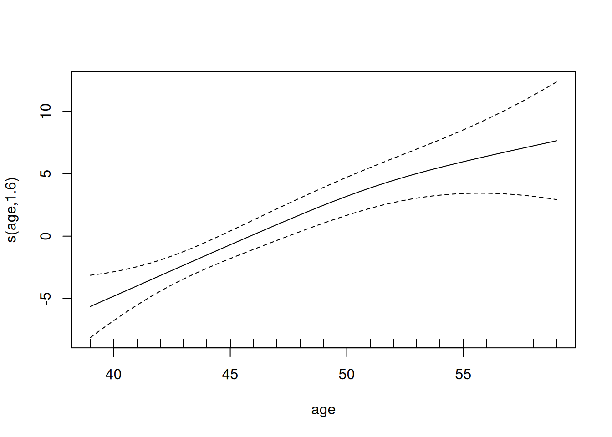](generalized-additive-models_files/figure-revealjs/unnamed-chunk-5-1.png)

We’ll return to [`mgcv::s()`](https://rdrr.io/pkg/mgcv/man/s.html) in [Section 10](#sec-gam-fitting) — the same [`s()`](https://rdrr.io/pkg/mgcv/man/s.html) syntax extends to multi-predictor additive models with no additional machinery.

# 7 Local regression

Adapted from James et al. [\[1, Sec. 7.6\]](#ref-james2021islr2e).

**Local regression**, also called **LOESS** (LOcally Estimated Scatterplot Smoothing) or **LOWESS**, takes yet another approach to nonlinear regression: instead of fitting a single global model with flexible basis functions, it fits **many local models**, one for each point on the $x$-axis where we want a prediction.

## 7.1 The local fit

> **NOTE:**
>
> **Definition 8 (Local regression at** $x_0$) To estimate the regression function $f(x_0)$ at a target point $x_0$:
>
> 1.  Choose a **bandwidth** $s \in (0, 1]$, also called the **span**. Take the fraction $s$ of training observations with $x_i$ closest to $x_0$ — this is the **local neighborhood**.
> 2.  **Weight** the neighborhood observations using a kernel that gives higher weight to points closer to $x_0$ and zero weight to points outside the neighborhood. The tricube kernel $K(u) = (1 - |u|^3)^3 {\mathbb{1}\mathopen{}\left(|u| \le 1\right)\mathclose{}}$ is the standard choice.
> 3.  **Fit a low-degree polynomial** (constant, linear, or quadratic) by weighted least squares to the neighborhood, using the kernel weights. The fitted value at $x_0$ is the prediction $\hat{f}(x_0)$.

> **NOTE:**
>
> **Example 15 (LOESS fit on age–cholesterol)** To smooth the relationship between age and total cholesterol in the WCGS data using LOESS with a span of 0.5:
>
> Show R code
>
> ``` downlit
> m_loess <- loess(chol ~ age, data = wcgs, span = 0.5)
> ```
>
> At age 50, the local neighborhood is the 50% of observations with ages closest to 50. Each observation in that window is weighted by the tricube kernel — down-weighted as its age moves away from 50, zero weight outside the window. The predicted cholesterol at age 50 is the fitted value from the weighted least-squares linear regression over that neighborhood.

> **NOTE:**
>
> *Remark 6* (From local fits to a fitted curve). To get the entire fitted curve, repeat for a dense grid of $x_0$ values and connect the resulting predictions.

> **NOTE:**
>
> **Theorem 3 (A local constant fit is a kernel-weighted average)** In [Definition 8](#def-local-regression), suppose the local polynomial has degree 0 (a constant $a$), and let $w_i \ge 0$ be the kernel weight of observation $i$ at the target point $x_0$, with $\sum_{i=1}^n w_i > 0$. Then the weighted least-squares fit at $x_0$ is the weighted average
>
> $$\hat{f}(x_0) = \frac{\sum_{i=1}^n w_i y_i}{\sum_{i=1}^n w_i}$$
>
> [\[6, Sec. 6.1\]](#ref-hastie2009esl2e).

> **NOTE:**
>
> *Proof*. The weighted residual sum of squares for a constant $a$ is $Q(a) \stackrel{\text{def}}{=}\sum_{i=1}^n w_i (y_i - a)^2$. Its derivative is
>
> $$\begin{aligned}
> Q'(a)
> &= \sum_{i=1}^n w_i \cdot 2 (y_i - a) \cdot (-1)
> && \text{(chain rule, term by term)}
> \\ &= \sum_{i=1}^n \mathopen{}\left(-2 w_i y_i + 2 a w_i\right)\mathclose{}
> && \text{(distribute)}
> \\ &= -2 \sum_{i=1}^n w_i y_i + 2 a \sum_{i=1}^n w_i
> && \text{(distribute the sum over the terms)}
> \end{aligned}$$
>
> Setting $Q'(a) = 0$:
>
> $$\begin{aligned}
> 2 a \sum_{i=1}^n w_i &= 2 \sum_{i=1}^n w_i y_i
> && \text{(add } 2 \textstyle\sum w_i y_i \text{ to both sides)}
> \\ a &= \frac{\sum_{i=1}^n w_i y_i}{\sum_{i=1}^n w_i}
> && \text{(divide by } 2 \textstyle\sum w_i > 0\text{)}
> \end{aligned}$$
>
> The second derivative $Q''(a) = 2\sum_{i=1}^n w_i$ is positive, so this stationary point is the minimizer.

> **NOTE:**
>
> **Example 16 (A tricube-weighted average)** Take the target point $x_0 = 0$ and a local neighborhood of five observations whose farthest member lies at distance 1 from $x_0$, so the scaled distances are $u_i = x_i - x_0 = x_i$:
>
> | $x_i$ | $y_i$ | $w_i = K(u_i) = (1 - \mathopen{}\left|u_i\right|\mathclose{}^3)^3$ |
> |----|----|----|
> | $-1$ | 10 | $(1 - 1)^3 = 0$ |
> | $-0.5$ | 2 | $(1 - 0.125)^3 \approx 0.6699$ |
> | $0$ | 3 | $(1 - 0)^3 = 1$ |
> | $0.5$ | 7 | $(1 - 0.125)^3 \approx 0.6699$ |
> | $1$ | 10 | $(1 - 1)^3 = 0$ |
>
> By [Theorem 3](#thm-local-constant):
>
> $$\begin{aligned}
> \hat{f}(0)
> &= \frac{0 \cdot 10 + 0.6699 \cdot 2 + 1 \cdot 3 + 0.6699 \cdot 7 + 0 \cdot 10}
> {0 + 0.6699 + 1 + 0.6699 + 0}
> && \text{(substitute the table)}
> \\ &\approx \frac{1.3398 + 3 + 4.6895}{0.6699 + 1 + 0.6699}
> && \text{(multiply, and drop the zero terms)}
> \\ &= \frac{9.0293}{2.3398}
> && \text{(add)}
> \\ &\approx 3.859
> && \text{(divide)}
> \end{aligned}$$
>
> The two observations at distance 1 get zero weight, so the large outcomes $y = 10$ at $x = \pm 1$ do not affect the fit, and the closer observation at $x = 0$ counts more than those at $x = \pm 0.5$. The unweighted sample mean of all five outcomes would be $32/5 = 6.4$.

## 7.2 Strengths

- **Conceptually simple.** No basis functions, no penalty matrices. Just “fit a line through the nearby points, and call that the curve at this $x$.”
- **Adaptive to local structure.** Regions with rapid change get their own local polynomial, just like flat regions do.
- **Robust to outliers** in the standard [`loess()`](https://rdrr.io/r/stats/loess.html) implementation, which iteratively down-weights observations with large residuals.

## 7.3 Limitations

- **No global model.** Local regression doesn’t produce a closed-form $\hat{f}(x)$ — predictions at any new $x$ are computed on demand by re-running the local fit at that point, but there is no parametric formula for the curve. Inference for the entire function (e.g. “is this exposure associated with outcome at all”) needs special tooling.
- **Hard to extend to many predictors.** With $p$ predictors, the local neighborhood is in $p$-dimensional space, and the curse of dimensionality bites hard: even for moderate $p$, “the nearest fraction $s$ of the data” is geometrically nothing like local. LOESS is rarely used with more than 2–4 predictors.
- **Bandwidth selection.** Just like the smoothing parameter $\lambda$ in smoothing splines, $s$ has to be chosen. Cross-validation works but is slower.

## 7.4 Local regression in R

Show R code

``` downlit
m_loess <- loess(chol ~ age, data = wcgs, span = 0.5)
grid <- data.frame(age = seq(min(wcgs$age), max(wcgs$age), length.out = 200))
grid$fit <- predict(m_loess, newdata = grid)

# Inside ggplot2, geom_smooth() with method = "loess"
# is the standard scatterplot smoother:
ggplot(wcgs, aes(x = age, y = chol)) +
  geom_point(alpha = 0.2) +
  geom_smooth(method = "loess", span = 0.5)
```

[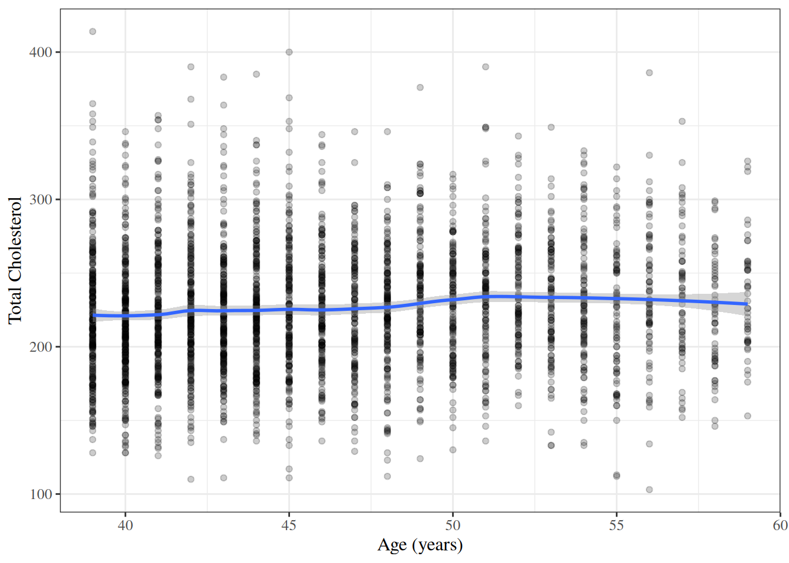](generalized-additive-models_files/figure-revealjs/unnamed-chunk-7-1.png)

For most modeling work in this chapter we’ll prefer the smoothing-spline approach via [`mgcv::s()`](https://rdrr.io/pkg/mgcv/man/s.html), which produces a global fit with full inferential machinery. LOESS is best thought of as a **diagnostic smoother** — an unobtrusive way to overlay the local mean of a scatterplot to check whether a parametric fit is missing nonlinearity.

# 8 Method comparison on a shared synthetic dataset

This section illustrates the methods of [Section 2](#sec-polynomial-regression) through [Section 7](#sec-local-regression) on a shared synthetic dataset, so the strengths and failure modes can be compared side-by-side.

We generate $n = 200$ noisy observations from a smooth nonlinear function

$$f(x) = \sin(x) + 0.3 \sin(3 x), \quad x \in [0, 2\pi],$$

with additive Gaussian noise ($\sigma= 0.4$). The truth is bumpy enough to expose differences between the methods but not so wild that any one of them obviously breaks.

The fitted curves are shown in [Figure 1](#fig-method-comparison-overlay).

> **NOTE:**
>
> Show R code
>
> ``` downlit
> ggplot(grid, aes(x = x)) +
>   geom_point(
>     data = demo_data, aes(y = y),
>     alpha = 0.3, size = 0.8
>   ) +
>   geom_line(aes(y = truth, color = "Truth"), linewidth = 0.9) +
>   geom_line(aes(y = linear, color = "Linear"),
>             linewidth = 0.7, linetype = "longdash") +
>   geom_line(aes(y = poly2, color = "Quadratic"), linewidth = 0.7) +
>   geom_line(aes(y = poly12, color = "Degree 12"),
>             linewidth = 0.7) +
>   scale_color_manual(
>     name = NULL,
>     values = c("Truth" = "black", "Linear" = "grey50",
>                "Quadratic" = "tomato", "Degree 12" = "steelblue")
>   ) +
>   labs(x = "Predictor, x", y = "Response, y") +
>   theme(legend.position = "bottom")
> ```
>
> [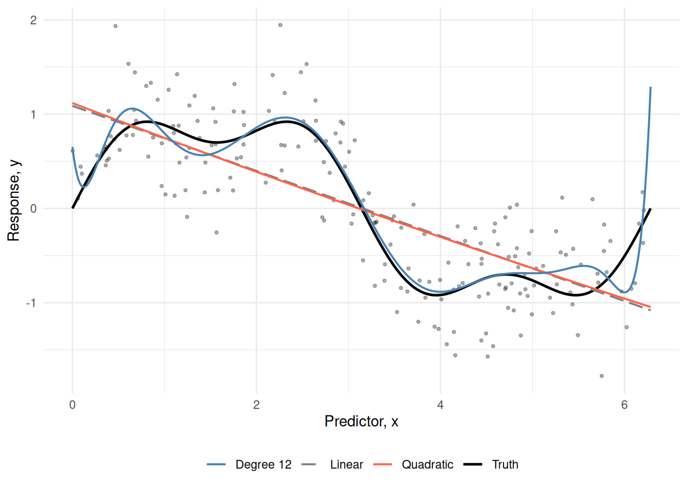](generalized-additive-models_files/figure-revealjs/method-comparison-poly-plot-1.png "Figure 1 (a): Polynomial fits. Quadratic underfits the central inflection; the degree-12 polynomial chases the noise and swings wildly near the boundaries (Runge’s phenomenon).")
>
> \(a\) Polynomial fits. Quadratic underfits the central inflection; the degree-12 polynomial chases the noise and swings wildly near the boundaries (Runge’s phenomenon).
>
> Show R code
>
> ``` downlit
> ggplot(grid, aes(x = x)) +
>   geom_point(
>     data = demo_data, aes(y = y),
>     alpha = 0.3, size = 0.8
>   ) +
>   geom_line(aes(y = truth, color = "Truth"), linewidth = 0.9) +
>   geom_step(aes(y = step, color = "Step (5 bins)"),
>             linewidth = 0.7) +
>   scale_color_manual(
>     name = NULL,
>     values = c("Truth" = "black", "Step (5 bins)" = "tomato")
>   ) +
>   labs(x = "Predictor, x", y = "Response, y") +
>   theme(legend.position = "bottom")
> ```
>
> [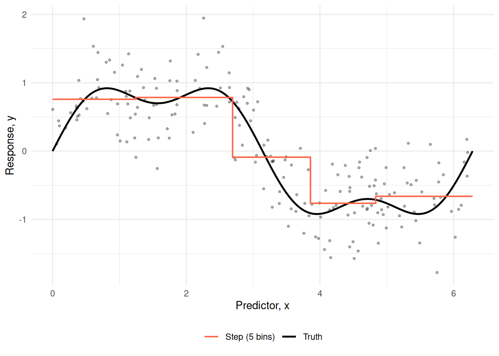](generalized-additive-models_files/figure-revealjs/method-comparison-step-plot-1.png "Figure 1 (b): Step function with 5 quantile-spaced bins. Captures the broad shape but is discontinuous at each cutpoint — almost never the right model for a continuous exposure.")
>
> \(b\) Step function with 5 quantile-spaced bins. Captures the broad shape but is discontinuous at each cutpoint — almost never the right model for a continuous exposure.
>
> Show R code
>
> ``` downlit
> ggplot(grid, aes(x = x)) +
>   geom_point(
>     data = demo_data, aes(y = y),
>     alpha = 0.3, size = 0.8
>   ) +
>   geom_line(aes(y = truth, color = "Truth"), linewidth = 0.9) +
>   geom_line(
>     aes(y = ns, color = "Natural cubic spline (df = 6)"),
>     linewidth = 0.7
>   ) +
>   geom_line(
>     aes(y = gam, color = "Smoothing spline (REML, k = 20)"),
>     linewidth = 0.7
>   ) +
>   scale_color_manual(
>     name = NULL,
>     values = c(
>       "Truth" = "black",
>       "Natural cubic spline (df = 6)" = "tomato",
>       "Smoothing spline (REML, k = 20)" = "steelblue"
>     )
>   ) +
>   labs(x = "Predictor, x", y = "Response, y") +
>   theme(legend.position = "bottom")
> ```
>
> [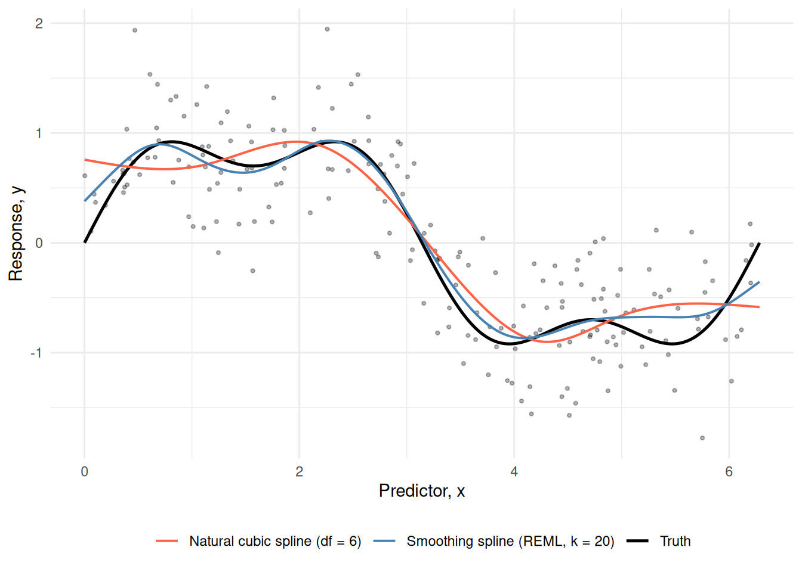](generalized-additive-models_files/figure-revealjs/method-comparison-splines-plot-1.png "Figure 1 (c): Splines. Both spline fits track the truth closely without the boundary swings of the degree-12 polynomial. The smoothing spline (REML-selected \lambda) has slightly less peak-to-peak amplitude because the penalty shrinks toward a straight line.")
>
> \(c\) Splines. Both spline fits track the truth closely without the boundary swings of the degree-12 polynomial. The smoothing spline (REML-selected $\lambda$) has slightly less peak-to-peak amplitude because the penalty shrinks toward a straight line.
>
> Show R code
>
> ``` downlit
> ggplot(grid, aes(x = x)) +
>   geom_point(
>     data = demo_data, aes(y = y),
>     alpha = 0.3, size = 0.8
>   ) +
>   geom_line(aes(y = truth, color = "Truth"), linewidth = 0.9) +
>   geom_line(aes(y = loess, color = "LOESS (span = 0.5)"),
>             linewidth = 0.7) +
>   scale_color_manual(
>     name = NULL,
>     values = c("Truth" = "black", "LOESS (span = 0.5)" = "tomato")
>   ) +
>   labs(x = "Predictor, x", y = "Response, y") +
>   theme(legend.position = "bottom")
> ```
>
> [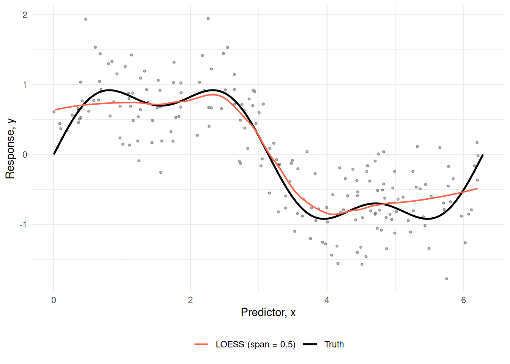](generalized-additive-models_files/figure-revealjs/method-comparison-loess-plot-1.png "Figure 1 (d): LOESS with the default 50% span. Similar shape to the splines but without a global closed-form parametric representation — the curve is computed on demand at any evaluation point rather than stored as a parametric formula.")
>
> \(d\) LOESS with the default 50% span. Similar shape to the splines but without a global closed-form parametric representation — the curve is computed on demand at any evaluation point rather than stored as a parametric formula.
>
> Figure 1: Comparison of nonlinear regression methods on synthetic data $y = \sin(x) + 0.3\sin(3x) + \varepsilon$, $\varepsilon\sim {\operatorname{N}\mathopen{}\left(0, 0.4^2\right)\mathclose{}}$, $n = 200$. Splines (both regression and smoothing) and LOESS track the truth closely; quadratic polynomial underfits the multi- modal structure; degree-12 polynomial overfits and swings at boundaries.

## 8.1 Takeaways

- **Polynomials beyond degree 3–4 are usually a bad idea.** The degree-12 fit is a clean illustration: it’s interpolating noise in the middle of the data and swinging beyond the data range. With 13 parameters (intercept + 12 polynomial terms) it has more flexibility than the natural cubic spline (`df = 6`), yet uses that flexibility on noise rather than on the curve’s shape — a reminder that global polynomials concentrate their degrees of freedom in the wrong places.
- **Splines and LOESS are essentially indistinguishable on this example.** Both produce smooth curves close to the truth. The practical differences are in how easily they extend to multi- predictor settings (splines do, LOESS doesn’t beyond 2-D) and in how inference works (splines have full Wald/Bayesian machinery, LOESS doesn’t).
- **REML-selected smoothing spline doesn’t require a degrees-of- freedom choice.** The `df = 6` for the natural cubic spline was a modeler choice; the REML smoothing spline picked its own smoothness from the data.
- **Step functions are for categorization, not smoothing.** The 5- bin step function is the worst fit on a smooth-truth dataset, but on real epidemiologic data where bins have substantive meaning (clinical BMI categories, age groups), the interpretability benefit can outweigh the within-bin information loss.

# 9 Generalized additive models

Adapted from James et al. [\[1, Sec. 7.7\]](#ref-james2021islr2e) and Wood [\[2, Secs. 4–7\]](#ref-wood2017generalized).

We’re now ready to assemble the **generalized additive model**. The idea is to take any of the nonlinear smoothers we’ve built up — regression splines, smoothing splines, local regression — and let **each predictor have its own smoother**, with the smoother contributions added together on the link scale.

## 9.1 The GAM formulation

> **NOTE:**
>
> **Definition 9 (Generalized additive model)** Let $Y$ be a response variable with conditional distribution from an exponential family (Gaussian, [binomial](https://morrison-lab.github.io/pds/distributions.html#def-binomial), Poisson, etc.), and let $X = (X_1, \ldots, X_p)$ be predictors. A **generalized additive model** (GAM) specifies
>
> $$g({\mathbb{E}\mathopen{}\left[Y \mid X = x\right]\mathclose{}}) = \beta_0 + f_1(x_1) + f_2(x_2) + \cdots + f_p(x_p),$$
>
> where:
>
> - $g$ is a link function (identity for Gaussian, logit for binary, log for Poisson — same as in a GLM).
> - Each $f_j$ is a **smooth function** of the $j$-th predictor, estimated from the data.
> - $\beta_0$ is an intercept (sometimes absorbed into one of the $f_j$’s via a centering constraint).

> **NOTE:**
>
> **Example 17 (GAM for CHD risk)** For the WCGS data with continuous predictors age, systolic blood pressure, and cholesterol, a GAM for CHD on the logit scale is
>
> $${\operatorname{logit}\mathopen{}\left\{\Pr(\text{chd69} = 1 \mid \text{age}, \text{sbp}, \text{chol})\right\}\mathclose{}}
> = \beta_0 + f_1(\text{age}) + f_2(\text{sbp}) + f_3(\text{chol}),$$
>
> where each $f_j$ is a smoothing spline estimated by REML. The three partial-effect curves can be plotted separately, revealing, for example, whether CHD risk rises linearly with age or accelerates nonlinearly.

> **NOTE:**
>
> *Remark 7* (What counts as a smooth function). A “smooth function” in practice means a regression spline, smoothing spline, or other smoother — anything that can be written as a basis expansion $f_j(x_j) = \sum_k \beta_{jk} b_{jk}(x_j)$ with the coefficients $\beta_{jk}$ estimated jointly across all predictors.

The model class includes ordinary linear regression as a special case (every $f_j$ is just $\beta_j x_j$) and ordinary GLMs as another special case (same — every $f_j$ linear, with the right link function). The point of the GAM extension is to let *some* $f_j$ be nonlinear while keeping the predictor contributions additive.

## 9.2 What the additive structure gives you

The additive structure makes GAMs strictly less flexible than fully nonparametric models like

$$g({\mathbb{E}\mathopen{}\left[Y \mid X = x\right]\mathclose{}}) = f(x_1, x_2, \ldots, x_p),$$

which allow arbitrary interactions among predictors. In return, GAMs gain:

- **Interpretability per predictor.** Each $f_j$ can be plotted on its own axis as the predicted shift in the linear predictor as $X_j$ varies, holding the other predictors fixed. The same partial-effect intuition that makes linear-model coefficients useful carries over.
- **Avoidance of the curse of dimensionality.** Fitting a smooth in one dimension takes $O(n)$ data; fitting it in $p$ dimensions jointly takes $O(n^p)$ data. Additivity is a structural assumption that makes the problem tractable even with several predictors.
- **Direct extension of GLM workflow.** The link function $g$, exponential-family likelihood, residual diagnostics, and AIC comparisons all work essentially unchanged — GAMs are GLMs in spline coordinates.

## 9.3 Adding interactions and tensor smooths

The strict-additivity restriction can be relaxed when needed. The two standard escape hatches are:

- **Predictor-by-factor interactions.** A smooth that varies by category — e.g. an age effect that’s different for Type A and Type B behavior patterns (`dibpat`) — is fit as $f_j(X_j) + f_{j,\text{by}}(X_j) \cdot {\mathbb{1}\mathopen{}\left(\text{dibpat} = \text{Type A}\right)\mathclose{}}$ via `s(age, by = dibpat)` in `mgcv`. When `dibpat` is a factor, this syntax requires an accompanying parametric main effect for identifiability (the smooth is centered to mean zero in each level, so the level-specific intercepts have to come from somewhere else); the correct idiom is:

  Show R code
  ``` downlit
  gam(chol ~ dibpat + s(age, by = dibpat), data = wcgs, method = "REML")
  #> 
  #> Family: gaussian 
  #> Link function: identity 
  #> 
  #> Formula:
  #> chol ~ dibpat + s(age, by = dibpat)
  #> 
  #> Estimated degrees of freedom:
  #> 1.00 1.01  total = 4.01 
  #> 
  #> REML score: 16231.9
  ```

  The result is still additive in the *factors*, but allows separate smooth shapes within each level.

- **Tensor-product smooths.** A genuine two-dimensional smooth surface in two continuous predictors — e.g. $f(\text{age}, \text{bmi})$ — fit via `te(age, bmi)` in `mgcv`. The smoothing penalty is applied separately to wiggliness in each marginal direction, so the smooth doesn’t assume the two predictors are on comparable scales — the right choice when predictors have different units (e.g. age in years, BMI in kg/m²). An isotropic 2D smooth (`s(age, bmi)`) would penalize the same amount of “wiggliness per year of age” as per “unit of BMI”, which is rarely substantively defensible.

For routine epidemiology work, the additive model is usually the right starting point; tensor smooths come up mainly when interactions between continuous predictors are scientifically central (e.g. space–time models, age–calendar-time mortality surfaces).

# 10 Fitting GAMs in R

Adapted from Wood [\[2, Sec. 6\]](#ref-wood2017generalized).

The standard tool for fitting GAMs in R is the `mgcv` package [\[2\]](#ref-wood2017generalized). We’ll use [`mgcv::gam()`](https://rdrr.io/pkg/mgcv/man/gam.html), which fits GAMs by **penalized likelihood** with automatic smoothness selection via REML or GCV.

## 10.1 The `gam()` call

The basic syntax mirrors [`lm()`](https://rdrr.io/r/stats/lm.html)/[`glm()`](https://rdrr.io/r/stats/glm.html), with smoothers introduced by [`s()`](https://rdrr.io/pkg/mgcv/man/s.html):

Show R code

``` downlit
library(mgcv)

m <- gam(
  chd ~ s(age) + s(bmi) + dibpat + s(chol, k = 10),
  data = wcgs,
  family = binomial(),
  method = "REML"
)
```

Reading the formula:

- `s(age)`, `s(bmi)`, `s(chol, k = 10)` are **smooth terms**. Each introduces a basis expansion plus a smoothness penalty. The default basis (`bs = "tp"`, thin-plate regression spline) is almost always a good choice. `k = 10` requests a basis of dimension up to 10 — large enough that the smoothness penalty, not the basis, controls flexibility.
- `dibpat` (behavior pattern, Type A or B) is a **parametric term**, treated exactly as in a GLM.

You can mix smooth and parametric terms freely. Parametric terms contribute conventional regression coefficients (with $t$/$z$ statistics in the model summary); smooth terms contribute fitted curves with effective-degrees-of-freedom summaries.

## 10.2 Useful `s()` arguments

| Argument | What it controls | When to change from default |
|:---|:---|:---|
| `bs` | basis type (`"tp"`, `"cr"`, `"ps"`, …) | rarely; `"tp"` is the default and the safe choice |
| `k` | basis dimension (max EDF + 1) | when [`gam.check()`](https://rdrr.io/pkg/mgcv/man/gam.check.html) flags `k-index < 1` |
| `by` | factor for per-level smooths | predictor-by-factor interactions |
| `id` | label for sharing smoothness across smooths | when two or more smooths should share a single $\lambda$, e.g. `s(x1, id = 1) + s(x2, id = 1)` |
| `m` | order of the penalty derivative | rarely; default penalizes 2nd derivative |
| `pc` | constraint point | when you need the smooth to pass through 0 at a chosen $x$ |

## 10.3 Smoothness selection: REML vs GCV

[`mgcv::gam()`](https://rdrr.io/pkg/mgcv/man/gam.html) picks the smoothness parameter(s) $\lambda$ automatically by optimizing one of:

- **REML** (restricted maximum likelihood). Treats the penalty as arising from a normal prior on the spline coefficients and selects $\lambda$ by the marginal likelihood. **Not the default** — [`gam()`](https://rdrr.io/pkg/mgcv/man/gam.html) defaults to `method = "GCV.Cp"`, so you have to pass `method = "REML"` explicitly (as in the examples in this section). Generally **more stable** than GCV, less prone to undersmoothing.
- **ML** (marginal likelihood). Similar to REML but with a slightly different effective sample size adjustment.
- **GCV** (generalized cross-validation). The default. Computes faster than REML but can occasionally select a much wigglier smooth than is justified by the data, especially when $n$ is small or signal is weak.

**Recommendation: use `method = "REML"`** for routine work. If you’re comparing GAMs to GLMs via AIC, also set `select = TRUE` to turn on smoothness selection at the term level. `select = TRUE` adds an extra null-space penalty to each smooth (separate from the wiggliness penalty) that can shrink an *entire* smooth term to zero — effectively functioning as variable selection [\[2, Sec. 5.4\]](#ref-wood2017generalized). Without it, the ordinary wiggliness penalty can only shrink a smooth down to a straight line, never to identically zero; `select = TRUE` extends that floor all the way down. This refit makes AIC comparisons more honest because the GAM is then allowed to “discover” that a predictor’s smooth shouldn’t be there at all.

## 10.4 Checking the fit

After fitting, run [`gam.check()`](https://rdrr.io/pkg/mgcv/man/gam.check.html) to verify:

Show R code

``` downlit
gam.check(m)
```

[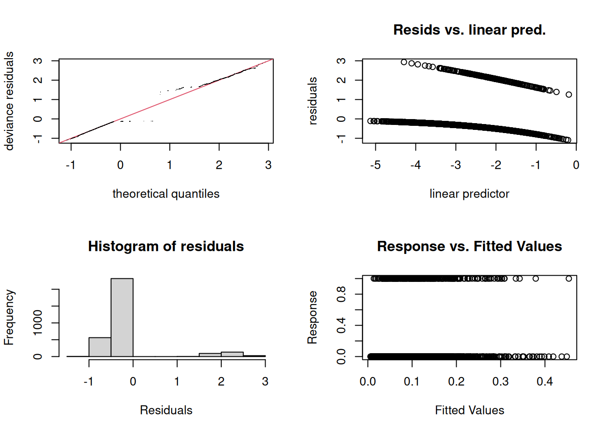](generalized-additive-models_files/figure-revealjs/unnamed-chunk-10-1.png)

    #> 
    #> Method: REML   Optimizer: outer newton
    #> full convergence after 7 iterations.
    #> Gradient range [-0.000358419,-2.1343e-05]
    #> (score 821.975 & scale 1).
    #> Hessian positive definite, eigenvalue range [3.16164e-05,0.220195].
    #> Model rank =  29 / 29 
    #> 
    #> Basis dimension (k) checking results. Low p-value (k-index<1) may
    #> indicate that k is too low, especially if edf is close to k'.
    #> 
    #>           k'  edf k-index p-value  
    #> s(age)  9.00 1.00    0.94   0.600  
    #> s(bmi)  9.00 1.00    0.91   0.070 .
    #> s(chol) 9.00 1.82    0.92   0.055 .
    #> ---
    #> Signif. codes:  0 '***' 0.001 '**' 0.01 '*' 0.05 '.' 0.1 ' ' 1

Output includes:

- A **convergence diagnostic** (REML/GCV optimization should converge to a stationary point — usually it does without intervention).
- **Basis-dimension check** (`k'`, `edf`, `k-index`, `p-value`) for each smooth. If `edf` is close to `k'`, the smooth is hitting its maximum allowed flexibility — bump `k` up and refit. If `k-index < 1` with a small p-value, the basis may be too small.
- **Residual diagnostics**: QQ plot, residuals vs. linear predictor, histogram of residuals, observed vs. fitted. Same intuition as for a GLM.

## 10.5 Plotting smooths

Show R code

``` downlit
plot(m, pages = 1, shade = TRUE)
```

[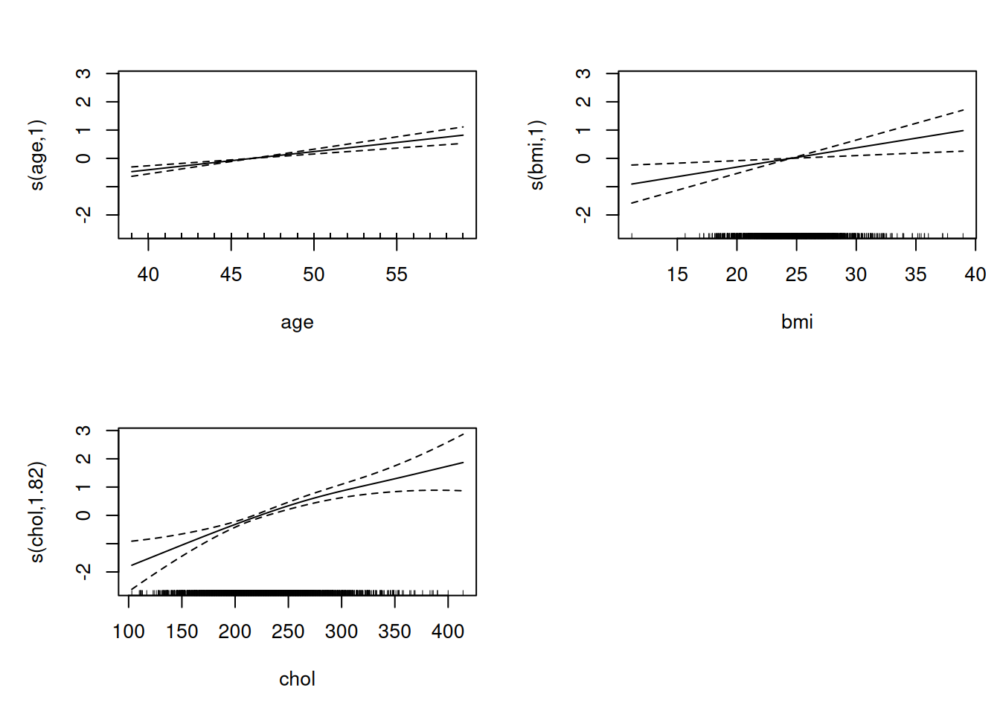](generalized-additive-models_files/figure-revealjs/unnamed-chunk-11-1.png)

produces a panel of partial-effect plots — one per smooth term — with a 2-SE pointwise confidence band. The y-axis is on the **linear predictor scale** by default, centered to mean zero (the smooth’s contribution to $g({\mathbb{E}\mathopen{}\left[Y\right]\mathclose{}})$ above its mean), not on the response scale.

For a publication-quality plot on the response scale, use `predict(m, type = "response", se.fit = TRUE)` on a grid of $X$ values with the other predictors held at typical values.

# 11 Inference and model selection

Adapted from Wood [\[2, Secs. 6.10–6.12\]](#ref-wood2017generalized).

GAM output from [`summary()`](https://rdrr.io/r/base/summary.html) looks similar to GLM output but has a few quirks driven by the penalized fit. Here’s what to read off it.

## 11.1 Reading `summary(gam_fit)`

A `summary.gam` object splits the report into two sections:

### 11.1.1 Parametric coefficients

These are the non-smooth terms in the formula — intercept, categorical predictors, terms entered as `x` rather than `s(x)`. Their output is identical to a GLM:

Show R code

``` downlit
# Fit a logistic GAM with one parametric term (dibpat) and two smooths,
# then pull the two summary tables out of the summary.gam object.
m_inf <- gam(chd ~ dibpat + s(age) + s(bmi),
             family = binomial(), data = wcgs, method = "REML")
sm_inf <- summary(m_inf)
sm_inf$p.table  # parametric coefficients
#>              Estimate Std. Error   z value     Pr(>|z|)
#> (Intercept)  -2.97147   0.117513 -25.28619 4.53227e-141
#> dibpatType A  0.78173   0.141714   5.51627  3.46277e-08
```

Read these exactly as you would GLM coefficients.

### 11.1.2 Smooth terms

Show R code

``` downlit
sm_inf$s.table  # smooth terms
#>            edf  Ref.df  Chi.sq   p-value
#> s(age) 1.00107 1.00214 36.4005 0.0000000
#> s(bmi) 1.29959 1.54968 10.8386 0.0064354
```

Each column reports:

- **`edf`** — effective degrees of freedom of the smooth, as defined in [Definition 7](#def-effective-degrees-of-freedom). An EDF of 1.0 means the smooth has been penalized down to a straight line; higher values mean more wiggliness.
- **`Ref.df`** — a reference degrees of freedom used in constructing the p-value (slightly larger than EDF; the difference accounts for the penalized-fit uncertainty in selecting $\lambda$).
- **`Chi.sq`** — the test statistic for “is this smooth different from zero?”.
- **`p-value`** — an *approximate* p-value for that null. The standard caveat applies: the smoothing parameter was selected from the data, so the test statistic doesn’t have an exact $\chi^2$ distribution — `mgcv` uses a careful approximation accounting for the selection, but it’s still an approximation [\[7\]](#ref-wood2013pvalues).

### 11.1.3 Adjusted $R^2$ and deviance explained

For Gaussian GAMs, the summary reports an adjusted $R^2$; for GLM families, **deviance explained** (the GLM analog of $R^2$). Same interpretation as in the GLM chapters.

## 11.2 Confidence bands for smooth terms

The pointwise CIs that [`plot.gam()`](https://rdrr.io/pkg/mgcv/man/plot.gam.html) draws come from the Bayesian posterior distribution of the spline coefficients [\[2, Sec. 6.10\]](#ref-wood2017generalized). They have the property:

- They are **roughly the right Bayesian credible intervals** for the smooth at each point.
- They are **roughly the right frequentist confidence bands** “across the function” — i.e. averaged over $x$, the band has approximately 95% coverage of the true $f(x)$.
- They **are not** pointwise frequentist CIs in the strict sense; at any single $x$, coverage can be a few percentage points off.

For routine plotting and reporting in epidemiology, these bands are the right thing to display. If you need something stricter (e.g. simultaneous bands valid across the entire $x$-range), posterior simulation from the spline coefficients gives the right answer: [`gratia::smooth_samples()`](https://gavinsimpson.github.io/gratia/reference/smooth_samples.html) (gratia \>= 0.9) returns draws of the smooth from the posterior on the spline coefficients (equivalently, you can roll your own via [`mgcv::rmvn()`](https://rdrr.io/pkg/mgcv/man/rmvn.html) with the fitted `Vp`). See [\[2, Sec. 6.10\]](#ref-wood2017generalized) for the underlying theory. Note that `simulate(m_gam)` is a *different* tool — it returns response-scale draws (posterior predictive samples of new observations), not smooth-coefficient draws, so it’s appropriate for predictive checks but not for constructing simultaneous bands on the smooth.

## 11.3 Comparing models

Two GAMs can be compared in the usual ways:

- **AIC**: `AIC(m1, m2)`. Lower is better. `mgcv` reports the AIC with an effective-degrees-of-freedom correction that’s appropriate for the penalized fit.
- **Likelihood-ratio test**: `anova(m1, m2, test = "Chisq")`. Same caveat as the smooth-term p-values — the smoothing parameter was data-chosen, so the LRT is approximate. Use with the same care.
- **[`gratia::compare_smooths()`](https://gavinsimpson.github.io/gratia/reference/compare_smooths.html)** (from the companion `gratia` package) — a more comprehensive comparison framework, including visual overlays of smooths and difference plots.

## 11.4 When to prefer a GLM over a GAM

GAMs are strictly more flexible than GLMs, but that flexibility has drawbacks:

- **Communication.** A linear effect is easier to describe in a table of coefficients than a curve.
- **Power.** With small $n$ and a smooth that’s truly linear, the GAM wastes degrees of freedom on penalty selection. The EDF will drop toward 1, but the inference loses a little efficiency.
- **Reporting standards.** Some epidemiology journals still require linear or quadratic exposure terms.

A reasonable workflow:

1.  Plot the data + a LOESS smoother for an initial scatterplot diagnostic.
2.  Fit a GAM with `s(x)` for every continuous predictor where nonlinearity is plausible.
3.  Read the EDF: if EDF $\approx 1$, the linear form is fine — drop [`s()`](https://rdrr.io/pkg/mgcv/man/s.html) and refit as a GLM for parsimony.
4.  If EDF $> 1$, report the GAM with a curve plot.

# 12 Worked example

We’ll fit a logistic GAM to the Western Collaborative Group Study (WCGS) data [\[8\]](#ref-rosenman1975coronary), the coronary-heart-disease cohort introduced in the [logistic regression chapter](../chapters/logistic-regression.llms.md). The outcome is incident coronary heart disease (`chd69`); the continuous risk factors we smooth are age (`age`), body mass index (`bmi`), serum cholesterol (`chol`), and systolic blood pressure (`sbp`) — predictors whose effect on CHD risk need not be linear on the log-odds scale.

## Setup

Show R code

``` downlit
library(mgcv)        # gam(), s()
library(ggplot2)
library(gratia)      # tidy plots for gam fits (optional)

# WCGS ships with this repository (cleaned once in the chapter setup):
wcgs <- readRDS(here::here("inst/extdata/wcgs.rds"))

# Binary 0/1 outcome, and drop the one known cholesterol outlier (645):
wcgs <- subset(wcgs, !is.na(chol) & chol < 645)
wcgs$chd <- as.integer(wcgs$chd69 == "Yes")
```

## Linear baseline

Start with an ordinary logistic GLM as a baseline:

Show R code

``` downlit
m_lin <- glm(
  chd ~ age + bmi + chol + sbp,
  family = binomial(), data = wcgs
)
summary(m_lin)
#> 
#> Call:
#> glm(formula = chd ~ age + bmi + chol + sbp, family = binomial(), 
#>     data = wcgs)
#> 
#> Coefficients:
#>              Estimate Std. Error z value Pr(>|z|)    
#> (Intercept) -11.56086    0.95245  -12.14  < 2e-16 ***
#> age           0.06160    0.01181    5.21  1.8e-07 ***
#> bmi           0.03905    0.02628    1.49     0.14    
#> chol          0.01146    0.00151    7.61  2.8e-14 ***
#> sbp           0.01942    0.00404    4.81  1.5e-06 ***
#> ---
#> Signif. codes:  0 '***' 0.001 '**' 0.01 '*' 0.05 '.' 0.1 ' ' 1
#> 
#> (Dispersion parameter for binomial family taken to be 1)
#> 
#>     Null deviance: 1774.2  on 3140  degrees of freedom
#> Residual deviance: 1635.5  on 3136  degrees of freedom
#> AIC: 1645
#> 
#> Number of Fisher Scoring iterations: 5
```

Each coefficient is a single log-odds increment per unit of the predictor — one slope for the entire range of age, BMI, cholesterol, and blood pressure. That’s a strong assumption: it forces risk to climb at a constant rate across the whole range of each exposure.

## GAM with smooth terms

Now refit with a smooth on each continuous predictor:

Show R code

``` downlit
m_gam <- gam(
  chd ~ s(age) + s(bmi) + s(chol) + s(sbp),
  family = binomial(),
  data = wcgs,
  method = "REML"
)
summary(m_gam)
#> 
#> Family: binomial 
#> Link function: logit 
#> 
#> Formula:
#> chd ~ s(age) + s(bmi) + s(chol) + s(sbp)
#> 
#> Parametric coefficients:
#>             Estimate Std. Error z value Pr(>|z|)    
#> (Intercept)  -2.6693     0.0792   -33.7   <2e-16 ***
#> ---
#> Signif. codes:  0 '***' 0.001 '**' 0.01 '*' 0.05 '.' 0.1 ' ' 1
#> 
#> Approximate significance of smooth terms:
#>          edf Ref.df Chi.sq p-value    
#> s(age)  1.00   1.00  26.55 1.1e-06 ***
#> s(bmi)  1.00   1.00   2.18    0.14    
#> s(chol) 1.61   2.02  56.48 < 2e-16 ***
#> s(sbp)  1.00   1.00  22.83 1.4e-06 ***
#> ---
#> Signif. codes:  0 '***' 0.001 '**' 0.01 '*' 0.05 '.' 0.1 ' ' 1
#> 
#> R-sq.(adj) =  0.0444   Deviance explained =  7.9%
#> -REML = 826.74  Scale est. = 1         n = 3141
```

The summary reports an effective degrees of freedom (EDF) for each smooth. A smooth whose EDF stays close to 1 has collapsed to a straight line — the data give no evidence of curvature for that predictor — while an EDF meaningfully above 1 signals a nonlinear effect. In this dataset most of the smooths sit near 1 (the linear baseline already captures them well), with cholesterol the predictor most likely to show curvature; treat the actual EDFs from your run, not these expectations, as the evidence.

## Reading the EDFs

For each smooth, ask:

- **EDF** $\approx 1$: the smooth has collapsed to a straight line. No evidence the relationship is nonlinear. You can drop the smoother and use a linear term without loss.
- **EDF in 2–5**: meaningfully nonlinear. The fitted curve is more than just a line but doesn’t have lots of bumps.
- **EDF** $> 5$: substantially nonlinear, possibly with multiple inflections. Check whether the data actually support that wiggle (look at the plot; check [`gam.check()`](https://rdrr.io/pkg/mgcv/man/gam.check.html)’s `k-index`).

If `gam.check(m_gam)` flags any smooth as having `edf` close to `k'`, bump `k` up:

Show R code

``` downlit
m_gam2 <- gam(
  chd ~ s(age) + s(bmi) + s(chol, k = 20) + s(sbp),
  family = binomial(),
  data = wcgs,
  method = "REML"
)
```

## Plotting partial-effect curves

Show R code

``` downlit
plot(m_gam, pages = 1, shade = TRUE, seWithMean = TRUE)
```

[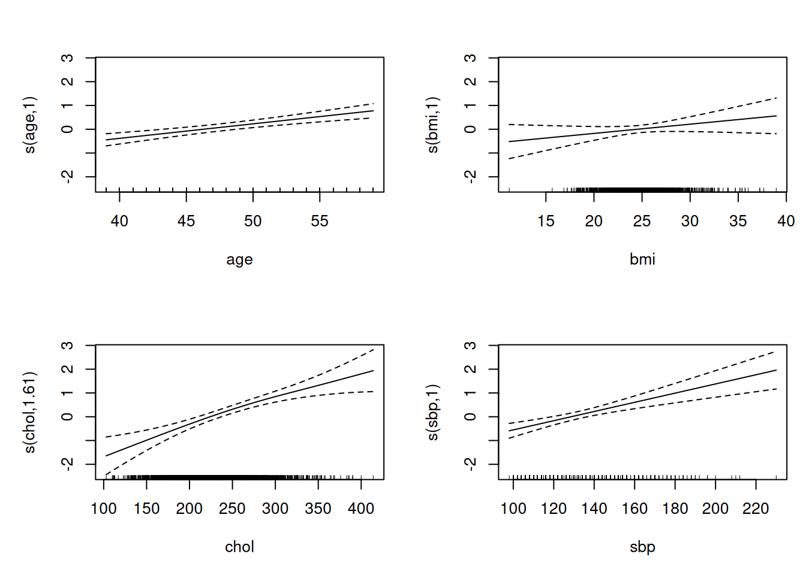](generalized-additive-models_files/figure-revealjs/unnamed-chunk-17-1.png)

produces one panel per smooth, each showing the partial effect on the log-odds scale with a 2-SE band. `seWithMean = TRUE` adds the variance of the smooth’s overall level (its centering offset) to the pointwise standard errors. Without it, the band is the variance of the *deviation* of the smooth around its mean; with it, the band is the variance of the smooth itself — the right interpretation when comparing partial-effect curves across predictors on a publication figure.

For a cleaner ggplot rendering, [`gratia::draw()`](https://gavinsimpson.github.io/gratia/reference/draw.html) is a one-line alternative:

Show R code

``` downlit
gratia::draw(m_gam)
```

[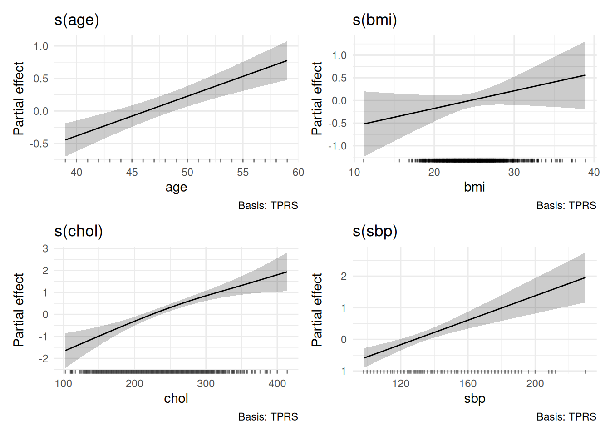](generalized-additive-models_files/figure-revealjs/unnamed-chunk-18-1.png)

## Translating to the response scale

Partial-effect plots are on the **link scale** (log-odds for binary). To plot predicted probability against a single predictor — here cholesterol, the predictor with the clearest curvature — hold the others at typical values, build the Wald CI on the **link** scale, then back-transform with [`plogis()`](https://rdrr.io/r/stats/Logistic.html):

Show R code

``` downlit
grid <- data.frame(
  chol = seq(min(wcgs$chol), max(wcgs$chol), length.out = 200),
  age  = median(wcgs$age),
  bmi  = median(wcgs$bmi),
  sbp  = median(wcgs$sbp)
)
pred <- predict(m_gam, newdata = grid,
                type = "link", se.fit = TRUE)
grid$prob  <- plogis(pred$fit)
grid$lower <- plogis(pred$fit - 1.96 * pred$se.fit)
grid$upper <- plogis(pred$fit + 1.96 * pred$se.fit)

ggplot(grid, aes(x = chol, y = prob)) +
  geom_ribbon(aes(ymin = lower, ymax = upper), alpha = 0.2) +
  geom_line() +
  labs(x = "Serum cholesterol (mg/dL)",
       y = "Predicted probability of CHD",
       caption = "Other predictors held at sample medians") +
  theme_minimal()
```

[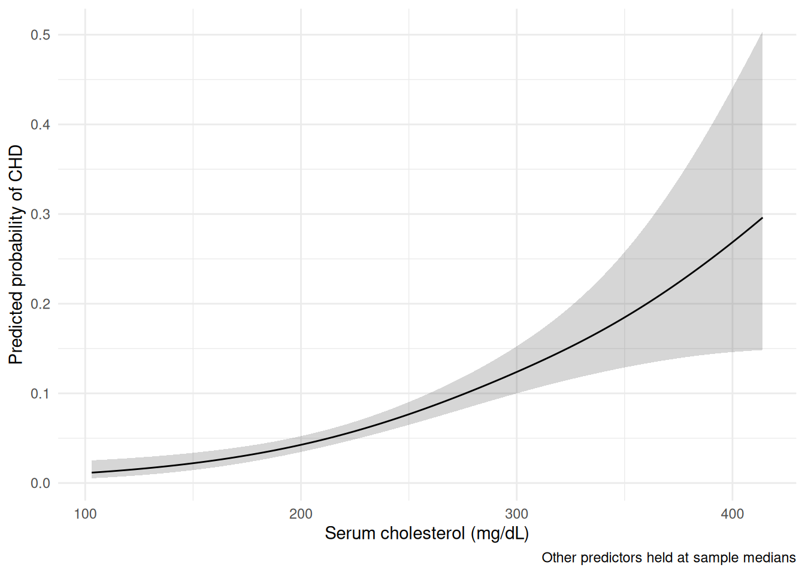](generalized-additive-models_files/figure-revealjs/unnamed-chunk-19-1.png)

We compute the CI on the link scale and back-transform because the delta-method SE on `type = "response"` doesn’t respect the \[0, 1\] boundary — Wald intervals built from it can extend outside (0, 1) near the tails of the curve and have non-symmetric coverage. Working on the link scale and applying the monotone [`plogis()`](https://rdrr.io/r/stats/Logistic.html) transformation keeps the interval inside (0, 1) by construction and preserves asymmetry around the boundaries (wider near 0 and 1, narrower near the middle), which is the right qualitative shape for a probability.

## Comparing GLM and GAM

Show R code

``` downlit
# Refit the GAM with method = "ML" for AIC comparison.
# REML and ML likelihoods are on different scales; comparing AIC
# from glm() (always ML) with a REML-fitted gam() mixes criteria.
# Use select = TRUE to enable term-level smoothness selection (the
# null-space penalty), so a smooth that's really just a line --- or
# zero --- isn't penalized as more complex than the linear baseline.
m_gam_ml <- gam(
  chd ~ s(age) + s(bmi) + s(chol) + s(sbp),
  family = binomial(),
  data = wcgs,
  method = "ML",
  select = TRUE
)
AIC(m_lin, m_gam_ml)
```

Compare the two fits on AIC. When most smooths sit at EDF near 1 — as several do here — the GLM is the parsimonious choice and the AIC gap will be small or may even favor the GLM. The GAM earns its extra complexity only when one or more smooths show clear curvature and the curve plots reveal a substantively interesting shape; if they do, the GAM is the better report.

The refit with `method = "ML"` is required only for the AIC comparison; the REML fit `m_gam` remains the preferred fit for final inference and plotting [\[2, Sec. 6.2\]](#ref-wood2017generalized).

## Reporting in a manuscript

A typical methods-section sentence is:

> Continuous predictors were modeled using thin-plate regression splines (the default basis for [`mgcv::s()`](https://rdrr.io/pkg/mgcv/man/s.html)) via penalized restricted maximum likelihood (`mgcv` *version*, R *version*; Wood [\[2\]](#ref-wood2017generalized)). The number of basis functions per predictor was set to 10 and reduced by penalization to the effective degrees of freedom shown in Table X.

Replace *version* with the actual versions you used — these can drift between drafts.

Pair this with a table giving each smooth’s EDF and approximate p-value, plus a figure of the partial-effect curves on the link scale (with the response-scale plot of the predictor of primary interest as a supplementary figure).

# 13 Lab: Non-linear modeling

## Setup

Lab adapted from James et al. [\[1, Sec. 7.8\]](#ref-james2021islr2e) and James et al. [\[9, Sec. 7.8\]](#ref-james2023islp).

## R

Show R code

``` downlit
library(ISLR2)
library(splines)
library(mgcv)
library(ggplot2)
library(boot)
data(Wage)
head(Wage[, c("age", "wage", "education", "year")])
```

## Python

The Python blocks in this lab are shown but not run when the book is rendered, because the render has no Python environment; run them locally. The smoothing-spline and GAM sections also require `pygam`, which is not part of the standard ISLP/sklearn ecosystem — install with `pip install pygam` before running those blocks.

Show R code

``` python
# Not run: the rme render has no Python environment.
import numpy as np
import pandas as pd
import matplotlib.pyplot as plt
from ISLP import load_data
from sklearn.preprocessing import PolynomialFeatures
from sklearn.linear_model import LinearRegression, LogisticRegression
import statsmodels.api as sm
from patsy import dmatrix
Wage = load_data("Wage")
print(Wage[["age","wage","education","year"]].head())
```

## Polynomial regression

Fit degree-1 through degree-5 polynomials, then use ANOVA to select degree [\[1, Sec. 7.1\]](#ref-james2021islr2e).

## R

Show R code

``` downlit
fit1 <- lm(wage ~ poly(age, 1), data = Wage)
fit2 <- lm(wage ~ poly(age, 2), data = Wage)
fit3 <- lm(wage ~ poly(age, 3), data = Wage)
fit4 <- lm(wage ~ poly(age, 4), data = Wage)
fit5 <- lm(wage ~ poly(age, 5), data = Wage)
anova(fit1, fit2, fit3, fit4, fit5)
```

The ANOVA p-values suggest degree 3 or 4 is adequate.

Show R code

``` downlit
age_grid <- seq(min(Wage$age), max(Wage$age), length.out = 200)
pred <- predict(fit4, newdata = data.frame(age = age_grid), se.fit = TRUE)
df_pred <- data.frame(
  age = age_grid,
  fit = pred$fit,
  lo  = pred$fit - 2 * pred$se.fit,
  hi  = pred$fit + 2 * pred$se.fit
)
ggplot(Wage, aes(age, wage)) +
  geom_point(alpha = 0.2, size = 0.8) +
  geom_ribbon(data = df_pred, aes(y = fit, ymin = lo, ymax = hi),
              alpha = 0.3, fill = "steelblue") +
  geom_line(data = df_pred, aes(y = fit), colour = "steelblue", linewidth = 1) +
  labs(title = "Degree-4 polynomial fit", x = "Age", y = "Wage")
```

[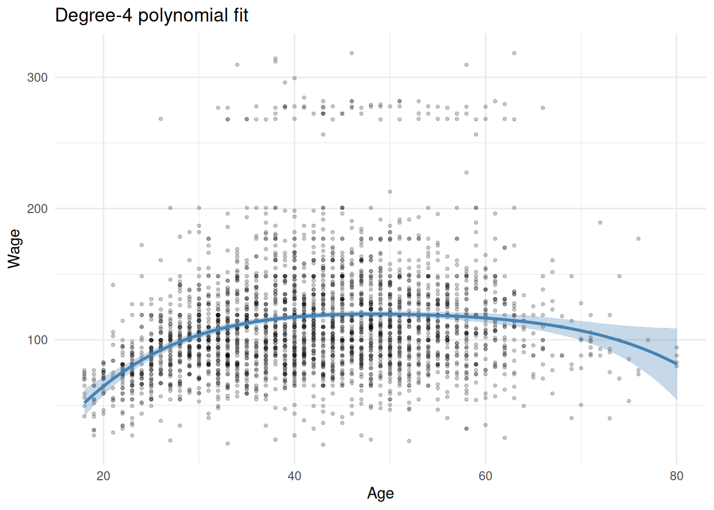](generalized-additive-models_files/figure-revealjs/lab-poly-plot-r-1.png)

## Python

Show R code

``` python
# Not run: the rme render has no Python environment.
from scipy import stats
results = {}
for deg in range(1, 6):
    X = np.column_stack([Wage["age"] ** k for k in range(1, deg + 1)])
    X = sm.add_constant(X)
    results[deg] = sm.OLS(Wage["wage"], X).fit()

# F-tests between consecutive nested models. compare_f_test() is
# called on the *unrestricted* (more flexible) model and given the
# restricted model as the argument.
for d in range(1, 5):
    f, p, df_diff = results[d + 1].compare_f_test(results[d])
    print(f"Degree {d} vs {d+1}: F={f:.3f}, p={p:.4f}")
```

Show R code

``` python
# Not run: the rme render has no Python environment.
age_grid = np.linspace(Wage["age"].min(), Wage["age"].max(), 200)
X_grid = sm.add_constant(np.column_stack([age_grid ** k for k in range(1, 5)]))
pred4 = results[4].get_prediction(X_grid)
pred_df = pred4.summary_frame(alpha=0.05)

plt.figure(figsize=(7, 4))
plt.scatter(Wage["age"], Wage["wage"], alpha=0.15, s=8)
plt.plot(age_grid, pred_df["mean"], color="steelblue", linewidth=2)
plt.fill_between(age_grid, pred_df["mean_ci_lower"], pred_df["mean_ci_upper"],
                 alpha=0.3, color="steelblue")
plt.title("Degree-4 polynomial fit"); plt.xlabel("Age"); plt.ylabel("Wage")
plt.tight_layout(); plt.show()
```

## Step functions

Cut `age` into four intervals and fit a piecewise-constant model [\[1, Sec. 7.2\]](#ref-james2021islr2e).

## R

Show R code

``` downlit
Wage$age_cut <- cut(Wage$age, 4)
fit_step <- lm(wage ~ age_cut, data = Wage)
summary(fit_step)$coef
#>                    Estimate Std. Error  t value    Pr(>|t|)
#> (Intercept)        94.15839    1.47607 63.78997 0.00000e+00
#> age_cut(33.5,49]   24.05349    1.82943 13.14807 1.98232e-38
#> age_cut(49,64.5]   23.66456    2.06796 11.44344 1.04075e-29
#> age_cut(64.5,80.1]  7.64059    4.98742  1.53197 1.25635e-01
```

## Python

Show R code

``` python
# Not run: the rme render has no Python environment.
Wage["age_cut"] = pd.cut(Wage["age"], bins=4)
step_dummies = pd.get_dummies(Wage["age_cut"], drop_first=True).astype(float)
X_step = sm.add_constant(step_dummies)
fit_step = sm.OLS(Wage["wage"], X_step).fit()
print(fit_step.summary().tables[1])
```

## Regression splines

Fit a cubic B-spline with knots at ages 25, 40, and 60, and a natural cubic spline with the same knots [\[1, Sec. 7.4\]](#ref-james2021islr2e).

## R

Show R code

``` downlit
# Redefine age_grid so the splines section runs in isolation
# (it's also defined in the poly-plot chunk above).
age_grid <- seq(min(Wage$age), max(Wage$age), length.out = 200)
knots <- c(25, 40, 60)
fit_bs <- lm(wage ~ bs(age, knots = knots), data = Wage)
fit_ns <- lm(wage ~ ns(age, knots = knots), data = Wage)

pred_bs <- predict(fit_bs, newdata = data.frame(age = age_grid), se.fit = TRUE)
pred_ns <- predict(fit_ns, newdata = data.frame(age = age_grid), se.fit = TRUE)

df_sp <- data.frame(
  age = rep(age_grid, 2),
  fit = c(pred_bs$fit, pred_ns$fit),
  lo  = c(pred_bs$fit - 2*pred_bs$se.fit, pred_ns$fit - 2*pred_ns$se.fit),
  hi  = c(pred_bs$fit + 2*pred_bs$se.fit, pred_ns$fit + 2*pred_ns$se.fit),
  type = rep(c("B-spline", "Natural spline"), each = 200)
)
ggplot(Wage, aes(age, wage)) +
  geom_point(alpha = 0.15, size = 0.6) +
  geom_ribbon(data = df_sp, aes(y = fit, ymin = lo, ymax = hi, fill = type), alpha = 0.25) +
  geom_line(data = df_sp, aes(y = fit, colour = type), linewidth = 1) +
  labs(x = "Age", y = "Wage", colour = NULL, fill = NULL)
```

[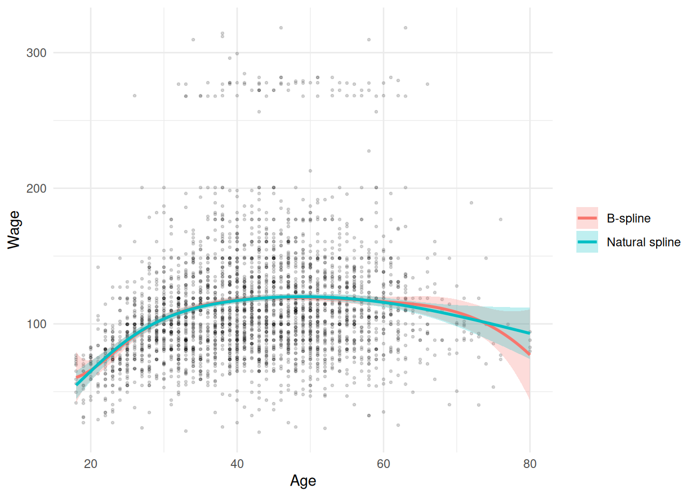](generalized-additive-models_files/figure-revealjs/lab-splines-r-1.png)

## Python

Show R code

``` python
# Not run: the rme render has no Python environment.
bs_mat = dmatrix("bs(age, knots=(25,40,60), include_intercept=False)",
                 {"age": Wage["age"]}, return_type="dataframe")
ns_mat = dmatrix("cr(age, knots=(25,40,60))",
                 {"age": Wage["age"]}, return_type="dataframe")

fit_bs_py = sm.OLS(Wage["wage"], bs_mat).fit()
fit_ns_py = sm.OLS(Wage["wage"], ns_mat).fit()

bs_grid = dmatrix("bs(age, knots=(25,40,60), include_intercept=False)",
                  {"age": age_grid}, return_type="dataframe")
ns_grid = dmatrix("cr(age, knots=(25,40,60))",
                  {"age": age_grid}, return_type="dataframe")

plt.figure(figsize=(7, 4))
plt.scatter(Wage["age"], Wage["wage"], alpha=0.15, s=6)
plt.plot(age_grid, fit_bs_py.predict(bs_grid), label="B-spline", linewidth=2)
plt.plot(age_grid, fit_ns_py.predict(ns_grid), label="Natural spline", linewidth=2)
plt.legend(); plt.xlabel("Age"); plt.ylabel("Wage")
plt.tight_layout(); plt.show()
```

## Smoothing splines and local regression

A smoothing spline selects the penalty parameter $\lambda$ by generalized cross-validation (GCV); LOESS uses a local polynomial fit [\[1, Secs. 7.5–7.6\]](#ref-james2021islr2e).

## R

Show R code

``` downlit
fit_ss_16 <- smooth.spline(Wage$age, Wage$wage, df = 16)
fit_ss_gcv <- smooth.spline(Wage$age, Wage$wage, cv = FALSE)  # GCV
fit_lo    <- loess(wage ~ age, data = Wage, span = 0.2)

age_seq <- seq(min(Wage$age), max(Wage$age), length.out = 200)
df_sm <- data.frame(
  age  = rep(age_seq, 3),
  fit  = c(predict(fit_ss_16, age_seq)$y,
           predict(fit_ss_gcv, age_seq)$y,
           predict(fit_lo, data.frame(age = age_seq))),
  type = rep(c("Smooth spline df=16",
               paste0("Smooth spline GCV (df=",
                      round(fit_ss_gcv$df, 1), ")"),
               "LOESS span=0.2"),
             each = 200)
)
ggplot(Wage, aes(age, wage)) +
  geom_point(alpha = 0.15, size = 0.6) +
  geom_line(data = df_sm, aes(y = fit, colour = type), linewidth = 1) +
  labs(x = "Age", y = "Wage", colour = NULL)
```

[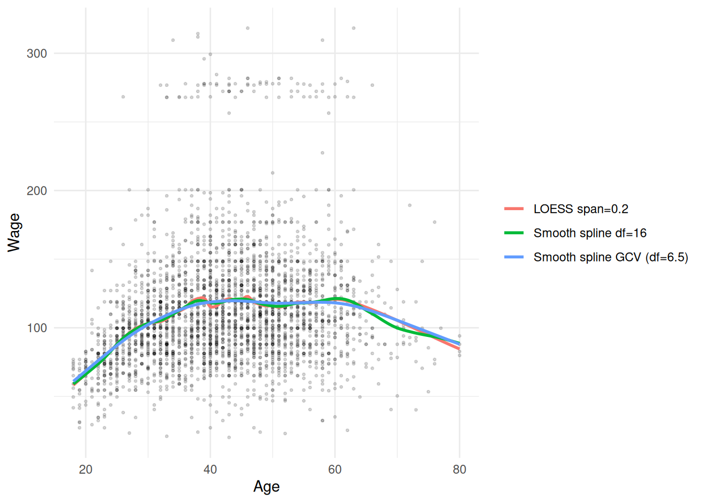](generalized-additive-models_files/figure-revealjs/lab-smooth-r-1.png)

## Python

Show R code

``` python
# Not run: the rme render has no Python environment.
from pygam import LinearGAM, s as gam_s
from statsmodels.nonparametric.smoothers_lowess import lowess

# Smoothing spline via pyGAM
gam_smooth = LinearGAM(gam_s(0, n_splines=25)).gridsearch(
    Wage[["age"]].values, Wage["wage"].values)
XX = gam_smooth.generate_X_grid(term=0, n=200)
pdep, confi = gam_smooth.partial_dependence(term=0, X=XX, width=0.95)

# LOESS
lo_fit = lowess(Wage["wage"], Wage["age"], frac=0.2)

fig, axes = plt.subplots(1, 2, figsize=(12, 4))
axes[0].scatter(Wage["age"], Wage["wage"], alpha=0.15, s=6)
axes[0].plot(XX.ravel(), pdep, color="steelblue", linewidth=2, label="Smoothing spline (GCV)")
axes[0].fill_between(XX.ravel(), confi[:,0], confi[:,1], alpha=0.3)
axes[0].set_xlabel("Age"); axes[0].set_ylabel("Wage"); axes[0].legend()

axes[1].scatter(Wage["age"], Wage["wage"], alpha=0.15, s=6)
axes[1].plot(lo_fit[:,0], lo_fit[:,1], color="tomato", linewidth=2, label="LOESS span=0.2")
axes[1].set_xlabel("Age"); axes[1].set_ylabel("Wage"); axes[1].legend()
plt.tight_layout(); plt.show()
```

## GAMs: continuous outcome

Fit three GAMs for `wage` on the `Wage` data and compare them with [AIC](../chapters/Linear-models-overview.llms.md#def-aic). The book’s lab [\[1, Sec. 7.8.3\]](#ref-james2021islr2e) uses the `gam` package, with [smoothing splines](#def-smoothing-spline) `s(year, 4)` and `s(age, 5)` of 4 and 5 degrees of freedom. It compares, using [`anova()`](https://rdrr.io/r/stats/anova.html), a model without `year`, a model with `year` entering as a straight line, and a model with `year` smooth. This lab uses `mgcv` instead, so the smooths `s(year, k = 4)` and `s(age, k = 5)` have basis dimension 4 and 5, which is not the same as 4 and 5 degrees of freedom, and `mgcv` chooses the amount of smoothing itself. It uses the `mgcv` default `method = "GCV.Cp"` for smoothness selection; for new analyses prefer `method = "REML"` (see [Section 6](#sec-smoothing-splines) and [Section 10](#sec-gam-fitting)).

## R

Show R code

``` downlit
gam1 <- gam(wage ~ s(year, k = 4) + s(age, k = 5) + education,
            data = Wage)
gam2 <- gam(wage ~ year + s(age, k = 5) + education,
            data = Wage)
gam3 <- gam(wage ~ s(year, k = 4) + poly(age, 4) + education,
            data = Wage)

AIC(gam1, gam2, gam3)
```

Show R code

``` downlit

# Book's question: does year belong, and does it need a smooth?
gam0 <- gam(wage ~ s(age, k = 5) + education, data = Wage)
anova(gam0, gam2, gam1, test = "F")
```

Show R code

``` downlit

par(mfrow = c(1, 3))
plot(gam1, shade = TRUE, seWithMean = TRUE,
     main = "GAM1: s(year) + s(age) + education")
```

[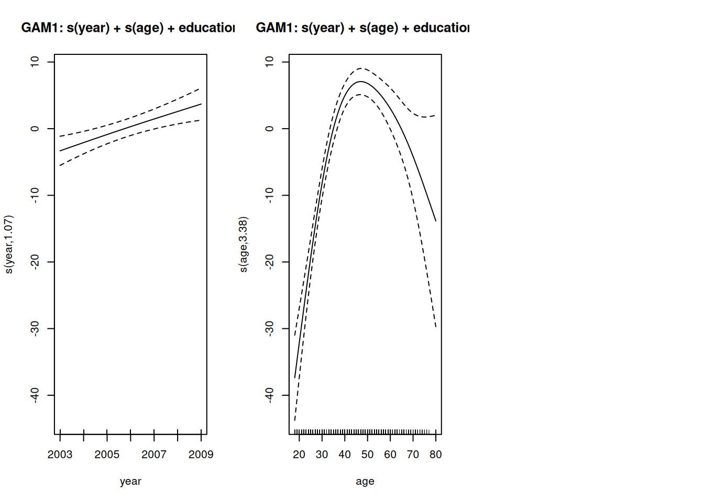](generalized-additive-models_files/figure-revealjs/lab-gam-r-1.png)

## Python

Show R code

``` python
# Not run: the rme render has no Python environment.
from pygam import LinearGAM, s as gam_s, f as gam_f

edu_codes = Wage["education"].cat.codes.values
X_gam = np.column_stack([Wage["year"].values,
                         Wage["age"].values,
                         edu_codes])
y_gam = Wage["wage"].values

gam_py = LinearGAM(
    gam_s(0, n_splines=4) + gam_s(1, n_splines=5) + gam_f(2)
).gridsearch(X_gam, y_gam)

print("AIC:", gam_py.statistics_["AIC"])

fig, axes = plt.subplots(1, 3, figsize=(14, 4))
titles = ["year", "age", "education"]
for i, ax in enumerate(axes):
    XX = gam_py.generate_X_grid(term=i)
    pdep, confi = gam_py.partial_dependence(term=i, X=XX, width=0.95)
    ax.plot(XX[:, i], pdep, linewidth=2)
    ax.fill_between(XX[:, i], confi[:,0], confi[:,1], alpha=0.3)
    ax.set_xlabel(titles[i]); ax.set_ylabel("Partial effect")
plt.tight_layout(); plt.show()
```

## GAMs: binary outcome

Predict whether a worker earns more than \$250k using a logistic GAM. We subset to workers with at least some college education, as the book’s lab does [\[1, Sec. 7.8.3\]](#ref-james2021islr2e). The book keeps `year` as a straight line in this model. Here `year` is smooth, as in the continuous-outcome GAMs.

## R

Show R code

``` downlit
Wage$high <- factor(ifelse(Wage$wage > 250, "High", "Low"),
                    levels = c("Low", "High"))

fit_logit_gam <- gam(
  high ~ s(year, k = 4) + s(age, k = 5) + education,
  family = binomial,
  data = Wage,
  subset = (education != "1. < HS Grad")
)
summary(fit_logit_gam)
#> 
#> Family: binomial 
#> Link function: logit 
#> 
#> Formula:
#> high ~ s(year, k = 4) + s(age, k = 5) + education
#> 
#> Parametric coefficients:
#>                             Estimate Std. Error z value Pr(>|z|)    
#> (Intercept)                   -5.621      0.485  -11.58  < 2e-16 ***
#> education3. Some College       0.788      0.589    1.34  0.18078    
#> education4. College Grad       1.822      0.499    3.65  0.00026 ***
#> education5. Advanced Degree    2.992      0.476    6.28  3.3e-10 ***
#> ---
#> Signif. codes:  0 '***' 0.001 '**' 0.01 '*' 0.05 '.' 0.1 ' ' 1
#> 
#> Approximate significance of smooth terms:
#>          edf Ref.df Chi.sq p-value  
#> s(year) 1.00   1.00   0.14   0.704  
#> s(age)  3.71   3.95   9.41   0.049 *
#> ---
#> Signif. codes:  0 '***' 0.001 '**' 0.01 '*' 0.05 '.' 0.1 ' ' 1
#> 
#> R-sq.(adj) =  0.0494   Deviance explained = 15.7%
#> UBRE = -0.77287  Scale est. = 1         n = 2732

par(mfrow = c(1, 3))
plot(fit_logit_gam, shade = TRUE, seWithMean = TRUE,
     trans = plogis,
     main = "Logistic GAM (P(wage > 250k))")
```

[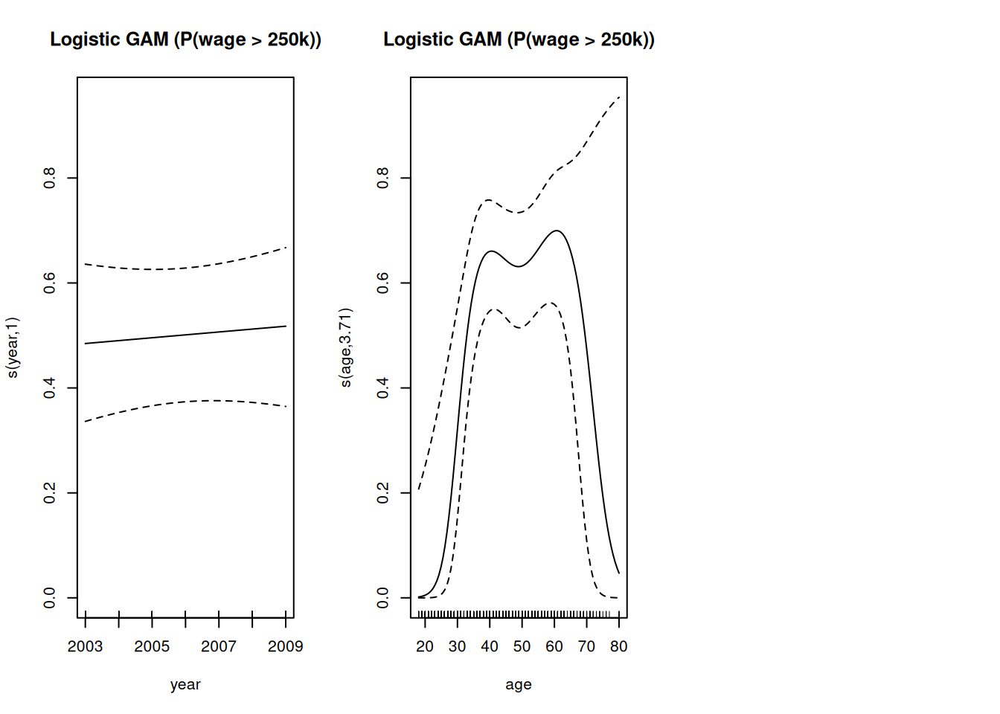](generalized-additive-models_files/figure-revealjs/lab-gam-logistic-r-1.png)

## Python

Show R code

``` python
# Not run: the rme render has no Python environment.
from pygam import LogisticGAM, s as gam_s, f as gam_f
from scipy.special import expit

mask = Wage["education"] != "1. < HS Grad"
W2 = Wage[mask].copy()
W2["high"] = (W2["wage"] > 250).astype(int)
# drop the unused level so the codes run from 0, as pygam's factor term expects:
edu2 = W2["education"].cat.remove_unused_categories().cat.codes.values

X_log = np.column_stack([W2["year"].values,
                          W2["age"].values,
                          edu2])
y_log = W2["high"].values

gam_log = LogisticGAM(
    gam_s(0, n_splines=4) + gam_s(1, n_splines=5) + gam_f(2)
).gridsearch(X_log, y_log)

print("Training accuracy:", (gam_log.predict(X_log) == y_log).mean())

# pygam's partial effects are on the log-odds scale and leave out the intercept
# (the last coefficient), so add it back before applying the inverse logit:
intercept = gam_log.coef_[-1]

fig, axes = plt.subplots(1, 3, figsize=(14, 4))
titles = ["year", "age", "education"]
for i, ax in enumerate(axes):
    XX = gam_log.generate_X_grid(term=i)
    pdep, confi = gam_log.partial_dependence(term=i, X=XX, width=0.95)
    ax.plot(XX[:, i], expit(pdep + intercept), linewidth=2)
    ax.fill_between(XX[:, i],
                    expit(confi[:, 0] + intercept),
                    expit(confi[:, 1] + intercept),
                    alpha=0.3)
    ax.set_xlabel(titles[i]); ax.set_ylabel("P(wage > 250k)")
plt.tight_layout(); plt.show()
```

# 14 Exercises

## 14.1 Conceptual exercises

Exercises adapted from James et al. [\[1, Sec. 7.9\]](#ref-james2021islr2e) and Hastie et al. [\[6, Sec. 9.1\]](#ref-hastie2009esl2e).

### 14.1.1 Piecewise polynomial continuity (ISLRv2 Conceptual 1)

> **NOTE:**
>
> **Exercise 1** A cubic polynomial with one interior knot at $\xi$ uses the truncated power basis:
>
> $$f(X) = \beta_0 + \beta_1 X + \beta_2 X^2 + \beta_3 X^3 + \beta_4 (X-\xi)_+^3$$
>
> where $(u)_+ = \max(u,0)$.
>
> **(a)** Write $f(X)$ as two cubics: $f_1(X)$ for $X < \xi$ and $f_2(X)$ for $X \ge \xi$.
>
> **(b)** Show $f_1(\xi) = f_2(\xi)$ (continuity).
>
> **(c)** Show the first derivatives match at $\xi$.
>
> **(d)** Show the second derivatives match at $\xi$.
>
> **(e)** Do the third derivatives match? What order of smoothness does this cubic spline achieve?

> **NOTE:**
>
> *Solution 1*. **(a)** For $X < \xi$: $(X-\xi)_+ = 0$, giving $f_1(X) = \beta_0 + \beta_1 X + \beta_2 X^2 + \beta_3 X^3$. For $X \ge \xi$: $f_2(X) = f_1(X) + \beta_4(X-\xi)^3$.
>
> **(b)** At $X=\xi$: $(X-\xi)_+^3 = 0$, so $f_2(\xi) = f_1(\xi)$. $\checkmark$
>
> **(c)** $f_2^{\prime}(X) = f_1^{\prime}(X) + 3\beta_4(X-\xi)_+^2$. At $X=\xi$: $(X-\xi)_+^2 = 0$, so the derivatives agree. $\checkmark$
>
> **(d)** $f_2^{\prime\prime}(X) = f_1^{\prime\prime}(X) + 6\beta_4(X-\xi)_+$. At $X=\xi$: $(X-\xi)_+ = 0$. $\checkmark$
>
> **(e)** $f_1^{\prime\prime\prime} = 6\beta_3$ and $f_2^{\prime\prime\prime} = 6\beta_3 + 6\beta_4$ for $X > \xi$. These differ (unless $\beta_4=0$). The truncated power basis gives a **cubic spline**: continuous with continuous 1st and 2nd derivatives, but a jump in the 3rd derivative at each knot.

### 14.1.2 Smoothing spline penalty behavior (ISLRv2 Conceptual 2)

> **NOTE:**
>
> **Exercise 2** The smoothing spline minimizes
>
> $$\hat{g} = \arg\min_g \left\{ \sum_{i=1}^n (y_i - g(x_i))^2 + \lambda\int g^{\prime\prime}(t)^2 \, dt \right\}.$$
>
> **(a)** What is the limiting form of $\hat{g}$ as $\lambda\to \infty$?
>
> **(b)** What is the limiting form as $\lambda\to 0$?
>
> **(c)** For $\lambda\to 0$, is the training RSS equal to zero?

> **NOTE:**
>
> *Solution 2*. **(a)** As $\lambda\to \infty$ the roughness penalty dominates. The only $g$ with $\int g^{\prime\prime}(t)^2\,dt = 0$ is a linear function $g(x) = a + bx$. So $\hat{g}$ converges to the ordinary least-squares line.
>
> **(b)** As $\lambda\to 0$ there is no penalty; the minimizer interpolates every training point: $g(x_i) = y_i$ for all $i$.
>
> **(c)** Yes. Interpolation means training RSS $= 0$ – the overfit extreme.

> **NOTE:**
>
> **Theorem 4 (Smoothing spline with an infinite penalty is the least-squares line)** Let $(x_1, y_1), \ldots, (x_n, y_n)$ be data with at least two distinct values of $x_i$. For $\lambda\ge 0$, let $\hat{g}_\lambda$ be the smoothing spline that minimizes
>
> $$\sum_{i=1}^n(y_i - g(x_i))^2 + \lambda\int g^{\prime\prime}(t)^2 \, dt.$$
>
> As $\lambda\to \infty$, $\hat{g}_\lambda$ converges to the ordinary least-squares line $g(x) = a + bx$.

> **NOTE:**
>
> *Proof*. This proof is the solution to [Exercise 2](#exr-smoothing-penalty), worked in [Solution 2](#sol-smoothing-penalty).

> **NOTE:**
>
> **Example 18 (A heavily penalized smoothing spline matches the least-squares line)** In the built-in `cars` data, the code below fits a smoothing spline of stopping distance on speed with a very large penalty, and compares its fitted values with those of the least-squares line:
>
> Show R code
>
> ``` downlit
> cars_lm <- lm(dist ~ speed, data = cars)
> cars_big_lambda <- smooth.spline(cars$speed, cars$dist, lambda = 1e6)
> max_gap <- max(abs(predict(cars_big_lambda, cars$speed)$y - fitted(cars_lm)))
> ```
>
> The largest gap between the two sets of fitted values is 0.00067, which is negligible next to stopping distances measured in feet, as [Theorem 4](#thm-smoothing-spline-large-penalty) says.

> **NOTE:**
>
> **Theorem 5 (Smoothing spline with no penalty interpolates the training data)** Let $(x_1, y_1), \ldots, (x_n, y_n)$ be data with distinct values $x_i$, and let $\hat{g}_\lambda$ be the smoothing spline of [Theorem 4](#thm-smoothing-spline-large-penalty). As $\lambda\to 0$, $\hat{g}_\lambda$ approaches a function that interpolates every training point, $g(x_i) = y_i$ for all $i$, so the training residual sum of squares $\sum_{i=1}^n(y_i - \hat{g}_\lambda(x_i))^2$ approaches $0$.

> **NOTE:**
>
> *Proof*. This proof is the solution to [Exercise 2](#exr-smoothing-penalty), worked in [Solution 2](#sol-smoothing-penalty).

> **NOTE:**
>
> **Example 19 (A barely penalized smoothing spline interpolates the data)** The code below simulates 20 noisy observations of a sine curve at distinct values of $x$, fits a smoothing spline with a tiny penalty, and computes its training residual sum of squares:
>
> Show R code
>
> ``` downlit
> set.seed(1)
> sim_x <- sort(runif(20))
> sim_y <- sin(2 * pi * sim_x) + rnorm(20, sd = 0.3)
> sim_small_lambda <- smooth.spline(sim_x, sim_y, lambda = 1e-12)
> sim_rss <- sum((sim_y - predict(sim_small_lambda, sim_x)$y)^2)
> ```
>
> The training residual sum of squares is 8.1e-11, which is essentially 0 even though the data have noise standard deviation 0.3, as [Theorem 5](#thm-smoothing-spline-zero-penalty) says.

## 14.2 Applied exercises

Applied exercises adapted from James et al. [\[1, Sec. 7.9\]](#ref-james2021islr2e) and Hastie et al. [\[6, Sec. 9.1\]](#ref-hastie2009esl2e).

### 14.2.1 Polynomial regression and step functions (ISLRv2 Applied 6)

> **NOTE:**
>
> **Exercise 3** Using the `Wage` dataset from the `ISLR2` package [\[1\]](#ref-james2021islr2e):
>
> **(a)** Use 10-fold cross-validation to choose the polynomial degree $d^*$ for predicting `wage` from `age`. Plot the CV errors for degrees 1 through 10.
>
> **(b)** Fit the degree-$d^*$ polynomial and plot it with a 95% confidence band.
>
> **(c)** Separately, choose the number of cut-points $K^*$ for a step-function model using cross-validation. Plot the chosen step-function fit.

> **NOTE:**
>
> *Solution 3*.
>
> ## R
>
> Show R code
>
> ``` downlit
> library(ISLR2)
> library(boot)
> library(ggplot2)
> set.seed(1)
> cv_poly <- vapply(1:10, function(d) {
>   cv.glm(Wage, glm(wage ~ poly(age, d), data = Wage), K = 10)$delta[1]
> }, numeric(1))
> best_d <- which.min(cv_poly)
> cat("CV-selected degree:", best_d, "\n")
> #> CV-selected degree: 9
> plot(1:10, cv_poly, type = "b", xlab = "Degree", ylab = "CV MSE",
>      main = "Polynomial degree selection")
> points(best_d, cv_poly[best_d], col = "red", pch = 19)
> ```
>
> [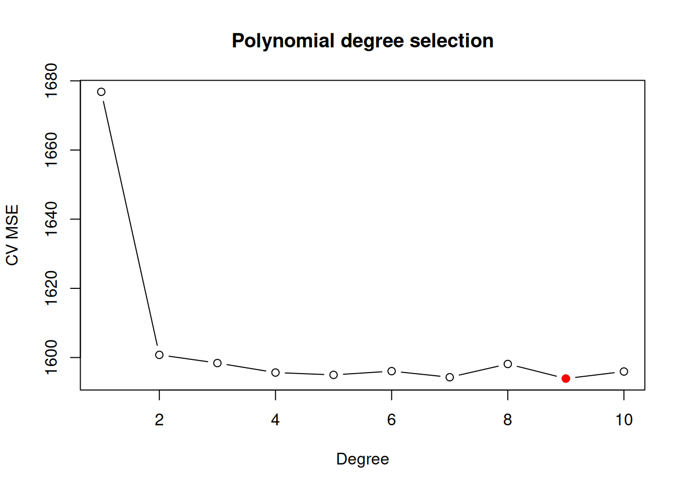](generalized-additive-models_files/figure-revealjs/unnamed-chunk-29-1.png)
>
> ## Python
>
> Show R code
>
> ``` python
> # Not run: the rme render has no Python environment.
> import numpy as np
> from sklearn.preprocessing import PolynomialFeatures
> from sklearn.linear_model import LinearRegression
> from sklearn.pipeline import Pipeline
> from sklearn.model_selection import cross_val_score
> from ISLP import load_data
> Wage = load_data("Wage")
> X = Wage["age"].values.reshape(-1, 1)
> y = Wage["wage"].values
> cv_errs = [-cross_val_score(
>     Pipeline([("poly", PolynomialFeatures(d, include_bias=False)),
>               ("reg", LinearRegression())]),
>     X, y, cv=10, scoring="neg_mean_squared_error").mean() for d in range(1, 11)]
> best_d = int(np.argmin(cv_errs)) + 1
> print(f"CV-selected degree: {best_d}")
> ```

### 14.2.2 Backfitting algorithm (ESL §9.1.1 / ISLRv2 Applied 11)

> **NOTE:**
>
> **Exercise 4** The **backfitting algorithm** [\[6, Sec. 9.1.1\]](#ref-hastie2009esl2e) fits an additive model $Y = \alpha+ \sum_j f_j(X_j) + \varepsilon$ by iteratively smoothing partial residuals.
>
> For $p=2$ predictors with linear component smoothers $\hat{f_j}(X_j) = \hat{\beta}_j X_j$:
>
> 1.  Initialise: $\hat{\alpha} = \bar{y}$, $\hat{f_1} = \hat{f_2} = 0$.
> 2.  Repeat until convergence (Gauss–Seidel order — re-centre each $\hat{f_j}$ immediately, so the centred $\hat{f_1}$ is used when computing $r_2$):
>     1.  $r_1 \leftarrow y - \hat{\alpha} - \hat{f_2}(x_2)$; regress $r_1$ on $x_1$ to update $\hat{f_1}$; $\hat{f_1} \leftarrow \hat{f_1} -
>         \overline{\hat{f_1}}$.
>     2.  $r_2 \leftarrow y - \hat{\alpha} - \hat{f_1}(x_1)$; regress $r_2$ on $x_2$ to update $\hat{f_2}$; $\hat{f_2} \leftarrow \hat{f_2} -
>         \overline{\hat{f_2}}$.
>
> **(a)** Implement this on simulated data with known true coefficients.
>
> **(b)** Verify the coefficients match `lm(y ~ x1 + x2)`.

> **NOTE:**
>
> *Solution 4*.
>
> ## R
>
> Show R code
>
> ``` downlit
> set.seed(1)
> n <- 100
> x1 <- rnorm(n)
> x2 <- rnorm(n)
> y <- 2 + 3 * x1 - 1.5 * x2 + rnorm(n, sd = 0.5)
> alpha_hat <- mean(y)
> f1 <- f2 <- rep(0, n)
> for (iter in seq_len(500)) {
>   r1 <- y - alpha_hat - f2
>   b1 <- coef(lm(r1 ~ x1))[2]
>   f1 <- b1 * x1
>   f1 <- f1 - mean(f1)
>   r2 <- y - alpha_hat - f1
>   b2 <- coef(lm(r2 ~ x2))[2]
>   f2 <- b2 * x2
>   f2 <- f2 - mean(f2)
> }
> lm_fit <- lm(y ~ x1 + x2)
> cat(sprintf("Backfitting: b1=%.4f, b2=%.4f\n", b1, b2))
> #> Backfitting: b1=3.0106, b2=-1.5267
> cat(sprintf("lm():        b1=%.4f, b2=%.4f\n",
>             coef(lm_fit)[2], coef(lm_fit)[3]))
> #> lm():        b1=3.0106, b2=-1.5267
> ```
>
> ## Python
>
> Show R code
>
> ``` python
> # Not run: the rme render has no Python environment.
> import numpy as np
> rng = np.random.default_rng(1)
> n = 100; x1 = rng.standard_normal(n); x2 = rng.standard_normal(n)
> y = 2 + 3*x1 - 1.5*x2 + rng.normal(0, 0.5, n)
> alpha_hat = y.mean(); f1 = np.zeros(n); f2 = np.zeros(n)
> for _ in range(500):
>     r1 = y - alpha_hat - f2
>     b1 = float(np.cov(x1, r1)[0, 1] / np.var(x1, ddof=1))
>     f1 = b1*x1 - (b1*x1).mean()
>     r2 = y - alpha_hat - f1
>     b2 = float(np.cov(x2, r2)[0, 1] / np.var(x2, ddof=1))
>     f2 = b2*x2 - (b2*x2).mean()
> X_ols = np.column_stack([np.ones(n), x1, x2])
> b_ols = np.linalg.lstsq(X_ols, y, rcond=None)[0]
> print(f"Backfitting: b1={b1:.4f}, b2={b2:.4f}")
> print(f"OLS:         b1={b_ols[1]:.4f}, b2={b_ols[2]:.4f}")
> ```
>
> The coefficients agree, confirming backfitting converges to OLS when all component smoothers are linear [\[6, Sec. 9.1.1\]](#ref-hastie2009esl2e).

Back to top

## References

\[1\]

G. James, D. Witten, T. Hastie, and R. Tibshirani, *An introduction to statistical learning: With applications in R*, 2nd ed. Springer, 2021. doi: [10.1007/978-1-0716-1418-1](https://doi.org/10.1007/978-1-0716-1418-1).

\[2\]

S. N. Wood, *Generalized additive models: An introduction with r*, 2nd ed. Chapman; Hall/CRC, 2017.

\[3\]

K. J. Rothman, T. L. Lash, T. J. VanderWeele, and S. Haneuse, *Modern epidemiology*, Fourth edition. Philadelphia: Wolters Kluwer, 2021.

\[4\]

D. Aune *et al.*, “BMI and all cause mortality: Systematic review and non-linear dose-response meta-analysis of 230 cohort studies with 3.74 million deaths among 30.3 million participants,” *BMJ*, vol. 353, p. i2156, 2016, doi: [10.1136/bmj.i2156](https://doi.org/10.1136/bmj.i2156).

\[5\]

A. Gasparrini *et al.*, “Mortality risk attributable to high and low ambient temperature: A multicountry observational study,” *The Lancet*, vol. 386, no. 9991, pp. 369–375, 2015, doi: [10.1016/S0140-6736(14)62114-0](https://doi.org/10.1016/S0140-6736(14)62114-0).

\[6\]

T. Hastie, R. Tibshirani, and J. Friedman, *The elements of statistical learning: Data mining, inference, and prediction*, 2nd ed. Springer, 2009. doi: [10.1007/978-0-387-84858-7](https://doi.org/10.1007/978-0-387-84858-7).

\[7\]

S. N. Wood, “On p-values for smooth components of an extended generalized additive model,” *Biometrika*, vol. 100, no. 1, pp. 221–228, 2013, doi: [10.1093/biomet/ass048](https://doi.org/10.1093/biomet/ass048).

\[8\]

R. H. Rosenman, R. J. Brand, C. D. Jenkins, M. Friedman, R. Straus, and M. Wurm, “Coronary heart disease in the Western Collaborative Group Study: Final follow-up experience of 8 1/2 years,” *JAMA*, vol. 233, no. 8, pp. 872–877, 1975, doi: [10.1001/jama.1975.03260080034016](https://doi.org/10.1001/jama.1975.03260080034016).

\[9\]

G. James, D. Witten, T. Hastie, R. Tibshirani, and J. Taylor, *An introduction to statistical learning: With applications in Python*. New York: Springer, 2023. Available: <https://www.statlearning.com>
