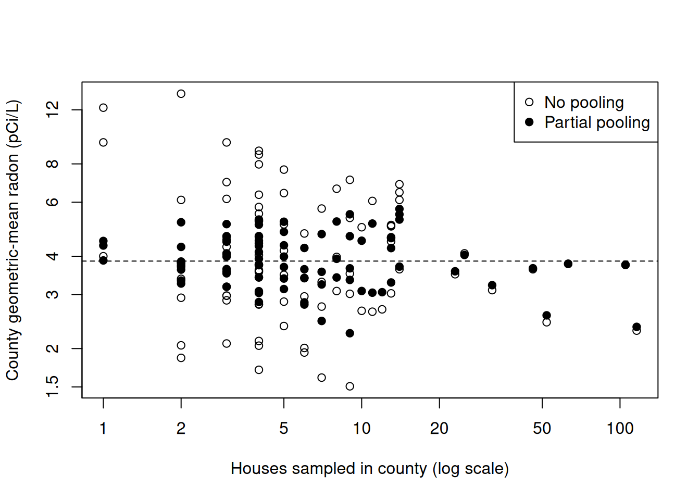

# Introduction to Multi-level Models

Code

- [Show All Code](javascript:void(0))

- [Hide All Code](javascript:void(0))

- 

  ------------------------------------------------------------------------

- [View Source](javascript:void(0))

Published

Last modified: 2026-11-11: 8:13:42 (UTC)

------------------------------------------------------------------------

# Configuring R

Functions from these packages will be used throughout this document:

Show R code

``` downlit
library(conflicted) # check for conflicting function definitions
# printr is not loaded here: it inserts help-file output into markdown output
library(rmarkdown) # Convert R Markdown documents into a variety of formats.
library(pander) # format tables for markdown
library(ggplot2) # graphics
library(ggfortify) # help with graphics
library(dplyr) # manipulate data
library(tibble) # `tibble`s extend `data.frame`s
library(magrittr) # `%>%` and other additional piping tools
library(haven) # import Stata files
library(knitr) # format R output for markdown
library(tidyr) # Tools to help to create tidy data
library(plotly) # interactive graphics
library(dobson) # datasets from Dobson and Barnett 2018
library(parameters) # format model output tables for markdown
library(haven) # import Stata files
library(latex2exp) # use LaTeX in R code (for figures and tables)
library(fs) # filesystem path manipulations
library(survival) # survival analysis
library(survminer) # survival analysis graphics
library(KMsurv) # datasets from Klein and Moeschberger
library(parameters) # format model output tables for
library(webshot2) # convert interactive content to static for pdf
library(forcats) # functions for categorical variables ("factors")
library(stringr) # functions for dealing with strings
library(lubridate) # functions for dealing with dates and times
# Summarizes key information about statistical objects in tidy tibbles
library(broom)
# Provides suite of functions to work with regression model
# `broom::tidy()` tibbles
library(broom.helpers)
```

Here are some R settings I use in this document:

Show R code

``` downlit
rm(list = ls()) # delete any data that's already loaded into R

conflicts_prefer(dplyr::filter)
ggplot2::theme_set(
  ggplot2::theme_bw() +
    # ggplot2::labs(col = "") +
    ggplot2::theme(
      legend.position = "bottom",
      text = ggplot2::element_text(size = 12, family = "serif")
    )
)

knitr::opts_chunk$set(message = FALSE)
options(digits = 6)

panderOptions("big.mark", ",")
pander::panderOptions("table.emphasize.rownames", FALSE)
pander::panderOptions("table.split.table", Inf)
# use the `filter()` function from dplyr() by default
conflicts_prefer(dplyr::filter)
legend_text_size <- 9
run_graphs <- TRUE
```

This chapter adapts [David Rocke](https://dmrocke.ucdavis.edu/)’s May 25 – June 1 lectures from the [2021 edition of this course](https://dmrocke.ucdavis.edu/Class/EPI204-Spring-2021/EPI204-Spring-2021.html) [\[1\]](#ref-rocke2021epi204).

# 1 Correlated data

The models in earlier chapters assumed that the outcomes $Y_1, \ldots, Y_n$ were mutually independent given the covariates. Many epidemiologic studies collect data in **clusters**: repeated measurements on the same person, patients treated at the same hospital, or houses in the same county [\[2, Ch. 11\]](#ref-dobson4e). Observations in the same cluster tend to resemble one another more than observations in different clusters, so the independence assumption fails. Ignoring that correlation usually makes standard errors too small, because the data carry less information than the same number of independent observations would [\[2, Ch. 11\]](#ref-dobson4e).

Two kinds of model term describe clusters.

> **NOTE:**
>
> **Definition 1 (Fixed effect)** A **fixed effect** is a model term whose coefficient the model treats as an unknown constant, such as the effect of a specific treatment or the mean of a specific group; the goal is to estimate that particular value [\[1\]](#ref-rocke2021epi204).

> **NOTE:**
>
> **Example 1 (A treatment fixed effect)** In a trial comparing a new blood-pressure drug with a placebo, let $X = 1$ for the drug group and $X = 0$ for the placebo group, and suppose that the mean systolic blood pressure (in mmHg) is $${\mathbb{E}\mathopen{}\left[Y|X=x\right]\mathclose{}} = \beta_0 + \beta_1 x,$$ with $\beta_0 = 120$ and $\beta_1 = -8$. Both coefficients are fixed effects: each is a single constant that applies to every participant. The mean in the drug group is:
>
> $$\begin{aligned}
> {\mathbb{E}\mathopen{}\left[Y|X=1\right]\mathclose{}}
> &= \beta_0 + \beta_1 \cdot 1
> && \text{(substitute $x = 1$)}\\
> &= 120 + (-8) \cdot 1
> && \text{(substitute the coefficient values)}\\
> &= 112
> && \text{(arithmetic)}
> \end{aligned}$$

> **NOTE:**
>
> **Definition 2 (Random effect)** A **random effect** is a model term that treats the groups in the data as a sample from a larger population of groups: each group’s effect is a [random variable](https://morrison-lab.github.io/pds/random-variables.html#def-random-variable), and the groups’ effects are drawn from a common distribution, such as $$\alpha_1, \ldots, \alpha_a \ \sim_{\operatorname{iid}}\ {\operatorname{N}\mathopen{}\left(0, \sigma_\alpha^2\right)\mathclose{}}.$$ The parameters of interest are then the parameters of that distribution, especially its [variance](https://morrison-lab.github.io/pds/variance-covariance.html#def-variance) $\sigma_\alpha^2$, rather than the effects of the particular groups in the data [\[1\]](#ref-rocke2021epi204).

> **NOTE:**
>
> **Example 2 (Patient random effects)** Suppose each of 20 patients has their systolic blood pressure measured several times, and patient $i$’s mean blood pressure is $\mu + \alpha_i$, with $\mu = 120$ mmHg and patient random effects $\alpha_i \ \sim_{\operatorname{iid}}\ {\operatorname{N}\mathopen{}\left(0, \sigma_\alpha^2\right)\mathclose{}}$, with $\sigma_\alpha = 10$ mmHg. About 95% of a normal distribution lies within 1.96 standard deviations of its mean, so about 95% of patients in the population have mean blood pressures between:
>
> $$\begin{aligned}
> \mu \pm 1.96\,\sigma_\alpha
> &= 120 \pm 1.96 \cdot 10
> && \text{(substitute $\mu$ and $\sigma_\alpha$)}\\
> &= 120 \pm 19.6
> && \text{(multiply)}\\
> &= [100.4, 139.6]
> && \text{(add and subtract)}
> \end{aligned}$$
>
> The quantity this model is built to estimate is $\sigma_\alpha$, which describes all patients in the population, not only the 20 patients who happen to be in the study.

> **NOTE:**
>
> **Example 3 (Fixed versus random effects)**  
>
> - In a trial comparing a new drug with a placebo, the treatment groups are the only two groups of interest, so treatment is a fixed effect.
> - In a study that measures each of 20 patients several times, the 20 patients are a sample from the population of all patients, and we want conclusions that apply to patients beyond these 20, so patient is a random effect.

Random effects can be **nested** or **crossed**. Effects are nested when each lower-level group belongs to exactly one higher-level group, such as batches within laboratories. Effects are crossed when every level of one factor can appear with every level of the other, such as patients and raters when every rater scores every patient [\[1\]](#ref-rocke2021epi204).

> **NOTE:**
>
> **Definition 3 (Mixed-effects model (mixed model))** A **mixed-effects model** (or **mixed model**) is a regression model that contains both fixed effects ([Definition 1](#def-fixed-effect)) and random effects ([Definition 2](#def-random-effect)) [\[1\]](#ref-rocke2021epi204), [\[2, Ch. 11\]](#ref-dobson4e).

Whether a term is fixed or random is part of the *model structure*. It does not determine the *inference method*: the same mixed-effects model can be fit by maximum likelihood, by restricted maximum likelihood (REML), or by Bayesian inference.

> **NOTE:**
>
> **Example 4 (Linear mixed model with a random intercept)** For example, a linear mixed model with a random intercept for each group is $$Y_{ij} \stackrel{\text{def}}{=}{\mathord{\smash[b]{\underset{\raise.3ex\hbox{$\scriptstyle\sim$}}{x}}\vphantom{x}}_{ij}}^{\top}\mathord{\smash[b]{\underset{\raise.3ex\hbox{$\scriptstyle\sim$}}{\beta}}\vphantom{\beta}}+ \alpha_i + \epsilon_{ij},$$ where $\mathord{\smash[b]{\underset{\raise.3ex\hbox{$\scriptstyle\sim$}}{\beta}}\vphantom{\beta}}$ is a vector of fixed effects, $\alpha_i \ \sim_{\operatorname{iid}}\ {\operatorname{N}\mathopen{}\left(0, \sigma_\alpha^2\right)\mathclose{}}$ is the random effect of group $i$, and $\epsilon_{ij} \ \sim_{\operatorname{iid}}\ {\operatorname{N}\mathopen{}\left(0, \sigma^2\right)\mathclose{}}$ is independent of the $\alpha_i$s.

> **NOTE:**
>
> **Example 5 (Drug trial with repeated measurements)** Combining [Example 1](#exm-fixed-effect) and [Example 2](#exm-random-effect), suppose that each patient in the drug trial has blood pressure measured several times, and that $$Y_{ij} = \beta_0 + \beta_1 x_{ij} + \alpha_i + \epsilon_{ij},$$ with fixed effects $\beta_0 = 120$ and $\beta_1 = -8$, and patient random effects $\alpha_i \ \sim_{\operatorname{iid}}\ {\operatorname{N}\mathopen{}\left(0, 10^2\right)\mathclose{}}$. If patient 3 takes the drug ($x_{3j} = 1$) and that patient’s random effect is $\alpha_3 = 7$, then the mean blood pressure of patient 3 is:
>
> $$\begin{aligned}
> {\mathbb{E}\mathopen{}\left[Y_{3j}|x_{3j} = 1, \alpha_3 = 7\right]\mathclose{}}
> &= \beta_0 + \beta_1 \cdot 1 + \alpha_3
> && \text{(substitute $x_{3j} = 1$; ${\mathbb{E}\mathopen{}\left[\epsilon_{3j}\right]\mathclose{}} = 0$)}\\
> &= 120 + (-8) \cdot 1 + 7
> && \text{(substitute the values)}\\
> &= 119
> && \text{(arithmetic)}
> \end{aligned}$$

> **NOTE:**
>
> **Example 6 (A model with only fixed effects)** The model in [Example 1](#exm-fixed-effect) is not a mixed-effects model: both of its coefficients are fixed effects, and it has no random effects.

The same ideas extend from linear models to logistic and Poisson regression [\[1\]](#ref-rocke2021epi204).

# 2 One-way random-effects models

> **TIP:**
>
> David Rocke’s Epi 204 lecture [*Introduction to Random Effects and Mixed Models*](https://dmrocke.ucdavis.edu/Class/EPI204-Spring-2021/EPI204-2021-05-25.mp4) ([slides](https://dmrocke.ucdavis.edu/Class/EPI204-Spring-2021/Lecture15RandomEffectsMixedModels.pdf)) covers [fixed](#def-fixed-effect) versus [random effects](#def-random-effect), [one-way random-effects ANOVA](#def-one-way-re), variance components and their [method-of-moments estimates](#cor-mom-vc), and [nested random effects](#def-nested-re) [\[1\]](#ref-rocke2021epi204).

The simplest model with a [random effect](#def-random-effect) has one grouping factor and no covariates [\[1\]](#ref-rocke2021epi204), [\[2, Ch. 11\]](#ref-dobson4e).

> **NOTE:**
>
> **Definition 4 (One-way random-effects model)** Suppose we observe $m$ outcomes $Y_{i1}, \ldots, Y_{im}$ in each of $a$ groups $i = 1, \ldots, a$. The **one-way random-effects model** is $$Y_{ij} \stackrel{\text{def}}{=}\mu + \alpha_i + \epsilon_{ij},
> \tag{1}$$ where:
>
> - $\mu$ is a fixed overall mean;
> - $\alpha_1, \ldots, \alpha_a \ \sim_{\operatorname{iid}}\ {\operatorname{N}\mathopen{}\left(0, \sigma_\alpha^2\right)\mathclose{}}$ are the [random effects](#def-random-effect) of the groups;
> - $\epsilon_{ij} \ \sim_{\operatorname{iid}}\ {\operatorname{N}\mathopen{}\left(0, \sigma^2\right)\mathclose{}}$ are the within-group errors;
> - the $\alpha_i$s and the $\epsilon_{ij}$s are [mutually independent](https://morrison-lab.github.io/pds/independence.html#def-indpt).

> **NOTE:**
>
> **Example 7 (Batches of dyestuff)** The `Dyestuff` data in the `lme4` package [\[3\]](#ref-bates2015lme4) record the yield of dyestuff (in grams of standard color) from $m = 5$ preparations in each of $a = 6$ batches of an intermediate product. The batches are a sample of all the batches the process could produce, so a one-way random-effects model treats $\alpha_i$ as the deviation of batch $i$’s mean yield from the overall mean $\mu$.
>
> Show R code
>
> ``` downlit
> with(Dyestuff, tapply(Yield, Batch, mean))
> #>    A    B    C    D    E    F 
> #> 1505 1528 1564 1498 1600 1470
> ```

> **NOTE:**
>
> **Definition 5 (Variance components)** In [Definition 4](#def-one-way-re), the variances $\sigma_\alpha^2$ and $\sigma^2$ are called **variance components**.

> **NOTE:**
>
> **Example 8 (Variance components of the dyestuff batches)** In [Example 7](#exm-dyestuff), $\sigma_\alpha^2$ is the variance of the batch means around the overall mean $\mu$, and $\sigma^2$ is the variance of the yields within a batch.

The shared [random effect](#def-random-effect) $\alpha_i$ is what makes observations in the same group [correlated](https://morrison-lab.github.io/pds/variance-covariance.html#def-correlation).

> **NOTE:**
>
> **Theorem 1 (Moments of the one-way random-effects model)** Under [Definition 4](#def-one-way-re), for any group $i$ and observations $j \neq k$:
>
> $$\begin{aligned}
> {\mathbb{E}\mathopen{}\left[Y_{ij}\right]\mathclose{}} &= \mu
> \\
> {\operatorname{Var}\mathopen{}\left(Y_{ij}\right)\mathclose{}} &= \sigma_\alpha^2 + \sigma^2
> \\
> {\operatorname{Cov}\mathopen{}\left(Y_{ij}, Y_{ik}\right)\mathclose{}} &= \sigma_\alpha^2
> \end{aligned}
> \tag{2}$$
>
> and observations in different groups are independent.

> **NOTE:**
>
> *Proof*. This proof uses [the definition of covariance](https://morrison-lab.github.io/pds/variance-covariance.html#def-cov), [the covariance of a variable with itself](https://morrison-lab.github.io/pds/variance-covariance.html#lem-cov-xx), and [linearity of expectation](https://morrison-lab.github.io/pds/expectation.html#thm-linearity-expectation).
>
> Mean:
>
> $$\begin{aligned}
> {\mathbb{E}\mathopen{}\left[Y_{ij}\right]\mathclose{}}
> &= {\mathbb{E}\mathopen{}\left[\mu + \alpha_i + \epsilon_{ij}\right]\mathclose{}}
> && \text{(definition of the model)}
> \\
> &= \mu + {\mathbb{E}\mathopen{}\left[\alpha_i\right]\mathclose{}} + {\mathbb{E}\mathopen{}\left[\epsilon_{ij}\right]\mathclose{}}
> && \text{(linearity of expectation)}
> \\
> &= \mu + 0 + 0
> && \text{(both have mean zero)}
> \\
> &= \mu
> && \text{(simplify)}
> \end{aligned}
> \tag{3}$$
>
> Covariance, for $j$ and $k$ equal or not:
>
> $$\begin{aligned}
> {\operatorname{Cov}\mathopen{}\left(Y_{ij}, Y_{ik}\right)\mathclose{}}
> &\stackrel{\text{def}}{=}{\mathbb{E}\mathopen{}\left[(Y_{ij} - \mu)(Y_{ik} - \mu)\right]\mathclose{}}
> && \text{(definition of covariance)}
> \\
> &= {\mathbb{E}\mathopen{}\left[(\alpha_i + \epsilon_{ij})(\alpha_i + \epsilon_{ik})\right]\mathclose{}}
> && \text{(substitute the model)}
> \\
> &= {\mathbb{E}\mathopen{}\left[\alpha_i^2 + \alpha_i\epsilon_{ik} + \epsilon_{ij}\alpha_i + \epsilon_{ij}\epsilon_{ik}\right]\mathclose{}}
> && \text{(distribute)}
> \\
> &= {\mathbb{E}\mathopen{}\left[\alpha_i^2\right]\mathclose{}} + {\mathbb{E}\mathopen{}\left[\alpha_i\epsilon_{ik}\right]\mathclose{}} + {\mathbb{E}\mathopen{}\left[\epsilon_{ij}\alpha_i\right]\mathclose{}} + {\mathbb{E}\mathopen{}\left[\epsilon_{ij}\epsilon_{ik}\right]\mathclose{}}
> && \text{(linearity of expectation)}
> \\
> &= \sigma_\alpha^2 + {\mathbb{E}\mathopen{}\left[\alpha_i\epsilon_{ik}\right]\mathclose{}} + {\mathbb{E}\mathopen{}\left[\epsilon_{ij}\alpha_i\right]\mathclose{}} + {\mathbb{E}\mathopen{}\left[\epsilon_{ij}\epsilon_{ik}\right]\mathclose{}}
> && \text{(${\mathbb{E}\mathopen{}\left[\alpha_i\right]\mathclose{}} = 0$, so ${\mathbb{E}\mathopen{}\left[\alpha_i^2\right]\mathclose{}} = {\operatorname{Var}\mathopen{}\left(\alpha_i\right)\mathclose{}}$)}
> \\
> &= \sigma_\alpha^2 + 0 + 0 + {\mathbb{E}\mathopen{}\left[\epsilon_{ij}\epsilon_{ik}\right]\mathclose{}}
> && \text{(independent, mean-zero factors)}
> \end{aligned}
> \tag{4}$$
>
> If $j \neq k$, $\epsilon_{ij}$ and $\epsilon_{ik}$ are independent with mean zero, so ${\mathbb{E}\mathopen{}\left[\epsilon_{ij}\epsilon_{ik}\right]\mathclose{}} = 0$ and the covariance is $\sigma_\alpha^2$. If $j = k$, ${\mathbb{E}\mathopen{}\left[\epsilon_{ij}^2\right]\mathclose{}} = \sigma^2$, so the covariance of $Y_{ij}$ with itself, which is its variance, is $\sigma_\alpha^2 + \sigma^2$.
>
> Observations in different groups $i \neq i'$ are functions of the disjoint sets of independent variables $\{\alpha_i, \epsilon_{ij}\}$ and $\{\alpha_{i'}, \epsilon_{i'k}\}$, so they are independent.

> **NOTE:**
>
> **Example 9 (Covariance between two dyestuff preparations)** Suppose, for illustration, that the true batch-level variance in [Example 7](#exm-dyestuff) is $\sigma_\alpha^2 = 1764$ and the true within-batch variance is $\sigma^2 = 2451$ (these are the estimates for these data that [Example 11](#exm-dyestuff-vc) derives later, treated here as the true values). Then by [Theorem 1](#thm-re-cov) two preparations from the same batch would have covariance $1764$, and each preparation would have variance $1764 + 2451 = 4215$. Two preparations from different batches would have covariance $0$.

> **NOTE:**
>
> **Definition 6 (Intraclass correlation)** Under [Definition 4](#def-one-way-re), the **intraclass correlation** is the [correlation](https://morrison-lab.github.io/pds/variance-covariance.html#def-correlation) between two observations $j \neq k$ in the same group:
>
> $$\rho \stackrel{\text{def}}{=}\frac{{\operatorname{Cov}\mathopen{}\left(Y_{ij}, Y_{ik}\right)\mathclose{}}}{\sqrt{{\operatorname{Var}\mathopen{}\left(Y_{ij}\right)\mathclose{}}{\operatorname{Var}\mathopen{}\left(Y_{ik}\right)\mathclose{}}}}
> \tag{5}$$

> **NOTE:**
>
> **Corollary 1 (Intraclass correlation in terms of variance components)** Under [Definition 4](#def-one-way-re),
>
> $$\rho = \frac{\sigma_\alpha^2}{\sigma_\alpha^2 + \sigma^2}.
> \tag{6}$$

> **NOTE:**
>
> *Proof*. This proof uses [Theorem 1](#thm-re-cov).
>
> $$\begin{aligned}
> \rho
> &\stackrel{\text{def}}{=}\frac{{\operatorname{Cov}\mathopen{}\left(Y_{ij}, Y_{ik}\right)\mathclose{}}}{\sqrt{{\operatorname{Var}\mathopen{}\left(Y_{ij}\right)\mathclose{}}{\operatorname{Var}\mathopen{}\left(Y_{ik}\right)\mathclose{}}}}
> && \text{(definition of intraclass correlation)}
> \\
> &= \frac{\sigma_\alpha^2}{\sqrt{{\operatorname{Var}\mathopen{}\left(Y_{ij}\right)\mathclose{}}{\operatorname{Var}\mathopen{}\left(Y_{ik}\right)\mathclose{}}}}
> && \text{(covariance from the moments theorem)}
> \\
> &= \frac{\sigma_\alpha^2}{\sqrt{(\sigma_\alpha^2 + \sigma^2)(\sigma_\alpha^2 + \sigma^2)}}
> && \text{(variances from the moments theorem)}
> \\
> &= \frac{\sigma_\alpha^2}{\sigma_\alpha^2 + \sigma^2}
> && \text{(square root of a square)}
> \end{aligned}
> \tag{7}$$

> **NOTE:**
>
> **Example 10 (Intraclass correlation for the dyestuff batches)** With the variance components from [Example 9](#exm-dyestuff-cov), [Corollary 1](#cor-icc) gives
>
> $$\begin{aligned}
> \rho
> &= \frac{1764}{1764 + 2451}
> && \text{(substitute the variance components)}
> \\
> &= \frac{1764}{4215}
> && \text{(add)}
> \\
> &\approx 0.4185
> && \text{(divide)}
> \\
> &\approx 0.42
> && \text{(round to two decimal places)}
> \end{aligned}
> \tag{8}$$
>
> so about 42% of the variation in yield is between batches.

The intraclass correlation is also the fraction of the total variance ${\operatorname{Var}\mathopen{}\left(Y_{ij}\right)\mathclose{}} = \sigma_\alpha^2 + \sigma^2$ that comes from the [random effect](#def-random-effect).

# 3 Variance components

One way to estimate the [variance components](#def-one-way-re) uses the [mean squares](https://morrison-lab.github.io/sds/basic-statistical-methods.html#def-mean-squares) from a [one-way analysis of variance](https://morrison-lab.github.io/sds/basic-statistical-methods.html#def-one-way-anova) (ANOVA) table [\[1\]](#ref-rocke2021epi204). Write $\bar{Y}_{i\cdot} \stackrel{\text{def}}{=}\frac{1}{m}\sum_{j=1}^m Y_{ij}$ for the mean of group $i$ and $\bar{Y}_{\cdot\cdot} \stackrel{\text{def}}{=}\frac{1}{a}\sum_{i=1}^a \bar{Y}_{i\cdot}$ for the overall mean. The **between-group mean square** and the **within-group mean square** are

$$\begin{aligned}
\text{MSA} &\stackrel{\text{def}}{=}\frac{m}{a-1}\sum_{i=1}^a \mathopen{}\left(\bar{Y}_{i\cdot} - \bar{Y}_{\cdot\cdot}\right)\mathclose{}^2,
\\
\text{MSE} &\stackrel{\text{def}}{=}\frac{1}{a(m-1)}\sum_{i=1}^a\sum_{j=1}^m \mathopen{}\left(Y_{ij} - \bar{Y}_{i\cdot}\right)\mathclose{}^2.
\end{aligned}
\tag{9}$$

> **NOTE:**
>
> **Theorem 2 (Expected mean squares in the one-way random-effects model)** Under [Definition 4](#def-one-way-re):
>
> $$\begin{aligned}
> {\mathbb{E}\mathopen{}\left[\text{MSE}\right]\mathclose{}} &= \sigma^2
> \\
> {\mathbb{E}\mathopen{}\left[\text{MSA}\right]\mathclose{}} &= m\sigma_\alpha^2 + \sigma^2
> \end{aligned}
> \tag{10}$$

> **NOTE:**
>
> *Proof*. This proof uses the fact that the [sample variance](https://morrison-lab.github.io/sds/exploratory-descriptive.html#def-sample-variance) of [independent, identically distributed](https://morrison-lab.github.io/pds/independence.html#def-iid) observations is [unbiased](https://morrison-lab.github.io/sds/estimation.html#def-unbiased) for their variance, [the law of iterated expectations](https://morrison-lab.github.io/pds/expectation.html#thm-lie), and [the variance of a linear combination](https://morrison-lab.github.io/pds/variance-covariance.html#thm-var-lincom).
>
> **Within groups.** Given $\alpha_i$, the observations $Y_{i1}, \ldots, Y_{im}$ are independent with common variance $\sigma^2$, so their sample variance $s_i^2 \stackrel{\text{def}}{=}\frac{1}{m-1}\sum_{j=1}^m (Y_{ij} - \bar{Y}_{i\cdot})^2$ satisfies ${\mathbb{E}\mathopen{}\left[s_i^2 \mid \alpha_i\right]\mathclose{}} = \sigma^2$. By the law of iterated expectations, ${\mathbb{E}\mathopen{}\left[s_i^2\right]\mathclose{}} = \sigma^2$. Then
>
> $$\begin{aligned}
> {\mathbb{E}\mathopen{}\left[\text{MSE}\right]\mathclose{}}
> &= {\mathbb{E}\mathopen{}\left[\frac{1}{a}\sum_{i=1}^a s_i^2\right]\mathclose{}}
> && \text{(MSE is the average of the } s_i^2\text{)}
> \\
> &= \frac{1}{a}\sum_{i=1}^a {\mathbb{E}\mathopen{}\left[s_i^2\right]\mathclose{}}
> && \text{(linearity of expectation)}
> \\
> &= \frac{1}{a}\sum_{i=1}^a \sigma^2
> && \text{(each } s_i^2 \text{ is unbiased)}
> \\
> &= \sigma^2
> && \text{(simplify)}
> \end{aligned}
> \tag{11}$$
>
> **Between groups.** Each group mean is $\bar{Y}_{i\cdot} = \mu + \alpha_i + \bar{\epsilon}_{i\cdot}$, where $\bar{\epsilon}_{i\cdot} \stackrel{\text{def}}{=}\frac{1}{m}\sum_{j=1}^m \epsilon_{ij}$. The group means are independent and identically distributed across groups, with
>
> $$\begin{aligned}
> {\operatorname{Var}\mathopen{}\left(\bar{Y}_{i\cdot}\right)\mathclose{}}
> &= {\operatorname{Var}\mathopen{}\left(\alpha_i\right)\mathclose{}} + {\operatorname{Var}\mathopen{}\left(\bar{\epsilon}_{i\cdot}\right)\mathclose{}}
> && \text{(variance of a sum of independent terms)}
> \\
> &= \sigma_\alpha^2 + \frac{1}{m^2}\sum_{j=1}^m {\operatorname{Var}\mathopen{}\left(\epsilon_{ij}\right)\mathclose{}}
> && \text{(variance of a linear combination)}
> \\
> &= \sigma_\alpha^2 + \frac{\sigma^2}{m}
> && \text{(simplify)}
> \end{aligned}
> \tag{12}$$
>
> $\text{MSA}$ is $m$ times the sample variance of $\bar{Y}_{1\cdot}, \ldots, \bar{Y}_{a\cdot}$, so
>
> $$\begin{aligned}
> {\mathbb{E}\mathopen{}\left[\text{MSA}\right]\mathclose{}}
> &= m \cdot {\operatorname{Var}\mathopen{}\left(\bar{Y}_{i\cdot}\right)\mathclose{}}
> && \text{(sample variance is unbiased)}
> \\
> &= m\mathopen{}\left(\sigma_\alpha^2 + \frac{\sigma^2}{m}\right)\mathclose{}
> && \text{(substitute)}
> \\
> &= m\sigma_\alpha^2 + \sigma^2
> && \text{(distribute)}
> \end{aligned}
> \tag{13}$$

> **NOTE:**
>
> **Corollary 2 (Method-of-moments estimators of the variance components)** Under [Definition 4](#def-one-way-re), $\hat{\sigma}^2 \stackrel{\text{def}}{=}\text{MSE}$ and $$\hat{\sigma}_\alpha^2 \stackrel{\text{def}}{=}\frac{\text{MSA} - \text{MSE}}{m}
> \tag{14}$$ are [unbiased estimators](https://morrison-lab.github.io/sds/estimation.html#def-unbiased) of $\sigma^2$ and $\sigma_\alpha^2$.

> **NOTE:**
>
> *Proof*. This proof uses [Theorem 2](#thm-ems-one-way).
>
> $$\begin{aligned}
> {\mathbb{E}\mathopen{}\left[\hat{\sigma}_\alpha^2\right]\mathclose{}}
> &= {\mathbb{E}\mathopen{}\left[\frac{\text{MSA} - \text{MSE}}{m}\right]\mathclose{}}
> && \text{(definition of the estimator)}
> \\
> &= \frac{{\mathbb{E}\mathopen{}\left[\text{MSA}\right]\mathclose{}} - {\mathbb{E}\mathopen{}\left[\text{MSE}\right]\mathclose{}}}{m}
> && \text{(linearity of expectation)}
> \\
> &= \frac{m\sigma_\alpha^2 + \sigma^2 - \sigma^2}{m}
> && \text{(expected mean squares)}
> \\
> &= \frac{m\sigma_\alpha^2}{m}
> && \text{(cancel } \sigma^2\text{)}
> \\
> &= \sigma_\alpha^2
> && \text{(cancel } m\text{)}
> \end{aligned}
> \tag{15}$$
>
> ${\mathbb{E}\mathopen{}\left[\hat{\sigma}^2\right]\mathclose{}} = {\mathbb{E}\mathopen{}\left[\text{MSE}\right]\mathclose{}} = \sigma^2$ directly from [Theorem 2](#thm-ems-one-way).

> **NOTE:**
>
> **Example 11 (Variance components for the dyestuff batches)** The ANOVA table for [Example 7](#exm-dyestuff) gives the mean squares:
>
> Show R code
>
> ``` downlit
> anova(lm(Yield ~ Batch, data = Dyestuff))
> ```
>
> By [Corollary 2](#cor-mom-vc), $\hat{\sigma}^2 = 2451.3$ and $$\begin{aligned}
> \hat{\sigma}_\alpha^2
> &= \frac{11271.5 - 2451.3}{5}
> && \text{(substitute the mean squares and } m = 5\text{)}
> \\
> &= \frac{8820.2}{5}
> && \text{(subtract)}
> \\
> &= 1764.04
> && \text{(divide)}
> \\
> &\approx 1764.0
> && \text{(round to one decimal place)}
> \end{aligned}
> \tag{16}$$
>
> The `lmer()` function in the `lme4` package [\[3\]](#ref-bates2015lme4) fits the same model by restricted maximum likelihood (REML); `(1 | Batch)` requests a random intercept for each batch:
>
> Show R code
>
> ``` downlit
> dyestuff_lmer <- lmer(Yield ~ 1 + (1 | Batch), data = Dyestuff)
> VarCorr(dyestuff_lmer) |> as.data.frame()
> ```
>
> In this balanced design with a positive moment estimate, the REML estimates match the method-of-moments estimates.

The method-of-moments estimate $\hat{\sigma}_\alpha^2$ is negative whenever $\text{MSA} < \text{MSE}$, which is impossible for a variance; likelihood-based methods such as REML constrain the estimate to be nonnegative, and they also handle unbalanced designs [\[1\]](#ref-rocke2021epi204), [\[3\]](#ref-bates2015lme4).

# 4 Nested random effects

A model can have more than one level of [random effects](#def-random-effect). When each lower-level group belongs to exactly one higher-level group, the random effects are **nested** [\[1\]](#ref-rocke2021epi204).

> **NOTE:**
>
> **Definition 7 (Two-level nested random-effects model)** Suppose $a$ laboratories each analyze $b$ batches, with $r$ replicate measurements per batch. The **two-level nested random-effects model** is
>
> $$Y_{ijk} \stackrel{\text{def}}{=}\mu + L_i + B_{ij} + \epsilon_{ijk},
> \tag{17}$$
>
> where $L_i \ \sim_{\operatorname{iid}}\ {\operatorname{N}\mathopen{}\left(0, \sigma_L^2\right)\mathclose{}}$ is the effect of laboratory $i$, $B_{ij} \ \sim_{\operatorname{iid}}\ {\operatorname{N}\mathopen{}\left(0, \sigma_B^2\right)\mathclose{}}$ is the effect of batch $j$ within laboratory $i$, $\epsilon_{ijk} \ \sim_{\operatorname{iid}}\ {\operatorname{N}\mathopen{}\left(0, \sigma^2\right)\mathclose{}}$ is the replicate error, and all three sets of [random variables](https://morrison-lab.github.io/pds/random-variables.html#def-random-variable) are [mutually independent](https://morrison-lab.github.io/pds/independence.html#def-indpt).

By the same argument as [Theorem 2](#thm-ems-one-way), the expected mean squares of the nested ANOVA are ${\mathbb{E}\mathopen{}\left[\text{MS}_L\right]\mathclose{}} = br\sigma_L^2 + r\sigma_B^2 + \sigma^2$, ${\mathbb{E}\mathopen{}\left[\text{MS}_B\right]\mathclose{}} = r\sigma_B^2 + \sigma^2$, and ${\mathbb{E}\mathopen{}\left[\text{MS}_E\right]\mathclose{}} = \sigma^2$ [\[1\]](#ref-rocke2021epi204). So the correct $F$ test for laboratories divides $\text{MS}_L$ by $\text{MS}_B$, not by $\text{MS}_E$.

> **NOTE:**
>
> **Example 12 (A cooperative trial)** The `coop` data in the `MASS` package [\[4\]](#ref-venables2002modern) come from a cooperative trial in which $a = 6$ laboratories each analyzed $b = 3$ batches, a month apart, with $r = 2$ replicates per batch. We use the measurements of specimen `S1`:
>
> Show R code
>
> ``` downlit
> coop2 <- subset(MASS::coop, Spc == "S1")
> anova(lm(Conc ~ Lab + Lab:Bat, data = coop2))
> ```
>
> The `Lab:Bat` term is the batch-within-laboratory effect. The $F$ statistic that [`anova()`](https://rdrr.io/r/stats/anova.html) prints for `Lab` uses $\text{MS}_E$ as its denominator, which is wrong here; the correct statistic is $F = 0.37804 / 0.01703 \approx 22.2$ on $(5, 12)$ degrees of freedom.
>
> The equivalent [mixed model](#def-mixed-model) has a random intercept for each laboratory and for each batch within each laboratory:
>
> Show R code
>
> ``` downlit
> coop_lmer <- lmer(Conc ~ 1 + (1 | Lab) + (1 | Lab:Bat), data = coop2)
> VarCorr(coop_lmer) |> as.data.frame()
> ```
>
> The estimated variance components are $\hat{\sigma}^2 \approx 0.0063$ (same-day replicates), $\hat{\sigma}_B^2 \approx 0.0054$ (batches a month apart), and $\hat{\sigma}_L^2 \approx 0.0602$ (laboratories). Most of the variation in the measurements comes from differences between laboratories.

> **NOTE:**
>
> **Theorem 3 (Covariances in the two-level nested model)** Under [Definition 7](#def-nested-re):
>
> $${\operatorname{Cov}\mathopen{}\left(Y_{ijk}, Y_{i'j'k'}\right)\mathclose{}} =
> \begin{cases}
> \sigma_L^2 + \sigma_B^2 + \sigma^2 & \text{if } (i', j', k') = (i, j, k)
> \\
> \sigma_L^2 + \sigma_B^2 & \text{if } i' = i,\ j' = j,\ k' \ne k
> \\
> \sigma_L^2 & \text{if } i' = i,\ j' \ne j
> \\
> 0 & \text{if } i' \ne i
> \end{cases}
> \tag{18}$$

> **NOTE:**
>
> *Proof*. Subtracting the constant $\mu$ does not change a covariance, and covariance is bilinear, so:
>
> $$\begin{aligned}
> {\operatorname{Cov}\mathopen{}\left(Y_{ijk}, Y_{i'j'k'}\right)\mathclose{}}
> &= {\operatorname{Cov}\mathopen{}\left(L_i + B_{ij} + \epsilon_{ijk},\ L_{i'} + B_{i'j'} + \epsilon_{i'j'k'}\right)\mathclose{}}
> && \text{(subtract the constant } \mu \text{)}
> \\
> &= {\operatorname{Cov}\mathopen{}\left(L_i, L_{i'}\right)\mathclose{}} + {\operatorname{Cov}\mathopen{}\left(B_{ij}, B_{i'j'}\right)\mathclose{}} + {\operatorname{Cov}\mathopen{}\left(\epsilon_{ijk}, \epsilon_{i'j'k'}\right)\mathclose{}} + R
> && \text{(bilinearity of covariance)}
> \\
> &= {\operatorname{Cov}\mathopen{}\left(L_i, L_{i'}\right)\mathclose{}} + {\operatorname{Cov}\mathopen{}\left(B_{ij}, B_{i'j'}\right)\mathclose{}} + {\operatorname{Cov}\mathopen{}\left(\epsilon_{ijk}, \epsilon_{i'j'k'}\right)\mathclose{}}
> && \text{(} R = 0 \text{)}
> \end{aligned}$$
>
> where $R$ is the sum of the six cross covariances, such as ${\operatorname{Cov}\mathopen{}\left(L_i, B_{i'j'}\right)\mathclose{}}$, each between two independent random variables, so each is 0.
>
> Each remaining covariance is a variance when its two arguments are the same random variable, and 0 when they are different, independent random variables:
>
> - ${\operatorname{Cov}\mathopen{}\left(L_i, L_{i'}\right)\mathclose{}}$ is $\sigma_L^2$ if $i' = i$ and 0 otherwise;
> - ${\operatorname{Cov}\mathopen{}\left(B_{ij}, B_{i'j'}\right)\mathclose{}}$ is $\sigma_B^2$ if $(i', j') = (i, j)$ and 0 otherwise;
> - ${\operatorname{Cov}\mathopen{}\left(\epsilon_{ijk}, \epsilon_{i'j'k'}\right)\mathclose{}}$ is $\sigma^2$ if $(i', j', k') = (i, j, k)$ and 0 otherwise.
>
> Adding the three terms in each case of [Equation 18](#eq-nested-re-cov):
>
> - if $(i', j', k') = (i, j, k)$, all three conditions hold, so the covariance is $\sigma_L^2 + \sigma_B^2 + \sigma^2$;
> - if $i' = i$, $j' = j$, and $k' \ne k$, the laboratory and batch conditions hold but the error condition fails, so the covariance is $\sigma_L^2 + \sigma_B^2 + 0 = \sigma_L^2 + \sigma_B^2$;
> - if $i' = i$ and $j' \ne j$, only the laboratory condition holds, so the covariance is $\sigma_L^2 + 0 + 0 = \sigma_L^2$;
> - if $i' \ne i$, none of the conditions hold, so the covariance is $0 + 0 + 0 = 0$.

> **NOTE:**
>
> **Example 13 (Correlations in the cooperative trial)** With the estimated variance components from [Example 12](#exm-coop), $\sigma_L^2 = 0.0602$, $\sigma_B^2 = 0.0054$, and $\sigma^2 = 0.0063$, [Theorem 3](#thm-nested-re-cov) gives the variance of one measurement:
>
> $$\begin{aligned}
> {\operatorname{Var}\mathopen{}\left(Y_{ijk}\right)\mathclose{}}
> &= 0.0602 + 0.0054 + 0.0063
> && \text{(first case of the theorem)}
> \\
> &= 0.0719
> && \text{(add)}
> \end{aligned}$$
>
> Dividing each covariance by this variance gives the correlations:
>
> - two replicates of the same batch: $(0.0602 + 0.0054) / 0.0719 = 0.0656 / 0.0719 \approx 0.912$;
> - two batches from the same laboratory: $0.0602 / 0.0719 \approx 0.837$;
> - measurements from different laboratories: $0$.
>
> Measurements from the same laboratory are highly correlated even when they come from batches analyzed a month apart.

Testing whether a variance component is zero is harder than testing a [fixed effect](#def-fixed-effect), because $\sigma^2 = 0$ lies on the boundary of the [parameter space](https://morrison-lab.github.io/sds/bayesian-inference.html#def-parameter-space): a variance cannot be negative, so the usual large-sample distribution of the [likelihood ratio statistic](https://morrison-lab.github.io/sds/intro-MLEs.html#def-lrt-stat) does not apply [\[1\]](#ref-rocke2021epi204).

# 5 Multilevel models: complete, no, and partial pooling

> **TIP:**
>
> David Rocke’s Epi 204 lecture [*Multilevel Models*](https://dmrocke.ucdavis.edu/Class/EPI204-Spring-2021/EPI204-2021-05-27.mp4) ([slides](https://dmrocke.ucdavis.edu/Class/EPI204-Spring-2021/Lecture16MultilevelModels.pdf)) covers complete, no, and [partial pooling](#thm-partial-pooling) of the Minnesota radon data, random intercepts and slopes with `lmer()`, and shrinkage [\[1\]](#ref-rocke2021epi204).

> **TIP:**
>
> Richard McElreath’s [*Multilevel Models*](https://www.youtube.com/watch?v=jh3RltVrQ-Q) (Statistical Rethinking 2026, Lecture B01) introduces multilevel models and partial pooling. The lecture fits these models using [Bayesian inference](https://morrison-lab.github.io/sds/bayesian-inference.html#def-bayesian-paradigm); the same model structures can also be fit by [maximum likelihood](https://morrison-lab.github.io/sds/intro-MLEs.html#def-mle), as this chapter does with `lmer()` [\[5\]](#ref-mcelreath2026rethinking).

A **multilevel model** is a [regression model](../chapters/Intro-to-GLMs.llms.md#def-regression-model) whose coefficients are allowed to vary by group, with the group-level coefficients themselves given a model [\[6, Ch. 12\]](#ref-gelman2006data). The [random-effects](#def-random-effect) models in [Definition 4](#def-one-way-re) and [Definition 7](#def-nested-re) are the simplest multilevel models.

> **NOTE:**
>
> **Example 14 (Radon in Minnesota homes)** Gelman and Hill [\[6, Ch. 12\]](#ref-gelman2006data) analyze measurements of indoor radon, a radioactive gas that can cause lung cancer, from 919 houses in 85 Minnesota counties. We use the copy of these data distributed with the `rstanarm` R package [\[7\]](#ref-goodrich2024rstanarm):
>
> - `log_radon`: [natural log](https://morrison-lab.github.io/mds/algebra-exponentials.html#def-natural-log) of the radon measurement in the house;
> - `floor`: `0` if the measurement was taken in the basement, `1` if on the first floor;
> - `county`: the county the house is in;
> - `log_uranium`: natural log of the county-level soil uranium measurement.
>
> Show R code
>
> ``` downlit
> load(here::here("inst/extdata/radon.rda"))
> radon_n <- table(radon$county)
> summary(as.vector(radon_n))
> #>    Min. 1st Qu.  Median    Mean 3rd Qu.    Max. 
> #>     1.0     3.0     5.0    10.8    10.0   116.0
> ```
>
> The number of houses per county varies from 1 to 116.

Let $\mu_j \stackrel{\text{def}}{=}\mu + \alpha_j$ denote the true mean log radon level in county $j$. There are three ways to estimate it [\[6, Ch. 12\]](#ref-gelman2006data):

- **Complete pooling** ignores the counties and estimates every county’s mean by the overall mean.
- **No pooling** estimates each county’s mean by its own [sample mean](https://morrison-lab.github.io/sds/exploratory-descriptive.html#def-sample-mean) $\bar{y}_j$, which is very noisy for counties with only one or two houses.
- **Partial pooling** fits the random-intercept model $Y_{ij} = \mu + \alpha_j + \epsilon_{ij}$ for house $i$ in county $j$ ([Definition 4](#def-one-way-re), with the roles of the indices swapped and unequal group sizes $n_j$) and estimates each county’s mean as a compromise between $\bar{y}_j$ and $\mu$.

> **NOTE:**
>
> **Theorem 4 (Partial-pooling estimate of a group mean)** In the random-intercept model with known $\mu$, $\sigma_\alpha^2$, and $\sigma^2$, the predicted mean of group $j$, ${\mathbb{E}\mathopen{}\left[\mu + \alpha_j \mid \text{data}\right]\mathclose{}}$, is
>
> $$\hat{\mu}_j = w_j\bar{y}_j + (1 - w_j)\mu,
> \qquad
> w_j \stackrel{\text{def}}{=}\frac{n_j / \sigma^2}{n_j / \sigma^2 + 1 / \sigma_\alpha^2},
> \tag{19}$$
>
> a weighted average of the group’s sample mean and the overall mean, with weights proportional to their [precisions](https://morrison-lab.github.io/pds/variance-covariance.html#def-precision) [\[6, Ch. 12\]](#ref-gelman2006data).

The proof of [Theorem 4](#thm-partial-pooling) uses the conditional distribution of one [normal variable](https://morrison-lab.github.io/pds/random-variables.html#def-normal) given another, which is beyond the scope of this chapter. The weight $w_j$ increases with the group size $n_j$: large groups keep estimates close to their own sample means, and small groups are pulled, or **shrunk**, toward the overall mean.

> **NOTE:**
>
> **Example 15 (Shrinkage of county mean radon levels)** We fit the random-intercept model to the radon data from [Example 14](#exm-radon-data):
>
> Show R code
>
> ``` downlit
> radon_lmer0 <- lmer(log_radon ~ 1 + (1 | county), data = radon)
> VarCorr(radon_lmer0) |> as.data.frame()
> ```
>
> Show R code
>
> ``` downlit
> fixef(radon_lmer0)
> #> (Intercept) 
> #>     1.34983
> ```
>
> The estimates are $\hat{\mu }\approx 1.350$, $\hat{\sigma}_\alpha^2 \approx 0.0886$, and $\hat{\sigma}^2 \approx 0.587$. Aitkin County has $n_j = 4$ houses with sample mean $\bar{y}_j \approx 0.715$. Plugging these estimates into [Theorem 4](#thm-partial-pooling):
>
> $$\begin{aligned}
> w_j
> &= \frac{4 / 0.587}{4 / 0.587 + 1 / 0.0886}
> && \text{(substitute the estimates)}
> \\
> &\approx \frac{6.81}{6.81 + 11.29}
> && \text{(divide)}
> \\
> &\approx 0.377
> && \text{(divide)}
> \\
> \hat{\mu}_j
> &\approx 0.377 \times 0.715 + 0.623 \times 1.350
> && \text{(substitute into the weighted average)}
> \\
> &\approx 1.111
> && \text{(multiply and add)}
> \end{aligned}
> \tag{20}$$
>
> Aitkin County’s estimate moves most of the way from its own mean toward the overall mean. In contrast, Hennepin County has $n_j = 105$ houses, so its weight is about 0.94 and its estimate barely moves. The same calculation for every county reproduces the estimates that `lme4` reports:
>
> Show R code
>
> ``` downlit
> radon_vc <- as.data.frame(VarCorr(radon_lmer0))$vcov
> radon_w <- (radon_n / radon_vc[2]) /
>   (radon_n / radon_vc[2] + 1 / radon_vc[1])
> radon_ybar <- tapply(radon$log_radon, radon$county, mean)
> radon_pp <- radon_w * radon_ybar + (1 - radon_w) * fixef(radon_lmer0)
> max(abs(radon_pp - coef(radon_lmer0)$county[, 1]))
> #> [1] 3.77476e-15
> ```

> **NOTE:**
>
> Show R code
>
> ``` downlit
> # the fit works with log radon;
> # the y-axis ticks sit at the logs of round radon values, labelled in pCi/L
> radon_ticks <- c(0.5, 1, 1.5, 2, 3, 4, 6, 8, 12)
> plot(
>   as.vector(radon_n), radon_ybar,
>   log = "x", pch = 1, yaxt = "n",
>   xlab = "Houses sampled in county (log scale)",
>   ylab = "County geometric-mean radon (pCi/L)"
> )
> axis(2, at = log(radon_ticks), labels = radon_ticks)
> points(as.vector(radon_n), radon_pp, pch = 19)
> abline(h = fixef(radon_lmer0), lty = 2)
> legend(
>   "topright",
>   legend = c("No pooling", "Partial pooling"),
>   pch = c(1, 19)
> )
> ```
>
> [](intro-multilevel-models_files/figure-revealjs/radon-shrinkage-plot-1.png "Figure 1: No-pooling and partial-pooling estimates of the county geometric-mean radon levels (the exponentials of the estimated county means of log radon); the dashed line is the complete-pooling estimate. The model is fit to log radon, so the radon axis is spaced logarithmically.")
>
> Figure 1: No-pooling and partial-pooling estimates of the county geometric-mean radon levels (the exponentials of the estimated county means of log radon); the dashed line is the complete-pooling estimate. The model is fit to log radon, so the radon axis is spaced logarithmically.

The weight $w_j$ is not arbitrary: even without the normality assumptions, it is the best choice among predictors that move $\bar{y}_j$ toward $\mu$ by a fixed fraction.

> **NOTE:**
>
> **Lemma 1 (The partial-pooling weight minimizes mean squared error)** In the random-intercept model with known $\mu$, $\sigma_\alpha^2$, and $\sigma^2$, consider predictors of the group mean $\mu_j \stackrel{\text{def}}{=}\mu + \alpha_j$ of the form
>
> $$\tilde\mu_j(c) \stackrel{\text{def}}{=}\mu + c\,(\bar{y}_j - \mu)$$
>
> for a constant $c$. The mean squared error ${\mathbb{E}\mathopen{}\left[\mathopen{}\left(\tilde\mu_j(c) - \mu_j\right)\mathclose{}^2\right]\mathclose{}}$ is minimized at $c = w_j$, the weight in [Equation 19](#eq-partial-pooling), which can also be written as
>
> $$w_j = \frac{\sigma_\alpha^2}{\sigma_\alpha^2 + \sigma^2 / n_j}.
> \tag{21}$$
>
> This lemma does not need the normality assumptions of the model, only the means, variances, and independence of its terms.

> **NOTE:**
>
> *Proof*. The sample mean of group $j$ is $\bar{y}_j = \mu + \alpha_j + \bar\epsilon_j$, where $\bar\epsilon_j \stackrel{\text{def}}{=}\frac{1}{n_j}\sum_{i=1}^{n_j}\epsilon_{ij}$ has mean 0 and variance $\sigma^2 / n_j$ and is independent of $\alpha_j$. The prediction error is
>
> $$\begin{aligned}
> \tilde\mu_j(c) - \mu_j
> &= \mu + c\,(\alpha_j + \bar\epsilon_j) - (\mu + \alpha_j)
> && \text{(substitute } \bar{y}_j \text{ and } \mu_j \text{)}
> \\
> &= \mu + c\,\alpha_j + c\,\bar\epsilon_j - \mu - \alpha_j
> && \text{(distribute)}
> \\
> &= c\,\alpha_j + c\,\bar\epsilon_j - \alpha_j
> && \text{(cancel } \mu \text{)}
> \\
> &= (c - 1)\,\alpha_j + c\,\bar\epsilon_j
> && \text{(collect the } \alpha_j \text{ terms)}
> \end{aligned}$$
>
> Both terms have mean 0 and are independent, so
>
> $$\begin{aligned}
> {\operatorname{pMSE}\mathopen{}\left(c\right)\mathclose{}}
> &= {\operatorname{Var}\mathopen{}\left((c - 1)\,\alpha_j + c\,\bar\epsilon_j\right)\mathclose{}}
> && \text{(the error has mean 0)}
> \\
> &= (c - 1)^2 \sigma_\alpha^2 + c^2 \sigma^2 / n_j
> && \text{(variance of a sum of independent terms)}
> \end{aligned}$$
>
> Setting the derivative with respect to $c$ to zero:
>
> $$\begin{aligned}
> 0 &= 2 (c - 1) \sigma_\alpha^2 + 2 c\, \sigma^2 / n_j
> && \text{(differentiate)}
> \\
> 0 &= (c - 1) \sigma_\alpha^2 + c\, \sigma^2 / n_j
> && \text{(divide by 2)}
> \\
> 0 &= c\,\sigma_\alpha^2 - \sigma_\alpha^2 + c\, \sigma^2 / n_j
> && \text{(distribute)}
> \\
> \sigma_\alpha^2 &= c\,\sigma_\alpha^2 + c\, \sigma^2 / n_j
> && \text{(add } \sigma_\alpha^2 \text{ to both sides)}
> \\
> \sigma_\alpha^2 &= c\,\mathopen{}\left(\sigma_\alpha^2 + \sigma^2 / n_j\right)\mathclose{}
> && \text{(factor out } c \text{)}
> \\
> c &= \frac{\sigma_\alpha^2}{\sigma_\alpha^2 + \sigma^2 / n_j}
> && \text{(divide)}
> \end{aligned}$$
>
> The second derivative, $2\sigma_\alpha^2 + 2\sigma^2 / n_j$, is positive, so this value of $c$ is the minimizer. Dividing its numerator and denominator by $\sigma_\alpha^2 \sigma^2 / n_j$ gives
>
> $$\begin{aligned}
> \frac{\sigma_\alpha^2}{\sigma_\alpha^2 + \sigma^2 / n_j}
> &= \frac{\sigma_\alpha^2 / (\sigma_\alpha^2 \sigma^2 / n_j)}
> {\sigma_\alpha^2 / (\sigma_\alpha^2 \sigma^2 / n_j) + (\sigma^2 / n_j) / (\sigma_\alpha^2 \sigma^2 / n_j)}
> && \text{(divide each term)}
> \\
> &= \frac{n_j / \sigma^2}{n_j / \sigma^2 + 1 / \sigma_\alpha^2}
> && \text{(cancel)}
> \\
> &= w_j
> && \text{(definition of } w_j \text{)}
> \end{aligned}$$

> **NOTE:**
>
> **Example 16 (Mean squared errors for Aitkin County)** Use the estimates from [Example 15](#exm-radon-shrinkage) as if they were the true values: $\sigma_\alpha^2 = 0.0886$, $\sigma^2 = 0.587$, and $n_j = 4$, so $\sigma^2 / n_j = 0.14675$. By [Lemma 1](#lem-partial-pooling-blp), ${\operatorname{pMSE}\mathopen{}\left(c\right)\mathclose{}} = (c - 1)^2 \cdot 0.0886 + c^2 \cdot 0.14675$:
>
> | Predictor | $c$ | ${\operatorname{pMSE}\mathopen{}\left(c\right)\mathclose{}}$ |
> |----|----|----|
> | Complete pooling | 0 | $0.0886$ |
> | No pooling | 1 | $0.1468$ |
> | Partial pooling | $0.0886 / (0.0886 + 0.14675) \approx 0.3765$ | $\approx 0.0552$ |
>
> The partial-pooling weight matches the $w_j \approx 0.377$ of [Example 15](#exm-radon-shrinkage), and its mean squared error is smaller than that of either extreme.

# 6 Adding predictors to a multilevel model

> **TIP:**
>
> David Rocke’s Epi 204 lecture [*Multilevel Models II*](https://dmrocke.ucdavis.edu/Class/EPI204-Spring-2021/EPI204-2021-06-01.mp4) ([slides](https://dmrocke.ucdavis.edu/Class/EPI204-Spring-2021/Lecture17MultilevelModelsII.pdf)) covers adding county-level uranium as a group-level predictor for the radon data, and multilevel [logistic regression](../chapters/logistic-regression.llms.md#def-logistic-regression) with `glmer()` [\[1\]](#ref-rocke2021epi204).

> **TIP:**
>
> Richard McElreath’s [*Multilevel Model Expansion*](https://www.youtube.com/watch?v=Nv2rm1s9q6I) (Statistical Rethinking 2026, Lecture B02) continues Lecture B01’s treatment of multilevel models, again using [Bayesian inference](https://morrison-lab.github.io/sds/bayesian-inference.html#def-bayesian-paradigm) [\[5\]](#ref-mcelreath2026rethinking).

Covariates enter a multilevel model as [fixed effects](#def-fixed-effect), and their coefficients can also vary by group [\[6, Ch. 12\]](#ref-gelman2006data). For house $i$ in county $j$ with floor [indicator](https://morrison-lab.github.io/sds/data.html#def-indicator-variable) $x_{ij}$:

- the **varying-intercept** model is $Y_{ij} = \beta_0 + \alpha_j + \beta_1 x_{ij} + \epsilon_{ij}$;
- the **varying-intercept, varying-slope** model is $Y_{ij} = \beta_0 + \alpha_j + (\beta_1 + \gamma_j) x_{ij} + \epsilon_{ij}$, where each county’s pair $(\alpha_j, \gamma_j)$ is [bivariate normal](https://morrison-lab.github.io/pds/distributions.html#def-mvn) with mean zero.

> **NOTE:**
>
> **Example 17 (Radon by floor of measurement)**  
>
> Show R code
>
> ``` downlit
> radon_lmer1 <- lmer(log_radon ~ floor + (1 | county), data = radon)
> radon_lmer2 <- lmer(log_radon ~ floor + (1 + floor | county), data = radon)
> fixef(radon_lmer1)
> #> (Intercept)       floor 
> #>    1.492393   -0.662889
> VarCorr(radon_lmer2)
> #>  Groups   Name        Std.Dev. Corr  
> #>  county   (Intercept) 0.3371         
> #>           floor       0.3285   -0.37 
> #>  Residual             0.7168
> ```
>
> In the varying-intercept model, measurements on the first floor average about 0.66 lower on the log scale than basement measurements in the same county, a ratio of ${\operatorname{exp}\mathopen{}\left\{(\right\}\mathclose{}}-0.66) \approx 0.52$. The varying-slope model lets that difference vary by county.
>
> To compare the two models, [`anova()`](https://rdrr.io/r/stats/anova.html) refits both by [maximum likelihood](https://morrison-lab.github.io/sds/intro-MLEs.html#def-mle) and computes a [likelihood ratio test](../chapters/logistic-regression.llms.md#def-lrt):
>
> Show R code
>
> ``` downlit
> anova(radon_lmer1, radon_lmer2)
> ```
>
> The varying-slope model adds two parameters (the slope variance and its [correlation](https://morrison-lab.github.io/pds/variance-covariance.html#def-correlation) with the intercept), and the likelihood ratio test gives $p \approx 0.26$. Because the null value of the slope variance, zero, is on the boundary of the [parameter space](https://morrison-lab.github.io/sds/bayesian-inference.html#def-parameter-space), this $p$-value is conservative [\[1\]](#ref-rocke2021epi204); [AIC](../chapters/Linear-models-overview.llms.md#def-aic) and [BIC](../chapters/Linear-models-overview.llms.md#def-bic) also favor the simpler model.

> **NOTE:**
>
> **Example 18 (A county-level predictor)** Soil uranium is measured once per county, so it is a **group-level predictor**. Adding it to the varying-intercept model:
>
> Show R code
>
> ``` downlit
> radon_lmer3 <- lmer(
>   log_radon ~ floor + log_uranium + (1 | county),
>   data = radon
> )
> fixef(radon_lmer3)
> #> (Intercept)       floor log_uranium 
> #>    1.496157   -0.638778    0.697499
> VarCorr(radon_lmer3) |> as.data.frame()
> ```
>
> The estimated between-county variance falls from about 0.099 without uranium to about 0.022 with it, while the within-county variance barely changes: county uranium explains most of the differences between counties.

# 7 Multilevel logistic regression

[Random effects](#def-random-effect) can be added to any generalized linear model. A **generalized linear mixed model** (GLMM) adds random effects to the linear predictor, so for a [binary outcome](https://morrison-lab.github.io/sds/data.html#def-binary) with random intercepts,

$${\operatorname{log}\mathopen{}\left\{\frac{\pi_{ij}}{1 - \pi_{ij}}\right\}\mathclose{}} = {\mathord{\smash[b]{\underset{\raise.3ex\hbox{$\scriptstyle\sim$}}{x}}\vphantom{x}}_{ij}}^{\top}\mathord{\smash[b]{\underset{\raise.3ex\hbox{$\scriptstyle\sim$}}{\beta}}\vphantom{\beta}}+ \alpha_j,
\qquad
\alpha_j \ \sim_{\operatorname{iid}}\ {\operatorname{N}\mathopen{}\left(0, \sigma_\alpha^2\right)\mathclose{}}
\tag{22}$$

[\[2, Ch. 11\]](#ref-dobson4e), [\[6, Ch. 14\]](#ref-gelman2006data). Each group’s [odds](../chapters/binary-outcome-associations.llms.md#def-odds) are multiplied by ${\operatorname{exp}\mathopen{}\left\{\alpha_j\right\}\mathclose{}}$, so about 95% of groups have odds within a factor of ${\operatorname{exp}\mathopen{}\left\{\pm 2\sigma_\alpha\right\}\mathclose{}}$ of the odds for a typical group [\[1\]](#ref-rocke2021epi204).

> **NOTE:**
>
> **Example 19 (Contagious bovine pleuropneumonia)** The `cbpp` data in the `lme4` package [\[3\]](#ref-bates2015lme4) record the number of new cases of contagious bovine pleuropneumonia in 15 herds of zebu cattle in Ethiopia, each observed in up to four periods. The herds are a sample of all herds, so we model herd as a random effect and period as a [fixed effect](#def-fixed-effect):
>
> Show R code
>
> ``` downlit
> cbpp_glmer <- glmer(
>   cbind(incidence, size - incidence) ~ period + (1 | herd),
>   family = binomial,
>   data = cbpp
> )
> summary(cbpp_glmer)$coefficients
> #>              Estimate Std. Error  z value    Pr(>|z|)
> #> (Intercept) -1.398343   0.231214 -6.04783 1.46810e-09
> #> period2     -0.991925   0.303151 -3.27205 1.06769e-03
> #> period3     -1.128216   0.322830 -3.49477 4.74473e-04
> #> period4     -1.579745   0.422049 -3.74304 1.81808e-04
> VarCorr(cbpp_glmer)
> #>  Groups Name        Std.Dev.
> #>  herd   (Intercept) 0.6421
> ```
>
> The estimated herd [standard deviation](https://morrison-lab.github.io/pds/variance-covariance.html#def-sd) is $\hat{\sigma}_\alpha \approx 0.642$, so about 95% of herds have odds of a new case between ${\operatorname{exp}\mathopen{}\left\{-2 \times 0.642\right\}\mathclose{}} \approx 0.28$ and ${\operatorname{exp}\mathopen{}\left\{2 \times 0.642\right\}\mathclose{}} \approx 3.6$ times those of a typical herd. Holding herd fixed, the odds of a new case in period 4 are ${\operatorname{exp}\mathopen{}\left\{-1.58\right\}\mathclose{}} \approx 0.21$ times the odds in period 1.

The fixed-effect coefficients in a GLMM are **conditional** on the random effect: they compare odds within the same group. Because the [logit](../chapters/binary-outcome-associations.llms.md#def-logit-fn) link is nonlinear, these coefficients are not the same as population-averaged [odds ratios](../chapters/binary-outcome-associations.llms.md#def-OR) [\[2, Ch. 11\]](#ref-dobson4e).

# 8 Further reading

For more, see:

- [David Rocke](https://dmrocke.ucdavis.edu/)’s materials from the [2021 edition of this course](https://dmrocke.ucdavis.edu/Class/EPI204-Spring-2021/EPI204-Spring-2021.html)
  - May 25 - June 1 lectures
- Other UC Davis courses:
  - [EVE 225](https://catalog.ucdavis.edu/search/?q=EVE+225): “Linear Mixed Modeling in Ecology & Evolution”
    - usually taught every other winter or spring by [Kate Laskowski](https://eve.ucdavis.edu/people/kate-laskowski)
    - materials, including syllabus and lecture videos: <https://laskowskilab.faculty.ucdavis.edu/teaching-2/>
  - [STA/BST 224](https://catalog.ucdavis.edu/search/?P=BST%20224): “Analysis of Longitudinal Data”
    - usually taught every spring by [Shuai Chen](https://shuaichen.weebly.com/)
    - should be accessible after completing Epi 204
  - [EPI 226](https://catalog.ucdavis.edu/search/?P=EPI+226) “Methods for Longitudinal & Repeated Measurement Data”
    - usually taught by [Heejung Bang](https://biostat.ucdavis.edu/people/heejung-bang)
  - [PSC 205D](https://catalog.ucdavis.edu/search/?q=PSC+205D) “Multilevel Models”
  - [PSC 205G](https://catalog.ucdavis.edu/search/?q=PSC+205G) “Applied Longitudinal Data Analysis”
  - [STA 101](https://catalog.ucdavis.edu/search/?q=STA+101) “Advanced Applied Statistics for the Biological Sciences”
  - [STA 207](https://catalog.ucdavis.edu/search/?q=STA+207) “Statistical Methods for Research II”
  - [STA 232B](https://www.stat.ucdavis.edu/~jiang/sta232b.html) “Applied Statistics II”
    - usually taught every winter by [Jiming Jiang](https://www.stat.ucdavis.edu/~jiang/)
  - [PLS 207](https://catalog.ucdavis.edu/search/?q=PLS+207): “Applied Statistical Modeling for the Environmental Sciences”
  - [EDU 236](https://catalog.ucdavis.edu/search/?q=EDU+236): “Application of Hierarchical Linear Models in Education Research”
  - [HDE 205](https://catalog.ucdavis.edu/search/?q=HDE+205): “Longitudinal Data Analysis”
- Software for fitting multilevel models by [Bayesian inference](https://morrison-lab.github.io/sds/bayesian-inference.html#def-bayesian-paradigm):
  - [Stan and JAGS compared](https://morrison-lab.github.io/sds/bayesian-examples.html#sec-bayes-examples-stan-jags), on the Bayesian examples page of the statistics notes
  - [Stan](https://mc-stan.org/), the sampler behind the `rstanarm` package used in this chapter
  - [`rstanarm`](https://mc-stan.org/rstanarm/), which fits multilevel [regression models](../chapters/Intro-to-GLMs.llms.md#def-regression-model) with Stan using `lme4`-style formulas
  - [JAGS](https://mcmc-jags.sourceforge.io/), which the statistics notes use for their Bayesian examples
- Books:
  - Dobson and Barnett [\[2\]](#ref-dobson4e) [Chapter 11](https://www.taylorfrancis.com/chapters/mono/10.1201/9781315182780-11/clustered-longitudinal-data-annette-dobson-adrian-barnett?context=ubx&refId=95f6c50e-093a-4488-a042-92a9f151a4b5)
  - Vittinghoff et al. [\[8\]](#ref-vittinghoff2e) [Chapter 7](https://link.springer.com/chapter/10.1007/978-1-4614-1353-0_7)
  - Gelman and Hill [\[6\]](#ref-gelman2006data)
  - Jiang and Nguyen [\[9\]](#ref-jiming2021)
    - by UC Davis Statistics Professor and GGE faculty member [Jiming Jiang](https://www.stat.ucdavis.edu/~jiang/)
  - Faraway [\[10\]](#ref-faraway2016extending)
  - McCulloch et al. [\[11\]](#ref-mcculloch2008generalized)
  - Hedeker and Gibbons [\[12\]](#ref-hedeker2006)
  - Wakefield [\[13\]](#ref-wakefield2013)
  - Zuur [\[14\]](#ref-zuur2009)
  - Diggle et al. [\[15\]](#ref-DigglePeter2013AoLD)
  - Fitzmaurice et al. [\[16\]](#ref-fitzmaurice2012)
  - Fitzmaurice et al. [\[17\]](#ref-fitzmaurice2009)
  - Gałecki and Burzykowski [\[18\]](#ref-galecki2013)
  - Congdon [\[19\]](#ref-congdon2020)
  - Molenberghs and Verbeke [\[20\]](#ref-molenberghs2005)
  - Verbeke and Molenberghs [\[21\]](#ref-VerbekeGeert2000LMMf)
  - Jewell and Hubbard [\[22\]](#ref-jewell2016analysis)
    - by UC Berkeley professors

# References

\[1\]

D. M. Rocke, “Epi 204 lecture notes, Spring 2021.” University of California, Davis, 2021. Available: <https://dmrocke.ucdavis.edu/Class/EPI204-Spring-2021/EPI204-Spring-2021.html>

\[2\]

A. J. Dobson and A. G. Barnett, *An introduction to generalized linear models*, 4th ed. CRC press, 2018. Available: <https://doi.org/10.1201/9781315182780>

\[3\]

D. Bates, M. Mächler, B. Bolker, and S. Walker, “Fitting linear mixed-effects models using lme4,” *Journal of Statistical Software*, vol. 67, no. 1, pp. 1–48, 2015, doi: [10.18637/jss.v067.i01](https://doi.org/10.18637/jss.v067.i01).

\[4\]

W. N. Venables and B. D. Ripley, *Modern applied statistics with S*, 4th ed. New York: Springer, 2002. doi: [10.1007/978-0-387-21706-2](https://doi.org/10.1007/978-0-387-21706-2).

\[5\]

R. McElreath, “Statistical rethinking 2026.” Lecture videos, YouTube, 2026. Available: <https://github.com/rmcelreath/stat_rethinking_2026>

\[6\]

A. Gelman and J. Hill, *Data analysis using regression and multilevel/hierarchical models*. in Analytical methods for social research. Cambridge, MA: Cambridge University Press, 2007.

\[7\]

B. Goodrich, J. Gabry, I. Ali, and S. Brilleman, *rstanarm: Bayesian applied regression modeling via Stan*. 2024. Available: <https://mc-stan.org/rstanarm/>

\[8\]

E. Vittinghoff, D. V. Glidden, S. C. Shiboski, and C. E. McCulloch, *Regression methods in biostatistics: Linear, logistic, survival, and repeated measures models*, 2nd ed. Springer, 2012. Available: <https://doi.org/10.1007/978-1-4614-1353-0>

\[9\]

J. Jiang and T. Nguyen, *Linear and generalized linear mixed models and their applications*, Second edition. in Springer series in statistics. New York, NY: Springer, 2021. doi: [10.1007/978-1-0716-1282-8](https://doi.org/10.1007/978-1-0716-1282-8).

\[10\]

J. J. Faraway, *Extending the linear model with r: Generalized linear, mixed effects and nonparametric regression models*, 2nd ed. Chapman; Hall/CRC, 2016. doi: [10.1201/9781315382722](https://doi.org/10.1201/9781315382722).

\[11\]

C. E. McCulloch, Searle Shayle R, and J. M. Neuhaus, *Generalized, linear, and mixed models*, 2nd ed., vol. 651. John Wiley & Sons, 2008.

\[12\]

D. R. Hedeker and R. D. Gibbons, *Longitudinal data analysis*. in Wiley series in probability and statistics. Hoboken, N.J: Wiley-Interscience, 2006.

\[13\]

Jon. Wakefield, *Bayesian and frequentist regression methods*, 1st ed. 2013. in Springer series in statistics. New York, NY: Springer New York, 2013.

\[14\]

A. F. Zuur, *Mixed effects models and extensions in ecology with r*. in Statistics for biology and health. New York ; Springer, 2009.

\[15\]

P. Diggle, S. Zeger, P. Heagerty, and K.-Y. Liang, *Analysis of longitudinal data*, Second edition., vol. 25. in Oxford statistical science series, vol. 25. United Kingdom: Oxford University Press, 2013, pp. xv–xv.

\[16\]

G. M. Fitzmaurice, N. M. Laird, and J. H. Ware, *Applied longitudinal analysis*, 2nd ed., vol. 998. in Wiley series in probability and statistics, vol. 998. Chicester: Wiley, 2012. doi: [10.1002/9781119513469](https://doi.org/10.1002/9781119513469).

\[17\]

G. M. Fitzmaurice, M. Davidian, G. Verbeke, and G. Molenberghs, *Longitudinal data analysis*. in Chapman & hall/CRC handbooks of modern statistical methods. Boca Raton: CRC Press, 2009. doi: [10.1201/9781420011579](https://doi.org/10.1201/9781420011579).

\[18\]

A. T. Gałecki and Tomasz. Burzykowski, *Linear mixed-effects models using R : A step-by-step approach*. in Springer texts in statistics. New York, NY: Springer, 2013. doi: [10.1007/978-1-4614-3900-4](https://doi.org/10.1007/978-1-4614-3900-4).

\[19\]

P. D. Congdon, *Bayesian hierarchical models: With applications using R, second edition*, 2nd edition. Milton: CRC Press, 2020.

\[20\]

Geert. Molenberghs and Geert. Verbeke, *Models for discrete longitudinal data*. in Springer series in statistics. New York: Springer Science+Business Media, Inc., 2005. doi: [10.1007/0-387-28980-1](https://doi.org/10.1007/0-387-28980-1).

\[21\]

G. Verbeke and G. Molenberghs, *Linear mixed models for longitudinal data*, 1st ed. in Springer series in statistics. New York, NY: SpringerLink (Online service); Springer, 2000. doi: [10.1007/978-1-4419-0300-6](https://doi.org/10.1007/978-1-4419-0300-6).

\[22\]

N. P. Jewell and A. E. Hubbard, *Analysis of longitudinal studies in epidemiology*. in Chapman & hall/CRC texts in statistical science. Taylor & Francis, 2016. Available: <https://books.google.com/books?id=-LoLPQAACAAJ>

Back to top
