# Models for Binary Outcomes

Code

- [Show All Code](javascript:void(0))

- [Hide All Code](javascript:void(0))

- 

  ------------------------------------------------------------------------

- [View Source](javascript:void(0))

Logistic regression and variations

Published

Last modified: 2026-11-12: 0:44:21 (UTC)

------------------------------------------------------------------------

# Configuring R

Functions from these packages will be used throughout this document:

Show R code

``` downlit
library(conflicted) # check for conflicting function definitions
# printr is not loaded here: it inserts help-file output into markdown output
library(rmarkdown) # Convert R Markdown documents into a variety of formats.
library(pander) # format tables for markdown
library(ggplot2) # graphics
library(ggfortify) # help with graphics
library(dplyr) # manipulate data
library(tibble) # `tibble`s extend `data.frame`s
library(magrittr) # `%>%` and other additional piping tools
library(haven) # import Stata files
library(knitr) # format R output for markdown
library(tidyr) # Tools to help to create tidy data
library(plotly) # interactive graphics
library(dobson) # datasets from Dobson and Barnett 2018
library(parameters) # format model output tables for markdown
library(haven) # import Stata files
library(latex2exp) # use LaTeX in R code (for figures and tables)
library(fs) # filesystem path manipulations
library(survival) # survival analysis
library(survminer) # survival analysis graphics
library(KMsurv) # datasets from Klein and Moeschberger
library(parameters) # format model output tables for
library(webshot2) # convert interactive content to static for pdf
library(forcats) # functions for categorical variables ("factors")
library(stringr) # functions for dealing with strings
library(lubridate) # functions for dealing with dates and times
# Summarizes key information about statistical objects in tidy tibbles
library(broom)
# Provides suite of functions to work with regression model
# `broom::tidy()` tibbles
library(broom.helpers)
```

Here are some R settings I use in this document:

Show R code

``` downlit
rm(list = ls()) # delete any data that's already loaded into R

conflicts_prefer(dplyr::filter)
ggplot2::theme_set(
  ggplot2::theme_bw() +
    # ggplot2::labs(col = "") +
    ggplot2::theme(
      legend.position = "bottom",
      text = ggplot2::element_text(size = 12, family = "serif")
    )
)

knitr::opts_chunk$set(message = FALSE)
options(digits = 6)

panderOptions("big.mark", ",")
pander::panderOptions("table.emphasize.rownames", FALSE)
pander::panderOptions("table.split.table", Inf)
# use the `filter()` function from dplyr() by default
conflicts_prefer(dplyr::filter)
legend_text_size <- 9
run_graphs <- TRUE
```

Show R code

``` downlit
options(digits = 6)
```

# Acknowledgements

This content is adapted from:

- Dobson and Barnett [\[1\]](#ref-dobson4e), Chapter 7
- Vittinghoff et al. [\[2\]](#ref-vittinghoff2e), Chapter 5
- [David Rocke](https://dmrocke.ucdavis.edu/)’s materials from the [2021 edition of Epi 204](https://dmrocke.ucdavis.edu/Class/EPI204-Spring-2021/EPI204-Spring-2021.html)
- Nahhas [\[3\]](#ref-NahhasIRMPHR) [Chapter 6](https://www.bookdown.org/rwnahhas/RMPH/blr.html)

# 1 Introduction

> **NOTE:**
>
> **Exercise 1** What is [logistic regression](#def-logistic-regression)?

> **NOTE:**
>
> *Solution 1*. See [Definition 1](#def-logistic-regression).

> **NOTE:**
>
> **Definition 1 (Logistic regression model)** **Logistic regression** is a framework for modeling [binary](https://morrison-lab.github.io/sds/data.html#def-binary) outcomes, conditional on one or more *predictors* (also called *covariates*).

> **NOTE:**
>
> **Exercise 2 (Examples of binary outcomes)** What are some examples of [binary outcomes](https://morrison-lab.github.io/sds/data.html#def-binary-var) in the health sciences?

> **NOTE:**
>
> *Solution 2*. Examples of [binary outcomes](https://morrison-lab.github.io/sds/data.html#def-binary-var) include:
>
> - exposure (exposed vs unexposed)
> - disease (diseased vs healthy)
> - recovery (recovered vs unrecovered)
> - relapse (relapse vs remission)
> - return to hospital (returned vs not)
> - vital status (dead vs alive)

[Logistic regression](#def-logistic-regression) uses the [Bernoulli](https://morrison-lab.github.io/pds/random-variables.html#def-bernoulli) distribution to model the outcome variable, conditional on one or more covariates.

> **NOTE:**
>
> **Exercise 3** Write down a mathematical definition of the Bernoulli distribution.

> **NOTE:**
>
> *Solution 3*. The **Bernoulli distribution** family for a [random variable](https://morrison-lab.github.io/pds/random-variables.html#def-random-variable) $X$ is defined as:
>
> $$\begin{aligned}
> \Pr(X=x) &\stackrel{\text{def}}{=}\text{1}_{x\in {\mathopen{}\left\{0,1\right\}\mathclose{}}}\pi^x(1-\pi)^{1-x}\\
> &= \begin{cases}
> \pi, & x=1\\
> 1-\pi, & x=0
> \end{cases}
> \end{aligned}$$

### 1.0.1 Logistic regression versus linear regression

[Logistic regression](#def-logistic-regression) differs from linear regression, which uses the Gaussian (“normal”) distribution to model the outcome variable, conditional on the covariates.

> **NOTE:**
>
> **Exercise 4** Recall: what kinds of outcomes is linear regression used for?

> **NOTE:**
>
> *Solution 4*. Linear regression is typically used for numerical outcomes that aren’t event counts or waiting times for an event.
>
> Examples of outcomes that are often analyzed using linear regression include:
>
> - weight
> - height
> - income
> - prices

This chapter assumes familiarity with the measures of association for [binary outcomes](https://morrison-lab.github.io/sds/data.html#def-binary-var) — [risks](../chapters/binary-outcome-associations.llms.md#def-risk-epi), [risk differences](../chapters/binary-outcome-associations.llms.md#def-RD) and ratios, [odds](../chapters/binary-outcome-associations.llms.md#def-odds), [odds ratios](../chapters/binary-outcome-associations.llms.md#def-OR), and the [logit](../chapters/binary-outcome-associations.llms.md#def-logit-fn) and [expit](../chapters/binary-outcome-associations.llms.md#def-expit) functions — which are reviewed in [Measures of Association for Binary Outcomes](../chapters/binary-outcome-associations.llms.md).

# 2 Introduction to logistic regression

> **TIP:**
>
> David Rocke’s Epi 204 lecture [*Introduction to Logistic Regression*](https://dmrocke.ucdavis.edu/Class/EPI204-Spring-2021/EPI204-2021-03-30.mp4) ([slides](https://dmrocke.ucdavis.edu/Class/EPI204-Spring-2021/EPI204-1%20Introduction%20to%20Logistic%20Regression.pdf)) continues from [risks and odds ratios](../chapters/binary-outcome-associations.llms.md) to [generalized linear models](../chapters/Intro-to-GLMs.llms.md#def-glm), the [logit](../chapters/binary-outcome-associations.llms.md#def-logit-fn) link, and fitting and interpreting [logistic regression models](#def-logistic-regression) in R [\[4\]](#ref-rocke2021epi204).

> **TIP:**
>
> Josh Starmer’s StatQuest video [*StatQuest: Logistic Regression*](https://www.youtube.com/watch?v=yIYKR4sgzI8) gives a visual overview of logistic regression: modeling the probability of a [binary outcome](https://morrison-lab.github.io/sds/data.html#def-binary-var), and fitting the model by [maximum likelihood](https://morrison-lab.github.io/sds/intro-MLEs.html#def-mle) rather than least squares [\[5\]](#ref-starmer-statquest).

> **TIP:**
>
> Richard McElreath’s [*Modeling Events*](https://www.youtube.com/watch?v=RuBUVQELw-c) (Statistical Rethinking 2026, Lecture A09) accompanies Chapters 10 and 11 of McElreath [\[6\]](#ref-statrethink2e), which cover generalized linear models for binary and count outcomes. The lecture fits these models using Bayesian inference rather than the maximum likelihood estimation used in this chapter [\[7\]](#ref-mcelreath2026rethinking).

- In [the OC-MI example](../chapters/binary-outcome-associations.llms.md#exm-oc-mi), we estimated the [risk](../chapters/binary-outcome-associations.llms.md#def-risk-epi) and the [odds](../chapters/binary-outcome-associations.llms.md#def-odds) of MI for two groups, defined by oral contraceptive use.

- If the predictor is quantitative (dose) or there is more than one predictor, the task becomes more difficult.

- In this case, we will use [logistic regression](#def-logistic-regression), which is a generalization of the linear [regression models](../chapters/Intro-to-GLMs.llms.md#def-regression-model) you have been using that can account for a binary response instead of a continuous one.

### 2.0.1 Independent binary outcomes - general

> **NOTE:**
>
> **Exercise 5** Let $\mathord{\smash[b]{\underset{\raise.3ex\hbox{$\scriptstyle\sim$}}{y}}\vphantom{y}}$ represent a data set of mutually [independent](https://morrison-lab.github.io/pds/independence.html#def-indpt) [binary outcomes](https://morrison-lab.github.io/sds/data.html#def-binary-var), each with a potentially different event probability $\pi_i$:
>
> $$\begin{aligned}
> \mathord{\smash[b]{\underset{\raise.3ex\hbox{$\scriptstyle\sim$}}{y}}\vphantom{y}}&= (y_1, ..., y_n)
> \\
> y_i &\ \sim_{\perp\!\!\!\perp}\ \operatorname{Ber}(\pi_i)
> \end{aligned}$$
>
> Derive the [likelihood](https://morrison-lab.github.io/sds/intro-MLEs.html#def-lik) of $\mathord{\smash[b]{\underset{\raise.3ex\hbox{$\scriptstyle\sim$}}{y}}\vphantom{y}}$.

> **NOTE:**
>
> *Solution 5*. $$\begin{aligned}
> {\color{red}{\pi_i}} &\stackrel{\text{def}}{=}\mathbb{P}(Y_i=1)
> \\ \mathbb{P}(Y_i=0) &= 1-{\color{red}{\pi_i}}
> \\
> \mathbb{P}(Y_i=y_i) &= \mathbb{P}(Y_i=1)^{y_i} \mathbb{P}(Y_i=0)^{1-y_i}
> \\
> &= (\pi_i)^{y_i} (1-\pi_i)^{1-y_i}
> \\
> {\color{red}{\mathcal{L}_i(\pi_i)}} &\stackrel{\text{def}}{=}\mathbb{P}(Y_i=y_i)
> \\
> \mathcal{L}(\mathord{\smash[b]{\underset{\raise.3ex\hbox{$\scriptstyle\sim$}}{\pi}}\vphantom{\pi}}) &\stackrel{\text{def}}{=}\mathbb{P}(Y_1=y_1, \ldots, Y_n = y_n)
> \\
> &= \prod_{i=1}^n\mathbb{P}(Y_i=y_i)
> \\
> &= \prod_{i=1}^n{\color{red}{\mathcal{L}_i(\pi_i)}}
> \\
> &= \prod_{i=1}^n(\pi_i)^{y_i} (1-\pi_i)^{1-y_i}
> \end{aligned}$$

> **NOTE:**
>
> **Theorem 1 (Likelihood of independent binary outcomes)** Let $\mathord{\smash[b]{\underset{\raise.3ex\hbox{$\scriptstyle\sim$}}{y}}\vphantom{y}}= (y_1, ..., y_n)$ be a data set of mutually [independent](https://morrison-lab.github.io/pds/independence.html#def-indpt) [binary outcomes](https://morrison-lab.github.io/sds/data.html#def-binary-var), $y_i \ \sim_{\perp\!\!\!\perp}\ \operatorname{Ber}(\pi_i)$, each with a potentially different event probability $\pi_i$. Then the [likelihood](https://morrison-lab.github.io/sds/intro-MLEs.html#def-lik) of $\mathord{\smash[b]{\underset{\raise.3ex\hbox{$\scriptstyle\sim$}}{y}}\vphantom{y}}$ is:
>
> $$\mathcal{L}(\mathord{\smash[b]{\underset{\raise.3ex\hbox{$\scriptstyle\sim$}}{\pi}}\vphantom{\pi}}) = \prod_{i=1}^n(\pi_i)^{y_i} (1-\pi_i)^{1-y_i}$$

> **NOTE:**
>
> *Proof*. This proof is the solution to [Exercise 5](#exr-bernoulli-likelihood-general), worked in [Solution 5](#sol-bernoulli-likelihood-general).

> **NOTE:**
>
> **Example 1 (Likelihood of three binary outcomes)** Suppose $\mathord{\smash[b]{\underset{\raise.3ex\hbox{$\scriptstyle\sim$}}{y}}\vphantom{y}}= (1, 0, 1)$ with event probabilities $\mathord{\smash[b]{\underset{\raise.3ex\hbox{$\scriptstyle\sim$}}{\pi}}\vphantom{\pi}}= (0.8, 0.3, 0.6)$. The code below computes the likelihood from the formula of [Theorem 1](#thm-bernoulli-lik-general), and as the product of the three Bernoulli probabilities from [`dbinom()`](https://rdrr.io/r/stats/Binomial.html):
>
> Show R code
>
> ``` downlit
> ex_y <- c(1, 0, 1)
> ex_pi <- c(0.8, 0.3, 0.6)
> ex_lik_formula <- prod(ex_pi^ex_y * (1 - ex_pi)^(1 - ex_y))
> ex_lik_dbinom <- prod(dbinom(ex_y, size = 1, prob = ex_pi))
> ```
>
> The formula gives 0.336 and [`dbinom()`](https://rdrr.io/r/stats/Binomial.html) gives 0.336, so the two agree.

> **NOTE:**
>
> **Exercise 6** Derive the [log-likelihood](https://morrison-lab.github.io/sds/intro-MLEs.html#def-loglik) of $\mathord{\smash[b]{\underset{\raise.3ex\hbox{$\scriptstyle\sim$}}{y}}\vphantom{y}}$.

> **NOTE:**
>
> *Solution 6*. $$\begin{aligned}
> \ell(\mathord{\smash[b]{\underset{\raise.3ex\hbox{$\scriptstyle\sim$}}{\pi}}\vphantom{\pi}}) &\stackrel{\text{def}}{=}{\operatorname{log}\mathopen{}\left\{\mathcal{L}(\mathord{\smash[b]{\underset{\raise.3ex\hbox{$\scriptstyle\sim$}}{\pi}}\vphantom{\pi}})\right\}\mathclose{}}
> \\
> &= {\operatorname{log}\mathopen{}\left\{\prod_{i=1}^n\mathcal{L}_i(\pi_i)\right\}\mathclose{}}
> \\
> &= \sum_{i=1}^n{\operatorname{log}\mathopen{}\left\{\mathcal{L}_i(\pi_i)\right\}\mathclose{}}
> \\
> &= \sum_{i=1}^n\ell_i(\pi_i)
> \\
> \ell_i(\pi_i) &\stackrel{\text{def}}{=}{\operatorname{log}\mathopen{}\left\{\mathcal{L}_i(\pi_i)\right\}\mathclose{}}
> \\ &= y_i {\operatorname{log}\mathopen{}\left\{\pi_i\right\}\mathclose{}} + (1-y_i) {\operatorname{log}\mathopen{}\left\{1-\pi_i\right\}\mathclose{}}
> \end{aligned}$$

> **NOTE:**
>
> **Theorem 2 (Log-likelihood of independent binary outcomes)** Under the assumptions of [Theorem 1](#thm-bernoulli-lik-general), the [log-likelihood](https://morrison-lab.github.io/sds/intro-MLEs.html#def-loglik) of $\mathord{\smash[b]{\underset{\raise.3ex\hbox{$\scriptstyle\sim$}}{y}}\vphantom{y}}$ is:
>
> $$\ell(\mathord{\smash[b]{\underset{\raise.3ex\hbox{$\scriptstyle\sim$}}{\pi}}\vphantom{\pi}})
> = \sum_{i=1}^n\ell_i(\pi_i)
> = \sum_{i=1}^n\mathopen{}\left(y_i {\operatorname{log}\mathopen{}\left\{\pi_i\right\}\mathclose{}} + (1-y_i) {\operatorname{log}\mathopen{}\left\{1-\pi_i\right\}\mathclose{}}\right)\mathclose{}$$

> **NOTE:**
>
> *Proof*. This proof is the solution to [Exercise 6](#exr-bernoulli-loglik-general), worked in [Solution 6](#sol-bernoulli-loglik-general).

> **NOTE:**
>
> **Example 2 (Log-likelihood of three binary outcomes)** Take $\mathord{\smash[b]{\underset{\raise.3ex\hbox{$\scriptstyle\sim$}}{y}}\vphantom{y}}$ and $\mathord{\smash[b]{\underset{\raise.3ex\hbox{$\scriptstyle\sim$}}{\pi}}\vphantom{\pi}}$ from [Example 1](#exm-bernoulli-lik-general). The code below computes the log-likelihood from the formula of [Theorem 2](#thm-bernoulli-loglik-general), and as the logarithm of the likelihood:
>
> Show R code
>
> ``` downlit
> ex_y <- c(1, 0, 1)
> ex_pi <- c(0.8, 0.3, 0.6)
> ex_llik_formula <- sum(ex_y * log(ex_pi) + (1 - ex_y) * log(1 - ex_pi))
> ex_llik_log <- log(prod(ex_pi^ex_y * (1 - ex_pi)^(1 - ex_y)))
> ```
>
> The formula gives -1.0906 and the logarithm of the likelihood is -1.0906, so the two agree.

### 2.0.2 Modeling $\pi_i$ as a function of $X_i$

If there are only a few distinct $X_i$ values, we can model $\pi_i$ separately for each value of $X_i$.

Otherwise, we need regression.

$$\begin{aligned}
\pi(x) &\equiv \text{E}(Y=1|X=x)\\
&= f({x}^{\top}\beta)
\end{aligned}$$

Typically, we use the $\operatorname{expit}$ inverse-link:

$$\pi(\mathord{\smash[b]{\underset{\raise.3ex\hbox{$\scriptstyle\sim$}}{x}}\vphantom{x}}) = \operatorname{expit}(\mathord{\smash[b]{\underset{\raise.3ex\hbox{$\scriptstyle\sim$}}{x}}\vphantom{x}}'\beta) \tag{1}$$

### 2.0.3 Meet the beetles

> **NOTE:**
>
> Show R code
>
> ``` downlit
>
> library(glmx)
> library(dplyr)
> data(BeetleMortality, package = "glmx")
> beetles <- BeetleMortality |>
>   mutate(
>     pct = died / n,
>     survived = n - died,
>     dose_c = dose - mean(dose)
>   )
> beetles
> ```
>
> Table 1: Mortality rates of adult flour beetles after five hours’ exposure to gaseous carbon disulphide [\[8\]](#ref-bliss1935beetles). The `dose` column holds the base-10 logarithm of the dose in mg/L, and the models use it as is; the figures show the dose itself, in mg/L, on a log-spaced axis.

> **NOTE:**
>
> Show R code
>
> ``` downlit
> library(ggplot2)
> plot1 <-
>   beetles |>
>   ggplot(aes(x = 10^dose, y = pct)) +
>   geom_point(aes(size = n)) +
>   scale_x_log10(breaks = c(40, 50, 60, 70, 80, 100)) +
>   xlab("Dose of CS2 (mg/L)") +
>   ylab("Mortality rate (%)") +
>   scale_y_continuous(labels = scales::percent) +
>   scale_size(range = c(1, 2)) +
>   theme_bw(base_size = 18)
>
> print(plot1)
> ```
>
> [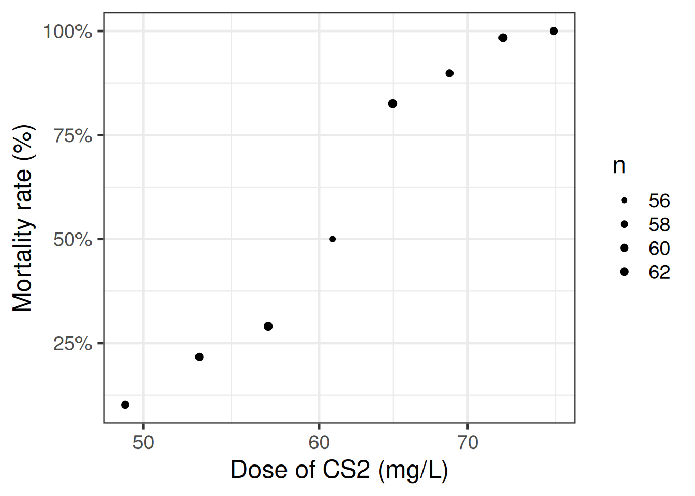](logistic-regression_files/figure-revealjs/unnamed-chunk-3-1.png "Figure 1: Mortality rates of adult flour beetles after five hours’ exposure to gaseous carbon disulphide [@bliss1935beetles]")
>
> Figure 1: Mortality rates of adult flour beetles after five hours’ exposure to gaseous carbon disulphide [\[8\]](#ref-bliss1935beetles)

### 2.0.4 Why don’t we use linear regression?

> **NOTE:**
>
> Show R code
>
> ``` downlit
> beetles_long <- beetles |>
>   reframe(
>     .by = everything(),
>     outcome = c(
>       rep(1, times = died),
>       rep(0, times = survived)
>     )
>   ) |>
>   as_tibble()
>
> # `dose` is log10 of the dose in mg/L, and the models use it as is;
> # the plot functions take mg/L and convert:
> lm1 <- beetles_long |> lm(formula = outcome ~ dose)
> f_linear <- function(x) predict(lm1, newdata = data.frame(dose = log10(x)))
>
> plot2 <-
>   plot1 +
>   geom_function(
>     fun = f_linear,
>     aes(col = "Straight line")
>   ) +
>   labs(colour = "Model", size = "")
>
> plot2 |> print()
> ```
>
> [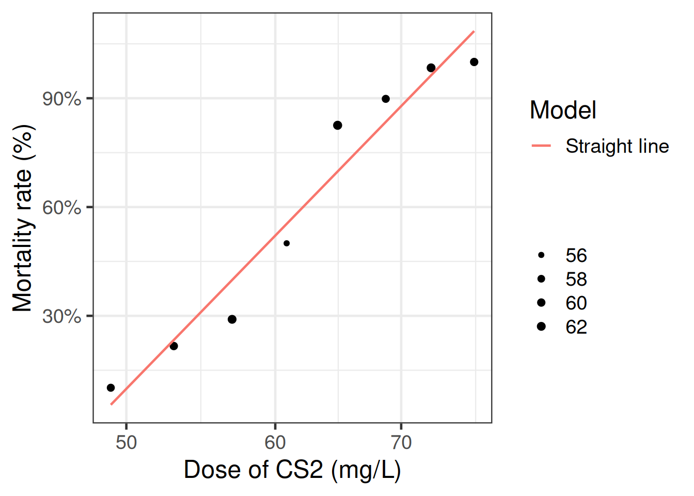](logistic-regression_files/figure-revealjs/unnamed-chunk-4-1.png "Figure 2: Mortality rates of adult flour beetles after five hours’ exposure to gaseous carbon disulphide [@bliss1935beetles]")
>
> Figure 2: Mortality rates of adult flour beetles after five hours’ exposure to gaseous carbon disulphide [\[8\]](#ref-bliss1935beetles)

### 2.0.5 Zoom out

> **NOTE:**
>
> Show R code
>
> ``` downlit
> (plot2 + expand_limits(x = c(40, 100))) |> print()
> ```
>
> [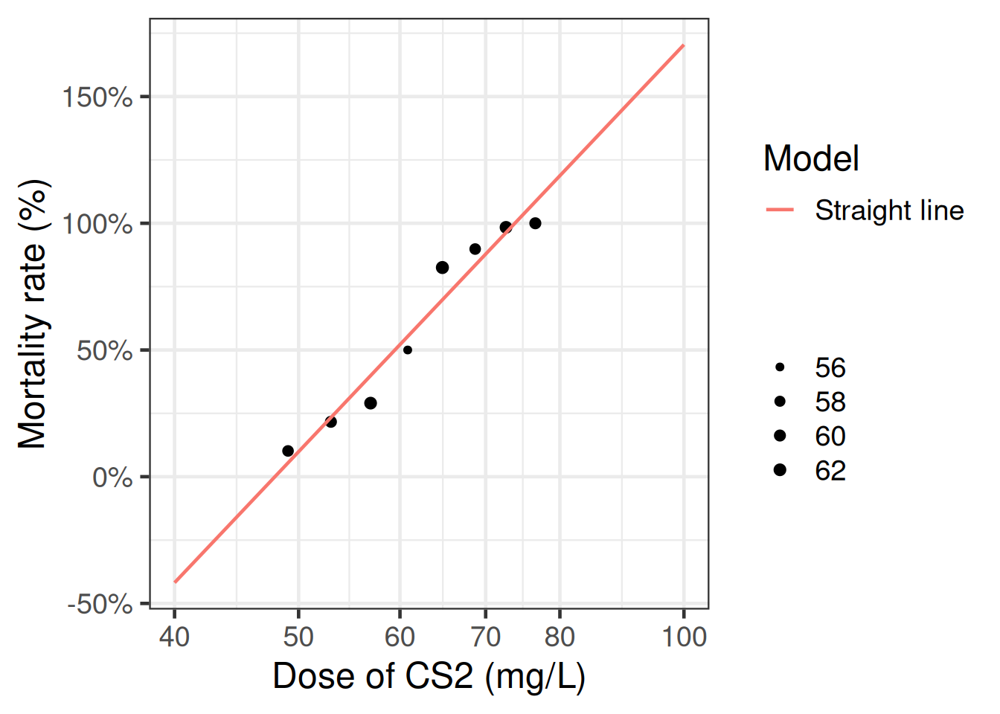](logistic-regression_files/figure-revealjs/unnamed-chunk-5-1.png "Figure 3: Mortality rates of adult flour beetles after five hours’ exposure to gaseous carbon disulphide [@bliss1935beetles]")
>
> Figure 3: Mortality rates of adult flour beetles after five hours’ exposure to gaseous carbon disulphide [\[8\]](#ref-bliss1935beetles)

### 2.0.6 log transformation of dose?

> **NOTE:**
>
> Show R code
>
> ``` downlit
> lm2 <- beetles_long |> lm(formula = outcome ~ log(dose))
> f_linearlog <- function(x) predict(lm2, newdata = data.frame(dose = log10(x)))
>
> plot3 <- plot2 +
>   expand_limits(x = c(40, 100)) +
>   geom_function(fun = f_linearlog, aes(col = "Log-transform dose"))
> (plot3 + expand_limits(x = c(40, 100))) |> print()
> ```
>
> [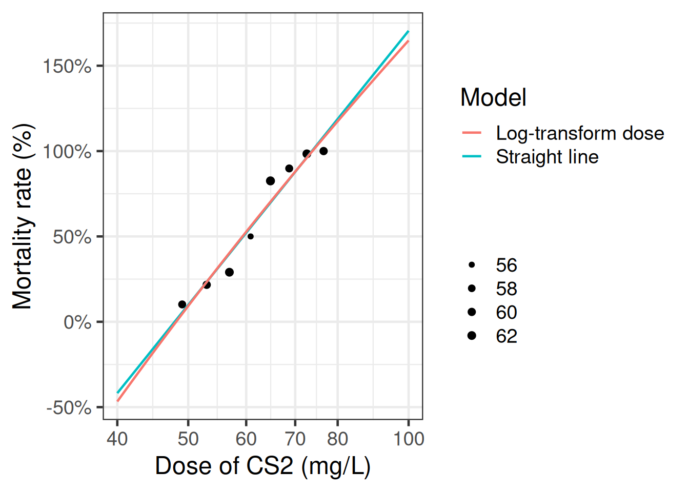](logistic-regression_files/figure-revealjs/unnamed-chunk-6-1.png "Figure 4: Mortality rates of adult flour beetles after five hours’ exposure to gaseous carbon disulphide [@bliss1935beetles]")
>
> Figure 4: Mortality rates of adult flour beetles after five hours’ exposure to gaseous carbon disulphide [\[8\]](#ref-bliss1935beetles)

### 2.0.7 Logistic regression

> **NOTE:**
>
> Show R code
>
> ``` downlit
> beetles_glm_grouped <- beetles |>
>   glm(formula = cbind(died, survived) ~ dose, family = "binomial")
> f <- function(x) {
>   beetles_glm_grouped |>
>     predict(newdata = data.frame(dose = log10(x)), type = "response")
> }
>
> plot4 <- plot3 + geom_function(fun = f, aes(col = "Logistic regression"))
> plot4 |> print()
> ```
>
> [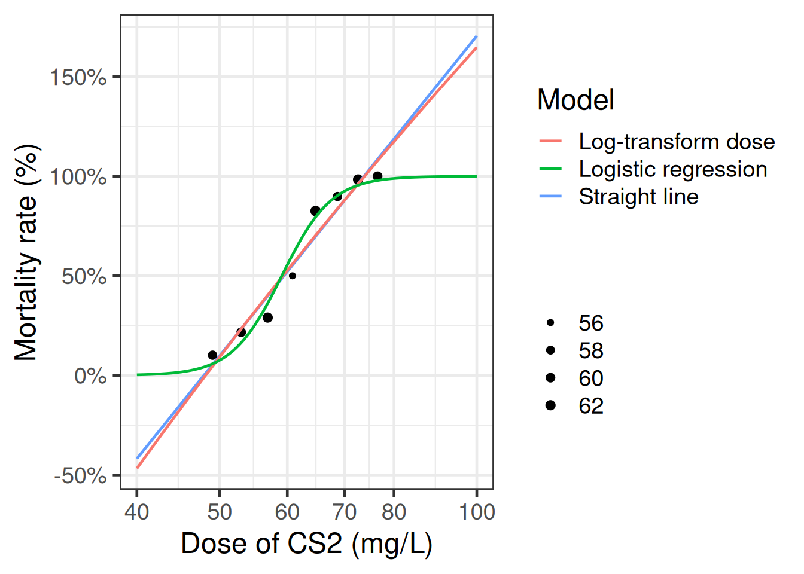](logistic-regression_files/figure-revealjs/unnamed-chunk-7-1.png "Figure 5: Mortality rates of adult flour beetles after five hours’ exposure to gaseous carbon disulphide [@bliss1935beetles].")
>
> Figure 5: Mortality rates of adult flour beetles after five hours’ exposure to gaseous carbon disulphide [\[8\]](#ref-bliss1935beetles).

### 2.0.8 Three parts to regression models

- What distribution does the outcome have for a specific subpopulation defined by covariates? (outcome model)

- How does the combination of covariates relate to the mean? (link function)

- How do the covariates combine? ([linear predictor](../chapters/Intro-to-GLMs.llms.md#def-linear-predictor), [interactions](../chapters/Intro-to-GLMs.llms.md#def-interaction))

### 2.0.9 Fitting and manipulating logistic regression models in R

> **NOTE:**
>
> Show R code
>
> ``` downlit
> library(glmx)
> library(dplyr)
> data(BeetleMortality)
> beetles <- BeetleMortality |>
>   mutate(
>     pct = died / n,
>     survived = n - died
>   )
>
> beetles_glm_grouped <-
>   beetles |>
>   glm(
>     formula = cbind(died, survived) ~ dose,
>     family = "binomial"
>   )
>
> library(parameters)
> beetles_glm_grouped |>
>   parameters() |>
>   print_md()
> ```
>
> | Parameter   | Log-Odds |  SE  |      95% CI      |   z    |    p    |
> |:------------|:--------:|:----:|:----------------:|:------:|:-------:|
> | (Intercept) |  -60.72  | 5.18 | (-71.44, -51.08) | -11.72 | \< .001 |
> | dose        |  34.27   | 2.91 |  (28.85, 40.30)  | 11.77  | \< .001 |
>
> Table 2: [logistic regression model](#def-logistic-regression) for beetles data with grouped (binomial) data

#### Fitted values

[Fitted values](https://morrison-lab.github.io/sds/prediction.html#def-fitted-value) are provided on the probability scale ([Table 3](#tbl-beetles-model-fitted-values))

> **NOTE:**
>
> Show R code
>
> ``` downlit
> fitted(beetles_glm_grouped)
> #>        1        2        3        4        5        6        7        8 
> #> 0.058601 0.164028 0.362119 0.605315 0.795172 0.903236 0.955196 0.979049
> predict(beetles_glm_grouped, type = "response")
> #>        1        2        3        4        5        6        7        8 
> #> 0.058601 0.164028 0.362119 0.605315 0.795172 0.903236 0.955196 0.979049
> ```
>
> Table 3

#### Count scale

For grouped data, we can convert to the count scale by multiplying by the group size:

Show R code

``` downlit
beetles$n * fitted(beetles_glm_grouped)
#>        1        2        3        4        5        6        7        8 
#>  3.45746  9.84167 22.45138 33.89763 50.09582 53.29091 59.22216 58.74296
```

#### Logit scale

Show R code

``` downlit
predict(beetles_glm_grouped, type = "link")
#>         1         2         3         4         5         6         7         8 
#> -2.776615 -1.628559 -0.566179  0.427661  1.356386  2.233707  3.059622  3.844412
```

Converting between [logit](../chapters/binary-outcome-associations.llms.md#def-logit-fn) and probability scales works as expected:

Show R code

``` downlit
predict(beetles_glm_grouped, type = "link") |> arm::invlogit()
#>        1        2        3        4        5        6        7        8 
#> 0.058601 0.164028 0.362119 0.605315 0.795172 0.903236 0.955196 0.979049
predict(beetles_glm_grouped, type = "response")
#>        1        2        3        4        5        6        7        8 
#> 0.058601 0.164028 0.362119 0.605315 0.795172 0.903236 0.955196 0.979049

predict(beetles_glm_grouped, type = "response") |> arm::logit()
#>         1         2         3         4         5         6         7         8 
#> -2.776615 -1.628559 -0.566179  0.427661  1.356386  2.233707  3.059622  3.844412
predict(beetles_glm_grouped, type = "link")
#>         1         2         3         4         5         6         7         8 
#> -2.776615 -1.628559 -0.566179  0.427661  1.356386  2.233707  3.059622  3.844412
```

`type = "terms"` is confusing, because the variables get centered:

Show R code

``` downlit
predict(beetles_glm_grouped, type = "terms")
#>        dose
#> 1 -3.520419
#> 2 -2.372363
#> 3 -1.309983
#> 4 -0.316144
#> 5  0.612582
#> 6  1.489902
#> 7  2.315817
#> 8  3.100608
#> attr(,"constant")
#> [1] 0.743804
coef(beetles_glm_grouped)["dose"] * beetles$dose
#> [1] 57.9408 59.0889 60.1513 61.1451 62.0738 62.9512 63.7771 64.5619
```

We can construct the link-scale predictions from the terms:

Show R code

``` downlit
terms_pred <- predict(beetles_glm_grouped, type = "terms")
terms_pred + attr(terms_pred, "constant")
#>        dose
#> 1 -2.776615
#> 2 -1.628559
#> 3 -0.566179
#> 4  0.427661
#> 5  1.356386
#> 6  2.233707
#> 7  3.059622
#> 8  3.844412
#> attr(,"constant")
#> [1] 0.743804
predict(beetles_glm_grouped, type = "link")
#>         1         2         3         4         5         6         7         8 
#> -2.776615 -1.628559 -0.566179  0.427661  1.356386  2.233707  3.059622  3.844412
```

#### Individual observations

Show R code

``` downlit
beetles_long
```

> **NOTE:**
>
> Table 4: `beetles` data in long format

> **NOTE:**
>
> Show R code
>
> ``` downlit
> beetles_glm_ungrouped <-
>   beetles_long |>
>   glm(
>     formula = outcome ~ dose,
>     family = "binomial"
>   )
>
> beetles_glm_ungrouped |>
>   parameters() |>
>   print_md()
> ```
>
> | Parameter   | Log-Odds |  SE  |      95% CI      |   z    |    p    |
> |:------------|:--------:|:----:|:----------------:|:------:|:-------:|
> | (Intercept) |  -60.72  | 5.18 | (-71.44, -51.08) | -11.72 | \< .001 |
> | dose        |  34.27   | 2.91 |  (28.85, 40.30)  | 11.77  | \< .001 |
>
> Table 5: [logistic regression model](#def-logistic-regression) for beetles data with individual [Bernoulli](https://morrison-lab.github.io/pds/random-variables.html#def-bernoulli) data

> **NOTE:**
>
> **Exercise 7** Compare this model with the grouped-observations model ([Table 2](#tbl-beetles-model-grouped)).

> **NOTE:**
>
> *Solution 7*.
>
> They seem the same! But not quite:
>
> Show R code
>
> ``` downlit
> logLik(beetles_glm_grouped)
> #> 'log Lik.' -18.7151 (df=2)
> logLik(beetles_glm_ungrouped)
> #> 'log Lik.' -186.235 (df=2)
> ```
>
> The difference is due to the binomial coefficient $\binom{n}{x}$ which isn’t included in the individual-observations (Bernoulli) version of the model.

# 3 Derivatives of logistic regression functions

In order to interpret [logistic regression models](#def-logistic-regression) and find their [MLEs](https://morrison-lab.github.io/sds/intro-MLEs.html#def-mle), we will need to compute various [derivatives](https://morrison-lab.github.io/mds/calculus-derivatives.html#def-derivative). This section compiles some useful results.

### 3.0.1 Derivatives of odds function

> **NOTE:**
>
> **Theorem 3 (Derivative of odds function)** $${{\operatorname{odds}}'\mathopen{}\left\{\pi\right\}\mathclose{}} = \frac{\partial \omega}{\partial \pi} = \frac{1}{{\mathopen{}\left(1-\pi\right)\mathclose{}}^{2}}$$

> **NOTE:**
>
> *Proof*. We can use [odds as a function of probability](../chapters/binary-outcome-associations.llms.md#thm-prob-to-odds) and the [quotient rule](https://morrison-lab.github.io/mds/calculus-derivatives.html#thm-quotient-rule):
>
> $$\begin{aligned}
> \frac{\partial \omega}{\partial \pi}
>    &= \frac{\partial}{\partial \pi}\mathopen{}\left(\frac{\pi}{1-\pi}\right)\mathclose{}
> \\ &=  \frac {\frac{\partial}{\partial \pi}\pi} {1-\pi} -
>        \mathopen{}\left(\frac{\pi}{{\mathopen{}\left(1-\pi\right)\mathclose{}}^{2}} \cdot\frac{\partial}{\partial \pi}\mathopen{}\left(1-\pi\right)\mathclose{}\right)\mathclose{}
> \\ &=  \frac{1}{1-\pi} - \frac{\pi}{{\mathopen{}\left(1-\pi\right)\mathclose{}}^{2}} \cdot(-1)
> \\ &=  \frac{1}{1-\pi} + \frac{\pi}{{\mathopen{}\left(1-\pi\right)\mathclose{}}^{2}}
> \\ &=  \frac{1-\pi}{{\mathopen{}\left(1-\pi\right)\mathclose{}}^{2}} + \frac{\pi}{{\mathopen{}\left(1-\pi\right)\mathclose{}}^{2}}
> \\ &=  \frac{1-\pi + \pi}{{\mathopen{}\left(1-\pi\right)\mathclose{}}^{2}}
> \\ &=  \frac{1}{{\mathopen{}\left(1-\pi\right)\mathclose{}}^{2}}
> \end{aligned}$$

> **NOTE:**
>
> **Corollary 1 (Derivative of odds function in terms of odds)** $$\frac{\partial \omega}{\partial \pi} = {\mathopen{}\left(1+\omega\right)\mathclose{}}^{2}$$

> **NOTE:**
>
> *Proof*. Using [Theorem 3](#thm-deriv-odds) and [one plus odds in terms of non-event probability](../chapters/binary-outcome-associations.llms.md#cor-inverse-odds-nonevent):
>
> $$\begin{aligned}
> \frac{\partial \omega}{\partial \pi}
> &= \frac{1}{{\mathopen{}\left(1-\pi\right)\mathclose{}}^{2}}
> && \text{(derivative of odds function)}
> \\ &= {\mathopen{}\left(\frac{1}{1-\pi}\right)\mathclose{}}^{2}
> && \text{(the reciprocal of a square is the square of the reciprocal)}
> \\ &= {\mathopen{}\left(1+\omega\right)\mathclose{}}^{2}
> && \text{(substitute } \frac{1}{1-\pi} = 1+\omega\text{)}
> \end{aligned}$$

### 3.0.2 Derivatives of inverse-odds function

> **NOTE:**
>
> **Theorem 4 (Derivative of inverse odds function)** $${{\operatorname{invodds}}'\mathopen{}\left\{\omega\right\}\mathclose{}} = \frac{\partial \pi}{\partial \omega} = (1-\pi)^2 = \frac{1}{{\mathopen{}\left(1+\omega\right)\mathclose{}}^{2}}  \tag{2}$$

> **NOTE:**
>
> *Proof*. Using the [inverse function rule](https://en.wikipedia.org/wiki/Inverse_function_rule), [Theorem 3](#thm-deriv-odds), and [one minus inverse-odds](../chapters/binary-outcome-associations.llms.md#lem-one-minus-odds-inv):
>
> $$\begin{aligned}
> \frac{\partial \pi}{\partial \omega}
> &= {\mathopen{}\left(\frac{\partial \omega}{\partial \pi}\right)\mathclose{}}^{-1}
> && \text{(inverse function rule)}
> \\ &= {\mathopen{}\left(\frac{1}{{\mathopen{}\left(1-\pi\right)\mathclose{}}^{2}}\right)\mathclose{}}^{-1}
> && \text{(derivative of odds function)}
> \\ &= {\mathopen{}\left(1-\pi\right)\mathclose{}}^{2}
> && \text{(the reciprocal of a reciprocal is the original quantity)}
> \\ &= {\mathopen{}\left(\frac{1}{1+\omega}\right)\mathclose{}}^{2}
> && \text{(substitute } 1-\pi= \frac{1}{1+\omega}\text{)}
> \\ &= \frac{1}{{\mathopen{}\left(1+\omega\right)\mathclose{}}^{2}}
> && \text{(the square of a reciprocal is the reciprocal of the square)}
> \end{aligned}$$
>
> Or for a direct approach, use the [quotient rule](https://morrison-lab.github.io/mds/calculus-derivatives.html#thm-quotient-rule) again:
>
> $$\begin{aligned}
> \frac{\partial \pi}{\partial \omega}
> &= \frac{\partial}{\partial \omega} \frac{\omega}{1+\omega}
> \\ &= \frac{\frac{\partial}{\partial \omega}\omega}{1+\omega} - \frac{\omega}{{\mathopen{}\left(1+\omega\right)\mathclose{}}^{2}} \cdot\frac{\partial}{\partial \omega}(1+\omega)
> \\ &= \frac{1}{1+\omega} - \frac{\omega}{{\mathopen{}\left(1+\omega\right)\mathclose{}}^{2}} \cdot 1
> \\ &= \frac{1}{1+\omega} - \frac{\omega}{{\mathopen{}\left(1+\omega\right)\mathclose{}}^{2}}
> \\ &= \frac{1+\omega}{{\mathopen{}\left(1+\omega\right)\mathclose{}}^{2}} - \frac{\omega}{{\mathopen{}\left(1+\omega\right)\mathclose{}}^{2}}
> \\ &= \frac{1+\omega- \omega}{{\mathopen{}\left(1+\omega\right)\mathclose{}}^{2}}
> \\ &= \frac{1}{{\mathopen{}\left(1+\omega\right)\mathclose{}}^{2}}
> \end{aligned}$$

### 3.0.3 Derivatives of logit function

> **NOTE:**
>
> **Lemma 1 (Derivative of log-odds by odds)** $$\frac{\partial \eta}{\partial \omega} = \omega^{-1}$$

> **NOTE:**
>
> *Proof*. Using [the definition of log-odds](../chapters/binary-outcome-associations.llms.md#def-logodds):
>
> $$\begin{aligned}
> \frac{\partial \eta}{\partial \omega}
> &= \frac{\partial}{\partial \omega}\log{\omega}
> \\
> &= \omega^{-1}
> \end{aligned}$$

> **NOTE:**
>
> **Theorem 5 (Derivative of log-odds by odds)** $$\frac{\partial \eta}{\partial \omega} = \frac{1-\pi}{\pi}$$

> **NOTE:**
>
> *Proof*. Using [odds as a function of probability](../chapters/binary-outcome-associations.llms.md#thm-prob-to-odds) and [Lemma 1](#lem-d_logodds-d_odds):
>
> $$\begin{aligned}
> \frac{\partial \eta}{\partial \omega}
> &= \omega^{-1}
> \\
> &= \frac{1-\pi}{\pi}
> \end{aligned}$$

> **NOTE:**
>
> **Theorem 6 (Derivative of log-odds by probability)** $$\frac{\partial \eta}{\partial \pi} = \frac{1}{(\pi)(1-\pi)}$$

> **NOTE:**
>
> *Proof*. Using [Theorem 5](#thm-d_logodds-d_odds), [Theorem 3](#thm-deriv-odds), and the [chain rule](https://morrison-lab.github.io/mds/calculus-derivatives.html#thm-chain-rule):
>
> $$\begin{aligned}
> \frac{\partial \eta}{\partial \pi}
> &= \frac{\partial \eta}{\partial \omega} \frac{\partial \omega}{\partial \pi}
> \\
> &= \frac{1-\pi}{\pi} \frac{1}{{\mathopen{}\left(1-\pi\right)\mathclose{}}^{2}}
> \\
> &= \frac{1}{(\pi)(1-\pi)}
> \end{aligned}$$

> **NOTE:**
>
> **Corollary 2 (Derivative of logit function)** $$\operatorname{logit}'(\pi) = \frac{1}{(\pi)(1-\pi)}$$

> **NOTE:**
>
> *Proof*. Using [log-odds via the logit function](../chapters/binary-outcome-associations.llms.md#cor-logodds-logit) and [Theorem 6](#thm-d_logodds-d_prob):
>
> $$\begin{aligned}
> \operatorname{logit}'(\pi)
> &= \frac{\partial}{\partial \pi} {\operatorname{logit}\mathopen{}\left\{\pi\right\}\mathclose{}}
> && \text{(Lagrange notation rewritten in Leibniz notation)}
> \\ &= \frac{\partial}{\partial \pi} \eta
> && \text{(log-odds via the logit function: } {\operatorname{logit}\mathopen{}\left\{\pi\right\}\mathclose{}} = \eta\text{)}
> \\ &= \frac{\partial \eta}{\partial \pi}
> && \text{(Leibniz notation)}
> \\ &= \frac{1}{(\pi)(1-\pi)}
> && \text{(derivative of log-odds by probability)}
> \end{aligned}$$

### 3.0.4 Derivatives of expit function

> **NOTE:**
>
> **Lemma 2 (Derivative of odds w.r.t. log-odds)** $$\frac{\partial \omega}{\partial \eta} = \omega$$

> **NOTE:**
>
> *Proof*. Using [the odds-from-log-odds lemma](../chapters/binary-outcome-associations.llms.md#lem-odds-from-logodds) and [the derivative of the exponential function](https://morrison-lab.github.io/mds/calculus-derivatives.html#thm-deriv-exp):
>
> $$\begin{aligned}
> \frac{\partial \omega}{\partial \eta}
> &= \frac{\partial}{\partial \eta} {\operatorname{exp}\mathopen{}\left\{\eta\right\}\mathclose{}}
> \\
> &= {\operatorname{exp}\mathopen{}\left\{\eta\right\}\mathclose{}}
> \\
> &= \omega
> \end{aligned}$$

> **NOTE:**
>
> **Theorem 7 (Derivative of odds in terms of probability)** $$\frac{\partial \omega}{\partial \eta} = \frac{\pi}{1-\pi} \tag{3}$$

> **NOTE:**
>
> *Proof*. Using [Lemma 2](#lem-deriv-invodds) and [odds as a function of probability](../chapters/binary-outcome-associations.llms.md#thm-prob-to-odds):
>
> $$\begin{aligned}
> \frac{\partial \omega}{\partial \eta}
> &= \omega
> && \text{(derivative of odds w.r.t. log-odds)}
> \\ &= \frac{\pi}{1-\pi}
> && \text{(odds as a function of probability)}
> \end{aligned}$$

> **NOTE:**
>
> **Theorem 8 (Derivative of probability w.r.t. log-odds)** $$\frac{\partial \pi}{\partial \eta} = \pi (1-\pi)$$

> **NOTE:**
>
> *Proof*. By the [chain rule](https://morrison-lab.github.io/mds/calculus-derivatives.html#thm-chain-rule), [Theorem 7](#thm-d_odds-d_logodds), and [Theorem 4](#thm-deriv-invodds):
>
> $$\begin{aligned}
> \frac{\partial \pi}{\partial \eta}
> &= {\color{green}{\frac{\partial \omega}{\partial \eta}}}{\color{teal}{\frac{\partial \pi}{\partial \omega}}}
> \\
> &= {\color{green}{\frac{\pi}{1-\pi}}} {\color{teal}{(1-\pi)^2}}
> \\
> &= \pi (1-\pi)
> \end{aligned}$$
>
> Alternatively, by [Theorem 6](#thm-d_logodds-d_prob):
>
> $$\begin{aligned}
> \frac{\partial \pi}{\partial \eta}
> &= {\mathopen{}\left(\frac{\partial \eta}{\partial \pi}\right)\mathclose{}}^{-1}
> \\
> &= {\mathopen{}\left(\frac{1}{(\pi)(1-\pi)}\right)\mathclose{}}^{-1}
> \\
> &= \pi (1-\pi)
> \end{aligned}$$

> **NOTE:**
>
> **Corollary 3 (Derivative of probability w.r.t. linear predictor as a variance)** If $\pi = \Pr(Y=1| \mathord{\smash[b]{\underset{\raise.3ex\hbox{$\scriptstyle\sim$}}{X}}\vphantom{X}}=\mathord{\smash[b]{\underset{\raise.3ex\hbox{$\scriptstyle\sim$}}{x}}\vphantom{x}})$, then:
>
> $$\frac{\partial \pi}{\partial \eta} = {\operatorname{Var}\mathopen{}\left(Y|X=x\right)\mathclose{}}$$

> **NOTE:**
>
> *Proof*. Since $Y$ is a binary (0/1) outcome with $\Pr(Y=1|\mathord{\smash[b]{\underset{\raise.3ex\hbox{$\scriptstyle\sim$}}{X}}\vphantom{X}}=\mathord{\smash[b]{\underset{\raise.3ex\hbox{$\scriptstyle\sim$}}{x}}\vphantom{x}}) = \pi$, the conditional distribution of $Y$ given $\mathord{\smash[b]{\underset{\raise.3ex\hbox{$\scriptstyle\sim$}}{X}}\vphantom{X}}=\mathord{\smash[b]{\underset{\raise.3ex\hbox{$\scriptstyle\sim$}}{x}}\vphantom{x}}$ is [Bernoulli](https://morrison-lab.github.io/pds/random-variables.html#def-bernoulli) with parameter $\pi$.
>
> First, we compute ${\operatorname{Var}\mathopen{}\left(Y|X=x\right)\mathclose{}}$, using the [simplified expression for variance](https://morrison-lab.github.io/pds/variance-covariance.html#thm-variance), the [expected value of the square of a Bernoulli variable](https://morrison-lab.github.io/pds/expectation.html#exm-lotus), and the [expectation of the Bernoulli distribution](https://morrison-lab.github.io/pds/expectation.html#thm-bernoulli-mean), all applied to the conditional distribution of $Y$ given $X=x$:
>
> $$\begin{aligned}
> {\operatorname{Var}\mathopen{}\left(Y|X=x\right)\mathclose{}}
> &= {\mathbb{E}\mathopen{}\left[Y^2|X=x\right]\mathclose{}} - {\mathopen{}\left({\mathbb{E}\mathopen{}\left[Y|X=x\right]\mathclose{}}\right)\mathclose{}}^{2}
> && \text{(simplified expression for variance)}
> \\ &= \pi - {\mathopen{}\left({\mathbb{E}\mathopen{}\left[Y|X=x\right]\mathclose{}}\right)\mathclose{}}^{2}
> && \text{(expected square of a Bernoulli variable: } {\mathbb{E}\mathopen{}\left[Y^2|X=x\right]\mathclose{}} = \pi\text{)}
> \\ &= \pi - {\mathopen{}\left(\pi\right)\mathclose{}}^{2}
> && \text{(Bernoulli mean: } {\mathbb{E}\mathopen{}\left[Y|X=x\right]\mathclose{}} = \pi\text{)}
> \\ &= \pi(1 - \pi)
> && \text{(factor out } \pi\text{)}
> \end{aligned}
> \tag{4}$$
>
> Then, using [Theorem 8](#thm-d_prob-d_logodds) and [Equation 4](#eq-bernoulli-cond-var):
>
> $$\begin{aligned}
> \frac{\partial \pi}{\partial \eta}
> &= \pi(1-\pi)
> && \text{(derivative of probability w.r.t. log-odds)}
> \\ &= {\operatorname{Var}\mathopen{}\left(Y|X=x\right)\mathclose{}}
> && \text{(Bernoulli conditional variance, read right-to-left)}
> \end{aligned}$$

> **NOTE:**
>
> **Corollary 4 (Derivative of expit)** $${\operatorname{expit}'\mathopen{}\left\{\eta\right\}\mathclose{}} = {\operatorname{expit}\mathopen{}\left\{\eta\right\}\mathclose{}}(1 - {\operatorname{expit}\mathopen{}\left\{\eta\right\}\mathclose{}})$$

> **NOTE:**
>
> *Proof*. Using [probability via the expit function](../chapters/binary-outcome-associations.llms.md#thm-expit-prob-logodds) and [Theorem 8](#thm-d_prob-d_logodds):
>
> $$\begin{aligned}
> {\operatorname{expit}'\mathopen{}\left\{\eta\right\}\mathclose{}}
> &= \frac{\partial \pi}{\partial \eta}
> && \text{(probability via the expit function: } \pi= {\operatorname{expit}\mathopen{}\left\{\eta\right\}\mathclose{}}\text{)}
> \\ &= \pi(1-\pi)
> && \text{(derivative of probability w.r.t. log-odds)}
> \\ &= {\operatorname{expit}\mathopen{}\left\{\eta\right\}\mathclose{}}(1 - {\operatorname{expit}\mathopen{}\left\{\eta\right\}\mathclose{}})
> && \text{(substitute } \pi= {\operatorname{expit}\mathopen{}\left\{\eta\right\}\mathclose{}}\text{)}
> \end{aligned}$$

> **NOTE:**
>
> **Example 3 (Slope of expit for the beetles model)**  
>
> Show R code
>
> ``` downlit
> beetles_mid_row <- ceiling(nrow(beetles) / 2)
> beetles_dose_mid <- beetles$dose[beetles_mid_row]
> beetles_eta_mid <-
>   predict(beetles_glm_grouped, type = "link")[beetles_mid_row] |>
>   unname()
> beetles_pi_mid <-
>   predict(beetles_glm_grouped, type = "response")[beetles_mid_row] |>
>   unname()
> beetles_slope_mid <- beetles_pi_mid * (1 - beetles_pi_mid)
> ```
>
> Consider the grouped-data [logistic regression model](#def-logistic-regression) for the beetles data ([Table 2](#tbl-beetles-model-grouped)). At the middle (4th of 8) dose in the dataset, $x = 1.7842$, the fitted [log-odds](../chapters/binary-outcome-associations.llms.md#def-logodds) of death is $\hat{\eta} = 0.4277$, and the fitted probability of death is $\hat{\pi} = {\operatorname{expit}\mathopen{}\left\{0.4277\right\}\mathclose{}} = 0.6053$. By [Corollary 4](#cor-deriv-expit), the slope of the [expit function](../chapters/binary-outcome-associations.llms.md#def-expit) at this fitted log-odds value is:
>
> $${\operatorname{expit}'\mathopen{}\left\{0.4277\right\}\mathclose{}}
> = 0.6053 \times (1 - 0.6053)
> = 0.2389$$
>
> Specifically, near dose $x = 1.7842$, a small increase of $\Delta\eta$ in the fitted log-odds corresponds to an increase of approximately $0.2389 \times \Delta\eta$ in the fitted probability of death.

### 3.0.5 Summary matrix of derivatives

Each entry gives the [derivative](https://morrison-lab.github.io/mds/calculus-derivatives.html#def-derivative) of the **column quantity** with respect to the **row quantity**; that is, the entry in row $i$ and column $j$ is $\frac{\partial (\text{col } j)}{\partial (\text{row } i)}$.

**Dimensions** of each entry depend on the types of the row and column quantities:

- **Scalar/scalar** (upper-left $3 \times 3$ block): row and column are both scalars ($\pi$, $\omega$, or $\eta$); derivative is a scalar.
- **Gradient** (lower-left $2 \times 3$ block): row is a $p$-vector ($\mathord{\smash[b]{\underset{\raise.3ex\hbox{$\scriptstyle\sim$}}{x}}\vphantom{x}}$ or $\mathord{\smash[b]{\underset{\raise.3ex\hbox{$\scriptstyle\sim$}}{\beta}}\vphantom{\beta}}$), column is a scalar; derivative is a $p$-vector (gradient).
- **[Jacobian](https://morrison-lab.github.io/mds/vector-calculus.html#def-jacobian-matrix)** (lower-right $2 \times 2$ block): both row and column are $p$-vectors; derivative is a $p \times p$ matrix.
- **Undefined** (upper-right $3 \times 2$ block): row is a scalar ($\pi$, $\omega$, or $\eta$), column is $\mathord{\smash[b]{\underset{\raise.3ex\hbox{$\scriptstyle\sim$}}{x}}\vphantom{x}}$ or $\mathord{\smash[b]{\underset{\raise.3ex\hbox{$\scriptstyle\sim$}}{\beta}}\vphantom{\beta}}$. Each of these entries would be the derivative of a $p$-vector with respect to a scalar, which would require expressing $\mathord{\smash[b]{\underset{\raise.3ex\hbox{$\scriptstyle\sim$}}{x}}\vphantom{x}}$ (or $\mathord{\smash[b]{\underset{\raise.3ex\hbox{$\scriptstyle\sim$}}{\beta}}\vphantom{\beta}}$) as a function of that scalar. No such function exists, because the map from the vector to the scalar is **not invertible**: for $p > 1$, many distinct vectors produce the same value of $\eta= \mathord{\smash[b]{\underset{\raise.3ex\hbox{$\scriptstyle\sim$}}{x}}\vphantom{x}} \cdot \mathord{\smash[b]{\underset{\raise.3ex\hbox{$\scriptstyle\sim$}}{\beta}}\vphantom{\beta}}$ (and hence the same $\omega$ and $\pi$), so the scalar does not determine the vector, and these derivatives are undefined.

> **NOTE:**
>
> $$\begin{array}{r|ccccc}
> & \pi& \omega& \eta& \mathord{\smash[b]{\underset{\raise.3ex\hbox{$\scriptstyle\sim$}}{x}}\vphantom{x}}& \mathord{\smash[b]{\underset{\raise.3ex\hbox{$\scriptstyle\sim$}}{\beta}}\vphantom{\beta}}\\
> \hline
> \pi
>   & 1
>   & {\mathopen{}\left(1+\omega\right)\mathclose{}}^{2}
>   & \dfrac{{\mathopen{}\left(1+\omega\right)\mathclose{}}^{2}}{\omega}
>   & \text{undef}
>   & \text{undef} \\[10pt]
> \omega
>   & {\mathopen{}\left(1-\pi\right)\mathclose{}}^{2}
>   & 1
>   & \dfrac{1}{\omega}
>   & \text{undef}
>   & \text{undef} \\[10pt]
> \eta
>   & \pi(1-\pi)
>   & \omega
>   & 1
>   & \text{undef}
>   & \text{undef} \\[10pt]
> \mathord{\smash[b]{\underset{\raise.3ex\hbox{$\scriptstyle\sim$}}{x}}\vphantom{x}}
>   & \underbrace{\mathord{\smash[b]{\underset{\raise.3ex\hbox{$\scriptstyle\sim$}}{\beta}}\vphantom{\beta}}\pi(1-\pi)}_{p \times 1}
>   & \underbrace{\mathord{\smash[b]{\underset{\raise.3ex\hbox{$\scriptstyle\sim$}}{\beta}}\vphantom{\beta}}\omega}_{p \times 1}
>   & \underbrace{\mathord{\smash[b]{\underset{\raise.3ex\hbox{$\scriptstyle\sim$}}{\beta}}\vphantom{\beta}}}_{p \times 1}
>   & \underbrace{\mathbb{I}}_{p \times p}
>   & \mathbf{0}_{p \times p} \\[10pt]
> \mathord{\smash[b]{\underset{\raise.3ex\hbox{$\scriptstyle\sim$}}{\beta}}\vphantom{\beta}}
>   & \underbrace{\mathord{\smash[b]{\underset{\raise.3ex\hbox{$\scriptstyle\sim$}}{x}}\vphantom{x}}\pi(1-\pi)}_{p \times 1}
>   & \underbrace{\mathord{\smash[b]{\underset{\raise.3ex\hbox{$\scriptstyle\sim$}}{x}}\vphantom{x}}\omega}_{p \times 1}
>   & \underbrace{\mathord{\smash[b]{\underset{\raise.3ex\hbox{$\scriptstyle\sim$}}{x}}\vphantom{x}}}_{p \times 1}
>   & \mathbf{0}_{p \times p}
>   & \underbrace{\mathbb{I}}_{p \times p} \\
> \end{array}$$
>
> Table 6: Matrix of [logistic regression](#def-logistic-regression) derivatives ($p$ = number of predictors, $\eta\stackrel{\text{def}}{=}\mathord{\smash[b]{\underset{\raise.3ex\hbox{$\scriptstyle\sim$}}{x}}\vphantom{x}} \cdot \mathord{\smash[b]{\underset{\raise.3ex\hbox{$\scriptstyle\sim$}}{\beta}}\vphantom{\beta}}$, $\omega\stackrel{\text{def}}{=}{\operatorname{exp}\mathopen{}\left\{\eta\right\}\mathclose{}}$, $\pi\stackrel{\text{def}}{=}\omega/ (1 + \omega)$). Each entry is the derivative of the **column quantity** with respect to the **row quantity**. Entries marked “undef” are not defined because the vector-to-scalar map is not invertible: the scalar row quantity does not determine the vector column quantity.

# 4 Understanding logistic regression models

> **TIP:**
>
> Josh Starmer’s StatQuest video [*Logistic Regression Details Pt1: Coefficients*](https://www.youtube.com/watch?v=vN5cNN2-HWE) explains how [logistic regression](#def-logistic-regression) coefficients are interpreted on the [log-odds](../chapters/binary-outcome-associations.llms.md#def-logodds) scale, for both continuous and [categorical predictors](https://morrison-lab.github.io/sds/data.html#def-categorical-var) [\[5\]](#ref-starmer-statquest).

> **NOTE:**
>
> **Lemma 3 (Derivative of log-odds w.r.t. predictor)** $$\underbrace{\frac{\partial \eta}{\partial \mathord{\smash[b]{\underset{\raise.3ex\hbox{$\scriptstyle\sim$}}{x}}\vphantom{x}}}}_{(p+1) \times 1}
> = \underbrace{\mathord{\smash[b]{\underset{\raise.3ex\hbox{$\scriptstyle\sim$}}{\beta}}\vphantom{\beta}}}_{(p+1) \times 1}
> \tag{5}$$

> **NOTE:**
>
> *Proof*. Differentiating the [linear predictor](../chapters/Intro-to-GLMs.llms.md#def-linear-predictor) $\eta(\mathord{\smash[b]{\underset{\raise.3ex\hbox{$\scriptstyle\sim$}}{x}}\vphantom{x}}) = \mathord{\smash[b]{\underset{\raise.3ex\hbox{$\scriptstyle\sim$}}{x}}\vphantom{x}}\cdot \mathord{\smash[b]{\underset{\raise.3ex\hbox{$\scriptstyle\sim$}}{\beta}}\vphantom{\beta}}$ with respect to the covariate vector $\mathord{\smash[b]{\underset{\raise.3ex\hbox{$\scriptstyle\sim$}}{x}}\vphantom{x}}$, using [the derivative of a linear combination](https://morrison-lab.github.io/mds/vector-calculus.html#thm-deriv-lincom):
>
> $$\begin{aligned}
> \frac{\partial \eta}{\partial \mathord{\smash[b]{\underset{\raise.3ex\hbox{$\scriptstyle\sim$}}{x}}\vphantom{x}}} &= \frac{\partial}{\partial \mathord{\smash[b]{\underset{\raise.3ex\hbox{$\scriptstyle\sim$}}{x}}\vphantom{x}}} (\mathord{\smash[b]{\underset{\raise.3ex\hbox{$\scriptstyle\sim$}}{x}}\vphantom{x}}\cdot \mathord{\smash[b]{\underset{\raise.3ex\hbox{$\scriptstyle\sim$}}{\beta}}\vphantom{\beta}})
> && \text{(logistic regression's linear-predictor assumption)}
> \\
> &= \mathord{\smash[b]{\underset{\raise.3ex\hbox{$\scriptstyle\sim$}}{\beta}}\vphantom{\beta}}
> && \text{(derivative of a linear combination w.r.t. covariate vector)}
> \end{aligned}
> \tag{6}$$

> **NOTE:**
>
> **Example 4 (Evaluating the gradient of the log-odds)** Consider a [logistic regression model](#def-logistic-regression) with an intercept and one predictor, so $\mathord{\smash[b]{\underset{\raise.3ex\hbox{$\scriptstyle\sim$}}{x}}\vphantom{x}}= (1, x)'$, and coefficients $\mathord{\smash[b]{\underset{\raise.3ex\hbox{$\scriptstyle\sim$}}{\beta}}\vphantom{\beta}}= (-2, 0.5)'$. By [Lemma 3](#lem-d_logodds-d_x):
>
> $$\begin{aligned}
> \frac{\partial \eta}{\partial \mathord{\smash[b]{\underset{\raise.3ex\hbox{$\scriptstyle\sim$}}{x}}\vphantom{x}}}
> &= \mathord{\smash[b]{\underset{\raise.3ex\hbox{$\scriptstyle\sim$}}{\beta}}\vphantom{\beta}}
> && \text{(gradient of the log-odds w.r.t. the covariates)}
> \\
> &= \underbrace{\begin{pmatrix}-2 \\ 0.5\end{pmatrix}}_{2 \times 1}
> && \text{(substitute } \mathord{\smash[b]{\underset{\raise.3ex\hbox{$\scriptstyle\sim$}}{\beta}}\vphantom{\beta}}= (-2, 0.5)' \text{)}
> \end{aligned}
> \tag{7}$$
>
> The second entry says that increasing the predictor $x$ by one unit changes the [log-odds](../chapters/binary-outcome-associations.llms.md#def-logodds) by $0.5$, whatever the values of $x$ and the intercept term.

> **NOTE:**
>
> **Exercise 8** Consider a logistic regression model with a single predictor, $X$:
>
> $$\begin{aligned}
> Y_i|X_i &\ \sim_{\perp\!\!\!\perp}\ \operatorname{Ber}(\pi(X_i))
> \\
> \pi(x) &= {\operatorname{expit}\mathopen{}\left\{\eta(x)\right\}\mathclose{}} = \pi(\omega(\eta(x)))
> \\
> \eta(x) &= \alpha + \beta x
> \end{aligned}
> \tag{8}$$
>
> Find the [derivative](https://morrison-lab.github.io/mds/calculus-derivatives.html#def-derivative) of $\pi(x) = {\mathbb{E}\mathopen{}\left[Y|X=x\right]\mathclose{}}$ with respect to $x$:
>
> $$\frac{\partial \pi}{\partial x} = ?$$

> **NOTE:**
>
> *Solution 8*. By [Theorem 8](#thm-d_prob-d_logodds), [Lemma 3](#lem-d_logodds-d_x), and the [chain rule](https://morrison-lab.github.io/mds/calculus-derivatives.html#thm-chain-rule):
>
> $$\begin{aligned}
> \frac{\partial \pi}{\partial x}
> &={\color{red}{\frac{\partial \pi}{\partial \eta}}} {\color{teal}{\frac{\partial \eta}{\partial x}}}
> \\
> &= {\color{red}{\pi (1-\pi)}} {\color{teal}{\beta}}
> \\
> &= {\color{red}{{\operatorname{Var}\mathopen{}\left(Y|X=x\right)\mathclose{}}}} \cdot {\color{teal}{\beta}}
> \end{aligned}$$
>
> The slope is steepest at $\pi = 0.5$, i.e., at $\eta = 0$, which for a unipredictor model occurs at $x = -\alpha/\beta$. The slope goes to 0 as $x$ goes to $-\infty$ or $+\infty$ (compare with [the graph of the expit function](../chapters/binary-outcome-associations.llms.md#fig-expit-plot)).

> **NOTE:**
>
> **Corollary 5 (Derivative of the probability with respect to the predictor)** In the single-predictor logistic regression model of [Equation 8](#eq-unipredictor-logreg):
>
> $$\frac{\partial \pi}{\partial x}
> = \pi (1-\pi) \beta
> = {\operatorname{Var}\mathopen{}\left(Y|X=x\right)\mathclose{}} \cdot \beta$$

> **NOTE:**
>
> *Proof*. This proof is the solution to [Exercise 8](#exr-logistic-slope), worked in [Solution 8](#sol-logistic-slope).

> **NOTE:**
>
> **Example 5 (The slope of a logistic probability curve)** Suppose $\alpha = -2$ and $\beta = 0.5$ in the single-predictor logistic regression model of [Equation 8](#eq-unipredictor-logreg). The code below approximates $\frac{\partial \pi}{\partial x}$ at $x = 1$ with a central difference, and compares it with the formula of [Corollary 5](#cor-logistic-slope):
>
> Show R code
>
> ``` downlit
> ex_alpha <- -2
> ex_beta <- 0.5
> ex_pi <- function(x) plogis(ex_alpha + ex_beta * x)
> ex_h <- 1e-6
> ex_numeric <- (ex_pi(1 + ex_h) - ex_pi(1 - ex_h)) / (2 * ex_h)
> ex_formula <- ex_pi(1) * (1 - ex_pi(1)) * ex_beta
> ```
>
> At $x = 1$, $\pi =$ 0.1824. The central difference gives 0.07457 and the formula $\pi(1-\pi)\beta$ gives 0.07457, so the two agree.

> **NOTE:**
>
> See the [general procedure for interpreting a regression coefficient](../chapters/Linear-models-overview.llms.md#def-coef-interp-procedure) for full details, including how to handle [interaction terms](../chapters/Intro-to-GLMs.llms.md#def-interaction-term) and how to set remaining covariates to their reference values.
>
> **In order to interpret** $\beta_j$: differentiate or difference ${\color{red}{\eta(\mathord{\smash[b]{\underset{\raise.3ex\hbox{$\scriptstyle\sim$}}{x}}\vphantom{x}})}}$ with respect to ${\color{red}{x_j}}$ (depending on whether $x_j$ is continuous or discrete, respectively):
>
> $$\frac{\partial}{\partial {\color{red}{x_j}}} {\color{red}{\eta(\mathord{\smash[b]{\underset{\raise.3ex\hbox{$\scriptstyle\sim$}}{x}}\vphantom{x}})}}$$
>
> **In order to find the [MLE](https://morrison-lab.github.io/sds/intro-MLEs.html#def-mle)** $\hat{\mathord{\smash[b]{\underset{\raise.3ex\hbox{$\scriptstyle\sim$}}{\beta}}\vphantom{\beta}}}$: differentiate the [log-likelihood function](https://morrison-lab.github.io/sds/intro-MLEs.html#def-loglik) ${\color{teal}{\ell(\mathord{\smash[b]{\underset{\raise.3ex\hbox{$\scriptstyle\sim$}}{\beta}}\vphantom{\beta}})}}$ with respect to ${\color{teal}{\mathord{\smash[b]{\underset{\raise.3ex\hbox{$\scriptstyle\sim$}}{\beta}}\vphantom{\beta}}}}$:
>
> $$\frac{\partial}{\partial {\color{teal}{\mathord{\smash[b]{\underset{\raise.3ex\hbox{$\scriptstyle\sim$}}{\beta}}\vphantom{\beta}}}}} {\color{teal}{\ell(\mathord{\smash[b]{\underset{\raise.3ex\hbox{$\scriptstyle\sim$}}{\beta}}\vphantom{\beta}})}}$$

> **NOTE:**
>
> **Exercise 9 (General formula for odds ratios in logistic regression)** Consider the generic [logistic regression model](#def-logistic-regression):
>
> - $Y_i|\mathord{\smash[b]{\underset{\raise.3ex\hbox{$\scriptstyle\sim$}}{X}}\vphantom{X}}_i \ \sim_{\perp\!\!\!\perp}\ \operatorname{Ber}(\pi(\mathord{\smash[b]{\underset{\raise.3ex\hbox{$\scriptstyle\sim$}}{X}}\vphantom{X}}_i))$
> - ${\operatorname{logit}\mathopen{}\left\{\pi(\mathord{\smash[b]{\underset{\raise.3ex\hbox{$\scriptstyle\sim$}}{x}}\vphantom{x}})\right\}\mathclose{}} = \eta(\mathord{\smash[b]{\underset{\raise.3ex\hbox{$\scriptstyle\sim$}}{x}}\vphantom{x}})$
> - $\eta(\mathord{\smash[b]{\underset{\raise.3ex\hbox{$\scriptstyle\sim$}}{x}}\vphantom{x}}) = \mathord{\smash[b]{\underset{\raise.3ex\hbox{$\scriptstyle\sim$}}{x}}\vphantom{x}}'\mathord{\smash[b]{\underset{\raise.3ex\hbox{$\scriptstyle\sim$}}{\beta}}\vphantom{\beta}}$
>
> Let $\mathord{\smash[b]{\underset{\raise.3ex\hbox{$\scriptstyle\sim$}}{x}}\vphantom{x}}$ and $\mathord{{\mathord{\smash[b]{\underset{\raise.3ex\hbox{$\scriptstyle\sim$}}{x}}\vphantom{x}}^*}}$ be two covariate patterns, representing two individuals or two subpopulations.
>
> Find a concise formula to compute the [odds ratio](../chapters/binary-outcome-associations.llms.md#def-OR) comparing covariate patterns $\mathord{\smash[b]{\underset{\raise.3ex\hbox{$\scriptstyle\sim$}}{x}}\vphantom{x}}$ and $\mathord{{\mathord{\smash[b]{\underset{\raise.3ex\hbox{$\scriptstyle\sim$}}{x}}\vphantom{x}}^*}}$:
>
> $$\text{ϙ}_{\omega}(\mathord{\smash[b]{\underset{\raise.3ex\hbox{$\scriptstyle\sim$}}{x}}\vphantom{x}},\mathord{{\mathord{\smash[b]{\underset{\raise.3ex\hbox{$\scriptstyle\sim$}}{x}}\vphantom{x}}^*}}) \stackrel{\text{def}}{=}\frac{\omega(\mathord{\smash[b]{\underset{\raise.3ex\hbox{$\scriptstyle\sim$}}{x}}\vphantom{x}})}{\omega(\mathord{{\mathord{\smash[b]{\underset{\raise.3ex\hbox{$\scriptstyle\sim$}}{x}}\vphantom{x}}^*}})} \tag{9}$$

> **NOTE:**
>
> *Solution 9* (General formula for odds ratios in logistic regression). $$\begin{aligned}
> \text{ϙ}_{\omega}(\mathord{\smash[b]{\underset{\raise.3ex\hbox{$\scriptstyle\sim$}}{x}}\vphantom{x}},\mathord{{\mathord{\smash[b]{\underset{\raise.3ex\hbox{$\scriptstyle\sim$}}{x}}\vphantom{x}}^*}})
> &\stackrel{\text{def}}{=}\frac{\omega(\mathord{\smash[b]{\underset{\raise.3ex\hbox{$\scriptstyle\sim$}}{x}}\vphantom{x}})}{\omega(\mathord{{\mathord{\smash[b]{\underset{\raise.3ex\hbox{$\scriptstyle\sim$}}{x}}\vphantom{x}}^*}})}
> \\
> &= \frac{{\operatorname{exp}\mathopen{}\left\{\eta(\mathord{\smash[b]{\underset{\raise.3ex\hbox{$\scriptstyle\sim$}}{x}}\vphantom{x}})\right\}\mathclose{}}}{{\operatorname{exp}\mathopen{}\left\{\eta(\mathord{{\mathord{\smash[b]{\underset{\raise.3ex\hbox{$\scriptstyle\sim$}}{x}}\vphantom{x}}^*}})\right\}\mathclose{}}}
> \\
> &= {\operatorname{exp}\mathopen{}\left\{{\color{red}{\eta(\mathord{\smash[b]{\underset{\raise.3ex\hbox{$\scriptstyle\sim$}}{x}}\vphantom{x}}) - \eta(\mathord{{\mathord{\smash[b]{\underset{\raise.3ex\hbox{$\scriptstyle\sim$}}{x}}\vphantom{x}}^*}})}}\right\}\mathclose{}}
> \end{aligned}$$

[Solution 9](#sol-logistic-OR) is more concrete than [Equation 9](#eq-def-ror), but it doesn’t yet completely explain how to compute $\text{ϙ}_{\omega}(\mathord{\smash[b]{\underset{\raise.3ex\hbox{$\scriptstyle\sim$}}{x}}\vphantom{x}},\mathord{{\mathord{\smash[b]{\underset{\raise.3ex\hbox{$\scriptstyle\sim$}}{x}}\vphantom{x}}^*}})$, so let’s mark it as a lemma:

> **NOTE:**
>
> **Lemma 4 (General formula for odds ratios in logistic regression)** $$\text{ϙ}_{\omega}(\mathord{\smash[b]{\underset{\raise.3ex\hbox{$\scriptstyle\sim$}}{x}}\vphantom{x}},\mathord{{\mathord{\smash[b]{\underset{\raise.3ex\hbox{$\scriptstyle\sim$}}{x}}\vphantom{x}}^*}}) = {\operatorname{exp}\mathopen{}\left\{{\color{red}{\eta(\mathord{\smash[b]{\underset{\raise.3ex\hbox{$\scriptstyle\sim$}}{x}}\vphantom{x}}) - \eta(\mathord{{\mathord{\smash[b]{\underset{\raise.3ex\hbox{$\scriptstyle\sim$}}{x}}\vphantom{x}}^*}})}}\right\}\mathclose{}} \tag{10}$$

> **NOTE:**
>
> *Proof*. By [Solution 9](#sol-logistic-OR).

> **NOTE:**
>
> **Definition 2 (Difference in log-odds)**  
>
> Let $\mathord{\smash[b]{\underset{\raise.3ex\hbox{$\scriptstyle\sim$}}{x}}\vphantom{x}}$ and $\mathord{{\mathord{\smash[b]{\underset{\raise.3ex\hbox{$\scriptstyle\sim$}}{x}}\vphantom{x}}^*}}$ be two covariate patterns, representing two individuals or two subpopulations.
>
> Then we can define the difference in log-odds between $\mathord{\smash[b]{\underset{\raise.3ex\hbox{$\scriptstyle\sim$}}{x}}\vphantom{x}}$ and $\mathord{{\mathord{\smash[b]{\underset{\raise.3ex\hbox{$\scriptstyle\sim$}}{x}}\vphantom{x}}^*}}$, denoted $\Delta\eta(\mathord{\smash[b]{\underset{\raise.3ex\hbox{$\scriptstyle\sim$}}{x}}\vphantom{x}}, \mathord{{\mathord{\smash[b]{\underset{\raise.3ex\hbox{$\scriptstyle\sim$}}{x}}\vphantom{x}}^*}})$ or $\Delta\eta$ for short, as:
>
> $${\color{red}{\Delta\eta}} \stackrel{\text{def}}{=}{\color{red}{\eta(\mathord{\smash[b]{\underset{\raise.3ex\hbox{$\scriptstyle\sim$}}{x}}\vphantom{x}}) - \eta(\mathord{{\mathord{\smash[b]{\underset{\raise.3ex\hbox{$\scriptstyle\sim$}}{x}}\vphantom{x}}^*}})}}$$

> **NOTE:**
>
> **Corollary 6 (Shorthand general formula for odds ratios in logistic regression)** $$\text{ϙ}_{\omega}(\mathord{\smash[b]{\underset{\raise.3ex\hbox{$\scriptstyle\sim$}}{x}}\vphantom{x}},\mathord{{\mathord{\smash[b]{\underset{\raise.3ex\hbox{$\scriptstyle\sim$}}{x}}\vphantom{x}}^*}}) = {\operatorname{exp}\mathopen{}\left\{{\color{red}{\Delta\eta}}\right\}\mathclose{}} \tag{11}$$

> **NOTE:**
>
> *Proof*. By [Lemma 4](#lem-logistic-OR) and [Definition 2](#def-difflogodds).

> **NOTE:**
>
> **Exercise 10 (Difference in log-odds)** Find a concise expression for the [difference in log-odds](#def-difflogodds): $$\Delta\eta\stackrel{\text{def}}{=}{\color{red}{\eta(\mathord{\smash[b]{\underset{\raise.3ex\hbox{$\scriptstyle\sim$}}{x}}\vphantom{x}}) - \eta(\mathord{{\mathord{\smash[b]{\underset{\raise.3ex\hbox{$\scriptstyle\sim$}}{x}}\vphantom{x}}^*}})}}$$

> **NOTE:**
>
> *Solution 10* (Difference in log-odds). $$\begin{aligned}
> {\color{red}{\Delta\eta}}
> &\stackrel{\text{def}}{=}{\color{red}{\eta(\mathord{\smash[b]{\underset{\raise.3ex\hbox{$\scriptstyle\sim$}}{x}}\vphantom{x}}) - \eta(\mathord{{\mathord{\smash[b]{\underset{\raise.3ex\hbox{$\scriptstyle\sim$}}{x}}\vphantom{x}}^*}})}}
> \\
> &= (\mathord{\smash[b]{\underset{\raise.3ex\hbox{$\scriptstyle\sim$}}{x}}\vphantom{x}}\cdot\mathord{\smash[b]{\underset{\raise.3ex\hbox{$\scriptstyle\sim$}}{\beta}}\vphantom{\beta}}) - (\mathord{{\mathord{\smash[b]{\underset{\raise.3ex\hbox{$\scriptstyle\sim$}}{x}}\vphantom{x}}^*}}\cdot\mathord{\smash[b]{\underset{\raise.3ex\hbox{$\scriptstyle\sim$}}{\beta}}\vphantom{\beta}})
> \\
> &= (\mathord{\smash[b]{\underset{\raise.3ex\hbox{$\scriptstyle\sim$}}{x}}\vphantom{x}}^{\top}\mathord{\smash[b]{\underset{\raise.3ex\hbox{$\scriptstyle\sim$}}{\beta}}\vphantom{\beta}}) - ({\mathopen{}\left(\mathord{{\mathord{\smash[b]{\underset{\raise.3ex\hbox{$\scriptstyle\sim$}}{x}}\vphantom{x}}^*}}\right)\mathclose{}}^{\top}\mathord{\smash[b]{\underset{\raise.3ex\hbox{$\scriptstyle\sim$}}{\beta}}\vphantom{\beta}})
> \\
> &= (\mathord{\smash[b]{\underset{\raise.3ex\hbox{$\scriptstyle\sim$}}{x}}\vphantom{x}}^{\top} - {\mathopen{}\left(\mathord{{\mathord{\smash[b]{\underset{\raise.3ex\hbox{$\scriptstyle\sim$}}{x}}\vphantom{x}}^*}}\right)\mathclose{}}^{\top})\mathord{\smash[b]{\underset{\raise.3ex\hbox{$\scriptstyle\sim$}}{\beta}}\vphantom{\beta}}
> \\
> &= (\mathord{\smash[b]{\underset{\raise.3ex\hbox{$\scriptstyle\sim$}}{x}}\vphantom{x}}- \mathord{{\mathord{\smash[b]{\underset{\raise.3ex\hbox{$\scriptstyle\sim$}}{x}}\vphantom{x}}^*}})^{\top}\mathord{\smash[b]{\underset{\raise.3ex\hbox{$\scriptstyle\sim$}}{\beta}}\vphantom{\beta}}
> \\
> &= ({\color{teal}{\mathord{\smash[b]{\underset{\raise.3ex\hbox{$\scriptstyle\sim$}}{x}}\vphantom{x}}- \mathord{{\mathord{\smash[b]{\underset{\raise.3ex\hbox{$\scriptstyle\sim$}}{x}}\vphantom{x}}^*}}}})\cdot\mathord{\smash[b]{\underset{\raise.3ex\hbox{$\scriptstyle\sim$}}{\beta}}\vphantom{\beta}}
> \end{aligned}$$

> **NOTE:**
>
> **Lemma 5 (Difference in log-odds)** $${\color{red}{\Delta\eta}}= ({\color{teal}{\mathord{\smash[b]{\underset{\raise.3ex\hbox{$\scriptstyle\sim$}}{x}}\vphantom{x}}- \mathord{{\mathord{\smash[b]{\underset{\raise.3ex\hbox{$\scriptstyle\sim$}}{x}}\vphantom{x}}^*}}}})\cdot\mathord{\smash[b]{\underset{\raise.3ex\hbox{$\scriptstyle\sim$}}{\beta}}\vphantom{\beta}}$$

> **NOTE:**
>
> *Proof*. By [Solution 10](#sol-diff-logodds).

> **NOTE:**
>
> **Definition 3 (Difference in covariate patterns)**  
>
> Let $\mathord{\smash[b]{\underset{\raise.3ex\hbox{$\scriptstyle\sim$}}{x}}\vphantom{x}}$ and $\mathord{{\mathord{\smash[b]{\underset{\raise.3ex\hbox{$\scriptstyle\sim$}}{x}}\vphantom{x}}^*}}$ be two covariate patterns, representing two individuals or two subpopulations. The difference in covariate patterns, denoted $\Delta\mathord{\smash[b]{\underset{\raise.3ex\hbox{$\scriptstyle\sim$}}{x}}\vphantom{x}}$, is defined as:
>
> $${\color{teal}{\Delta\mathord{\smash[b]{\underset{\raise.3ex\hbox{$\scriptstyle\sim$}}{x}}\vphantom{x}}}} \stackrel{\text{def}}{=}{\color{teal}{\mathord{\smash[b]{\underset{\raise.3ex\hbox{$\scriptstyle\sim$}}{x}}\vphantom{x}}- \mathord{{\mathord{\smash[b]{\underset{\raise.3ex\hbox{$\scriptstyle\sim$}}{x}}\vphantom{x}}^*}}}}$$

> **NOTE:**
>
> **Corollary 7 (Difference in log-odds)** $${\color{red}{\Delta\eta}}= ({\color{teal}{\Delta\mathord{\smash[b]{\underset{\raise.3ex\hbox{$\scriptstyle\sim$}}{x}}\vphantom{x}}}}) \cdot \mathord{\smash[b]{\underset{\raise.3ex\hbox{$\scriptstyle\sim$}}{\beta}}\vphantom{\beta}}$$

> **NOTE:**
>
> *Proof*. By [Lemma 5](#lem-diff-logodds) and [Definition 3](#def-diff-covs).

> **NOTE:**
>
> **Exercise 11** Find an expression for the [odds ratio](../chapters/binary-outcome-associations.llms.md#def-OR) $\text{ϙ}_{\omega}(\mathord{\smash[b]{\underset{\raise.3ex\hbox{$\scriptstyle\sim$}}{x}}\vphantom{x}},\mathord{{\mathord{\smash[b]{\underset{\raise.3ex\hbox{$\scriptstyle\sim$}}{x}}\vphantom{x}}^*}})$ in terms of $\Delta\mathord{\smash[b]{\underset{\raise.3ex\hbox{$\scriptstyle\sim$}}{x}}\vphantom{x}}$ and $\mathord{\smash[b]{\underset{\raise.3ex\hbox{$\scriptstyle\sim$}}{\beta}}\vphantom{\beta}}$.

> **NOTE:**
>
> *Solution 11*. Combine [Corollary 6](#cor-logistic-OR) and [Corollary 7](#cor-diff-logodds):
>
> $$\begin{aligned}
> \text{ϙ}_{\omega}(\mathord{\smash[b]{\underset{\raise.3ex\hbox{$\scriptstyle\sim$}}{x}}\vphantom{x}},\mathord{{\mathord{\smash[b]{\underset{\raise.3ex\hbox{$\scriptstyle\sim$}}{x}}\vphantom{x}}^*}})
> &= {\operatorname{exp}\mathopen{}\left\{\Delta\eta\right\}\mathclose{}}
> \\
> &= {\operatorname{exp}\mathopen{}\left\{\Delta\mathord{\smash[b]{\underset{\raise.3ex\hbox{$\scriptstyle\sim$}}{x}}\vphantom{x}}\cdot \mathord{\smash[b]{\underset{\raise.3ex\hbox{$\scriptstyle\sim$}}{\beta}}\vphantom{\beta}}\right\}\mathclose{}}
> \end{aligned}$$

> **NOTE:**
>
> **Theorem 9 (Odds ratio from difference in covariate patterns)** The [odds ratio](../chapters/binary-outcome-associations.llms.md#def-OR) comparing covariate patterns $\mathord{\smash[b]{\underset{\raise.3ex\hbox{$\scriptstyle\sim$}}{x}}\vphantom{x}}$ and $\mathord{{\mathord{\smash[b]{\underset{\raise.3ex\hbox{$\scriptstyle\sim$}}{x}}\vphantom{x}}^*}}$ is:
>
> $$\text{ϙ}_{\omega}(\mathord{\smash[b]{\underset{\raise.3ex\hbox{$\scriptstyle\sim$}}{x}}\vphantom{x}},\mathord{{\mathord{\smash[b]{\underset{\raise.3ex\hbox{$\scriptstyle\sim$}}{x}}\vphantom{x}}^*}}) = {\operatorname{exp}\mathopen{}\left\{(\Delta\mathord{\smash[b]{\underset{\raise.3ex\hbox{$\scriptstyle\sim$}}{x}}\vphantom{x}}) \cdot \mathord{\smash[b]{\underset{\raise.3ex\hbox{$\scriptstyle\sim$}}{\beta}}\vphantom{\beta}}\right\}\mathclose{}} \tag{12}$$

> **NOTE:**
>
> *Proof*. By [Solution 11](#sol-simplify-logistic-OR).

> **NOTE:**
>
> **Example 6 (Odds ratio between adjacent beetle dose levels)**  
>
> We can apply [Theorem 9](#thm-logistic-OR) to the `beetles` [logistic regression model](#def-logistic-regression) ([Table 2](#tbl-beetles-model-grouped)).
>
> The estimated dose coefficient for that model is $\hat{\beta}_1 = 34.270326$.
>
> Consider the two covariate patterns given by the two lowest dose levels in the `beetles` data: $\mathord{\smash[b]{\underset{\raise.3ex\hbox{$\scriptstyle\sim$}}{x}}\vphantom{x}}= (1, 1.7242)^{\top}$ and $\mathord{{\mathord{\smash[b]{\underset{\raise.3ex\hbox{$\scriptstyle\sim$}}{x}}\vphantom{x}}^*}}= (1, 1.6907)^{\top}$ (intercept and dose). Their difference is $\Delta\mathord{\smash[b]{\underset{\raise.3ex\hbox{$\scriptstyle\sim$}}{x}}\vphantom{x}}= \mathord{\smash[b]{\underset{\raise.3ex\hbox{$\scriptstyle\sim$}}{x}}\vphantom{x}}- \mathord{{\mathord{\smash[b]{\underset{\raise.3ex\hbox{$\scriptstyle\sim$}}{x}}\vphantom{x}}^*}}= (0, 0.0335)^{\top}$.
>
> By [Theorem 9](#thm-logistic-OR), the estimated [odds ratio](../chapters/binary-outcome-associations.llms.md#def-OR) comparing these two dose levels is:
>
> $$\begin{aligned}
> \hat{\text{ϙ}}_{\omega}(\mathord{\smash[b]{\underset{\raise.3ex\hbox{$\scriptstyle\sim$}}{x}}\vphantom{x}},\mathord{{\mathord{\smash[b]{\underset{\raise.3ex\hbox{$\scriptstyle\sim$}}{x}}\vphantom{x}}^*}})
> &= {\operatorname{exp}\mathopen{}\left\{(\Delta\mathord{\smash[b]{\underset{\raise.3ex\hbox{$\scriptstyle\sim$}}{x}}\vphantom{x}})\cdot \hat{\beta}\right\}\mathclose{}}
> && \text{(odds ratio from difference in covariate patterns)}
> \\
> &= {\operatorname{exp}\mathopen{}\left\{0\cdot\hat{\beta}_0 + (0.0335)\cdot \hat{\beta}_1\right\}\mathclose{}}
> && \text{(expand the dot product)}
> \\
> &= {\operatorname{exp}\mathopen{}\left\{(0.0335)\cdot (34.270326)\right\}\mathclose{}}
> && \text{(substitute } \hat{\beta}_1\text{)}
> \\
> &= 3.152059
> && \text{(evaluate the exponential)}
> \end{aligned}$$
>
> So an increase of $0.0335$ units in dose (the gap between the two lowest dose levels) multiplies the estimated [odds](../chapters/binary-outcome-associations.llms.md#def-odds) of death by about $3.15$.

> **NOTE:**
>
> **Corollary 8 (Log odds ratio equals the difference in log-odds)** $${\operatorname{log}\mathopen{}\left\{\text{ϙ}_{\omega}(\mathord{\smash[b]{\underset{\raise.3ex\hbox{$\scriptstyle\sim$}}{x}}\vphantom{x}},\mathord{{\mathord{\smash[b]{\underset{\raise.3ex\hbox{$\scriptstyle\sim$}}{x}}\vphantom{x}}^*}})\right\}\mathclose{}} = \Delta\eta$$

> **NOTE:**
>
> *Proof*. Taking the [natural logarithm](https://morrison-lab.github.io/mds/algebra-exponentials.html#def-natural-log) of both sides of [Corollary 6](#cor-logistic-OR):
>
> $$\begin{aligned}
> {\operatorname{log}\mathopen{}\left\{\text{ϙ}_{\omega}(\mathord{\smash[b]{\underset{\raise.3ex\hbox{$\scriptstyle\sim$}}{x}}\vphantom{x}},\mathord{{\mathord{\smash[b]{\underset{\raise.3ex\hbox{$\scriptstyle\sim$}}{x}}\vphantom{x}}^*}})\right\}\mathclose{}} &= {\operatorname{log}\mathopen{}\left\{{\operatorname{exp}\mathopen{}\left\{\Delta\eta\right\}\mathclose{}}\right\}\mathclose{}}
> && \text{(take the logarithm of both sides of the odds-ratio corollary)}
> \\
> &= \Delta\eta
> && \text{(natural logarithm and exponential are inverse functions)}
> \end{aligned}
> \tag{13}$$

> **NOTE:**
>
> **Example 7 (Log odds ratio example)** If the [difference in log-odds](#def-difflogodds) between two subjects is $\Delta\eta= 0.693$, then by [Corollary 6](#cor-logistic-OR), the [odds ratio](../chapters/binary-outcome-associations.llms.md#def-OR) is $\text{ϙ}_{\omega}= {\operatorname{exp}\mathopen{}\left\{0.693\right\}\mathclose{}} \approx 2.0$.
>
> Taking the logarithm yields ${\operatorname{log}\mathopen{}\left\{\text{ϙ}_{\omega}\right\}\mathclose{}} = {\operatorname{log}\mathopen{}\left\{{\operatorname{exp}\mathopen{}\left\{0.693\right\}\mathclose{}}\right\}\mathclose{}} = 0.693 = \Delta\eta$, illustrating [Corollary 8](#cor-log-or); the rounded odds ratio gives ${\operatorname{log}\mathopen{}\left\{2.0\right\}\mathclose{}} \approx 0.693$.

# 5 Estimating logistic regression models

> **TIP:**
>
> David Rocke’s Epi 204 lecture [*Logistic Regression and Likelihood*](https://dmrocke.ucdavis.edu/Class/EPI204-Spring-2021/EPI204-2021-04-01.mp4) ([slides](https://dmrocke.ucdavis.edu/Class/EPI204-Spring-2021/EPI204-2%20Logistic%20Regression%20and%20Likelihood.pdf)) covers [maximum likelihood estimation](https://morrison-lab.github.io/sds/intro-MLEs.html#def-mle) for [logistic regression](#def-logistic-regression), [deviance](../chapters/Linear-models-overview.llms.md#def-deviance), and comparing models with [AIC](../chapters/Linear-models-overview.llms.md#def-aic) and [deviance tests](#def-deviance-test) [\[4\]](#ref-rocke2021epi204).

> **TIP:**
>
> Josh Starmer’s StatQuest video [*Maximum Likelihood, clearly explained!!!*](https://www.youtube.com/watch?v=XepXtl9YKwc) introduces the idea of maximum likelihood estimation [\[5\]](#ref-starmer-statquest).

> **TIP:**
>
> Josh Starmer’s StatQuest video [*Logistic Regression Details Pt 2: Maximum Likelihood*](https://www.youtube.com/watch?v=BfKanl1aSG0) shows how maximum likelihood estimation fits a logistic regression curve [\[5\]](#ref-starmer-statquest).

## 5.1 Model

We estimate the coefficients $\mathord{\smash[b]{\underset{\raise.3ex\hbox{$\scriptstyle\sim$}}{\beta}}\vphantom{\beta}}$ of the [logistic regression model](#def-logistic-regression), which has three parts:

- $Y_i|\mathord{\smash[b]{\underset{\raise.3ex\hbox{$\scriptstyle\sim$}}{X}}\vphantom{X}}_i \ \sim_{\perp\!\!\!\perp}\ \operatorname{Ber}(\pi(\mathord{\smash[b]{\underset{\raise.3ex\hbox{$\scriptstyle\sim$}}{X}}\vphantom{X}}_i))$
- $\pi(\mathord{\smash[b]{\underset{\raise.3ex\hbox{$\scriptstyle\sim$}}{x}}\vphantom{x}}) = {\operatorname{expit}\mathopen{}\left\{\eta(\mathord{\smash[b]{\underset{\raise.3ex\hbox{$\scriptstyle\sim$}}{x}}\vphantom{x}})\right\}\mathclose{}}$
- $\eta(\mathord{\smash[b]{\underset{\raise.3ex\hbox{$\scriptstyle\sim$}}{x}}\vphantom{x}}) = \mathord{\smash[b]{\underset{\raise.3ex\hbox{$\scriptstyle\sim$}}{x}}\vphantom{x}}\cdot \mathord{\smash[b]{\underset{\raise.3ex\hbox{$\scriptstyle\sim$}}{\beta}}\vphantom{\beta}}$

## 5.2 Likelihood function

> **NOTE:**
>
> **Exercise 12** Compute and graph the [likelihood](https://morrison-lab.github.io/sds/intro-MLEs.html#def-lik) for the `beetles` data model:
>
> > **NOTE:**
> >
> > Show R code
> >
> > ``` downlit
> > library(glmx)
> > library(dplyr)
> > data(BeetleMortality)
> > beetles <- BeetleMortality |>
> >   mutate(
> >     pct = died / n,
> >     survived = n - died,
> >     dose_c = dose - mean(dose)
> >   )
> > beetles_long <-
> >   beetles |>
> >   reframe(
> >     .by = everything(),
> >     outcome = c(
> >       rep(1, times = died),
> >       rep(0, times = survived)
> >     )
> >   )
> > beetles
> > ```
> >
> > Table 7: Mortality rates of adult flour beetles after five hours’ exposure to gaseous carbon disulphide [\[8\]](#ref-bliss1935beetles)
>
> Show R code
>
> ``` downlit
> beetles_glm <-
>   beetles |>
>   glm(
>     formula = cbind(died, survived) ~ dose,
>     family = "binomial"
>   )
> equatiomatic::extract_eq(beetles_glm)
> ```
>
> $$\log\left[ \frac { P( \operatorname{died} = \operatorname{60} ) }{ 1 - P( \operatorname{died} = \operatorname{60} ) } \right] = \alpha + \beta_{1}(\operatorname{dose})$$
>
> > **NOTE:**
> >
> > Show R code
> >
> > ``` downlit
> > beetles_glm |>
> >   parameters::parameters() |>
> >   parameters::print_md()
> > ```
> >
> > | Parameter   | Log-Odds |  SE  |      95% CI      |   z    |    p    |
> > |:------------|:--------:|:----:|:----------------:|:------:|:-------:|
> > | (Intercept) |  -60.72  | 5.18 | (-71.44, -51.08) | -11.72 | \< .001 |
> > | dose        |  34.27   | 2.91 |  (28.85, 40.30)  | 11.77  | \< .001 |
> >
> > Table 8: Fitted [logistic regression model](#def-logistic-regression) for `beetles` data

> **NOTE:**
>
> *Solution 12*.
>
> Show R code
>
> ``` downlit
> odds_inv <- function(omega) (1 + omega^-1)^-1
> lik_beetles0 <- function(beta_0, beta_1) {
>   beetles |>
>     mutate(
>       eta = beta_0 + beta_1 * dose,
>       omega = exp(eta),
>       pi = odds_inv(omega),
>       Lik = pi^died * (1 - pi)^survived,
>       # llik = died*eta + n*log(1 - pi)
>     ) |>
>     pull(Lik) |>
>     prod()
> }
>
> lik_beetles <- Vectorize(lik_beetles0)
> ```
>
> > **NOTE:**
> >
> > Show R code
> >
> > ``` downlit
> > ranges <- beetles_glm |> confint.default(level = 0.05)
> >
> > n_points <- 25
> > beta_0s <- seq(
> >   ranges["(Intercept)", 1],
> >   ranges["(Intercept)", 2],
> >   length.out = n_points
> > )
> > beta_1s <- seq(
> >   ranges["dose", 1],
> >   ranges["dose", 2],
> >   length.out = n_points
> > )
> > names(beta_0s) <- round(beta_0s, 2)
> > names(beta_1s) <- round(beta_1s, 2)
> >
> > if (run_graphs) {
> >   lik_mat_beetles <- outer(beta_0s, beta_1s, lik_beetles)
> >   plotly::plot_ly(
> >     type = "surface",
> >     x = ~beta_0s,
> >     y = ~beta_1s,
> >     z = ~ t(lik_mat_beetles)
> >   )
> >   # see https://stackoverflow.com/questions/69472185/correct-use-of-coordinates-to-plot-surface-data-with-plotly 
> >   # for explanation of why transpose `t()` is needed
> >   
> > }
> > ```
> >
> > Figure 6: **Likelihood of `beetles` data.** Bumps on ridge are artifacts of render; increase `n_points` to improve render quality.

## 5.3 Log-likelihood function

> **NOTE:**
>
> **Exercise 13** Find the [log-likelihood function](https://morrison-lab.github.io/sds/intro-MLEs.html#def-loglik) for the general [logistic regression model](#def-logistic-regression).

> **NOTE:**
>
> *Solution 13*. $$\begin{aligned}
> \ell(\mathord{\smash[b]{\underset{\raise.3ex\hbox{$\scriptstyle\sim$}}{\beta}}\vphantom{\beta}}, \mathord{\smash[b]{\underset{\raise.3ex\hbox{$\scriptstyle\sim$}}{y}}\vphantom{y}})
>    &\stackrel{\text{def}}{=}{\operatorname{log}\mathopen{}\left\{\mathcal{L}(\mathord{\smash[b]{\underset{\raise.3ex\hbox{$\scriptstyle\sim$}}{\beta}}\vphantom{\beta}}, \mathord{\smash[b]{\underset{\raise.3ex\hbox{$\scriptstyle\sim$}}{y}}\vphantom{y}}) \right\}\mathclose{}}
> && \text{(definition of log-likelihood)}
> \\ &= {\operatorname{log}\mathopen{}\left\{\prod_{i=1}^n\mathcal{L}_i(\mathord{\smash[b]{\underset{\raise.3ex\hbox{$\scriptstyle\sim$}}{\beta}}\vphantom{\beta}}, y_i)\right\}\mathclose{}}
> && \text{(likelihood factors, by independence)}
> \\ &= \sum_{i=1}^n{\operatorname{log}\mathopen{}\left\{\mathcal{L}_i(\mathord{\smash[b]{\underset{\raise.3ex\hbox{$\scriptstyle\sim$}}{\beta}}\vphantom{\beta}}, y_i)\right\}\mathclose{}}
> && \text{(log of a product is the sum of the logs)}
> \\ &= \sum_{i=1}^n{\color{red}{\ell_i}}(\pi(\mathord{\smash[b]{\underset{\raise.3ex\hbox{$\scriptstyle\sim$}}{x}}\vphantom{x}}_i))
> && \text{(definition: } {\color{red}{\ell_i}} \stackrel{\text{def}}{=}{\operatorname{log}\mathopen{}\left\{\mathcal{L}_i\right\}\mathclose{}} \text{)}
> \end{aligned}
> \tag{14}$$
>
> Using [log-odds as a function of probability](../chapters/binary-outcome-associations.llms.md#thm-logodds-pi) and [one plus odds in terms of non-event probability](../chapters/binary-outcome-associations.llms.md#cor-inverse-odds-nonevent):
>
> $$\begin{aligned}
> {\color{red}{\ell_i}}(\pi_i)
>    &= y_i {\operatorname{log}\mathopen{}\left\{\pi_i\right\}\mathclose{}} + (1 - y_i) {\operatorname{log}\mathopen{}\left\{1-\pi_i\right\}\mathclose{}}
> && \text{(log of the Bernoulli likelihood } \pi_i^{y_i}(1-\pi_i)^{1-y_i} \text{)}
> \\ &= y_i {\operatorname{log}\mathopen{}\left\{\pi_i\right\}\mathclose{}} + 1 \cdot{\operatorname{log}\mathopen{}\left\{1-\pi_i\right\}\mathclose{}} - y_i \cdot{\operatorname{log}\mathopen{}\left\{1-\pi_i\right\}\mathclose{}}
> && \text{(distribute } (1-y_i) \text{)}
> \\ &= y_i {\operatorname{log}\mathopen{}\left\{\pi_i\right\}\mathclose{}} + {\operatorname{log}\mathopen{}\left\{1-\pi_i\right\}\mathclose{}} - y_i {\operatorname{log}\mathopen{}\left\{1-\pi_i\right\}\mathclose{}}
> && \text{(multiplicative identity: } 1 \cdot{\operatorname{log}\mathopen{}\left\{1-\pi_i\right\}\mathclose{}} = {\operatorname{log}\mathopen{}\left\{1-\pi_i\right\}\mathclose{}} \text{)}
> \\ &= y_i {\operatorname{log}\mathopen{}\left\{\pi_i\right\}\mathclose{}} - y_i {\operatorname{log}\mathopen{}\left\{{\color{teal}{1-\pi_i}}\right\}\mathclose{}} + {\operatorname{log}\mathopen{}\left\{1-\pi_i\right\}\mathclose{}}
> && \text{(commute the addition)}
> \\ &= y_i \mathopen{}\left({\operatorname{log}\mathopen{}\left\{{\color{red}{\pi_i}}\right\}\mathclose{}} - {\operatorname{log}\mathopen{}\left\{{\color{teal}{1-\pi_i}}\right\}\mathclose{}}\right)\mathclose{} + {\operatorname{log}\mathopen{}\left\{1-\pi_i\right\}\mathclose{}}
> && \text{(factor out } y_i \text{)}
> \\ &= y_i {\operatorname{log}\mathopen{}\left\{\frac{{\color{red}{\pi_i}}}{{\color{teal}{1-\pi_i}}}\right\}\mathclose{}} + {\operatorname{log}\mathopen{}\left\{1-\pi_i\right\}\mathclose{}}
> && \text{(difference of logs is the log of the quotient)}
> \\ &= y_i \operatorname{logit}(\pi_i) + {\operatorname{log}\mathopen{}\left\{1-\pi_i\right\}\mathclose{}}
> && \text{(log-odds identity: } \operatorname{logit}(\pi) = {\operatorname{log}\mathopen{}\left\{\pi/(1-\pi)\right\}\mathclose{}} \text{)}
> \\ &= y_i \eta_i + {\operatorname{log}\mathopen{}\left\{1-\pi_i\right\}\mathclose{}}
> && \text{(definition: } \eta_i \stackrel{\text{def}}{=}\operatorname{logit}(\pi_i) \text{)}
> \\ &= y_i \eta_i + {\operatorname{log}\mathopen{}\left\{{\mathopen{}\left(1+\omega_i\right)\mathclose{}}^{-1}\right\}\mathclose{}}
> && \text{(non-event probability: } 1-\pi_i = {\mathopen{}\left(1+\omega_i\right)\mathclose{}}^{-1} \text{)}
> \\ &= y_i \eta_i - {\operatorname{log}\mathopen{}\left\{1+\omega_i\right\}\mathclose{}}
> && \text{(log of a reciprocal)}
> \end{aligned}$$

> **NOTE:**
>
> **Lemma 6 (Per-observation log-likelihood component)** $$\ell_i(\pi_i) = y_i \eta_i - {\operatorname{log}\mathopen{}\left\{1+\omega_i\right\}\mathclose{}}$$

> **NOTE:**
>
> **Exercise 14** Compute and graph the [log-likelihood](https://morrison-lab.github.io/sds/intro-MLEs.html#def-loglik) for the `beetles` data.

> **NOTE:**
>
> *Solution 14*.
>
> Show R code
>
> ``` downlit
> odds_inv <- function(omega) (1 + omega^-1)^-1
> llik_beetles0 <- function(beta_0, beta_1) {
>   beetles |>
>     mutate(
>       eta = beta_0 + beta_1 * dose,
>       omega = exp(eta),
>       pi = odds_inv(omega), # need for next line:
>       llik = died*eta + n*log(1 - pi)
>     ) |>
>     pull(llik) |>
>     sum()
> }
>
> llik_beetles <- Vectorize(llik_beetles0)
>
> # to check that we implemented it correctly:
> # ests = coef(beetles_glm_ungrouped)
> # logLik(beetles_glm_ungrouped)
> # llik_beetles(ests[1], ests[2])
> ```
>
> > **NOTE:**
> >
> > Show R code
> >
> > ``` downlit
> > if (run_graphs) {
> >   llik_mat_beetles <- outer(beta_0s, beta_1s, llik_beetles)
> >   plotly::plot_ly(
> >     type = "surface",
> >     x = ~beta_0s,
> >     y = ~beta_1s,
> >     z = ~ t(llik_mat_beetles)
> >   )
> > }
> > ```
> >
> > Figure 7: log-likelihood of `beetles` data

Subtracting the average dose from `dose` makes the intercept the [log-odds](../chapters/binary-outcome-associations.llms.md#def-logodds) of death at the average dose. It also moves the [likelihood](https://morrison-lab.github.io/sds/intro-MLEs.html#def-lik) surface closer to the origin, which makes the surface easier to plot.

Show R code

``` downlit
beetles_glm_grouped_centered <- beetles |>
  glm(
    formula = cbind(died, survived) ~ dose_c,
    family = "binomial"
  )

beetles_glm_ungrouped_centered <- beetles_long |>
  mutate(died = outcome) |>
  glm(
    formula = died ~ dose_c,
    family = "binomial"
  )

equatiomatic::extract_eq(beetles_glm_ungrouped_centered)
```

$$\log\left[ \frac { P( \operatorname{died} = \operatorname{1} ) }{ 1 - P( \operatorname{died} = \operatorname{1} ) } \right] = \alpha + \beta_{1}(\operatorname{dose\_c})$$

> **NOTE:**
>
> Show R code
>
> ``` downlit
> beetles_glm_grouped_centered |>
>   parameters::parameters() |>
>   parameters::print_md()
> ```
>
> | Parameter   | Log-Odds |  SE  |     95% CI     |   z   |    p    |
> |:------------|:--------:|:----:|:--------------:|:-----:|:-------:|
> | (Intercept) |   0.74   | 0.14 |  (0.48, 1.02)  | 5.40  | \< .001 |
> | dose c      |  34.27   | 2.91 | (28.85, 40.30) | 11.77 | \< .001 |
>
> Table 9: Fitted [logistic regression model](#def-logistic-regression) for `beetles` data, with `dose` centered

Show R code

``` downlit
odds_inv <- function(omega) (1 + omega^-1)^-1
lik_beetles0 <- function(beta_0, beta_1) {
  beetles |>
    mutate(
      eta = beta_0 + beta_1 * dose_c,
      omega = exp(eta),
      pi = odds_inv(omega),
      Lik = (pi^died) * (1 - pi)^(survived)
    ) |>
    pull(Lik) |>
    prod()
}

lik_beetles <- Vectorize(lik_beetles0)
```

> **NOTE:**
>
> Show R code
>
> ``` downlit
>
> ranges <- beetles_glm_grouped_centered |> confint.default(level = .95)
>
> n_points <- 25
> beta_0s <- seq(
>   ranges["(Intercept)", 1],
>   ranges["(Intercept)", 2],
>   length.out = n_points
> )
> beta_1s <- seq(
>   ranges["dose_c", 1],
>   ranges["dose_c", 2],
>   length.out = n_points
> )
> names(beta_0s) <- round(beta_0s, 2)
> names(beta_1s) <- round(beta_1s, 2)
> if (run_graphs) {
>   lik_mat_beetles <- outer(beta_0s, beta_1s, lik_beetles)
>   plotly::plot_ly(
>     type = "surface",
>     x = ~beta_0s,
>     y = ~beta_1s,
>     z = ~ t(lik_mat_beetles)
>   )
> }
> ```
>
> Figure 8: [Likelihood](https://morrison-lab.github.io/sds/intro-MLEs.html#def-lik) of `beetles` data (centered model)

Show R code

``` downlit
odds_inv <- function(omega) (1 + omega^-1)^-1
llik_beetles0 <- function(beta_0, beta_1) {
  beetles |>
    mutate(
      eta = beta_0 + beta_1 * dose_c,
      omega = exp(eta),
      pi = odds_inv(omega),
      llik = died * eta + n*log(1 - pi)
    ) |>
    pull(llik) |>
    sum()
}

llik_beetles <- Vectorize(llik_beetles0)
```

> **NOTE:**
>
> Show R code
>
> ``` downlit
> if (run_graphs) {
>   llik_mat_beetles <- outer(beta_0s, beta_1s, llik_beetles)
>   plotly::plot_ly(
>     type = "surface",
>     x = ~beta_0s,
>     y = ~beta_1s,
>     z = ~ t(llik_mat_beetles)
>   )
> }
> ```
>
> Figure 9: log-likelihood of `beetles` data (centered model)

## 5.4 Score function

As usual, by [independence](https://morrison-lab.github.io/pds/independence.html#def-indpt), we have:

> **NOTE:**
>
> **Lemma 7 (Score function decomposes over observations)** $$\begin{aligned}
> {\color{brown}{\mathord{\smash[b]{\underset{\raise.3ex\hbox{$\scriptstyle\sim$}}{\ell'}}\vphantom{\ell'}}(\mathord{\smash[b]{\underset{\raise.3ex\hbox{$\scriptstyle\sim$}}{\beta}}\vphantom{\beta}})}}
>    &\stackrel{\text{def}}{=}\frac{\partial}{\partial \mathord{\smash[b]{\underset{\raise.3ex\hbox{$\scriptstyle\sim$}}{\beta}}\vphantom{\beta}}} \ell(\mathord{\smash[b]{\underset{\raise.3ex\hbox{$\scriptstyle\sim$}}{\beta}}\vphantom{\beta}})
> && \text{(definition of the score function)}
> \\ &=      \frac{\partial}{\partial \mathord{\smash[b]{\underset{\raise.3ex\hbox{$\scriptstyle\sim$}}{\beta}}\vphantom{\beta}}} \sum_{i=1}^n\ell_i(\mathord{\smash[b]{\underset{\raise.3ex\hbox{$\scriptstyle\sim$}}{\beta}}\vphantom{\beta}})
> && \text{(the log-likelihood decomposes over observations, by independence)}
> \\ &=      \sum_{i=1}^n\frac{\partial}{\partial \mathord{\smash[b]{\underset{\raise.3ex\hbox{$\scriptstyle\sim$}}{\beta}}\vphantom{\beta}}} \ell_i(\mathord{\smash[b]{\underset{\raise.3ex\hbox{$\scriptstyle\sim$}}{\beta}}\vphantom{\beta}})
> && \text{(linearity of differentiation)}
> \\ &=      \sum_{i=1}^n{\color{magenta}{\mathord{\smash[b]{\underset{\raise.3ex\hbox{$\scriptstyle\sim$}}{\ell'_i}}\vphantom{\ell'_i}}(\mathord{\smash[b]{\underset{\raise.3ex\hbox{$\scriptstyle\sim$}}{\beta}}\vphantom{\beta}})}}
> && \text{(definition: } {\color{magenta}{\mathord{\smash[b]{\underset{\raise.3ex\hbox{$\scriptstyle\sim$}}{\ell'_i}}\vphantom{\ell'_i}}}} \stackrel{\text{def}}{=}\frac{\partial}{\partial \mathord{\smash[b]{\underset{\raise.3ex\hbox{$\scriptstyle\sim$}}{\beta}}\vphantom{\beta}}} \ell_i \text{)}
> \end{aligned}$$

Starting from [Lemma 6](#lem-logistic-loglik-component), we can apply the [vector chain rule](https://morrison-lab.github.io/mds/vector-calculus.html#thm-chain-vec):

> **NOTE:**
>
> **Lemma 8 (Chain rule applied to the score component)** $$\begin{aligned}
> {\color{magenta}{\mathord{\smash[b]{\underset{\raise.3ex\hbox{$\scriptstyle\sim$}}{\ell_i'}}\vphantom{\ell_i'}}(\mathord{\smash[b]{\underset{\raise.3ex\hbox{$\scriptstyle\sim$}}{\beta}}\vphantom{\beta}})}}
>    &\stackrel{\text{def}}{=}\frac{\partial}{\partial \mathord{\smash[b]{\underset{\raise.3ex\hbox{$\scriptstyle\sim$}}{\beta}}\vphantom{\beta}}} \ell_i(\mathord{\smash[b]{\underset{\raise.3ex\hbox{$\scriptstyle\sim$}}{\beta}}\vphantom{\beta}})
> && \text{(definition of the score component)}
> \\ &= \frac{\partial}{\partial \mathord{\smash[b]{\underset{\raise.3ex\hbox{$\scriptstyle\sim$}}{\beta}}\vphantom{\beta}}}\mathopen{}\left(y_i \eta_i - {\operatorname{log}\mathopen{}\left\{1+\omega_i\right\}\mathclose{}}\right)\mathclose{}
> && \text{(per-observation log-likelihood)}
> \\ &= \frac{\partial}{\partial \mathord{\smash[b]{\underset{\raise.3ex\hbox{$\scriptstyle\sim$}}{\beta}}\vphantom{\beta}}}\mathopen{}\left(y_i\eta_i\right)\mathclose{} - \frac{\partial}{\partial \mathord{\smash[b]{\underset{\raise.3ex\hbox{$\scriptstyle\sim$}}{\beta}}\vphantom{\beta}}}{\operatorname{log}\mathopen{}\left\{1+\omega_i\right\}\mathclose{}}
> && \text{(linearity of differentiation)}
> \\ &= {\color{red}{\frac{\partial \eta_i}{\partial \mathord{\smash[b]{\underset{\raise.3ex\hbox{$\scriptstyle\sim$}}{\beta}}\vphantom{\beta}}}}}y_i - \frac{\partial}{\partial \mathord{\smash[b]{\underset{\raise.3ex\hbox{$\scriptstyle\sim$}}{\beta}}\vphantom{\beta}}}{\operatorname{log}\mathopen{}\left\{1+\omega_i\right\}\mathclose{}}
> && \text{(constant-factor rule: } y_i \text{ does not depend on } \mathord{\smash[b]{\underset{\raise.3ex\hbox{$\scriptstyle\sim$}}{\beta}}\vphantom{\beta}}\text{)}
> \\ &= {\color{red}{\frac{\partial \eta_i}{\partial \mathord{\smash[b]{\underset{\raise.3ex\hbox{$\scriptstyle\sim$}}{\beta}}\vphantom{\beta}}}}}y_i - \frac{\partial u_i}{\partial \mathord{\smash[b]{\underset{\raise.3ex\hbox{$\scriptstyle\sim$}}{\beta}}\vphantom{\beta}}} \mathopen{}\left(\frac{\partial}{\partial u_i}{\operatorname{log}\mathopen{}\left\{u_i\right\}\mathclose{}}\right)\mathclose{}
> && \text{(vector chain rule, with } u_i \stackrel{\text{def}}{=}1+\omega_i \text{)}
> \\ &= {\color{red}{\frac{\partial \eta_i}{\partial \mathord{\smash[b]{\underset{\raise.3ex\hbox{$\scriptstyle\sim$}}{\beta}}\vphantom{\beta}}}}}y_i - \frac{\partial u_i}{\partial \mathord{\smash[b]{\underset{\raise.3ex\hbox{$\scriptstyle\sim$}}{\beta}}\vphantom{\beta}}} \frac{1}{u_i}
> && \text{(derivative of the natural log: } \frac{\partial}{\partial u}{\operatorname{log}\mathopen{}\left\{u\right\}\mathclose{}} = 1/u \text{)}
> \\ &= {\color{red}{\frac{\partial \eta_i}{\partial \mathord{\smash[b]{\underset{\raise.3ex\hbox{$\scriptstyle\sim$}}{\beta}}\vphantom{\beta}}}}}y_i - {\color{purple}{\frac{\partial \omega_i}{\partial \mathord{\smash[b]{\underset{\raise.3ex\hbox{$\scriptstyle\sim$}}{\beta}}\vphantom{\beta}}}}} \frac{1}{u_i}
> && \text{(} \frac{\partial u_i}{\partial \mathord{\smash[b]{\underset{\raise.3ex\hbox{$\scriptstyle\sim$}}{\beta}}\vphantom{\beta}}} = \frac{\partial \omega_i}{\partial \mathord{\smash[b]{\underset{\raise.3ex\hbox{$\scriptstyle\sim$}}{\beta}}\vphantom{\beta}}} \text{: the constant 1 has derivative } \mathbf{0}_{(p+1) \times 1} \text{)}
> \\ &= {\color{red}{\frac{\partial \eta_i}{\partial \mathord{\smash[b]{\underset{\raise.3ex\hbox{$\scriptstyle\sim$}}{\beta}}\vphantom{\beta}}}}}y_i - {\color{purple}{\frac{\partial \omega_i}{\partial \mathord{\smash[b]{\underset{\raise.3ex\hbox{$\scriptstyle\sim$}}{\beta}}\vphantom{\beta}}}}}\frac{1}{1+\omega_i}
> && \text{(substitute back } u_i = 1+\omega_i \text{)}
> \end{aligned}$$

> **NOTE:**
>
> **Lemma 9 (Derivative of log-odds with respect to coefficients)** By [the derivative of a linear combination](https://morrison-lab.github.io/mds/vector-calculus.html#thm-deriv-lincom):
>
> $$\begin{aligned}
> {\color{red}{\frac{\partial \eta}{\partial \mathord{\smash[b]{\underset{\raise.3ex\hbox{$\scriptstyle\sim$}}{\beta}}\vphantom{\beta}}}}} &= \frac{\partial}{\partial \mathord{\smash[b]{\underset{\raise.3ex\hbox{$\scriptstyle\sim$}}{\beta}}\vphantom{\beta}}}(\mathord{\smash[b]{\underset{\raise.3ex\hbox{$\scriptstyle\sim$}}{x}}\vphantom{x}}\cdot \mathord{\smash[b]{\underset{\raise.3ex\hbox{$\scriptstyle\sim$}}{\beta}}\vphantom{\beta}})
> \\
> &= {\color{red}{\mathord{\smash[b]{\underset{\raise.3ex\hbox{$\scriptstyle\sim$}}{x}}\vphantom{x}}}}
> \end{aligned}
> \tag{15}$$

[Lemma 9](#lem-d_logodds-d_vb) is very similar to [Lemma 3](#lem-d_logodds-d_x), but not quite the same; [Lemma 3](#lem-d_logodds-d_x) differentiates by $\mathord{\smash[b]{\underset{\raise.3ex\hbox{$\scriptstyle\sim$}}{x}}\vphantom{x}}$, whereas [Lemma 9](#lem-d_logodds-d_vb) differentiates by $\mathord{\smash[b]{\underset{\raise.3ex\hbox{$\scriptstyle\sim$}}{\beta}}\vphantom{\beta}}$.

> **NOTE:**
>
> **Theorem 10 (Gradient of odds w.r.t. coefficients)** $$\underbrace{\frac{\partial \omega}{\partial \mathord{\smash[b]{\underset{\raise.3ex\hbox{$\scriptstyle\sim$}}{\beta}}\vphantom{\beta}}}}_{(p+1) \times 1}
> = \underbrace{\mathord{\smash[b]{\underset{\raise.3ex\hbox{$\scriptstyle\sim$}}{x}}\vphantom{x}}}_{(p+1) \times 1} \cdot \omega
> \tag{16}$$

> **NOTE:**
>
> *Proof*. Applying the [vector chain rule](https://morrison-lab.github.io/mds/vector-calculus.html#thm-chain-vec) along with [Lemma 2](#lem-deriv-invodds) and [Lemma 9](#lem-d_logodds-d_vb):
>
> $$\begin{aligned}
> \frac{\partial \omega}{\partial \mathord{\smash[b]{\underset{\raise.3ex\hbox{$\scriptstyle\sim$}}{\beta}}\vphantom{\beta}}}
> &= {\color{red}{\frac{\partial \eta}{\partial \mathord{\smash[b]{\underset{\raise.3ex\hbox{$\scriptstyle\sim$}}{\beta}}\vphantom{\beta}}}}} {\color{teal}{\frac{\partial \omega}{\partial \eta}}}
> && \text{(vector chain rule, through } \eta= \eta \text{)}
> \\
> &= {\color{red}{\mathord{\smash[b]{\underset{\raise.3ex\hbox{$\scriptstyle\sim$}}{x}}\vphantom{x}}}} {\color{teal}{\frac{\partial \omega}{\partial \eta}}}
> && \text{(gradient of log-odds w.r.t. coefficients: } \frac{\partial \eta}{\partial \mathord{\smash[b]{\underset{\raise.3ex\hbox{$\scriptstyle\sim$}}{\beta}}\vphantom{\beta}}} = \mathord{\smash[b]{\underset{\raise.3ex\hbox{$\scriptstyle\sim$}}{x}}\vphantom{x}}\text{)}
> \\
> &= {\color{red}{\mathord{\smash[b]{\underset{\raise.3ex\hbox{$\scriptstyle\sim$}}{x}}\vphantom{x}}}} {\color{teal}{\omega}}
> && \text{(derivative of odds w.r.t. log-odds: } \frac{\partial \omega}{\partial \eta} = \omega\text{)}
> \end{aligned}
> \tag{17}$$

> **NOTE:**
>
> **Example 8 (Evaluating gradient of odds w.r.t. coefficients)** Consider a subject with covariate vector $\mathord{\smash[b]{\underset{\raise.3ex\hbox{$\scriptstyle\sim$}}{x}}\vphantom{x}}= (1, 2)'$ and [linear predictor](../chapters/Intro-to-GLMs.llms.md#def-linear-predictor) $\eta = \mathord{\smash[b]{\underset{\raise.3ex\hbox{$\scriptstyle\sim$}}{x}}\vphantom{x}}'\mathord{\smash[b]{\underset{\raise.3ex\hbox{$\scriptstyle\sim$}}{\beta}}\vphantom{\beta}}= 0$, so $\omega= {\operatorname{exp}\mathopen{}\left\{0\right\}\mathclose{}} = 1$.
>
> By [Theorem 10](#thm-d_odds_d_beta):
>
> $$\begin{aligned}
> \frac{\partial \omega}{\partial \mathord{\smash[b]{\underset{\raise.3ex\hbox{$\scriptstyle\sim$}}{\beta}}\vphantom{\beta}}}
> &= \mathord{\smash[b]{\underset{\raise.3ex\hbox{$\scriptstyle\sim$}}{x}}\vphantom{x}}\cdot \omega
> && \text{(gradient of odds w.r.t. coefficients)}
> \\
> &= \underbrace{\begin{pmatrix}1 \\ 2\end{pmatrix}}_{2 \times 1} \cdot 1
> && \text{(substitute } \mathord{\smash[b]{\underset{\raise.3ex\hbox{$\scriptstyle\sim$}}{x}}\vphantom{x}}= (1,2)' \text{ and } \omega= 1 \text{)}
> \\
> &= \underbrace{\begin{pmatrix}1 \\ 2\end{pmatrix}}_{2 \times 1}
> && \text{(scalar multiplication)}
> \end{aligned}
> \tag{18}$$
>
> The gradient vector indicates that increasing $\beta_0$ or $\beta_1$ increases the [odds](../chapters/binary-outcome-associations.llms.md#def-odds) at rates 1 and 2, respectively.

> **NOTE:**
>
> **Corollary 9 (Gradient of odds w.r.t. coefficients in terms of probability)** $$\underbrace{\frac{\partial \omega}{\partial \mathord{\smash[b]{\underset{\raise.3ex\hbox{$\scriptstyle\sim$}}{\beta}}\vphantom{\beta}}}}_{(p+1) \times 1}
> = \underbrace{\mathord{\smash[b]{\underset{\raise.3ex\hbox{$\scriptstyle\sim$}}{x}}\vphantom{x}}}_{(p+1) \times 1} \cdot \frac{\pi}{1-\pi}
> \tag{19}$$

> **NOTE:**
>
> *Proof*. By [Theorem 10](#thm-d_odds_d_beta) and the definition of [odds](../chapters/binary-outcome-associations.llms.md#def-odds) in terms of probability $\pi$:
>
> $$\begin{aligned}
> \frac{\partial \omega}{\partial \mathord{\smash[b]{\underset{\raise.3ex\hbox{$\scriptstyle\sim$}}{\beta}}\vphantom{\beta}}}
> &= {\color{red}{\mathord{\smash[b]{\underset{\raise.3ex\hbox{$\scriptstyle\sim$}}{x}}\vphantom{x}}}} {\color{teal}{\omega}}
> && \text{(gradient of odds w.r.t. coefficients)}
> \\
> &= {\color{red}{\mathord{\smash[b]{\underset{\raise.3ex\hbox{$\scriptstyle\sim$}}{x}}\vphantom{x}}}} \frac{\pi}{1-\pi}
> && \text{(odds in terms of probability: } \omega= \frac{\pi}{1-\pi} \text{)}
> \end{aligned}
> \tag{20}$$

> **NOTE:**
>
> **Example 9 (Gradient of odds in terms of probability)** For a model where a subject has event probability $\pi = 0.5$ and covariate vector $\mathord{\smash[b]{\underset{\raise.3ex\hbox{$\scriptstyle\sim$}}{x}}\vphantom{x}}= (1, 3)'$, [Corollary 9](#cor-d_odds_d_beta) gives:
>
> $$\begin{aligned}
> \frac{\partial \omega}{\partial \mathord{\smash[b]{\underset{\raise.3ex\hbox{$\scriptstyle\sim$}}{\beta}}\vphantom{\beta}}}
> &= \mathord{\smash[b]{\underset{\raise.3ex\hbox{$\scriptstyle\sim$}}{x}}\vphantom{x}}\cdot \frac{\pi}{1-\pi}
> && \text{(gradient of odds in terms of probability)}
> \\
> &= \underbrace{\begin{pmatrix}1 \\ 3\end{pmatrix}}_{2 \times 1} \cdot \frac{0.5}{1-0.5}
> && \text{(substitute } \mathord{\smash[b]{\underset{\raise.3ex\hbox{$\scriptstyle\sim$}}{x}}\vphantom{x}}= (1,3)' \text{ and } \pi = 0.5 \text{)}
> \\
> &= \underbrace{\begin{pmatrix}1 \\ 3\end{pmatrix}}_{2 \times 1} \cdot 1
> && \text{(simplify the fraction)}
> \\
> &= \underbrace{\begin{pmatrix}1 \\ 3\end{pmatrix}}_{2 \times 1}
> && \text{(scalar multiplication)}
> \end{aligned}
> \tag{21}$$

Now we can combine [Lemma 8](#lem-logistic-score-comp), [Lemma 9](#lem-d_logodds-d_vb), and [Theorem 10](#thm-d_odds_d_beta):

$$\begin{aligned}
{\color{magenta}{\ell_i'(\mathord{\smash[b]{\underset{\raise.3ex\hbox{$\scriptstyle\sim$}}{\beta}}\vphantom{\beta}})}}
&= {\color{red}{\frac{\partial \eta_i}{\partial \mathord{\smash[b]{\underset{\raise.3ex\hbox{$\scriptstyle\sim$}}{\beta}}\vphantom{\beta}}}}}y_i - {\color{purple}{\frac{\partial \omega_i}{\partial \mathord{\smash[b]{\underset{\raise.3ex\hbox{$\scriptstyle\sim$}}{\beta}}\vphantom{\beta}}}}}\frac{1}{1+\omega_i}
&& \text{(score component lemma)}
\\
&= {\color{red}{\mathord{\smash[b]{\underset{\raise.3ex\hbox{$\scriptstyle\sim$}}{x}}\vphantom{x}}_i}}y_i - {\color{purple}{\frac{\partial \omega_i}{\partial \mathord{\smash[b]{\underset{\raise.3ex\hbox{$\scriptstyle\sim$}}{\beta}}\vphantom{\beta}}}}}\frac{1}{1+\omega_i}
&& \text{(gradient of log-odds w.r.t. coefficients: } \frac{\partial \eta_i}{\partial \mathord{\smash[b]{\underset{\raise.3ex\hbox{$\scriptstyle\sim$}}{\beta}}\vphantom{\beta}}} = \mathord{\smash[b]{\underset{\raise.3ex\hbox{$\scriptstyle\sim$}}{x}}\vphantom{x}}_i \text{)}
\\
&= {\color{red}{\mathord{\smash[b]{\underset{\raise.3ex\hbox{$\scriptstyle\sim$}}{x}}\vphantom{x}}_i}}y_i - {\color{red}{\mathord{\smash[b]{\underset{\raise.3ex\hbox{$\scriptstyle\sim$}}{x}}\vphantom{x}}_i}} {\color{teal}{\omega_i}}\frac{1}{1+\omega_i}
&& \text{(gradient of odds w.r.t. coefficients: } \frac{\partial \omega_i}{\partial \mathord{\smash[b]{\underset{\raise.3ex\hbox{$\scriptstyle\sim$}}{\beta}}\vphantom{\beta}}} = \mathord{\smash[b]{\underset{\raise.3ex\hbox{$\scriptstyle\sim$}}{x}}\vphantom{x}}_i \omega_i \text{)}
\\
&= {\color{red}{\mathord{\smash[b]{\underset{\raise.3ex\hbox{$\scriptstyle\sim$}}{x}}\vphantom{x}}_i}}y_i - {\color{red}{\mathord{\smash[b]{\underset{\raise.3ex\hbox{$\scriptstyle\sim$}}{x}}\vphantom{x}}_i}} \frac{{\color{teal}{\omega_i}}}{1+\omega_i}
&& \text{(combine the scalar factors into one fraction)}
\\
&= \mathord{\smash[b]{\underset{\raise.3ex\hbox{$\scriptstyle\sim$}}{x}}\vphantom{x}}_i y_i - \mathord{\smash[b]{\underset{\raise.3ex\hbox{$\scriptstyle\sim$}}{x}}\vphantom{x}}_i \pi_i
&& \text{(inverse-odds identity: } \frac{\omega_i}{1+\omega_i} = \pi_i \text{)}
\\ &= \mathord{\smash[b]{\underset{\raise.3ex\hbox{$\scriptstyle\sim$}}{x}}\vphantom{x}}_i (y_i - \pi_i)
&& \text{(factor out } \mathord{\smash[b]{\underset{\raise.3ex\hbox{$\scriptstyle\sim$}}{x}}\vphantom{x}}_i \text{)}
\\ &= \mathord{\smash[b]{\underset{\raise.3ex\hbox{$\scriptstyle\sim$}}{x}}\vphantom{x}}_i (y_i - \mu_i)
&& \text{(Bernoulli conditional mean: } \pi_i = \mu_i \text{)}
\\ &= \mathord{\smash[b]{\underset{\raise.3ex\hbox{$\scriptstyle\sim$}}{x}}\vphantom{x}}_i (y_i - \mathbb{E}[Y_i|\mathord{\smash[b]{\underset{\raise.3ex\hbox{$\scriptstyle\sim$}}{X}}\vphantom{X}}_i=\mathord{\smash[b]{\underset{\raise.3ex\hbox{$\scriptstyle\sim$}}{x}}\vphantom{x}}_i])
&& \text{(definition: } \mu_i \stackrel{\text{def}}{=}\mathbb{E}[Y_i|\mathord{\smash[b]{\underset{\raise.3ex\hbox{$\scriptstyle\sim$}}{X}}\vphantom{X}}_i=\mathord{\smash[b]{\underset{\raise.3ex\hbox{$\scriptstyle\sim$}}{x}}\vphantom{x}}_i] \text{)}
\\ &= \mathord{\smash[b]{\underset{\raise.3ex\hbox{$\scriptstyle\sim$}}{x}}\vphantom{x}}_i \ \varepsilon(y_i|\mathord{\smash[b]{\underset{\raise.3ex\hbox{$\scriptstyle\sim$}}{X}}\vphantom{X}}_i=\mathord{\smash[b]{\underset{\raise.3ex\hbox{$\scriptstyle\sim$}}{x}}\vphantom{x}}_i)
&& \text{(definition of the error: } \varepsilon(y|\mathord{\smash[b]{\underset{\raise.3ex\hbox{$\scriptstyle\sim$}}{X}}\vphantom{X}}=\mathord{\smash[b]{\underset{\raise.3ex\hbox{$\scriptstyle\sim$}}{x}}\vphantom{x}}) \stackrel{\text{def}}{=}y - \mathbb{E}[Y|\mathord{\smash[b]{\underset{\raise.3ex\hbox{$\scriptstyle\sim$}}{X}}\vphantom{X}}=\mathord{\smash[b]{\underset{\raise.3ex\hbox{$\scriptstyle\sim$}}{x}}\vphantom{x}}] \text{)}
\\ &= {\color{magenta}{\mathord{\smash[b]{\underset{\raise.3ex\hbox{$\scriptstyle\sim$}}{x}}\vphantom{x}}_i \varepsilon_i}}
&& \text{(abbreviation: } \varepsilon_i \stackrel{\text{def}}{=}\varepsilon(y_i|\mathord{\smash[b]{\underset{\raise.3ex\hbox{$\scriptstyle\sim$}}{X}}\vphantom{X}}_i=\mathord{\smash[b]{\underset{\raise.3ex\hbox{$\scriptstyle\sim$}}{x}}\vphantom{x}}_i) \text{)}
\end{aligned}$$

> **NOTE:**
>
> **Theorem 11 (Score component for one observation)** $${\color{magenta}{\ell_i'(\mathord{\smash[b]{\underset{\raise.3ex\hbox{$\scriptstyle\sim$}}{\beta}}\vphantom{\beta}})}} = {\color{magenta}{\mathord{\smash[b]{\underset{\raise.3ex\hbox{$\scriptstyle\sim$}}{x}}\vphantom{x}}_i \varepsilon_i}} \tag{22}$$

This last expression is essentially the same as we found in [linear regression](../chapters/Linear-models-overview.llms.md#eq-scorefun-linreg).

Finally, combining [Lemma 7](#lem-score-logistic) and [Theorem 11](#thm-logistic-score-comp), we have:

> **NOTE:**
>
> **Theorem 12 (Logistic-model score function)** $$\begin{aligned}
> {\color{brown}{\mathord{\smash[b]{\underset{\raise.3ex\hbox{$\scriptstyle\sim$}}{\ell'}}\vphantom{\ell'}}(\mathord{\smash[b]{\underset{\raise.3ex\hbox{$\scriptstyle\sim$}}{\beta}}\vphantom{\beta}})}} &= \sum_{i=1}^n{\color{magenta}{\ell_i'(\mathord{\smash[b]{\underset{\raise.3ex\hbox{$\scriptstyle\sim$}}{\beta}}\vphantom{\beta}})}}
> && \text{(the score decomposes over observations)}
> \\
> &= \sum_{i=1}^n\underbrace{\mathord{\smash[b]{\underset{\raise.3ex\hbox{$\scriptstyle\sim$}}{x}}\vphantom{x}}_i}_{(p+1) \times 1} \underbrace{\varepsilon_i}_{1 \times 1}
> && \text{(score component for one observation)}
> \\
> &= {\color{brown}{\underbrace{\mathbf{X}^{\top}}_{(p+1) \times n} \underbrace{\mathord{\smash[b]{\underset{\raise.3ex\hbox{$\scriptstyle\sim$}}{\varepsilon}}\vphantom{\varepsilon}}}_{n \times 1}}}
> && \text{(matrix form: } \sum_{i=1}^n\mathord{\smash[b]{\underset{\raise.3ex\hbox{$\scriptstyle\sim$}}{x}}\vphantom{x}}_i \varepsilon_i = \mathbf{X}^{\top}\mathord{\smash[b]{\underset{\raise.3ex\hbox{$\scriptstyle\sim$}}{\varepsilon}}\vphantom{\varepsilon}}\text{)}
> \end{aligned}
> \tag{23}$$

The [score function](https://morrison-lab.github.io/sds/intro-MLEs.html#def-score) is vector-valued; its components are:

$$\frac{\partial \ell}{\partial \mathord{\smash[b]{\underset{\raise.3ex\hbox{$\scriptstyle\sim$}}{\beta}}\vphantom{\beta}}}
= \begin{pmatrix}
\frac{\partial \ell}{\partial \beta_0}
\\
\frac{\partial \ell}{\partial \beta_1}
\\
\vdots
\\
\frac{\partial \ell}{\partial \beta_p}
\end{pmatrix}
= \begin{pmatrix}
\sum_{i=1}^n1 \varepsilon_i
\\
\sum_{i=1}^nx_{i,1}\varepsilon_i
\\
\vdots
\\
\sum_{i=1}^nx_{i,p} \varepsilon_i
\end{pmatrix}
= \begin{pmatrix}
\mathord{\smash[b]{\underset{\raise.3ex\hbox{$\scriptstyle\sim$}}{1}}\vphantom{1}} \cdot \mathord{\smash[b]{\underset{\raise.3ex\hbox{$\scriptstyle\sim$}}{\varepsilon}}\vphantom{\varepsilon}}
\\
\mathbf{X}_{\cdot 1} \cdot \mathord{\smash[b]{\underset{\raise.3ex\hbox{$\scriptstyle\sim$}}{\varepsilon}}\vphantom{\varepsilon}}
\\
\vdots
\\
\mathbf{X}_{\cdot p} \cdot \mathord{\smash[b]{\underset{\raise.3ex\hbox{$\scriptstyle\sim$}}{\varepsilon}}\vphantom{\varepsilon}}\end{pmatrix}$$

Here, $\mathbf{X}_{\cdot j} \stackrel{\text{def}}{=}(x_{1j}, \ldots, x_{nj})$ denotes the $j^{th}$ column of the [design matrix](https://morrison-lab.github.io/mds/linear-algebra-projections.html#def-design-matrix) $\mathbf{X}$ (the $n$-vector of covariate $j$’s values across all observations), in contrast with $\mathord{\smash[b]{\underset{\raise.3ex\hbox{$\scriptstyle\sim$}}{x}}\vphantom{x}}_i$, which denotes observation $i$’s covariate row vector (a $p$-vector).

Thus, the [score equation](https://morrison-lab.github.io/sds/intro-MLEs.html#def-score-equation) $\mathord{\smash[b]{\underset{\raise.3ex\hbox{$\scriptstyle\sim$}}{\ell'}}\vphantom{\ell'}} = \mathbf{0}_{(p+1) \times 1}$ means that for the [MLE](https://morrison-lab.github.io/sds/intro-MLEs.html#def-mle) $\hat{\mathord{\smash[b]{\underset{\raise.3ex\hbox{$\scriptstyle\sim$}}{\beta}}\vphantom{\beta}}}$:

1.  the sum of the errors (aka deviations) equals 0:

$$\sum_{i=1}^n\varepsilon_i = 0$$

2.  the sums of the errors times each covariate also equal 0:

$$\mathbf{X}_{\cdot j} \cdot \mathord{\smash[b]{\underset{\raise.3ex\hbox{$\scriptstyle\sim$}}{\varepsilon}}\vphantom{\varepsilon}}= \sum_{i=1}^nx_{ij} \varepsilon_i = 0, \forall j \in {\mathopen{}\left\{1:p\right\}\mathclose{}}$$

> **NOTE:**
>
> **Example 10** In our model for the `beetles` data, we only have an intercept plus one covariate, gas concentration ($c$): $$\mathord{\smash[b]{\underset{\raise.3ex\hbox{$\scriptstyle\sim$}}{x}}\vphantom{x}}= (1, c)$$
>
> If $c_i$ is the gas concentration for the beetle in observation $i$, and $\mathord{\smash[b]{\underset{\raise.3ex\hbox{$\scriptstyle\sim$}}{c}}\vphantom{c}} = (c_1, c_2, ...c_n)$, then the score equation $\mathord{\smash[b]{\underset{\raise.3ex\hbox{$\scriptstyle\sim$}}{\ell'}}\vphantom{\ell'}} = \mathbf{0}_{2 \times 1}$ means that for the MLE $\hat{\mathord{\smash[b]{\underset{\raise.3ex\hbox{$\scriptstyle\sim$}}{\beta}}\vphantom{\beta}}}$:
>
> 1.  the sum of the errors (aka deviations) equals 0:
>
> $$\sum_{i=1}^n\varepsilon_i = 0$$
>
> 2.  the weighted sum of the error times the gas concentrations equals 0:
>
> $$\sum_{i=1}^nc_i \varepsilon_i = 0$$

> **NOTE:**
>
> **Exercise 15** Implement and graph the [score function](https://morrison-lab.github.io/sds/intro-MLEs.html#def-score) for the beetles data

> **NOTE:**
>
> *Solution 15*.
>
> Show R code
>
> ``` downlit
> odds_inv <- function(omega) (1 + omega^-1)^-1
>
> score_fn_beetles_beta0_0 <- function(beta_0, beta_1) {
>   beetles |>
>     mutate(
>       eta = beta_0 + beta_1 * dose_c,
>       omega = exp(eta),
>       pi = odds_inv(omega),
>       mu = pi * n,
>       epsilon = died - mu,
>       score = epsilon
>     ) |>
>     pull(score) |>
>     sum()
> }
> score_fn_beetles_beta_0 <- Vectorize(score_fn_beetles_beta0_0)
>
> score_fn_beetles_beta1_0 <- function(beta_0, beta_1) {
>   beetles |>
>     mutate(
>       eta = beta_0 + beta_1 * dose_c,
>       omega = exp(eta),
>       pi = odds_inv(omega),
>       mu = pi * n,
>       epsilon = died - mu,
>       score = dose_c * epsilon
>     ) |>
>     pull(score) |>
>     sum()
> }
> score_fn_beetles_beta_1 <- Vectorize(score_fn_beetles_beta1_0)
> ```
>
> > **NOTE:**
> >
> > Show R code
> >
> > ``` downlit
> > if (run_graphs) {
> >   scores_beetles_beta_0 <- outer(beta_0s, beta_1s, score_fn_beetles_beta_0)
> >   scores_beetles_beta_1 <- outer(beta_0s, beta_1s, score_fn_beetles_beta_1)
> >
> >   plotly::plot_ly(
> >     x = ~beta_0s,
> >     y = ~beta_1s
> >   ) |>
> >     plotly::add_markers(
> >       type = "scatter",
> >       x = coef(beetles_glm_grouped_centered)["(Intercept)"],
> >       y = coef(beetles_glm_grouped_centered)["dose_c"],
> >       z = 0,
> >       marker = list(color = "black"),
> >       name = "MLE"
> >     ) |>
> >     plotly::add_surface(
> >       z = ~ t(scores_beetles_beta_1),
> >       name = "score_beta_1",
> >       colorscale = list(c(0, 1), c("red", "green")),
> >       showscale = FALSE,
> >       contours = list(
> >         z = list(
> >           show = TRUE,
> >           start = -1,
> >           end = 1,
> >           size = .1
> >         )
> >       ),
> >       opacity = 0.75
> >     ) |>
> >     plotly::add_surface(
> >       z = ~ t(scores_beetles_beta_0),
> >       colorscale = list(c(0, 1), c("yellow", "blue")),
> >       showscale = FALSE,
> >       contours = list(
> >         z = list(
> >           show = TRUE,
> >           start = -14,
> >           end = 14,
> >           size = 2
> >         )
> >       ),
> >       opacity = 0.75,
> >       name = "score_beta_0"
> >     ) |>
> >     plotly::layout(legend = list(orientation = "h"))
> > }
> > ```
> >
> > Figure 10: [score functions](https://morrison-lab.github.io/sds/intro-MLEs.html#def-score) of `beetles` data (centered model), by parameter ($\beta_0$ and $\beta_1$), with [MLE](https://morrison-lab.github.io/sds/intro-MLEs.html#def-mle) marked in black.

## 5.5 Hessian function

$$\underbrace{\ell''(\mathord{\smash[b]{\underset{\raise.3ex\hbox{$\scriptstyle\sim$}}{\beta}}\vphantom{\beta}})}_{(p+1) \times (p+1)} = \sum_{i=1}^n\underbrace{{\color{olive}{\ell''_i(\mathord{\smash[b]{\underset{\raise.3ex\hbox{$\scriptstyle\sim$}}{\beta}}\vphantom{\beta}})}}}_{(p+1) \times (p+1)}
\tag{24}$$

$$\begin{aligned}
{\color{olive}{\ell''_i(\mathord{\smash[b]{\underset{\raise.3ex\hbox{$\scriptstyle\sim$}}{\beta}}\vphantom{\beta}})}} &\stackrel{\text{def}}{=}\frac{\partial}{\partial \mathord{\smash[b]{\underset{\raise.3ex\hbox{$\scriptstyle\sim$}}{\beta}}\vphantom{\beta}}^{\top}}\mathord{\smash[b]{\underset{\raise.3ex\hbox{$\scriptstyle\sim$}}{\ell_i'}}\vphantom{\ell_i'}}
&& \text{(definition of the Hessian component)}
\\
&= \frac{\partial}{\partial \mathord{\smash[b]{\underset{\raise.3ex\hbox{$\scriptstyle\sim$}}{\beta}}\vphantom{\beta}}^{\top}}\mathopen{}\left(\mathord{\smash[b]{\underset{\raise.3ex\hbox{$\scriptstyle\sim$}}{x}}\vphantom{x}}_i\varepsilon_i\right)\mathclose{}
&& \text{(score component for one observation)}
\\
&= \mathord{\smash[b]{\underset{\raise.3ex\hbox{$\scriptstyle\sim$}}{x}}\vphantom{x}}_i \frac{\partial}{\partial \mathord{\smash[b]{\underset{\raise.3ex\hbox{$\scriptstyle\sim$}}{\beta}}\vphantom{\beta}}^{\top}}\varepsilon_i
&& \text{(constant-factor rule: } \mathord{\smash[b]{\underset{\raise.3ex\hbox{$\scriptstyle\sim$}}{x}}\vphantom{x}}_i \text{ does not depend on } \mathord{\smash[b]{\underset{\raise.3ex\hbox{$\scriptstyle\sim$}}{\beta}}\vphantom{\beta}}\text{)}
\\
&= \mathord{\smash[b]{\underset{\raise.3ex\hbox{$\scriptstyle\sim$}}{x}}\vphantom{x}}_i {\color{violet}{\varepsilon_i'}}
&& \text{(definition: } {\color{violet}{\varepsilon_i'}} \stackrel{\text{def}}{=}\frac{\partial}{\partial \mathord{\smash[b]{\underset{\raise.3ex\hbox{$\scriptstyle\sim$}}{\beta}}\vphantom{\beta}}^{\top}}\varepsilon_i \text{)}
\end{aligned}
\tag{25}$$

> **NOTE:**
>
> **Theorem 13 (Gradient of fitted probability w.r.t. coefficients)** Using [Lemma 9](#lem-d_logodds-d_vb) and [Theorem 8](#thm-d_prob-d_logodds):
>
> $$\begin{aligned}
> \frac{\partial \pi}{\partial \mathord{\smash[b]{\underset{\raise.3ex\hbox{$\scriptstyle\sim$}}{\beta}}\vphantom{\beta}}}
> &= {\color{red}{\frac{\partial \eta}{\partial \mathord{\smash[b]{\underset{\raise.3ex\hbox{$\scriptstyle\sim$}}{\beta}}\vphantom{\beta}}}}} {\color{teal}{\frac{\partial \pi}{\partial \eta}}}
> && \text{(vector chain rule, through } \eta\text{)}
> \\
> &= {\color{red}{\mathord{\smash[b]{\underset{\raise.3ex\hbox{$\scriptstyle\sim$}}{x}}\vphantom{x}}}} {\color{teal}{\frac{\partial \pi}{\partial \eta}}}
> && \text{(gradient of log-odds w.r.t. coefficients: } \frac{\partial \eta}{\partial \mathord{\smash[b]{\underset{\raise.3ex\hbox{$\scriptstyle\sim$}}{\beta}}\vphantom{\beta}}} = \mathord{\smash[b]{\underset{\raise.3ex\hbox{$\scriptstyle\sim$}}{x}}\vphantom{x}}\text{)}
> \\
> &= {\color{red}{\mathord{\smash[b]{\underset{\raise.3ex\hbox{$\scriptstyle\sim$}}{x}}\vphantom{x}}}} {\color{teal}{\pi(1-\pi)}}
> && \text{(derivative of probability w.r.t. log-odds: } \frac{\partial \pi}{\partial \eta} = \pi(1-\pi) \text{)}
> \end{aligned}$$

Using [Theorem 13](#thm-d_pi_d_beta):

$$\begin{aligned}
{\color{violet}{\varepsilon'_i}} &\stackrel{\text{def}}{=}\frac{\partial \varepsilon_i}{\partial \mathord{\smash[b]{\underset{\raise.3ex\hbox{$\scriptstyle\sim$}}{\beta}}\vphantom{\beta}}^{\top}}
&& \text{(definition of } {\color{violet}{\varepsilon'_i}} \text{)}
\\
&= \frac{\partial}{\partial \mathord{\smash[b]{\underset{\raise.3ex\hbox{$\scriptstyle\sim$}}{\beta}}\vphantom{\beta}}^{\top}}(y_i - \mu_i)
&& \text{(definition of the error: } \varepsilon_i \stackrel{\text{def}}{=}y_i - \mu_i \text{)}
\\
&= \frac{\partial}{\partial \mathord{\smash[b]{\underset{\raise.3ex\hbox{$\scriptstyle\sim$}}{\beta}}\vphantom{\beta}}^{\top}}y_i - \frac{\partial}{\partial \mathord{\smash[b]{\underset{\raise.3ex\hbox{$\scriptstyle\sim$}}{\beta}}\vphantom{\beta}}^{\top}}\mu_i
&& \text{(linearity of differentiation)}
\\
&= \mathbf{0}_{1 \times (p+1)} - \frac{\partial}{\partial \mathord{\smash[b]{\underset{\raise.3ex\hbox{$\scriptstyle\sim$}}{\beta}}\vphantom{\beta}}^{\top}}\mu_i
&& \text{(} y_i \text{ does not depend on } \mathord{\smash[b]{\underset{\raise.3ex\hbox{$\scriptstyle\sim$}}{\beta}}\vphantom{\beta}}\text{)}
\\
&= -\frac{\partial \mu_i}{\partial \mathord{\smash[b]{\underset{\raise.3ex\hbox{$\scriptstyle\sim$}}{\beta}}\vphantom{\beta}}^{\top}}
&& \text{(additive identity)}
\\
&= -{\color{purple}{\frac{\partial \pi_i}{\partial \mathord{\smash[b]{\underset{\raise.3ex\hbox{$\scriptstyle\sim$}}{\beta}}\vphantom{\beta}}^{\top}}}}
&& \text{(Bernoulli conditional mean: } \mu_i = \pi_i \text{)}
\\ &= - \pi_i (1-\pi_i) \mathord{\smash[b]{\underset{\raise.3ex\hbox{$\scriptstyle\sim$}}{x}}\vphantom{x}}_i^{\top}
&& \text{(transpose of the gradient of } \pi \text{ w.r.t. coefficients)}
\\ &= - {\operatorname{Var}\mathopen{}\left(Y_i|\mathord{\smash[b]{\underset{\raise.3ex\hbox{$\scriptstyle\sim$}}{X}}\vphantom{X}}_i=\mathord{\smash[b]{\underset{\raise.3ex\hbox{$\scriptstyle\sim$}}{x}}\vphantom{x}}_i\right)\mathclose{}} \mathord{\smash[b]{\underset{\raise.3ex\hbox{$\scriptstyle\sim$}}{x}}\vphantom{x}}_i^{\top}
&& \text{(Bernoulli conditional variance: } {\operatorname{Var}\mathopen{}\left(Y_i|\mathord{\smash[b]{\underset{\raise.3ex\hbox{$\scriptstyle\sim$}}{X}}\vphantom{X}}_i=\mathord{\smash[b]{\underset{\raise.3ex\hbox{$\scriptstyle\sim$}}{x}}\vphantom{x}}_i\right)\mathclose{}} = \pi_i(1-\pi_i) \text{)}
\end{aligned}$$

Returning to [Equation 25](#eq-logit-hessian-i):

$$\begin{aligned}
{\color{olive}{\ell''_i(\mathord{\smash[b]{\underset{\raise.3ex\hbox{$\scriptstyle\sim$}}{\beta}}\vphantom{\beta}})}} &= \mathord{\smash[b]{\underset{\raise.3ex\hbox{$\scriptstyle\sim$}}{x}}\vphantom{x}}_i {\color{violet}{\varepsilon_i'}}
&& \text{(Hessian component identity)}
\\ &= \mathord{\smash[b]{\underset{\raise.3ex\hbox{$\scriptstyle\sim$}}{x}}\vphantom{x}}_i \mathopen{}\left(- {\operatorname{Var}\mathopen{}\left(Y_i|\mathord{\smash[b]{\underset{\raise.3ex\hbox{$\scriptstyle\sim$}}{X}}\vphantom{X}}_i=\mathord{\smash[b]{\underset{\raise.3ex\hbox{$\scriptstyle\sim$}}{x}}\vphantom{x}}_i\right)\mathclose{}} \mathord{\smash[b]{\underset{\raise.3ex\hbox{$\scriptstyle\sim$}}{x}}\vphantom{x}}_i^{\top}\right)\mathclose{}
&& \text{(substitute } {\color{violet}{\varepsilon_i'}} \text{)}
\\ &= {\color{olive}{-\underbrace{\mathord{\smash[b]{\underset{\raise.3ex\hbox{$\scriptstyle\sim$}}{x}}\vphantom{x}}_i}_{(p+1) \times 1} \underbrace{{\operatorname{Var}\mathopen{}\left(Y_i|\mathord{\smash[b]{\underset{\raise.3ex\hbox{$\scriptstyle\sim$}}{X}}\vphantom{X}}_i=\mathord{\smash[b]{\underset{\raise.3ex\hbox{$\scriptstyle\sim$}}{x}}\vphantom{x}}_i\right)\mathclose{}}}_{1 \times 1} \underbrace{\mathord{\smash[b]{\underset{\raise.3ex\hbox{$\scriptstyle\sim$}}{x}}\vphantom{x}}_i^{\top}}_{1 \times (p+1)}}}
&& \text{(move the scalar factor } -{\operatorname{Var}\mathopen{}\left(Y_i|\mathord{\smash[b]{\underset{\raise.3ex\hbox{$\scriptstyle\sim$}}{X}}\vphantom{X}}_i=\mathord{\smash[b]{\underset{\raise.3ex\hbox{$\scriptstyle\sim$}}{x}}\vphantom{x}}_i\right)\mathclose{}} \text{ between the vectors)}
\end{aligned}
\tag{26}$$

Returning to [Equation 24](#eq-logit-hessian):

$$\begin{aligned}
{\ell''(\mathord{\smash[b]{\underset{\raise.3ex\hbox{$\scriptstyle\sim$}}{\beta}}\vphantom{\beta}})} &= \sum_{i=1}^n{\color{olive}{\ell''_i(\mathord{\smash[b]{\underset{\raise.3ex\hbox{$\scriptstyle\sim$}}{\beta}}\vphantom{\beta}})}}
&& \text{(the Hessian decomposes over observations)}
\\ &= {-\sum_{i=1}^n\underbrace{\mathord{\smash[b]{\underset{\raise.3ex\hbox{$\scriptstyle\sim$}}{x}}\vphantom{x}}_i}_{(p+1) \times 1}  \underbrace{{\operatorname{Var}\mathopen{}\left(Y_i|\mathord{\smash[b]{\underset{\raise.3ex\hbox{$\scriptstyle\sim$}}{X}}\vphantom{X}}_i=\mathord{\smash[b]{\underset{\raise.3ex\hbox{$\scriptstyle\sim$}}{x}}\vphantom{x}}_i\right)\mathclose{}}}_{1 \times 1} \underbrace{\mathord{\smash[b]{\underset{\raise.3ex\hbox{$\scriptstyle\sim$}}{x}}\vphantom{x}}_i^{\top}}_{1 \times (p+1)}}
&& \text{(Hessian component for one observation)}
\\ &= {- \underbrace{\mathbf{X}^{\top}}_{(p+1) \times n} \underbrace{\mathbf{D}}_{n \times n} \underbrace{\mathbf{X}}_{n \times (p+1)}}
&& \text{(matrix form: } \mathbf{D} \stackrel{\text{def}}{=}\text{diag}({\operatorname{Var}\mathopen{}\left(Y_i|\mathord{\smash[b]{\underset{\raise.3ex\hbox{$\scriptstyle\sim$}}{X}}\vphantom{X}}_i=\mathord{\smash[b]{\underset{\raise.3ex\hbox{$\scriptstyle\sim$}}{x}}\vphantom{x}}_i\right)\mathclose{}}) \text{)}
\end{aligned}
\tag{27}$$

where $\mathbf{D} \stackrel{\text{def}}{=}\text{diag}({\operatorname{Var}\mathopen{}\left(Y_i|\mathord{\smash[b]{\underset{\raise.3ex\hbox{$\scriptstyle\sim$}}{X}}\vphantom{X}}_i=\mathord{\smash[b]{\underset{\raise.3ex\hbox{$\scriptstyle\sim$}}{x}}\vphantom{x}}_i\right)\mathclose{}})$ is the [diagonal matrix](https://morrison-lab.github.io/mds/linear-algebra-special-matrices.html#def-diagonal-matrix) whose $i^{th}$ diagonal element is ${\operatorname{Var}\mathopen{}\left(Y_i|\mathord{\smash[b]{\underset{\raise.3ex\hbox{$\scriptstyle\sim$}}{X}}\vphantom{X}}_i=\mathord{\smash[b]{\underset{\raise.3ex\hbox{$\scriptstyle\sim$}}{x}}\vphantom{x}}_i\right)\mathclose{}}$.

> **NOTE:**
>
> *Remark 1* (The logistic log-likelihood is concave). The [Hessian](https://morrison-lab.github.io/mds/vector-calculus.html#def-hessian) $\ell''(\mathord{\smash[b]{\underset{\raise.3ex\hbox{$\scriptstyle\sim$}}{\beta}}\vphantom{\beta}}) = -\mathbf{X}^{\top}\mathbf{D}\mathbf{X}$ ([Equation 27](#eq-logistic-hess)) is negative semi-definite for every $\mathord{\smash[b]{\underset{\raise.3ex\hbox{$\scriptstyle\sim$}}{\beta}}\vphantom{\beta}}$, because the diagonal entries of $\mathbf{D}$ are ${\operatorname{Var}\mathopen{}\left(Y_i|\mathord{\smash[b]{\underset{\raise.3ex\hbox{$\scriptstyle\sim$}}{X}}\vphantom{X}}_i=\mathord{\smash[b]{\underset{\raise.3ex\hbox{$\scriptstyle\sim$}}{x}}\vphantom{x}}_i\right)\mathclose{}} = \pi_i(1-\pi_i) \geq 0$. Since the diagonal entries are non-negative, $\mathbf{D}^{1/2} \stackrel{\text{def}}{=}\text{diag}\mathopen{}\left(\sqrt{\pi_i(1-\pi_i)}\right)\mathclose{}$ is well-defined, and for any vector $\mathord{\smash[b]{\underset{\raise.3ex\hbox{$\scriptstyle\sim$}}{v}}\vphantom{v}} \in \mathbb{R}^{p+1}$:
>
> $$\begin{aligned}
> \underbrace{{\mathord{\smash[b]{\underset{\raise.3ex\hbox{$\scriptstyle\sim$}}{v}}\vphantom{v}}}^{\top}}_{1 \times (p+1)} \mathopen{}\left(-\underbrace{\mathbf{X}^{\top}}_{(p+1) \times n}\underbrace{\mathbf{D}}_{n \times n}\underbrace{\mathbf{X}}_{n \times (p+1)}\right)\mathclose{} \underbrace{\mathord{\smash[b]{\underset{\raise.3ex\hbox{$\scriptstyle\sim$}}{v}}\vphantom{v}}}_{(p+1) \times 1}
> &= -{\mathord{\smash[b]{\underset{\raise.3ex\hbox{$\scriptstyle\sim$}}{v}}\vphantom{v}}}^{\top}\mathbf{X}^{\top}\mathbf{D}\mathbf{X}\mathord{\smash[b]{\underset{\raise.3ex\hbox{$\scriptstyle\sim$}}{v}}\vphantom{v}}
> && \text{(the scalar } -1 \text{ factors out)}
> \\ &= -{\mathord{\smash[b]{\underset{\raise.3ex\hbox{$\scriptstyle\sim$}}{v}}\vphantom{v}}}^{\top}\mathbf{X}^{\top}\mathbf{D}^{1/2}\mathbf{D}^{1/2}\mathbf{X}\mathord{\smash[b]{\underset{\raise.3ex\hbox{$\scriptstyle\sim$}}{v}}\vphantom{v}}
> && \text{(} \mathbf{D} = \mathbf{D}^{1/2}\mathbf{D}^{1/2} \text{)}
> \\ &= -{\mathopen{}\left(\mathbf{D}^{1/2}\mathbf{X}\mathord{\smash[b]{\underset{\raise.3ex\hbox{$\scriptstyle\sim$}}{v}}\vphantom{v}}\right)\mathclose{}}^{\top}\mathopen{}\left(\mathbf{D}^{1/2}\mathbf{X}\mathord{\smash[b]{\underset{\raise.3ex\hbox{$\scriptstyle\sim$}}{v}}\vphantom{v}}\right)\mathclose{}
> && \text{(transpose of a product; } \mathbf{D}^{1/2} \text{ is diagonal, hence symmetric)}
> \\ &= -{\mathopen{}\left\lVert\mathbf{D}^{1/2}\mathbf{X}\mathord{\smash[b]{\underset{\raise.3ex\hbox{$\scriptstyle\sim$}}{v}}\vphantom{v}}\right\rVert\mathclose{}}^2
> && \text{(definition of the squared Euclidean norm)}
> \\ &\leq 0
> && \text{(squared norms are non-negative)}
> \end{aligned}$$
>
> A twice-differentiable function whose Hessian is negative semi-definite everywhere is [concave](https://en.wikipedia.org/wiki/Concave_function) [\[9, Sec. 3.1.4\]](#ref-boyd2004convex), so the [log-likelihood](https://morrison-lab.github.io/sds/intro-MLEs.html#def-loglik) $\ell(\mathord{\smash[b]{\underset{\raise.3ex\hbox{$\scriptstyle\sim$}}{\beta}}\vphantom{\beta}})$ is [concave](https://morrison-lab.github.io/mds/optimization.html#def-strictly-convex), and every [stationary point](https://morrison-lab.github.io/mds/optimization.html#def-stationary-point) (every solution of the [score equation](https://morrison-lab.github.io/sds/intro-MLEs.html#def-score-equation) $\mathord{\smash[b]{\underset{\raise.3ex\hbox{$\scriptstyle\sim$}}{\ell'}}\vphantom{\ell'}}(\mathord{\smash[b]{\underset{\raise.3ex\hbox{$\scriptstyle\sim$}}{\beta}}\vphantom{\beta}}) = \mathbf{0}_{(p+1) \times 1}$) is a [global maximum](https://en.wikipedia.org/wiki/Concave_function#Properties) [\[9, Sec. 4.2.2\]](#ref-boyd2004convex). In fact, since $\pi_i = {\operatorname{expit}\mathopen{}\left\{\mathord{\smash[b]{\underset{\raise.3ex\hbox{$\scriptstyle\sim$}}{x}}\vphantom{x}}_i \cdot \mathord{\smash[b]{\underset{\raise.3ex\hbox{$\scriptstyle\sim$}}{\beta}}\vphantom{\beta}}\right\}\mathclose{}} \in (0,1)$ strictly, every diagonal entry $\pi_i(1-\pi_i)$ is strictly positive; so when $\mathbf{X}$ has full column rank, $\mathbf{D}^{1/2}\mathbf{X}\mathord{\smash[b]{\underset{\raise.3ex\hbox{$\scriptstyle\sim$}}{v}}\vphantom{v}} = \mathbf{0}_{n \times 1}$ only for $\mathord{\smash[b]{\underset{\raise.3ex\hbox{$\scriptstyle\sim$}}{v}}\vphantom{v}} = \mathbf{0}_{(p+1) \times 1}$, the Hessian is negative definite, the log-likelihood is strictly concave, and the maximum is unique. Consequently, when the [Newton-Raphson algorithm](https://morrison-lab.github.io/sds/intro-MLEs.html#sec-newton-raphson) converges, it converges to the unique global [maximum likelihood estimate](https://morrison-lab.github.io/sds/intro-MLEs.html#def-mle), not merely to a local optimum.

Compare with [the linear regression Hessian](../chapters/Linear-models-overview.llms.md#eq-lm-hess):

$$\begin{aligned}
\ell''(\mathord{\smash[b]{\underset{\raise.3ex\hbox{$\scriptstyle\sim$}}{\beta}}\vphantom{\beta}}) &= -\frac{1}{\sigma^2}\sum_{i=1}^n\underbrace{\mathord{\smash[b]{\underset{\raise.3ex\hbox{$\scriptstyle\sim$}}{x}}\vphantom{x}}_i}_{(p+1) \times 1} \underbrace{\mathord{\smash[b]{\underset{\raise.3ex\hbox{$\scriptstyle\sim$}}{x}}\vphantom{x}}_i'}_{1 \times (p+1)}
&& \text{(linear-model Hessian)}
\\ &= -\underbrace{\mathbf{X}^{\top}}_{(p+1) \times n} \underbrace{\mathbf{D}^{-1}}_{n \times n} \underbrace{\mathbf{X}}_{n \times (p+1)}
&& \text{(matrix form: here } \mathbf{D} = \sigma^2\mathbb{I}_{n \times n} \text{, so } \mathbf{D}^{-1} = \frac{1}{\sigma^2}\mathbb{I}_{n \times n} \text{)}
\end{aligned}
\tag{28}$$

> **NOTE:**
>
> **Exercise 16** Determine the elements of the Hessian matrix for [logistic regression](#def-logistic-regression).

> **NOTE:**
>
> *Solution 16*. The components of the Hessian are:
>
> $$\begin{aligned}
> \underbrace{\ell''(\beta)}_{(p+1) \times (p+1)}
> &= \frac{\partial^2}{\partial \beta^{\top} \partial \beta}{\ell}
> && \text{(definition of the Hessian)}
> \\
> &= \frac{\partial}{\partial \beta^{\top}}\underbrace{\ell'}_{(p+1) \times 1}
> && \text{(the Hessian is the derivative of the score)}
> \\
> &= \begin{bmatrix}
> \underbrace{\frac{\partial \ell'}{\partial \beta_0}}_{(p+1) \times 1}
> & \underbrace{\frac{\partial \ell'}{\partial \beta_1}}_{(p+1) \times 1}
> & \cdots
> & \underbrace{\frac{\partial \ell'}{\partial \beta_p}}_{(p+1) \times 1}
> \end{bmatrix}
> && \text{(differentiate column-by-column w.r.t. } \beta^{\top} \text{)}
> \\
> &=
> \underbrace{\begin{bmatrix}
> \frac{\partial^2 \ell}{\partial \beta_0^2}
> & \frac{\partial^2 \ell}{\partial \beta_0 \partial \beta_1}
> & \cdots
> & \frac{\partial^2 \ell}{\partial \beta_0 \partial \beta_p}
> \\
> \frac{\partial^2 \ell}{\partial \beta_1 \partial \beta_0}
> & \frac{\partial^2 \ell}{\partial \beta_1^2}
> & \cdots
> & \frac{\partial^2 \ell}{\partial \beta_1 \partial \beta_p}
> \\
> \vdots
> & \ddots
> & \ddots
> & \vdots
> \\
> \frac{\partial^2 \ell}{\partial \beta_p \partial \beta_0}
> & \frac{\partial^2 \ell}{\partial \beta_p \partial \beta_1}
> & \cdots
> & \frac{\partial^2 \ell}{\partial \beta_p^2}
> \end{bmatrix}}_{(p+1) \times (p+1)}
> && \text{(each score entry is itself a partial derivative of } \ell\text{)}
> \end{aligned}$$

> **NOTE:**
>
> **Exercise 17** Determine the Hessian for the `beetles` model.

> **NOTE:**
>
> *Solution 17*. In the `beetles` model, the Hessian is:
>
> $$\begin{aligned}
> \underbrace{\ell''(\beta)}_{2 \times 2} &=
> \begin{bmatrix}
> \underbrace{\frac{\partial \ell'}{\partial \beta_0}}_{2 \times 1}
> & \underbrace{\frac{\partial \ell'}{\partial \beta_1}}_{2 \times 1}
> \end{bmatrix}
> && \text{(differentiate column-by-column; here } p+1 = 2 \text{)}
> \\
> &=
> \begin{bmatrix}
> \frac{\partial^2 \ell}{\partial \beta_0^2}
> & \frac{\partial^2 \ell}{\partial \beta_0 \partial \beta_1}
> \\
> \frac{\partial^2 \ell}{\partial \beta_1 \partial \beta_0}
> & \frac{\partial^2 \ell}{\partial \beta_1^2}
> \end{bmatrix}
> && \text{(each score entry is a partial derivative of } \ell\text{)}
> \\
> &=
> -\sum_{i=1}^n
> \underbrace{\begin{pmatrix}1 \\ c_i\end{pmatrix}}_{2 \times 1}
> \underbrace{\pi_i(1-\pi_i)}_{1 \times 1}
> \underbrace{\begin{pmatrix}1 & c_i\end{pmatrix}}_{1 \times 2}
> && \text{(logistic Hessian with } \mathord{\smash[b]{\underset{\raise.3ex\hbox{$\scriptstyle\sim$}}{x}}\vphantom{x}}_i = (1, c_i)^{\top} \text{)}
> \\
> &=
> \begin{bmatrix}
> -\sum_{i=1}^n\pi_i(1-\pi_i)
> & -\sum_{i=1}^nc_i \pi_i(1-\pi_i)
> \\
> -\sum_{i=1}^nc_i \pi_i(1-\pi_i)
> & -\sum_{i=1}^nc_i^2 \pi_i(1-\pi_i)
> \end{bmatrix}
> && \text{(multiply out the outer products, entry by entry)}
> \end{aligned}$$

Setting the [score function](https://morrison-lab.github.io/sds/intro-MLEs.html#def-score) to zero gives the [score equation](https://morrison-lab.github.io/sds/intro-MLEs.html#def-score-equation):

$$\sum_{i=1}^n\mathopen{}\left\{\underbrace{\mathord{\smash[b]{\underset{\raise.3ex\hbox{$\scriptstyle\sim$}}{x}}\vphantom{x}}_i}_{(p+1) \times 1} \underbrace{\mathopen{}\left(y_i - {\operatorname{expit}\mathopen{}\left\{{\mathord{\smash[b]{\underset{\raise.3ex\hbox{$\scriptstyle\sim$}}{x}}\vphantom{x}}_i}^{\top}\mathord{\smash[b]{\underset{\raise.3ex\hbox{$\scriptstyle\sim$}}{\beta}}\vphantom{\beta}}\right\}\mathclose{}}\right)\mathclose{}}_{1 \times 1} \right\}\mathclose{} = \mathbf{0}_{(p+1) \times 1} \tag{29}$$

> **NOTE:**
>
> *Remark 2* (Why the logistic score equation has no closed-form solution). In [linear regression](https://morrison-lab.github.io/sds/basic-statistical-methods.html#def-linear-regression), the [score equation](https://morrison-lab.github.io/sds/intro-MLEs.html#def-score-equation) is [linear in](../chapters/Linear-models-overview.llms.md#eq-scorefun-linreg) $\mathord{\smash[b]{\underset{\raise.3ex\hbox{$\scriptstyle\sim$}}{\beta}}\vphantom{\beta}}$. Rearranging a linear system isolates $\mathord{\smash[b]{\underset{\raise.3ex\hbox{$\scriptstyle\sim$}}{\beta}}\vphantom{\beta}}$, which gives the [normal equations](https://morrison-lab.github.io/sds/basic-statistical-methods.html#def-normal-equations).
>
> In [logistic regression](#def-logistic-regression), $\mathord{\smash[b]{\underset{\raise.3ex\hbox{$\scriptstyle\sim$}}{\beta}}\vphantom{\beta}}$ appears inside ${\operatorname{expit}\mathopen{}\left\{{\mathord{\smash[b]{\underset{\raise.3ex\hbox{$\scriptstyle\sim$}}{x}}\vphantom{x}}_i}^{\top}\mathord{\smash[b]{\underset{\raise.3ex\hbox{$\scriptstyle\sim$}}{\beta}}\vphantom{\beta}}\right\}\mathclose{}}$ in every term of [Equation 29](#eq-score-logistic). The equations are therefore non-linear in $\mathord{\smash[b]{\underset{\raise.3ex\hbox{$\scriptstyle\sim$}}{\beta}}\vphantom{\beta}}$. No rearrangement isolates $\mathord{\smash[b]{\underset{\raise.3ex\hbox{$\scriptstyle\sim$}}{\beta}}\vphantom{\beta}}$ on one side. A system of $p+1$ non-linear equations in $p+1$ unknowns has no general solution formula.
>
> The [log-likelihood](https://morrison-lab.github.io/sds/intro-MLEs.html#def-loglik) is [concave](#rem-hessian-nsd), so every solution of the score equation is a global maximum. Concavity does not give a formula for such a solution.
>
> Some models do have closed-form solutions. In the intercept-only model, the [MLE](https://morrison-lab.github.io/sds/intro-MLEs.html#def-mle) of the [log-odds](../chapters/binary-outcome-associations.llms.md#def-logodds) is the log-odds of the [sample proportion](https://morrison-lab.github.io/sds/exploratory-descriptive.html#def-sample-proportion) of the $y_i$ that equal 1.

In general, the [score equation](https://morrison-lab.github.io/sds/intro-MLEs.html#def-score-equation) has no closed-form solution ([Remark 2](#rem-score-no-closed-form)). Instead, we can use the [Newton-Raphson method](https://morrison-lab.github.io/sds/intro-MLEs.html#sec-newton-raphson):

$${\widehat{\theta}}^*
\leftarrow {\widehat{\theta}}^* - {\mathopen{}\left({\ell''\mathopen{}\left(\mathord{\smash[b]{\underset{\raise.3ex\hbox{$\scriptstyle\sim$}}{y}}\vphantom{y}};{\widehat{\theta}}^*\right)\mathclose{}}\right)\mathclose{}}^{-1}
{\ell'\mathopen{}\left(\mathord{\smash[b]{\underset{\raise.3ex\hbox{$\scriptstyle\sim$}}{y}}\vphantom{y}};{\widehat{\theta}}^*\right)\mathclose{}}$$

The method makes a series of guesses. Each guess improves on the previous one by raising the [log-likelihood](https://morrison-lab.github.io/sds/intro-MLEs.html#def-loglik). Setting `glm.control(trace = TRUE)` prints the [deviance](../chapters/Linear-models-overview.llms.md#def-deviance) after each iteration:

``` downlit
beetles_glm_ungrouped <-
  beetles_long |>
  glm(
    control = glm.control(trace = TRUE),
    formula = outcome ~ dose,
    family = "binomial"
  )
#> Deviance = 383.249 Iterations - 1
#> Deviance = 372.921 Iterations - 2
#> Deviance = 372.472 Iterations - 3
#> Deviance = 372.471 Iterations - 4
#> Deviance = 372.471 Iterations - 5
```

The printed [deviance](../chapters/Linear-models-overview.llms.md#def-deviance) is $2(\ell_{\text{full}} - \ell(\hat\beta))$. The algorithm stops once the deviance changes very little between iterations.

[Table 10](#tbl-beetles-glm-ungrouped) and [Table 11](#tbl-beetles-glm-ungrouped-vcov) show the fitted model and the [covariance matrix](https://morrison-lab.github.io/pds/variance-covariance.html#def-cov-vec-x) of the estimates, respectively.

> **NOTE:**
>
> Show R code
>
> ``` downlit
> beetles_glm_ungrouped |> summary()
> #> 
> #> Call:
> #> glm(formula = outcome ~ dose, family = "binomial", data = beetles_long, 
> #>     control = glm.control(trace = TRUE))
> #> 
> #> Coefficients:
> #>             Estimate Std. Error z value Pr(>|z|)    
> #> (Intercept)   -60.72       5.18   -11.7   <2e-16 ***
> #> dose           34.27       2.91    11.8   <2e-16 ***
> #> ---
> #> Signif. codes:  0 '***' 0.001 '**' 0.01 '*' 0.05 '.' 0.1 ' ' 1
> #> 
> #> (Dispersion parameter for binomial family taken to be 1)
> #> 
> #>     Null deviance: 645.44  on 480  degrees of freedom
> #> Residual deviance: 372.47  on 479  degrees of freedom
> #> AIC: 376.5
> #> 
> #> Number of Fisher Scoring iterations: 5
> ```
>
> Table 10: Fitted model for `beetles` data

> **NOTE:**
>
> Show R code
>
> ``` downlit
> beetles_glm_ungrouped |> vcov()
> #>             (Intercept)      dose
> #> (Intercept)     26.8393 -15.08189
> #> dose           -15.0819   8.48041
> ```
>
> Table 11: Parameter estimate covariance matrix for `beetles` data

# 6 Inference for logistic regression models

> **TIP:**
>
> David Rocke’s Epi 204 lecture [*Inference for Logistic Regression*](https://dmrocke.ucdavis.edu/Class/EPI204-Spring-2021/EPI204-2021-04-06.mp4) ([slides](https://dmrocke.ucdavis.edu/Class/EPI204-Spring-2021/EPI204-3%20Inference%20for%20Logistic%20Regression.pdf)) covers [likelihood ratio tests](#def-lrt) for nested models, [Wald tests](https://morrison-lab.github.io/sds/intro-MLEs.html#def-wald-test) and [confidence intervals](https://morrison-lab.github.io/sds/inference.html#def-confidence-interval), and [interaction terms](../chapters/Intro-to-GLMs.llms.md#def-interaction), using the Evans County heart disease data [\[4\]](#ref-rocke2021epi204).

## 6.1 Inference for individual predictor coefficients

### 6.1.1 Wald tests and confidence intervals

By [the central limit theorem for MLEs](https://morrison-lab.github.io/sds/intro-MLEs.html#thm-dist-mle), the [maximum likelihood estimates](https://morrison-lab.github.io/sds/intro-MLEs.html#def-mle) $\hat{\beta}_k$ are approximately Gaussian for large sample sizes; see also the [table of Gaussian vs. MLE-based tests](https://morrison-lab.github.io/sds/intro-MLEs.html#tbl-gaussian-vs-mle-tests).

#### Wald test statistic

To test $H_0: \beta_k = \beta_{k,0}$ (typically $\beta_{k,0} = 0$):

$$z_k = \frac{\hat{\beta}_k - \beta_{k,0}}{{\mathop{\widehat{\operatorname{SE}}}\nolimits\mathopen{}\left(\hat{\beta}_k\right)\mathclose{}}}$$

Under $H_0$, $z_k \overset{\cdot}{\sim} N(0,1)$ for large $n$.

#### Confidence intervals for regression coefficients

A 95% [confidence interval](https://morrison-lab.github.io/sds/inference.html#def-confidence-interval) for $\beta_k$ is:

$$\hat{\beta}_k \pm 1.96 \cdot {\mathop{\widehat{\operatorname{SE}}}\nolimits\mathopen{}\left(\hat{\beta}_k\right)\mathclose{}}$$

#### Confidence intervals for exponentiated coefficients

By the invariance property of [MLEs](https://morrison-lab.github.io/sds/intro-MLEs.html#def-mle), the MLE of $e^{\beta_k}$ is $e^{\hat{\beta}_k}$.

A 95% [confidence interval](https://morrison-lab.github.io/sds/inference.html#def-confidence-interval) for $e^{\beta_k}$ is obtained by exponentiating the endpoints of the CI for $\beta_k$:

$$e^{\beta_k} \in \mathopen{}\left(
  e^{\hat{\beta}_k - 1.96 \cdot {\mathop{\widehat{\operatorname{SE}}}\nolimits\mathopen{}\left(\hat{\beta}_k\right)\mathclose{}}},\;
  e^{\hat{\beta}_k + 1.96 \cdot {\mathop{\widehat{\operatorname{SE}}}\nolimits\mathopen{}\left(\hat{\beta}_k\right)\mathclose{}}}
\right)\mathclose{}$$

For covariate coefficients ($k \neq 0$), $e^{\beta_k}$ is an [odds ratio](../chapters/binary-outcome-associations.llms.md#def-OR) (the multiplicative change in [odds](../chapters/binary-outcome-associations.llms.md#def-odds) per 1-unit increase in $x_k$, holding all other covariates fixed). For the intercept ($k = 0$), $e^{\beta_0}$ is the baseline odds (the odds when all covariates equal zero), not an odds ratio.

#### In R

In R, [`parameters()`](https://easystats.github.io/parameters/reference/model_parameters.html) from the `parameters` package automatically computes [Wald tests](https://morrison-lab.github.io/sds/intro-MLEs.html#def-wald-test) and [confidence intervals](https://morrison-lab.github.io/sds/inference.html#def-confidence-interval) for [logistic regression model](#def-logistic-regression) coefficients:

Show R code

``` downlit
beetles_glm_ungrouped |>
  parameters() |>
  print_md()
#> Deviance = 372.714 Iterations - 1
#> Deviance = 372.714 Iterations - 2
#> Deviance = 373.417 Iterations - 1
#> Deviance = 373.417 Iterations - 2
#> Deviance = 374.544 Iterations - 1
#> Deviance = 374.544 Iterations - 2
#> Deviance = 376.063 Iterations - 1
#> Deviance = 376.063 Iterations - 2
#> Deviance = 377.943 Iterations - 1
#> Deviance = 377.943 Iterations - 2
#> Deviance = 380.156 Iterations - 1
#> Deviance = 380.156 Iterations - 2
#> Deviance = 372.727 Iterations - 1
#> Deviance = 372.727 Iterations - 2
#> Deviance = 373.526 Iterations - 1
#> Deviance = 373.526 Iterations - 2
#> Deviance = 374.912 Iterations - 1
#> Deviance = 374.912 Iterations - 2
#> Deviance = 376.937 Iterations - 1
#> Deviance = 376.937 Iterations - 2
#> Deviance = 376.937 Iterations - 3
#> Deviance = 379.654 Iterations - 1
#> Deviance = 379.654 Iterations - 2
#> Deviance = 379.654 Iterations - 3
#> Deviance = 372.727 Iterations - 1
#> Deviance = 372.727 Iterations - 2
#> Deviance = 373.526 Iterations - 1
#> Deviance = 373.526 Iterations - 2
#> Deviance = 374.913 Iterations - 1
#> Deviance = 374.913 Iterations - 2
#> Deviance = 376.94 Iterations - 1
#> Deviance = 376.94 Iterations - 2
#> Deviance = 379.66 Iterations - 1
#> Deviance = 379.66 Iterations - 2
#> Deviance = 379.66 Iterations - 3
#> Deviance = 372.714 Iterations - 1
#> Deviance = 372.714 Iterations - 2
#> Deviance = 373.417 Iterations - 1
#> Deviance = 373.417 Iterations - 2
#> Deviance = 374.543 Iterations - 1
#> Deviance = 374.543 Iterations - 2
#> Deviance = 376.061 Iterations - 1
#> Deviance = 376.061 Iterations - 2
#> Deviance = 377.939 Iterations - 1
#> Deviance = 377.939 Iterations - 2
#> Deviance = 380.151 Iterations - 1
#> Deviance = 380.151 Iterations - 2
```

> **NOTE:**
>
> | Parameter   | Log-Odds |  SE  |      95% CI      |   z    |    p    |
> |:------------|:--------:|:----:|:----------------:|:------:|:-------:|
> | (Intercept) |  -60.72  | 5.18 | (-71.44, -51.08) | -11.72 | \< .001 |
> | dose        |  34.27   | 2.91 |  (28.85, 40.30)  | 11.77  | \< .001 |
>
> Table 12: Wald tests and 95% CIs for `beetles` logistic regression

Pass `exponentiate = TRUE` to [`parameters()`](https://easystats.github.io/parameters/reference/model_parameters.html) to report exponentiated coefficients. The intercept is then interpreted as baseline [odds](../chapters/binary-outcome-associations.llms.md#def-odds), while the non-intercept coefficients are [odds ratios](../chapters/binary-outcome-associations.llms.md#def-OR):

Show R code

``` downlit
beetles_glm_ungrouped |>
  parameters(exponentiate = TRUE) |>
  print_md()
#> Deviance = 372.714 Iterations - 1
#> Deviance = 372.714 Iterations - 2
#> Deviance = 373.417 Iterations - 1
#> Deviance = 373.417 Iterations - 2
#> Deviance = 374.544 Iterations - 1
#> Deviance = 374.544 Iterations - 2
#> Deviance = 376.063 Iterations - 1
#> Deviance = 376.063 Iterations - 2
#> Deviance = 377.943 Iterations - 1
#> Deviance = 377.943 Iterations - 2
#> Deviance = 380.156 Iterations - 1
#> Deviance = 380.156 Iterations - 2
#> Deviance = 372.727 Iterations - 1
#> Deviance = 372.727 Iterations - 2
#> Deviance = 373.526 Iterations - 1
#> Deviance = 373.526 Iterations - 2
#> Deviance = 374.912 Iterations - 1
#> Deviance = 374.912 Iterations - 2
#> Deviance = 376.937 Iterations - 1
#> Deviance = 376.937 Iterations - 2
#> Deviance = 376.937 Iterations - 3
#> Deviance = 379.654 Iterations - 1
#> Deviance = 379.654 Iterations - 2
#> Deviance = 379.654 Iterations - 3
#> Deviance = 372.727 Iterations - 1
#> Deviance = 372.727 Iterations - 2
#> Deviance = 373.526 Iterations - 1
#> Deviance = 373.526 Iterations - 2
#> Deviance = 374.913 Iterations - 1
#> Deviance = 374.913 Iterations - 2
#> Deviance = 376.94 Iterations - 1
#> Deviance = 376.94 Iterations - 2
#> Deviance = 379.66 Iterations - 1
#> Deviance = 379.66 Iterations - 2
#> Deviance = 379.66 Iterations - 3
#> Deviance = 372.714 Iterations - 1
#> Deviance = 372.714 Iterations - 2
#> Deviance = 373.417 Iterations - 1
#> Deviance = 373.417 Iterations - 2
#> Deviance = 374.543 Iterations - 1
#> Deviance = 374.543 Iterations - 2
#> Deviance = 376.061 Iterations - 1
#> Deviance = 376.061 Iterations - 2
#> Deviance = 377.939 Iterations - 1
#> Deviance = 377.939 Iterations - 2
#> Deviance = 380.151 Iterations - 1
#> Deviance = 380.151 Iterations - 2
```

> **NOTE:**
>
> | Parameter   | Odds Ratio |    SE    |        95% CI        |   z    |    p    |
> |:------------|:----------:|:--------:|:--------------------:|:------:|:-------:|
> | (Intercept) |  4.27e-27  | 2.21e-26 | (9.39e-32, 6.56e-23) | -11.72 | \< .001 |
> | dose        |  7.65e+14  | 2.23e+15 | (3.40e+12, 3.18e+17) | 11.77  | \< .001 |
>
> Table 13: Exponentiated coefficients and 95% CIs for `beetles`

## 6.2 Inference for predicted probabilities

> **NOTE:**
>
> **Exercise 18** Given a [maximum likelihood estimate](https://morrison-lab.github.io/sds/intro-MLEs.html#def-mle) $\hat{\beta}$ and a corresponding estimated [covariance matrix](https://morrison-lab.github.io/pds/variance-covariance.html#def-cov-vec-x) $\hat{\Sigma}\stackrel{\text{def}}{=}\widehat{\operatorname{Cov}}(\hat{\beta})$, calculate a 95% [confidence interval](https://morrison-lab.github.io/sds/inference.html#def-confidence-interval) for the predicted probability $\pi(\mathord{\smash[b]{\underset{\raise.3ex\hbox{$\scriptstyle\sim$}}{x}}\vphantom{x}}) = \Pr(Y = 1 | \mathord{\smash[b]{\underset{\raise.3ex\hbox{$\scriptstyle\sim$}}{X}}\vphantom{X}}= \mathord{\smash[b]{\underset{\raise.3ex\hbox{$\scriptstyle\sim$}}{x}}\vphantom{x}})$.

> **NOTE:**
>
> *Solution 18*.
>
> By [the central limit theorem for MLEs](https://morrison-lab.github.io/sds/intro-MLEs.html#thm-dist-mle), a 95% confidence interval for $\pi(\mathord{\smash[b]{\underset{\raise.3ex\hbox{$\scriptstyle\sim$}}{x}}\vphantom{x}})$ can be constructed as:
>
> $$\hat\pi(\mathord{\smash[b]{\underset{\raise.3ex\hbox{$\scriptstyle\sim$}}{x}}\vphantom{x}}) \pm 1.96 * {\mathop{\widehat{\operatorname{SE}}}\nolimits\mathopen{}\left(\hat\pi(\mathord{\smash[b]{\underset{\raise.3ex\hbox{$\scriptstyle\sim$}}{x}}\vphantom{x}})\right)\mathclose{}}$$
>
> However, ${\mathop{\widehat{\operatorname{SE}}}\nolimits\mathopen{}\left(\hat\pi(\mathord{\smash[b]{\underset{\raise.3ex\hbox{$\scriptstyle\sim$}}{x}}\vphantom{x}})\right)\mathclose{}}$ seems difficult to compute; doing so would require using the [delta method](https://en.wikipedia.org/wiki/Delta_method).
>
> Instead, using the invariance property of MLEs, we can first calculate a confidence interval for the [log-odds](../chapters/binary-outcome-associations.llms.md#def-logodds),
>
> $$\eta(\mathord{\smash[b]{\underset{\raise.3ex\hbox{$\scriptstyle\sim$}}{x}}\vphantom{x}}) = \mathord{\smash[b]{\underset{\raise.3ex\hbox{$\scriptstyle\sim$}}{x}}\vphantom{x}}'\mathord{\smash[b]{\underset{\raise.3ex\hbox{$\scriptstyle\sim$}}{\beta}}\vphantom{\beta}}\in (L, R)$$
>
> and then apply $\operatorname{expit}$ to the endpoints of that log-odds-scale confidence interval:
>
> $$\pi(\mathord{\smash[b]{\underset{\raise.3ex\hbox{$\scriptstyle\sim$}}{x}}\vphantom{x}}) \in (\operatorname{expit}(L), \operatorname{expit}(R)) \tag{30}$$

> **NOTE:**
>
> **Theorem 14 (Confidence interval for a predicted probability)** In a [logistic regression model](#def-logistic-regression), let $(L, R)$ be a 95% [confidence interval](https://morrison-lab.github.io/sds/inference.html#def-confidence-interval) for the log-odds $\eta(\mathord{\smash[b]{\underset{\raise.3ex\hbox{$\scriptstyle\sim$}}{x}}\vphantom{x}}) = \mathord{\smash[b]{\underset{\raise.3ex\hbox{$\scriptstyle\sim$}}{x}}\vphantom{x}} \cdot \mathord{\smash[b]{\underset{\raise.3ex\hbox{$\scriptstyle\sim$}}{\beta}}\vphantom{\beta}}$. Then:
>
> $$\pi(\mathord{\smash[b]{\underset{\raise.3ex\hbox{$\scriptstyle\sim$}}{x}}\vphantom{x}}) \in \mathopen{}\left(\operatorname{expit}(L), \operatorname{expit}(R)\right)\mathclose{}$$
>
> is a 95% confidence interval for the predicted probability $\pi(\mathord{\smash[b]{\underset{\raise.3ex\hbox{$\scriptstyle\sim$}}{x}}\vphantom{x}}) = \Pr(Y = 1 | \mathord{\smash[b]{\underset{\raise.3ex\hbox{$\scriptstyle\sim$}}{X}}\vphantom{X}}= \mathord{\smash[b]{\underset{\raise.3ex\hbox{$\scriptstyle\sim$}}{x}}\vphantom{x}})$.

> **NOTE:**
>
> *Proof*. This proof is the solution to [Exercise 18](#exr-ci-prob), worked in [Solution 18](#sol-ci-prob).

> **NOTE:**
>
> **Example 11 (Confidence interval for a beetle mortality probability)** For the `beetles` [logistic regression model](#def-logistic-regression) (`beetles_glm_ungrouped`), the code below first computes a 95% confidence interval for the log-odds at dose 1.8, then applies $\operatorname{expit}$ to its endpoints as in [Theorem 14](#thm-ci-prob):
>
> Show R code
>
> ``` downlit
> ex_pred <- predict(
>   beetles_glm_ungrouped,
>   newdata = data.frame(dose = 1.8),
>   type = "link",
>   se.fit = TRUE
> )
> ex_ci_logodds <- ex_pred$fit + c(-1, 1) * 1.96 * ex_pred$se.fit
> ex_ci_prob <- plogis(ex_ci_logodds)
> ```
>
> The 95% confidence interval for the log-odds is (0.685, 1.253), so the 95% confidence interval for the probability of death is (0.665, 0.778), which stays inside $(0, 1)$ and contains the estimate 0.725.

> **NOTE:**
>
> **Exercise 19** Find a 95% confidence interval for the log-odds $\eta(\mathord{\smash[b]{\underset{\raise.3ex\hbox{$\scriptstyle\sim$}}{x}}\vphantom{x}}) = \mathord{\smash[b]{\underset{\raise.3ex\hbox{$\scriptstyle\sim$}}{x}}\vphantom{x}}'\mathord{\smash[b]{\underset{\raise.3ex\hbox{$\scriptstyle\sim$}}{\beta}}\vphantom{\beta}}$.

> **NOTE:**
>
> *Solution 19*. By [the central limit theorem for MLEs](https://morrison-lab.github.io/sds/intro-MLEs.html#thm-dist-mle), a 95% confidence interval for $\eta(\mathord{\smash[b]{\underset{\raise.3ex\hbox{$\scriptstyle\sim$}}{x}}\vphantom{x}})$ can be constructed as:
>
> $$\hat\eta(\mathord{\smash[b]{\underset{\raise.3ex\hbox{$\scriptstyle\sim$}}{x}}\vphantom{x}}) \pm 1.96 * {\color{teal}{{\mathop{\widehat{\operatorname{SE}}}\nolimits\mathopen{}\left(\hat\eta(\mathord{\smash[b]{\underset{\raise.3ex\hbox{$\scriptstyle\sim$}}{x}}\vphantom{x}})\right)\mathclose{}}}}$$
>
> where $\hat\eta(\mathord{\smash[b]{\underset{\raise.3ex\hbox{$\scriptstyle\sim$}}{x}}\vphantom{x}}) = \mathord{\smash[b]{\underset{\raise.3ex\hbox{$\scriptstyle\sim$}}{x}}\vphantom{x}}'\hat{\beta}$.

> **NOTE:**
>
> **Theorem 15 (Confidence interval for the log-odds)** In a [logistic regression model](#def-logistic-regression), let $\hat{\beta}$ be the [maximum likelihood estimate](https://morrison-lab.github.io/sds/intro-MLEs.html#def-mle) of $\mathord{\smash[b]{\underset{\raise.3ex\hbox{$\scriptstyle\sim$}}{\beta}}\vphantom{\beta}}$, and let $\hat\eta(\mathord{\smash[b]{\underset{\raise.3ex\hbox{$\scriptstyle\sim$}}{x}}\vphantom{x}}) = \mathord{\smash[b]{\underset{\raise.3ex\hbox{$\scriptstyle\sim$}}{x}}\vphantom{x}} \cdot \hat{\beta}$. For large samples, an approximate 95% [confidence interval](https://morrison-lab.github.io/sds/inference.html#def-confidence-interval) for the log-odds $\eta(\mathord{\smash[b]{\underset{\raise.3ex\hbox{$\scriptstyle\sim$}}{x}}\vphantom{x}})$ is:
>
> $$\eta(\mathord{\smash[b]{\underset{\raise.3ex\hbox{$\scriptstyle\sim$}}{x}}\vphantom{x}}) \in \mathopen{}\left(\hat\eta(\mathord{\smash[b]{\underset{\raise.3ex\hbox{$\scriptstyle\sim$}}{x}}\vphantom{x}}) \pm 1.96 \cdot {\mathop{\widehat{\operatorname{SE}}}\nolimits\mathopen{}\left(\hat\eta(\mathord{\smash[b]{\underset{\raise.3ex\hbox{$\scriptstyle\sim$}}{x}}\vphantom{x}})\right)\mathclose{}}\right)\mathclose{}$$

> **NOTE:**
>
> *Proof*. This proof is the solution to [Exercise 19](#exr-logodds-ci), worked in [Solution 19](#sol-logodds-ci).

> **NOTE:**
>
> **Example 12 (Confidence interval for a beetle log-odds)** For the `beetles` [logistic regression model](#def-logistic-regression) (`beetles_glm_ungrouped`), the code below applies [Theorem 15](#thm-ci-logodds) at dose 1.8, using the standard error from [`predict()`](https://rdrr.io/r/stats/predict.html) and, as a check, the standard error from the estimated covariance matrix:
>
> Show R code
>
> ``` downlit
> ex_pred <- predict(
>   beetles_glm_ungrouped,
>   newdata = data.frame(dose = 1.8),
>   type = "link",
>   se.fit = TRUE
> )
> ex_ci_predict <- ex_pred$fit + c(-1, 1) * 1.96 * ex_pred$se.fit
> ex_x <- c(1, 1.8)
> ex_se_vcov <- sqrt(drop(t(ex_x) %*% vcov(beetles_glm_ungrouped) %*% ex_x))
> ex_ci_vcov <- sum(ex_x * coef(beetles_glm_ungrouped)) + c(-1, 1) * 1.96 * ex_se_vcov
> ```
>
> The estimated log-odds is 0.969, with 95% confidence interval (0.685, 1.253). The covariance-matrix calculation gives (0.685, 1.253), which agrees.

> **NOTE:**
>
> **Exercise 20**  
>
> How can we estimate the [standard error](https://morrison-lab.github.io/sds/estimation.html#def-SE) of $\hat\eta(\mathord{\smash[b]{\underset{\raise.3ex\hbox{$\scriptstyle\sim$}}{x}}\vphantom{x}})$?
>
> $${\color{teal}{{\mathop{\widehat{\operatorname{SE}}}\nolimits\mathopen{}\left(\hat\eta(\mathord{\smash[b]{\underset{\raise.3ex\hbox{$\scriptstyle\sim$}}{x}}\vphantom{x}})\right)\mathclose{}}}} = {\color{teal}{?}}$$

> **NOTE:**
>
> *Solution 20*. $${\color{green}{{\operatorname{SE}\mathopen{}\left(\hat\eta(\mathord{\smash[b]{\underset{\raise.3ex\hbox{$\scriptstyle\sim$}}{x}}\vphantom{x}})\right)\mathclose{}}}} =
> \sqrt{{\color{red}{{\operatorname{Var}\mathopen{}\left(\hat\eta(\mathord{\smash[b]{\underset{\raise.3ex\hbox{$\scriptstyle\sim$}}{x}}\vphantom{x}})\right)\mathclose{}}}}}
> \tag{31}$$
>
> By the definition $\hat\eta(\mathord{\smash[b]{\underset{\raise.3ex\hbox{$\scriptstyle\sim$}}{x}}\vphantom{x}}) = \mathord{\smash[b]{\underset{\raise.3ex\hbox{$\scriptstyle\sim$}}{x}}\vphantom{x}}'\hat{\beta}$ and [the variance of a linear combination](https://morrison-lab.github.io/pds/variance-covariance.html#thm-var-lincom):
>
> $$\begin{aligned}
> {\color{red}{{\operatorname{Var}\mathopen{}\left(\hat\eta(\mathord{\smash[b]{\underset{\raise.3ex\hbox{$\scriptstyle\sim$}}{x}}\vphantom{x}})\right)\mathclose{}}}}
> &= {\operatorname{Var}\mathopen{}\left({\mathord{\smash[b]{\underset{\raise.3ex\hbox{$\scriptstyle\sim$}}{x}}\vphantom{x}}}^{\top}\hat{\beta}\right)\mathclose{}}
> \\
> &= {\mathord{\smash[b]{\underset{\raise.3ex\hbox{$\scriptstyle\sim$}}{x}}\vphantom{x}}}^{\top}{\operatorname{Cov}\mathopen{}\left(\hat{\beta}\right)\mathclose{}}\mathord{\smash[b]{\underset{\raise.3ex\hbox{$\scriptstyle\sim$}}{x}}\vphantom{x}}
> \\
> &= {\color{red}{{\mathord{\smash[b]{\underset{\raise.3ex\hbox{$\scriptstyle\sim$}}{x}}\vphantom{x}}}^{\top}\Sigma\mathord{\smash[b]{\underset{\raise.3ex\hbox{$\scriptstyle\sim$}}{x}}\vphantom{x}}}}
> \end{aligned}
> \tag{32}$$
>
> where $\Sigma \stackrel{\text{def}}{=}\operatorname{Cov}(\hat{\beta})$.
>
> Expanding [Equation 32](#eq-var-logodds) out of matrix-vector notation, we have:
>
> $$\begin{aligned}
> {\color{red}{{\mathord{\smash[b]{\underset{\raise.3ex\hbox{$\scriptstyle\sim$}}{x}}\vphantom{x}}}^{\top}\Sigma\mathord{\smash[b]{\underset{\raise.3ex\hbox{$\scriptstyle\sim$}}{x}}\vphantom{x}}}}
> &= \sum_{i=1}^p\sum_{j=1}^px_i \Sigma_{ij} x_j
> \\
> &= {\color{red}{\sum_{i=1}^p\sum_{j=1}^px_i \operatorname{Cov}(\hat{\beta}_i,\hat{\beta}_j) x_j}}
> \end{aligned}$$

> **NOTE:**
>
> **Theorem 16 (Variance of the estimated log-odds)** In a [logistic regression model](#def-logistic-regression), let $\hat{\beta}$ be the [maximum likelihood estimate](https://morrison-lab.github.io/sds/intro-MLEs.html#def-mle) of $\mathord{\smash[b]{\underset{\raise.3ex\hbox{$\scriptstyle\sim$}}{\beta}}\vphantom{\beta}}$, let $\Sigma \stackrel{\text{def}}{=}\operatorname{Cov}(\hat{\beta})$ be its covariance matrix, and let $\hat\eta(\mathord{\smash[b]{\underset{\raise.3ex\hbox{$\scriptstyle\sim$}}{x}}\vphantom{x}}) = \mathord{\smash[b]{\underset{\raise.3ex\hbox{$\scriptstyle\sim$}}{x}}\vphantom{x}} \cdot \hat{\beta}$ be the estimated log-odds at covariate pattern $\mathord{\smash[b]{\underset{\raise.3ex\hbox{$\scriptstyle\sim$}}{x}}\vphantom{x}}$. Then:
>
> $${\operatorname{Var}\mathopen{}\left(\hat\eta(\mathord{\smash[b]{\underset{\raise.3ex\hbox{$\scriptstyle\sim$}}{x}}\vphantom{x}})\right)\mathclose{}} = {\mathord{\smash[b]{\underset{\raise.3ex\hbox{$\scriptstyle\sim$}}{x}}\vphantom{x}}}^{\top}\Sigma\mathord{\smash[b]{\underset{\raise.3ex\hbox{$\scriptstyle\sim$}}{x}}\vphantom{x}}$$

> **NOTE:**
>
> *Proof*. This proof is the solution to [Exercise 20](#exr-se-logodds), worked in [Solution 20](#sol-se-logodds).

> **NOTE:**
>
> **Example 13 (Variance of an estimated beetle log-odds)** For the `beetles` [logistic regression model](#def-logistic-regression) (`beetles_glm_ungrouped`), the code below applies [Theorem 16](#thm-var-logodds) at $\mathord{\smash[b]{\underset{\raise.3ex\hbox{$\scriptstyle\sim$}}{x}}\vphantom{x}}= (1, 1.8)^{\top}$, using the estimated covariance matrix of the coefficients in place of $\Sigma$, and compares the result with the squared standard error from [`predict()`](https://rdrr.io/r/stats/predict.html):
>
> Show R code
>
> ``` downlit
> ex_x <- c(1, 1.8)
> ex_var_quadratic <- drop(t(ex_x) %*% vcov(beetles_glm_ungrouped) %*% ex_x)
> ex_se_predict <- predict(
>   beetles_glm_ungrouped,
>   newdata = data.frame(dose = 1.8),
>   type = "link",
>   se.fit = TRUE
> )$se.fit
> ```
>
> The quadratic form gives 0.02104, and the squared standard error from [`predict()`](https://rdrr.io/r/stats/predict.html) is 0.02104, so the two agree.

Combining [Equation 32](#eq-var-logodds) with the invariance property of MLEs gives an [estimator](https://morrison-lab.github.io/sds/estimation.html#def-estimator) for the [variance](https://morrison-lab.github.io/pds/variance-covariance.html#def-variance) and standard error:

> **NOTE:**
>
> **Theorem 17 (Estimated variance and standard error of log-odds)** $${\color{orange}{{\mathop{\widehat{\operatorname{Var}}}\nolimits\mathopen{}\left(\hat\eta(\mathord{\smash[b]{\underset{\raise.3ex\hbox{$\scriptstyle\sim$}}{x}}\vphantom{x}})\right)\mathclose{}}}} = {\color{orange}{{\mathord{\smash[b]{\underset{\raise.3ex\hbox{$\scriptstyle\sim$}}{x}}\vphantom{x}}}^{\top}\hat{\Sigma}\mathord{\smash[b]{\underset{\raise.3ex\hbox{$\scriptstyle\sim$}}{x}}\vphantom{x}}}}
> \tag{33}$$
>
> $${\color{teal}{{\mathop{\widehat{\operatorname{SE}}}\nolimits\mathopen{}\left(\hat\eta(\mathord{\smash[b]{\underset{\raise.3ex\hbox{$\scriptstyle\sim$}}{x}}\vphantom{x}})\right)\mathclose{}}}} =
> {\color{teal}{\sqrt{{\mathord{\smash[b]{\underset{\raise.3ex\hbox{$\scriptstyle\sim$}}{x}}\vphantom{x}}}^{\top}\hat{\Sigma}\mathord{\smash[b]{\underset{\raise.3ex\hbox{$\scriptstyle\sim$}}{x}}\vphantom{x}}}}}
> \tag{34}$$

> **NOTE:**
>
> *Proof*. By [Theorem 16](#thm-var-logodds), ${\operatorname{Var}\mathopen{}\left(\hat\eta(\mathord{\smash[b]{\underset{\raise.3ex\hbox{$\scriptstyle\sim$}}{x}}\vphantom{x}})\right)\mathclose{}} = {\mathord{\smash[b]{\underset{\raise.3ex\hbox{$\scriptstyle\sim$}}{x}}\vphantom{x}}}^{\top}\Sigma\mathord{\smash[b]{\underset{\raise.3ex\hbox{$\scriptstyle\sim$}}{x}}\vphantom{x}}$ ([Equation 32](#eq-var-logodds)). By the invariance property of [MLEs](https://morrison-lab.github.io/sds/intro-MLEs.html#def-mle), we estimate $\Sigma$ with $\hat{\Sigma}\stackrel{\text{def}}{=}\widehat{\operatorname{Cov}}(\hat{\beta})$, which yields [Equation 33](#eq-est-var-logodds); taking the square root gives [Equation 34](#eq-est-se-logodds).

> **NOTE:**
>
> **Example 14 (Standard error and CI for a beetle log-odds)**  
>
> We instantiate [Theorem 17](#thm-est-se-logodds) for the `beetles` [logistic regression model](#def-logistic-regression) ([Table 5](#tbl-beetles-model-ungrouped)).
>
> Consider the covariate pattern $\mathord{\smash[b]{\underset{\raise.3ex\hbox{$\scriptstyle\sim$}}{x}}\vphantom{x}}= (1, 1.8)^{\top}$, representing the intercept and a dose of 1.8.
>
> Show R code
>
> ``` downlit
> x_vec <- c(1, 1.8)
> sigma_hat <- vcov(beetles_glm_ungrouped)
> logodds_hat <- as.numeric(x_vec %*% coef(beetles_glm_ungrouped))
> se_logodds <- sqrt(as.numeric(t(x_vec) %*% sigma_hat %*% x_vec))
> ci_logodds <- logodds_hat + c(-1, 1) * 1.96 * se_logodds
> ```
>
> By [Equation 34](#eq-est-se-logodds), the estimated [standard error](https://morrison-lab.github.io/sds/estimation.html#def-SE) of the [log-odds](../chapters/binary-outcome-associations.llms.md#def-logodds) is ${\mathop{\widehat{\operatorname{SE}}}\nolimits\mathopen{}\left(\hat\eta(\mathord{\smash[b]{\underset{\raise.3ex\hbox{$\scriptstyle\sim$}}{x}}\vphantom{x}})\right)\mathclose{}} = \sqrt{{\mathord{\smash[b]{\underset{\raise.3ex\hbox{$\scriptstyle\sim$}}{x}}\vphantom{x}}}^{\top}\hat{\Sigma}\mathord{\smash[b]{\underset{\raise.3ex\hbox{$\scriptstyle\sim$}}{x}}\vphantom{x}}} = 0.145056$, while the estimated log-odds itself is $\hat\eta(\mathord{\smash[b]{\underset{\raise.3ex\hbox{$\scriptstyle\sim$}}{x}}\vphantom{x}}) = \mathord{\smash[b]{\underset{\raise.3ex\hbox{$\scriptstyle\sim$}}{x}}\vphantom{x}}'\hat{\beta}= 0.969132$.
>
> The resulting 95% [confidence interval](https://morrison-lab.github.io/sds/inference.html#def-confidence-interval) for the log-odds is $(0.684823, 1.253441)$, and applying $\operatorname{expit}$ to its endpoints ([Equation 30](#eq-ci-prob-exp)) gives a 95% confidence interval for $\pi(\mathord{\smash[b]{\underset{\raise.3ex\hbox{$\scriptstyle\sim$}}{x}}\vphantom{x}})$ of $(0.664814, 0.777895)$.
>
> These values match the `dose = 1.8` row of [Table 14](#tbl-beetles-pred-logodds), which uses [`predict()`](https://rdrr.io/r/stats/predict.html) with `type = "link"` and `se.fit = TRUE` to compute the estimated log-odds $\hat\eta(\mathord{\smash[b]{\underset{\raise.3ex\hbox{$\scriptstyle\sim$}}{x}}\vphantom{x}}) = \mathord{\smash[b]{\underset{\raise.3ex\hbox{$\scriptstyle\sim$}}{x}}\vphantom{x}}'\hat{\beta}$ and its estimated standard error for each covariate pattern:
>
> Show R code
>
> ``` downlit
> library(dplyr)
> new_doses <- tibble(dose = c(1.7, 1.8, 1.9))
>
> pred_logodds <-
>   beetles_glm_ungrouped |>
>   predict(
>     newdata = new_doses,
>     type = "link",
>     se.fit = TRUE
>   )
>
> new_doses |>
>   mutate(
>     logodds_hat = pred_logodds$fit,
>     se = pred_logodds$se.fit,
>     ci_lower_logodds = logodds_hat - 1.96 * se,
>     ci_upper_logodds = logodds_hat + 1.96 * se,
>     pi_hat = plogis(logodds_hat),
>     ci_lower_prob = plogis(ci_lower_logodds),
>     ci_upper_prob = plogis(ci_upper_logodds)
>   ) |>
>   knitr::kable(digits = 3)
> ```
>
> > **NOTE:**
> >
> > | dose | logodds_hat | se | ci_lower_logodds | ci_upper_logodds | pi_hat | ci_lower_prob | ci_upper_prob |
> > |---:|---:|---:|---:|---:|---:|---:|---:|
> > | 1.7 | -2.458 | 0.263 | -2.974 | -1.942 | 0.079 | 0.049 | 0.125 |
> > | 1.8 | 0.969 | 0.145 | 0.685 | 1.253 | 0.725 | 0.665 | 0.778 |
> > | 1.9 | 4.396 | 0.377 | 3.656 | 5.136 | 0.988 | 0.975 | 0.994 |
> >
> > Table 14: Predicted log-odds and 95% CI for `beetles` logistic regression

## 6.3 Inference for odds ratios

> **NOTE:**
>
> **Exercise 21** Given a [maximum likelihood estimate](https://morrison-lab.github.io/sds/intro-MLEs.html#def-mle) $\hat{\beta}$ and a corresponding estimated [covariance matrix](https://morrison-lab.github.io/pds/variance-covariance.html#def-cov-vec-x) $\hat{\Sigma}\stackrel{\text{def}}{=}\widehat{\operatorname{Cov}}(\hat{\beta})$, calculate a 95% [confidence interval](https://morrison-lab.github.io/sds/inference.html#def-confidence-interval) for the [odds ratio](../chapters/binary-outcome-associations.llms.md#def-OR) comparing covariate patterns $\mathord{\smash[b]{\underset{\raise.3ex\hbox{$\scriptstyle\sim$}}{x}}\vphantom{x}}$ and $\mathord{{\mathord{\smash[b]{\underset{\raise.3ex\hbox{$\scriptstyle\sim$}}{x}}\vphantom{x}}^*}}$, $\text{ϙ}_{\omega}(\mathord{\smash[b]{\underset{\raise.3ex\hbox{$\scriptstyle\sim$}}{x}}\vphantom{x}},\mathord{{\mathord{\smash[b]{\underset{\raise.3ex\hbox{$\scriptstyle\sim$}}{x}}\vphantom{x}}^*}})$.

> **NOTE:**
>
> *Solution 21*.
>
> By [the central limit theorem for MLEs](https://morrison-lab.github.io/sds/intro-MLEs.html#thm-dist-mle), a 95% confidence interval for $\text{ϙ}_{\omega}(\mathord{\smash[b]{\underset{\raise.3ex\hbox{$\scriptstyle\sim$}}{x}}\vphantom{x}},\mathord{{\mathord{\smash[b]{\underset{\raise.3ex\hbox{$\scriptstyle\sim$}}{x}}\vphantom{x}}^*}})$ can be constructed as:
>
> $$\hat{\text{ϙ}}_{\omega}\pm 1.96 * {\mathop{\widehat{\operatorname{SE}}}\nolimits\mathopen{}\left(\hat{\text{ϙ}}_{\omega}\right)\mathclose{}} \tag{35}$$ However, ${\mathop{\widehat{\operatorname{SE}}}\nolimits\mathopen{}\left(\hat{\text{ϙ}}_{\omega}\right)\mathclose{}}$ seems difficult to compute; doing so would require using the [delta method](https://en.wikipedia.org/wiki/Delta_method).
>
> Instead, using the invariance property of MLEs, we can first calculate a confidence interval for the logarithm of the odds ratio,
>
> $${\operatorname{log}\mathopen{}\left\{\text{ϙ}_{\omega}(\mathord{\smash[b]{\underset{\raise.3ex\hbox{$\scriptstyle\sim$}}{x}}\vphantom{x}},\mathord{{\mathord{\smash[b]{\underset{\raise.3ex\hbox{$\scriptstyle\sim$}}{x}}\vphantom{x}}^*}})\right\}\mathclose{}} \in (L,R) \tag{36}$$
>
> and then exponentiate the endpoints of that log-odds-scale confidence interval:
>
> $$\text{ϙ}_{\omega}(\mathord{\smash[b]{\underset{\raise.3ex\hbox{$\scriptstyle\sim$}}{x}}\vphantom{x}},\mathord{{\mathord{\smash[b]{\underset{\raise.3ex\hbox{$\scriptstyle\sim$}}{x}}\vphantom{x}}^*}}) \in (e^L, e^R) \tag{37}$$

> **NOTE:**
>
> **Theorem 18 (Confidence interval for an odds ratio)** In a [logistic regression model](#def-logistic-regression), let $\mathord{\smash[b]{\underset{\raise.3ex\hbox{$\scriptstyle\sim$}}{x}}\vphantom{x}}$ and $\mathord{{\mathord{\smash[b]{\underset{\raise.3ex\hbox{$\scriptstyle\sim$}}{x}}\vphantom{x}}^*}}$ be two covariate patterns, and let $(L, R)$ be a 95% [confidence interval](https://morrison-lab.github.io/sds/inference.html#def-confidence-interval) for the logarithm of the [odds ratio](../chapters/binary-outcome-associations.llms.md#def-OR), ${\operatorname{log}\mathopen{}\left\{\text{ϙ}_{\omega}(\mathord{\smash[b]{\underset{\raise.3ex\hbox{$\scriptstyle\sim$}}{x}}\vphantom{x}},\mathord{{\mathord{\smash[b]{\underset{\raise.3ex\hbox{$\scriptstyle\sim$}}{x}}\vphantom{x}}^*}})\right\}\mathclose{}}$. Then:
>
> $$\text{ϙ}_{\omega}(\mathord{\smash[b]{\underset{\raise.3ex\hbox{$\scriptstyle\sim$}}{x}}\vphantom{x}},\mathord{{\mathord{\smash[b]{\underset{\raise.3ex\hbox{$\scriptstyle\sim$}}{x}}\vphantom{x}}^*}}) \in (e^L, e^R)$$
>
> is a 95% confidence interval for $\text{ϙ}_{\omega}(\mathord{\smash[b]{\underset{\raise.3ex\hbox{$\scriptstyle\sim$}}{x}}\vphantom{x}},\mathord{{\mathord{\smash[b]{\underset{\raise.3ex\hbox{$\scriptstyle\sim$}}{x}}\vphantom{x}}^*}})$.

> **NOTE:**
>
> *Proof*. This proof is the solution to [Exercise 21](#exr-ci-OR), worked in [Solution 21](#sol-ci-OR).

> **NOTE:**
>
> **Example 15 (Confidence interval for a beetle odds ratio)** For the `beetles` [logistic regression model](#def-logistic-regression) (`beetles_glm_ungrouped`), let $\mathord{\smash[b]{\underset{\raise.3ex\hbox{$\scriptstyle\sim$}}{x}}\vphantom{x}}= (1, 1.8)^{\top}$ and $\mathord{{\mathord{\smash[b]{\underset{\raise.3ex\hbox{$\scriptstyle\sim$}}{x}}\vphantom{x}}^*}}= (1, 1.7)^{\top}$. The code below computes a 95% confidence interval for ${\operatorname{log}\mathopen{}\left\{\text{ϙ}_{\omega}(\mathord{\smash[b]{\underset{\raise.3ex\hbox{$\scriptstyle\sim$}}{x}}\vphantom{x}},\mathord{{\mathord{\smash[b]{\underset{\raise.3ex\hbox{$\scriptstyle\sim$}}{x}}\vphantom{x}}^*}})\right\}\mathclose{}}$ and exponentiates its endpoints as in [Theorem 18](#thm-ci-OR):
>
> Show R code
>
> ``` downlit
> ex_dx <- c(0, 1.8 - 1.7)
> ex_logor <- sum(ex_dx * coef(beetles_glm_ungrouped))
> ex_se <- sqrt(drop(t(ex_dx) %*% vcov(beetles_glm_ungrouped) %*% ex_dx))
> ex_ci_logor <- ex_logor + c(-1, 1) * 1.96 * ex_se
> ex_ci_or <- exp(ex_ci_logor)
> ```
>
> The estimated odds ratio is 30.785, with 95% confidence interval (17.396, 54.479). This interval is above 1, which reflects the higher odds of death at the higher dose.

> **NOTE:**
>
> **Exercise 22** Find a 95% confidence interval for the [natural logarithm](https://morrison-lab.github.io/mds/algebra-exponentials.html#def-natural-log) of the odds ratio, ${\operatorname{log}\mathopen{}\left\{\text{ϙ}_{\omega}(\mathord{\smash[b]{\underset{\raise.3ex\hbox{$\scriptstyle\sim$}}{x}}\vphantom{x}},\mathord{{\mathord{\smash[b]{\underset{\raise.3ex\hbox{$\scriptstyle\sim$}}{x}}\vphantom{x}}^*}})\right\}\mathclose{}}$

> **NOTE:**
>
> *Solution 22*. From [Corollary 8](#cor-log-or), we know:
>
> $${\operatorname{log}\mathopen{}\left\{\text{ϙ}_{\omega}(\mathord{\smash[b]{\underset{\raise.3ex\hbox{$\scriptstyle\sim$}}{x}}\vphantom{x}},\mathord{{\mathord{\smash[b]{\underset{\raise.3ex\hbox{$\scriptstyle\sim$}}{x}}\vphantom{x}}^*}})\right\}\mathclose{}} = \Delta\eta$$
>
> By [the central limit theorem for MLEs](https://morrison-lab.github.io/sds/intro-MLEs.html#thm-dist-mle), a 95% confidence interval for $\Delta\eta$ can be constructed as:
>
> $$\widehat{\Delta\eta}\pm 1.96 * {\color{teal}{{\mathop{\widehat{\operatorname{SE}}}\nolimits\mathopen{}\left(\widehat{\Delta\eta}\right)\mathclose{}}}}$$

> **NOTE:**
>
> **Theorem 19 (Confidence interval for a log odds ratio)** In a [logistic regression model](#def-logistic-regression), let $\mathord{\smash[b]{\underset{\raise.3ex\hbox{$\scriptstyle\sim$}}{x}}\vphantom{x}}$ and $\mathord{{\mathord{\smash[b]{\underset{\raise.3ex\hbox{$\scriptstyle\sim$}}{x}}\vphantom{x}}^*}}$ be two covariate patterns, let $\hat{\beta}$ be the [maximum likelihood estimate](https://morrison-lab.github.io/sds/intro-MLEs.html#def-mle) of $\mathord{\smash[b]{\underset{\raise.3ex\hbox{$\scriptstyle\sim$}}{\beta}}\vphantom{\beta}}$, and let $\widehat{\Delta\eta}$ be the estimated difference in log-odds. For large samples, an approximate 95% [confidence interval](https://morrison-lab.github.io/sds/inference.html#def-confidence-interval) for the logarithm of the odds ratio, ${\operatorname{log}\mathopen{}\left\{\text{ϙ}_{\omega}(\mathord{\smash[b]{\underset{\raise.3ex\hbox{$\scriptstyle\sim$}}{x}}\vphantom{x}},\mathord{{\mathord{\smash[b]{\underset{\raise.3ex\hbox{$\scriptstyle\sim$}}{x}}\vphantom{x}}^*}})\right\}\mathclose{}} = \Delta\eta$, is:
>
> $$\Delta\eta\in \mathopen{}\left(\widehat{\Delta\eta}\pm 1.96 \cdot {\mathop{\widehat{\operatorname{SE}}}\nolimits\mathopen{}\left(\widehat{\Delta\eta}\right)\mathclose{}}\right)\mathclose{}$$

> **NOTE:**
>
> *Proof*. This proof is the solution to [Exercise 22](#exr-or-diff-logodds), worked in [Solution 22](#sol-or-diff-logodds).

> **NOTE:**
>
> **Example 16 (Confidence interval for a beetle log odds ratio)** For the `beetles` [logistic regression model](#def-logistic-regression) (`beetles_glm_ungrouped`), let $\mathord{\smash[b]{\underset{\raise.3ex\hbox{$\scriptstyle\sim$}}{x}}\vphantom{x}}= (1, 1.8)^{\top}$ and $\mathord{{\mathord{\smash[b]{\underset{\raise.3ex\hbox{$\scriptstyle\sim$}}{x}}\vphantom{x}}^*}}= (1, 1.7)^{\top}$. The code below applies [Theorem 19](#thm-ci-log-OR), and compares the interval with the one obtained by scaling the confidence interval for the dose coefficient by $0.1$, which is valid here because $\Delta\mathord{\smash[b]{\underset{\raise.3ex\hbox{$\scriptstyle\sim$}}{x}}\vphantom{x}}= (0, 0.1)^{\top}$:
>
> Show R code
>
> ``` downlit
> ex_dx <- c(0, 1.8 - 1.7)
> ex_est <- sum(ex_dx * coef(beetles_glm_ungrouped))
> ex_se <- sqrt(drop(t(ex_dx) %*% vcov(beetles_glm_ungrouped) %*% ex_dx))
> ex_ci <- ex_est + c(-1, 1) * 1.96 * ex_se
> ex_ci_scaled <- 0.1 * confint.default(beetles_glm_ungrouped)["dose", ]
> ```
>
> The estimated log odds ratio is 3.427, with 95% confidence interval (2.856, 3.998). The scaled interval for the dose coefficient is (2.856, 3.998), which agrees.

> **NOTE:**
>
> **Exercise 23**  
>
> How can we estimate the [standard error](https://morrison-lab.github.io/sds/estimation.html#def-SE) of $\widehat{\Delta\eta}$?
>
> $${\color{teal}{{\mathop{\widehat{\operatorname{SE}}}\nolimits\mathopen{}\left(\widehat{\Delta\eta}\right)\mathclose{}}}} = {\color{teal}{?}}$$

> **NOTE:**
>
> *Solution 23*. $${\color{green}{{\operatorname{SE}\mathopen{}\left(\widehat{\Delta\eta}\right)\mathclose{}}}} =
> \sqrt{{\color{red}{{\operatorname{Var}\mathopen{}\left(\widehat{\Delta\eta}\right)\mathclose{}}}}}
> \tag{38}$$
>
> By [Lemma 5](#lem-diff-logodds) and [the variance of a linear combination](https://morrison-lab.github.io/pds/variance-covariance.html#thm-var-lincom):
>
> $$\begin{aligned}
> {\color{red}{{\operatorname{Var}\mathopen{}\left(\widehat{\Delta\eta}\right)\mathclose{}}}}
> &= {\operatorname{Var}\mathopen{}\left((\Delta\mathord{\smash[b]{\underset{\raise.3ex\hbox{$\scriptstyle\sim$}}{x}}\vphantom{x}}) \cdot \hat{\beta}\right)\mathclose{}}
> \\
> &= {\mathopen{}\left(\Delta\mathord{\smash[b]{\underset{\raise.3ex\hbox{$\scriptstyle\sim$}}{x}}\vphantom{x}}\right)\mathclose{}}^{\top}{\operatorname{Cov}\mathopen{}\left(\hat{\beta}\right)\mathclose{}}(\Delta\mathord{\smash[b]{\underset{\raise.3ex\hbox{$\scriptstyle\sim$}}{x}}\vphantom{x}})
> \\
> &= {\color{red}{{\mathopen{}\left(\Delta\mathord{\smash[b]{\underset{\raise.3ex\hbox{$\scriptstyle\sim$}}{x}}\vphantom{x}}\right)\mathclose{}}^{\top}\Sigma(\Delta\mathord{\smash[b]{\underset{\raise.3ex\hbox{$\scriptstyle\sim$}}{x}}\vphantom{x}})}}
> \end{aligned}
> \tag{39}$$
>
> where $\Sigma \stackrel{\text{def}}{=}\operatorname{Cov}(\hat{\beta})$.
>
> Expanding [Equation 39](#eq-var-diff-logodds) out of matrix-vector notation, we have:
>
> $$\begin{aligned}
> {\color{red}{{\mathopen{}\left(\Delta\mathord{\smash[b]{\underset{\raise.3ex\hbox{$\scriptstyle\sim$}}{x}}\vphantom{x}}\right)\mathclose{}}^{\top}\Sigma(\Delta\mathord{\smash[b]{\underset{\raise.3ex\hbox{$\scriptstyle\sim$}}{x}}\vphantom{x}})}}
> &= \sum_{i=1}^p\sum_{j=1}^p(\Delta\mathord{\smash[b]{\underset{\raise.3ex\hbox{$\scriptstyle\sim$}}{x}}\vphantom{x}})_i \Sigma_{ij} (\Delta\mathord{\smash[b]{\underset{\raise.3ex\hbox{$\scriptstyle\sim$}}{x}}\vphantom{x}})_j
> \\
> &= \sum_{i=1}^p\sum_{j=1}^p(\Delta x_i) \Sigma_{ij} (\Delta x_j)
> \\
> &= {\color{red}{\sum_{i=1}^p\sum_{j=1}^p(x_i - x^*_i) \operatorname{Cov}(\hat{\beta}_i,\hat{\beta}_j) (x_j - x^*_j)}}
> \end{aligned}$$

> **NOTE:**
>
> **Theorem 20 (Variance of the estimated difference in log-odds)** In a [logistic regression model](#def-logistic-regression), let $\hat{\beta}$ be the [maximum likelihood estimate](https://morrison-lab.github.io/sds/intro-MLEs.html#def-mle) of $\mathord{\smash[b]{\underset{\raise.3ex\hbox{$\scriptstyle\sim$}}{\beta}}\vphantom{\beta}}$, let $\Sigma \stackrel{\text{def}}{=}\operatorname{Cov}(\hat{\beta})$ be its covariance matrix, and let $\Delta\mathord{\smash[b]{\underset{\raise.3ex\hbox{$\scriptstyle\sim$}}{x}}\vphantom{x}}\stackrel{\text{def}}{=}\mathord{\smash[b]{\underset{\raise.3ex\hbox{$\scriptstyle\sim$}}{x}}\vphantom{x}}- \mathord{{\mathord{\smash[b]{\underset{\raise.3ex\hbox{$\scriptstyle\sim$}}{x}}\vphantom{x}}^*}}$ be the difference between two covariate patterns. Then the variance of the estimated difference in log-odds $\widehat{\Delta\eta}= \Delta\mathord{\smash[b]{\underset{\raise.3ex\hbox{$\scriptstyle\sim$}}{x}}\vphantom{x}} \cdot \hat{\beta}$ is:
>
> $${\operatorname{Var}\mathopen{}\left(\widehat{\Delta\eta}\right)\mathclose{}} = {\Delta\mathord{\smash[b]{\underset{\raise.3ex\hbox{$\scriptstyle\sim$}}{x}}\vphantom{x}}}^{\top}\Sigma(\Delta\mathord{\smash[b]{\underset{\raise.3ex\hbox{$\scriptstyle\sim$}}{x}}\vphantom{x}})$$

> **NOTE:**
>
> *Proof*. This proof is the solution to [Exercise 23](#exr-se-diff-logodds), worked in [Solution 23](#sol-se-diff-logodds).

> **NOTE:**
>
> **Example 17 (Variance of an estimated difference in beetle log-odds)** For the `beetles` [logistic regression model](#def-logistic-regression) (`beetles_glm_ungrouped`), let $\mathord{\smash[b]{\underset{\raise.3ex\hbox{$\scriptstyle\sim$}}{x}}\vphantom{x}}= (1, 1.8)^{\top}$ and $\mathord{{\mathord{\smash[b]{\underset{\raise.3ex\hbox{$\scriptstyle\sim$}}{x}}\vphantom{x}}^*}}= (1, 1.7)^{\top}$, so that $\Delta\mathord{\smash[b]{\underset{\raise.3ex\hbox{$\scriptstyle\sim$}}{x}}\vphantom{x}}= (0, 0.1)^{\top}$. The code below applies [Theorem 20](#thm-var-diff-logodds), using the estimated covariance matrix of the coefficients in place of $\Sigma$:
>
> Show R code
>
> ``` downlit
> ex_dx <- c(0, 1.8 - 1.7)
> ex_sigma <- vcov(beetles_glm_ungrouped)
> ex_var_quadratic <- drop(t(ex_dx) %*% ex_sigma %*% ex_dx)
> ex_var_slope <- 0.1^2 * ex_sigma["dose", "dose"]
> ```
>
> The quadratic form gives 0.084804. Because $\Delta\mathord{\smash[b]{\underset{\raise.3ex\hbox{$\scriptstyle\sim$}}{x}}\vphantom{x}}$ has a zero in the intercept position, the variance should equal $0.1^2$ times the estimated variance of the dose coefficient, which is 0.084804.

Combining [Equation 39](#eq-var-diff-logodds) with the invariance property of MLEs gives an [estimator](https://morrison-lab.github.io/sds/estimation.html#def-estimator) for the [variance](https://morrison-lab.github.io/pds/variance-covariance.html#def-variance) and standard error:

> **NOTE:**
>
> **Theorem 21 (Estimated variance and standard error of difference in log-odds)** $${\color{orange}{{\mathop{\widehat{\operatorname{Var}}}\nolimits\mathopen{}\left(\Delta{\hat\eta}\right)\mathclose{}}}} = {\color{orange}{{\Delta\mathord{\smash[b]{\underset{\raise.3ex\hbox{$\scriptstyle\sim$}}{x}}\vphantom{x}}}^{\top}\hat{\Sigma}(\Delta\mathord{\smash[b]{\underset{\raise.3ex\hbox{$\scriptstyle\sim$}}{x}}\vphantom{x}})}}
> \tag{40}$$
>
> $${\color{teal}{{\mathop{\widehat{\operatorname{SE}}}\nolimits\mathopen{}\left(\Delta{\hat\eta}\right)\mathclose{}}}} =
> {\color{teal}{\sqrt{{\Delta\mathord{\smash[b]{\underset{\raise.3ex\hbox{$\scriptstyle\sim$}}{x}}\vphantom{x}}}^{\top}\hat{\Sigma}(\Delta\mathord{\smash[b]{\underset{\raise.3ex\hbox{$\scriptstyle\sim$}}{x}}\vphantom{x}})}}}
> \tag{41}$$

> **NOTE:**
>
> *Proof*. By [Theorem 20](#thm-var-diff-logodds), ${\operatorname{Var}\mathopen{}\left(\widehat{\Delta\eta}\right)\mathclose{}} = {\Delta\mathord{\smash[b]{\underset{\raise.3ex\hbox{$\scriptstyle\sim$}}{x}}\vphantom{x}}}^{\top}\Sigma(\Delta\mathord{\smash[b]{\underset{\raise.3ex\hbox{$\scriptstyle\sim$}}{x}}\vphantom{x}})$ ([Equation 39](#eq-var-diff-logodds)). By the invariance property of [MLEs](https://morrison-lab.github.io/sds/intro-MLEs.html#def-mle), we estimate $\Sigma$ with $\hat{\Sigma}\stackrel{\text{def}}{=}\widehat{\operatorname{Cov}}(\hat{\beta})$, which yields [Equation 40](#eq-est-var-difflogodds); taking the square root gives [Equation 41](#eq-est-se-diff-logodds).

Compare [Theorem 21](#thm-est-se-diff-logodds) with [confidence intervals](../chapters/Linear-models-overview.llms.md#sec-se-fitted).

> **NOTE:**
>
> **Example 18 (Standard error and CI for a beetle odds ratio)**  
>
> We instantiate [Theorem 21](#thm-est-se-diff-logodds) for the `beetles` [logistic regression model](#def-logistic-regression) ([Table 5](#tbl-beetles-model-ungrouped)).
>
> Compare two covariate patterns, a dose of 1.8 versus a dose of 1.7: $\mathord{\smash[b]{\underset{\raise.3ex\hbox{$\scriptstyle\sim$}}{x}}\vphantom{x}}= (1, 1.8)^{\top}$ and $\mathord{{\mathord{\smash[b]{\underset{\raise.3ex\hbox{$\scriptstyle\sim$}}{x}}\vphantom{x}}^*}}= (1, 1.7)^{\top}$, so that $\Delta\mathord{\smash[b]{\underset{\raise.3ex\hbox{$\scriptstyle\sim$}}{x}}\vphantom{x}}= \mathord{\smash[b]{\underset{\raise.3ex\hbox{$\scriptstyle\sim$}}{x}}\vphantom{x}}- \mathord{{\mathord{\smash[b]{\underset{\raise.3ex\hbox{$\scriptstyle\sim$}}{x}}\vphantom{x}}^*}}= (0, 0.1)^{\top}$.
>
> Show R code
>
> ``` downlit
> delta_x <- c(0, 0.1)
> sigma_hat <- vcov(beetles_glm_ungrouped)
> diff_logodds_hat <- as.numeric(delta_x %*% coef(beetles_glm_ungrouped))
> se_diff <- sqrt(as.numeric(t(delta_x) %*% sigma_hat %*% delta_x))
> ci_diff <- diff_logodds_hat + c(-1, 1) * 1.96 * se_diff
> ```
>
> By [Equation 41](#eq-est-se-diff-logodds), the estimated [standard error](https://morrison-lab.github.io/sds/estimation.html#def-SE) of the [difference in log-odds](#def-difflogodds) is ${\mathop{\widehat{\operatorname{SE}}}\nolimits\mathopen{}\left(\Delta\hat\eta\right)\mathclose{}} = \sqrt{{\Delta\mathord{\smash[b]{\underset{\raise.3ex\hbox{$\scriptstyle\sim$}}{x}}\vphantom{x}}}^{\top}\hat{\Sigma}(\Delta\mathord{\smash[b]{\underset{\raise.3ex\hbox{$\scriptstyle\sim$}}{x}}\vphantom{x}})} = 0.291211$, and the estimated difference in log-odds is $\Delta\hat\eta= (\Delta\mathord{\smash[b]{\underset{\raise.3ex\hbox{$\scriptstyle\sim$}}{x}}\vphantom{x}})\cdot\hat{\beta}= 3.427033$.
>
> The resulting 95% [confidence interval](https://morrison-lab.github.io/sds/inference.html#def-confidence-interval) for $\Delta\eta$ is $(2.856258, 3.997807)$, so by [Equation 37](#eq-ci-OR-exp) the estimated [odds ratio](../chapters/binary-outcome-associations.llms.md#def-OR) and its 95% confidence interval are $\hat{\text{ϙ}}_{\omega}(\mathord{\smash[b]{\underset{\raise.3ex\hbox{$\scriptstyle\sim$}}{x}}\vphantom{x}},\mathord{{\mathord{\smash[b]{\underset{\raise.3ex\hbox{$\scriptstyle\sim$}}{x}}\vphantom{x}}^*}}) = e^{3.427033} = 30.785154$, with CI $(17.396309, 54.478551)$.

# 7 Multiple logistic regression

### 7.0.1 Coronary heart disease (WCGS) study data

Let’s use the data from the Western Collaborative Group Study (WCGS) (Rosenman et al. [\[10\]](#ref-rosenman1975coronary)) to explore multiple [logistic regression](#def-logistic-regression):

*From Vittinghoff et al. [\[2\]](#ref-vittinghoff2e):*

“The **Western Collaborative Group Study (WCGS)** was a large epidemiological study designed to investigate the association between the”type A” behavior pattern and coronary heart disease (CHD)“.

> **NOTE:**
>
> **Exercise 24** What is “type A” behavior?

> **NOTE:**
>
> *Solution 24*. *From Wikipedia, “Type A and Type B personality theory”:*
>
> “The hypothesis describes Type A individuals as outgoing, ambitious, rigidly organized, highly status-conscious, impatient, anxious, proactive, and concerned with time management….
>
> The hypothesis describes Type B individuals as a contrast to those of Type A. Type B personalities, by definition, are noted to live at lower stress levels. They typically work steadily and may enjoy achievement, although they have a greater tendency to disregard physical or mental stress when they do not achieve.”

#### Study design

*from `?faraway::wcgs`:*

3154 healthy young men aged 39-59 from the San Francisco area were assessed for their personality type. All were free from coronary heart disease at the start of the research. Eight and a half years later change in CHD status was recorded.

*Details (from `faraway::wcgs`)*

The WCGS began in 1960 with 3,524 male volunteers who were employed by 11 California companies. Subjects were 39 to 59 years old and free of heart disease as determined by electrocardiogram. After the initial screening, the study population dropped to 3,154 and the number of companies to 10 because of various exclusions. The cohort comprised both blue- and white-collar employees.

### 7.0.2 Baseline data collection

socio-demographic characteristics:

- age
- education
- marital status
- income
- occupation
- physical and physiological including:
- height
- weight
- blood pressure
- electrocardiogram
- corneal arcus

biochemical measurements:

- cholesterol and lipoprotein fractions;
- medical and family history and use of medications;

behavioral data:

- Type A interview,
- smoking,
- exercise
- alcohol use.

Later surveys added data on:

- anthropometry
- triglycerides
- Jenkins Activity Survey
- caffeine use

The sample mean follow-up time was 8.5 years, with repeat examinations.

### 7.0.3 Load the data

Here, I load the data:

Show R code

``` downlit
### load the data directly from a UCSF website:
library(haven)
url <- paste0(
  # I'm breaking up the url into two chunks for readability
  "https://regression.ucsf.edu/sites/g/files/",
  "tkssra6706/f/wysiwyg/home/data/wcgs.dta"
)
wcgs <- haven::read_dta(url)
```

A copy is also available on [Kaggle](https://www.kaggle.com/datasets/nmd2104/wcgs-data).

Show R code

``` downlit
wcgs
```

> **NOTE:**
>
> Table 15: `wcgs` data

### 7.0.4 Data cleaning

Now let’s do some data cleaning

Show R code

``` downlit
library(arsenal) # provides `set_labels()`
library(forcats) # provides `as_factor()`
library(haven)
library(plotly)
wcgs <- wcgs |>
  mutate(
    age = age |>
      arsenal::set_labels("Age (years)"),
    arcus = arcus |>
      as.logical() |>
      arsenal::set_labels("Arcus Senilis"),
    time169 = time169 |>
      as.numeric() |>
      arsenal::set_labels("Observation (follow up) time (days)"),
    dibpat = dibpat |>
      as_factor() |>
      relevel(ref = "Type B") |>
      arsenal::set_labels("Behavioral Pattern"),
    typchd69 = typchd69 |>
      labelled(
        label = "Type of CHD Event",
        labels =
          c(
            "None" = 0,
            "infdeath" = 1,
            "silent" = 2,
            "angina" = 3
          )
      ),

    # turn stata-style labelled variables in to R-style factors:
    across(
      where(is.labelled),
      haven::as_factor
    )
  )
```

### 7.0.5 What’s in the data

[Table 16](#tbl-wcgs-demos) summarizes the data.

> **NOTE:**
>
> Show R code
>
> ``` downlit
> library(gtsummary)
> wcgs |>
>   dplyr::select(
>     -dplyr::all_of(c("id", "uni", "t1"))
>   ) |>
>   gtsummary::tbl_summary(
>     by = "chd69",
>     missing_text = "Missing"
>   ) |>
>   gtsummary::add_p() |>
>   gtsummary::add_overall() |>
>   gtsummary::bold_labels() |> 
>   gtsummary::separate_p_footnotes()
> ```
>
> [TABLE]
>
> Table 16: Baseline characteristics by CHD status at end of follow-up

### 7.0.6 Data by age and personality type

For now, we will look at the [interaction](../chapters/Intro-to-GLMs.llms.md#def-interaction) between age and personality type (`dibpat`). To make it easier to visualize the data, we summarize the event rates for each combination of age:

Show R code

``` downlit
library(dplyr)
odds <- function(pi) pi / (1 - pi)
chd_grouped_data <-
  wcgs |>
  summarize(
    .by = c(age, dibpat),
    n = sum(chd69 %in% c("Yes", "No")),
    x = sum(chd69 == "Yes")
  ) |>
  mutate(
    `n - x` = n - x,
    `p(chd)` = (x / n) |>
      labelled(label = "CHD Event by 1969"),
    `odds(chd)` = `p(chd)` / (1 - `p(chd)`),
    `logit(chd)` = log(`odds(chd)`)
  )

chd_grouped_data
```

### 7.0.7 Graphical exploration

Show R code

``` downlit
library(ggplot2)
library(scales)
chd_plot_probs <-
  chd_grouped_data |>
  ggplot() +
  aes(
    x = age,
    y = `p(chd)`,
    col = dibpat
  ) +
  geom_point(aes(size = n), alpha = .7) +
  scale_size(range = c(1, 4)) +
  geom_line() +
  theme_bw() +
  ylab("P(CHD Event by 1969)") +
  scale_y_continuous(
    labels = scales::label_percent(),
    sec.axis = sec_axis(
      ~ odds(.),
      name = "odds(CHD Event by 1969)"
    )
  ) +
  theme(legend.position = "bottom")

print(chd_plot_probs)
```

> **NOTE:**
>
> [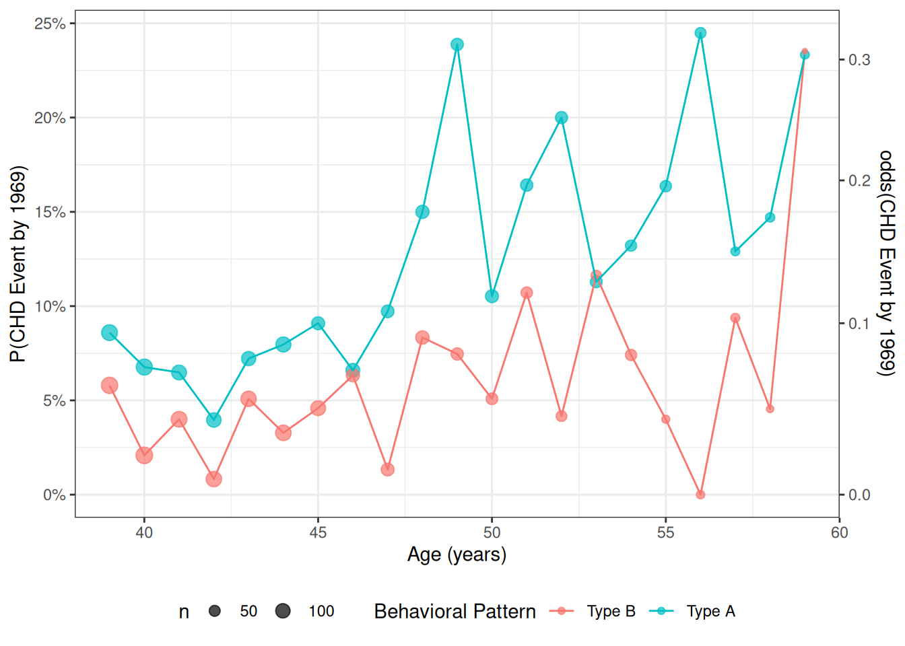](logistic-regression_files/figure-revealjs/fig-chd-graph-prob-scale-1.png "Figure 11: CHD rates by age group, probability scale")
>
> Figure 11: CHD rates by age group, probability scale

## 7.1 Odds scale

Show R code

``` downlit
odds_inv <- function(omega) omega / (1 + omega)
trans_odds <- trans_new(
  name = "odds",
  transform = odds,
  inverse = odds_inv
)

chd_plot_odds <- chd_plot_probs +
  scale_y_continuous(
    trans = trans_odds, # this line changes the vertical spacing
    name = chd_plot_probs$labels$y,
    sec.axis = sec_axis(
      ~ odds(.),
      name = "odds(CHD Event by 1969)"
    )
  )

print(chd_plot_odds)
```

> **NOTE:**
>
> [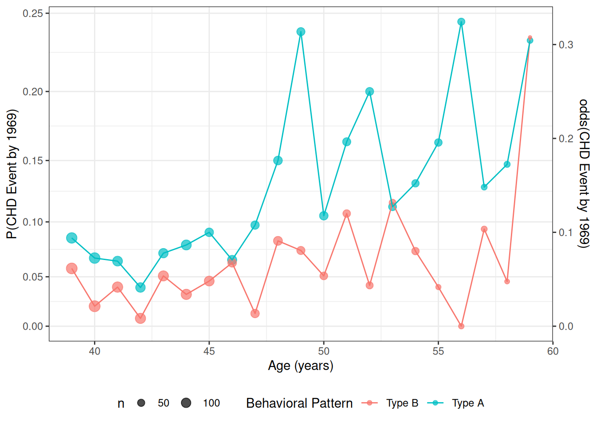](logistic-regression_files/figure-revealjs/fig-chd-odds-scale-1.png "Figure 12: CHD rates by age group, odds spacing")
>
> Figure 12: CHD rates by age group, odds spacing

## 7.2 Log-odds (logit) scale

Show R code

``` downlit
logit <- function(pi) log(odds(pi))
expit <- function(eta) odds_inv(exp(eta))
trans_logit <- trans_new(
  name = "logit",
  transform = logit,
  inverse = expit
)

chd_plot_logit <-
  chd_plot_probs +
  scale_y_continuous(
    trans = trans_logit, # this line changes the vertical spacing
    name = chd_plot_probs$labels$y,
    breaks = c(seq(.01, .1, by = .01), .15, .2),
    minor_breaks = NULL,
    sec.axis = sec_axis(
      ~ logit(.),
      name = "log(odds(CHD Event by 1969))"
    )
  )

print(chd_plot_logit)
```

> **NOTE:**
>
> [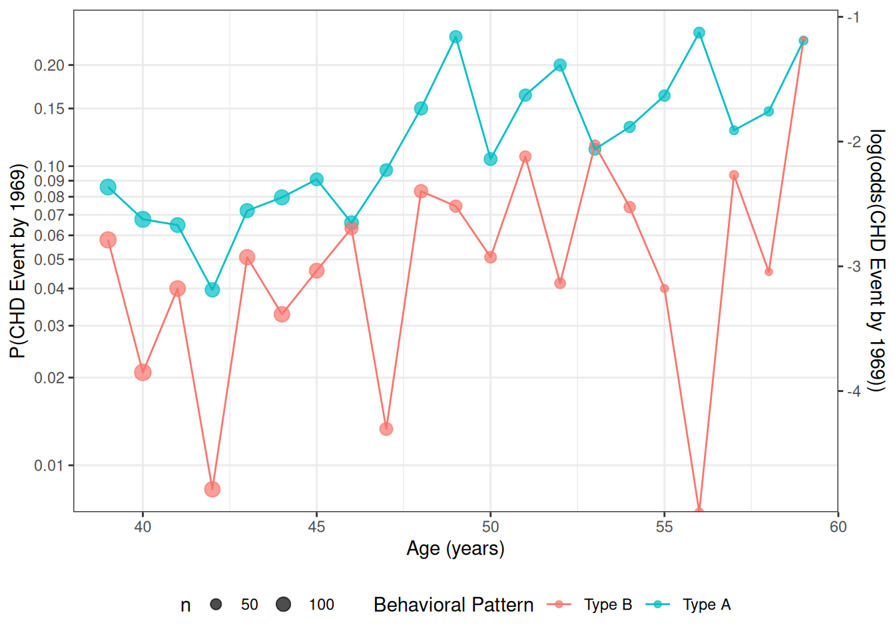](logistic-regression_files/figure-revealjs/fig-chd_plot_logit-1.png "Figure 13: CHD data (logit-scale)")
>
> Figure 13: CHD data (logit-scale)

### 7.2.1 Logistic regression models for CHD data

For the `wcgs` dataset, let’s consider a **[logistic regression model](../chapters/logistic-regression.llms.md#def-logistic-regression)** for the outcome of Coronary Heart Disease ($Y$; `chd` in computer output):

- $Y = 1$ if an individual developed CHD by the end of the study;
- $Y = 0$ if they have not developed CHD by the end of the study.

Let’s include an intercept, two covariates, plus their [interaction](../chapters/Intro-to-GLMs.llms.md#def-interaction):

- $A$: age at study enrollment (`age`, recorded in years)
- $P$: personality type (`dibpat`):
  - $P = 1$ represents “Type A personality”,
  - $P = 0$ represents “Type B personality”.
- $PA$: the interaction of personality type and age (`dibpat:age`)
- $\mathord{\smash[b]{\underset{\raise.3ex\hbox{$\scriptstyle\sim$}}{X}}\vphantom{X}}= (1, A, P, PA)$

Show R code

``` downlit
chd_glm_contrasts <-
  wcgs |>
  glm(
    "data" = _,
    "formula" = chd69 == "Yes" ~ dibpat * age,
    "family" = binomial(link = "logit")
  )

library(equatiomatic)
equatiomatic::extract_eq(chd_glm_contrasts)
```

$$\log\left[ \frac { P( \operatorname{chd69} = \operatorname{Yes} ) }{ 1 - P( \operatorname{chd69} = \operatorname{Yes} ) } \right] = \alpha + \beta_{1}(\operatorname{dibpat}_{\operatorname{Type\ A}}) + \beta_{2}(\operatorname{age}) + \beta_{3}(\operatorname{dibpat}_{\operatorname{Type\ A}} \times \operatorname{age})$$

Or in more formal notation:

$$\begin{aligned}
Y_i | \mathord{\smash[b]{\underset{\raise.3ex\hbox{$\scriptstyle\sim$}}{X}}\vphantom{X}}_i &\ \sim_{\perp\!\!\!\perp}\ \operatorname{Ber}(\pi(\mathord{\smash[b]{\underset{\raise.3ex\hbox{$\scriptstyle\sim$}}{X}}\vphantom{X}}_i))
\\
\pi(\mathord{\smash[b]{\underset{\raise.3ex\hbox{$\scriptstyle\sim$}}{x}}\vphantom{x}}) &= \operatorname{expit}(\eta(\mathord{\smash[b]{\underset{\raise.3ex\hbox{$\scriptstyle\sim$}}{x}}\vphantom{x}}))
\\
\eta(\mathord{\smash[b]{\underset{\raise.3ex\hbox{$\scriptstyle\sim$}}{x}}\vphantom{x}}) &= \beta_0 + \beta_P p + \beta_A a + \beta_{PA} pa
\end{aligned}
\tag{42}$$

### 7.2.2 Models superimposed on data

We can graph our fitted models on each scale (probability, [odds](../chapters/binary-outcome-associations.llms.md#def-odds), [log-odds](../chapters/binary-outcome-associations.llms.md#def-logodds)).

#### probability scale

> **NOTE:**
>
> Show R code
>
> ``` downlit
> curve_type_A <- function(x) { # nolint: object_name_linter
>   chd_glm_contrasts |> predict(
>     type = "response",
>     newdata = tibble(age = x, dibpat = "Type A")
>   )
> }
>
> curve_type_B <- function(x) { # nolint: object_name_linter
>   chd_glm_contrasts |> predict(
>     type = "response",
>     newdata = tibble(age = x, dibpat = "Type B")
>   )
> }
>
> chd_plot_probs_2 <-
>   chd_plot_probs +
>   geom_function(
>     fun = curve_type_A,
>     aes(col = "Type A")
>   ) +
>   geom_function(
>     fun = curve_type_B,
>     aes(col = "Type B")
>   )
> print(chd_plot_probs_2)
> ```
>
> [](logistic-regression_files/figure-revealjs/unnamed-chunk-31-1.png "Figure 14: Fitted CHD risk by age and behavior pattern (probability scale)")
>
> Figure 14: Fitted CHD [risk](../chapters/binary-outcome-associations.llms.md#def-risk-epi) by age and behavior pattern (probability scale)

#### odds scale

> **NOTE:**
>
> Show R code
>
> ``` downlit
>
> chd_plot_odds_2 <-
>   chd_plot_odds +
>   geom_function(
>     fun = curve_type_A,
>     aes(col = "Type A")
>   ) +
>   geom_function(
>     fun = curve_type_B,
>     aes(col = "Type B")
>   )
> print(chd_plot_odds_2)
> ```
>
> [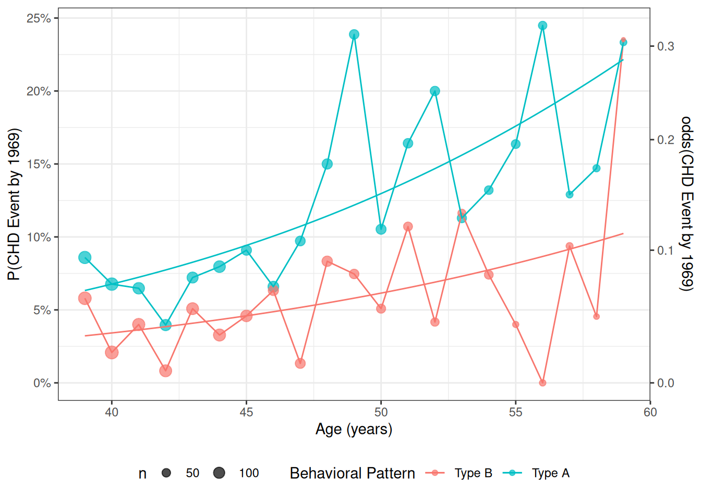](logistic-regression_files/figure-revealjs/unnamed-chunk-32-1.png "Figure 15: Fitted CHD odds by age and behavior pattern (odds scale)")
>
> Figure 15: Fitted CHD [odds](../chapters/binary-outcome-associations.llms.md#def-odds) by age and behavior pattern (odds scale)

#### log-odds (logit) scale

> **NOTE:**
>
> Show R code
>
> ``` downlit
>
> chd_plot_logit_2 <-
>   chd_plot_logit +
>   geom_function(
>     fun = curve_type_A,
>     aes(col = "Type A")
>   ) +
>   geom_function(
>     fun = curve_type_B,
>     aes(col = "Type B")
>   )
>
> print(chd_plot_logit_2)
> ```
>
> [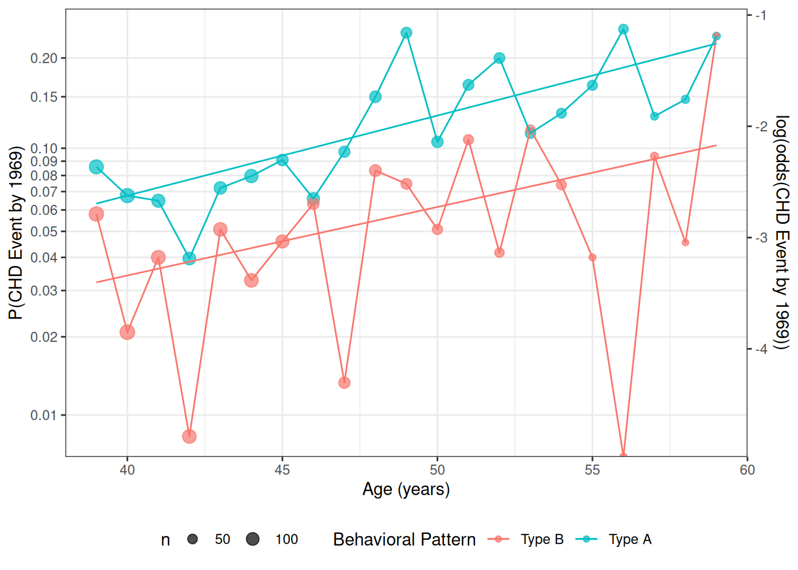](logistic-regression_files/figure-revealjs/unnamed-chunk-33-1.png "Figure 16: Fitted CHD log-odds by age and behavior pattern (log-odds scale)")
>
> Figure 16: Fitted CHD [log-odds](../chapters/binary-outcome-associations.llms.md#def-logodds) by age and behavior pattern (log-odds scale)

### 7.2.3 Interpreting the model parameters

> **NOTE:**
>
> **Exercise 25** For [Equation 42](#eq-wcgs-model-1), derive interpretations of $\beta_0$, $\beta_P$, $\beta_A$, and $\beta_{PA}$ on the [odds](../chapters/binary-outcome-associations.llms.md#def-odds) **and** [log-odds](../chapters/binary-outcome-associations.llms.md#def-logodds) scales, State the interpretations concisely in math **and** in words.
>
> *(Hint: apply the [general procedure for interpreting a regression coefficient](../chapters/Linear-models-overview.llms.md#def-coef-interp-procedure) to the log-odds [linear predictor](../chapters/Intro-to-GLMs.llms.md#def-linear-predictor)* $\eta(\mathord{\smash[b]{\underset{\raise.3ex\hbox{$\scriptstyle\sim$}}{x}}\vphantom{x}}) = \operatorname{logit}(\pi(\mathord{\smash[b]{\underset{\raise.3ex\hbox{$\scriptstyle\sim$}}{x}}\vphantom{x}}))$.)

> **NOTE:**
>
> *Solution 25*.  
>
> Show R code
>
> ``` downlit
> # include: false
> age_offset = 0L
> ```
>
> $$\begin{aligned}
> \eta(P=0,A=0) &= \beta_0 + \beta_P \cdot 0 + \beta_A \cdot 0 + \beta_{PA} (0 \cdot 0)
> && \text{(model equation, with } p = 0, a = 0 \text{)}
> \\
> &= \beta_0 + 0 + 0 + 0
> && \text{(multiplication by zero)}
> \\
> &= \beta_0
> && \text{(additive identity)}
> \end{aligned}$$
>
> Therefore:
>
> $$\beta_{0} = \eta(P=0,A=0) \tag{43}$$
>
> $\beta_{0}$ is the [natural logarithm](https://morrison-lab.github.io/mds/algebra-exponentials.html#def-natural-log) of the odds (“log-odds”) of experiencing CHD for a 0 year-old person with a type B personality; that is,
>
> The WCGS cohort ranges in age from 39 to 59 years, so a 0-year-old is far outside the observed data. This intercept is therefore an extrapolation with no in-sample referent. Centering age at a representative value (replacing $A$ with $A - \bar{A}$) is the standard remedy: it makes the intercept the log-odds at the mean age, which does have in-sample support.
>
> $\text{e}^{\beta_{0}}$ is the odds of experiencing CHD for a 0 year-old with a type B personality. Here we write
>
> $$\omega(p, a) \stackrel{\text{def}}{=}\operatorname{odds}(Y=1|P=p, A=a)$$
>
> for the odds of CHD at covariate values $(p, a)$. Then:
>
> $$\begin{aligned}
> {\operatorname{exp}\mathopen{}\left\{\beta_{0}\right\}\mathclose{}}
> &= {\operatorname{exp}\mathopen{}\left\{\eta(P=0,A=0)\right\}\mathclose{}}
> && \text{(} \beta_0 \text{ as a log-odds)}
> \\ &= \omega(P=0,A=0)
> && \text{(exponential of log-odds is odds: } \omega= {\operatorname{exp}\mathopen{}\left\{\eta\right\}\mathclose{}} \text{)}
> \\ &= \frac{\Pr(Y= 1| P = 0, A = 0)}{1-\Pr(Y= 1| P = 0, A = 0)}
> && \text{(definition of odds)}
> \\ &= \frac
> {\Pr(Y= 1| P = 0, A = 0)}
> {\Pr(Y= 0| P = 0, A = 0)}
> && \text{(complement rule: } 1 - \Pr(Y=1|\cdot) = \Pr(Y=0|\cdot) \text{)}
> \end{aligned}$$
>
> As with the log-odds interpretation, this odds is evaluated at age 0, which lies outside the cohort’s 39-to-59-year age range, so $\text{e}^{\beta_0}$ has no in-sample referent. Centering age before fitting gives an intercept whose odds is evaluated at the mean age instead.
>
> $$\begin{aligned}
> \frac{\partial}{\partial a}\eta(P=0, A = a)
> &= \frac{\partial}{\partial a} \mathopen{}\left(\beta_0 + \beta_P \cdot 0 + \beta_A a + \beta_{PA}(0\cdot a)\right)\mathclose{}
> && \text{(model equation, with } p = 0 \text{)}
> \\
> &= \frac{\partial}{\partial a} \mathopen{}\left(\beta_0 + 0 + \beta_A a + 0\right)\mathclose{}
> && \text{(multiplication by zero)}
> \\
> &= \frac{\partial}{\partial a} \mathopen{}\left(\beta_0 + \beta_A a\right)\mathclose{}
> && \text{(additive identity)}
> \\
> &= \frac{\partial}{\partial a}\beta_0 + \frac{\partial}{\partial a}\mathopen{}\left(\beta_A a\right)\mathclose{}
> && \text{(linearity of differentiation)}
> \\
> &=  0 + \beta_A
> && \text{(constants have derivative 0; derivative of a linear term)}
> \\
> &= \beta_A
> && \text{(additive identity)}
> \end{aligned}$$
>
> Therefore:
>
> $$\beta_A = \frac{\partial}{\partial a}\eta(P=0, A = a) \tag{44}$$
>
> $\beta_A$ is the slope of the log-odds of CHD with respect to age, for individuals with personality type B.
>
> Alternatively:
>
> $$\begin{aligned}
> \eta(P = 0, A = a + 1)- \eta(P = 0, A = a)
> &= \mathopen{}\left(\beta_0 + \beta_P \cdot 0 + \beta_A (a+1) + \beta_{PA} (0 \cdot (a+1))\right)\mathclose{} - \mathopen{}\left(\beta_0 + \beta_P \cdot 0 + \beta_A a + \beta_{PA} (0 \cdot a)\right)\mathclose{}
> && \text{(model equation, with } p = 0 \text{)}
> \\
> &= \mathopen{}\left(\beta_0 + 0 + \beta_A (a+1) + 0\right)\mathclose{} - \mathopen{}\left(\beta_0 + 0 + \beta_A a + 0\right)\mathclose{}
> && \text{(multiplication by zero)}
> \\
> &= \mathopen{}\left(\beta_0 + \beta_A (a+1)\right)\mathclose{} - \mathopen{}\left(\beta_0 + \beta_A a\right)\mathclose{}
> && \text{(additive identity)}
> \\
> &= \beta_0 + \beta_A a + \beta_A - \beta_0 - \beta_A a
> && \text{(distribute)}
> \\
> &= \beta_{A}
> && \text{(cancel } \beta_0 \text{ and } \beta_A a \text{)}
> \end{aligned}$$
>
> In terms of finite differences, $\beta_{A}$ is the difference in log-odds of experiencing CHD per one-year difference in age between two individuals with type B personalities.
>
> $$\begin{aligned}
> {\operatorname{exp}\mathopen{}\left\{\beta_{A}\right\}\mathclose{}} &= {\operatorname{exp}\mathopen{}\left\{\eta(P = 0, A = a + 1)- \eta(P = 0, A = a)\right\}\mathclose{}}
> && \text{(} \beta_A \text{ as a difference in log-odds)}
> \\
> &= \frac{{\operatorname{exp}\mathopen{}\left\{\eta(P = 0, A = a + 1)\right\}\mathclose{}}}{{\operatorname{exp}\mathopen{}\left\{\eta(P = 0, A = a)\right\}\mathclose{}}}
> && \text{(exponential of a difference is a ratio)}
> \\
> &= \frac{\omega(P = 0, A = a + 1)}{\omega(P = 0, A = a)}
> && \text{(exponential of log-odds is odds: } \omega= {\operatorname{exp}\mathopen{}\left\{\eta\right\}\mathclose{}} \text{)}
> \\
> &= \frac
> {\operatorname{odds}(Y= 1|P=0, A = a + 1)}
> {\operatorname{odds}(Y= 1|P=0, A = a)}
> && \text{(the } \omega(p, a) \text{ notation defined at } \beta_0 \text{'s interpretation)}
> \\
> &= \text{ϙ}_{\omega}(\Delta a = 1 | P = 0)
> && \text{(definition of the odds ratio)}
> \end{aligned}$$
>
> - The [odds ratio](../chapters/binary-outcome-associations.llms.md#def-OR) of experiencing CHD (aka “the odds ratio”) differs by a factor of $\text{e}^{\beta_{A}}$ per one-year difference in age between individuals with type B personality.
>
> $\beta_{P}$ is the [difference in log-odds](#def-difflogodds) of experiencing CHD for a 0 year-old person with type A personality compared to a 0 year-old person with type B personality; specifically,
>
> $$\beta_P = \eta(P = 1, A = 0) - \eta(P=0, A = 0) \tag{45}$$
>
> - $\text{e}^{\beta_{P}}$ is the ratio of the odds (aka “the odds ratio”) of experiencing CHD, for a 0-year old individual with type A personality vs a 0-year old individual with type B personality; specifically,
>
> $${\operatorname{exp}\mathopen{}\left\{\beta_{P}\right\}\mathclose{}}
> = \frac
> {\operatorname{odds}(Y= 1|P=1, A = 0)}
> {\operatorname{odds}(Y= 1|P=0, A = 0)}$$
>
> $$\begin{aligned}
> \frac{\partial}{\partial a}\eta(P={\color{red}{1}}, A = a)
> &= \frac{\partial}{\partial a} \mathopen{}\left(\beta_0 + \beta_P \cdot 1 + \beta_A a + \beta_{PA}(1 \cdot a)\right)\mathclose{}
> && \text{(model equation, with } p = 1 \text{)}
> \\
> &= \frac{\partial}{\partial a} \mathopen{}\left(\beta_0 + \beta_P + \beta_A a + \beta_{PA} a\right)\mathclose{}
> && \text{(multiplicative identity)}
> \\
> &= \frac{\partial}{\partial a}\beta_0 + \frac{\partial}{\partial a}\beta_P + \frac{\partial}{\partial a}\mathopen{}\left(\beta_A a\right)\mathclose{} + \frac{\partial}{\partial a}\mathopen{}\left(\beta_{PA} a\right)\mathclose{}
> && \text{(linearity of differentiation)}
> \\
> &= 0 + 0 + \beta_A + \beta_{PA}
> && \text{(constants have derivative 0; derivatives of linear terms)}
> \\
> &= {\color{red}{\beta_A + \beta_{PA}}}
> && \text{(additive identity)}
> \\
> \frac{\partial}{\partial a}\eta(P={\color{teal}{0}}, A = a) &= {\color{teal}{\beta_A}}
> && \text{(the type B slope, from the } \beta_A \text{ derivation)}
> \end{aligned}$$
>
> Therefore:
>
> $$\begin{aligned}
> \frac{\partial}{\partial a}\eta(P={\color{red}{1}}, A = a) - \frac{\partial}{\partial a}\eta(P={\color{teal}{0}}, A = a)
> &= \mathopen{}\left({\color{red}{\beta_A + \beta_{PA}}}\right)\mathclose{} - {\color{teal}{\beta_A}}
> && \text{(substitute the two slopes)}
> \\
> &= \beta_A - \beta_A + \beta_{PA}
> && \text{(commute the addition)}
> \\
> &= \beta_{PA}
> && \text{(cancel } \beta_A \text{)}
> \end{aligned}$$
>
> That slope difference implies that
>
> $$\begin{aligned}
> \beta_{PA} &= \frac{\partial}{\partial a}\eta(P={\color{red}{1}}, A = a) - \frac{\partial}{\partial a}\eta(P={\color{teal}{0}}, A = a)
> && \text{(rearrange the difference of slopes)}
> \\
> &= \frac{\partial}{\partial a}\eta(P={\color{red}{1}}, A = a) - {\color{teal}{\beta_A}}
> && \text{(substitute the type B slope, } \frac{\partial}{\partial a}\eta(P=0, A=a) = \beta_A \text{)}
> \end{aligned}$$
>
> $\beta_{PA}$ is the difference in the slopes of log-odds over age between participants with Type A personalities and participants with Type B personalities.
>
> Accordingly, the odds ratio of experiencing CHD per one-year difference in age differs by a factor of $\text{e}^{\beta_{PA}}$ for participants with type A personality compared to participants with type B personality; specifically,
>
> $$\begin{aligned}
> \text{ϙ}_{\omega}(\Delta a = 1 | P = 1)
> = {\operatorname{exp}\mathopen{}\left\{\beta_{PA}\right\}\mathclose{}} \times \text{ϙ}_{\omega}(\Delta a = 1 | P = 0)
> \end{aligned}$$
>
> or equivalently:
>
> $${\operatorname{exp}\mathopen{}\left\{\beta_{PA}\right\}\mathclose{}} =
> \frac
> {\text{ϙ}_{\omega}(\Delta a = 1 | P = 1)}
> {\text{ϙ}_{\omega}(\Delta a = 1 | P = 0)}$$

> **NOTE:**
>
> **Theorem 22 (Interpretation of the intercept in the WCGS interaction model)** In the model of [Equation 42](#eq-wcgs-model-1), write $\omega(p, a) \stackrel{\text{def}}{=}\operatorname{odds}(Y=1|P=p, A=a)$ for the odds of CHD at covariate values $(p, a)$. Then the intercept $\beta_0$ is the log-odds of CHD for a person with type B personality ($P = 0$) and age $0$:
>
> $$\beta_{0} = \eta(P=0,A=0)$$
>
> and ${\operatorname{exp}\mathopen{}\left\{\beta_0\right\}\mathclose{}}$ is the corresponding odds:
>
> $${\operatorname{exp}\mathopen{}\left\{\beta_{0}\right\}\mathclose{}} = \omega(P=0,A=0)$$

> **NOTE:**
>
> *Proof*. This proof is the solution to [Exercise 25](#exr-logistic-coef-interp), worked in [Solution 25](#sol-logistic-coef-interp).

> **NOTE:**
>
> **Example 19 (The fitted WCGS intercept as a log-odds)** The code below compares the intercept of the fitted model (`chd_glm_contrasts`) with the predicted log-odds for a type B participant at age 0, and compares ${\operatorname{exp}\mathopen{}\left\{\hat\beta_0\right\}\mathclose{}}$ with the corresponding predicted odds:
>
> Show R code
>
> ``` downlit
> ex_new <- data.frame(
>   dibpat = factor("Type B", levels = levels(wcgs$dibpat)),
>   age = 0
> )
> ex_eta <- predict(chd_glm_contrasts, newdata = ex_new, type = "link")
> ex_prob <- predict(chd_glm_contrasts, newdata = ex_new, type = "response")
> ex_odds <- ex_prob / (1 - ex_prob)
> ex_b0 <- unname(coef(chd_glm_contrasts)["(Intercept)"])
> ```
>
> The intercept is -5.8033 and the predicted log-odds is -5.8033. Also, ${\operatorname{exp}\mathopen{}\left\{\hat\beta_0\right\}\mathclose{}}$ is 0.00302 and the predicted odds is 0.00302. These values are tiny because age 0 lies far outside the observed ages, so the intercept is an extrapolation.

> **NOTE:**
>
> **Theorem 23 (Interpretation of the age coefficient in the WCGS interaction model)** In the model of [Equation 42](#eq-wcgs-model-1), write $\omega(p, a) \stackrel{\text{def}}{=}\operatorname{odds}(Y=1|P=p, A=a)$ and $\text{ϙ}_{\omega}(\Delta a = 1 | P = p) \stackrel{\text{def}}{=}\omega(p, a + 1) / \omega(p, a)$. Then for every age $a$, the age coefficient $\beta_A$ is the slope of the log-odds of CHD with respect to age among participants with type B personality ($P = 0$):
>
> $$\beta_A
> = \frac{\partial}{\partial a}\eta(P=0, A = a)
> = \eta(P = 0, A = a + 1)- \eta(P = 0, A = a)$$
>
> and ${\operatorname{exp}\mathopen{}\left\{\beta_A\right\}\mathclose{}}$ is the odds ratio per one-year difference in age among participants with type B personality:
>
> $${\operatorname{exp}\mathopen{}\left\{\beta_{A}\right\}\mathclose{}} = \text{ϙ}_{\omega}(\Delta a = 1 | P = 0)$$

> **NOTE:**
>
> *Proof*. This proof is the solution to [Exercise 25](#exr-logistic-coef-interp), worked in [Solution 25](#sol-logistic-coef-interp).

> **NOTE:**
>
> **Example 20 (The fitted WCGS age coefficient for type B participants)** The code below compares the age coefficient of the fitted model (`chd_glm_contrasts`) with the change in predicted log-odds between ages 50 and 51 for type B participants, and compares ${\operatorname{exp}\mathopen{}\left\{\hat\beta_A\right\}\mathclose{}}$ with the corresponding ratio of predicted odds:
>
> Show R code
>
> ``` downlit
> ex_new <- data.frame(
>   dibpat = factor("Type B", levels = levels(wcgs$dibpat)),
>   age = c(50, 51)
> )
> ex_eta <- predict(chd_glm_contrasts, newdata = ex_new, type = "link")
> ex_prob <- predict(chd_glm_contrasts, newdata = ex_new, type = "response")
> ex_odds <- ex_prob / (1 - ex_prob)
> ex_bA <- unname(coef(chd_glm_contrasts)["age"])
> ```
>
> The age coefficient is 0.0616 and the difference in predicted log-odds is 0.0616. Also, ${\operatorname{exp}\mathopen{}\left\{\hat\beta_A\right\}\mathclose{}}$ is 1.0635 and the ratio of predicted odds is 1.0635.

> **NOTE:**
>
> **Theorem 24 (Interpretation of the personality coefficient in the WCGS interaction model)** In the model of [Equation 42](#eq-wcgs-model-1), write $\omega(p, a) \stackrel{\text{def}}{=}\operatorname{odds}(Y=1|P=p, A=a)$. Then the personality coefficient $\beta_P$ is the difference in log-odds of CHD between type A ($P = 1$) and type B ($P = 0$) participants at age $0$:
>
> $$\beta_P = \eta(P = 1, A = 0) - \eta(P=0, A = 0)$$
>
> and ${\operatorname{exp}\mathopen{}\left\{\beta_P\right\}\mathclose{}}$ is the corresponding odds ratio:
>
> $${\operatorname{exp}\mathopen{}\left\{\beta_{P}\right\}\mathclose{}}
> = \frac{\omega(P=1, A = 0)}{\omega(P=0, A = 0)}$$

> **NOTE:**
>
> *Proof*. This proof is the solution to [Exercise 25](#exr-logistic-coef-interp), worked in [Solution 25](#sol-logistic-coef-interp).

> **NOTE:**
>
> **Example 21 (The fitted WCGS personality coefficient)** The code below compares the personality coefficient of the fitted model (`chd_glm_contrasts`) with the difference in predicted log-odds between type A and type B participants at age 0, and compares ${\operatorname{exp}\mathopen{}\left\{\hat\beta_P\right\}\mathclose{}}$ with the corresponding ratio of predicted odds:
>
> Show R code
>
> ``` downlit
> ex_new <- data.frame(
>   dibpat = factor(c("Type B", "Type A"), levels = levels(wcgs$dibpat)),
>   age = 0
> )
> ex_eta <- predict(chd_glm_contrasts, newdata = ex_new, type = "link")
> ex_prob <- predict(chd_glm_contrasts, newdata = ex_new, type = "response")
> ex_odds <- ex_prob / (1 - ex_prob)
> ex_bP <- unname(coef(chd_glm_contrasts)["dibpatType A"])
> ```
>
> The personality coefficient is 0.3044 and the difference in predicted log-odds is 0.3044. Also, ${\operatorname{exp}\mathopen{}\left\{\hat\beta_P\right\}\mathclose{}}$ is 1.3558 and the ratio of predicted odds is 1.3558.

> **NOTE:**
>
> **Theorem 25 (Interpretation of the interaction coefficient in the WCGS interaction model)** In the model of [Equation 42](#eq-wcgs-model-1), write $\omega(p, a) \stackrel{\text{def}}{=}\operatorname{odds}(Y=1|P=p, A=a)$ and $\text{ϙ}_{\omega}(\Delta a = 1 | P = p) \stackrel{\text{def}}{=}\omega(p, a + 1) / \omega(p, a)$. Then for every age $a$, the interaction coefficient $\beta_{PA}$ is the difference between the slopes of the log-odds of CHD over age for type A ($P = 1$) and type B ($P = 0$) participants:
>
> $$\beta_{PA} = \frac{\partial}{\partial a}\eta(P=1, A = a) - \frac{\partial}{\partial a}\eta(P=0, A = a)$$
>
> and ${\operatorname{exp}\mathopen{}\left\{\beta_{PA}\right\}\mathclose{}}$ is the ratio of the odds ratios per one-year difference in age:
>
> $${\operatorname{exp}\mathopen{}\left\{\beta_{PA}\right\}\mathclose{}} =
> \frac
> {\text{ϙ}_{\omega}(\Delta a = 1 | P = 1)}
> {\text{ϙ}_{\omega}(\Delta a = 1 | P = 0)}$$

> **NOTE:**
>
> *Proof*. This proof is the solution to [Exercise 25](#exr-logistic-coef-interp), worked in [Solution 25](#sol-logistic-coef-interp).

> **NOTE:**
>
> **Example 22 (The fitted WCGS interaction coefficient)** The code below compares the interaction coefficient of the fitted model (`chd_glm_contrasts`) with the difference between the type A and type B changes in predicted log-odds from age 50 to age 51, and compares ${\operatorname{exp}\mathopen{}\left\{\hat\beta_{PA}\right\}\mathclose{}}$ with the ratio of the two odds ratios:
>
> Show R code
>
> ``` downlit
> ex_levels <- levels(wcgs$dibpat)
> ex_new <- data.frame(
>   dibpat = factor(c("Type B", "Type B", "Type A", "Type A"), levels = ex_levels),
>   age = c(50, 51, 50, 51)
> )
> ex_eta <- predict(chd_glm_contrasts, newdata = ex_new, type = "link")
> ex_prob <- predict(chd_glm_contrasts, newdata = ex_new, type = "response")
> ex_odds <- ex_prob / (1 - ex_prob)
> ex_or_B <- ex_odds[2] / ex_odds[1]
> ex_or_A <- ex_odds[4] / ex_odds[3]
> ex_slope_diff <- (ex_eta[4] - ex_eta[3]) - (ex_eta[2] - ex_eta[1])
> ex_bPA <- unname(coef(chd_glm_contrasts)["dibpatType A:age"])
> ```
>
> The interaction coefficient is 0.0103 and the difference in the changes in predicted log-odds is 0.0103. Also, ${\operatorname{exp}\mathopen{}\left\{\hat\beta_{PA}\right\}\mathclose{}}$ is 1.0104 and the ratio of the odds ratio for type A (1.0746) to the odds ratio for type B (1.0635) is 1.0104.

See [Section 5.1.1](https://link.springer.com/chapter/10.1007/978-1-4614-1353-0_5#Sec2_5) of Vittinghoff et al. [\[2\]](#ref-vittinghoff2e) for another perspective, also using the `wcgs` data as an example.

### 7.2.4 Interpreting the model parameter estimates

[Table 17](#tbl-model-corner-point) shows the fitted model.

Show R code

``` downlit
library(parameters)
chd_glm_contrasts |>
  parameters() |>
  print_md()
```

> **NOTE:**
>
> | Parameter             | Log-Odds |  SE  |     95% CI     |   z   |    p    |
> |:----------------------|:--------:|:----:|:--------------:|:-----:|:-------:|
> | (Intercept)           |  -5.80   | 0.98 | (-7.73, -3.90) | -5.95 | \< .001 |
> | dibpat (Type A)       |   0.30   | 1.18 | (-2.02, 2.63)  | 0.26  |  0.797  |
> | age                   |   0.06   | 0.02 |  (0.02, 0.10)  | 3.01  |  0.003  |
> | dibpat (Type A) × age |   0.01   | 0.02 | (-0.04, 0.06)  | 0.42  |  0.674  |
>
> Table 17: CHD model (corner-point parametrization)

We can get the corresponding [odds ratio](../chapters/binary-outcome-associations.llms.md#def-OR) estimates ($e^{\hat{\beta}}$s) by passing `exponentiate = TRUE` to [`parameters()`](https://easystats.github.io/parameters/reference/model_parameters.html):

Show R code

``` downlit
chd_glm_contrasts |>
  parameters(exponentiate = TRUE) |>
  print_md()
```

> **NOTE:**
>
> | Parameter             | Odds Ratio |    SE    |      95% CI      |   z   |    p    |
> |:----------------------|:----------:|:--------:|:----------------:|:-----:|:-------:|
> | (Intercept)           |  3.02e-03  | 2.94e-03 | (4.40e-04, 0.02) | -5.95 | \< .001 |
> | dibpat (Type A)       |    1.36    |   1.61   |  (0.13, 13.88)   | 0.26  |  0.797  |
> | age                   |    1.06    |   0.02   |   (1.02, 1.11)   | 3.01  |  0.003  |
> | dibpat (Type A) × age |    1.01    |   0.02   |   (0.96, 1.06)   | 0.42  |  0.674  |
>
> Table 18: Odds ratio estimates for CHD model

### 7.2.5 Stratified parametrization

We could instead use a stratified parametrization:

Show R code

``` downlit
chd_glm_strat <- glm(
  "formula" = chd69 == "Yes" ~ dibpat + dibpat:age - 1,
  "data" = wcgs,
  "family" = binomial(link = "logit")
)
equatiomatic::extract_eq(chd_glm_strat)
```

$$\log\left[ \frac { P( \operatorname{chd69} = \operatorname{Yes} ) }{ 1 - P( \operatorname{chd69} = \operatorname{Yes} ) } \right] = \beta_{1}(\operatorname{dibpat}_{\operatorname{Type\ B}}) + \beta_{2}(\operatorname{dibpat}_{\operatorname{Type\ A}}) + \beta_{3}(\operatorname{dibpat}_{\operatorname{Type\ B}} \times \operatorname{dibpat}_{\operatorname{age}}) + \beta_{4}(\operatorname{dibpat}_{\operatorname{Type\ A}} \times \operatorname{dibpat}_{\operatorname{age}})$$

Show R code

``` downlit
chd_glm_strat |>
  parameters() |>
  print_md()
```

> **NOTE:**
>
> | Parameter             | Log-Odds |  SE  |     95% CI     |   z   |    p    |
> |:----------------------|:--------:|:----:|:--------------:|:-----:|:-------:|
> | dibpat (Type B)       |  -5.80   | 0.98 | (-7.73, -3.90) | -5.95 | \< .001 |
> | dibpat (Type A)       |  -5.50   | 0.67 | (-6.83, -4.19) | -8.18 | \< .001 |
> | dibpat (Type B) × age |   0.06   | 0.02 |  (0.02, 0.10)  | 3.01  |  0.003  |
> | dibpat (Type A) × age |   0.07   | 0.01 |  (0.05, 0.10)  | 5.24  | \< .001 |
>
> Table 19: CHD model, stratified parametrization

Again, we can get the corresponding [odds ratios](../chapters/binary-outcome-associations.llms.md#def-OR) ($e^{\beta}$s) by passing `exponentiate = TRUE` to [`parameters()`](https://easystats.github.io/parameters/reference/model_parameters.html):

Show R code

``` downlit
chd_glm_strat |>
  parameters(exponentiate = TRUE) |>
  print_md()
```

> **NOTE:**
>
> | Parameter             | Odds Ratio |    SE    |      95% CI      |   z   |    p    |
> |:----------------------|:----------:|:--------:|:----------------:|:-----:|:-------:|
> | dibpat (Type B)       |  3.02e-03  | 2.94e-03 | (4.40e-04, 0.02) | -5.95 | \< .001 |
> | dibpat (Type A)       |  4.09e-03  | 2.75e-03 | (1.08e-03, 0.02) | -8.18 | \< .001 |
> | dibpat (Type B) × age |    1.06    |   0.02   |   (1.02, 1.11)   | 3.01  |  0.003  |
> | dibpat (Type A) × age |    1.07    |   0.01   |   (1.05, 1.10)   | 5.24  | \< .001 |
>
> Table 20: Odds ratio estimates for CHD model

Compare with [Table 17](#tbl-model-corner-point).

> **NOTE:**
>
> **Exercise 26** If I give you model 1, how would you get the coefficients of model 2?

> **NOTE:**
>
> *Solution 26*. Model 1 is the corner-point (reference/contrast) parametrization fitted in `chd_glm_contrasts`, with linear predictor ([Equation 42](#eq-wcgs-model-1)):
>
> $$\eta(p, a) = \beta_0 + \beta_P p + \beta_A a + \beta_{PA} pa$$
>
> Model 2 is the stratified parametrization fitted in `chd_glm_strat`, which gives each personality type its own intercept and its own age slope. Writing $\gamma_B, \gamma_A$ for the stratum-specific intercepts and $\delta_B, \delta_A$ for the stratum-specific age slopes:
>
> $$\eta(p, a) \stackrel{\text{def}}{=}
> \gamma_B (1 - p) + \gamma_A p + \delta_B (1 - p) a + \delta_A p a
> \tag{46}$$
>
> The two parametrizations span the same set of linear-predictor functions, so both models have the same fitted linear predictor $\eta(p, a)$. We can therefore recover the model 2 coefficients by equating the two expressions for $\eta(p, a)$ within each personality-type stratum.
>
> **Type B stratum (**$p = 0$):
>
> In model 1 ([Equation 42](#eq-wcgs-model-1)):
>
> $$\begin{aligned}
> \eta(0, a)
> &= \beta_0 + \beta_P \cdot 0 + \beta_A a + \beta_{PA} \cdot 0 \cdot a
> && \text{(substitute } p = 0\text{)}
> \\
> &= \beta_0 + 0 + \beta_A a + 0
> && \text{(multiply by 0)}
> \\
> &= \beta_0 + \beta_A a
> && \text{(drop the zero terms)}
> \end{aligned}$$
>
> In model 2 ([Equation 46](#eq-wcgs-model-strat)):
>
> $$\begin{aligned}
> \eta(0, a)
> &= \gamma_B (1 - 0) + \gamma_A \cdot 0 + \delta_B (1 - 0) a + \delta_A \cdot 0 \cdot a
> && \text{(substitute } p = 0\text{)}
> \\
> &= \gamma_B \cdot 1 + \gamma_A \cdot 0 + \delta_B \cdot 1 \cdot a + \delta_A \cdot 0 \cdot a
> && \text{(} 1 - 0 = 1 \text{)}
> \\
> &= \gamma_B + 0 + \delta_B a + 0
> && \text{(multiply by 1 and by 0)}
> \\
> &= \gamma_B + \delta_B a
> && \text{(drop the zero terms)}
> \end{aligned}$$
>
> Equating the two expressions for $\eta(0, a)$, for all ages $a$:
>
> $$\gamma_B + \delta_B a = \beta_0 + \beta_A a
> \tag{47}$$
>
> Setting $a = 0$ in [Equation 47](#eq-wcgs-strat-match-b):
>
> $$\begin{aligned}
> \gamma_B + \delta_B \cdot 0
> &= \beta_0 + \beta_A \cdot 0
> && \text{(substitute } a = 0\text{)}
> \\
> \gamma_B + 0
> &= \beta_0 + 0
> && \text{(multiply by 0)}
> \\
> \gamma_B
> &= \beta_0
> && \text{(drop the zero terms)}
> \end{aligned}$$
>
> Subtracting $\gamma_B = \beta_0$ from both sides of [Equation 47](#eq-wcgs-strat-match-b) and then setting $a = 1$:
>
> $$\begin{aligned}
> \delta_B a
> &= \beta_A a
> && \text{(subtract } \gamma_B = \beta_0 \text{ from both sides)}
> \\
> \delta_B \cdot 1
> &= \beta_A \cdot 1
> && \text{(substitute } a = 1\text{)}
> \\
> \delta_B
> &= \beta_A
> && \text{(multiply by 1)}
> \end{aligned}$$
>
> **Type A stratum (**$p = 1$):
>
> In model 1 ([Equation 42](#eq-wcgs-model-1)):
>
> $$\begin{aligned}
> \eta(1, a)
> &= \beta_0 + \beta_P \cdot 1 + \beta_A a + \beta_{PA} \cdot 1 \cdot a
> && \text{(substitute } p = 1\text{)}
> \\
> &= \beta_0 + \beta_P + \beta_A a + \beta_{PA} a
> && \text{(multiply by 1)}
> \\
> &= (\beta_0 + \beta_P) + (\beta_A + \beta_{PA}) a
> && \text{(group the constant terms; factor out } a \text{)}
> \end{aligned}$$
>
> In model 2 ([Equation 46](#eq-wcgs-model-strat)):
>
> $$\begin{aligned}
> \eta(1, a)
> &= \gamma_B (1 - 1) + \gamma_A \cdot 1 + \delta_B (1 - 1) a + \delta_A \cdot 1 \cdot a
> && \text{(substitute } p = 1\text{)}
> \\
> &= \gamma_B \cdot 0 + \gamma_A \cdot 1 + \delta_B \cdot 0 \cdot a + \delta_A \cdot 1 \cdot a
> && \text{(} 1 - 1 = 0 \text{)}
> \\
> &= 0 + \gamma_A + 0 + \delta_A a
> && \text{(multiply by 0 and by 1)}
> \\
> &= \gamma_A + \delta_A a
> && \text{(drop the zero terms)}
> \end{aligned}$$
>
> Equating the two expressions for $\eta(1, a)$ and applying the same two steps as in the Type B stratum (set $a = 0$; then subtract the intercepts and set $a = 1$):
>
> $$\begin{aligned}
> \gamma_A &= \beta_0 + \beta_P
> \\
> \delta_A &= \beta_A + \beta_{PA}
> \end{aligned}$$
>
> **Summary of the conversion:**
>
> $$\begin{aligned}
> \gamma_B &= \beta_0
> \\
> \gamma_A &= \beta_0 + \beta_P
> \\
> \delta_B &= \beta_A
> \\
> \delta_A &= \beta_A + \beta_{PA}
> \end{aligned}
> \tag{48}$$
>
> Solving [Equation 48](#eq-wcgs-strat-from-contrast) for the model 1 coefficients inverts the conversion, so either parametrization determines the other:
>
> $$\begin{aligned}
> \beta_0 &= \gamma_B
> && \text{(first equation of the summary)}
> \\
> \beta_P &= \gamma_A - \gamma_B
> && \text{(subtract the first equation from the second)}
> \\
> \beta_A &= \delta_B
> && \text{(third equation)}
> \\
> \beta_{PA} &= \delta_A - \delta_B
> && \text{(subtract the third equation from the fourth)}
> \end{aligned}$$
>
> **Numerical check:** applying [Equation 48](#eq-wcgs-strat-from-contrast) to the fitted model 1 coefficients ([Table 17](#tbl-model-corner-point)) reproduces the fitted model 2 coefficients ([Table 19](#tbl-chd-strat)):
>
> Show R code
>
> ``` downlit
> b <- coef(chd_glm_contrasts)
>
> gamma_delta <- c(
>   "dibpatType B" = unname(b["(Intercept)"]),
>   "dibpatType A" = unname(b["(Intercept)"] + b["dibpatType A"]),
>   "dibpatType B:age" = unname(b["age"]),
>   "dibpatType A:age" = unname(b["age"] + b["dibpatType A:age"])
> )
>
> cbind(
>   "converted from model 1" = gamma_delta,
>   "model 2 (fitted directly)" = coef(chd_glm_strat)[names(gamma_delta)]
> )
> #>                  converted from model 1 model 2 (fitted directly)
> #> dibpatType B                 -5.8032532                -5.8032532
> #> dibpatType A                 -5.4988618                -5.4988618
> #> dibpatType B:age              0.0615634                 0.0615634
> #> dibpatType A:age              0.0719071                 0.0719071
> ```

> **NOTE:**
>
> **Theorem 26 (Converting between the corner-point and stratified parametrizations)** Let $\beta_0$, $\beta_P$, $\beta_A$ and $\beta_{PA}$ be the coefficients of the corner-point parametrization ([Equation 42](#eq-wcgs-model-1)). Let $\gamma_B$ and $\gamma_A$ be the stratum-specific intercepts, and $\delta_B$ and $\delta_A$ the stratum-specific age slopes, of the stratified parametrization of the same linear predictor ([Equation 46](#eq-wcgs-model-strat)). Then:
>
> $$\begin{aligned}
> \gamma_B &= \beta_0
> \\
> \gamma_A &= \beta_0 + \beta_P
> \\
> \delta_B &= \beta_A
> \\
> \delta_A &= \beta_A + \beta_{PA}
> \end{aligned}$$
>
> Equivalently:
>
> $$\begin{aligned}
> \beta_0 &= \gamma_B
> \\
> \beta_P &= \gamma_A - \gamma_B
> \\
> \beta_A &= \delta_B
> \\
> \beta_{PA} &= \delta_A - \delta_B
> \end{aligned}$$

> **NOTE:**
>
> *Proof*. This proof is the solution to [Exercise 26](#exr-strat-to-contrast), worked in [Solution 26](#sol-strat-to-contrast).

> **NOTE:**
>
> **Example 23 (Converting the fitted WCGS coefficients)** The code below applies [Theorem 26](#thm-wcgs-strat-from-contrast) to the coefficients of the fitted corner-point model (`chd_glm_contrasts`), and compares the result with the coefficients of the model fitted directly with the stratified parametrization (`chd_glm_strat`):
>
> Show R code
>
> ``` downlit
> ex_b <- coef(chd_glm_contrasts)
> ex_converted <- c(
>   "dibpatType B" = unname(ex_b["(Intercept)"]),
>   "dibpatType A" = unname(ex_b["(Intercept)"] + ex_b["dibpatType A"]),
>   "dibpatType B:age" = unname(ex_b["age"]),
>   "dibpatType A:age" = unname(ex_b["age"] + ex_b["dibpatType A:age"])
> )
> ex_direct <- coef(chd_glm_strat)[names(ex_converted)]
> ex_max_gap <- max(abs(ex_converted - ex_direct))
> ```
>
> The largest difference between the converted coefficients and the directly fitted ones is 4.4e-15, which is zero up to numerical error.

# 8 Model comparisons for logistic models

> **TIP:**
>
> David Rocke’s Epi 204 lecture [*Diagnostics and Goodness of Fit*](https://dmrocke.ucdavis.edu/Class/EPI204-Spring-2021/EPI204-2021-04-13.mp4) ([slides](https://dmrocke.ucdavis.edu/Class/EPI204-Spring-2021/Lecture5_Diagnostics_Logistic_Regression.pdf)) covers the [deviance goodness-of-fit test](#def-deviance-test) and the [Hosmer-Lemeshow test](#def-hosmer-lemeshow) [\[4\]](#ref-rocke2021epi204).

> **TIP:**
>
> Josh Starmer’s StatQuest video [*Saturated Models and Deviance*](https://www.youtube.com/watch?v=9T0wlKdew6I) explains [saturated models](../chapters/Linear-models-overview.llms.md#def-saturated-model), [null deviance](../chapters/Linear-models-overview.llms.md#def-null-deviance), and residual deviance [\[5\]](#ref-starmer-statquest).

> **TIP:**
>
> Josh Starmer’s StatQuest video [*Logistic Regression Details Pt 3: R-squared and p-value*](https://www.youtube.com/watch?v=xxFYro8QuXA) explains a likelihood-based pseudo-$R^2$ for [logistic regression](#def-logistic-regression) and the [likelihood ratio test](#def-lrt) of the fitted model against the intercept-only model [\[5\]](#ref-starmer-statquest).

### 8.0.1 Deviance test

> **NOTE:**
>
> **Definition 4 (Deviance goodness-of-fit test (deviance test))** We can compare the maximized [log-likelihood](https://morrison-lab.github.io/sds/intro-MLEs.html#def-loglik) of our model, $\ell(\hat\beta; \mathbf x)$, versus the log-likelihood of the full model (aka saturated model aka maximal model; see [the saturated model definition](../chapters/Linear-models-overview.llms.md#def-saturated-model)), $\ell_{\text{full}}$, which has one parameter per covariate pattern. The **deviance** statistic (see [the deviance definition](../chapters/Linear-models-overview.llms.md#def-deviance)) is:
>
> $$D \stackrel{\text{def}}{=}2(\ell_{\text{full}} - \ell(\hat\beta; \mathbf x))$$
>
> With enough data, $D \dot \sim \chi^2(q - p)$, where $q$ is the number of distinct covariate patterns and $p$ is the number of $\beta$ parameters in our model. The **deviance goodness-of-fit test** (or **deviance test**) compares $D$ to that $\chi^2(q-p)$ distribution.

> **NOTE:**
>
> *Remark 3* (Interpreting the deviance test). A significant [p-value](https://morrison-lab.github.io/sds/inference.html#def-p-value) for this deviance statistic indicates that there’s some detectable pattern in the data that our model isn’t flexible enough to catch.

> **CAUTION:**
>
> The deviance statistic needs to have a large amount of data **for each covariate pattern** for the $\chi^2$ approximation to hold. A guideline from Dobson and Barnett [\[1, Ch. 5\]](#ref-dobson4e) is that if there are $q$ distinct covariate patterns $x_1...,x_q$, with $n_1,...,n_q$ observations per pattern, then the expected frequencies $n_k \cdot \pi(x_k)$ should be at least 1 for every pattern $k\in 1:q$.

If you have covariates measured on a continuous scale, you may not be able to use the [deviance tests](#def-deviance-test) to assess goodness of fit.

> **NOTE:**
>
> **Example 24 (Deviance test for the WCGS CHD model)** Our CHD model `chd_glm_contrasts` was fit to individual-level observations, but its covariate patterns are just the combinations of personality type (`dibpat`) and whole-year `age`, so we can refit the same model to the grouped data and perform the [deviance test](#def-deviance-test):
>
> Show R code
>
> ``` downlit
> wcgs_gof_grouped <-
>   wcgs |>
>   summarize(
>     .by = c(dibpat, age),
>     n = n(),
>     chd = sum(chd69 == "Yes"),
>     no_chd = sum(chd69 == "No")
>   )
>
> chd_glm_gof_grouped <- glm(
>   "formula" = cbind(chd, no_chd) ~ dibpat * age,
>   "data" = wcgs_gof_grouped,
>   "family" = binomial(link = "logit")
> )
>
> deviance_gof <- deviance(chd_glm_gof_grouped)
> q_gof <- nrow(wcgs_gof_grouped)
> p_gof <- length(coef(chd_glm_gof_grouped))
> pval_deviance_gof <- pchisq(
>   deviance_gof,
>   df = q_gof - p_gof,
>   lower.tail = FALSE
> )
> min_exp_freq <- min(wcgs_gof_grouped$n * fitted(chd_glm_gof_grouped))
> ```
>
> The smallest expected event frequency across the covariate patterns is $\min_k {\mathopen{}\left\{ n_k \cdot \hat\pi(x_k) \right\}\mathclose{}} = 1.74$, which is at least 1, so these grouped data meet the minimum-expected-frequency guideline from Dobson and Barnett [\[1, Ch. 5\]](#ref-dobson4e) for using the $\chi^2$ approximation.
>
> The grouped data have $q = 42$ distinct covariate patterns, and the model has $p = 4$ parameters, so the deviance statistic $D = 45$ has $q - p = 38$ degrees of freedom. The corresponding [p-value](https://morrison-lab.github.io/sds/inference.html#def-p-value) is $p(\chi^2(38) > 45) = 0.202$, so the deviance test finds no significant evidence of lack of fit for this model.

### 8.0.2 Hosmer-Lemeshow test

If our covariate patterns produce groups that are too small, a reasonable solution is to make bigger groups by merging some of the covariate-pattern groups together.

> **NOTE:**
>
> **Definition 5 (Hosmer-Lemeshow test)** Hosmer and Lemeshow [\[11\]](#ref-hosmer1980goodness) proposed that we group the patterns by their predicted probabilities according to the model of interest. For example, you could group all of the observations with predicted probabilities of 10% or less together, then group the observations with 11%-20% probability together, and so on; $g=10$ categories in all.
>
> Then we can construct a statistic $$X^2 \stackrel{\text{def}}{=}\sum_{c=1}^g \frac{(o_c - e_c)^2}{e_c}$$ where $o_c$ is the number of events *observed* in group $c$, and $e_c$ is the number of events expected in group $c$ (based on the sum of the [fitted values](https://morrison-lab.github.io/sds/prediction.html#def-fitted-value) $\hat\pi_i$ for observations in group $c$).
>
> If each group has enough observations in it, you can compare $X^2$ to a $\chi^2$ distribution; by simulation, the degrees of freedom has been found to be approximately $g-2$.

> **NOTE:**
>
> The [Hosmer-Lemeshow](#def-hosmer-lemeshow) statistic depends on how the observations are grouped. Changing the number of groups $g$, or the cut points used to form them, can change the value of $X^2$ and its [p-value](https://morrison-lab.github.io/sds/inference.html#def-p-value) for the same fitted model, so the test can reach different conclusions depending on the grouping choice. Hosmer et al. [\[12\]](#ref-hosmer1997comparison) compare the Hosmer-Lemeshow test against several alternative goodness-of-fit tests and document this sensitivity.

> **NOTE:**
>
> **Example 25 (Hosmer-Lemeshow test for the WCGS CHD model)** For our CHD model, this procedure would be:
>
> Show R code
>
> ``` downlit
> wcgs <-
>   wcgs |>
>   mutate(
>     pred_probs_glm1 = chd_glm_contrasts |> fitted(),
>     pred_prob_cats1 = pred_probs_glm1 |>
>       cut(
>         breaks = seq(0, 1, by = .1),
>         include.lowest = TRUE
>       )
>   )
>
> HL_table <- # nolint: object_name_linter
>   wcgs |>
>   summarize(
>     .by = pred_prob_cats1,
>     n = n(),
>     o = sum(chd69 == "Yes"),
>     e = sum(pred_probs_glm1)
>   )
>
> library(pander)
> HL_table |> pander()
> ```
>
> | pred_prob_cats1 |   n   |  o  |   e   |
> |:---------------:|:-----:|:---:|:-----:|
> |   (0.1,0.2\]    |  785  | 116 |  108  |
> |   (0.2,0.3\]    |  64   | 12  | 13.77 |
> |    \[0,0.1\]    | 2,305 | 129 | 135.2 |
>
> Show R code
>
> ``` downlit
>
> X2 <- HL_table |> # nolint: object_name_linter
>   summarize(
>     `X^2` = sum((o - e)^2 / e)
>   ) |>
>   pull(`X^2`)
> print(X2)
> #> [1] 1.11029
>
> pval1 <- pchisq(X2, lower = FALSE, df = nrow(HL_table) - 2)
> ```
>
> Our statistic is $X^2 = 1.110287$; $p(\chi^2(1) > 1.110287) = 0.29202$, which is our [p-value](https://morrison-lab.github.io/sds/inference.html#def-p-value) for detecting a lack of goodness of fit.
>
> Unfortunately that grouping plan left us with just three categories with any observations, so instead of grouping by 10% increments of predicted probability, typically analysts use deciles of the predicted probabilities:
>
> Show R code
>
> ``` downlit
> wcgs <-
>   wcgs |>
>   mutate(
>     pred_probs_glm1 = chd_glm_contrasts |> fitted(),
>     pred_prob_cats1 = pred_probs_glm1 |>
>       cut(
>         breaks = quantile(pred_probs_glm1, seq(0, 1, by = .1)),
>         include.lowest = TRUE
>       )
>   )
>
> HL_table <- # nolint: object_name_linter
>   wcgs |>
>   summarize(
>     .by = pred_prob_cats1,
>     n = n(),
>     o = sum(chd69 == "Yes"),
>     e = sum(pred_probs_glm1)
>   )
>
> HL_table |> pander()
> ```
>
> |  pred_prob_cats1  |  n  |  o  |   e   |
> |:-----------------:|:---:|:---:|:-----:|
> |  (0.114,0.147\]   | 275 | 48  | 36.81 |
> |  (0.147,0.222\]   | 314 | 51  | 57.19 |
> | (0.0774,0.0942\]  | 371 | 27  | 32.56 |
> |  (0.0942,0.114\]  | 282 | 30  | 29.89 |
> |  (0.0633,0.069\]  | 237 | 17  | 15.97 |
> |  (0.069,0.0774\]  | 306 | 20  | 22.95 |
> | (0.0487,0.0633\]  | 413 | 27  | 24.1  |
> | (0.0409,0.0487\]  | 310 | 14  | 14.15 |
> | \[0.0322,0.0363\] | 407 | 16  | 13.91 |
> | (0.0363,0.0409\]  | 239 |  7  | 9.48  |
>
> Show R code
>
> ``` downlit
>
> X2 <- HL_table |> # nolint: object_name_linter
>   summarize(
>     `X^2` = sum((o - e)^2 / e)
>   ) |>
>   pull(`X^2`)
>
> print(X2)
> #> [1] 6.78114
>
> pval1 <- pchisq(X2, lower = FALSE, df = nrow(HL_table) - 2)
> ```
>
> Now we have more evenly split categories. The p-value is $0.56042$, still not significant.
>
> Graphically, we have compared:
>
> Show R code
>
> ``` downlit
> HL_plot <- # nolint: object_name_linter
>   HL_table |>
>   ggplot(aes(x = pred_prob_cats1)) +
>   geom_line(
>     aes(y = e, x = pred_prob_cats1, group = "Expected", col = "Expected")
>   ) +
>   geom_point(aes(y = e, size = n, col = "Expected")) +
>   geom_point(aes(y = o, size = n, col = "Observed")) +
>   geom_line(aes(y = o, col = "Observed", group = "Observed")) +
>   scale_size(range = c(1, 4)) +
>   theme_bw() +
>   ylab("number of CHD events") +
>   theme(axis.text.x = element_text(angle = 45))
> ```
>
> Show R code
>
> ``` downlit
> ggplotly(HL_plot)
> ```

### 8.0.3 Comparing models

The deviance test ([Definition 4](#def-deviance-test)) and the Hosmer-Lemeshow test ([Definition 5](#def-hosmer-lemeshow)) assess the fit of a single model in absolute terms. To choose between two competing models, we can instead compare their fits against each other, using criteria that trade off fit against complexity:

- AIC = $-2 * \ell(\hat\theta) + 2 * p$ \[lower is better\] [\[13\]](#ref-akaike1974new) (see [the AIC definition](../chapters/Linear-models-overview.llms.md#def-aic))
- BIC = $-2 * \ell(\hat\theta) + p * \text{log}(n)$ \[lower is better\] [\[14\]](#ref-schwarz1978estimating) (see [the BIC definition](../chapters/Linear-models-overview.llms.md#def-bic))

A larger maximized [log-likelihood](https://morrison-lab.github.io/sds/intro-MLEs.html#def-loglik) is not, by itself, evidence that one model is better than another: adding parameters to a model can never decrease its maximized log-likelihood, so the more complex of two nested models always fits at least as well. For **nested** models, the [likelihood ratio test](#def-lrt) accounts for this complexity difference by testing whether the improvement in fit is larger than chance alone would produce:

> **NOTE:**
>
> **Definition 6 (Likelihood ratio test statistic)** Suppose a **reduced** model with $p_0$ parameters is nested in a **full** model with $p_1 > p_0$ parameters; that is, the reduced model is a special case of the full model. The **likelihood ratio test statistic** is:
>
> $$\Lambda \stackrel{\text{def}}{=}2(\ell_{\text{full}}(\hat\theta_1) - \ell_{\text{red}}(\hat\theta_0))$$
>
> where $\hat\theta_1$ and $\hat\theta_0$ are the [maximum likelihood estimates](https://morrison-lab.github.io/sds/intro-MLEs.html#def-mle) of the full and reduced models, respectively.

> **NOTE:**
>
> **Definition 7 (Likelihood ratio test (LRT))** Under the [null hypothesis](https://morrison-lab.github.io/sds/inference.html#def-null-hypothesis) that the reduced model is adequate, the likelihood ratio test statistic $\Lambda$ ([Definition 6](#def-lrt-statistic)) satisfies $\Lambda \dot \sim \chi^2(p_1 - p_0)$ by [Wilks’ theorem](https://morrison-lab.github.io/sds/intro-MLEs.html#thm-wilks). The **likelihood ratio test (LRT)** rejects the reduced model when $\Lambda$ is large relative to that $\chi^2(p_1 - p_0)$ distribution.

See also [the likelihood ratio test for linear models](../chapters/Linear-models-overview.llms.md#sec-linreg-LRT).

> **NOTE:**
>
> **Example 26 (Testing the WCGS interaction term with a likelihood ratio test)** Our CHD model `chd_glm_contrasts` includes a `dibpat:age` [interaction term](../chapters/Intro-to-GLMs.llms.md#def-interaction-term). Does that interaction term improve the fit enough to justify its extra parameter? Let’s fit the nested model without the interaction term and compare the two models with a [likelihood ratio test](#def-lrt):
>
> Show R code
>
> ``` downlit
> chd_glm_additive <-
>   wcgs |>
>   glm(
>     "data" = _,
>     "formula" = chd69 == "Yes" ~ dibpat + age,
>     "family" = binomial(link = "logit")
>   )
>
> lrt_chd <- anova(
>   chd_glm_additive,
>   chd_glm_contrasts,
>   test = "LRT"
> )
> lrt_chd
> ```
>
> Show R code
>
> ``` downlit
>
> llik_full_chd <- logLik(chd_glm_contrasts) |> as.numeric()
> llik_red_chd <- logLik(chd_glm_additive) |> as.numeric()
> lambda_chd <- lrt_chd$Deviance[2]
> df_chd <- lrt_chd$Df[2]
> pval_lrt_chd <- lrt_chd$`Pr(>Chi)`[2]
> ```
>
> Here the [test statistic](https://morrison-lab.github.io/sds/inference.html#def-test-statistic) is:
>
> $$\begin{aligned}
> \Lambda
> &\stackrel{\text{def}}{=}2(\ell_{\text{full}}(\hat\theta_1) - \ell_{\text{red}}(\hat\theta_0))
> && \text{(definition of the LRT statistic)}
> \\ &= 2 \times (-851.99 - (-852.08))
> && \text{(substituting the two maximized log-likelihoods)}
> \\ &= 2 \times 0.09
> && \text{(subtraction)}
> \\ &= 0.18
> && \text{(multiplication)}
> \end{aligned}$$
>
> The full model has $p_1 = 4$ parameters and the reduced model has $p_0 = 3$, so the null distribution is $\chi^2(p_1 - p_0) = \chi^2(1)$, and the [p-value](https://morrison-lab.github.io/sds/inference.html#def-p-value) is $p(\chi^2(1) > 0.18) = 0.674$. The LRT finds no significant evidence that the interaction term improves the fit.
>
> The `lrtest()` function from the [{lmtest}](https://cran.r-project.org/package=lmtest) package performs the same test:
>
> Show R code
>
> ``` downlit
> lmtest::lrtest(chd_glm_contrasts, chd_glm_additive)
> ```
>
> [AIC](../chapters/Linear-models-overview.llms.md#def-aic) and [BIC](../chapters/Linear-models-overview.llms.md#def-bic) can also compare these two models:
>
> Show R code
>
> ``` downlit
> AIC(chd_glm_additive, chd_glm_contrasts)
> ```
>
> Show R code
>
> ``` downlit
> BIC(chd_glm_additive, chd_glm_contrasts)
> ```
>
> Both criteria are lower for the additive model (AIC: $1710.16$ vs $1711.98$; BIC: $1728.33$ vs $1736.21$), agreeing with the LRT that the interaction term is not worth its extra parameter.

# 9 Residual-based diagnostics

> **TIP:**
>
> David Rocke’s Epi 204 lecture [*Diagnostics and Goodness of Fit*](https://dmrocke.ucdavis.edu/Class/EPI204-Spring-2021/EPI204-2021-04-13.mp4) ([slides](https://dmrocke.ucdavis.edu/Class/EPI204-Spring-2021/Lecture5_Diagnostics_Logistic_Regression.pdf)) covers residuals, [leverage](#def-leverage-glm), and influence diagnostics for grouped and ungrouped logistic models, and [overdispersion](../chapters/count-regression.llms.md#def-overdispersion) [\[4\]](#ref-rocke2021epi204).

> **TIP:**
>
> Josh Starmer’s StatQuest video [*Deviance Residuals*](https://www.youtube.com/watch?v=JC56jS2gVUE) explains how [deviance residuals](#def-deviance-residual-logistic) are computed and used [\[5\]](#ref-starmer-statquest).

### 9.0.1 Logistic regression residuals only work for grouped data

The residual and [leverage](#def-leverage-glm) diagnostics in this section follow the logistic-regression diagnostics developed by Pregibon [\[15\]](#ref-pregibon1981logistic); see also Dobson and Barnett [\[1, Ch. 7\]](#ref-dobson4e) and Vittinghoff et al. [\[2, Ch. 5\]](#ref-vittinghoff2e) for textbook treatments.

Show R code

``` downlit
library(haven)
url <- paste0(
  # I'm breaking up the url into two chunks for readability
  "https://regression.ucsf.edu/sites/g/files/",
  "tkssra6706/f/wysiwyg/home/data/wcgs.dta"
)
library(here) # provides the `here()` function
library(fs) # provides the `path()` function
here::here() |>
  fs::path("Data/wcgs.rda") |>
  load()
chd_glm_contrasts <-
  wcgs |>
  glm(
    "data" = _,
    "formula" = chd69 == "Yes" ~ dibpat * age,
    "family" = binomial(link = "logit")
  )
library(ggfortify)
chd_glm_contrasts |> autoplot()
```

> **NOTE:**
>
> [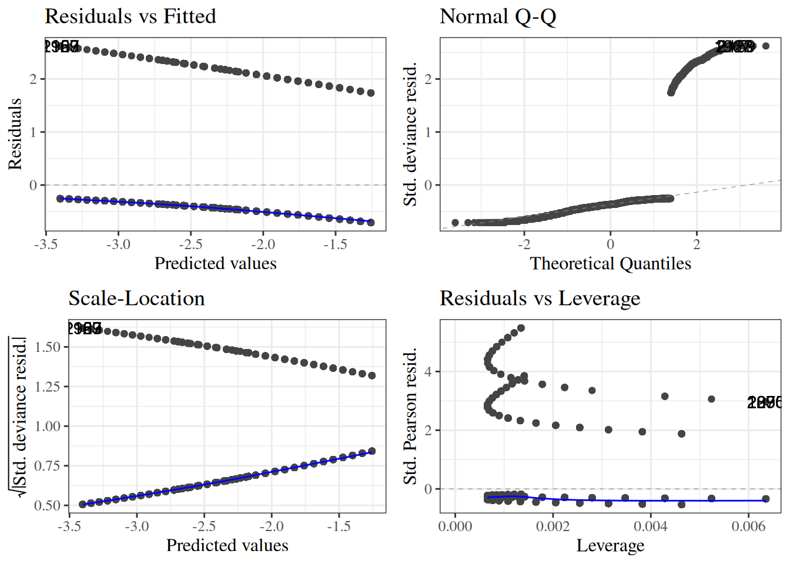](logistic-regression_files/figure-revealjs/fig-resid-dx-wcgs-ungrouped-1.png "Figure 17: Residual diagnostics for WCGS model with individual-level observations")
>
> Figure 17: Residual diagnostics for WCGS model with individual-level observations

Residuals only work if there is more than one observation for most covariate patterns.

Here we will create the grouped-data version of our CHD model from the WCGS study:

Show R code

``` downlit
library(dplyr)
wcgs_grouped <-
  wcgs |>
  summarize(
    .by = c(dibpat, age),
    n = n(),
    chd = sum(chd69 == "Yes"),
    no_chd = sum(chd69 == "No")
  ) |> 
  mutate(p_chd = chd/n)

chd_glm_contrasts_grouped <- glm(
  "formula" = cbind(chd, no_chd) ~ dibpat*age,
  "data" = wcgs_grouped,
  "family" = binomial(link = "logit")
)
chd_glm_contrasts_grouped |> equatiomatic::extract_eq()
```

$$\log\left[ \frac { P( \operatorname{chd} ) }{ 1 - P( \operatorname{chd} ) } \right] = \alpha + \beta_{1}(\operatorname{dibpat}_{\operatorname{Type\ A}}) + \beta_{2}(\operatorname{age}) + \beta_{3}(\operatorname{dibpat}_{\operatorname{Type\ A}} \times \operatorname{age})$$

Show R code

``` downlit
library(parameters)
chd_glm_contrasts_grouped |>
  parameters() |>
  print_md()
```

> **NOTE:**
>
> | Parameter             | Log-Odds |  SE  |     95% CI     |   z   |    p    |
> |:----------------------|:--------:|:----:|:--------------:|:-----:|:-------:|
> | (Intercept)           |  -5.80   | 0.98 | (-7.73, -3.90) | -5.95 | \< .001 |
> | dibpat (Type A)       |   0.30   | 1.18 | (-2.02, 2.63)  | 0.26  |  0.797  |
> | age                   |   0.06   | 0.02 |  (0.02, 0.10)  | 3.01  |  0.003  |
> | dibpat (Type A) × age |   0.01   | 0.02 | (-0.04, 0.06)  | 0.42  |  0.674  |
>
> Table 21: CHD model with grouped `wcgs` data

Show R code

``` downlit
chd_glm_contrasts_grouped |> 
  sjPlot::plot_model(type = "pred", terms = c("age", "dibpat")) + 
  geom_point(data = wcgs_grouped |> mutate(group_col = dibpat), 
             aes(x = age, y = p_chd))
```

> **NOTE:**
>
> [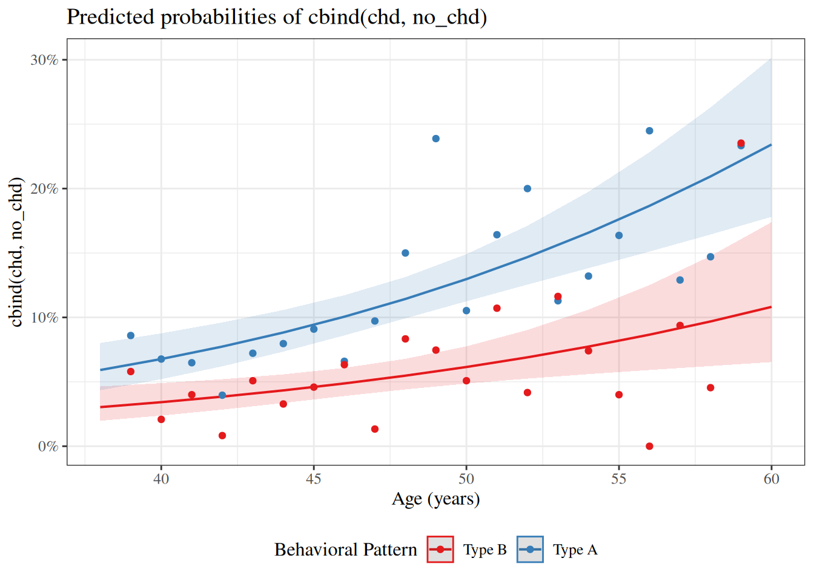](logistic-regression_files/figure-revealjs/fig-wcgs-model-grouped-data-1.png "Figure 18: CHD model with grouped wcgs data")
>
> Figure 18: CHD model with grouped `wcgs` data

Show R code

``` downlit
library(ggfortify)
chd_glm_contrasts_grouped |> autoplot()
```

[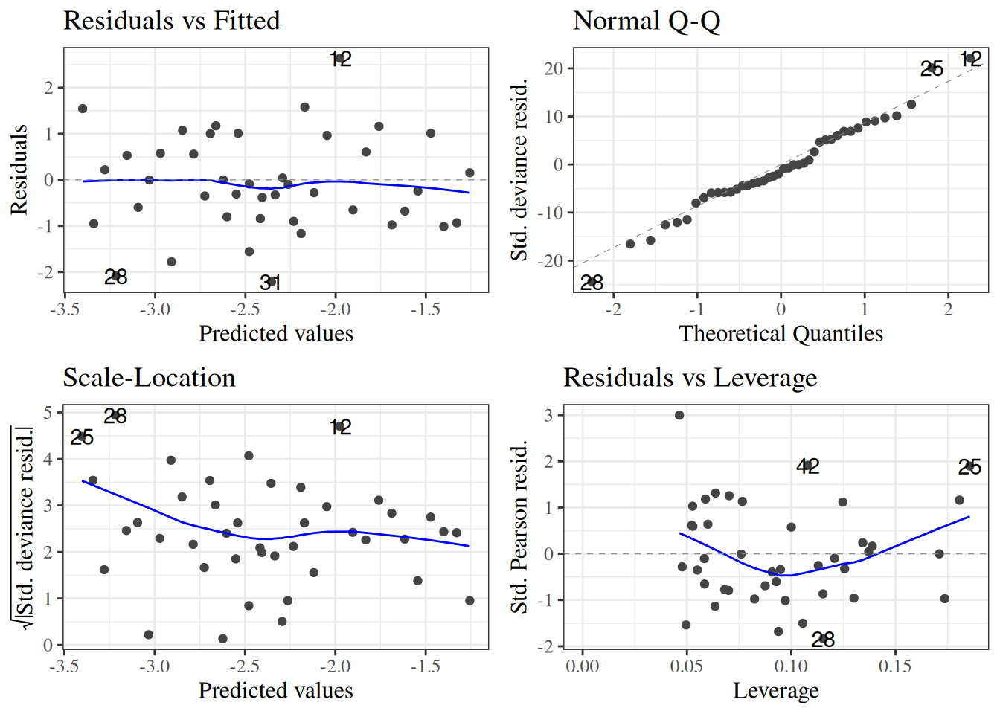](logistic-regression_files/figure-revealjs/unnamed-chunk-42-1.png)

### 9.0.2 (Response) residuals

> **NOTE:**
>
> **Definition 8**  
>
> #### Response residual
>
> The **response residual** for covariate pattern $k$ is
>
> $$e_k \stackrel{\text{def}}{=}\bar y_k - \hat{\pi}(x_k)$$
>
> where $k$ indexes the covariate patterns, $\bar y_k$ is the observed proportion of events in pattern $k$, and $\hat\pi(x_k)$ is the fitted probability for pattern $k$.

> **NOTE:**
>
> **Example 27 (Response residuals for the WCGS CHD model)** We can graph these residuals $e_k$ ([Definition 8](#def-response-residual-logistic)) against the [fitted values](https://morrison-lab.github.io/sds/prediction.html#def-fitted-value) $\hat\pi(x_k)$:
>
> Show R code
>
> ``` downlit
> odds <- function(pi) pi/(1-pi)
> logit <- function(pi) log(odds(pi))
> wcgs_grouped <-
>   wcgs_grouped |>
>   mutate(
>     fitted = chd_glm_contrasts_grouped |> fitted(),
>     fitted_logit = fitted |> logit(),
>     response_resids = chd_glm_contrasts_grouped |> resid(type = "response")
>   )
>
> wcgs_response_resid_plot <-
>   wcgs_grouped |>
>   ggplot(
>     mapping = aes(
>       x = fitted,
>       y = response_resids
>     )
>   ) +
>   geom_point(
>     aes(col = dibpat)
>   ) +
>   geom_hline(yintercept = 0) +
>   geom_smooth( #<1>
>     se = TRUE, #<1>
>     method.args = list( #<1>
>       span = 2 / 3, #<1>
>       degree = 1, #<1>
>       family = "symmetric", #<1>
>       iterations = 3
>     ), #<1>
>     method = stats::loess
>   ) #<1>
> ```
>
> 1  
> Don’t worry about these options for now; I chose them to match [`autoplot()`](https://ggplot2.tidyverse.org/reference/autoplot.html) as closely as I can. `plot.glm` and `autoplot` use [`stats::lowess`](https://rdrr.io/r/stats/lowess.html) instead of [`stats::loess`](https://rdrr.io/r/stats/loess.html); [`stats::lowess`](https://rdrr.io/r/stats/lowess.html) is older, hard to use with `geom_smooth`, and hard to match exactly with [`stats::loess`](https://rdrr.io/r/stats/loess.html); see https://support.bioconductor.org/p/2323/.\]
>
> Show R code
>
> ``` downlit
> wcgs_response_resid_plot |> print()
> ```
>
> > **NOTE:**
> >
> > [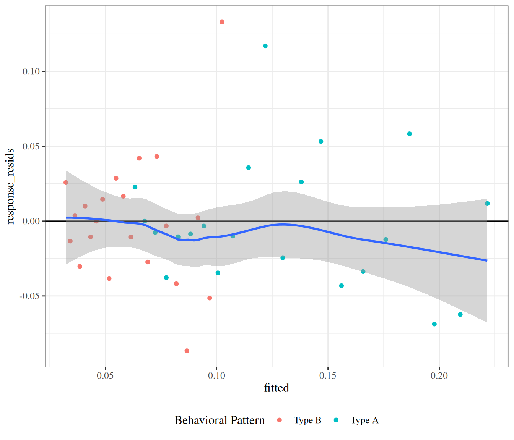](logistic-regression_files/figure-revealjs/fig-wcgs-resid-manual-1.png "Figure 19: residuals plot for wcgs model")
> >
> > Figure 19: residuals plot for `wcgs` model
>
> We can see a slight fan-shape here: observations on the right have larger [variance](https://morrison-lab.github.io/pds/variance-covariance.html#def-variance) (as expected since $var(\bar y) = \pi(1-\pi)/n$ is maximized when $\pi = 0.5$).

### 9.0.3 Pearson residuals

The fan-shape in the [response residuals](#def-response-residual-logistic) plot isn’t necessarily a concern here, since we haven’t made an assumption of constant residual [variance](https://morrison-lab.github.io/pds/variance-covariance.html#def-variance), as we did for linear regression.

However, we might want to divide by the [standard error](https://morrison-lab.github.io/sds/estimation.html#def-SE) in order to make the graph easier to interpret. Here’s one way to do that:

> **NOTE:**
>
> **Definition 9 (Pearson residual)** The Pearson (chi-squared) residual for covariate pattern $k$ is: $$\begin{aligned}
> X_k &\stackrel{\text{def}}{=}\frac{\bar y_k - \hat\pi_k}{\sqrt{\hat \pi_k (1-\hat\pi_k)/n_k}}
> \end{aligned}$$
>
> where $$\begin{aligned}
> \hat\pi_k
> &\stackrel{\text{def}}{=}\hat\pi(x_k)\\
> &\stackrel{\text{def}}{=}\hat P(Y=1|X=x_k)\\
> &\stackrel{\text{def}}{=}\operatorname{expit}(x_i'\hat \beta)\\
> &\stackrel{\text{def}}{=}\operatorname{expit}(\hat \beta_0 + \sum_{j=1}^p \hat \beta_j x_{ij})
> \end{aligned}$$

> **NOTE:**
>
> **Example 28 (Pearson residuals for the WCGS CHD model)** Let’s take a look at the Pearson residuals ([Definition 9](#def-pearson-residual)) for our CHD model from the WCGS data (graphed against the [fitted values](https://morrison-lab.github.io/sds/prediction.html#def-fitted-value) on the [logit](../chapters/binary-outcome-associations.llms.md#def-logit-fn) scale):
>
> Show R code
>
> ``` downlit
> library(ggfortify)
> ```
>
> Show R code
>
> ``` downlit
> autoplot(chd_glm_contrasts_grouped, which = 1, ncol = 1) |> print()
> ```
>
> [](logistic-regression_files/figure-revealjs/unnamed-chunk-45-1.png)
>
> The fan-shape is gone, and these residuals don’t show any obvious signs of model fit issues.

> **NOTE:**
>
> **Example 29 (Counterexample: Pearson residuals for the beetles model)** If we create the same plot for the `beetles` model, we see some strong evidence of a lack of fit; this plot is a **counterexample** to a well-fitting model:
>
> Show R code
>
> ``` downlit
> library(glmx)
> library(dplyr)
> data(BeetleMortality)
> beetles <- BeetleMortality |>
>   mutate(
>     pct = died / n,
>     survived = n - died,
>     dose_c = dose - mean(dose)
>   )
> beetles_glm_grouped <- beetles |>
>   glm(
>     formula = cbind(died, survived) ~ dose,
>     family = "binomial"
>   )
> autoplot(beetles_glm_grouped, which = 1, ncol = 1) |> print()
> ```
>
> [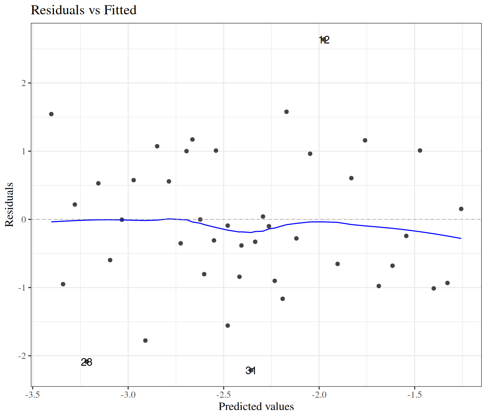](logistic-regression_files/figure-revealjs/unnamed-chunk-46-1.png)
>
> The clear pattern in the residuals signals that the straight-line [logit](../chapters/binary-outcome-associations.llms.md#def-logit-fn) model does not fit the beetle-mortality data well.

#### Pearson residuals with individual (ungrouped) data

What happens if we try to compute residuals without grouping the data by covariate pattern?

Show R code

``` downlit
library(ggfortify)
```

Show R code

``` downlit
chd_glm_strat <- glm(
  "formula" = chd69 == "Yes" ~ dibpat + dibpat:age - 1,
  "data" = wcgs,
  "family" = binomial(link = "logit")
)

autoplot(chd_glm_strat, which = 1, ncol = 1) |> print()
```

[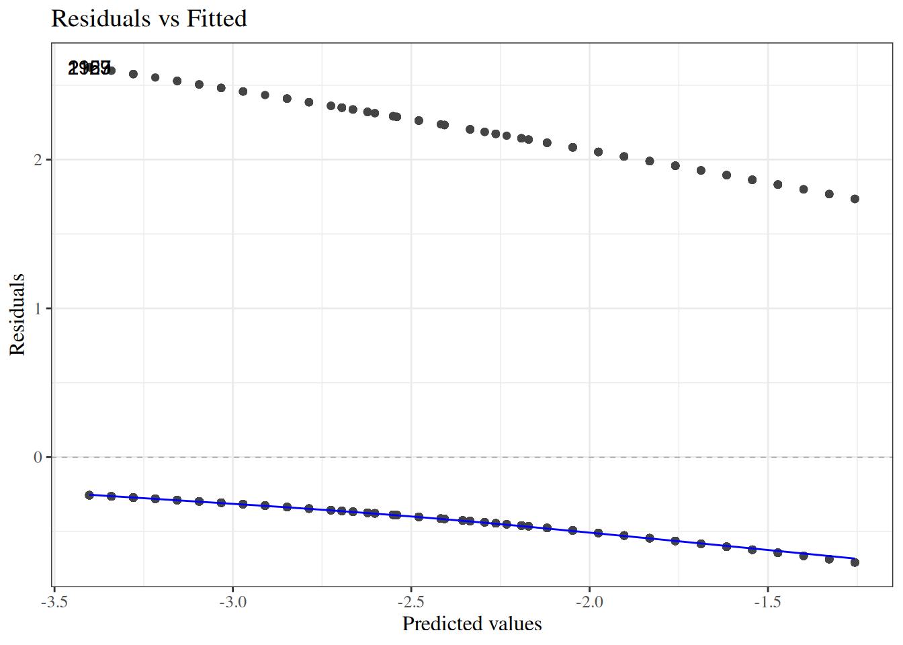](logistic-regression_files/figure-revealjs/unnamed-chunk-48-1.png)

This residuals-vs-fitted plot is meaningless: with ungrouped (individual-level) data, each covariate pattern contains only one observation ($n_k = 1$), so each residual can take only one of two possible values, both determined by the fitted probability $\hat\pi(x_k)$ (one value when $y_k = 1$ and another when $y_k = 0$). With a single binary observation per covariate pattern, the residuals have no meaningful reference distribution to assess the model fit against; this lack of a reference distribution is why [logistic regression](#def-logistic-regression) residuals only work for grouped data, with multiple observations per covariate pattern.

#### Residuals plot by hand

If you want to check your understanding of what these residual plots are, try building them yourself:

Show R code

``` downlit
wcgs_grouped <-
  wcgs_grouped |>
  mutate(
    fitted = chd_glm_contrasts_grouped |> fitted(),
    fitted_logit = fitted |> logit(),
    resids = chd_glm_contrasts_grouped |> resid(type = "pearson")
  )

wcgs_resid_plot1 <-
  wcgs_grouped |>
  ggplot(
    mapping = aes(
      x = fitted_logit,
      y = resids
    )
  ) +
  geom_point(
    aes(col = dibpat)
  ) +
  geom_hline(yintercept = 0) +
  geom_smooth(
    se = FALSE,
    method.args = list(
      span = 2 / 3,
      degree = 1,
      family = "symmetric",
      iterations = 3,
      surface = "direct"
    ),
    method = stats::loess
  )
# plot.glm and autoplot use stats::lowess, which is hard to use with
# geom_smooth and hard to match exactly;
# see https://support.bioconductor.org/p/2323/
```

Show R code

``` downlit
wcgs_resid_plot1 |> print()
```

[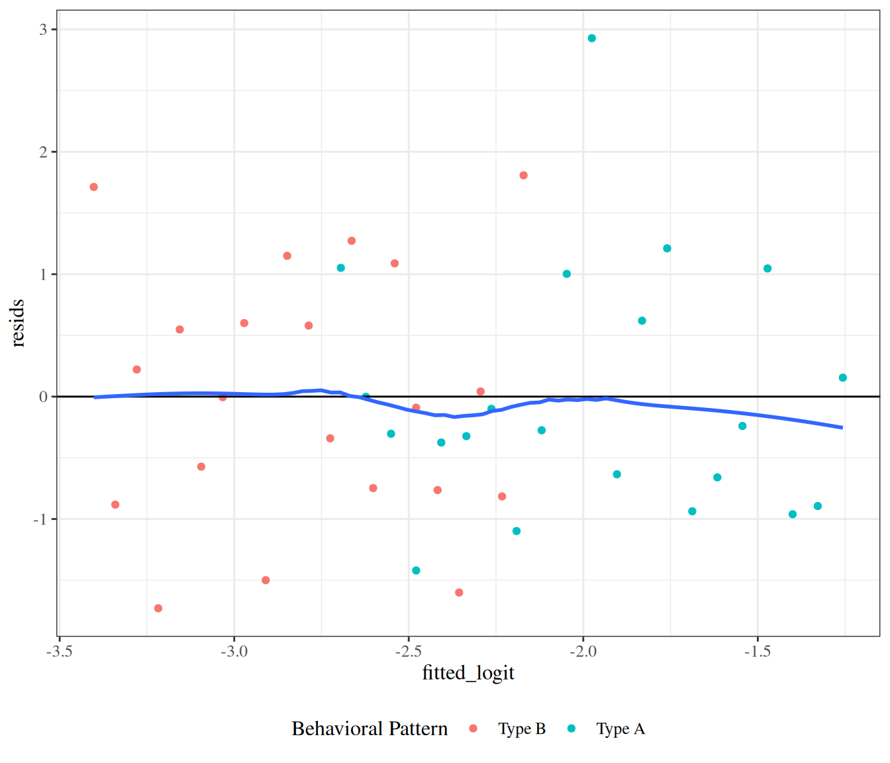](logistic-regression_files/figure-revealjs/unnamed-chunk-50-1.png)

#### Pearson chi-squared goodness of fit test

The Pearson chi-squared goodness of fit statistic is: $$X^2 = \sum_{k=1}^q X_k^2$$

Under the [null hypothesis](https://morrison-lab.github.io/sds/inference.html#def-null-hypothesis) that the model in question is correct (i.e., sufficiently complex), $X^2\ \dot \sim\ \chi^2(q-p)$.

Show R code

``` downlit
x_pearson <- chd_glm_contrasts_grouped |>
  resid(type = "pearson")

chisq_stat <- sum(x_pearson^2)

pval <- pchisq(
  chisq_stat,
  lower = FALSE,
  df = length(x_pearson) - length(coef(chd_glm_contrasts_grouped))
)
```

For our CHD model, the [p-value](https://morrison-lab.github.io/sds/inference.html#def-p-value) for this test is 0.265236; no significant evidence of a lack of fit at the 0.05 level.

> **NOTE:**
>
> **Definition 10 (Weighted hat matrix for a GLM)** For a logistic (or other) generalized linear model fit to $q$ covariate patterns with $p$ parameters, the **weighted hat matrix** is
>
> $$\underbrace{\mathbf{H}}_{q \times q}
> \stackrel{\text{def}}{=}
> \underbrace{\mathbf{W}^{1/2}}_{q \times q}
> \underbrace{\mathbf{X}}_{q \times p}
> \mathopen{}\left(\underbrace{{\mathbf{X}}^{\top}\,\mathbf{W}\,\mathbf{X}}_{p \times p}\right)\mathclose{}^{-1}
> \underbrace{{\mathbf{X}}^{\top}}_{p \times q}
> \underbrace{\mathbf{W}^{1/2}}_{q \times q}$$
>
> where $\underbrace{\mathbf{W}}_{q \times q} \stackrel{\text{def}}{=}\text{diag}\mathopen{}\left(n_k \, \hat\pi_k \, (1 - \hat\pi_k)\right)\mathclose{}$ is the [diagonal matrix](https://morrison-lab.github.io/mds/linear-algebra-special-matrices.html#def-diagonal-matrix) of binomial weights.

> **NOTE:**
>
> **Definition 11 (Leverage for a GLM)** Let $\mathbf{H}$ be the weighted hat matrix ([Definition 10](#def-weighted-hat-matrix-glm)). The **leverage** $h_k$ of covariate pattern $k$ is the $k$-th diagonal element of $\mathbf{H}$.

> **NOTE:**
>
> *Remark 4* (The weighted hat matrix as the GLM analog of the linear-model hat matrix). This weighted hat matrix is the GLM analog of [the linear-model hat matrix](../chapters/Linear-models-overview.llms.md#def-hat-matrix); the weight matrix $\mathbf{W}$ reduces to the identity in the ordinary-least-squares case.

> **NOTE:**
>
> **Definition 12 (Standardized Pearson residual)** Especially for small data sets, we might want to adjust our residuals for [leverage](#def-leverage-glm) (since outliers in $X$ add extra [variance](https://morrison-lab.github.io/pds/variance-covariance.html#def-variance) to the residuals):
>
> $$r_{P_k} \stackrel{\text{def}}{=}\frac{X_k}{\sqrt{1-h_k}}$$
>
> where $X_k$ is the Pearson residual ([Definition 9](#def-pearson-residual)) and $h_k$ is the leverage of covariate pattern $k$ ([Definition 11](#def-leverage-glm)).

> **NOTE:**
>
> *Remark 5* (Standardized Pearson residuals in R diagnostic plots). The functions [`autoplot()`](https://ggplot2.tidyverse.org/reference/autoplot.html) and `plot.lm()` use these for some of their graphs.

### 9.0.4 Deviance residuals

For large sample sizes, the Pearson and [deviance residuals](#def-deviance-residual-logistic) will be approximately the same. For small sample sizes, the deviance residuals from covariate patterns with small sample sizes can be unreliable (high [variance](https://morrison-lab.github.io/pds/variance-covariance.html#def-variance)).

> **NOTE:**
>
> **Definition 13 (Deviance residual)** Here $\ell_{\text{full}}(x_k)$ is the [saturated model](../chapters/Linear-models-overview.llms.md#def-saturated-model)’s log-likelihood contribution from covariate pattern $k$, so that summing over the covariate patterns gives the full [log-likelihood](https://morrison-lab.github.io/sds/intro-MLEs.html#def-loglik):
>
> $$\ell_{\text{full}} \stackrel{\text{def}}{=}\sum_{k} \ell_{\text{full}}(x_k)$$
>
> The **deviance residual** for covariate pattern $k$ is
>
> $$d_k \stackrel{\text{def}}{=}\operatorname{sign}(y_k - n_k \hat \pi_k)
> {\mathopen{}\left\{\sqrt{2[\ell_{\text{full}}(x_k) - \ell(\hat\beta; x_k)]}\right\}\mathclose{}}$$

#### Standardized deviance residuals

Analogously to the standardized Pearson residual ([Definition 12](#def-standardized-pearson-residual)), we can adjust the [deviance residual](#def-deviance-residual-logistic) for [leverage](#def-leverage-glm):

$$r_{D_k} \stackrel{\text{def}}{=}\frac{d_k}{\sqrt{1-h_k}}$$

where $h_k$ is the leverage of covariate pattern $k$ ([Definition 11](#def-leverage-glm)).

### 9.0.5 Diagnostic plots

> **NOTE:**
>
> **Definition 14**  
>
> #### Cook’s distance for a GLM
>
> Some of the [`autoplot()`](https://ggplot2.tidyverse.org/reference/autoplot.html) diagnostic panels display **Cook’s distance**, which measures how influential each covariate pattern is on the fit. For a generalized linear model, the Cook’s distance for covariate pattern $k$ combines the standardized Pearson residual ([Definition 12](#def-standardized-pearson-residual)) and the leverage ([Definition 11](#def-leverage-glm)):
>
> $$D_k \stackrel{\text{def}}{=}\frac{(r_{P_k})^2}{p} \cdot \frac{h_k}{1 - h_k}$$
>
> where $p$ is the number of parameters.

> **NOTE:**
>
> *Remark 6* (Relation to Cook’s distance for linear models). This diagnostic is the GLM analog of [Cook’s distance](../chapters/Linear-models-overview.llms.md#def-cooks-distance) for linear models, and shares its closed-form structure.

> **NOTE:**
>
> **Example 30 (Diagnostics for the WCGS CHD model)** Let’s take a look at the full set of [`autoplot()`](https://ggplot2.tidyverse.org/reference/autoplot.html) diagnostics now for our `CHD` model:
>
> Show R code
>
> ``` downlit
> chd_glm_contrasts_grouped |>
>   autoplot(which = 1:6) |>
>   print()
> ```
>
> > **NOTE:**
> >
> > [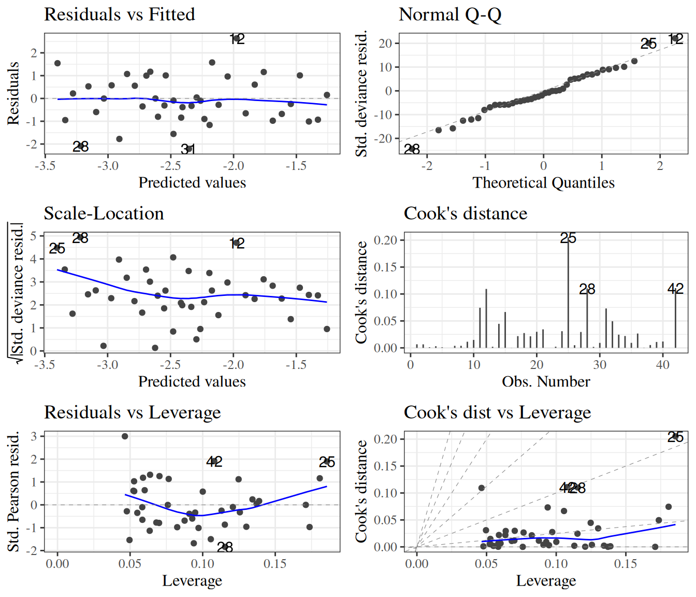](logistic-regression_files/figure-revealjs/fig-chd-model-diagnostics-1.png "Figure 20: Diagnostics for CHD model")
> >
> > Figure 20: Diagnostics for CHD model
>
> Things look pretty good here. The QQ plot is still usable: when the number of observations at each covariate pattern is large, the grouped residuals should be approximately Gaussian.

> **NOTE:**
>
> **Example 31 (Diagnostics for the beetles model)** Let’s look at the beetles model diagnostic plots for comparison:
>
> Show R code
>
> ``` downlit
> beetles_glm_grouped |>
>   autoplot(which = 1:6) |>
>   print()
> ```
>
> > **NOTE:**
> >
> > [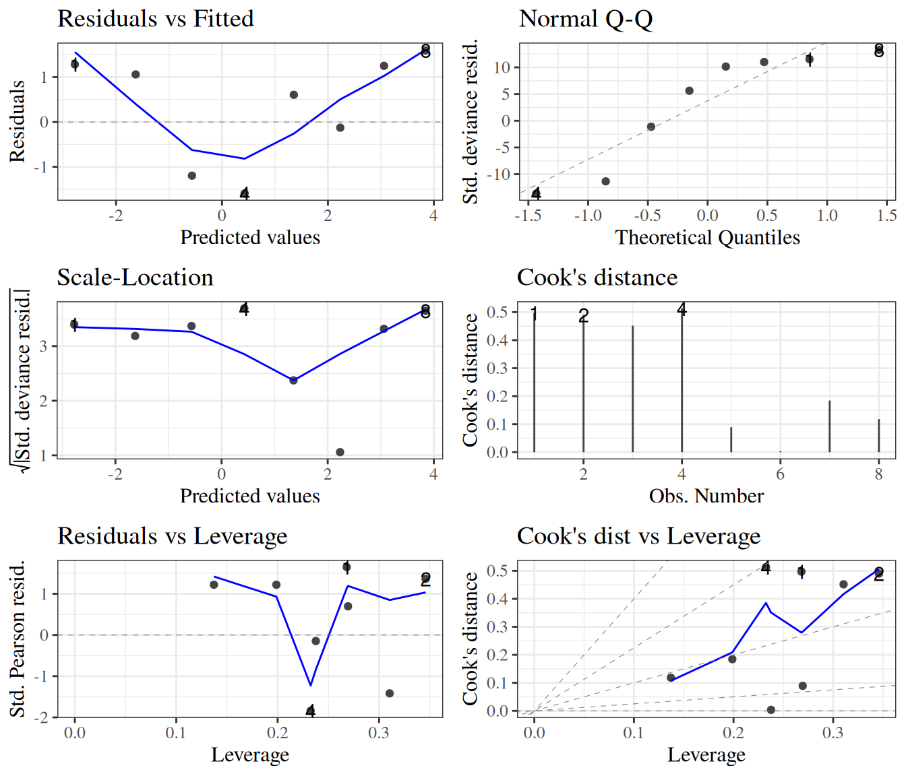](logistic-regression_files/figure-revealjs/fig-beetles-glm-diag-1.png "Figure 21: Diagnostics for logistic model of BeetleMortality data")
> >
> > Figure 21: Diagnostics for logistic model of `BeetleMortality` data
>
> Hard to tell much from so little data, but there might be some issues here.

# 10 Alternatives to reporting odds ratios

## 10.1 Objections to odds ratios

Some scholars have raised objections to the use of [odds ratios](../chapters/binary-outcome-associations.llms.md#def-OR) as an effect measurement [\[16\]](#ref-sackett1996down), [\[17\]](#ref-norton2024requiem).

As we saw in [the figure comparing risk differences, risk ratios, and odds ratios](../chapters/binary-outcome-associations.llms.md#fig-rd-rr-or), the odds ratio is not very closely correlated with the [risk difference](../chapters/binary-outcome-associations.llms.md#def-RD), and the risk difference is typically the metric that ultimately matters for policy decisions.

Another objection is that odds ratios (and [risk ratios](../chapters/binary-outcome-associations.llms.md#def-RR), and risk differences) depend on the set of covariates in a [logistic regression model](#def-logistic-regression), even when those covariates are [independent](https://morrison-lab.github.io/pds/independence.html#def-indpt) of the exposure of interest and do not interact with that exposure. For example, consider the following model:

$$\mathbb{P}(Y=y|X=x,C=c) = {\color{red}{\pi(x,c)}}^y (1-{\color{red}{\pi(x,c)}})^{1-y}$$

$${\color{red}{\pi(x,c)}} = {\operatorname{expit}\mathopen{}\left\{\eta_0 + \beta_Xx + \beta_Cc\right\}\mathclose{}} \tag{49}$$

Then:

$$\begin{aligned}
{\mathbb{E}\mathopen{}\left[Y|X=x\right]\mathclose{}} &= {\mathbb{E}\mathopen{}\left[{\mathbb{E}\mathopen{}\left[Y | X, C\right]\mathclose{}} | X=x\right]\mathclose{}}
&& \text{(law of total expectation)}
\\ &= {\mathbb{E}\mathopen{}\left[{\color{red}{\pi(X,C)}} | X=x\right]\mathclose{}}
&& \text{(Bernoulli conditional mean: } {\mathbb{E}\mathopen{}\left[Y|X,C\right]\mathclose{}} = \pi(X,C) \text{)}
\\ &= {\mathbb{E}\mathopen{}\left[{\operatorname{expit}\mathopen{}\left\{\eta_0 + \beta_X X + \beta_C C\right\}\mathclose{}} | X=x\right]\mathclose{}}
&& \text{(model definition of } \pi \text{)}
\\ &= {\mathbb{E}\mathopen{}\left[{\operatorname{expit}\mathopen{}\left\{\eta_0 + \beta_X x + \beta_C C\right\}\mathclose{}} | X=x\right]\mathclose{}}
&& \text{(conditioning on } X = x \text{ fixes } X \text{ at } x \text{)}
\\ &= \int_c{{\operatorname{expit}\mathopen{}\left\{\eta_0 + \beta_X x + \beta_C c\right\}\mathclose{}} ~\operatorname{p}(C=c|X=x)~ \partial c}
&& \text{(conditional expectation as an integral over } C \text{'s conditional distribution)}
\\ &= \int_c{{\color{red}{\pi(x,c)}}~ \operatorname{p}(C=c|X=x)~ \partial c}
&& \text{(model definition of } \pi \text{, in reverse)}
\end{aligned}$$

Since the ${\operatorname{expit}\mathopen{}\left\{\right\}\mathclose{}}$ function is nonlinear, we can’t change the order of the [expectation](https://morrison-lab.github.io/pds/expectation.html#def-expectation) and ${\operatorname{expit}\mathopen{}\left\{\right\}\mathclose{}}$ operators:

$${\mathbb{E}\mathopen{}\left[{\operatorname{expit}\mathopen{}\left\{\eta_0 + \beta_XX + \beta_CC\right\}\mathclose{}} | X\right]\mathclose{}} \neq {\operatorname{expit}\mathopen{}\left\{{\mathbb{E}\mathopen{}\left[\eta_0 + \beta_XX + \beta_CC\right]\mathclose{}} | X\right\}\mathclose{}}$$

In contrast, consider a model with an identity [link function](../chapters/Intro-to-GLMs.llms.md#sec-why-link):

$$\mathbb{P}(Y=y|X=x,C=c) = {\color{red}{\pi(x,c)}}^y (1-{\color{red}{\pi(x,c)}})^{1-y}$$

$${\color{red}{\pi(x,c)}} = \eta_0 + \beta_Xx + \beta_Cc \tag{50}$$

Then:

$$\begin{aligned}
{\mathbb{E}\mathopen{}\left[Y|X=x\right]\mathclose{}} &= {\mathbb{E}\mathopen{}\left[{\mathbb{E}\mathopen{}\left[Y | X, C\right]\mathclose{}} | X=x\right]\mathclose{}}
&& \text{(law of total expectation)}
\\ &= {\mathbb{E}\mathopen{}\left[{\color{red}{\pi(X,C)}} | X=x\right]\mathclose{}}
&& \text{(Bernoulli conditional mean: } {\mathbb{E}\mathopen{}\left[Y|X,C\right]\mathclose{}} = \pi(X,C) \text{)}
\\ &= {\mathbb{E}\mathopen{}\left[\eta_0 + \beta_X X + \beta_C C | X=x\right]\mathclose{}}
&& \text{(identity-link model definition of } \pi \text{)}
\\ &= {\mathbb{E}\mathopen{}\left[\eta_0 | X=x\right]\mathclose{}} + {\mathbb{E}\mathopen{}\left[\beta_X X | X=x\right]\mathclose{}} + {\mathbb{E}\mathopen{}\left[\beta_C C | X=x\right]\mathclose{}}
&& \text{(linearity of expectation)}
\\ &= \eta_0 + {\mathbb{E}\mathopen{}\left[\beta_X X | X=x\right]\mathclose{}} + {\mathbb{E}\mathopen{}\left[\beta_C C | X=x\right]\mathclose{}}
&& \text{(expectation of a constant)}
\\ &= \eta_0 + \beta_X {\mathbb{E}\mathopen{}\left[X | X=x\right]\mathclose{}} + \beta_C {\mathbb{E}\mathopen{}\left[C | X=x\right]\mathclose{}}
&& \text{(constant factors move outside expectations)}
\\ &= \eta_0 + \beta_X x + \beta_C {\mathbb{E}\mathopen{}\left[C | X=x\right]\mathclose{}}
&& \text{(} {\mathbb{E}\mathopen{}\left[X | X=x\right]\mathclose{}} = x \text{)}
\\ &= {\color{red}{(\eta_0 + \beta_C{\mathbb{E}\mathopen{}\left[C | X=x\right]\mathclose{}})}} + {\color{teal}{\beta_Xx}}
&& \text{(commute and regroup the terms)}
\end{aligned}$$

If $C \perp\!\!\!\perp X$, then ${\mathbb{E}\mathopen{}\left[C|X=x\right]\mathclose{}} = {\mathbb{E}\mathopen{}\left[C\right]\mathclose{}}$, and we can simplify further:

$$\begin{aligned}
{\mathbb{E}\mathopen{}\left[Y|X=x\right]\mathclose{}} &= {\color{red}{(\eta_0 + \beta_C {\mathbb{E}\mathopen{}\left[C|X=x\right]\mathclose{}})}} + {\color{teal}{\beta_Xx}}
&& \text{(marginal mean under the identity link)}
\\
&= {\color{red}{(\eta_0 + \beta_C {\mathbb{E}\mathopen{}\left[C\right]\mathclose{}})}} + {\color{teal}{\beta_Xx}}
&& \text{(} C \perp\!\!\!\perp X \text{, so } {\mathbb{E}\mathopen{}\left[C|X=x\right]\mathclose{}} = {\mathbb{E}\mathopen{}\left[C\right]\mathclose{}} \text{)}
\\&= {\color{red}{\eta_0^*}}  + {\color{teal}{\beta_Xx}}
&& \text{(definition: } \eta_0^* \stackrel{\text{def}}{=}\eta_0 + \beta_C {\mathbb{E}\mathopen{}\left[C\right]\mathclose{}} \text{)}
\end{aligned}$$

Then:

$$\begin{aligned}
\frac{\partial}{\partial x} {\mathbb{E}\mathopen{}\left[Y|X=x\right]\mathclose{}}
&= \frac{\partial}{\partial x} \mathopen{}\left({\color{red}{\eta_0^*}} + {\color{teal}{\beta_Xx}}\right)\mathclose{}
&& \text{(marginal mean when } C \perp\!\!\!\perp X \text{)}
\\ &= \frac{\partial}{\partial x}\eta_0^* + \frac{\partial}{\partial x}\mathopen{}\left(\beta_X x\right)\mathclose{}
&& \text{(linearity of differentiation)}
\\ &= 0 + \frac{\partial}{\partial x}\mathopen{}\left(\beta_X x\right)\mathclose{}
&& \text{(} \eta_0^* \text{ does not depend on } x \text{)}
\\ &= 0 + \beta_X
&& \text{(derivative of a linear term)}
\\ &= {\color{teal}{\beta_X}}
&& \text{(additive identity)}
\end{aligned}$$

The conditional slope is the same:

$$\begin{aligned}
\frac{\partial}{\partial x} {\mathbb{E}\mathopen{}\left[Y|X=x,C=c\right]\mathclose{}}
&= \frac{\partial}{\partial x} \mathopen{}\left(\eta_0 + \beta_Xx + \beta_Cc\right)\mathclose{}
&& \text{(identity-link model definition of } \pi \text{)}
\\ &= 0 + \beta_X + 0
&& \text{(term-by-term: only } \beta_X x \text{ depends on } x \text{)}
\\ &= {\color{teal}{\beta_X}}
&& \text{(additive identity)}
\end{aligned}$$

Therefore:

$$\frac{\partial}{\partial x} {\mathbb{E}\mathopen{}\left[Y|X=x\right]\mathclose{}} = {\color{teal}{\beta_X}} = \frac{\partial}{\partial x} {\mathbb{E}\mathopen{}\left[Y|X=x,C=c\right]\mathclose{}}$$

In other words, for a model with an identity link function, if covariates $X$ and $C$ are independent, then the slope with respect to $X$ doesn’t depend on whether $C$ is included in the model (and an analogous result holds if $X$ is discrete or categorical).

> **NOTE:**
>
> **Exercise 27** What are the expressions for ${\mathbb{E}\mathopen{}\left[Y|X=x\right]\mathclose{}}$ and $\frac{\partial}{\partial x} {\mathbb{E}\mathopen{}\left[Y|X=x\right]\mathclose{}}$ for the identity-link model in [Equation 50](#eq-or-objections-identity-model), if ${\mathbb{E}\mathopen{}\left[C|X=x\right]\mathclose{}} = \gamma_0 + \gamma_x x$?

> **NOTE:**
>
> *Solution 27*. $$\begin{aligned}
> {\mathbb{E}\mathopen{}\left[Y|X=x\right]\mathclose{}}
> &= {\mathbb{E}\mathopen{}\left[\pi(x, C)|X=x\right]\mathclose{}}
> && \text{(law of total expectation, conditional on } X = x \text{)}
> \\ &= {\mathbb{E}\mathopen{}\left[\eta_0 + \beta_Xx + \beta_C C|X=x\right]\mathclose{}}
> && \text{(identity-link model)}
> \\ &= \eta_0 + \beta_Xx + \beta_C {\mathbb{E}\mathopen{}\left[C|X=x\right]\mathclose{}}
> && \text{(linearity of expectation)}
> \\ &= \eta_0 + \beta_Xx + \beta_C (\gamma_0 + \gamma_x x)
> && \text{(substitute } {\mathbb{E}\mathopen{}\left[C|X=x\right]\mathclose{}} = \gamma_0 + \gamma_x x \text{)}
> \\ &= \eta_0 + \beta_Xx + \beta_C \gamma_0 + \beta_C \gamma_x x
> && \text{(distribute)}
> \\ &= (\eta_0 + \beta_C \gamma_0) + (\beta_X + \beta_C \gamma_x) x
> && \text{(commute and regroup the terms)}
> \end{aligned}$$
>
> $$\begin{aligned}
> \frac{\partial}{\partial x}{\mathbb{E}\mathopen{}\left[Y|X=x\right]\mathclose{}}
> &= \frac{\partial}{\partial x}\mathopen{}\left\{(\eta_0 + \beta_C \gamma_0) + (\beta_X + \beta_C \gamma_x) x\right\}\mathclose{}
> && \text{(marginal mean from the derivation of } {\mathbb{E}\mathopen{}\left[Y|X=x\right]\mathclose{}} \text{)}
> \\ &= \frac{\partial}{\partial x}(\eta_0 + \beta_C \gamma_0) + \frac{\partial}{\partial x}\mathopen{}\left\{(\beta_X + \beta_C \gamma_x) x\right\}\mathclose{}
> && \text{(linearity of differentiation)}
> \\ &= \beta_X + \beta_C \gamma_x
> && \text{(constants have derivative 0; derivative of a linear term)}
> \end{aligned}$$
>
> The marginal mean is still linear in $x$, but its slope $\beta_X + \beta_C \gamma_x$ differs from the conditional slope $\beta_X$ unless $\beta_C = 0$ or $\gamma_x = 0$.

> **NOTE:**
>
> **Theorem 27 (Marginal mean under an identity link when the covariates are associated)** In the identity-link model of [Equation 50](#eq-or-objections-identity-model), suppose ${\mathbb{E}\mathopen{}\left[C|X=x\right]\mathclose{}} = \gamma_0 + \gamma_x x$. Then:
>
> $${\mathbb{E}\mathopen{}\left[Y|X=x\right]\mathclose{}} = (\eta_0 + \beta_C \gamma_0) + (\beta_X + \beta_C \gamma_x) x$$

> **NOTE:**
>
> *Proof*. This proof is the solution to [Exercise 27](#exr-marginal-model-non-indep), worked in [Solution 27](#sol-marginal-model-non-indep).

> **NOTE:**
>
> **Example 32 (A marginal mean under an identity link)** Suppose $\eta_0 = 0.1$, $\beta_X = 0.05$ and $\beta_C = 0.1$ in the identity-link model of [Equation 50](#eq-or-objections-identity-model), and ${\mathbb{E}\mathopen{}\left[C|X=x\right]\mathclose{}} = 1 + 0.5 x$, so that $\gamma_0 = 1$ and $\gamma_x = 0.5$. The code below computes ${\mathbb{E}\mathopen{}\left[Y|X=2\right]\mathclose{}}$ by substituting ${\mathbb{E}\mathopen{}\left[C|X=2\right]\mathclose{}}$ into the model, and from the formula of [Theorem 27](#thm-marginal-mean-nonindep):
>
> Show R code
>
> ``` downlit
> ex_eta0 <- 0.1
> ex_bX <- 0.05
> ex_bC <- 0.1
> ex_g0 <- 1
> ex_gx <- 0.5
> ex_x <- 2
> ex_direct <- ex_eta0 + ex_bX * ex_x + ex_bC * (ex_g0 + ex_gx * ex_x)
> ex_formula <- (ex_eta0 + ex_bC * ex_g0) + (ex_bX + ex_bC * ex_gx) * ex_x
> ```
>
> The direct calculation gives 0.4 and the formula gives 0.4, so the two agree.

> **NOTE:**
>
> **Corollary 10 (Marginal slope under an identity link when the covariates are associated)** Under the assumptions of [Theorem 27](#thm-marginal-mean-nonindep):
>
> $$\frac{\partial}{\partial x}{\mathbb{E}\mathopen{}\left[Y|X=x\right]\mathclose{}} = \beta_X + \beta_C \gamma_x$$

> **NOTE:**
>
> *Proof*. This proof is the solution to [Exercise 27](#exr-marginal-model-non-indep), worked in [Solution 27](#sol-marginal-model-non-indep).

> **NOTE:**
>
> **Example 33 (A marginal slope under an identity link)** Take the parameter values of [Example 32](#exm-marginal-mean-nonindep). Because the marginal mean is linear in $x$, the change in ${\mathbb{E}\mathopen{}\left[Y|X=x\right]\mathclose{}}$ from $x = 2$ to $x = 3$ equals its slope. The code below computes that change, and the slope from [Corollary 10](#cor-marginal-slope-nonindep):
>
> Show R code
>
> ``` downlit
> ex_marginal_mean <- function(x) {
>   (0.1 + 0.1 * 1) + (0.05 + 0.1 * 0.5) * x
> }
> ex_change <- ex_marginal_mean(3) - ex_marginal_mean(2)
> ex_slope <- 0.05 + 0.1 * 0.5
> ```
>
> The change is 0.1 and the slope formula gives 0.1, so the two agree. The slope exceeds the conditional slope $\beta_X = 0.05$, because $\beta_C \gamma_x = 0.05$ is positive.

> **NOTE:**
>
> **Exercise 28** What are the expressions for ${\mathbb{E}\mathopen{}\left[Y|X=x\right]\mathclose{}}$ and $\frac{\partial}{\partial x} {\mathbb{E}\mathopen{}\left[Y|X=x\right]\mathclose{}}$, if instead of the identity-link model in [Equation 50](#eq-or-objections-identity-model), $$\pi(x,c) = \eta_0 + \beta_Xx + \beta_Cc +\beta_{XC}xc$$ and ${\mathbb{E}\mathopen{}\left[C|X=x\right]\mathclose{}} = \gamma_0 + \gamma_x x$?

> **NOTE:**
>
> *Solution 28*. $$\begin{aligned}
> {\mathbb{E}\mathopen{}\left[Y|X=x\right]\mathclose{}}
> &= {\mathbb{E}\mathopen{}\left[\pi(x, C)|X=x\right]\mathclose{}}
> && \text{(law of total expectation, conditional on } X = x \text{)}
> \\ &= {\mathbb{E}\mathopen{}\left[\eta_0 + \beta_Xx + \beta_C C + \beta_{XC}xC|X=x\right]\mathclose{}}
> && \text{(interaction model)}
> \\ &= \eta_0 + \beta_Xx + \beta_C {\mathbb{E}\mathopen{}\left[C|X=x\right]\mathclose{}} + \beta_{XC}x {\mathbb{E}\mathopen{}\left[C|X=x\right]\mathclose{}}
> && \text{(linearity of expectation)}
> \\ &= \eta_0 + \beta_Xx + (\beta_C + \beta_{XC}x){\mathbb{E}\mathopen{}\left[C|X=x\right]\mathclose{}}
> && \text{(factor out } {\mathbb{E}\mathopen{}\left[C|X=x\right]\mathclose{}} \text{)}
> \\ &= \eta_0 + \beta_Xx + (\beta_C + \beta_{XC}x)(\gamma_0 + \gamma_x x)
> && \text{(substitute } {\mathbb{E}\mathopen{}\left[C|X=x\right]\mathclose{}} = \gamma_0 + \gamma_x x \text{)}
> \\ &= \eta_0 + \beta_Xx + \beta_C\gamma_0 + \beta_C\gamma_x x + \beta_{XC}\gamma_0 x + \beta_{XC}\gamma_x x^2
> && \text{(distribute)}
> \\ &= (\eta_0 + \beta_C\gamma_0) + (\beta_X + \beta_C\gamma_x + \beta_{XC}\gamma_0) x + \beta_{XC}\gamma_x x^2
> && \text{(commute and regroup the terms)}
> \end{aligned}$$
>
> $$\begin{aligned}
> \frac{\partial}{\partial x}{\mathbb{E}\mathopen{}\left[Y|X=x\right]\mathclose{}}
> &= \frac{\partial}{\partial x}\mathopen{}\left\{(\eta_0 + \beta_C\gamma_0) + (\beta_X + \beta_C\gamma_x + \beta_{XC}\gamma_0) x + \beta_{XC}\gamma_x x^2\right\}\mathclose{}
> && \text{(marginal mean from the derivation of } {\mathbb{E}\mathopen{}\left[Y|X=x\right]\mathclose{}} \text{)}
> \\ &= \frac{\partial}{\partial x}(\eta_0 + \beta_C\gamma_0) + \frac{\partial}{\partial x}\mathopen{}\left\{(\beta_X + \beta_C\gamma_x + \beta_{XC}\gamma_0) x\right\}\mathclose{} + \frac{\partial}{\partial x}\mathopen{}\left(\beta_{XC}\gamma_x x^2\right)\mathclose{}
> && \text{(linearity of differentiation)}
> \\ &= (\beta_X + \beta_C\gamma_x + \beta_{XC}\gamma_0) + 2\beta_{XC}\gamma_x x
> && \text{(constants have derivative 0; derivative of a linear term; power rule)}
> \end{aligned}$$
>
> So, answering the hint: yes — adding the interaction term changes the functional form of ${\mathbb{E}\mathopen{}\left[Y|X=x\right]\mathclose{}}$. The marginal mean is now quadratic in $x$ (whenever $\beta_{XC} \neq 0$ and $\gamma_x \neq 0$), even though the conditional model is linear in $x$ for each fixed $c$, and the marginal slope now varies with $x$.

> **NOTE:**
>
> **Theorem 28 (Marginal mean under an identity link with an interaction)** Suppose $\pi(x,c) = \eta_0 + \beta_Xx + \beta_Cc +\beta_{XC}xc$ and ${\mathbb{E}\mathopen{}\left[C|X=x\right]\mathclose{}} = \gamma_0 + \gamma_x x$. Then:
>
> $${\mathbb{E}\mathopen{}\left[Y|X=x\right]\mathclose{}} =
> (\eta_0 + \beta_C\gamma_0)
> + (\beta_X + \beta_C\gamma_x + \beta_{XC}\gamma_0) x
> + \beta_{XC}\gamma_x x^2$$

> **NOTE:**
>
> *Proof*. This proof is the solution to [Exercise 28](#exr-marginal-model-non-indep-interaction), worked in [Solution 28](#sol-marginal-model-non-indep-interaction).

> **NOTE:**
>
> **Example 34 (A marginal mean under an identity link with an interaction)** Suppose $\eta_0 = 0.1$, $\beta_X = 0.05$, $\beta_C = 0.1$ and $\beta_{XC} = 0.02$, and ${\mathbb{E}\mathopen{}\left[C|X=x\right]\mathclose{}} = 1 + 0.5 x$, so that $\gamma_0 = 1$ and $\gamma_x = 0.5$. The code below computes ${\mathbb{E}\mathopen{}\left[Y|X=2\right]\mathclose{}}$ by substituting ${\mathbb{E}\mathopen{}\left[C|X=2\right]\mathclose{}}$ into the model, and from the formula of [Theorem 28](#thm-marginal-mean-nonindep-interaction):
>
> Show R code
>
> ``` downlit
> ex_eta0 <- 0.1
> ex_bX <- 0.05
> ex_bC <- 0.1
> ex_bXC <- 0.02
> ex_g0 <- 1
> ex_gx <- 0.5
> ex_x <- 2
> ex_ec <- ex_g0 + ex_gx * ex_x
> ex_direct <- ex_eta0 + ex_bX * ex_x + ex_bC * ex_ec + ex_bXC * ex_x * ex_ec
> ex_formula <- (ex_eta0 + ex_bC * ex_g0) +
>   (ex_bX + ex_bC * ex_gx + ex_bXC * ex_g0) * ex_x +
>   ex_bXC * ex_gx * ex_x^2
> ```
>
> The direct calculation gives 0.48 and the formula gives 0.48, so the two agree.

> **NOTE:**
>
> **Corollary 11 (Marginal slope under an identity link with an interaction)** Under the assumptions of [Theorem 28](#thm-marginal-mean-nonindep-interaction):
>
> $$\frac{\partial}{\partial x}{\mathbb{E}\mathopen{}\left[Y|X=x\right]\mathclose{}}
> = (\beta_X + \beta_C\gamma_x + \beta_{XC}\gamma_0) + 2\beta_{XC}\gamma_x x$$

> **NOTE:**
>
> *Proof*. This proof is the solution to [Exercise 28](#exr-marginal-model-non-indep-interaction), worked in [Solution 28](#sol-marginal-model-non-indep-interaction).

> **NOTE:**
>
> **Example 35 (A marginal slope under an identity link with an interaction)** Take the parameter values of [Example 34](#exm-marginal-mean-nonindep-interaction). Because the marginal mean is now quadratic in $x$, its slope varies with $x$. The code below approximates the slope at $x = 2$ and $x = 4$ with a central difference, and compares it with the formula of [Corollary 11](#cor-marginal-slope-nonindep-interaction):
>
> Show R code
>
> ``` downlit
> ex_marginal_mean <- function(x) {
>   (0.1 + 0.1 * 1) + (0.05 + 0.1 * 0.5 + 0.02 * 1) * x + 0.02 * 0.5 * x^2
> }
> ex_h <- 1e-4
> ex_slope_numeric <- sapply(
>   c(2, 4),
>   function(x) (ex_marginal_mean(x + ex_h) - ex_marginal_mean(x - ex_h)) / (2 * ex_h)
> )
> ex_slope_formula <- (0.05 + 0.1 * 0.5 + 0.02 * 1) + 2 * 0.02 * 0.5 * c(2, 4)
> ```
>
> At $x = 2$ and $x = 4$, the central differences are 0.16, 0.2 and the formula gives 0.16, 0.2, so the two agree, and the slope increases with $x$.

## 10.2 Deriving risk ratios and risk differences from logistic regression models

If you want to report [risk differences](../chapters/binary-outcome-associations.llms.md#def-RD) or [risk ratios](../chapters/binary-outcome-associations.llms.md#def-RR) instead of [odds ratios](../chapters/binary-outcome-associations.llms.md#def-OR), you can obtain estimates from [logistic regression models](#def-logistic-regression), as long as you didn’t stratify sampling by the outcome; in other words, not in case-control studies (see [Odds Ratios in Case-Control Studies](../chapters/binary-outcome-associations.llms.md#sec-CC-studies)).

### 10.2.1 Computing marginal risk differences

> **NOTE:**
>
> This section is **optional for 2026** and will not be tested on exams.

#### Conceptual approach

To compute [risk ratios](../chapters/binary-outcome-associations.llms.md#def-RR) or [risk differences](../chapters/binary-outcome-associations.llms.md#def-RD) from [logistic regression models](#def-logistic-regression):

- Apply the expit function ([definition](../chapters/binary-outcome-associations.llms.md#def-expit)) to the linear predictor for each covariate pattern to compute the (estimated) risks,
- Then take the differences or ratios of the risks, as needed.

For example, suppose we have a logistic regression model with a binary exposure $A$ and a covariate $Z$:

$${\operatorname{logit}\mathopen{}\left\{\Pr(Y = 1 | A, Z)\right\}\mathclose{}} = \beta_0 + \beta_A A + \beta_Z Z
\tag{51}$$

> **NOTE:**
>
> **Definition 15 (Conditional predicted risk (conditional risk))** The **conditional predicted risk** (or **conditional risk**) for an individual with exposure $A = a$ and covariate $Z = z$ is the population probability
>
> $$\pi(a, z) \stackrel{\text{def}}{=}\Pr(Y = 1 \mid A = a, Z = z).$$

Under the logistic model in [Equation 51](#eq-logistic-rr-rd-model), this population risk equals

$$\pi(a, z) = {\operatorname{expit}\mathopen{}\left\{\beta_0 + \beta_A a + \beta_Z z\right\}\mathclose{}}.$$

> **NOTE:**
>
> **Definition 16 (Conditional risk difference)** The **conditional risk difference** comparing exposure levels $a = 1$ vs. $a = 0$ at a fixed covariate value $z$ is, using the [conditional predicted risk](#def-cond-predicted-risk) ([Definition 15](#def-cond-predicted-risk)):
>
> $$\text{RD}(z) \stackrel{\text{def}}{=}\pi(1, z) - \pi(0, z)$$

> **NOTE:**
>
> **Definition 17 (Conditional risk ratio)** The **conditional risk ratio** comparing exposure levels $a = 1$ vs. $a = 0$ at a fixed covariate value $z$ is, using the [conditional predicted risk](#def-cond-predicted-risk) ([Definition 15](#def-cond-predicted-risk)):
>
> $$\text{RR}(z) \stackrel{\text{def}}{=}\frac{\pi(1, z)}{\pi(0, z)}$$

> **NOTE:**
>
> **Example 36 (Numerical example: conditional RD and RR at a fixed covariate value)** Using the WCGS data with `dibpat` (behavior pattern) as the exposure and `chd69` (coronary heart disease by 1969) as the outcome, adjusted for `age`:
>
> Show R code
>
> ``` downlit
> library(dplyr)
> library(haven)
>
> wcgs_clean <- rmb::wcgs |>
>   mutate(
>     across(where(is.labelled), haven::as_factor),
>     dibpat = dibpat |> relevel(ref = "Type B"),
>     chd69_binary = as.numeric(chd69 == "Yes")
>   ) |>
>   filter(!is.na(chd69_binary), !is.na(dibpat), !is.na(age))
>
> fit <- glm(
>   chd69_binary ~ dibpat + age,
>   data = wcgs_clean,
>   family = binomial(link = "logit")
> )
> ```
>
> At age $z = 50$ (within the WCGS sample’s observed age range):
>
> Show R code
>
> ``` downlit
> z <- 50
> dibpat_levels <- levels(wcgs_clean$dibpat)
> wcgs_cf_a <- data.frame(dibpat = factor("Type A", levels = dibpat_levels), age = z)
> wcgs_cf_b <- data.frame(dibpat = factor("Type B", levels = dibpat_levels), age = z)
>
> pi_hat_1 <- predict(fit, newdata = wcgs_cf_a, type = "response")
> pi_hat_0 <- predict(fit, newdata = wcgs_cf_b, type = "response")
>
> rd_hat_z <- pi_hat_1 - pi_hat_0
> rr_hat_z <- pi_hat_1 / pi_hat_0
>
> tibble::tibble(
>   quantity = c(
>     "$\\hat\\pi(1, 50)$", "$\\hat\\pi(0, 50)$",
>     "$\\widehat{\\text{RD}}(50)$", "$\\widehat{\\text{RR}}(50)$"
>   ),
>   value = c(pi_hat_1, pi_hat_0, rd_hat_z, rr_hat_z)
> ) |>
>   knitr::kable(digits = 3)
> ```
>
> | quantity                  | value |
> |:--------------------------|------:|
> | $\hat\pi(1, 50)$          | 0.129 |
> | $\hat\pi(0, 50)$          | 0.063 |
> | $\widehat{\text{RD}}(50)$ | 0.067 |
> | $\widehat{\text{RR}}(50)$ | 2.066 |
>
> These values are *conditional* estimates: both hold age fixed at 50 and compare only the two exposure levels at that one age.

#### Marginal vs. conditional effects

Note that these [risk differences](../chapters/binary-outcome-associations.llms.md#def-RD) and [risk ratios](../chapters/binary-outcome-associations.llms.md#def-RR) are **conditional** on the covariate value $z$. In many applications, we want to summarize the effect across the population, which requires computing a **marginal** risk difference or risk ratio.

> **NOTE:**
>
> **Definition 18 (Observed marginal risk)** The **observed marginal risk** under exposure level $A = a$ is:
>
> $$\pi(a) \stackrel{\text{def}}{=}\Pr(Y = 1 \mid A = a)$$

> **NOTE:**
>
> **Example 37 (Illustration: observed marginal risk)** Continuing the WCGS example ([Example 36](#exm-cond-rd-rr)):
>
> Show R code
>
> ``` downlit
> pi1_direct <- mean(wcgs_clean$chd69_binary[wcgs_clean$dibpat == "Type A"])
> ```
>
> The [observed marginal risk](#def-observed-marginal-risk) among the Type A men ($A = 1$) is $\pi(1) = \Pr(Y = 1 \mid A = 1)$. The proportion of the Type A men who developed CHD by 1969 estimates it:
>
> $$\hat{\pi}(1) = 0.112$$

[Definition 18](#def-observed-marginal-risk) collapses the outcome over everything else in one step. When the model also conditions on covariates $Z$, we can unpack $\pi(a)$ as the covariate-specific risk $\pi(a, z)$ averaged over the distribution of $Z$ among those with $A = a$:

> **NOTE:**
>
> **Theorem 29 (Marginal risk as a conditional expectation)** $$\pi(a) = {\mathbb{E}\mathopen{}\left[{\color{teal}{\pi(a, Z)}} \mid {\color{red}{A = a}}\right]\mathclose{}}$$
>
> where ${\color{teal}{\pi(a, z)}}$ is the conditional predicted risk ([Definition 15](#def-cond-predicted-risk)).
>
> > **NOTE:**
> >
> > *Proof*. $$\begin{aligned}
> > \pi(a)
> > &= \Pr(Y = 1 \mid A = a)
> > && \text{[definition of observed marginal risk]}
> > \\
> > &= \int \Pr(Y = 1 \mid Z=z, A = a)\, {\color{red}{f_{Z \mid A}(z \mid a)}}\, dz
> > && \text{[law of total probability]}
> > \\
> > &= \int {\color{teal}{\pi(a, z)}}\, {\color{red}{f_{Z \mid A}(z \mid a)}}\, dz
> > && \text{[definition of conditional risk]}
> > \\
> > &= {\mathbb{E}\mathopen{}\left[{\color{teal}{\pi(a, Z)}} \mid {\color{red}{A = a}}\right]\mathclose{}}
> > && \text{[definition of conditional expectation]}
> > \end{aligned}$$

> **NOTE:**
>
> **Example 38 (Observed marginal risk by standardization)** Take $Z$ to be an indicator for age 50 or older. Among the WCGS men with $A = 1$ (Type A):
>
> Show R code
>
> ``` downlit
> wcgs_clean$age_ge50 <- as.numeric(wcgs_clean$age >= 50)
> wcgs_exposed <- wcgs_clean[wcgs_clean$dibpat == "Type A", ]
> pi1_z0 <- mean(wcgs_exposed$chd69_binary[wcgs_exposed$age_ge50 == 0])
> pi1_z1 <- mean(wcgs_exposed$chd69_binary[wcgs_exposed$age_ge50 == 1])
> p_z1_a1 <- mean(wcgs_exposed$age_ge50)
> ```
>
> the age-specific risks are $\pi(1, 0) = 0.089$ (under 50) and $\pi(1, 1) = 0.159$ (50 or older), and $\Pr(Z = 1 \mid A = 1) = 0.329$ of the Type A men are 50 or older. Then [Theorem 29](#thm-observed-marginal-risk) gives:
>
> $$\begin{aligned}
> \pi(1)
> &= {\mathbb{E}\mathopen{}\left[\pi(1, Z) \mid A = 1\right]\mathclose{}}
> && \text{[observed marginal risk theorem]}
> \\
> &= (1 - 0.329)(0.089)
> + (0.329)(0.159)
> && \text{[substitute stratum risks and weights]}
> \\
> &= 0.112
> && \text{[arithmetic]}
> \end{aligned}$$
>
> matching the direct estimate $\hat{\pi}(1) = 0.112$ from [Example 37](#exm-observed-marginal-risk-direct) (up to rounding).

> **NOTE:**
>
> The rest of this section previews causal-inference concepts — [potential outcomes](../chapters/causal-inference.llms.md#def-potential-outcomes), [consistency](../chapters/causal-inference.llms.md#def-consistency), [exchangeability](../chapters/causal-inference.llms.md#def-exchangeability), and [positivity](../chapters/causal-inference.llms.md#def-positivity) — that are formally defined and developed fully in [the causal inference chapter](../chapters/causal-inference.llms.md).

In causal inference, [potential outcomes](../chapters/causal-inference.llms.md#def-potential-outcomes) $Y^a$ represent the outcome each unit would have under exposure level $a$. Population-level causal [estimands](https://morrison-lab.github.io/sds/estimation.html#def-estimand) summarize these potential outcomes:

> **NOTE:**
>
> **Definition 19 (Potential mean (mean potential outcome))** The **potential mean** (or **mean potential outcome**) under treatment $A = a$ is the [expected value](https://morrison-lab.github.io/pds/expectation.html#def-expectation) of the [potential outcome](../chapters/causal-inference.llms.md#def-potential-outcomes) $Y^a$:
>
> $$\mu_a \stackrel{\text{def}}{=}{\mathbb{E}\mathopen{}\left[Y^a\right]\mathclose{}}$$

> **NOTE:**
>
> *Remark 7* (Interpretation of the potential mean). The potential mean is what the average outcome would be if the entire population were assigned treatment $a$.

> **NOTE:**
>
> **Example 39 (Illustration: potential mean)** Suppose, hypothetically, that if every man in the WCGS cohort had exhibited Type A behavior pattern ($a = 1$), the fraction who would go on to develop CHD by 1969 were close to the fraction actually observed among the men who really did have that behavior pattern, $\hat{\pi}(1) = 0.112$ ([Example 37](#exm-observed-marginal-risk-direct)). Under that supposition, the [potential mean](#def-potential-mean) is $\mu_1 = {\mathbb{E}\mathopen{}\left[Y^1\right]\mathclose{}} = 0.112$.

For a [binary outcome](https://morrison-lab.github.io/sds/data.html#def-binary-var), the potential mean is a probability, which we give its own name:

> **NOTE:**
>
> **Definition 20 (Causal marginal risk (potential probability, potential marginal risk))** For a [binary outcome](https://morrison-lab.github.io/sds/data.html#def-binary-var) $Y \in \{0, 1\}$, the potential mean ([Definition 19](#def-potential-mean)) is a probability, which we call the **causal marginal risk** (also: **potential probability**, **potential marginal risk**) under exposure level $a$:
>
> $$\pi_a \stackrel{\text{def}}{=}\Pr(Y^a = 1)$$

We use the term **causal marginal risk** throughout.

> **NOTE:**
>
> **Example 40 (Illustration: causal marginal risk)** Continuing [Example 39](#exm-potential-mean), under that same supposition the [causal marginal risk](#def-causal-marginal-risk) is $\pi_1 = \Pr(Y^1 = 1) = 0.112$ — the fraction who would develop CHD if every man in the cohort had Type A behavior pattern.

> **NOTE:**
>
> **Theorem 30 (Causal marginal risk equals potential mean)** The matching values in [Example 39](#exm-potential-mean) and [Example 40](#exm-causal-marginal-risk-illustration) are no coincidence: the causal marginal risk ([Definition 20](#def-causal-marginal-risk)) is a special case of the potential mean ([Definition 19](#def-potential-mean)):
>
> $$\pi_a = {\mathbb{E}\mathopen{}\left[Y^a\right]\mathclose{}}$$
>
> > **NOTE:**
> >
> > *Proof*. Since $Y^a$ is binary ($Y^a \in \{0, 1\}$):
> >
> > $$\begin{aligned}
> > {\mathbb{E}\mathopen{}\left[Y^a\right]\mathclose{}}
> > &= 1 \cdot \Pr(Y^a = 1) + 0 \cdot \Pr(Y^a = 0)
> > && \text{[expectation of a binary variable]}
> > \\
> > &= \Pr(Y^a = 1)
> > && \text{[arithmetic]}
> > \\
> > &= \pi_a
> > && \text{[definition of causal marginal risk]}
> > \end{aligned}$$

> **NOTE:**
>
> **Example 41 (Illustration: causal marginal risk equals potential mean)** With $\pi_1 = 0.112$ as in [Example 40](#exm-causal-marginal-risk-illustration), reading the [potential mean](#def-potential-mean) as an [expectation](https://morrison-lab.github.io/pds/expectation.html#def-expectation) gives the same value:
>
> $${\mathbb{E}\mathopen{}\left[Y^1\right]\mathclose{}} = 1 \cdot 0.112 + 0 \cdot 0.888
> = 0.112 = \pi_1.$$

Under causal identification assumptions (see [Consistency](../chapters/causal-inference.llms.md#def-consistency), [Conditional Exchangeability](../chapters/causal-inference.llms.md#def-exchangeability), and [Positivity](../chapters/causal-inference.llms.md#def-positivity)), the causal marginal risk $\pi_a$ ([Definition 20](#def-causal-marginal-risk)) can be expressed in terms of observed data:

> **NOTE:**
>
> **Theorem 31 (Causal marginal risk under identification assumptions)** Under [Consistency](../chapters/causal-inference.llms.md#def-consistency), [Conditional Exchangeability](../chapters/causal-inference.llms.md#def-exchangeability), and [Positivity](../chapters/causal-inference.llms.md#def-positivity):
>
> $$\pi_a = {\mathbb{E}\mathopen{}\left[{\color{teal}{\pi(a, Z)}}\right]\mathclose{}}$$
>
> where the [expectation](https://morrison-lab.github.io/pds/expectation.html#def-expectation) is over the **marginal** distribution of $Z$ (not the conditional distribution $f_{Z \mid A}(z \mid a)$).
>
> > **NOTE:**
> >
> > *Proof*. $$\begin{aligned}
> > \pi_a
> > &= \Pr(Y^a = 1)
> > && \text{[definition of causal marginal risk]}
> > \\
> > &= \int \Pr(Y^a = 1 \mid Z=z)\, {\color{red}{f_Z(z)}}\, dz
> > && \text{[law of total probability]}
> > \\
> > &= \int \Pr(Y^a = 1 \mid A=a, Z=z)\, {\color{red}{f_Z(z)}}\, dz
> > && \text{[by conditional exchangeability]}
> > \\
> > &= \int \Pr(Y=1 \mid A=a, Z=z)\, {\color{red}{f_Z(z)}}\, dz
> > && \text{[by consistency]}
> > \\
> > &= \int {\color{teal}{\pi(a, z)}}\, {\color{red}{f_Z(z)}}\, dz
> > && \text{[definition of conditional risk]}
> > \\
> > &= {\mathbb{E}\mathopen{}\left[{\color{teal}{\pi(a, Z)}}\right]\mathclose{}}
> > && \text{[definition of expectation]}
> > \end{aligned}$$
> >
> > Conditional exchangeability licenses adding the conditioning on $A = a$; positivity ($\Pr(A = a \mid Z = z) > 0$ wherever $f_Z(z) > 0$) guarantees that conditional risk is defined in every stratum; and consistency replaces the [potential outcome](../chapters/causal-inference.llms.md#def-potential-outcomes) $Y^a$ with the observed $Y$.

> **NOTE:**
>
> **Example 42 (Causal marginal risk by standardization)** Continuing [Example 38](#exm-observed-marginal-risk) with the same age-specific risks $\pi(1, 0) = 0.089$ and $\pi(1, 1) = 0.159$, now weight by the age distribution of the **whole** WCGS population rather than just the Type A men:
>
> Show R code
>
> ``` downlit
> p_z1_pop <- mean(wcgs_clean$age_ge50)
> ```
>
> $\Pr(Z = 1) = 0.287$ of the whole population is 50 or older — a smaller share than among the Type A men ($\Pr(Z = 1 \mid A = 1) = 0.329$), since behavior pattern and age are associated in this cohort. Then [Theorem 31](#thm-causal-marginal-risk) gives:
>
> $$\begin{aligned}
> \pi_1
> &= {\mathbb{E}\mathopen{}\left[\pi(1, Z)\right]\mathclose{}}
> && \text{[causal marginal risk theorem]}
> \\
> &= (1 - 0.287)(0.089)
> + (0.287)(0.159)
> && \text{[substitute stratum risks and weights]}
> \\
> &= 0.109
> && \text{[arithmetic]}
> \end{aligned}$$
>
> This [causal marginal risk](#def-causal-marginal-risk) differs (slightly) from the [observed marginal risk](#def-observed-marginal-risk) $\hat{\pi}(1) = 0.112$ because the Type A men skew somewhat older than the WCGS population as a whole.

We can now place the observed and causal marginal risks side by side:

> **NOTE:**
>
> *Remark 8* (Observed vs. causal marginal risk). The two risks differ in what they define — one conditions on the **observed** exposure $A = a$, the other on a **[potential outcome](../chapters/causal-inference.llms.md#def-potential-outcomes)** $Y^a$ — and, once unpacked through ${\color{teal}{\pi(a, z)}} = \Pr(Y = 1 \mid A = a, Z = z)$, in the distribution of $Z$ they average over:
>
> $$\begin{aligned}
> \text{observed: } \quad \pi(a)
> &= \Pr(Y=1 \mid {\color{red}{A=a}})
> &&= {\mathbb{E}\mathopen{}\left[{\color{teal}{\pi(a, Z)}} \mid {\color{red}{A = a}}\right]\mathclose{}}
> &&= \int {\color{teal}{\pi(a, z)}}\, {\color{red}{f_{Z \mid A}(z \mid a)}}\, dz
> \\
> \text{causal: } \quad \pi_a
> &= \Pr({\color{red}{Y^a}}=1)
> &&= {\mathbb{E}\mathopen{}\left[{\color{teal}{\pi(a, Z)}}\right]\mathclose{}}
> &&= \int {\color{teal}{\pi(a, z)}}\, {\color{red}{f_{Z}(z)}}\, dz
> \end{aligned}$$
>
> The [observed marginal risk](#def-observed-marginal-risk) $\pi(a)$ ([Theorem 29](#thm-observed-marginal-risk)) weights ${\color{teal}{\pi(a, z)}}$ by the covariate distribution ${\color{red}{f_{Z \mid A}(z \mid a)}}$ **among those actually exposed to** $A = a$, so it inherits any association between $A$ and $Z$ (that is, any [confounding](../chapters/causal-inference.llms.md#def-confounding-obs)).
>
> The [causal marginal risk](#def-causal-marginal-risk) $\pi_a$ ([Theorem 31](#thm-causal-marginal-risk)) weights ${\color{teal}{\pi(a, z)}}$ by the **whole population’s** covariate distribution ${\color{red}{f_{Z}(z)}}$, which is the *same* for every exposure level $a$; that common weighting is what makes the causal contrast $\pi_1 - \pi_0$ an apples-to-apples comparison.
>
> When $A$ and $Z$ are associated, the two risks diverge; they coincide in the absence of such association.

> **NOTE:**
>
> **Corollary 12 (Observed and causal marginal risks coincide without confounding)** Assume [Consistency](../chapters/causal-inference.llms.md#def-consistency), [Conditional Exchangeability](../chapters/causal-inference.llms.md#def-exchangeability), [Positivity](../chapters/causal-inference.llms.md#def-positivity), and $Z \perp\!\!\!\perp A$. Then the observed and [causal marginal risks](#def-causal-marginal-risk) are equal:
>
> $$\pi(a) = \pi_a$$
>
> > **NOTE:**
> >
> > *Proof*. When $Z \perp\!\!\!\perp A$ the conditional and [marginal distributions](https://morrison-lab.github.io/pds/random-variables.html#def-marginal) of $Z$ coincide, ${\color{red}{f_{Z \mid A}(z \mid a)}} = {\color{red}{f_Z(z)}}$, so [Theorem 29](#thm-observed-marginal-risk) and [Theorem 31](#thm-causal-marginal-risk) give:
> >
> > $$\begin{aligned}
> > \pi(a)
> > &= {\mathbb{E}\mathopen{}\left[{\color{teal}{\pi(a, Z)}} \mid A = a\right]\mathclose{}}
> > && \text{[observed marginal risk theorem]}
> > \\
> > &= {\mathbb{E}\mathopen{}\left[{\color{teal}{\pi(a, Z)}}\right]\mathclose{}}
> > && \text{[no confounding]}
> > \\
> > &= \pi_a
> > && \text{[causal marginal risk theorem]}
> > \end{aligned}$$

Under complete randomization of $A$, the design delivers $Z \perp\!\!\!\perp A$ together with the other two identification assumptions as parallel consequences — conditional exchangeability (randomized $A$ is [independent](https://morrison-lab.github.io/pds/independence.html#def-indpt) of the potential outcomes, hence also independent given $Z$) and positivity (every level has positive probability in each stratum) — so consistency and randomization alone suffice [\[18, Ch. 2–3\]](#ref-hernan2020causal). (Marginal independence $Z \perp\!\!\!\perp A$ on its own does not imply exchangeability; randomization is the stronger design assumption that yields all three.)

> **NOTE:**
>
> **Example 43 (Illustration: coincidence under randomization)** Take the same age-specific risks $\pi(1, 0) = 0.089$ and $\pi(1, 1) = 0.159$ of [Example 38](#exm-observed-marginal-risk), but now suppose $A$ had been randomized, so the exposed would carry the population’s age distribution instead of the actual, older-skewing one: $\Pr(Z = 1 \mid A = 1) = \Pr(Z = 1) = 0.287$. Then the [observed marginal risk](#def-observed-marginal-risk) would be
>
> $$\begin{aligned}
> \pi(1)
> &= {\mathbb{E}\mathopen{}\left[\pi(1, Z) \mid A = 1\right]\mathclose{}}
> && \text{[observed marginal risk theorem]}
> \\
> &= (1 - 0.287)(0.089)
> + (0.287)(0.159)
> && \text{[substitute randomized weights]}
> \\
> &= 0.109
> && \text{[arithmetic]}
> \end{aligned}$$
>
> equal to the [causal marginal risk](#def-causal-marginal-risk) $\pi_1 = 0.109$ of [Example 42](#exm-causal-marginal-risk), exactly as [Corollary 12](#cor-observed-equals-causal) predicts.

Two related procedures estimate these marginal risks from a fitted [regression model](../chapters/Intro-to-GLMs.llms.md#def-regression-model):

> **NOTE:**
>
> **Definition 21 (G-computation (g-formula, standardization))** **G-computation** (also called the **g-formula** or **standardization**) is a procedure for estimating the [causal marginal risk](#def-causal-marginal-risk) $\pi_a$ ([Definition 20](#def-causal-marginal-risk)) from observed data [\[19\]](#ref-robins1986new), see also [\[18, Ch. 13\]](#ref-hernan2020causal):
>
> 1.  Fit a regression model for $\hat\pi(a, z) = \widehat{\Pr}(Y = 1 \mid A = a, Z = z)$
> 2.  For each observation $i$, predict the risk under exposure level $a$, writing $\hat\pi_{a,i} \stackrel{\text{def}}{=}\hat\pi(a, z_i)$ for short
> 3.  Average these predicted risks over the observed covariate distribution:
>
> $$\hat\pi_a \stackrel{\text{def}}{=}\frac{1}{n}\sum_{i=1}^n\hat\pi_{a,i}$$

The following example carries out this procedure on the WCGS data.

> **NOTE:**
>
> **Example 44 (Estimated causal marginal risks (WCGS))** Continuing with the same WCGS data and fitted model (`wcgs_clean` and `fit`) introduced in [Example 36](#exm-cond-rd-rr) — `dibpat` (behavior pattern) as the exposure and `chd69` (coronary heart disease by 1969) as the outcome, adjusted for `age`:
>
> The **[causal marginal risks](#def-causal-marginal-risk)** $\hat\pi_a = \frac{1}{n}\sum_{i=1}^n\hat\pi_{a,i}$ standardize the fitted risks $\hat\pi_{a,i} = \hat\pi(a, z_i)$ over the full covariate distribution ([Definition 21](#def-g-computation)):
>
> Show R code
>
> ``` downlit
> dibpat_levels <- levels(wcgs_clean$dibpat)
> wcgs_counterfactual_a <- wcgs_clean |>
>   mutate(
>     dibpat = factor("Type A", levels = dibpat_levels)
>   )
> wcgs_counterfactual_b <- wcgs_clean |>
>   mutate(
>     dibpat = factor("Type B", levels = dibpat_levels)
>   )
>
> pi1_hat <- mean(
>   predict(fit, newdata = wcgs_counterfactual_a, type = "response")
> )
> pi0_hat <- mean(
>   predict(fit, newdata = wcgs_counterfactual_b, type = "response")
> )
> ```
>
> $$\hat\pi_1 = 0.109, \quad
> \hat\pi_0 = 0.052$$

Under the identification assumptions of [Theorem 31](#thm-causal-marginal-risk), this procedure consistently estimates the causal marginal risk:

> **NOTE:**
>
> **Theorem 32 (Consistency of g-computation)** Suppose:
>
> - the data $(Y_i, A_i, Z_i)$, $i = 1, \dots, n$, are [i.i.d.](https://morrison-lab.github.io/pds/independence.html#def-iid) draws from the population;
> - the outcome regression is correctly specified, so the fitted coefficients are consistent, $\hat\beta \overset{p}{\to} \beta^*$ (standard [MLE](https://morrison-lab.github.io/sds/intro-MLEs.html#def-mle) consistency for a correctly specified GLM; see Agresti [\[20\]](#ref-agresti2015foundations), Chapter 4);
> - the identification assumptions of [Theorem 31](#thm-causal-marginal-risk) hold;
> - the predictor vectors are uniformly bounded, $\|x_{a,i}\| \le B < \infty$ (as holds when covariates are bounded).
>
> Then the g-computation [estimator](https://morrison-lab.github.io/sds/estimation.html#def-estimator) ([Definition 21](#def-g-computation)) is consistent for the causal marginal risk $\pi_a$ ([Definition 20](#def-causal-marginal-risk)):
>
> $$\hat\pi_a \overset{p}{\to} \pi_a$$
>
> > **NOTE:**
> >
> > *Proof*. Split the estimator into the average of the **true** conditional risks plus an estimation-error term:
> >
> > $$\begin{aligned}
> > \hat\pi_a
> > &= \frac{1}{n}\sum_{i=1}^n\hat\pi(a, z_i)
> > && \text{[definition of the estimator]}
> > \\
> > &= \frac{1}{n}\sum_{i=1}^n{\color{teal}{\pi(a, z_i)}}
> > + \frac{1}{n}\sum_{i=1}^n\mathopen{}\left(\hat\pi(a, z_i) - {\color{teal}{\pi(a, z_i)}}\right)\mathclose{}
> > && \text{[add and subtract the true risks]}
> > \end{aligned}$$
> >
> > The estimation-error term converges to zero in probability. By assumption, the fitted coefficients are consistent, $\hat\beta \overset{p}{\to} \beta^*$. Express the fitted and true [risks](../chapters/binary-outcome-associations.llms.md#def-risk-epi) as the [logistic](../chapters/binary-outcome-associations.llms.md#def-expit) link of the [linear predictor](../chapters/Intro-to-GLMs.llms.md#def-linear-predictor), $\hat\pi(a, z_i) \stackrel{\text{def}}{=}{\operatorname{expit}\mathopen{}\left\{x_{a,i}'\hat\beta\right\}\mathclose{}}$ and ${\color{teal}{\pi(a, z_i)}} \stackrel{\text{def}}{=}{\operatorname{expit}\mathopen{}\left\{x_{a,i}'\beta^*\right\}\mathclose{}}$, and recall that $\operatorname{expit}$ is Lipschitz with constant $\tfrac{1}{4}$ (its [derivative](https://morrison-lab.github.io/mds/calculus-derivatives.html#def-derivative) ${\operatorname{expit}\mathopen{}\left\{u\right\}\mathclose{}}\,(1 - {\operatorname{expit}\mathopen{}\left\{u\right\}\mathclose{}})$ is at most $\tfrac{1}{4}$). Then
> >
> > $$\begin{aligned}
> > \mathopen{}\left|\hat\pi(a, z_i) - {\color{teal}{\pi(a, z_i)}}\right|\mathclose{}
> > &= \mathopen{}\left|{\operatorname{expit}\mathopen{}\left\{x_{a,i}'\hat\beta\right\}\mathclose{}} - {\operatorname{expit}\mathopen{}\left\{x_{a,i}'\beta^*\right\}\mathclose{}}\right|\mathclose{}
> > && \text{[risk as logistic link of the linear predictor]}
> > \\
> > &\le \tfrac{1}{4}\mathopen{}\left|x_{a,i}'\hat\beta - x_{a,i}'\beta^*\right|\mathclose{}
> > && \text{[$\operatorname{expit}$ is $\tfrac{1}{4}$-Lipschitz, by the mean value theorem]}
> > \\
> > &= \tfrac{1}{4}\mathopen{}\left|x_{a,i}'(\hat\beta - \beta^*)\right|\mathclose{}
> > && \text{[factor out $x_{a,i}'$]}
> > \\
> > &\le \tfrac{1}{4}\,\|x_{a,i}\|\,\|\hat\beta - \beta^*\|
> > && \text{[Cauchy-Schwarz]}
> > \\
> > &\le \tfrac{B}{4}\,\|\hat\beta - \beta^*\|
> > && \text{[boundedness condition $\|x_{a,i}\| \le B$]}
> > \end{aligned}$$
> >
> > uniformly in $i$, giving
> >
> > $$\frac{1}{n}\sum_{i=1}^n\mathopen{}\left|\hat\pi(a, z_i) - {\color{teal}{\pi(a, z_i)}}\right|\mathclose{}
> > \le \tfrac{B}{4}\,\|\hat\beta - \beta^*\| \overset{p}{\to} 0$$
> >
> > (a uniform bound that pointwise convergence of the individual terms, correlated through the shared $\hat\beta$, would not provide on its own). The remaining term averages the true risks over an i.i.d. sample $z_1, \dots, z_n$ from the [marginal distribution](https://morrison-lab.github.io/pds/random-variables.html#def-marginal) $f_Z$, so the weak law of large numbers gives
> >
> > $$\frac{1}{n}\sum_{i=1}^n{\color{teal}{\pi(a, z_i)}}
> > \overset{p}{\to} {\mathbb{E}\mathopen{}\left[{\color{teal}{\pi(a, Z)}}\right]\mathclose{}}.
> > \qquad \text{[weak law of large numbers]}$$
> >
> > Finally, [Theorem 31](#thm-causal-marginal-risk) identifies this [expectation](https://morrison-lab.github.io/pds/expectation.html#def-expectation) with the [causal marginal risk](#def-causal-marginal-risk):
> >
> > $${\mathbb{E}\mathopen{}\left[{\color{teal}{\pi(a, Z)}}\right]\mathclose{}} = \pi_a.
> > \qquad \text{[causal marginal risk identification]}$$
> >
> > Combining the three steps:
> >
> > $$\begin{aligned}
> > \hat\pi_a
> > &= \frac{1}{n}\sum_{i=1}^n{\color{teal}{\pi(a, z_i)}}
> > + \frac{1}{n}\sum_{i=1}^n\mathopen{}\left(\hat\pi(a, z_i) - {\color{teal}{\pi(a, z_i)}}\right)\mathclose{}
> > && \text{[add-and-subtract decomposition]}
> > \\
> > &\overset{p}{\to} {\mathbb{E}\mathopen{}\left[{\color{teal}{\pi(a, Z)}}\right]\mathclose{}} + 0
> > && \text{[Slutsky's theorem]}
> > \\
> > &= {\mathbb{E}\mathopen{}\left[{\color{teal}{\pi(a, Z)}}\right]\mathclose{}}
> > && \text{[additive identity]}
> > \\
> > &= \pi_a.
> > && \text{[causal marginal risk identification]}
> > \end{aligned}$$

The WCGS estimate $\hat\pi_1$ computed in [Example 44](#exm-wcgs-causal-marginal-risks) is a realization of the [estimator](https://morrison-lab.github.io/sds/estimation.html#def-estimator) that [Theorem 32](#thm-g-computation-consistency) covers: as the sample grows, that estimate is guaranteed to converge to the causal marginal risk $\pi_1$.

> **NOTE:**
>
> **Definition 22 (Predictive margins)** A **predictive margin** is the fitted risk $\hat\pi(a, z)$ averaged over a chosen set of observations $S$ the term is due to [\[21\]](#ref-graubard1999predictive), [\[22\]](#ref-lane1982analysis) develop the underlying standardization-as-prediction framework:
>
> $$\widehat{\text{PM}}(a \mid S) \stackrel{\text{def}}{=}\frac{1}{|S|} \sum_{i \in S} \hat\pi_{a,i}$$
>
> using the shorthand $\hat\pi_{a,i} = \hat\pi(a, z_i)$ from [Definition 21](#def-g-computation), where $|S|$ is the number of observations in $S$. The choice of the averaging set $S$ determines which [estimand](https://morrison-lab.github.io/sds/estimation.html#def-estimand) the margin targets; the two standard choices each have their own name.

> **NOTE:**
>
> *Remark 9* (Where the term “predictive margins” is used). The term “predictive margins” is commonly used in social science and in Stata’s `margins` command.

> **NOTE:**
>
> **Definition 23 (Full-sample predictive margin)** The **full-sample predictive margin** averages the fitted risks over the **whole sample** $S = \{1, \dots, n\}$:
>
> $$\widehat{\text{PM}}(a) \stackrel{\text{def}}{=}\frac{1}{n}\sum_{i=1}^n\hat\pi_{a,i} = \hat\pi_a$$

> **NOTE:**
>
> **Example 45 (Illustration: full-sample predictive margin)** In the WCGS example ([Example 44](#exm-wcgs-causal-marginal-risks)), the [g-computation](#def-g-computation) estimate $\hat\pi_1$ is simultaneously the full-sample predictive margin $\widehat{\text{PM}}(1)$: both are the same average $\frac{1}{n}\sum_{i=1}^n\hat\pi_{1,i}$ of the fitted Type A risks over the whole sample.

Because the [full-sample predictive margin](#def-full-sample-predictive-margin) is defined identically to the g-computation [estimator](https://morrison-lab.github.io/sds/estimation.html#def-estimator) ([Example 45](#exm-full-sample-pm)), it inherits the same consistency guarantee:

> **NOTE:**
>
> **Corollary 13 (Full-sample predictive margin estimates the causal marginal risk)** The [full-sample predictive margin](#def-full-sample-predictive-margin) is consistent for the causal marginal risk $\pi_a$ ([Definition 20](#def-causal-marginal-risk)):
>
> $$\widehat{\text{PM}}(a) = \hat\pi_a \overset{p}{\to} \pi_a$$
>
> > **NOTE:**
> >
> > *Proof*. The full-sample predictive margin $\frac{1}{n}\sum_{i=1}^n\hat\pi_{a,i}$ is, term for term, the g-computation [estimator](https://morrison-lab.github.io/sds/estimation.html#def-estimator) $\hat\pi_a$ of [Definition 21](#def-g-computation), so its consistency for $\pi_a$ is exactly [Theorem 32](#thm-g-computation-consistency).

The WCGS [predictive margin](#def-predictive-margins) computed in [Example 45](#exm-full-sample-pm) is therefore consistent for the [causal marginal risk](#def-causal-marginal-risk) $\pi_1$ by [Corollary 13](#cor-full-sample-pm).

> **NOTE:**
>
> **Definition 24 (Exposed-subgroup predictive margin)** The **exposed-subgroup predictive margin** averages the fitted risks only over the observations actually exposed to $A = a$, $S = \{i : A_i = a\}$, and we give it its own symbol $\hat\pi_a(a)$:
>
> $$\hat\pi_a(a) \stackrel{\text{def}}{=}\frac{1}{n_a} \sum_{i : A_i = a} \hat\pi_{a,i}$$
>
> where $n_a$ is the number of observations with $A_i = a$. The subscript records the treatment level the risks are predicted under, and the argument records the subgroup averaged over; the full-sample margin $\hat\pi_a$ averages over everyone instead.

> **NOTE:**
>
> **Example 46 (Illustration: exposed-subgroup predictive margin)** Continuing [Example 38](#exm-observed-marginal-risk), where the exposed ($A = 1$) have $\Pr(Z = 1 \mid A = 1) = 0.329$ and age-specific risks $\pi(1, 0) = 0.089$ and $\pi(1, 1) = 0.159$, averaging the fitted risks over the exposed subgroup gives
>
> $$\hat\pi_1(1) = (1 - 0.329)(0.089)
> + (0.329)(0.159)
> = 0.112,$$
>
> which coincides with the [observed marginal risk](#def-observed-marginal-risk) $\pi(1) = 0.112$ ([Example 38](#exm-observed-marginal-risk)), not the [causal marginal risk](#def-causal-marginal-risk) $\pi_1 = 0.109$ ([Example 42](#exm-causal-marginal-risk)); [Theorem 33](#thm-subgroup-pm) shows this agreement is no coincidence.

> **NOTE:**
>
> **Theorem 33 (Exposed-subgroup predictive margin estimates the observed marginal risk)** With the data $(Y_i, A_i, Z_i)$, $i = 1, \dots, n$, drawn [i.i.d.](https://morrison-lab.github.io/pds/independence.html#def-iid) from the population, under correct model specification, and with the predictor vectors uniformly bounded ($\|x_{a,i}\| \le B < \infty$, as in [Theorem 32](#thm-g-computation-consistency)), the [exposed-subgroup predictive margin](#def-subgroup-predictive-margin) is consistent for the observed marginal risk $\pi(a)$ ([Definition 18](#def-observed-marginal-risk)):
>
> $$\hat\pi_a(a) \overset{p}{\to} \pi(a)$$
>
> > **NOTE:**
> >
> > *Proof*. Split the [estimator](https://morrison-lab.github.io/sds/estimation.html#def-estimator) into the average of the **true** conditional risks over the exposed subgroup plus an estimation-error term:
> >
> > $$\begin{aligned}
> > \hat\pi_a(a)
> > &= \frac{1}{n_a} \sum_{i : A_i = a} \hat\pi(a, z_i)
> > && \text{[definition of the estimator]}
> > \\
> > &= \frac{1}{n_a} \sum_{i : A_i = a} {\color{teal}{\pi(a, z_i)}}
> > + \frac{1}{n_a} \sum_{i : A_i = a} \mathopen{}\left(\hat\pi(a, z_i) - {\color{teal}{\pi(a, z_i)}}\right)\mathclose{}
> > && \text{[add and subtract the true risks]}
> > \end{aligned}$$
> >
> > The estimation-error term converges to zero in probability by the same bounded-predictor Lipschitz bound as in [Theorem 32](#thm-g-computation-consistency): $\frac{1}{n_a}\sum_{i : A_i = a}\mathopen{}\left|\hat\pi(a, z_i) - {\color{teal}{\pi(a, z_i)}}\right|\mathclose{}
> > \le \tfrac{B}{4}\,\|\hat\beta - \beta^*\| \overset{p}{\to} 0$. The observations with $A_i = a$ are an i.i.d. sample from the conditional distribution $f_{Z \mid A}(z \mid a)$, so the weak law of large numbers gives
> >
> > $$\frac{1}{n_a} \sum_{i : A_i = a} {\color{teal}{\pi(a, z_i)}}
> > \overset{p}{\to} {\mathbb{E}\mathopen{}\left[{\color{teal}{\pi(a, Z)}} \mid A = a\right]\mathclose{}}.
> > \qquad \text{[weak law of large numbers]}$$
> >
> > Finally, [Theorem 29](#thm-observed-marginal-risk) identifies this [conditional expectation](https://morrison-lab.github.io/pds/expectation.html#def-cond-expectation) with the [observed marginal risk](#def-observed-marginal-risk):
> >
> > $${\mathbb{E}\mathopen{}\left[{\color{teal}{\pi(a, Z)}} \mid A = a\right]\mathclose{}} = \pi(a).
> > \qquad \text{[observed marginal risk theorem]}$$
> >
> > Combining the three steps, $\hat\pi_a(a) \overset{p}{\to} \pi(a)$.

The WCGS exposed-subgroup predictive margin from [Example 46](#exm-subgroup-pm) is therefore consistent for the observed marginal risk $\pi(1)$ by [Theorem 33](#thm-subgroup-pm).

> **NOTE:**
>
> **Lemma 10 (Exposed-subgroup predictive margin reproduces the observed proportion)** If the fitted model includes the exposure $A$ as a [categorical covariate](https://morrison-lab.github.io/sds/data.html#def-categorical-var), the [exposed-subgroup predictive margin](#def-subgroup-predictive-margin) equals the observed event proportion in that subgroup **exactly**, in any finite sample:
>
> $$\hat\pi_a(a) = \bar Y_a
> \stackrel{\text{def}}{=}\frac{1}{n_a} \sum_{i : A_i = a} Y_i$$
>
> > **NOTE:**
> >
> > *Proof*. The maximum-likelihood [score equations](https://morrison-lab.github.io/sds/intro-MLEs.html#def-score-equation) for a logistic GLM set $\sum_{i} x_{ij} (Y_i - \hat\mu_i) = 0$ for each covariate column $x_{\cdot j}$, where $\hat\mu_i = \hat\pi(A_i, z_i)$ is observation $i$’s fitted risk. Because $A$ enters as a categorical covariate, the indicator column for level $a$ contributes the score equation
> >
> > $$\sum_{i : A_i = a} (Y_i - \hat\mu_i) = 0,
> > \quad\text{i.e.}\quad
> > \sum_{i : A_i = a} \hat\mu_i = \sum_{i : A_i = a} Y_i.$$
> >
> > (For the [reference level](https://morrison-lab.github.io/sds/data.html#def-reference-level), which has no indicator column of its own, the same identity follows by subtracting the non-reference indicator score equations from the intercept score equation $\sum_{i=1}^n (Y_i - \hat\mu_i) = 0$.)
> >
> > For an observation with $A_i = a$ we have $\hat\mu_i = \hat\pi(a, z_i)$, so dividing by $n_a$ gives $\hat\pi_a(a) = \frac{1}{n_a}\sum_{i : A_i = a}\hat\pi(a, z_i)
> > = \frac{1}{n_a}\sum_{i : A_i = a} Y_i = \bar Y_a$.

The following example applies these [predictive margins](#def-predictive-margins) to the same WCGS data.

> **NOTE:**
>
> **Example 47 (Estimated observed marginal risks (WCGS))** Continuing the WCGS example ([Example 44](#exm-wcgs-causal-marginal-risks)), the **[observed marginal risks](#def-observed-marginal-risk)** $\pi(a) = \Pr(Y=1 \mid A=a)$ can be estimated in two equivalent ways.
>
> Directly, as the [sample proportion](https://morrison-lab.github.io/sds/exploratory-descriptive.html#def-sample-proportion) of events within each exposure group:
>
> Show R code
>
> ``` downlit
> pi1_obs <- mean(wcgs_clean$chd69_binary[wcgs_clean$dibpat == "Type A"])
> pi0_obs <- mean(wcgs_clean$chd69_binary[wcgs_clean$dibpat == "Type B"])
> ```
>
> $$\hat\pi(1) = 0.112, \quad
> \hat\pi(0) = 0.05$$
>
> Or via **predictive margins** ([Definition 22](#def-predictive-margins)): average the model’s fitted risks over the **subgroup** actually exposed to $A = a$, keeping each man’s own covariates and observed exposure:
>
> Show R code
>
> ``` downlit
> fitted_risk <- predict(fit, type = "response")
> pi1_obs_pm <- mean(fitted_risk[wcgs_clean$dibpat == "Type A"])
> pi0_obs_pm <- mean(fitted_risk[wcgs_clean$dibpat == "Type B"])
> ```
>
> $$\hat\pi_1(1) = 0.112, \quad
> \hat\pi_0(0) = 0.05$$
>
> The two estimates agree exactly (to displayed precision), as [Lemma 10](#lem-subgroup-pm-proportion) guarantees: because the model includes `dibpat` as a covariate, the [exposed-subgroup predictive margin](#def-subgroup-predictive-margin) reproduces the raw event proportion in each `dibpat` group.
>
> Note that $\hat\pi(1) \neq \hat\pi_1$ and $\hat\pi(0) \neq \hat\pi_0$ ([Example 44](#exm-wcgs-causal-marginal-risks)): because age is associated with behavioral pattern (Type A and Type B men have different age distributions), the observed marginal and causal marginal risks differ. Standardization via [g-computation](#def-g-computation) adjusts for this difference.

Contrasting marginal risks across exposure levels gives the corresponding marginal risk differences:

> **NOTE:**
>
> **Definition 25 (Observed marginal risk difference (OMRD))** The **observed marginal risk difference** (**OMRD**) is:
>
> $$\text{OMRD} \stackrel{\text{def}}{=}\pi(1) - \pi(0)$$

> **NOTE:**
>
> **Example 48 (Estimated observed marginal risk difference)** Continuing from [Example 47](#exm-wcgs-observed-marginal-risks), the [observed marginal risk difference](#def-observed-marginal-rd) estimate is:
>
> Show R code
>
> ``` downlit
> rd_obs <- pi1_obs - pi0_obs
> ```
>
> $$\begin{aligned}
> \widehat{\text{OMRD}}
> &= \hat\pi(1) - \hat\pi(0)
> && \text{[definition of OMRD]}
> \\
> &= 0.112 - 0.05
> && \text{[substitute estimates]}
> \\
> &= 0.062
> && \text{[arithmetic, computed from full-precision } \hat\pi(1) - \hat\pi(0) \text{]}
> \end{aligned}$$

> **NOTE:**
>
> **Definition 26 (Causal marginal risk difference (CMRD))** The **causal marginal risk difference** (**CMRD**) is:
>
> $$\text{CMRD} \stackrel{\text{def}}{=}\pi_1 - \pi_0$$

> **NOTE:**
>
> **Example 49 (Estimated causal marginal risk difference)** Continuing from [Example 44](#exm-wcgs-causal-marginal-risks), the [causal marginal risk difference](#def-causal-marginal-rd) estimate is:
>
> Show R code
>
> ``` downlit
> rd_hat <- pi1_hat - pi0_hat
> ```
>
> $$\begin{aligned}
> \widehat{\text{CMRD}}
> &= \hat\pi_1 - \hat\pi_0
> && \text{[definition of CMRD]}
> \\
> &= 0.109 - 0.052
> && \text{[substitute estimates]}
> \\
> &= 0.056
> && \text{[arithmetic, computed from full-precision } \hat\pi_1 - \hat\pi_0 \text{]}
> \end{aligned}$$

#### Standard errors and confidence intervals

To quantify uncertainty for [risk difference](../chapters/binary-outcome-associations.llms.md#def-RD) or [risk ratio](../chapters/binary-outcome-associations.llms.md#def-RR) estimates derived from [logistic regression models](#def-logistic-regression) (e.g., to calculate SEs, CIs, and [p-values](https://morrison-lab.github.io/sds/inference.html#def-p-value)), you will need to use the bootstrap, the multivariate delta method, or some other special technique.

The **bootstrap** is generally the most straightforward approach and does not require deriving complex formulas.

### 10.2.2 Bootstrap inference

Adapted from [\[2, Sec. 3.6\]](#ref-vittinghoff2e), p. 62, [\[23, Sec. 7.11\]](#ref-hastie2009esl2e), and [\[24, Ch. 5\]](#ref-james2021islr2e), Section 5.2.

The bootstrap is a resampling method that allows us to estimate the sampling distribution of a statistic without making strong parametric assumptions. The method was introduced by Efron [\[25\]](#ref-efron1979bootstrap); Efron and Tibshirani [\[26\]](#ref-efron1993introduction) give a book-length treatment. For an introduction to the bootstrap, see [Bootstrap Confidence Intervals](https://morrison-lab.github.io/sds/bootstrap.html#sec-bootstrap-ci).

> **NOTE:**
>
> **Definition 27 (Bootstrap algorithm for a marginal risk difference)** To construct a bootstrap [confidence interval](https://morrison-lab.github.io/sds/inference.html#def-confidence-interval) for a marginal risk difference:
>
> 1.  For $b = 1, \ldots, B$ (see [Section 10.2.4.1](#sec-marginal-effect-considerations) for guidance on choosing $B$):
>     1.  Draw a bootstrap sample of size $n$ with replacement from the original data
>     2.  Fit the logistic regression model to the bootstrap sample
>     3.  Compute the marginal risk difference from the fitted model
> 2.  The bootstrap distribution of the $B$ risk difference estimates approximates the sampling distribution
> 3.  Construct a confidence interval using the percentile method (e.g., the 2.5th and 97.5th percentiles for a 95% CI)

> **NOTE:**
>
> **Example 50 (Example: CHD risk and behavioral pattern)** We’ll use the Western Collaborative Group Study (WCGS) data to illustrate computing marginal risk differences from a [logistic regression model](#def-logistic-regression).
>
> The research question is: what is the marginal effect of Type A behavioral pattern on CHD risk, adjusting for age?
>
> ##### Fit the model
>
> We reuse `wcgs_clean` and `fit` from [Example 44](#exm-wcgs-causal-marginal-risks):
>
> Show R code
>
> ``` downlit
> broom::tidy(fit, conf.int = TRUE) |>
>   pander::pander()
> ```
>
> |     term     | estimate | std.error | statistic |  p.value  | conf.low | conf.high |
> |:------------:|:--------:|:---------:|:---------:|:---------:|:--------:|:---------:|
> | (Intercept)  |  -6.142  |   0.554   |  -11.09   | 1.461e-28 |  -7.236  |  -5.063   |
> | dibpatType A |  0.7994  |  0.1413   |   5.658   | 1.533e-08 |  0.5262  |   1.081   |
> |     age      | 0.06868  |  0.01137  |   6.04    | 1.539e-09 |  0.0464  |  0.09101  |
>
> ##### Compute the point estimate
>
> We define helper functions for [g-computation](#def-g-computation) — these helper functions are reused in the bootstrap loop of [Section 10.2.2.0.3](#sec-wcgs-rd-bootstrap-ci) — and extract the point estimate already computed in [Example 49](#exm-causal-marginal-rd) for the contrast comparing Type A to Type B behavioral patterns:
>
> Show R code
>
> ``` downlit
> make_counterfactual_datasets <- function(data,
>                                          exposure_var,
>                                          exposed_level,
>                                          unexposed_level) {
>   if (!is.factor(data[[exposure_var]])) {
>     stop("The exposure variable must be a factor.")
>   }
>   exposure_levels <- levels(data[[exposure_var]])
>   if (!all(c(exposed_level, unexposed_level) %in% exposure_levels)) {
>     stop(
>       sprintf(
>         paste0(
>           "Specified exposure levels '%s' and '%s' ",
>           "are not in factor levels: %s"
>         ),
>         exposed_level,
>         unexposed_level,
>         paste(exposure_levels, collapse = ", ")
>       )
>     )
>   }
>
>   data_exposed <- data
>   data_exposed[[exposure_var]] <- factor(
>     rep(exposed_level, nrow(data_exposed)),
>     levels = exposure_levels
>   )
>
>   data_unexposed <- data
>   data_unexposed[[exposure_var]] <- factor(
>     rep(unexposed_level, nrow(data_unexposed)),
>     levels = exposure_levels
>   )
>
>   list(
>     data_exposed = data_exposed,
>     data_unexposed = data_unexposed
>   )
> }
>
> compute_marginal_rd <- function(model,
>                                 data,
>                                 exposure_var,
>                                 exposed_level,
>                                 unexposed_level) {
>   counterfactual_data <- make_counterfactual_datasets(
>     data = data,
>     exposure_var = exposure_var,
>     exposed_level = exposed_level,
>     unexposed_level = unexposed_level
>   )
>   data_exposed <- counterfactual_data$data_exposed
>   data_unexposed <- counterfactual_data$data_unexposed
>
>   risk_exposed <- predict(
>     model,
>     newdata = data_exposed,
>     type = "response"
>   )
>
>   risk_unexposed <- predict(
>     model,
>     newdata = data_unexposed,
>     type = "response"
>   )
>
>   mean(risk_exposed) - mean(risk_unexposed)
> }
>
> # rd_hat is defined in _sec-marginal-risk-differences.qmd (chunk wcgs-causal-marginal-rd);
> # alias it here so both computation paths stay in sync
> marginal_rd_est <- rd_hat
> ```
>
> ##### Bootstrap confidence interval
>
> Now we use the bootstrap to estimate the [standard error](https://morrison-lab.github.io/sds/estimation.html#def-SE) and construct a 95% [confidence interval](https://morrison-lab.github.io/sds/inference.html#def-confidence-interval). In the non-parametric bootstrap, each iteration applies both the model-fitting step and the covariate standardization to the same bootstrap resample. This joint refit-and-restandardize approach mirrors the original world in the bootstrap world and is standard practice for this type of [estimator](https://morrison-lab.github.io/sds/estimation.html#def-estimator) [\[26, Ch. 6\]](#ref-efron1993introduction). (An alternative would hold the [covariates](../chapters/Intro-to-GLMs.llms.md#def-predictors) at the observed values, but is less common for [g-computation](#def-g-computation) estimators.)
>
> Show R code
>
> ``` downlit
> # Set seed for reproducibility
> set.seed(20260512)
>
> # Number of bootstrap iterations in this rendered example
> # (illustrative only; use >= 2000 for final CIs)
> B <- 300
>
> boot_estimates <- numeric(B)
>
> for (b in 1:B) {
>
>   boot_indices <- sample(
>     seq_len(nrow(wcgs_clean)),
>     size = nrow(wcgs_clean),
>     replace = TRUE
>   )
>
>   boot_data <- wcgs_clean[boot_indices, ]
>
>   boot_fit <- glm(
>     chd69_binary ~ dibpat + age,
>     data = boot_data,
>     family = binomial(link = "logit")
>   )
>
>   boot_estimates[b] <- compute_marginal_rd(
>     model = boot_fit,
>     data = boot_data,
>     exposure_var = "dibpat",
>     exposed_level = "Type A",
>     unexposed_level = "Type B"
>   )
> }
>
> boot_se <- sd(boot_estimates)
>
> # percentile method: quantiles of the bootstrap distribution
> ci_lower <- as.numeric(quantile(boot_estimates, 0.025))
> ci_upper <- as.numeric(quantile(boot_estimates, 0.975))
> ```
>
> > **NOTE:**
> >
> > Show R code
> >
> > ``` downlit
> > tibble(
> >   Estimate = marginal_rd_est,
> >   `Std. Error` = boot_se,
> >   `95% CI Lower` = ci_lower,
> >   `95% CI Upper` = ci_upper
> > ) |>
> >   knitr::kable(digits = 4)
> > ```
> >
> > | Estimate | Std. Error | 95% CI Lower | 95% CI Upper |
> > |---------:|-----------:|-------------:|-------------:|
> > |   0.0562 |     0.0096 |        0.037 |       0.0732 |
> >
> > Table 22: [Causal marginal risk difference](#def-causal-marginal-rd) (CMRD) for Type A vs Type B behavioral pattern (adjusted for age) via g-computation, with [bootstrap standard error](https://morrison-lab.github.io/sds/bootstrap.html#def-bootstrap-se) and 95% confidence interval
>
> ##### Visualize the bootstrap distribution
>
> We can visualize the [bootstrap distribution](https://morrison-lab.github.io/sds/bootstrap.html#def-bootstrap-distribution) to assess the sampling distribution of our estimate:
>
> > **NOTE:**
> >
> > Show R code
> >
> > ``` downlit
> > tibble(boot_rd = boot_estimates) |>
> >   ggplot() +
> >   aes(x = boot_rd) +
> >   geom_histogram(
> >     bins = 50,
> >     fill = "steelblue",
> >     alpha = 0.7,
> >     color = "black"
> >   ) +
> >   geom_vline(
> >     xintercept = marginal_rd_est,
> >     color = "red",
> >     linetype = "dashed",
> >     linewidth = 1
> >   ) +
> >   geom_vline(
> >     xintercept = ci_lower,
> >     color = "darkgreen",
> >     linetype = "dotted",
> >     linewidth = 1
> >   ) +
> >   geom_vline(
> >     xintercept = ci_upper,
> >     color = "darkgreen",
> >     linetype = "dotted",
> >     linewidth = 1
> >   ) +
> >   labs(
> >     x = "Bootstrap Marginal Risk Difference",
> >     y = "Frequency",
> >     title = "Bootstrap Distribution of Causal Marginal Risk Difference"
> >   ) +
> >   theme_minimal()
> > ```
> >
> > [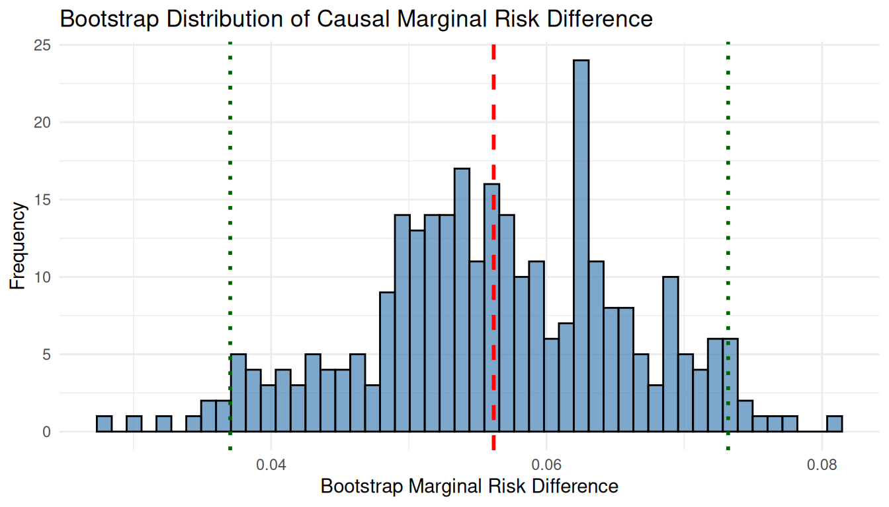](logistic-regression_files/figure-revealjs/unnamed-chunk-53-1.png "Figure 22: Bootstrap distribution of the marginal risk difference (Type A vs Type B behavioral pattern, adjusted for age). Red dashed line: point estimate. Green dotted lines: 95% CI bounds.")
> >
> > Figure 22: Bootstrap distribution of the marginal risk difference (Type A vs Type B behavioral pattern, adjusted for age). Red dashed line: point estimate. Green dotted lines: 95% CI bounds.
>
> ##### Interpretation
>
> Under the identification assumptions ([Consistency](../chapters/causal-inference.llms.md#def-consistency), [Conditional Exchangeability](../chapters/causal-inference.llms.md#def-exchangeability), and [Positivity](../chapters/causal-inference.llms.md#def-positivity)), we estimate that Type A behavioral pattern causally increases CHD risk by 5.62 percentage points compared to Type B behavioral pattern, after standardizing over the observed age distribution (95% CI: 3.7 to 7.32 percentage points).
>
> Because this rendered example uses 300 [bootstrap samples](https://morrison-lab.github.io/sds/bootstrap.html#def-bootstrap-sample), the displayed [standard error](https://morrison-lab.github.io/sds/estimation.html#def-SE) and [confidence interval](https://morrison-lab.github.io/sds/inference.html#def-confidence-interval) are illustrative. For final inferential reporting, rerun with at least 2000 bootstrap samples.
>
> A 95% CI that excludes zero does not by itself imply practical or clinical importance; also interpret the estimated [risk difference](../chapters/binary-outcome-associations.llms.md#def-RD) magnitude.

#### Alternative: Using the boot package

The [`boot`](https://cran.r-project.org/package=boot) package provides a more streamlined interface for bootstrap inference. Here’s how to compute the same [confidence interval](https://morrison-lab.github.io/sds/inference.html#def-confidence-interval) using [`boot::boot()`](https://rdrr.io/pkg/boot/man/boot.html):

Show R code

``` downlit
library(boot)

statistic_fn <- function(data, indices) {
  boot_data <- data[indices, ]

  boot_fit <- glm(
    chd69_binary ~ dibpat + age,
    data = boot_data,
    family = binomial(link = "logit")
  )

  compute_marginal_rd(
    model = boot_fit,
    data = boot_data,
    exposure_var = "dibpat",
    exposed_level = "Type A",
    unexposed_level = "Type B"
  )
}

set.seed(20260512)
boot_results <- boot(
  data = wcgs_clean,
  statistic = statistic_fn,
  # Keep the rendered example fast; increase to 2000+ for final analyses.
  R = 300
)

boot_results

boot.ci(boot_results, type = c("perc", "bca"))
```

The [`boot`](https://cran.r-project.org/package=boot) package provides several types of confidence intervals, including the percentile method (`perc`) and the bias-corrected and accelerated (BCa) method (`bca`), which can provide better coverage in some situations. The BCa method is more demanding than the percentile method: its bias-correction and acceleration estimates are unstable at the illustrative `R = 300` used here (and can warn or fail outright), so use a substantially larger `R` (at least 2000) before relying on `bca` intervals.

### 10.2.3 Computing marginal risk ratios

Contrasting marginal risks by ratio rather than by difference gives the corresponding marginal risk ratios:

> **NOTE:**
>
> **Definition 28 (Observed marginal risk ratio (OMRR))** The **observed marginal risk ratio** (**OMRR**) is:
>
> $$\text{OMRR} \stackrel{\text{def}}{=}\frac{\pi(1)}{\pi(0)}$$

> **NOTE:**
>
> **Example 51 (Estimated observed marginal risk ratio)** Continuing from [Example 47](#exm-wcgs-observed-marginal-risks), the [observed marginal risk ratio](#def-observed-marginal-rr) estimate is:
>
> Show R code
>
> ``` downlit
> rr_obs <- pi1_obs / pi0_obs
> ```
>
> $$\begin{aligned}
> \widehat{\text{OMRR}}
> &= \frac{\hat\pi(1)}{\hat\pi(0)}
> && \text{[definition of OMRR]}
> \\
> &= \frac{0.112}{0.05}
> && \text{[substitute estimates]}
> \\
> &= 2.22
> && \text{[arithmetic, computed from full-precision } \hat\pi(1) / \hat\pi(0) \text{]}
> \end{aligned}$$

> **NOTE:**
>
> **Definition 29 (Causal marginal risk ratio (CMRR))** The **causal marginal risk ratio** (**CMRR**) is:
>
> $$\text{CMRR} \stackrel{\text{def}}{=}\frac{\pi_1}{\pi_0}$$

> **NOTE:**
>
> **Example 52 (Estimated causal marginal risk ratio)** Continuing from [Example 44](#exm-wcgs-causal-marginal-risks), the [causal marginal risk ratio](#def-causal-marginal-rr) estimate is:
>
> Show R code
>
> ``` downlit
> rr_hat <- pi1_hat / pi0_hat
> ```
>
> $$\begin{aligned}
> \widehat{\text{CMRR}}
> &= \frac{\hat\pi_1}{\hat\pi_0}
> && \text{[definition of CMRR]}
> \\
> &= \frac{0.109}{0.052}
> && \text{[substitute estimates]}
> \\
> &= 2.07
> && \text{[arithmetic, computed from full-precision } \hat\pi_1 / \hat\pi_0 \text{]}
> \end{aligned}$$

The point estimates in [Example 51](#exm-observed-marginal-rr) and [Example 52](#exm-causal-marginal-rr) use the same fitted model as [Example 49](#exm-causal-marginal-rd). To quantify their uncertainty, we bootstrap the marginal risk ratio, modifying the statistic function to compute ratios instead of differences:

Show R code

``` downlit
library(boot)

compute_marginal_rr <- function(model,
                                data,
                                exposure_var,
                                exposed_level,
                                unexposed_level) {
  counterfactual_data <- make_counterfactual_datasets(
    data = data,
    exposure_var = exposure_var,
    exposed_level = exposed_level,
    unexposed_level = unexposed_level
  )
  data_exposed <- counterfactual_data$data_exposed
  data_unexposed <- counterfactual_data$data_unexposed

  risk_exposed <- predict(
    model,
    newdata = data_exposed,
    type = "response"
  )

  risk_unexposed <- predict(
    model,
    newdata = data_unexposed,
    type = "response"
  )

  mean(risk_exposed) / mean(risk_unexposed)
}

statistic_fn_rr <- function(data, indices) {
  boot_data <- data[indices, ]
  boot_fit <- glm(
    chd69_binary ~ dibpat + age,
    data = boot_data,
    family = binomial(link = "logit")
  )
  compute_marginal_rr(
    model = boot_fit,
    data = boot_data,
    exposure_var = "dibpat",
    exposed_level = "Type A",
    unexposed_level = "Type B"
  )
}

set.seed(20260512)
boot_results_rr <- boot(
  data = wcgs_clean,
  statistic = statistic_fn_rr,
  # Keep the rendered example fast; increase to 2000+ for final analyses.
  R = 300
)

# BCa intervals can be unstable at this small R;
# increase to R = 2000+ before relying on bca results.
boot_ci_rr <- boot.ci(boot_results_rr, type = c("perc", "bca"))

cat("Marginal Risk Ratio (Type A vs Type B):",
    round(boot_results_rr$t0, 3), "\n")
cat("95% Percentile CI: (",
    round(boot_ci_rr$percent[4], 3), ",",
    round(boot_ci_rr$percent[5], 3), ")\n")
```

### 10.2.4 Notes and caveats

> **NOTE:**
>
> **Definition 30 (Collapsibility)** An [estimand](https://morrison-lab.github.io/sds/estimation.html#def-estimand) $\theta$ is **collapsible** with respect to a covariate $Z$ if the population-level estimand equals the marginal-distribution-weighted average of stratum-specific estimands:
>
> $$\theta \stackrel{\text{def}}{=}{\mathbb{E}\mathopen{}\left[\theta(Z)\right]\mathclose{}}.
> \tag{52}$$

> **NOTE:**
>
> **Definition 31 (Collapsibility bias)** In the setting of [Definition 30](#def-collapsibility), **collapsibility bias** is the discrepancy that arises when $\theta \neq {\mathbb{E}\mathopen{}\left[\theta(Z)\right]\mathclose{}}$.

By LOTUS (the [Law of the Unconscious Statistician](https://morrison-lab.github.io/pds/expectation.html#thm-lotus)), [Equation 52](#eq-def-collapsibility) expands into a weighted sum or integral over $Z$’s distribution, depending on whether $Z$ is discrete or continuous:

$${\mathbb{E}\mathopen{}\left[\theta(Z)\right]\mathclose{}} =
\begin{cases}
\sum_z \theta(z)\, \mathbb{P}(Z=z), & Z \text{ discrete},
\\
\int \theta(z)\, f_Z(z)\, dz, & Z \text{ continuous}.
\end{cases}$$

> **NOTE:**
>
> **Theorem 34 (Which estimands are collapsible?)** For **causal** [estimands](https://morrison-lab.github.io/sds/estimation.html#def-estimand) ([Definition 20](#def-causal-marginal-risk)), and under the identification assumptions of [Theorem 31](#thm-causal-marginal-risk), the collapsibility criterion ([Definition 30](#def-collapsibility)) is evaluated with respect to the **marginal** distribution $f_Z(z)$. Additive (difference) measures are [collapsible](#def-collapsibility); ratio and [log-odds](../chapters/binary-outcome-associations.llms.md#def-logodds) measures are not collapsible in general.
>
> For **observational** estimands ([Definition 18](#def-observed-marginal-risk)), the marginal measure uses the conditional distribution $f_{Z \mid A}(z \mid a)$ as weights rather than the marginal $f_Z(z)$. Collapsibility with respect to $f_Z$ therefore holds in particular when $Z \perp\!\!\!\perp A$ (no [confounding](../chapters/causal-inference.llms.md#def-confounding-obs)).
>
> > **NOTE:**
> >
> > *Proof*. Additive measures are collapsible by linearity of [expectation](https://morrison-lab.github.io/pds/expectation.html#def-expectation), applying the causal-marginal-risk identity ([Theorem 31](#thm-causal-marginal-risk)) to each potential probability:
> >
> > $$\begin{aligned}
> > \pi_1 - \pi_0
> > &= {\mathbb{E}\mathopen{}\left[\pi(1,Z)\right]\mathclose{}} - {\mathbb{E}\mathopen{}\left[\pi(0,Z)\right]\mathclose{}}
> > && \text{[causal marginal risk theorem]}
> > \\
> > &= {\mathbb{E}\mathopen{}\left[\pi(1,Z) - \pi(0,Z)\right]\mathclose{}}.
> > && \text{[linearity of expectation]}
> > \end{aligned}$$
> >
> > Ratio and log-odds measures are not collapsible in general: [Example 53](#exm-collapsibility) gives a counterexample in which the marginal risk ratio and [odds ratio](../chapters/binary-outcome-associations.llms.md#def-OR) differ from the marginal-distribution-weighted average of their stratum-specific values, and [Equation 54](#eq-rr-not-collapsible) derives the discrepancy algebraically for the risk-ratio case.
> >
> > For the **observational** case, when $Z \perp\!\!\!\perp A$ the conditional weights coincide with the marginal ones, $f_{Z \mid A}(z \mid a) = f_Z(z)$, so by [Theorem 29](#thm-observed-marginal-risk):
> >
> > $$\begin{aligned}
> > \pi(a)
> > &= {\mathbb{E}\mathopen{}\left[\pi(a,Z) \mid A = a\right]\mathclose{}}
> > && \text{[observed marginal risk theorem: law of total expectation, given $A = a$]}
> > \\
> > &= {\mathbb{E}\mathopen{}\left[\pi(a,Z)\right]\mathclose{}},
> > && \text{[$Z \perp\!\!\!\perp A$: conditioning on $A = a$ does not change $Z$'s distribution]}
> > \end{aligned}$$
> >
> > establishing that $\pi(a)$ equals the $f_Z$-weighted stratum average, which is collapsibility with respect to $f_Z$, requiring only $Z \perp\!\!\!\perp A$, not the full identification assumptions.

> **NOTE:**
>
> **Example 53 (Collapsibility: numerical illustration)** Continuing the WCGS example with `dibpat` as the exposure, `chd69` as the outcome, and age 50 or older as $Z$ ([Example 38](#exm-observed-marginal-risk)): the causal marginal risk ([Definition 20](#def-causal-marginal-risk)) standardizes **both** exposure groups’ stratum-specific risks to the same population age distribution $f_Z(z)$ ([Remark 8](#rem-observed-vs-causal-marginal-risk)), so this standardization is exactly the common weighting [Definition 30](#def-collapsibility) requires – no simplifying assumptions needed:
>
> Show R code
>
> ``` downlit
> wcgs_nonexposed <- wcgs_clean[wcgs_clean$dibpat == "Type B", ]
> pi0_z0 <- mean(wcgs_nonexposed$chd69_binary[wcgs_nonexposed$age_ge50 == 0])
> pi0_z1 <- mean(wcgs_nonexposed$chd69_binary[wcgs_nonexposed$age_ge50 == 1])
>
> strata <- tibble::tibble(
>   stratum = c("Z = 0 (under 50)", "Z = 1 (50 or older)"),
>   weight  = c(1 - p_z1_pop, p_z1_pop),
>   pi_0    = c(pi0_z0, pi0_z1),
>   pi_1    = c(pi1_z0, pi1_z1)
> ) |>
>   dplyr::mutate(
>     RD = pi_1 - pi_0,
>     RR = pi_1 / pi_0,
>     OR = (pi_1 / (1 - pi_1)) / (pi_0 / (1 - pi_0))
>   )
>
> pi1_marg <- sum(strata$weight * strata$pi_1)
> pi0_marg <- sum(strata$weight * strata$pi_0)
>
> tibble::tibble(
>   Measure = c("Risk difference", "Risk ratio", "Odds ratio"),
>   Marginal = c(
>     pi1_marg - pi0_marg,
>     pi1_marg / pi0_marg,
>     (pi1_marg / (1 - pi1_marg)) / (pi0_marg / (1 - pi0_marg))
>   ),
>   `Weighted avg. conditional` = c(
>     sum(strata$weight * strata$RD),
>     sum(strata$weight * strata$RR),
>     sum(strata$weight * strata$OR)
>   ),
>   `Marginal = weighted avg. conditional?` = c("Yes", "No", "No")
> ) |>
>   knitr::kable(digits = 4)
> ```
>
> | Measure | Marginal | Weighted avg. conditional | Marginal = weighted avg. conditional? |
> |:---|---:|---:|:---|
> | Risk difference | 0.0572 | 0.0572 | Yes |
> | Risk ratio | 2.1028 | 2.1034 | No |
> | Odds ratio | 2.2378 | 2.2401 | No |
>
> The marginal risk difference equals the weighted average of the [conditional risk differences](#def-cond-rd) exactly, as [Theorem 34](#thm-collapsibility) guarantees. The marginal risk ratio and marginal odds ratio both differ from the weighted average of their conditional counterparts – though the [risk ratio](../chapters/binary-outcome-associations.llms.md#def-RR)’s discrepancy only shows up in the fourth decimal place here, because the [conditional risk ratios](#def-cond-rrr) happen to be nearly homogeneous across the two age strata ($2.105$ vs. $2.100$).
>
> Non-collapsibility is distinct from effect-measure modification. The [conditional odds ratios](../chapters/binary-outcome-associations.llms.md#def-OR) vary more across strata ($2.213$ vs. $2.308$), and for the risk ratio, that near-homogeneity is exactly what keeps its discrepancy small here: if the conditional risk ratio were instead **constant** across strata, the marginal risk ratio would reproduce it exactly, just like the [risk difference](../chapters/binary-outcome-associations.llms.md#def-RD). The odds ratio’s discrepancy is different in kind: even if the conditional odds ratio were held *constant* across strata, the marginal odds ratio would generally still differ from it (and lie closer to the null) [\[18, Ch. 4\]](#ref-hernan2020causal), [\[27\]](#ref-greenland1999confounding), [\[28\]](#ref-greenland1986identifiability), whereas a constant conditional risk difference or risk ratio always reproduces the corresponding marginal measure exactly.

#### Important considerations when computing marginal effects

1.  **Target population**: The marginal effect is specific to the covariate distribution in your sample. If your sample is not representative of your target population, you may want to use standardization or weighting.

2.  **Collapsibility** (see [Definition 30](#def-collapsibility)): [Equation 53](#eq-rd-collapsible) and [Equation 54](#eq-rr-not-collapsible) re-derive [Theorem 34](#thm-collapsibility) concretely for the risk-difference and risk-ratio/odds-ratio cases. [Risk differences](../chapters/binary-outcome-associations.llms.md#def-RD) are **[collapsible](#def-collapsibility)**: the causal marginal RD ($\pi_1 - \pi_0$) equals the average of stratum-specific causal RDs ($\pi(1,z) - \pi(0,z)$) weighted by the [marginal distribution](https://morrison-lab.github.io/pds/random-variables.html#def-marginal) $f_Z$,

    $$\begin{aligned}
    \pi_1 - \pi_0
    &= {\mathbb{E}\mathopen{}\left[\pi(1, Z)\right]\mathclose{}} - {\mathbb{E}\mathopen{}\left[\pi(0, Z)\right]\mathclose{}}
    && \text{[causal marginal risk theorem]}
    \\
    &= {\mathbb{E}\mathopen{}\left[\pi(1, Z) - \pi(0, Z)\right]\mathclose{}}
    && \text{[linearity of expectation]}
    \\
    &= {\mathbb{E}\mathopen{}\left[\text{RD}(Z)\right]\mathclose{}},
    && \text{[definition of conditional risk difference]}
    \end{aligned}
    \tag{53}$$

    so there is no collapsibility bias from averaging over a covariate $Z$. [Risk ratios](../chapters/binary-outcome-associations.llms.md#def-RR) are **not** collapsible in general: when the conditional RR varies across strata, the marginal RR does not equal the marginal-distribution-weighted average of conditional RRs, ${\mathbb{E}\mathopen{}\left[\text{RR}(Z)\right]\mathclose{}}$, because a ratio of [expectations](https://morrison-lab.github.io/pds/expectation.html#def-expectation) is not the same as an expectation of ratios:

    $$\begin{aligned}
    \frac{\pi_1}{\pi_0}
    &= \frac{{\mathbb{E}\mathopen{}\left[\pi(1, Z)\right]\mathclose{}}}{{\mathbb{E}\mathopen{}\left[\pi(0, Z)\right]\mathclose{}}}
    && \text{[causal marginal risk theorem]}
    \\
    &\neq {\mathbb{E}\mathopen{}\left[\frac{\pi(1, Z)}{\pi(0, Z)}\right]\mathclose{}}
    && \text{[ratio of expectations, not expectation of ratios]}
    \\
    &= {\mathbb{E}\mathopen{}\left[\text{RR}(Z)\right]\mathclose{}}.
    && \text{[definition of conditional risk ratio]}
    \end{aligned}
    \tag{54}$$

    Unlike the [odds ratio](../chapters/binary-outcome-associations.llms.md#def-OR), though, this discrepancy is entirely a consequence of the conditional RR *varying* across strata: when the [conditional risk ratio](#def-cond-rrr) is instead **constant**, $\text{RR}(z) = r$ for every $z$, the marginal RR reproduces it exactly:

    $$\begin{aligned}
    \pi_1
    &= {\mathbb{E}\mathopen{}\left[\pi(1, Z)\right]\mathclose{}}
    && \text{[causal marginal risk theorem]}
    \\
    &= {\mathbb{E}\mathopen{}\left[\text{RR}(Z) \cdot \pi(0, Z)\right]\mathclose{}}
    && \text{[definition of conditional risk ratio]}
    \\
    &= {\mathbb{E}\mathopen{}\left[r \cdot \pi(0, Z)\right]\mathclose{}}
    && \text{[constant conditional risk ratio]}
    \\
    &= r \cdot {\mathbb{E}\mathopen{}\left[\pi(0, Z)\right]\mathclose{}}
    && \text{[linearity of expectation]}
    \\
    &= r \cdot \pi_0
    && \text{[causal marginal risk theorem]}
    \end{aligned}$$

    so $\pi_1 / \pi_0 = r$: like the risk difference, the risk ratio is collapsible under a homogeneous conditional effect.

    Odds ratios are non-collapsible in a **stronger** sense than risk ratios: even when the conditional OR is the same in every stratum, the marginal OR is generally different from it (closer to the null) [\[18, Ch. 4\]](#ref-hernan2020causal), [\[27\]](#ref-greenland1999confounding), [\[28\]](#ref-greenland1986identifiability), whereas a constant conditional RD or RR always reproduces the corresponding marginal RD or RR exactly (the marginal RD is the average ${\mathbb{E}\mathopen{}\left[\text{RD}(Z)\right]\mathclose{}}$ of the stratum-specific RDs by [Theorem 34](#thm-collapsibility), and the average of a constant is that constant).

3.  **Bootstrap sample size**: A [confidence interval](https://morrison-lab.github.io/sds/inference.html#def-confidence-interval) needs more bootstrap resamples than a [standard error](https://morrison-lab.github.io/sds/estimation.html#def-SE), because it depends on the tails of the [bootstrap distribution](https://morrison-lab.github.io/sds/bootstrap.html#def-bootstrap-distribution) rather than just its spread [\[26, Ch. 6\]](#ref-efron1993introduction), [\[29, Ch. 2\]](#ref-davison1997bootstrap). As a conservative rule of thumb, use at least 1000 iterations for standard errors and at least 2000 for confidence intervals. More iterations give more stable estimates but take longer to compute.

4.  **Alternative methods**: The multivariate delta method can also be used to compute standard errors analytically, but the formulas are complex. The [`margins`](https://cran.r-project.org/package=margins) package in R provides implementations of the delta method for marginal effects.

5.  **Case-control studies**: These methods are **not valid** for case-control studies, where sampling is stratified by outcome. In case-control designs, only odds ratios can be estimated consistently (see [Odds Ratios in Case-Control Studies](../chapters/binary-outcome-associations.llms.md#sec-CC-studies)).

## 10.3 Other link functions for Bernoulli outcomes

Alternatively, if you want to estimate [risk ratios](../chapters/binary-outcome-associations.llms.md#def-RR) more directly from the model, you can sometimes change the [link function](../chapters/Intro-to-GLMs.llms.md#sec-why-link) from ${\operatorname{logit}\mathopen{}\left\{\right\}\mathclose{}}$ to ${\operatorname{log}\mathopen{}\left\{\right\}\mathclose{}}$; then you can obtain risk ratios by exponentiating coefficients [^1], just like we did for [odds ratios](../chapters/binary-outcome-associations.llms.md#def-OR) with the [logit](../chapters/binary-outcome-associations.llms.md#def-logit-fn) link:

Show R code

``` downlit
data(anthers, package = "dobson")
anthers_sum <- aggregate(
  anthers[c("n", "y")],
  by = anthers[c("storage")], FUN = sum
)

anthers_glm_log <- glm(
  formula = cbind(y, n - y) ~ storage,
  data = anthers_sum,
  family = binomial(link = "log")
)

anthers_glm_log |>
  parameters() |>
  print_md()
```

| Parameter   | Log-Risk |  SE  |     95% CI     |   z   |    p    |
|:------------|:--------:|:----:|:--------------:|:-----:|:-------:|
| (Intercept) |  -0.80   | 0.12 | (-1.04, -0.58) | -6.81 | \< .001 |
| storage     |   0.17   | 0.07 |  (0.02, 0.31)  | 2.31  |  0.021  |

Now ${\operatorname{exp}\mathopen{}\left\{\beta\right\}\mathclose{}}$ gives us risk ratios instead of odds ratios:

Show R code

``` downlit
anthers_glm_log |>
  parameters(exponentiate = TRUE) |>
  print_md()
```

| Parameter   | Risk Ratio |  SE  |    95% CI    |   z   |    p    |
|:------------|:----------:|:----:|:------------:|:-----:|:-------:|
| (Intercept) |    0.45    | 0.05 | (0.35, 0.56) | -6.81 | \< .001 |
| storage     |    1.18    | 0.09 | (1.03, 1.36) | 2.31  |  0.021  |

Let’s compare this model with a logistic model:

Show R code

``` downlit
anthers_glm_logit <- glm(
  formula = cbind(y, n - y) ~ storage,
  data = anthers_sum,
  family = binomial(link = "logit")
)

anthers_glm_logit |>
  parameters(exponentiate = TRUE) |>
  print_md()
```

| Parameter   | Odds Ratio |  SE  |    95% CI    |   z   |   p   |
|:------------|:----------:|:----:|:------------:|:-----:|:-----:|
| (Intercept) |    0.76    | 0.20 | (0.45, 1.27) | -1.05 | 0.296 |
| storage     |    1.49    | 0.26 | (1.06, 2.10) | 2.29  | 0.022 |

We can compare the two link functions by plotting their fitted germination probabilities across the range of the storage covariate, alongside the observed proportions:

> **NOTE:**
>
> Show R code
>
> ``` downlit
> library(tidyr)
>
> anthers_fitted_grid <-
>   data.frame(
>     storage = seq(
>       min(anthers_sum$storage),
>       max(anthers_sum$storage),
>       length.out = 100
>     )
>   ) |>
>   mutate(
>     `Log link` = predict(anthers_glm_log, pick(storage), type = "response"),
>     `Logit link` = predict(anthers_glm_logit, pick(storage), type = "response")
>   ) |>
>   pivot_longer(
>     cols = c(`Log link`, `Logit link`),
>     names_to = "Link function",
>     values_to = "fitted"
>   )
>
> anthers_observed <-
>   anthers_sum |>
>   mutate(proportion = y / n)
>
> ggplot() +
>   geom_line(
>     data = anthers_fitted_grid,
>     mapping = aes(x = storage, y = fitted, color = `Link function`)
>   ) +
>   geom_point(
>     data = anthers_observed,
>     mapping = aes(x = storage, y = proportion),
>     size = 3
>   ) +
>   labs(
>     x = "Storage condition",
>     y = "Fitted probability of germination"
>   ) +
>   theme_bw()
> ```
>
> [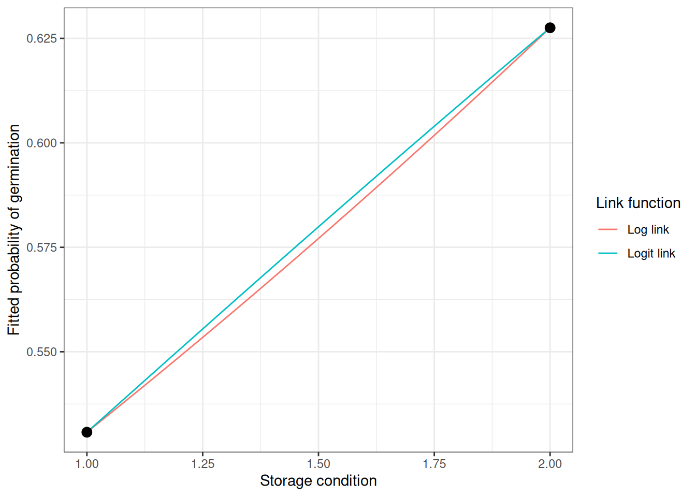](logistic-regression_files/figure-revealjs/unnamed-chunk-57-1.png "Figure 23: Fitted germination probabilities from the log-link and logit-link models for the anthers data, with the observed proportions as points. The two link functions nearly coincide here because the model is saturated (two parameters fit to two storage conditions), so both reproduce the observed proportions at the data points and differ only slightly in between.")
>
> Figure 23: Fitted germination probabilities from the log-link and logit-link models for the `anthers` data, with the observed proportions as points. The two link functions nearly coincide here because the model is saturated (two parameters fit to two storage conditions), so both reproduce the observed proportions at the data points and differ only slightly in between.

In practice, fitting a binomial model with `link = "log"` often fails to converge, producing errors about not finding good starting values for the estimation procedure. This convergence failure is likely because the model is producing fitted probabilities greater than 1.

When this happens, you can instead switch the outcome distribution from binomial to Poisson and fit a Poisson [regression model](../chapters/Intro-to-GLMs.llms.md#def-regression-model) (we will see those soon!). Note that this substitution is a change in model *structure* — a different outcome distribution — not just a different way of fitting the same model. With a Poisson outcome distribution, you won’t get warnings about fitted probabilities greater than 1, but that distribution isn’t quite right for [binary outcomes](https://morrison-lab.github.io/sds/data.html#def-binary-var). Despite this mismatch, Poisson regression is the usual fallback when the log-binomial model fails to converge.

### 10.3.1 WCGS: link functions

Show R code

``` downlit
wcgs_glm_logit_link <- chd_grouped_data |>
  mutate(type = relevel(dibpat, ref = "Type B")) |>
  glm(
    "formula" = cbind(x, `n - x`) ~ dibpat * age,
    "data" = _,
    "family" = binomial(link = "logit")
  )

wcgs_glm_identity_link <-
  chd_grouped_data |>
  mutate(type = relevel(dibpat, ref = "Type B")) |>
  glm(
    "formula" = cbind(x, `n - x`) ~ dibpat * age,
    "data" = _,
    "family" = binomial(link = "identity")
  )
wcgs_glm_identity_link |>
  coef() |>
  pander()
```

| (Intercept) | dibpatType A |   age    | dibpatType A:age |
|:-----------:|:------------:|:--------:|:----------------:|
|  -0.08257   |   -0.1374    | 0.002906 |     0.004194     |

> **NOTE:**
>
> Show R code
>
> ``` downlit
> library(ggfortify)
> wcgs_glm_logit_link |> autoplot(which = c(1), ncol = 1) + facet_wrap(~dibpat)
> ```
>
> [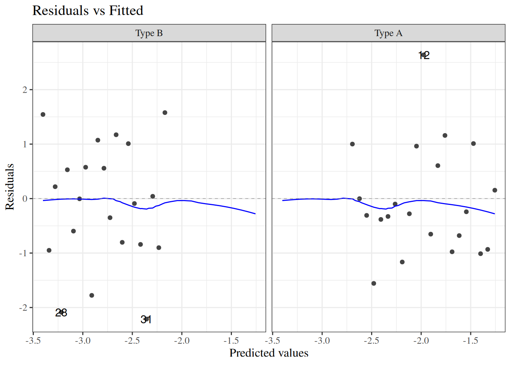](logistic-regression_files/figure-revealjs/unnamed-chunk-59-1.png "Figure 24 (a): Logistic link")
>
> \(a\) Logistic link
>
> Show R code
>
> ``` downlit
> wcgs_glm_identity_link |> autoplot(which = c(1), ncol = 1) + facet_wrap(~dibpat)
> ```
>
> [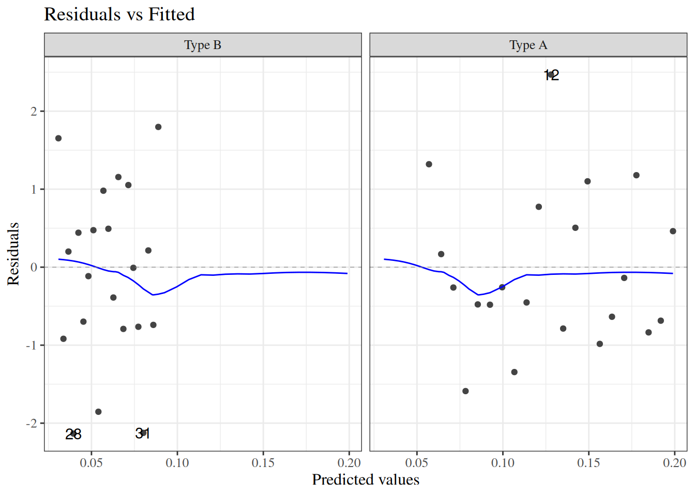](logistic-regression_files/figure-revealjs/unnamed-chunk-60-1.png "Figure 24 (b): Identity link")
>
> \(b\) Identity link
>
> Figure 24: Residuals vs Fitted plot for `wcgs` models

> **NOTE:**
>
> Show R code
>
> ``` downlit
> beetles_lm <-
>   beetles_long |>
>   lm(formula = died ~ dose)
>
> beetles_glm_grouped <- beetles |>
>   glm(formula = cbind(died, survived) ~ dose, family = "binomial")
>
>
> beetles <-
>   beetles |> mutate(
>     resid_logit = beetles_glm_grouped |> resid(type = "response")
>   )
> beetles_glm_grouped |> autoplot(which = c(1), ncol = 1)
> ```
>
> [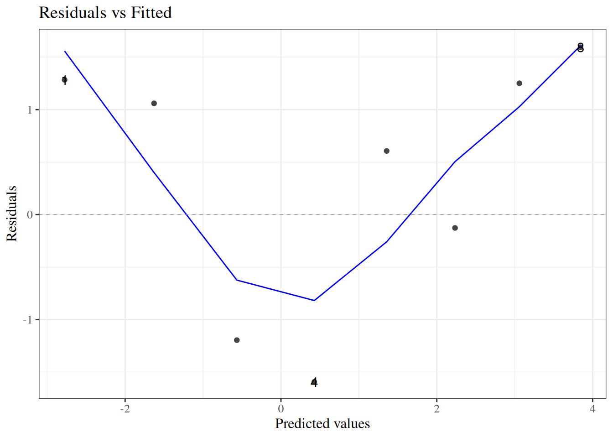](logistic-regression_files/figure-revealjs/unnamed-chunk-61-1.png "Figure 25 (a): Logistic link")
>
> \(a\) Logistic link
>
> Show R code
>
> ``` downlit
> beetles_lm |> autoplot(which = c(1), ncol = 1)
> ```
>
> [](logistic-regression_files/figure-revealjs/unnamed-chunk-62-1.png "Figure 25 (b): Identity link")
>
> \(b\) Identity link
>
> Figure 25: Residuals vs Fitted plot for `BeetleMortality` models

## 10.4 Quasibinomial

See [Hua Zhou](https://hua-zhou.github.io/)’s [lecture notes](https://ucla-biostat-200c-2020spring.github.io/slides/04-binomial/binomial.html#:~:text=0.05%20%27.%27%200.1%20%27%20%27%201-,Quasi%2Dbinomial,-Another%20way%20to)

# 11 Further reading

- Hosmer et al. [\[30\]](#ref-hosmer2013applied) is a classic textbook on logistic regression

# Exercises

> **NOTE:**
>
> **Exercise 29 (Choosing a link function for binary outcomes)** (adapted from Dunn and Smyth [\[31\]](#ref-dunn2018generalized), Chapter 3)
>
> Two researchers are modeling the probability that a patient experiences a side effect, as a function of dose. Define:
>
> - $x$: the dose administered to the patient ($x > 0$)
> - $\pi(x)$: the probability that a patient given dose $x$ experiences the side effect
> - $\beta_0$, $\beta_1$: the intercept and slope parameters of each model
>
> The two models are:
>
> - Researcher A uses the **[logit](../chapters/binary-outcome-associations.llms.md#def-logit-fn)** link: $\operatorname{logit}(\pi) = \beta_0 + \beta_1 x$
> - Researcher B uses the **log** link: ${\operatorname{log}\mathopen{}\left\{\pi\right\}\mathclose{}} = \beta_0 + \beta_1 x$
>
> **(a)** For each model, write $\pi(x)$ as an explicit function of $x$.
>
> **(b)** For the log-link model (Researcher B), what constraint on the parameters ensures $\pi(x) \leq 1$ for all $x > 0$?
>
> **(c)** Which link is more commonly used for [binary outcomes](https://morrison-lab.github.io/sds/data.html#def-binary-var)? Give one practical advantage of that link.

> **NOTE:**
>
> *Solution*. **(a)**
>
> **Logit link (Researcher A):**
>
> $$\pi(x) = \frac{e^{\beta_0 + \beta_1 x}}{1 + e^{\beta_0 + \beta_1 x}}
> = {\operatorname{expit}\mathopen{}\left\{\beta_0 + \beta_1 x\right\}\mathclose{}}$$
>
> This probability is always in $(0, 1)$, regardless of the values of $\beta_0$, $\beta_1$, or $x$.
>
> **Log link (Researcher B):**
>
> $$\pi(x) = e^{\beta_0 + \beta_1 x}$$
>
> This exponential expression is always positive, but may exceed 1.
>
> **(b)**
>
> For the log-link model, $\pi(x) \leq 1$ requires $e^{\beta_0 + \beta_1 x} \leq 1$.
>
> Since the [exponential function](https://morrison-lab.github.io/mds/algebra-exponentials.html#def-exponential-function) is increasing, this requirement is equivalent to $$\beta_0 + \beta_1 x \leq 0
> \qquad \text{for all } x > 0.$$
>
> Because this must hold for all positive $x$, a positive slope $\beta_1 > 0$ is not possible on this unbounded domain: for sufficiently large $x$, we would have $\beta_0 + \beta_1 x > 0$. Thus we need $\beta_1 \leq 0$. Also, to keep $\beta_0 + \beta_1 x \leq 0$ for $x$ arbitrarily close to 0, we need $\beta_0 \leq 0$. So the parameter constraint is $\beta_0 \leq 0$ and $\beta_1 \leq 0$.
>
> **(c)**
>
> The **logit link** is more commonly used for binary outcomes.
>
> One practical advantage: the logit link **automatically constrains** $\pi(x) \in (0,1)$ for any real values of $\beta_0$, $\beta_1$, and $x$, eliminating the risk of predicted probabilities outside $[0,1]$. Additionally, the logit link yields [odds ratios](../chapters/binary-outcome-associations.llms.md#def-OR) as the natural measure of association, which are widely used in epidemiology (see Vittinghoff et al. [\[2, Ch. 5\]](#ref-vittinghoff2e)).

# Summary of definitions and results

## Odds and log-odds

These association-measure results are covered in [Measures of Association for Binary Outcomes](../chapters/binary-outcome-associations.llms.md).

**Odds** ([def](../chapters/binary-outcome-associations.llms.md#def-odds)) $$\omega\stackrel{\text{def}}{=}\frac{\Pr(A)}{\Pr(\neg A)}$$

**Conditional odds** ([def](../chapters/binary-outcome-associations.llms.md#def-c-odds)) $$\omega(A|B) \stackrel{\text{def}}{=}\frac{\Pr(A|B)}{\Pr(\neg A|B)}$$

**Odds function** ([def](../chapters/binary-outcome-associations.llms.md#def-odds-fn)) $${\operatorname{odds}\mathopen{}\left\{\pi\right\}\mathclose{}} \stackrel{\text{def}}{=}\frac{\pi}{1-\pi}$$

**Probability to odds** ([thm](../chapters/binary-outcome-associations.llms.md#thm-prob-to-odds), [cor](../chapters/binary-outcome-associations.llms.md#cor-oddsf-to-odds)) $$\omega= \frac{\pi}{1-\pi} = {\operatorname{odds}\mathopen{}\left\{\pi\right\}\mathclose{}}$$

**Simplified odds expressions; odds of a non-event** ([thm](../chapters/binary-outcome-associations.llms.md#thm-odds-simplified), [cor](../chapters/binary-outcome-associations.llms.md#cor-odds-neg)) $${\operatorname{odds}\mathopen{}\left\{\pi\right\}\mathclose{}} = \frac{1}{\pi^{-1}-1} = {\mathopen{}\left(\pi^{-1}-1\right)\mathclose{}}^{-1},
\qquad \omega(\neg A) = \frac{1-\pi}{\pi} = \pi^{-1}-1$$

**Odds ratio** ([def](../chapters/binary-outcome-associations.llms.md#def-OR)) $$\text{ϙ}(\omega_1, \omega_2) \stackrel{\text{def}}{=}\frac{\omega_1}{\omega_2}$$

**OR as ratio of probability ratios** ([thm](../chapters/binary-outcome-associations.llms.md#thm-or-ratio-ratio)) $$\text{ϙ}(\omega_1, \omega_2)
= \frac{\omega_1}{\omega_2}
= \frac{\mathopen{}\left(\frac{\pi_1}{1-\pi_1}\right)\mathclose{}}{\mathopen{}\left(\frac{\pi_2}{1-\pi_2}\right)\mathclose{}}$$

**Odds ratios are reversible, marginally and conditionally** ([thm](../chapters/binary-outcome-associations.llms.md#thm-or-swap), [thm](../chapters/binary-outcome-associations.llms.md#thm-conditional-OR-swap)) $$\text{ϙ}_{\omega}(A|B) = \text{ϙ}_{\omega}(B|A),
\qquad \text{ϙ}_{\omega}(A|B,C) = \text{ϙ}_{\omega}(B|A,C)$$

## Inverse-odds and probability recovery

**Odds to probability** ([thm](../chapters/binary-outcome-associations.llms.md#thm-odds-to-prob)) $$\pi = \frac{\omega}{1+\omega}$$

**Inverse-odds function** ([def](../chapters/binary-outcome-associations.llms.md#def-inv-odds); recovers probability by [cor](../chapters/binary-outcome-associations.llms.md#cor-invodds-pi)) $${\operatorname{invodds}\mathopen{}\left\{\omega\right\}\mathclose{}} \stackrel{\text{def}}{=}\frac{\omega}{1 + \omega},
\qquad \pi= {\operatorname{invodds}\mathopen{}\left\{\omega\right\}\mathclose{}}$$

**Simplified inverse-odds** ([lem](../chapters/binary-outcome-associations.llms.md#lem-invodds-simplified)) $${\operatorname{invodds}\mathopen{}\left\{\omega\right\}\mathclose{}} = \frac{1}{1+\omega^{-1}} = (1+\omega^{-1})^{-1}$$

**One minus inverse-odds, and its complement** ([lem](../chapters/binary-outcome-associations.llms.md#lem-one-minus-odds-inv), [cor](../chapters/binary-outcome-associations.llms.md#cor-inverse-odds-nonevent)) $$1 - \pi= \frac{1}{1+\omega},
\qquad 1+\omega= \frac{1}{1-\pi}$$

## Log-odds (logit) and expit

**Log-odds, and log-odds from probability** ([def](../chapters/binary-outcome-associations.llms.md#def-logodds), [thm](../chapters/binary-outcome-associations.llms.md#thm-logodds-pi)) $$\eta\stackrel{\text{def}}{=}{\operatorname{log}\mathopen{}\left\{\omega\right\}\mathclose{}},
\qquad \eta= {\operatorname{log}\mathopen{}\left\{\frac{\pi}{1-\pi}\right\}\mathclose{}}$$

**Logit function, and expanded form** ([def](../chapters/binary-outcome-associations.llms.md#def-logit-fn), [thm](../chapters/binary-outcome-associations.llms.md#thm-logit-function)) $$\operatorname{logit}(\pi) \stackrel{\text{def}}{=}{\operatorname{log}\mathopen{}\left\{{\operatorname{odds}\mathopen{}\left\{\pi\right\}\mathclose{}}\right\}\mathclose{}} = {\operatorname{log}\mathopen{}\left\{\frac{\pi}{1-\pi}\right\}\mathclose{}}$$

**Log-odds equals logit** ([cor](../chapters/binary-outcome-associations.llms.md#cor-logodds-logit)) $$\eta= {\operatorname{logit}\mathopen{}\left\{\pi\right\}\mathclose{}}$$

**Odds and probability from log-odds** ([lem](../chapters/binary-outcome-associations.llms.md#lem-odds-from-logodds), [thm](../chapters/binary-outcome-associations.llms.md#thm-prob-from-logodds)) $$\omega= {\operatorname{exp}\mathopen{}\left\{\eta\right\}\mathclose{}},
\qquad \pi= \frac{{\operatorname{exp}\mathopen{}\left\{\eta\right\}\mathclose{}}}{1+{\operatorname{exp}\mathopen{}\left\{\eta\right\}\mathclose{}}}$$

**Expit / inverse-logit function, and equivalent expressions** ([def](../chapters/binary-outcome-associations.llms.md#def-expit), [thm](../chapters/binary-outcome-associations.llms.md#thm-expit-expressions)) $$\operatorname{expit}(\eta) \stackrel{\text{def}}{=}{\operatorname{invodds}\mathopen{}\left\{{\operatorname{exp}\mathopen{}\left\{\eta\right\}\mathclose{}}\right\}\mathclose{}}
= \frac{{\operatorname{exp}\mathopen{}\left\{\eta\right\}\mathclose{}}}{1+{\operatorname{exp}\mathopen{}\left\{\eta\right\}\mathclose{}}} = (1 + {\operatorname{exp}\mathopen{}\left\{-\eta\right\}\mathclose{}})^{-1}$$

**Probability as expit** ([thm](../chapters/binary-outcome-associations.llms.md#thm-expit-prob-logodds)) $$\pi= {\operatorname{expit}\mathopen{}\left\{\eta\right\}\mathclose{}} \tag{55}$$

**Logit and expit are inverses** ([thm](../chapters/binary-outcome-associations.llms.md#thm-logit-expit)) $${\operatorname{logit}\mathopen{}\left\{{\operatorname{expit}\mathopen{}\left\{\eta\right\}\mathclose{}}\right\}\mathclose{}} = \eta\qquad {\operatorname{expit}\mathopen{}\left\{{\operatorname{logit}\mathopen{}\left\{\pi\right\}\mathclose{}}\right\}\mathclose{}} = \pi$$

> **NOTE:**
>
> $$\underbrace{\pi}_{{\Pr\mathopen{}\left(Y=1\right)\mathclose{}}}
> \overbrace{
> \underbrace{
> \underset{
> \xleftarrow[\frac{\omega}{1+\omega}]{}
> }
> {
> \xrightarrow{\frac{\pi}{1-\pi}}
> }
> \underbrace{\omega}_{{\operatorname{odds}\mathopen{}\left\{Y=1\right\}\mathclose{}}}
> \underset{
> \xleftarrow[{\operatorname{exp}\mathopen{}\left\{\eta\right\}\mathclose{}}]{}
> }
> {
> \xrightarrow{{\operatorname{log}\mathopen{}\left\{\omega\right\}\mathclose{}}}
> }
> }_{{\operatorname{expit}\mathopen{}\left\{\eta\right\}\mathclose{}}}
> }^{{\operatorname{logit}\mathopen{}\left\{\pi\right\}\mathclose{}}}
> \underbrace{\eta}_{{\eta\mathopen{}\left(Y=1\right)\mathclose{}}}$$
>
> Figure 26: Diagram of [logistic regression](../chapters/logistic-regression.llms.md#def-logistic-regression) link and inverse [link functions](../chapters/Intro-to-GLMs.llms.md#sec-why-link)

## Rare events

**Odds minus probability** ([thm](../chapters/binary-outcome-associations.llms.md#thm-odds-minus-probs)) $$\omega- \pi = \frac{\pi^2}{1-\pi}, \quad \text{where } \omega= \frac{\pi}{1-\pi}$$

**OR as RR times a correction factor** ([thm](../chapters/binary-outcome-associations.llms.md#thm-rare-disease-or-rr)) $$\text{ϙ}(\omega_1, \omega_2)
= \rho(\pi_1, \pi_2) \cdot \frac{1-\pi_2}{1-\pi_1}$$ When $\pi_1$ and $\pi_2$ are both small, the correction factor is close to 1, so the [odds ratio](../chapters/binary-outcome-associations.llms.md#def-OR) is close to the [risk ratio](../chapters/binary-outcome-associations.llms.md#def-RR).

## Derivatives

$$\begin{array}{r|ccccc}
& \pi& \omega& \eta& \mathord{\smash[b]{\underset{\raise.3ex\hbox{$\scriptstyle\sim$}}{x}}\vphantom{x}}& \mathord{\smash[b]{\underset{\raise.3ex\hbox{$\scriptstyle\sim$}}{\beta}}\vphantom{\beta}}\\
\hline
\pi
  & 1
  & {\mathopen{}\left(1+\omega\right)\mathclose{}}^{2}
  & \dfrac{{\mathopen{}\left(1+\omega\right)\mathclose{}}^{2}}{\omega}
  & \text{undef}
  & \text{undef} \\[10pt]
\omega
  & {\mathopen{}\left(1-\pi\right)\mathclose{}}^{2}
  & 1
  & \dfrac{1}{\omega}
  & \text{undef}
  & \text{undef} \\[10pt]
\eta
  & \pi(1-\pi)
  & \omega
  & 1
  & \text{undef}
  & \text{undef} \\[10pt]
\mathord{\smash[b]{\underset{\raise.3ex\hbox{$\scriptstyle\sim$}}{x}}\vphantom{x}}
  & \underbrace{\mathord{\smash[b]{\underset{\raise.3ex\hbox{$\scriptstyle\sim$}}{\beta}}\vphantom{\beta}}\pi(1-\pi)}_{p \times 1}
  & \underbrace{\mathord{\smash[b]{\underset{\raise.3ex\hbox{$\scriptstyle\sim$}}{\beta}}\vphantom{\beta}}\omega}_{p \times 1}
  & \underbrace{\mathord{\smash[b]{\underset{\raise.3ex\hbox{$\scriptstyle\sim$}}{\beta}}\vphantom{\beta}}}_{p \times 1}
  & \underbrace{\mathbb{I}}_{p \times p}
  & \mathbf{0}_{p \times p} \\[10pt]
\mathord{\smash[b]{\underset{\raise.3ex\hbox{$\scriptstyle\sim$}}{\beta}}\vphantom{\beta}}
  & \underbrace{\mathord{\smash[b]{\underset{\raise.3ex\hbox{$\scriptstyle\sim$}}{x}}\vphantom{x}}\pi(1-\pi)}_{p \times 1}
  & \underbrace{\mathord{\smash[b]{\underset{\raise.3ex\hbox{$\scriptstyle\sim$}}{x}}\vphantom{x}}\omega}_{p \times 1}
  & \underbrace{\mathord{\smash[b]{\underset{\raise.3ex\hbox{$\scriptstyle\sim$}}{x}}\vphantom{x}}}_{p \times 1}
  & \mathbf{0}_{p \times p}
  & \underbrace{\mathbb{I}}_{p \times p} \\
\end{array}$$

Column labels indicate the numerators of the [derivatives](https://morrison-lab.github.io/mds/calculus-derivatives.html#def-derivative); row labels indicate the denominators (dimensions and details in [tbl](../chapters/logistic-regression.llms.md#tbl-logistic-deriv-matrix)).

**Derivative of expit** ([cor](../chapters/logistic-regression.llms.md#cor-deriv-expit)) $${\operatorname{expit}'\mathopen{}\left\{\eta\right\}\mathclose{}} = {\operatorname{expit}\mathopen{}\left\{\eta\right\}\mathclose{}}(1 - {\operatorname{expit}\mathopen{}\left\{\eta\right\}\mathclose{}})$$

## Logistic regression model

**Logistic regression** ([def](../chapters/logistic-regression.llms.md#def-logistic-regression)) $$Y_i|\mathord{\smash[b]{\underset{\raise.3ex\hbox{$\scriptstyle\sim$}}{X}}\vphantom{X}}_i \ \sim_{\perp\!\!\!\perp}\ \operatorname{Ber}(\pi(\mathord{\smash[b]{\underset{\raise.3ex\hbox{$\scriptstyle\sim$}}{X}}\vphantom{X}}_i)), \qquad {\operatorname{logit}\mathopen{}\left\{\pi(\mathord{\smash[b]{\underset{\raise.3ex\hbox{$\scriptstyle\sim$}}{x}}\vphantom{x}})\right\}\mathclose{}} = {\mathord{\smash[b]{\underset{\raise.3ex\hbox{$\scriptstyle\sim$}}{x}}\vphantom{x}}}^{\top}\mathord{\smash[b]{\underset{\raise.3ex\hbox{$\scriptstyle\sim$}}{\beta}}\vphantom{\beta}}$$

Throughout this summary, $\mathord{\smash[b]{\underset{\raise.3ex\hbox{$\scriptstyle\sim$}}{\beta}}\vphantom{\beta}}= (\beta_0, \beta_1, \ldots, \beta_p)$ is the $(p+1) \times 1$ coefficient vector (including the intercept), $\mathbf{X}$ is the $n \times (p+1)$ design matrix whose $i^{\text{th}}$ row is ${\mathord{\smash[b]{\underset{\raise.3ex\hbox{$\scriptstyle\sim$}}{x}}\vphantom{x}}_i}^{\top}$, and $\mathord{\smash[b]{\underset{\raise.3ex\hbox{$\scriptstyle\sim$}}{\varepsilon}}\vphantom{\varepsilon}}$ is the $n \times 1$ error vector with components $\varepsilon_i \stackrel{\text{def}}{=}y_i - \pi_i$.

## Log-likelihood and score function

**Log-likelihood component** ([lem](../chapters/logistic-regression.llms.md#lem-logistic-loglik-component)) $$\ell_i(\pi_i) = y_i \eta_i - {\operatorname{log}\mathopen{}\left\{1+\omega_i\right\}\mathclose{}}$$

**Score function as sum of components** ([lem](../chapters/logistic-regression.llms.md#lem-score-logistic), [thm](../chapters/logistic-regression.llms.md#thm-logistic-score-comp)) $$\mathord{\smash[b]{\underset{\raise.3ex\hbox{$\scriptstyle\sim$}}{\ell'}}\vphantom{\ell'}}(\mathord{\smash[b]{\underset{\raise.3ex\hbox{$\scriptstyle\sim$}}{\beta}}\vphantom{\beta}}) = \sum_{i=1}^n\mathord{\smash[b]{\underset{\raise.3ex\hbox{$\scriptstyle\sim$}}{\ell'_i}}\vphantom{\ell'_i}}(\mathord{\smash[b]{\underset{\raise.3ex\hbox{$\scriptstyle\sim$}}{\beta}}\vphantom{\beta}}),
\qquad \ell_i'(\mathord{\smash[b]{\underset{\raise.3ex\hbox{$\scriptstyle\sim$}}{\beta}}\vphantom{\beta}}) = \mathord{\smash[b]{\underset{\raise.3ex\hbox{$\scriptstyle\sim$}}{x}}\vphantom{x}}_i \varepsilon_i$$

**[Score function](https://morrison-lab.github.io/sds/intro-MLEs.html#def-score)** ([thm](../chapters/logistic-regression.llms.md#thm-logistic-score-fn)) $$\mathord{\smash[b]{\underset{\raise.3ex\hbox{$\scriptstyle\sim$}}{\ell'}}\vphantom{\ell'}}(\mathord{\smash[b]{\underset{\raise.3ex\hbox{$\scriptstyle\sim$}}{\beta}}\vphantom{\beta}}) = \sum_{i=1}^n\mathord{\smash[b]{\underset{\raise.3ex\hbox{$\scriptstyle\sim$}}{x}}\vphantom{x}}_i\varepsilon_i
= \underbrace{{\mathbf{X}}^{\top}}_{(p+1) \times n}\underbrace{\mathord{\smash[b]{\underset{\raise.3ex\hbox{$\scriptstyle\sim$}}{\varepsilon}}\vphantom{\varepsilon}}}_{n \times 1}$$

## Maximum likelihood estimation

**Estimating equation** ([eq](../chapters/logistic-regression.llms.md#eq-score-logistic)) The [MLE](https://morrison-lab.github.io/sds/intro-MLEs.html#def-mle) $\hat{\mathord{\smash[b]{\underset{\raise.3ex\hbox{$\scriptstyle\sim$}}{\beta}}\vphantom{\beta}}}$ solves the [score equation](https://morrison-lab.github.io/sds/intro-MLEs.html#def-score-equation): $$\underbrace{\mathord{\smash[b]{\underset{\raise.3ex\hbox{$\scriptstyle\sim$}}{\ell'}}\vphantom{\ell'}}(\hat{\mathord{\smash[b]{\underset{\raise.3ex\hbox{$\scriptstyle\sim$}}{\beta}}\vphantom{\beta}}})}_{(p+1) \times 1} = \sum_{i=1}^n\underbrace{\mathord{\smash[b]{\underset{\raise.3ex\hbox{$\scriptstyle\sim$}}{x}}\vphantom{x}}_i}_{(p+1) \times 1}\underbrace{\mathopen{}\left(y_i - {\operatorname{expit}\mathopen{}\left\{{\mathord{\smash[b]{\underset{\raise.3ex\hbox{$\scriptstyle\sim$}}{x}}\vphantom{x}}_i}^{\top}\hat{\mathord{\smash[b]{\underset{\raise.3ex\hbox{$\scriptstyle\sim$}}{\beta}}\vphantom{\beta}}}\right\}\mathclose{}}\right)\mathclose{}}_{1 \times 1} = \mathbf{0}_{(p+1) \times 1}$$

This estimating equation has no closed-form solution in general; $\hat{\mathord{\smash[b]{\underset{\raise.3ex\hbox{$\scriptstyle\sim$}}{\beta}}\vphantom{\beta}}}$ must be computed by numerical iteration.

**Hessian** ([eq](../chapters/logistic-regression.llms.md#eq-logistic-hess)) $$\underbrace{\ell''(\mathord{\smash[b]{\underset{\raise.3ex\hbox{$\scriptstyle\sim$}}{\beta}}\vphantom{\beta}})}_{(p+1) \times (p+1)} = -\underbrace{{\mathbf{X}}^{\top}}_{(p+1) \times n} \underbrace{\mathbf{D}}_{n \times n} \underbrace{\mathbf{X}}_{n \times (p+1)}, \qquad \mathbf{D} \stackrel{\text{def}}{=}\text{diag}({\operatorname{Var}\mathopen{}\left(Y_i|\mathord{\smash[b]{\underset{\raise.3ex\hbox{$\scriptstyle\sim$}}{X}}\vphantom{X}}_i=\mathord{\smash[b]{\underset{\raise.3ex\hbox{$\scriptstyle\sim$}}{x}}\vphantom{x}}_i\right)\mathclose{}}) = \text{diag}(\pi_i(1-\pi_i))$$

**Concavity** ([rem](../chapters/logistic-regression.llms.md#rem-hessian-nsd)): the [Hessian](https://morrison-lab.github.io/mds/vector-calculus.html#def-hessian) is negative semi-definite for every $\mathord{\smash[b]{\underset{\raise.3ex\hbox{$\scriptstyle\sim$}}{\beta}}\vphantom{\beta}}$ (negative definite when $\mathbf{X}$ has full column rank), so the [log-likelihood](https://morrison-lab.github.io/sds/intro-MLEs.html#def-loglik) is [concave](https://morrison-lab.github.io/mds/optimization.html#def-strictly-convex) and every solution of the score equation is a global maximum.

**Newton-Raphson update** ([Newton-Raphson method](https://morrison-lab.github.io/sds/intro-MLEs.html#sec-newton-raphson)) $$\underbrace{{\widehat{\mathord{\smash[b]{\underset{\raise.3ex\hbox{$\scriptstyle\sim$}}{\beta}}\vphantom{\beta}}}}^*}_{(p+1) \times 1} \leftarrow \underbrace{{\widehat{\mathord{\smash[b]{\underset{\raise.3ex\hbox{$\scriptstyle\sim$}}{\beta}}\vphantom{\beta}}}}^*}_{(p+1) \times 1} - \underbrace{{\mathopen{}\left({\ell''\mathopen{}\left(\mathord{\smash[b]{\underset{\raise.3ex\hbox{$\scriptstyle\sim$}}{y}}\vphantom{y}}; {\widehat{\mathord{\smash[b]{\underset{\raise.3ex\hbox{$\scriptstyle\sim$}}{\beta}}\vphantom{\beta}}}}^*\right)\mathclose{}}\right)\mathclose{}}^{-1}}_{(p+1) \times (p+1)} \underbrace{{\ell'\mathopen{}\left(\mathord{\smash[b]{\underset{\raise.3ex\hbox{$\scriptstyle\sim$}}{y}}\vphantom{y}}; {\widehat{\mathord{\smash[b]{\underset{\raise.3ex\hbox{$\scriptstyle\sim$}}{\beta}}\vphantom{\beta}}}}^*\right)\mathclose{}}}_{(p+1) \times 1}$$

**One-sample MLE for odds** ([thm](../chapters/binary-outcome-associations.llms.md#thm-est-odds)) $$\hat{\omega}= \frac{x}{n-x}$$

## Wald tests and confidence intervals for coefficients

**Wald test statistic** for $H_0: \beta_k = \beta_{k,0}$ ([CLT for MLEs](https://morrison-lab.github.io/sds/intro-MLEs.html#thm-dist-mle)) $$z_k = \frac{\hat{\beta}_k - \beta_{k,0}}{{\mathop{\widehat{\operatorname{SE}}}\nolimits\mathopen{}\left(\hat{\beta}_k\right)\mathclose{}}},
\qquad z_k \ \dot{\sim} \ N(0,1) \text{ under } H_0$$

**95% confidence intervals for** $\beta_k$ and $e^{\beta_k}$ ([MLE](https://morrison-lab.github.io/sds/intro-MLEs.html#def-mle) invariance) $$\hat{\beta}_k \pm 1.96 \cdot {\mathop{\widehat{\operatorname{SE}}}\nolimits\mathopen{}\left(\hat{\beta}_k\right)\mathclose{}},
\qquad e^{\beta_k} \in \mathopen{}\left(e^{\hat{\beta}_k - 1.96 \cdot {\mathop{\widehat{\operatorname{SE}}}\nolimits\mathopen{}\left(\hat{\beta}_k\right)\mathclose{}}},\;
  e^{\hat{\beta}_k + 1.96 \cdot {\mathop{\widehat{\operatorname{SE}}}\nolimits\mathopen{}\left(\hat{\beta}_k\right)\mathclose{}}}\right)\mathclose{}$$

For $k \neq 0$, $e^{\beta_k}$ is an [odds ratio](../chapters/binary-outcome-associations.llms.md#def-OR); for $k = 0$, $e^{\beta_0}$ is the baseline [odds](../chapters/binary-outcome-associations.llms.md#def-odds).

## Odds ratios in logistic regression

**General OR formula** ([lem](../chapters/logistic-regression.llms.md#lem-logistic-OR)) $$\text{ϙ}_{\omega}(\mathord{\smash[b]{\underset{\raise.3ex\hbox{$\scriptstyle\sim$}}{x}}\vphantom{x}},\mathord{{\mathord{\smash[b]{\underset{\raise.3ex\hbox{$\scriptstyle\sim$}}{x}}\vphantom{x}}^*}}) = {\operatorname{exp}\mathopen{}\left\{\eta(\mathord{\smash[b]{\underset{\raise.3ex\hbox{$\scriptstyle\sim$}}{x}}\vphantom{x}}) - \eta(\mathord{{\mathord{\smash[b]{\underset{\raise.3ex\hbox{$\scriptstyle\sim$}}{x}}\vphantom{x}}^*}})\right\}\mathclose{}}$$

**Difference in log-odds; OR in terms of** $\Delta\eta$ ([def](../chapters/logistic-regression.llms.md#def-difflogodds), [cor](../chapters/logistic-regression.llms.md#cor-logistic-OR)) $$\Delta\eta\stackrel{\text{def}}{=}\eta(\mathord{\smash[b]{\underset{\raise.3ex\hbox{$\scriptstyle\sim$}}{x}}\vphantom{x}}) - \eta(\mathord{{\mathord{\smash[b]{\underset{\raise.3ex\hbox{$\scriptstyle\sim$}}{x}}\vphantom{x}}^*}}),
\qquad \text{ϙ}_{\omega}(\mathord{\smash[b]{\underset{\raise.3ex\hbox{$\scriptstyle\sim$}}{x}}\vphantom{x}},\mathord{{\mathord{\smash[b]{\underset{\raise.3ex\hbox{$\scriptstyle\sim$}}{x}}\vphantom{x}}^*}}) = {\operatorname{exp}\mathopen{}\left\{\Delta\eta\right\}\mathclose{}}$$

$\Delta\eta$ from covariates ([lem](../chapters/logistic-regression.llms.md#lem-diff-logodds)) $$\Delta\eta= (\mathord{\smash[b]{\underset{\raise.3ex\hbox{$\scriptstyle\sim$}}{x}}\vphantom{x}}- \mathord{{\mathord{\smash[b]{\underset{\raise.3ex\hbox{$\scriptstyle\sim$}}{x}}\vphantom{x}}^*}})\cdot\mathord{\smash[b]{\underset{\raise.3ex\hbox{$\scriptstyle\sim$}}{\beta}}\vphantom{\beta}}$$

**Difference in covariate patterns;** $\Delta\eta$ from $\Delta\mathord{\smash[b]{\underset{\raise.3ex\hbox{$\scriptstyle\sim$}}{x}}\vphantom{x}}$ ([def](../chapters/logistic-regression.llms.md#def-diff-covs), [cor](../chapters/logistic-regression.llms.md#cor-diff-logodds)) $$\Delta\mathord{\smash[b]{\underset{\raise.3ex\hbox{$\scriptstyle\sim$}}{x}}\vphantom{x}}\stackrel{\text{def}}{=}\mathord{\smash[b]{\underset{\raise.3ex\hbox{$\scriptstyle\sim$}}{x}}\vphantom{x}}- \mathord{{\mathord{\smash[b]{\underset{\raise.3ex\hbox{$\scriptstyle\sim$}}{x}}\vphantom{x}}^*}},
\qquad \Delta\eta= \Delta\mathord{\smash[b]{\underset{\raise.3ex\hbox{$\scriptstyle\sim$}}{x}}\vphantom{x}}\cdot \mathord{\smash[b]{\underset{\raise.3ex\hbox{$\scriptstyle\sim$}}{\beta}}\vphantom{\beta}}$$

**OR in terms of** $\Delta\mathord{\smash[b]{\underset{\raise.3ex\hbox{$\scriptstyle\sim$}}{x}}\vphantom{x}}$ ([thm](../chapters/logistic-regression.llms.md#thm-logistic-OR)) $$\text{ϙ}_{\omega}(\mathord{\smash[b]{\underset{\raise.3ex\hbox{$\scriptstyle\sim$}}{x}}\vphantom{x}},\mathord{{\mathord{\smash[b]{\underset{\raise.3ex\hbox{$\scriptstyle\sim$}}{x}}\vphantom{x}}^*}}) = {\operatorname{exp}\mathopen{}\left\{(\Delta\mathord{\smash[b]{\underset{\raise.3ex\hbox{$\scriptstyle\sim$}}{x}}\vphantom{x}}) \cdot \mathord{\smash[b]{\underset{\raise.3ex\hbox{$\scriptstyle\sim$}}{\beta}}\vphantom{\beta}}\right\}\mathclose{}}$$

**Log OR equals** $\Delta\eta$ ([cor](../chapters/logistic-regression.llms.md#cor-log-or)) $${\operatorname{log}\mathopen{}\left\{\text{ϙ}_{\omega}(\mathord{\smash[b]{\underset{\raise.3ex\hbox{$\scriptstyle\sim$}}{x}}\vphantom{x}},\mathord{{\mathord{\smash[b]{\underset{\raise.3ex\hbox{$\scriptstyle\sim$}}{x}}\vphantom{x}}^*}})\right\}\mathclose{}} = \Delta\eta$$

## Inference for log-odds and odds ratios

**Estimated SE of log-odds** ([thm](../chapters/logistic-regression.llms.md#thm-est-se-logodds)) $${\mathop{\widehat{\operatorname{Var}}}\nolimits\mathopen{}\left(\hat\eta(\mathord{\smash[b]{\underset{\raise.3ex\hbox{$\scriptstyle\sim$}}{x}}\vphantom{x}})\right)\mathclose{}} = \underbrace{{\mathord{\smash[b]{\underset{\raise.3ex\hbox{$\scriptstyle\sim$}}{x}}\vphantom{x}}}^{\top}}_{1 \times (p+1)}\underbrace{\hat{\Sigma}}_{(p+1) \times (p+1)}\underbrace{\mathord{\smash[b]{\underset{\raise.3ex\hbox{$\scriptstyle\sim$}}{x}}\vphantom{x}}}_{(p+1) \times 1},
\qquad {\mathop{\widehat{\operatorname{SE}}}\nolimits\mathopen{}\left(\hat\eta(\mathord{\smash[b]{\underset{\raise.3ex\hbox{$\scriptstyle\sim$}}{x}}\vphantom{x}})\right)\mathclose{}} = \sqrt{{\mathord{\smash[b]{\underset{\raise.3ex\hbox{$\scriptstyle\sim$}}{x}}\vphantom{x}}}^{\top}\hat{\Sigma}\mathord{\smash[b]{\underset{\raise.3ex\hbox{$\scriptstyle\sim$}}{x}}\vphantom{x}}}$$

**Estimated SE of** $\Delta\widehat{\eta}$ ([thm](../chapters/logistic-regression.llms.md#thm-est-se-diff-logodds)) $${\mathop{\widehat{\operatorname{Var}}}\nolimits\mathopen{}\left(\Delta{\hat\eta}\right)\mathclose{}} = \underbrace{{\Delta\mathord{\smash[b]{\underset{\raise.3ex\hbox{$\scriptstyle\sim$}}{x}}\vphantom{x}}}^{\top}}_{1 \times (p+1)}\underbrace{\hat{\Sigma}}_{(p+1) \times (p+1)}\underbrace{(\Delta\mathord{\smash[b]{\underset{\raise.3ex\hbox{$\scriptstyle\sim$}}{x}}\vphantom{x}})}_{(p+1) \times 1},
\qquad {\mathop{\widehat{\operatorname{SE}}}\nolimits\mathopen{}\left(\Delta{\hat\eta}\right)\mathclose{}} = \sqrt{{\Delta\mathord{\smash[b]{\underset{\raise.3ex\hbox{$\scriptstyle\sim$}}{x}}\vphantom{x}}}^{\top}\hat{\Sigma}(\Delta\mathord{\smash[b]{\underset{\raise.3ex\hbox{$\scriptstyle\sim$}}{x}}\vphantom{x}})}$$

**CI for an odds ratio** ([eq](../chapters/logistic-regression.llms.md#eq-ci-OR-exp); details in [sec](../chapters/logistic-regression.llms.md#sec-or-inference)): exponentiate the endpoints of the CI for $\Delta\eta$: $$\text{ϙ}_{\omega}(\mathord{\smash[b]{\underset{\raise.3ex\hbox{$\scriptstyle\sim$}}{x}}\vphantom{x}},\mathord{{\mathord{\smash[b]{\underset{\raise.3ex\hbox{$\scriptstyle\sim$}}{x}}\vphantom{x}}^*}}) \in (e^L, e^R),
\qquad (L, R) = \widehat{\Delta\eta}\mp 1.96 \cdot {\mathop{\widehat{\operatorname{SE}}}\nolimits\mathopen{}\left(\widehat{\Delta\eta}\right)\mathclose{}}$$

## Odds ratios in study designs

**Disease and exposure odds ratios** ([def](../chapters/binary-outcome-associations.llms.md#def-disease-OR), [def](../chapters/binary-outcome-associations.llms.md#def-exposure-OR)) $$\text{ϙ}_{\omega}(D|E) \stackrel{\text{def}}{=}\frac{\omega(D|E)}{\omega(D|\neg E)},
\qquad \text{ϙ}_{\omega}(E|D) \stackrel{\text{def}}{=}\frac{\omega(E|D)}{\omega(E|\neg D)}$$

**Case-control studies** ([section](../chapters/binary-outcome-associations.llms.md#sec-CC-studies)): outcome-stratified sampling breaks estimation of [risks](../chapters/binary-outcome-associations.llms.md#def-risk-epi), [risk ratios](../chapters/binary-outcome-associations.llms.md#def-RR), and the components of the disease odds ratio ([def](../chapters/binary-outcome-associations.llms.md#def-disease-OR)), but the exposure odds ratio ([def](../chapters/binary-outcome-associations.llms.md#def-exposure-OR)) is estimable, and it equals the disease odds ratio by reversibility ([thm](../chapters/binary-outcome-associations.llms.md#thm-or-swap)).

$2 \times 2$ table shortcut ([table](../chapters/binary-outcome-associations.llms.md#tbl-2x2-generic); cell counts $a, b$ = exposed events and non-events, $c, d$ = unexposed events and non-events): $$\hat{\omega}(Event|Exposed) = \frac{a}{b},
\qquad \hat{\omega}(Event|\neg Exposed) = \frac{c}{d},
\qquad \text{ϙ}_{\omega}(Exposed, \neg Exposed) = \frac{ad}{bc}$$

## Model fit and comparison

Details in [sec](../chapters/logistic-regression.llms.md#sec-gof); here $q$ is the number of distinct covariate patterns, $p$ is the number of $\beta$ parameters, and $\ell_{\text{full}}$ is the saturated-model log-likelihood.

**Deviance test** ([def](../chapters/logistic-regression.llms.md#def-deviance-test)) $$D \stackrel{\text{def}}{=}2(\ell_{\text{full}} - \ell(\hat{\beta}; \mathbf x)),
\qquad D \ \dot{\sim} \ \chi^2(q - p)$$

**Hosmer-Lemeshow test** ([def](../chapters/logistic-regression.llms.md#def-hosmer-lemeshow); $g$ groups by predicted probability) $$X^2 \stackrel{\text{def}}{=}\sum_{c=1}^g \frac{(o_c - e_c)^2}{e_c} \ \dot{\sim} \ \chi^2(g-2)$$

**Pearson chi-squared GOF test** (sum of squared Pearson residuals, [def](../chapters/logistic-regression.llms.md#def-pearson-residual)) $$X^2 = \sum_{k=1}^q X_k^2 \ \dot{\sim} \ \chi^2(q-p)$$

**AIC and BIC** \[lower is better\] ([AIC](../chapters/Linear-models-overview.llms.md#def-aic) [\[13\]](#ref-akaike1974new); [BIC](../chapters/Linear-models-overview.llms.md#def-bic) [\[14\]](#ref-schwarz1978estimating)) $$\text{AIC} = -2 \ell(\hat{\theta}) + 2p,
\qquad \text{BIC} = -2 \ell(\hat{\theta}) + p {\operatorname{log}\mathopen{}\left\{n\right\}\mathclose{}}$$

**Likelihood ratio test** ([def](../chapters/logistic-regression.llms.md#def-lrt); for nested models with $p_0 < p_1$ parameters — here $\ell_1$ and $\ell_0$ are the two fitted models’ [log-likelihoods](https://morrison-lab.github.io/sds/intro-MLEs.html#def-loglik), not the [saturated model](../chapters/Linear-models-overview.llms.md#def-saturated-model)’s) $$\Lambda \stackrel{\text{def}}{=}2(\ell_1(\hat{\theta}_1) - \ell_0(\hat{\theta}_0)),
\qquad \Lambda \ \dot{\sim} \ \chi^2(p_1 - p_0) \text{ under } H_0$$ by [Wilks’ theorem](https://morrison-lab.github.io/sds/intro-MLEs.html#thm-wilks).

## Residual-based diagnostics

Residuals are computed per covariate pattern $k$ (grouped data); $h_k$ denotes the leverage of pattern $k$ ([def](../chapters/logistic-regression.llms.md#def-leverage-glm)).

**Response residual** ([def](../chapters/logistic-regression.llms.md#def-response-residual-logistic)) $$e_k \stackrel{\text{def}}{=}\bar y_k - \hat{\pi}(x_k)$$

**Pearson residual (and standardized version)** ([def](../chapters/logistic-regression.llms.md#def-pearson-residual), [def](../chapters/logistic-regression.llms.md#def-standardized-pearson-residual)) $$X_k \stackrel{\text{def}}{=}\frac{\bar y_k - \hat\pi_k}{\sqrt{\hat \pi_k (1-\hat\pi_k)/n_k}},
\qquad r_{P_k} \stackrel{\text{def}}{=}\frac{X_k}{\sqrt{1-h_k}}$$

**Deviance residual (and standardized version)** ([def](../chapters/logistic-regression.llms.md#def-deviance-residual-logistic)) $$d_k \stackrel{\text{def}}{=}\operatorname{sign}(y_k - n_k \hat \pi_k)
{\mathopen{}\left\{\sqrt{2[\ell_{\text{full}}(x_k) - \ell(\hat{\beta}; x_k)]}\right\}\mathclose{}},
\qquad r_{D_k} \stackrel{\text{def}}{=}\frac{d_k}{\sqrt{1-h_k}}$$

**Cook’s distance** ([def](../chapters/logistic-regression.llms.md#def-cooks-distance-glm)) $$D_k \stackrel{\text{def}}{=}\frac{(r_{P_k})^2}{p} \cdot \frac{h_k}{1 - h_k}$$

**Leverage** ([def](../chapters/logistic-regression.llms.md#def-leverage-glm)): $h_k$ is the $k$-th diagonal element of the weighted [hat matrix](../chapters/Linear-models-overview.llms.md#def-hat-matrix) (with $\mathbf{X}$ here the $q \times p$ [design matrix](https://morrison-lab.github.io/mds/linear-algebra-projections.html#def-design-matrix) of covariate patterns): $$\underbrace{\mathbf{H}}_{q \times q}
\stackrel{\text{def}}{=}
\underbrace{\mathbf{W}^{1/2}}_{q \times q}
\underbrace{\mathbf{X}}_{q \times p}
\mathopen{}\left(\underbrace{{\mathbf{X}}^{\top}\,\mathbf{W}\,\mathbf{X}}_{p \times p}\right)\mathclose{}^{-1}
\underbrace{{\mathbf{X}}^{\top}}_{p \times q}
\underbrace{\mathbf{W}^{1/2}}_{q \times q},
\qquad \underbrace{\mathbf{W}}_{q \times q} \stackrel{\text{def}}{=}\text{diag}\mathopen{}\left(n_k \, \hat\pi_k \, (1 - \hat\pi_k)\right)\mathclose{}$$

## Comparing probabilities

**Risk difference** ([def](../chapters/binary-outcome-associations.llms.md#def-RD)) $$\delta(\pi_1,\pi_2) \stackrel{\text{def}}{=}\pi_1 - \pi_2$$

**Risk ratio** ([def](../chapters/binary-outcome-associations.llms.md#def-RR)) $$\rho(\pi_1,\pi_2) \stackrel{\text{def}}{=}\frac{\pi_1}{\pi_2}$$

**Relative risk difference** ([def](../chapters/binary-outcome-associations.llms.md#def-RRD); equals RR minus 1 by [thm](../chapters/binary-outcome-associations.llms.md#thm-rrd-vs-rr)) $$\xi(\pi_1,\pi_2) \stackrel{\text{def}}{=}\frac{\delta(\pi_1,\pi_2)}{\pi_2} = \rho(\pi_1,\pi_2) - 1$$

## Marginal risks from logistic regression

**Conditional predicted risk** ([def](../chapters/logistic-regression.llms.md#def-cond-predicted-risk)) $$\pi(a, z) \stackrel{\text{def}}{=}\Pr(Y = 1 \mid A = a, Z = z)$$

**Conditional RD and RR** ([def](../chapters/logistic-regression.llms.md#def-cond-rd), [def](../chapters/logistic-regression.llms.md#def-cond-rrr)) $$\text{RD}(z) \stackrel{\text{def}}{=}\pi(1, z) - \pi(0, z),
\qquad \text{RR}(z) \stackrel{\text{def}}{=}\frac{\pi(1, z)}{\pi(0, z)}$$

**Observed marginal risk** ([def](../chapters/logistic-regression.llms.md#def-observed-marginal-risk); standardization form by [thm](../chapters/logistic-regression.llms.md#thm-observed-marginal-risk)) $$\pi(a) \stackrel{\text{def}}{=}\Pr(Y = 1 \mid A = a) = {\mathbb{E}\mathopen{}\left[\pi(a, Z) \mid A = a\right]\mathclose{}}$$

**Potential mean and causal marginal risk** ([def](../chapters/logistic-regression.llms.md#def-potential-mean), [def](../chapters/logistic-regression.llms.md#def-causal-marginal-risk); identification form by [thm](../chapters/logistic-regression.llms.md#thm-causal-marginal-risk)) $$\mu_a \stackrel{\text{def}}{=}{\mathbb{E}\mathopen{}\left[Y^a\right]\mathclose{}},
\qquad \pi_a \stackrel{\text{def}}{=}\Pr(Y^a = 1) = {\mathbb{E}\mathopen{}\left[\pi(a, Z)\right]\mathclose{}}$$

**No confounding: observed = causal** ([cor](../chapters/logistic-regression.llms.md#cor-observed-equals-causal); the two [estimands](https://morrison-lab.github.io/sds/estimation.html#def-estimand) are contrasted in [rem](../chapters/logistic-regression.llms.md#rem-observed-vs-causal-marginal-risk)) $$Z \perp\!\!\!\perp A \implies \pi(a) = \pi_a$$

**G-computation estimator** ([def](../chapters/logistic-regression.llms.md#def-g-computation); consistent for $\pi_a$ by [thm](../chapters/logistic-regression.llms.md#thm-g-computation-consistency)) $$\hat\pi_a \stackrel{\text{def}}{=}\frac{1}{n}\sum_{i=1}^n\hat\pi_{a,i},
\qquad \hat\pi_{a,i} \stackrel{\text{def}}{=}\hat\pi(a, z_i)$$

**Predictive margins** ([def](../chapters/logistic-regression.llms.md#def-predictive-margins); full-sample form [def](../chapters/logistic-regression.llms.md#def-full-sample-predictive-margin) is consistent for $\pi_a$ by [cor](../chapters/logistic-regression.llms.md#cor-full-sample-pm)) $$\widehat{\text{PM}}(a \mid S) \stackrel{\text{def}}{=}\frac{1}{|S|} \sum_{i \in S} \hat\pi_{a,i},
\qquad \widehat{\text{PM}}(a) \stackrel{\text{def}}{=}\frac{1}{n}\sum_{i=1}^n\hat\pi_{a,i} = \hat\pi_a$$

**Exposed-subgroup predictive margin** ([def](../chapters/logistic-regression.llms.md#def-subgroup-predictive-margin); consistent for $\pi(a)$ by [thm](../chapters/logistic-regression.llms.md#thm-subgroup-pm); equals $\bar Y_a$ exactly by [lem](../chapters/logistic-regression.llms.md#lem-subgroup-pm-proportion)) $$\hat\pi_a(a) \stackrel{\text{def}}{=}\frac{1}{n_a} \sum_{i : A_i = a} \hat\pi_{a,i} = \bar Y_a$$

**Observed marginal RD and RR** ([def](../chapters/logistic-regression.llms.md#def-observed-marginal-rd), [def](../chapters/logistic-regression.llms.md#def-observed-marginal-rr)) $$\text{OMRD} \stackrel{\text{def}}{=}\pi(1) - \pi(0),
\qquad \text{OMRR} \stackrel{\text{def}}{=}\frac{\pi(1)}{\pi(0)}$$

**Causal marginal RD and RR** ([def](../chapters/logistic-regression.llms.md#def-causal-marginal-rd), [def](../chapters/logistic-regression.llms.md#def-causal-marginal-rr)) $$\text{CMRD} \stackrel{\text{def}}{=}\pi_1 - \pi_0,
\qquad \text{CMRR} \stackrel{\text{def}}{=}\frac{\pi_1}{\pi_0}$$

**Bootstrap SE and CI for marginal contrasts** ([def](../chapters/logistic-regression.llms.md#def-bootstrap-marginal-rd); see [Bootstrap Confidence Intervals](https://morrison-lab.github.io/sds/bootstrap.html#sec-bootstrap-ci) and [exm](../chapters/logistic-regression.llms.md#exm-wcgs-marginal-rd)): resample the data with replacement $B$ times; refit the logistic model and recompute the marginal contrast on each resample; the bootstrap SE is the [standard deviation](https://morrison-lab.github.io/pds/variance-covariance.html#def-sd) of the $B$ estimates, and a 95% percentile CI uses their 2.5th and 97.5th percentiles.

**Collapsibility** ([def](../chapters/logistic-regression.llms.md#def-collapsibility)): an estimand $\theta$ is collapsible with respect to $Z$ if $$\theta \stackrel{\text{def}}{=}{\mathbb{E}\mathopen{}\left[\theta(Z)\right]\mathclose{}}$$ [Risk differences](../chapters/binary-outcome-associations.llms.md#def-RD) are collapsible; [risk ratios](../chapters/binary-outcome-associations.llms.md#def-RR) and [odds ratios](../chapters/binary-outcome-associations.llms.md#def-OR) are not collapsible in general ([thm](../chapters/logistic-regression.llms.md#thm-collapsibility); counterexample in [exm](../chapters/logistic-regression.llms.md#exm-collapsibility)).

# References

\[1\]

A. J. Dobson and A. G. Barnett, *An introduction to generalized linear models*, 4th ed. CRC press, 2018. Available: <https://doi.org/10.1201/9781315182780>

\[2\]

E. Vittinghoff, D. V. Glidden, S. C. Shiboski, and C. E. McCulloch, *Regression methods in biostatistics: Linear, logistic, survival, and repeated measures models*, 2nd ed. Springer, 2012. Available: <https://doi.org/10.1007/978-1-4614-1353-0>

\[3\]

R. W. Nahhas, *Introduction to regression methods for public health using R*. CRC Press, 2024. Available: <https://www.bookdown.org/rwnahhas/RMPH/>

\[4\]

D. M. Rocke, “Epi 204 lecture notes, Spring 2021.” University of California, Davis, 2021. Available: <https://dmrocke.ucdavis.edu/Class/EPI204-Spring-2021/EPI204-Spring-2021.html>

\[5\]

J. Starmer, “StatQuest with Josh Starmer.” YouTube channel. Available: <https://statquest.org/>

\[6\]

R. McElreath, *Statistical rethinking : A Bayesian course with examples in R and Stan*, Second edition. in Chapman & hall/CRC texts in statistical science series. Boca Raton, FL: CRC Press, 2020.

\[7\]

R. McElreath, “Statistical rethinking 2026.” Lecture videos, YouTube, 2026. Available: <https://github.com/rmcelreath/stat_rethinking_2026>

\[8\]

C. I. Bliss, “The calculation of the dosage-mortality curve,” *Annals of Applied Biology*, vol. 22, no. 1, pp. 134–167, 1935, doi: [10.1111/j.1744-7348.1935.tb07713.x](https://doi.org/10.1111/j.1744-7348.1935.tb07713.x).

\[9\]

S. Boyd and L. Vandenberghe, *Convex optimization*. Cambridge, UK: Cambridge University Press, 2004. Available: <https://web.stanford.edu/~boyd/cvxbook/>

\[10\]

R. H. Rosenman, R. J. Brand, C. D. Jenkins, M. Friedman, R. Straus, and M. Wurm, “Coronary heart disease in the Western Collaborative Group Study: Final follow-up experience of 8 1/2 years,” *JAMA*, vol. 233, no. 8, pp. 872–877, 1975, doi: [10.1001/jama.1975.03260080034016](https://doi.org/10.1001/jama.1975.03260080034016).

\[11\]

D. W. Hosmer and S. Lemeshow, “Goodness of fit tests for the multiple logistic regression model,” *Communications in Statistics — Theory and Methods*, vol. 9, no. 10, pp. 1043–1069, 1980, Available: <https://doi.org/10.1080/03610928008827941>

\[12\]

D. W. Hosmer, T. Hosmer, S. Le Cessie, and S. Lemeshow, “A comparison of goodness-of-fit tests for the logistic regression model,” *Statistics in Medicine*, vol. 16, no. 9, pp. 965–980, 1997, Available: <https://doi.org/10.1002/(SICI)1097-0258(19970515)16:9%3C965::AID-SIM509%3E3.0.CO;2-O>

\[13\]

H. Akaike, “A new look at the statistical model identification,” *IEEE Transactions on Automatic Control*, vol. 19, no. 6, pp. 716–723, 1974, Available: <https://doi.org/10.1109/TAC.1974.1100705>

\[14\]

G. Schwarz, “Estimating the dimension of a model,” *The Annals of Statistics*, vol. 6, no. 2, pp. 461–464, 1978, Available: <https://doi.org/10.1214/aos/1176344136>

\[15\]

D. Pregibon, “Logistic regression diagnostics,” *The Annals of Statistics*, vol. 9, no. 4, pp. 705–724, 1981, Available: <https://doi.org/10.1214/aos/1176345513>

\[16\]

D. L. Sackett, J. J. Deeks, and D. G. Altman, “Down with odds ratios!” *BMJ Evidence-Based Medicine*, vol. 1, no. 6, p. 164, 1996.

\[17\]

E. C. Norton, B. E. Dowd, M. M. Garrido, and M. L. Maciejewski, “Requiem for odds ratios,” *Health Services Research*, vol. 59, no. 4, p. e14337, 2024, doi: <https://doi.org/10.1111/1475-6773.14337>.

\[18\]

M. A. Hernán and J. M. Robins, *Causal inference: What if*. Chapman & Hall/CRC, 2020. Available: <https://www.hsph.harvard.edu/miguel-hernan/causal-inference-book/>

\[19\]

J. Robins, “A new approach to causal inference in mortality studies with a sustained exposure period—application to control of the healthy worker survivor effect,” *Mathematical Modelling*, vol. 7, no. 9–12, pp. 1393–1512, 1986, doi: [10.1016/0270-0255(86)90088-6](https://doi.org/10.1016/0270-0255(86)90088-6).

\[20\]

A. Agresti, *Foundations of linear and generalized linear models*. John Wiley & Sons, 2015. Available: <https://www.wiley.com/en-us/Foundations+of+Linear+and+Generalized+Linear+Models-p-9781118730034>

\[21\]

B. I. Graubard and E. L. Korn, “Predictive margins with survey data,” *Biometrics*, vol. 55, no. 2, pp. 652–659, 1999, doi: [10.1111/j.0006-341X.1999.00652.x](https://doi.org/10.1111/j.0006-341X.1999.00652.x).

\[22\]

P. W. Lane and J. A. Nelder, “Analysis of covariance and standardization as instances of prediction,” *Biometrics*, vol. 38, no. 3, pp. 613–621, 1982, doi: [10.2307/2530043](https://doi.org/10.2307/2530043).

\[23\]

T. Hastie, R. Tibshirani, and J. Friedman, *The elements of statistical learning: Data mining, inference, and prediction*, 2nd ed. Springer, 2009. doi: [10.1007/978-0-387-84858-7](https://doi.org/10.1007/978-0-387-84858-7).

\[24\]

G. James, D. Witten, T. Hastie, and R. Tibshirani, *An introduction to statistical learning: With applications in R*, 2nd ed. Springer, 2021. doi: [10.1007/978-1-0716-1418-1](https://doi.org/10.1007/978-1-0716-1418-1).

\[25\]

B. Efron, “Bootstrap methods: Another look at the jackknife,” *The Annals of Statistics*, vol. 7, no. 1, pp. 1–26, 1979, Available: <https://doi.org/10.1214/aos/1176344552>

\[26\]

B. Efron and R. J. Tibshirani, *An introduction to the bootstrap*. in Monographs on statistics and applied probability, no. 57. New York: Chapman & Hall/CRC, 1993. Available: <https://doi.org/10.1201/9780429246593>

\[27\]

S. Greenland, J. M. Robins, and J. Pearl, “Confounding and collapsibility in causal inference,” *Statistical Science*, vol. 14, no. 1, pp. 29–46, 1999, Available: <https://doi.org/10.1214/ss/1009211805>

\[28\]

S. Greenland and J. M. Robins, “Identifiability, exchangeability, and epidemiological confounding,” *International Journal of Epidemiology*, vol. 15, no. 3, pp. 413–419, 1986, Available: <https://doi.org/10.1093/ije/15.3.413>

\[29\]

A. C. Davison and D. V. Hinkley, *Bootstrap methods and their application*. in Cambridge series in statistical and probabilistic mathematics, no. 1. Cambridge: Cambridge University Press, 1997. Available: <https://doi.org/10.1017/CBO9780511802843>

\[30\]

D. W. Hosmer, S. Lemeshow, and R. X. Sturdivant, *Applied logistic regression*. John Wiley & Sons, 2013. Available: <https://onlinelibrary.wiley.com/doi/book/10.1002/9781118548387>

\[31\]

P. K. Dunn and G. K. Smyth, *Generalized linear models with examples in R*, vol. 53. Springer, 2018. Available: <https://link.springer.com/book/10.1007/978-1-4419-0118-7>

Back to top

## Footnotes

[^1]: or [linear combinations](https://morrison-lab.github.io/mds/linear-algebra-vectors.html#def-linear-combination) of coefficients, depending on what covariate patterns you are contrasting
