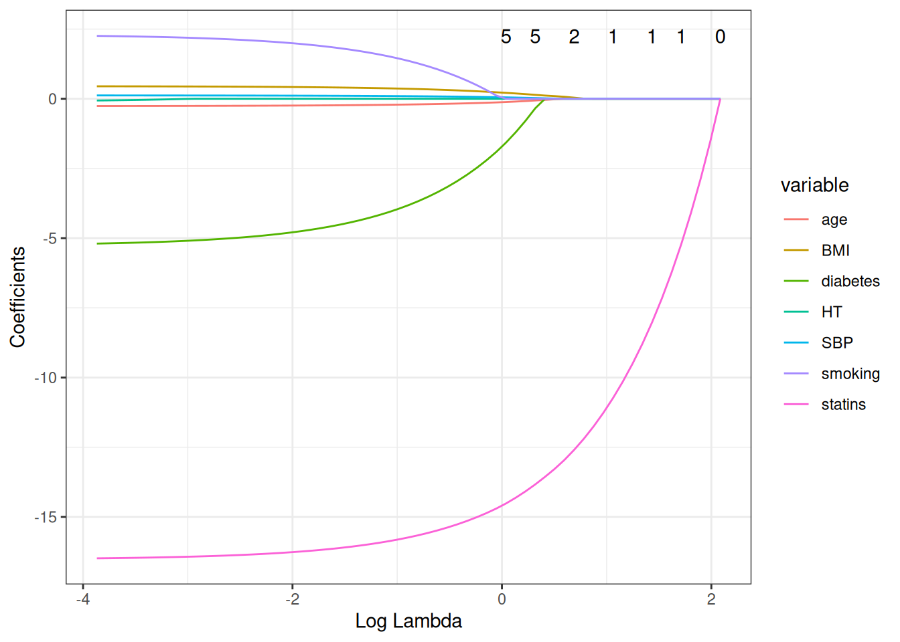
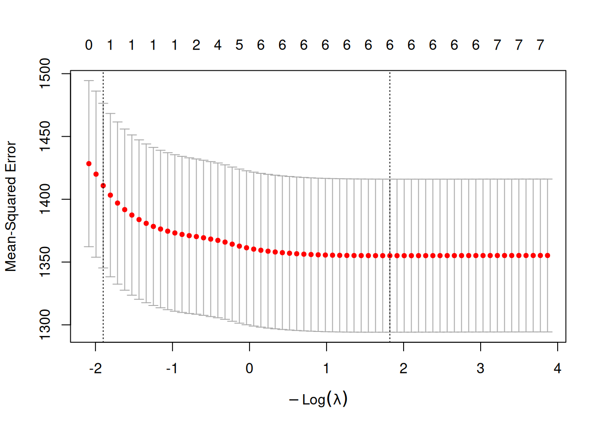

# Predictor Selection

Code

- [Show All Code](javascript:void(0))

- [Hide All Code](javascript:void(0))

- 

  ------------------------------------------------------------------------

- [View Source](javascript:void(0))

Choosing which variables to include in a regression model

Published

Last modified: 2026-11-12: 2:39:08 (UTC)

------------------------------------------------------------------------

# Configuring R

Functions from these packages will be used throughout this document:

Show R code

``` downlit
library(conflicted) # check for conflicting function definitions
# printr is not loaded here: it inserts help-file output into markdown output
library(rmarkdown) # Convert R Markdown documents into a variety of formats.
library(pander) # format tables for markdown
library(ggplot2) # graphics
library(ggfortify) # help with graphics
library(dplyr) # manipulate data
library(tibble) # `tibble`s extend `data.frame`s
library(magrittr) # `%>%` and other additional piping tools
library(haven) # import Stata files
library(knitr) # format R output for markdown
library(tidyr) # Tools to help to create tidy data
library(plotly) # interactive graphics
library(dobson) # datasets from Dobson and Barnett 2018
library(parameters) # format model output tables for markdown
library(haven) # import Stata files
library(latex2exp) # use LaTeX in R code (for figures and tables)
library(fs) # filesystem path manipulations
library(survival) # survival analysis
library(survminer) # survival analysis graphics
library(KMsurv) # datasets from Klein and Moeschberger
library(parameters) # format model output tables for
library(webshot2) # convert interactive content to static for pdf
library(forcats) # functions for categorical variables ("factors")
library(stringr) # functions for dealing with strings
library(lubridate) # functions for dealing with dates and times
# Summarizes key information about statistical objects in tidy tibbles
library(broom)
# Provides suite of functions to work with regression model
# `broom::tidy()` tibbles
library(broom.helpers)
```

Here are some R settings I use in this document:

Show R code

``` downlit
rm(list = ls()) # delete any data that's already loaded into R

conflicts_prefer(dplyr::filter)
ggplot2::theme_set(
  ggplot2::theme_bw() +
    # ggplot2::labs(col = "") +
    ggplot2::theme(
      legend.position = "bottom",
      text = ggplot2::element_text(size = 12, family = "serif")
    )
)

knitr::opts_chunk$set(message = FALSE)
options(digits = 6)

panderOptions("big.mark", ",")
pander::panderOptions("table.emphasize.rownames", FALSE)
pander::panderOptions("table.split.table", Inf)
# use the `filter()` function from dplyr() by default
conflicts_prefer(dplyr::filter)
legend_text_size <- 9
run_graphs <- TRUE
```

# Acknowledgements

This content is adapted from:

- [\[1, Ch. 10\]](#ref-vittinghoff2e)
- [\[2\]](#ref-heinze2018variable)

# 1 Introduction

## 1.1 Why predictor selection matters

In regression modeling, we often have many potential predictors available, but including too many predictors can cause problems:

- **[Overfitting](#def-overfitting)**: the model fits noise in the [training data](https://morrison-lab.github.io/sds/model-validation.html#def-training-set) and predicts poorly for new data.
- **[Multicollinearity](#def-collinearity)**: highly [correlated](https://morrison-lab.github.io/pds/variance-covariance.html#def-correlation) predictors make coefficients unstable and hard to interpret.
- **Loss of precision**: including unnecessary predictors increases [standard errors](https://morrison-lab.github.io/sds/estimation.html#def-SE).

On the other hand, excluding important predictors can lead to:

- **[Confounding](../chapters/causal-inference.llms.md#def-confounding-obs) bias**: omitting a common cause of the exposure and outcome distorts the estimated association.
- **Reduced power**: failing to adjust for strong predictors of the outcome can reduce statistical power.

## 1.2 Strategies for predictor selection

Vittinghoff et al. [\[1, Ch. 10\]](#ref-vittinghoff2e) describes several general approaches to predictor selection:

1.  **Science-driven (purposeful) selection**: Use subject-matter knowledge and a [causal diagram (DAG)](../chapters/causal-inference.llms.md#sec-pred-sel-dag) to identify which variables to include. Science-driven selection is the preferred approach when the goal is causal inference.

2.  **Testing-based selection**: Use statistical tests to decide which predictors to include. Examples include forward selection, backward elimination, and stepwise selection. These methods have well-known problems and should be used with caution (see [Section 7](#sec-pred-sel-stepwise)).

3.  **Criterion-based selection**: Compare models using information criteria such as [AIC](../chapters/Linear-models-overview.llms.md#def-aic) or [BIC](../chapters/Linear-models-overview.llms.md#def-bic). These criteria balance model fit against complexity (see [Section 8](#sec-pred-sel-aic-bic)).

4.  **Penalized regression**: Use regularization methods (such as the LASSO) that shrink coefficients toward zero, effectively performing selection and estimation simultaneously (see [Section 9](#sec-pred-sel-lasso)).

## 1.3 The role of subject-matter knowledge

Regardless of which selection strategy is used, subject-matter knowledge should guide model building.

A regression model can only tell us about *associations* — whether certain predictors are correlated with the outcome in our data. It cannot, on its own, tell us whether those associations reflect causal effects.

To draw causal conclusions, we need:

1.  A causal model (such as a DAG) specifying assumed causal relationships.
2.  Appropriate adjustment for [confounders](../chapters/causal-inference.llms.md#def-confounder).
3.  Careful avoidance of adjusting for [mediators](../chapters/causal-inference.llms.md#def-mediator) or [colliders](../chapters/causal-inference.llms.md#def-collider).

These concepts are discussed in the [causal inference chapter](../chapters/causal-inference.llms.md#sec-pred-sel-dag).

# 2 Inferential Goals

## 2.1 Three inferential goals

The appropriate strategy for predictor selection depends on the inferential goal of the analysis. Vittinghoff et al. [\[1, Ch. 10\]](#ref-vittinghoff2e) distinguishes three distinct goals:

### 2.1.1 Goal 1: Prediction

The primary aim is to minimize [prediction error](https://morrison-lab.github.io/sds/prediction.html#def-prediction-error) for new observations. The predictors’ individual causal interpretations are secondary.

> **NOTE:**
>
> **Example 1** *Example*: Walter et al. [\[3\]](#ref-Walter2001) developed a model to identify older adults at high risk of death following hospitalization, using backward selection on a development set and validating predictions in an independent hospital.

For this goal, we use measures of **prediction error** (PE) to choose among candidate models. [Overfitting](#def-overfitting) — the tendency of flexible models to fit noise — is the central concern. Strategies such as [cross-validation](#def-kfold) and penalized regression (see [Section 4](#sec-pred-sel-prediction) and [Section 9](#sec-pred-sel-lasso)) protect against overfitting.

### 2.1.2 Goal 2: Evaluating a predictor of primary interest

The aim is to obtain a valid, minimally confounded estimate of the association between a specific exposure and the outcome.

> **NOTE:**
>
> **Example 2** *Example*: Grodstein et al. [\[4\]](#ref-Grodstein2001) estimated the effect of hormone therapy on CHD risk in the Nurses’ Health Study (NHS), controlling for a wide range of known CHD risk factors to minimize confounding.

In observational studies, [confounding](../chapters/causal-inference.llms.md#def-confounding-obs) is the primary concern. In randomized trials (like HERS), treatment is already unconfounded by design, but adjusting for strong prognostic covariates can improve precision. DAGs (see the [causal inference chapter](../chapters/causal-inference.llms.md#sec-pred-sel-dag)) are especially useful for this goal.

### 2.1.3 Goal 3: Identifying the important predictors of an outcome

The aim is to discover which predictors are independently associated with the outcome.

> **NOTE:**
>
> **Example 3** *Example*: Orwoll et al. [\[5\]](#ref-Orwoll1996) examined independent predictors of bone mass in the Study of Osteoporotic Fractures (SOF), including all predictors [statistically significant](https://morrison-lab.github.io/sds/inference.html#def-statistically-significant) at $p < 0.05$ in age-adjusted models.

Identifying important predictors is the most challenging goal because inferences about multiple predictors are of direct interest, making false-positive findings and unstable selections particular concerns. Inclusive models with cautious interpretation are preferred (see [Section 6.1](#sec-pred-sel-multiple)).

In practice, these goals often overlap. For example, an analysis can estimate the causal effect of treatment (Goal 2) while also selecting additional prognostic covariates to improve individualized risk prediction performance (Goal 1) in the same model-building workflow.

# 3 Causal Thinking and DAGs

DAG material for this course is covered in the [causal inference chapter](../chapters/causal-inference.llms.md#sec-pred-sel-dag).

For the worked examples, see:

- [The HERS DAG example](../chapters/causal-inference.llms.md#sec-pred-sel-hers-dag)
- [The WCGS DAG example](../chapters/causal-inference.llms.md#sec-pred-sel-wcgs-dag)

# 4 Prediction

> **TIP:**
>
> David Rocke’s Epi 204 lecture [*Prediction and Classification*](https://dmrocke.ucdavis.edu/Class/EPI204-Spring-2021/EPI204-2021-04-20.mp4) ([slides](https://dmrocke.ucdavis.edu/Class/EPI204-Spring-2021/EPI204-6%20Measures%20of%20Classification%20Success.pdf)) covers sensitivity, [specificity](https://morrison-lab.github.io/sds/classification.html#def-specificity), predictive values, and ROC curves for classifying outcomes with a fitted [logistic model](../chapters/logistic-regression.llms.md#def-logistic-regression) [\[6\]](#ref-rocke2021epi204).

## 4.1 Bias–variance trade-off and overfitting

When building a prediction model, adding more predictors generally **reduces [bias](https://morrison-lab.github.io/sds/estimation.html#def-bias)**: the model better captures the true relationships in the population. But it also **increases [variance](https://morrison-lab.github.io/pds/variance-covariance.html#def-variance)**: more parameters to estimate means more sampling variability, and the model can start to fit noise in the [training data](https://morrison-lab.github.io/sds/model-validation.html#def-training-set).

> **NOTE:**
>
> **Definition 1 (Overfitting)** **Overfitting** occurs when a model fits the training data well but predicts poorly for new observations. It results from including too many predictors relative to the effective sample size.

A good prediction model minimizes the sum of bias and variance — the **[bias–variance trade-off](https://morrison-lab.github.io/sds/model-validation.html#def-bias-variance-tradeoff)**. Adding a predictor helps only if the reduction in bias outweighs the increase in variance.

## 4.2 Numerical example of overfitting

[Table 1](#tbl-overfit-example) gives a simple numerical example. A parsimonious model and an intentionally overfit model are both trained on the same [development set](https://morrison-lab.github.io/sds/model-validation.html#def-training-set). The overfit model adds many noise predictors that have no true relationship with LDL.

> **NOTE:**
>
> Show R code
>
> ``` downlit
> set.seed(204)
> n_noise_predictors <- 20
>
> hers_base <-
>   hers_ldl |>
>   dplyr::select(LDL, HT, age, statins) |>
>   tidyr::drop_na()
>
> n_overfit <- nrow(hers_base)
> idx_overfit <- sample(seq_len(n_overfit), size = floor(0.7 * n_overfit))
>
> train_overfit <- hers_base[idx_overfit, ]
> valid_overfit <- hers_base[-idx_overfit, ]
>
> for (j in seq_len(n_noise_predictors)) {
>   zname <- paste0("z", j)
>   train_overfit[[zname]] <- rnorm(nrow(train_overfit))
>   valid_overfit[[zname]] <- rnorm(nrow(valid_overfit))
> }
>
> model_parsimonious <- lm(LDL ~ HT + age + statins, data = train_overfit)
> noise_terms <- paste0("z", seq_len(n_noise_predictors))
> overfit_formula <- reformulate(c("HT", "age", "statins", noise_terms), "LDL")
> model_overfit <- lm(
>   overfit_formula,
>   data = train_overfit
> )
>
> rmse <- function(y, yhat) {
>   sqrt(mean((y - yhat)^2))
> }
>
> tibble::tibble(
>   Model = c(
>     "Parsimonious model",
>     paste0("Overfit model (+", n_noise_predictors, " noise predictors)")
>   ),
>   Training_sRMSE = c(
>     rmse(
>       train_overfit$LDL,
>       predict(model_parsimonious, newdata = train_overfit)
>     ),
>     rmse(train_overfit$LDL, predict(model_overfit, newdata = train_overfit))
>   ),
>   Validation_sRMSE = c(
>     rmse(
>       valid_overfit$LDL,
>       predict(model_parsimonious, newdata = valid_overfit)
>     ),
>     rmse(valid_overfit$LDL, predict(model_overfit, newdata = valid_overfit))
>   )
> ) |>
>   dplyr::mutate(
>     dplyr::across(c(Training_sRMSE, Validation_sRMSE), ~ round(.x, 2))
>   )
> ```
>
> Table 1: Numerical example showing overfitting: lower training error but worse validation error.

In this example, the overfit model usually has lower training [sample root mean squared error (sRMSE)](https://morrison-lab.github.io/sds/estimation.html#def-rmse) but higher validation sRMSE, which is the defining pattern of [overfitting](#def-overfitting).

## 4.3 Measures of prediction error

To select a model that minimizes [prediction error](https://morrison-lab.github.io/sds/prediction.html#def-prediction-error), we need a measure of PE that does not simply increase with the number of predictors.

For **[continuous outcomes](https://morrison-lab.github.io/sds/data.html#def-continuous-var)**:

- **Adjusted** $R^2$ penalizes the number of predictors: $$\bar R^2 = 1 - \frac{n-1}{n-p-1}(1 - R^2)$$ Adding a variable increases $\bar R^2$ only if it reduces the residual variance more than the penalty.

- **[AIC](../chapters/Linear-models-overview.llms.md#def-aic)** and **[BIC](../chapters/Linear-models-overview.llms.md#def-bic)** impose steeper penalties: $$\text{AIC} = -2\hat{\ell} + 2p, \quad
  \text{BIC} = -2\hat{\ell} + p\log n$$ (see [Section 8](#sec-pred-sel-aic-bic)).

For **[binary outcomes](https://morrison-lab.github.io/sds/data.html#def-binary)**, common measures include **balanced accuracy** and the **C-statistic**.

**Balanced accuracy**: $$\text{BA} = \frac{\text{Sensitivity} + \text{Specificity}}{2}$$ where $$\text{Sensitivity} = \Pr(\hat Y = 1 \mid Y = 1), \quad
\text{Specificity} = \Pr(\hat Y = 0 \mid Y = 0).$$ If $J$ is **Youden’s** $J$ statistic, $$J = \text{Sensitivity} + \text{Specificity} - 1,$$ then $$\text{BA} = \frac{J + 1}{2}.$$ So BA is a linear transformation of $J$, and BA and $J$ are equivalent for comparing models.

**C-statistic** (area under the ROC curve, AUC): $$\begin{aligned}
C \stackrel{\text{def}}{=}{} & \Pr(\hat{\pi}_i > \hat{\pi}_j \mid Y_i = 1, Y_j = 0) \\
& + \frac{1}{2}\Pr(\hat{\pi}_i = \hat{\pi}_j \mid Y_i = 1, Y_j = 0)
\end{aligned}$$ where $\hat{\pi}$ is the predicted event probability. An empirical estimator is $$\hat{C}
= \frac{1}{n_1 n_0}
\sum_{i:Y_i=1}
\sum_{j:Y_j=0}
\mathopen{}\left[
I(\hat{\pi}_i > \hat{\pi}_j)
+ \frac{1}{2}I(\hat{\pi}_i = \hat{\pi}_j)
\right]\mathclose{}.$$ It measures discrimination: the model’s ability to rank events above non-events.

For **survival outcomes**, the analogous measure is the **C-index**, defined as $$\hat C_{\text{index}}
= \frac{N_{\text{concordant}} + 0.5\,N_{\text{tied}}}
{N_{\text{comparable}}},$$ where pairs are comparable when one subject is observed to fail before the other is known to fail or be [censored](../chapters/intro-to-survival-analysis.llms.md#def-right-censor), and concordance means the subject with earlier failure has the higher predicted [risk score](../chapters/proportional-hazards-models.llms.md#def-risk-score).

## 4.4 Optimism and cross-validation

Naive estimates of PE evaluated on the same data used to fit the model are **optimistic**: they overstate the model’s ability to predict new data. For example, $R^2$ always increases when a predictor is added, even if the predictor is pure noise.

**Cross-validation** provides a less optimistic estimate of PE by evaluating predictions on observations not used to estimate the model.

> **NOTE:**
>
> **Definition 2 (**$k$-fold cross-validation) In $k$-fold cross-validation:
>
> 1.  The data are randomly divided into $k$ equal-sized subsets (“folds”).
> 2.  For each fold $i = 1, \ldots, k$:
>     - Fit the model using all data *except* fold $i$.
>     - Compute [predicted values](../chapters/Linear-models-overview.llms.md#def-predicted-value) for the observations in fold $i$.
> 3.  Compute a summary PE measure across all folds.

> **NOTE:**
>
> *Remark 1* (Typical values of $k$). Values of $k = 5$ or $k = 10$ are typical.

Using cross-validation to select predictors avoids overfitting because the predictive performance is evaluated on [held-out data](https://morrison-lab.github.io/sds/model-validation.html#def-held-out-set) that did not influence the model fit.

## 4.5 Cross-validation for LASSO in the HERS data

The LASSO (see [Section 9](#sec-pred-sel-lasso)) uses [cross-validation](#def-kfold) to select the [penalty parameter](https://morrison-lab.github.io/sds/model-validation.html#def-tuning-parameter) $\lambda$ that minimizes prediction error. The `cv.glmnet` function implements 10-fold cross-validation, fitting the LASSO for a grid of $\lambda$ values and evaluating [mean squared error](https://morrison-lab.github.io/sds/prediction.html#def-prediction-mse) on held-out folds. The fitted object provides two key $\lambda$ values: `lambda.min` (minimizes CV mean squared error) and `lambda.1se` (largest $\lambda$ within [one standard error](https://morrison-lab.github.io/sds/model-validation.html#def-one-se-rule) of the minimum). See [Section 9](#sec-pred-sel-lasso) for the HERS example with coefficient paths and CV results.

The two recommended values of $\lambda$ represent different points on the [bias–variance trade-off](https://morrison-lab.github.io/sds/model-validation.html#def-bias-variance-tradeoff):

- `lambda.min` minimizes cross-validated sample mean squared error (sMSE), yielding a model with good predictive accuracy.
- `lambda.1se` uses a larger penalty (farther from zero, more shrinkage), resulting in a sparser, more conservative model that is often preferred for interpretability.

## 4.6 Development and validation sets

The most transparent approach to measuring prediction error is to split the data into a **[development set](https://morrison-lab.github.io/sds/model-validation.html#def-training-set)** (used to fit the model) and a **[validation set](https://morrison-lab.github.io/sds/model-validation.html#def-validation-set)** (used only to evaluate predictions).

When a single data set must be split, a common allocation is two-thirds to development and one-third to validation. External validation using a completely independent sample (from a different time period or study site) provides the most rigorous assessment of generalizability.

Show R code

``` downlit
set.seed(42)
n_hers <- nrow(hers_ldl)
train_idx <- sample(seq_len(n_hers), size = floor(0.67 * n_hers))

hers_train <- hers_ldl[train_idx, ]
hers_valid <- hers_ldl[-train_idx, ]

# Fit model on training data
model_train <- lm(
  LDL ~ HT + age + BMI + diabetes + statins,
  data = hers_train
)

# Evaluate on validation data
pred_valid <- predict(model_train, newdata = hers_valid)
rmse_valid <- sqrt(mean((hers_valid$LDL - pred_valid)^2, na.rm = TRUE))
rmse_train <- sqrt(mean(residuals(model_train)^2))

cat(
  "Training sRMSE:", round(rmse_train, 2), "\n",
  "Validation sRMSE:", round(rmse_valid, 2), "\n"
)
#> Training sRMSE: 36.78 
#>  Validation sRMSE: 36.85
```

If the validation sRMSE is much larger than the training sRMSE, this discrepancy is a sign of overfitting. In well-specified models with adequate sample sizes, the two values are typically close.

# 5 Evaluating a Predictor of Primary Interest

## 5.1 Evaluating a predictor of primary interest

When the goal is to estimate the causal effect of a specific exposure on an outcome, the central challenge in observational data is **[confounding](../chapters/causal-inference.llms.md#def-confounding-obs)**. Relatively inclusive models — those including more potential confounders — are better at minimizing confounding bias.

The following principles guide predictor selection for this goal.

## 5.2 Including predictors for face validity

Some predictors are such well-established causal antecedents of the outcome that they should be included regardless of their [statistical significance](https://morrison-lab.github.io/sds/inference.html#def-statistically-significant) in the current data. Including these variables ensures the **face validity** of the model: readers and reviewers can be confident that obvious [confounders](../chapters/causal-inference.llms.md#def-confounder) have been accounted for.

For example, age and smoking are established CHD risk factors and would be included in any model for CHD outcomes, even if they are not statistically significant in a small sample.

## 5.3 Selecting confounders on statistical grounds

In addition to variables included for face validity, we may consider other potential [confounders](../chapters/causal-inference.llms.md#def-confounder) identified in previous studies or on substantive grounds.

A practical approach is **backward selection with a liberal criterion**:

1.  Start with a full model including all pre-specified candidates.
2.  At each step, remove the predictor with the largest [p-value](https://morrison-lab.github.io/sds/inference.html#def-p-value), provided it exceeds a liberal threshold (e.g., $p > 0.2$).
3.  Stop when all remaining predictors meet the retention criterion.

The liberal threshold ($p > 0.2$ rather than $p > 0.05$) is important for confounding control: in small samples, even important confounders may have large p-values, and removing them could introduce [bias](https://morrison-lab.github.io/sds/estimation.html#def-bias).

An alternative retention criterion is the **10% change-in-estimate rule** [\[7, Ch. 8\]](#ref-kleinbaum2010logistic), pp. 194–212, [\[1, Ch. 10\]](#ref-vittinghoff2e), pp. 257–275, [\[8, p. 125\]](#ref-MickeyGreenland1989), [\[9, p. 340\]](#ref-Greenland1989Modeling):

Retain a candidate confounder $C$ in the model if dropping it changes the estimated coefficient for the primary predictor by more than 10–15%.

More precisely, let $\hat\beta$ be the estimated coefficient for the exposure from the **full model** (including $C$), and let $\hat\beta_0$ be the estimate from the **reduced model** (dropping $C$). Then $C$ is judged a meaningful confounder if:

$$\mathopen{}\left| \frac{\hat\beta - \hat\beta_0}{\hat\beta} \right|\mathclose{} > 0.10$$

The threshold is often taken as 10–20%, depending on the context. A smaller threshold (e.g., 10%) retains more variables; a larger threshold (e.g., 20%) allows more aggressive pruning.

> **NOTE:**
>
> The 10% change-in-estimate rule focuses on **bias** rather than **statistical significance**. A variable can be a meaningful confounder even if it is not statistically significant (because of small sample size or measurement error), and conversely, a statistically significant variable may cause negligible confounding. The p-value criterion and the change-in-estimate rule can disagree, and Vittinghoff et al. [\[1\]](#ref-vittinghoff2e) recommends using both as complementary checks.

### 5.3.1 Numerical example: 10% rule in WCGS

The WCGS (Western Collaborative Group Study) is an observational prospective cohort of 3,154 men followed for CHD events. Unlike HERS (a randomized trial), the WCGS exposure — Type A behavior pattern — was not randomly assigned, so [confounding](../chapters/causal-inference.llms.md#def-confounding-obs) is a genuine concern.

In the WCGS study, the exposure of interest is Type A behavior pattern (`dibpat`), and the outcome is CHD incidence (`chd69`). We fit [logistic regression](../chapters/logistic-regression.llms.md#def-logistic-regression) models and apply the 10% change-in-estimate rule to assess whether age, cholesterol, SBP, and BMI are meaningful confounders of the Type A → CHD relationship, while also examining smoking as an additional covariate.

Adapted from Kleinbaum and Klein [\[7, Ch. 8\]](#ref-kleinbaum2010logistic), which describes the change-in-estimate procedure for logistic regression models.

Show R code

``` downlit
wcgs <- rmb::wcgs |> haven::as_factor()
wcgs$dibpat <- stats::relevel(wcgs$dibpat, ref = "Type B")
```

Show R code

``` downlit
# Full model (all candidate confounders)
m_full <- glm(
  I(chd69 == "Yes") ~ dibpat + age + chol + sbp + smoke + bmi,
  data = wcgs,
  family = binomial
)

# Unadjusted model (Type A only)
m_unadj <- glm(
  I(chd69 == "Yes") ~ dibpat,
  data = wcgs,
  family = binomial
)

# Estimate of Type A effect from full model
beta_full <- coef(m_full)["dibpatType A"]
beta_unadj <- coef(m_unadj)["dibpatType A"]

# Models dropping one confounder at a time
confounders <- c("age", "chol", "sbp", "smoke", "bmi")

results <- lapply(confounders, function(v) {
  f <- as.formula(
    paste("I(chd69 == \"Yes\") ~ dibpat +",
          paste(setdiff(confounders, v), collapse = " + "))
  )
  m_red <- glm(f, data = wcgs, family = binomial)
  beta_red <- coef(m_red)["dibpatType A"]
  pct_change <- abs((beta_full - beta_red) / beta_full) * 100
  data.frame(
    Confounder = v,
    Beta_full = round(beta_full, 4),
    Beta_reduced = round(beta_red, 4),
    Pct_change = round(pct_change, 1),
    Meaningful = ifelse(pct_change > 10, "Yes (>10%)", "No (<=10%)")
  )
})

results_df <- do.call(rbind, results)
rownames(results_df) <- NULL
```

> **NOTE:**
>
> Show R code
>
> ``` downlit
> knitr::kable(
>   results_df,
>   col.names = c(
>     "Dropped variable",
>     "β (full model)",
>     "β (reduced model)",
>     "% change",
>     "Meaningful confounder?"
>   )
> )
> ```
>
> | Dropped variable | β (full model) | β (reduced model) | % change | Meaningful confounder? |
> |:---|---:|---:|---:|:---|
> | age | 0.6972 | 0.7420 | 6.4 | No (\<=10%) |
> | chol | 0.6972 | 0.7183 | 3.0 | No (\<=10%) |
> | sbp | 0.6972 | 0.7303 | 4.8 | No (\<=10%) |
> | smoke | 0.6972 | 0.7242 | 3.9 | No (\<=10%) |
> | bmi | 0.6972 | 0.7031 | 0.8 | No (\<=10%) |
>
> Table 2: 10% change-in-estimate rule applied to the WCGS data. The Type A coefficient from the full model is compared with coefficients from models that drop one confounder at a time. A percentage change exceeding 10% indicates meaningful confounding.

In this example, none of the individual confounders causes a \>10% change when dropped, suggesting they are not individually strong confounders of the Type A → CHD relationship in WCGS. Comparing the unadjusted log-OR for Type A ($\approx$ 0.86) with the fully adjusted log-OR ($\approx$ 0.7) shows that the overall set of covariates provides modest adjustment. In practice, covariates with established biological relationships to the outcome (such as age, smoking, and blood pressure for CHD) are typically retained regardless of the change-in-estimate result, for reasons of face validity.

When multiple covariates are candidates for removal, checking all possible subsets is often impractical. A practical alternative is a backward-elimination procedure guided jointly by the 10% rule and precision.

At each step:

1.  Start from the current model.
2.  Fit models that drop one remaining candidate covariate at a time.
3.  Keep only candidates with absolute percent change from the full-model exposure coefficient no larger than 10%, where the full-model coefficient is always from the original gold-standard model.
4.  Among those candidates, drop the covariate that gives the largest reduction in the exposure coefficient’s [standard error](https://morrison-lab.github.io/sds/estimation.html#def-SE).
5.  Repeat until no remaining covariate can be dropped without either exceeding the 10% threshold or increasing the exposure standard error.

``` downlit
beta_full <- coef(m_full)["dibpatType A"]
se_full <- sqrt(vcov(m_full)["dibpatType A", "dibpatType A"])
exposure_var <- "dibpat"

current_covars <- confounders
current_se <- se_full
step_num <- 1
bwe_steps <- list()

repeat {
  candidate_results <- lapply(current_covars, function(v) {
    keep_covars <- setdiff(current_covars, v)
    reduced_formula <- if (length(keep_covars) == 0) {
      as.formula("I(chd69 == \"Yes\") ~ dibpat")
    } else {
      as.formula(
        paste(
          "I(chd69 == \"Yes\") ~",
          paste(c(exposure_var, keep_covars), collapse = " + ")
        )
      )
    }

    m_red <- glm(reduced_formula, data = wcgs, family = binomial)
    beta_red <- coef(m_red)["dibpatType A"]
    se_red <- sqrt(vcov(m_red)["dibpatType A", "dibpatType A"])
    pct_change <- abs((beta_full - beta_red) / beta_full) * 100
    se_reduction <- current_se - se_red

    data.frame(
      Step = step_num,
      Candidate_drop = v,
      Beta_reduced = beta_red,
      Pct_change_from_full = pct_change,
      SE_reduced = se_red,
      SE_reduction = se_reduction,
      Eligible = pct_change <= 10 & se_reduction > 0
    )
  })

  candidates_df <- do.call(rbind, candidate_results)
  eligible_df <- candidates_df[candidates_df$Eligible, , drop = FALSE]

  if (nrow(eligible_df) == 0) {
    break
  }

  best_idx <- which.max(eligible_df$SE_reduction)
  best_drop <- eligible_df[best_idx, , drop = FALSE]
  dropped_var <- as.character(best_drop$Candidate_drop)

  bwe_steps[[step_num]] <- data.frame(
    Step = step_num,
    Dropped = dropped_var,
    Pct_change_from_full = round(best_drop$Pct_change_from_full, 1),
    SE_before = round(current_se, 4),
    SE_after = round(best_drop$SE_reduced, 4),
    SE_reduction = round(best_drop$SE_reduction, 4)
  )

  current_covars <- setdiff(current_covars, dropped_var)
  current_se <- best_drop$SE_reduced
  step_num <- step_num + 1
}

bwe_steps_df <- if (length(bwe_steps) == 0) {
  data.frame(
    Step = NA_integer_,
    Dropped = "None",
    Pct_change_from_full = NA_real_,
    SE_before = round(se_full, 4),
    SE_after = round(se_full, 4),
    SE_reduction = 0
  )
} else {
  do.call(rbind, bwe_steps)
}

retained_covars <- current_covars
```

> **NOTE:**
>
> Show R code
>
> ``` downlit
> knitr::kable(
>   bwe_steps_df,
>   col.names = c(
>     "Step",
>     "Dropped covariate",
>     "% change from full model",
>     "SE before drop",
>     "SE after drop",
>     "SE reduction"
>   )
> )
> ```
>
> | Step | Dropped covariate | % change from full model | SE before drop | SE after drop | SE reduction |
> |---:|:---|---:|---:|---:|---:|
> | 1 | chol | 3.0 | 0.1444 | 0.1430 | 0.0013 |
> | 2 | sbp | 8.4 | 0.1430 | 0.1422 | 0.0008 |
>
> Table 3: Backward elimination under the 10% change-in-estimate rule, with standard-error reduction used to choose among eligible drops. The reference for the percent-change criterion is always the Type A coefficient in the original full model.

For further reading on model selection strategies in epidemiologic analyses, see Vittinghoff et al. [\[1, Ch. 10\]](#ref-vittinghoff2e), pp. 257–275, Kleinbaum and Klein [\[7, Ch. 6–8\]](#ref-kleinbaum2010logistic), and Rothman et al. [\[10, Ch. 21\]](#ref-me4), section “Model Selection”.

> **NOTE:**
>
> Unlike [collinearity](#def-collinearity) between a predictor of primary interest and other covariates (which inflates its standard error), collinearity *among* adjustment variables does not affect the precision of the primary predictor’s estimate. Thus, two collinear confounders can both be retained if both are judged necessary on substantive grounds.

## 5.4 Example: backward selection for CHD confounders

In the HERS data, we can use backward selection to identify which baseline covariates confound the effect of hormone therapy on LDL. Since HT was randomized in HERS, adjustment is needed for precision, not confounding; but this toy example illustrates the procedure.

Show R code

``` downlit
full_model <- lm(
  LDL ~ HT + age + BMI + diabetes + smoking + statins + SBP,
  data = hers_ldl
)

# Backward selection using AIC
back_model <- MASS::stepAIC(full_model, direction = "backward", trace = FALSE)
summary(back_model)
#> 
#> Call:
#> lm(formula = LDL ~ age + BMI + diabetes + statins + SBP, data = hers_ldl)
#> 
#> Residuals:
#>     Min      1Q  Median      3Q     Max 
#> -103.69  -24.08   -3.45   19.33  241.89 
#> 
#> Coefficients:
#>             Estimate Std. Error t value Pr(>|t|)    
#> (Intercept) 142.6424     9.2977   15.34   <2e-16 ***
#> age          -0.2881     0.1087   -2.65   0.0081 ** 
#> BMI           0.4349     0.1337    3.25   0.0012 ** 
#> diabetesYes  -5.3946     1.6742   -3.22   0.0013 ** 
#> statinsYes  -16.6397     1.4603  -11.40   <2e-16 ***
#> SBP           0.1232     0.0379    3.25   0.0012 ** 
#> ---
#> Signif. codes:  0 '***' 0.001 '**' 0.01 '*' 0.05 '.' 0.1 ' ' 1
#> 
#> Residual standard error: 36.8 on 2741 degrees of freedom
#>   (5 observations deleted due to missingness)
#> Multiple R-squared:  0.0565, Adjusted R-squared:  0.0548 
#> F-statistic: 32.8 on 5 and 2741 DF,  p-value: <2e-16
```

The backward selection procedure retains the predictors that most improve model fit according to [AIC](../chapters/Linear-models-overview.llms.md#def-aic). In this setting, since HT was randomized, we interpret the selected set as prognostic covariates that improve precision of the HT estimate, not as confounders.

## 5.5 Interactions with the primary predictor

A useful check on the validity of the selected model is to test for **interactions** between the primary predictor and key covariates. Particularly for novel findings, showing that the association is consistent across subgroups strengthens credibility.

If a substantial and biologically plausible interaction is found, the analysis must account for it. However, exploratory interaction tests are susceptible to false-positive findings, and unexpected interactions should be interpreted cautiously.

## 5.6 Randomized experiments

In randomized trials, participants are allocated to treatment randomly, so the treatment indicator is by design [uncorrelated](https://morrison-lab.github.io/pds/variance-covariance.html#def-uncorrelated) with pre-treatment covariates in expectation. [Confounding](../chapters/causal-inference.llms.md#def-confounding-obs) adjustment is therefore **not required** for causal inference.

However, there are several reasons to include covariates in trial analyses:

1.  **Improving precision** ([continuous outcomes](https://morrison-lab.github.io/sds/data.html#def-continuous-var)). Adjusting for strong predictors of the outcome reduces residual variance and tightens the treatment effect estimate. Because treatment is uncorrelated with the covariates by randomization, [variance inflation](#sec-pred-sel-vif) is negligible.

2.  **De-attenuation** (binary and survival outcomes). In logistic and [Cox models](../chapters/proportional-hazards-models.llms.md#def-ph-model), omitting important predictors attenuates the treatment effect estimate. Adjusting for them moves the estimate closer to the true subject-specific effect.

3.  **Accounting for stratified designs**. In stratified or cluster-randomized trials, including stratification variables in the model yields correct [standard errors](https://morrison-lab.github.io/sds/estimation.html#def-SE) and [p-values](https://morrison-lab.github.io/sds/inference.html#def-p-value).

4.  **Correcting for chance imbalances**. In small trials, randomization may leave residual imbalance in important prognostic covariates. Adjusted analyses demonstrate that the main inference is not materially affected by any such imbalance.

> **NOTE:**
>
> Adjusted analyses in clinical trials should ideally be **pre-specified in the study protocol**, to prevent post-hoc selection of covariates that minimize the treatment effect p-value.

# 6 Identifying Multiple Important Predictors

## 6.1 Identifying multiple important predictors

When the goal is to identify *all* important predictors of an outcome (Goal 3, [Section 2.1](#sec-pred-sel-goals)), [confounding](../chapters/causal-inference.llms.md#def-confounding-obs) remains a primary concern for each predictor in turn, not just a single primary predictor of interest.

This goal is the most challenging because:

- [Overfitting](#def-overfitting) and false-positive results are a greater concern (many predictors, many opportunities for spurious findings).
- Interactions among candidate predictors may be of interest, but systematically testing all possible interactions can easily produce false positives.
- [Collinear](#def-collinearity) predictors may be difficult to disentangle.

The same strategies recommended for Goal 2 (face validity, backward selection with liberal criterion) also apply here. However, cautious interpretation of novel and borderline findings becomes even more important.

## 6.2 Allen–Cady modified backward selection

A modified backward selection procedure due to Allen and Cady [\[11\]](#ref-AllenCady1982) limits false-positive findings while still allowing variable selection.

The procedure works as follows:

1.  **Specify** a set of variables to be forced into the model: predictors of primary interest and variables needed for face validity.
2.  **Rank** the remaining candidate variables in order of hypothesized importance.
3.  Start with a model containing all variables in both sets.
4.  Delete variables from the ranked set in order of **ascending importance** (least important first), stopping as soon as the first variable that meets the retention criterion is encountered.

This procedure limits false positives because there is a single pre-specified deletion sequence, and selection stops at the first retained variable. In contrast, conventional backward selection considers *all* remaining predictors at each step, producing many more potential opportunities for false findings.

## 6.3 Cautious interpretation

For Goal 3 analyses, we do **not** recommend using only predictors significant at $p < 0.05$: in small samples, even important predictors may fail to meet this threshold, and a parsimonious model may have substantial residual [confounding](../chapters/causal-inference.llms.md#def-confounding-obs).

Instead, the recommended approach is:

- Use a relatively **inclusive model** (liberal backward selection criterion: $p < 0.2$).
- Interpret **novel, weak, and borderline significant** associations cautiously.
- Report the **full list of candidate covariates** considered, including those ultimately excluded.
- Acknowledge inflated type-I error as a study limitation.

## 6.4 Example: risk factors for CHD in HERS

Vittinghoff et al. [\[12\]](#ref-Vittinghoff2003) identified independent CHD risk factors in the HERS cohort using a multipredictor [Cox model](../chapters/proportional-hazards-models.llms.md#def-ph-model). The large number of outcome events ($n = 361$) allowed all previously identified risk factors with $p < 0.2$ in unadjusted models to be included.

Among 11 predictors retained as important on both substantive and statistical grounds were: ethnicity, exercise habits, diabetes, angina, congestive heart failure, prior heart attacks, blood pressure, LDL, HDL, Lp(a), and creatinine clearance.

The model also controlled for age, smoking, alcohol use, and obesity (not statistically significant after adjustment) to rule out confounding and ensure face validity.

# 7 Testing-based selection

> **TIP:**
>
> David Rocke’s Epi 204 lecture [*Variable Selection and Model Choice*](https://dmrocke.ucdavis.edu/Class/EPI204-Spring-2021/EPI204-2021-04-08.mp4) ([slides](https://dmrocke.ucdavis.edu/Class/EPI204-Spring-2021/EPI204-4%20Variable%20Selection%20and%20Model%20Choice.pdf)) covers comparing logistic models with [`drop1()`](https://rdrr.io/r/stats/add1.html), [`add1()`](https://rdrr.io/r/stats/add1.html), [AIC](../chapters/Linear-models-overview.llms.md#def-aic), and [BIC](../chapters/Linear-models-overview.llms.md#def-bic), stepwise selection with [`step()`](https://rdrr.io/r/stats/step.html), and how heavy variable selection produces spurious findings and [overfitting](#def-overfitting) [\[6\]](#ref-rocke2021epi204).

Testing-based selection methods use statistical tests (such as [F-tests](../chapters/Linear-models-overview.llms.md#sec-partial-F-test) or [likelihood ratio tests](../chapters/logistic-regression.llms.md#def-lrt)) to decide which predictors to include in a model.

## 7.1 Stepwise regression

> **WARNING:**
>
> Stepwise regression has well-known problems:
>
> - It tends to select too many variables ([overfitting](#def-overfitting)).
> - [P-values](https://morrison-lab.github.io/sds/inference.html#def-p-value) and [confidence intervals](https://morrison-lab.github.io/sds/inference.html#def-confidence-interval) are [biased](https://morrison-lab.github.io/sds/estimation.html#def-bias) after selection.
> - It ignores model uncertainty.
> - Results can be unstable across different samples.
>
> Consider using subject-matter knowledge ([DAGs](../chapters/causal-inference.llms.md#sec-pred-sel-dag)), [cross-validation](#def-kfold), or penalized methods (such as [LASSO](#sec-pred-sel-lasso)) instead. See Heinze et al. [\[2\]](#ref-heinze2018variable) for a thorough review.

The basic idea of stepwise selection:

- **Forward selection**: Start with no predictors; add the predictor that most improves model fit at each step.
- **Backward elimination**: Start with all predictors; remove the predictor that least worsens model fit at each step.
- **Bidirectional stepwise**: Combine forward and backward steps.

## 7.2 Example: stepwise selection for LDL

Show R code

``` downlit
# Full model with all candidate predictors
full_model_ldl <- lm(
  LDL ~ HT + age + BMI + diabetes + smoking + statins + SBP,
  data = hers_ldl
)

# Backward elimination using AIC
step_model_ldl <- step(
  full_model_ldl,
  direction = "backward",
  trace = 0
)

summary(step_model_ldl)
#> 
#> Call:
#> lm(formula = LDL ~ age + BMI + diabetes + statins + SBP, data = hers_ldl)
#> 
#> Residuals:
#>     Min      1Q  Median      3Q     Max 
#> -103.69  -24.08   -3.45   19.33  241.89 
#> 
#> Coefficients:
#>             Estimate Std. Error t value Pr(>|t|)    
#> (Intercept) 142.6424     9.2977   15.34   <2e-16 ***
#> age          -0.2881     0.1087   -2.65   0.0081 ** 
#> BMI           0.4349     0.1337    3.25   0.0012 ** 
#> diabetesYes  -5.3946     1.6742   -3.22   0.0013 ** 
#> statinsYes  -16.6397     1.4603  -11.40   <2e-16 ***
#> SBP           0.1232     0.0379    3.25   0.0012 ** 
#> ---
#> Signif. codes:  0 '***' 0.001 '**' 0.01 '*' 0.05 '.' 0.1 ' ' 1
#> 
#> Residual standard error: 36.8 on 2741 degrees of freedom
#>   (5 observations deleted due to missingness)
#> Multiple R-squared:  0.0565, Adjusted R-squared:  0.0548 
#> F-statistic: 32.8 on 5 and 2741 DF,  p-value: <2e-16
```

# 8 Criterion-based selection

## 8.1 AIC and BIC

When comparing non-nested models, we can use information criteria:

- **AIC** ([Akaike Information Criterion](../chapters/Linear-models-overview.llms.md#def-aic)): $$\text{AIC} = -2\,\hat{\ell} + 2p$$
- **BIC** ([Bayesian Information Criterion](../chapters/Linear-models-overview.llms.md#def-bic)): $$\text{BIC} = -2\,\hat{\ell} + p\log n$$

where $\hat{\ell}$ is the maximized [log-likelihood](https://morrison-lab.github.io/sds/intro-MLEs.html#def-loglik), $p$ is the number of model parameters, and $n$ is the sample size.

Lower values of AIC or BIC indicate a better model. BIC applies a larger penalty for model complexity, especially for large $n$.

> **NOTE:**
>
> **Example 4 (Comparing two models by AIC and BIC)** Suppose two candidate models are fit to the same $n = 100$ observations. Model A has $p = 3$ parameters and maximized log-likelihood $\hat{\ell}_A = -120.0$, while model B has $p = 5$ parameters and $\hat{\ell}_B = -118.5$. Then
>
> $$\begin{aligned}
> \text{AIC}_A
> &= -2(-120.0) + 2 \cdot 3
> && \text{(AIC formula)} \\
> &= 240 + 6
> && \text{(multiply)} \\
> &= 246
> && \text{(add)} \\
> \text{AIC}_B
> &= -2(-118.5) + 2 \cdot 5
> && \text{(AIC formula)} \\
> &= 237 + 10
> && \text{(multiply)} \\
> &= 247
> && \text{(add)}
> \end{aligned}$$
>
> and, with ${\operatorname{log}\mathopen{}\left\{100\right\}\mathclose{}} \approx 4.605$,
>
> $$\begin{aligned}
> \text{BIC}_A
> &= 240 + 3 {\operatorname{log}\mathopen{}\left\{100\right\}\mathclose{}}
> && \text{(BIC formula)} \\
> &\approx 240 + 13.82
> && \text{(multiply)} \\
> &= 253.82
> && \text{(add)} \\
> \text{BIC}_B
> &= 237 + 5 {\operatorname{log}\mathopen{}\left\{100\right\}\mathclose{}}
> && \text{(BIC formula)} \\
> &\approx 237 + 23.03
> && \text{(multiply)} \\
> &= 260.03
> && \text{(add)}
> \end{aligned}$$
>
> Both criteria prefer model A. Model B fits better ($\hat{\ell}_B > \hat{\ell}_A$), but the penalty for its two extra parameters is larger than the gain from that better fit. The AIC difference is only 1, which is negligible, while the BIC difference of about 6.2 favors model A more clearly, because BIC charges ${\operatorname{log}\mathopen{}\left\{100\right\}\mathclose{}} \approx 4.6$ per parameter instead of 2.

> **NOTE:**
>
> **Theorem 1 (Information criteria as likelihood ratio thresholds)** Let model $M_0$ be nested in model $M_1$, with $M_1$ having $k$ more parameters than $M_0$, both fit by maximum likelihood to the same $n$ observations, and let $G^2 \stackrel{\text{def}}{=}2\mathopen{}\left(\hat{\ell}_1 - \hat{\ell}_0\right)\mathclose{}$ be the [likelihood ratio test statistic](../chapters/logistic-regression.llms.md#def-lrt-statistic) comparing them. Then
>
> $$\text{AIC}_1 < \text{AIC}_0
> \quad \text{if and only if} \quad
> G^2 > 2k$$
>
> and
>
> $$\text{BIC}_1 < \text{BIC}_0
> \quad \text{if and only if} \quad
> G^2 > k {\operatorname{log}\mathopen{}\left\{n\right\}\mathclose{}}$$

> **NOTE:**
>
> *Proof*. Let $M_0$ have $p$ parameters, so $M_1$ has $p + k$. For AIC:
>
> $$\begin{aligned}
> \text{AIC}_0 - \text{AIC}_1
> &= \mathopen{}\left(-2 \hat{\ell}_0 + 2p\right)\mathclose{} - \mathopen{}\left(-2 \hat{\ell}_1 + 2(p + k)\right)\mathclose{}
> && \text{(AIC formula for each model)} \\
> &= 2 \hat{\ell}_1 - 2 \hat{\ell}_0 + 2p - 2p - 2k
> && \text{(distribute the subtraction)} \\
> &= 2\mathopen{}\left(\hat{\ell}_1 - \hat{\ell}_0\right)\mathclose{} - 2k
> && \text{(cancel } 2p \text{; factor out 2)} \\
> &= G^2 - 2k
> && \text{(definition of } G^2 \text{)}
> \end{aligned}$$
>
> so $\text{AIC}_1 < \text{AIC}_0$ exactly when $G^2 - 2k > 0$, that is, when $G^2 > 2k$. The BIC calculation is the same with each penalty $2$ replaced by ${\operatorname{log}\mathopen{}\left\{n\right\}\mathclose{}}$:
>
> $$\begin{aligned}
> \text{BIC}_0 - \text{BIC}_1
> &= \mathopen{}\left(-2 \hat{\ell}_0 + p {\operatorname{log}\mathopen{}\left\{n\right\}\mathclose{}}\right)\mathclose{} - \mathopen{}\left(-2 \hat{\ell}_1 + (p + k) {\operatorname{log}\mathopen{}\left\{n\right\}\mathclose{}}\right)\mathclose{}
> && \text{(BIC formula for each model)} \\
> &= 2 \hat{\ell}_1 - 2 \hat{\ell}_0 + p {\operatorname{log}\mathopen{}\left\{n\right\}\mathclose{}} - p {\operatorname{log}\mathopen{}\left\{n\right\}\mathclose{}} - k {\operatorname{log}\mathopen{}\left\{n\right\}\mathclose{}}
> && \text{(distribute the subtraction)} \\
> &= 2\mathopen{}\left(\hat{\ell}_1 - \hat{\ell}_0\right)\mathclose{} - k {\operatorname{log}\mathopen{}\left\{n\right\}\mathclose{}}
> && \text{(cancel } p {\operatorname{log}\mathopen{}\left\{n\right\}\mathclose{}} \text{; factor out 2)} \\
> &= G^2 - k {\operatorname{log}\mathopen{}\left\{n\right\}\mathclose{}}
> && \text{(definition of } G^2 \text{)}
> \end{aligned}$$
>
> so $\text{BIC}_1 < \text{BIC}_0$ exactly when $G^2 > k {\operatorname{log}\mathopen{}\left\{n\right\}\mathclose{}}$.

> **NOTE:**
>
> **Example 5 (The significance levels implied by AIC and BIC)** Suppose model A in [Example 4](#exm-aic-bic-compare) is nested in model B, so model B adds $k = 2$ parameters. The likelihood ratio statistic is
>
> $$\begin{aligned}
> G^2
> &= 2\mathopen{}\left(-118.5 - (-120.0)\right)\mathclose{}
> && \text{(definition of } G^2 \text{)} \\
> &= 2 \cdot 1.5
> && \text{(subtract)} \\
> &= 3
> && \text{(multiply)}
> \end{aligned}$$
>
> By [Theorem 1](#thm-aic-lrt), AIC prefers model B only if $G^2 > 2k = 4$, and BIC (with $n = 100$) only if $G^2 > 2 {\operatorname{log}\mathopen{}\left\{100\right\}\mathclose{}} \approx 9.21$. Since $G^2 = 3$ clears neither threshold, both criteria prefer model A, matching [Example 4](#exm-aic-bic-compare).
>
> Under $H_0$ (the $k = 2$ extra parameters are zero), $G^2$ approximately follows a $\chi^2_2$ distribution, which is the [exponential distribution](https://morrison-lab.github.io/pds/random-variables.html#def-exponential) with mean 2, so $\mathbb{P}(\chi^2_2 > c) = {\operatorname{exp}\mathopen{}\left\{-c/2\right\}\mathclose{}}$. Choosing model B whenever AIC prefers it therefore acts like a likelihood ratio test at level
>
> $$\begin{aligned}
> \mathbb{P}(\chi^2_2 > 4)
> &= {\operatorname{exp}\mathopen{}\left\{-4/2\right\}\mathclose{}}
> && \text{(} \chi^2_2 \text{ tail probability with } c = 2k = 4 \text{)} \\
> &= {\operatorname{exp}\mathopen{}\left\{-2\right\}\mathclose{}}
> && \text{(divide)} \\
> &\approx 0.135
> && \text{(evaluate)}
> \end{aligned}$$
>
> and choosing by BIC acts like a test at level
>
> $$\begin{aligned}
> \mathbb{P}(\chi^2_2 > 2 {\operatorname{log}\mathopen{}\left\{100\right\}\mathclose{}})
> &= {\operatorname{exp}\mathopen{}\left\{-2 {\operatorname{log}\mathopen{}\left\{100\right\}\mathclose{}} / 2\right\}\mathclose{}}
> && \text{(} \chi^2_2 \text{ tail probability with } c = 2 {\operatorname{log}\mathopen{}\left\{100\right\}\mathclose{}} \text{)} \\
> &= {\operatorname{exp}\mathopen{}\left\{-{\operatorname{log}\mathopen{}\left\{100\right\}\mathclose{}}\right\}\mathclose{}}
> && \text{(cancel the 2s)} \\
> &= \frac{1}{100}
> && \text{(} {\operatorname{exp}\mathopen{}\left\{-{\operatorname{log}\mathopen{}\left\{a\right\}\mathclose{}}\right\}\mathclose{}} = 1/a \text{)}
> \end{aligned}$$
>
> AIC is a more lenient threshold than the conventional $\alpha = 0.05$, which is one reason it tends to select larger models, while BIC’s implied level shrinks as $n$ grows.

## 8.2 Comparing models for LDL

> **NOTE:**
>
> Show R code
>
> ``` downlit
>
> library(tibble)
>
> models_ldl <- list(
>   "HT only" = lm(LDL ~ HT, data = hers_ldl),
>   "HT + age" = lm(LDL ~ HT + age, data = hers_ldl),
>   "HT + statins" = lm(LDL ~ HT + statins, data = hers_ldl),
>   "HT + age + BMI + diabetes + statins" = lm(
>     LDL ~ HT + age + BMI + diabetes + statins,
>     data = hers_ldl
>   ),
>   "Full model" = lm(
>     LDL ~ HT + age + BMI + diabetes + smoking + statins + SBP,
>     data = hers_ldl
>   )
> )
>
> tibble(
>   Model = names(models_ldl),
>   AIC = sapply(models_ldl, AIC),
>   BIC = sapply(models_ldl, BIC),
>   Adj_R2 = sapply(
>     models_ldl,
>     function(m) summary(m)$adj.r.squared
>   )
> )
> ```
>
> Table 4: Comparison of LDL models by AIC, BIC, and adjusted $R^2$.

# 9 Penalized regression

When there are many candidate predictors, penalized regression methods simultaneously estimate model coefficients and perform variable selection by shrinking small coefficients toward zero.

## 9.1 The LASSO

> **NOTE:**
>
> **Definition 3 (LASSO estimate)** The **LASSO** (Least Absolute Shrinkage and Selection Operator) estimate of the coefficients $\mathord{\smash[b]{\underset{\raise.3ex\hbox{$\scriptstyle\sim$}}{\beta}}\vphantom{\beta}}= {(\beta_1, \dots, \beta_p)}^{\top}$ maximizes the [log-likelihood](https://morrison-lab.github.io/sds/intro-MLEs.html#def-loglik) minus an $\ell_{1}$ penalty:
>
> $$\hat{\mathord{\smash[b]{\underset{\raise.3ex\hbox{$\scriptstyle\sim$}}{\beta}}\vphantom{\beta}}}_\lambda \stackrel{\text{def}}{=}\arg\max_{\mathord{\smash[b]{\underset{\raise.3ex\hbox{$\scriptstyle\sim$}}{\beta}}\vphantom{\beta}}} {\mathopen{}\left\{
> \ell(\mathord{\smash[b]{\underset{\raise.3ex\hbox{$\scriptstyle\sim$}}{\beta}}\vphantom{\beta}}) - \lambda \sum_{j=1}^p \mathopen{}\left|\beta_j\right|\mathclose{}
> \right\}\mathclose{}}
> \tag{1}$$
>
> where $\lambda \ge 0$ is a [tuning parameter](https://morrison-lab.github.io/sds/model-validation.html#def-tuning-parameter). The intercept, if any, is not penalized.

The [tuning parameter](https://morrison-lab.github.io/sds/model-validation.html#def-tuning-parameter) $\lambda$ controls the strength of the penalty:

- $\lambda = 0$: no penalty, so $\hat{\mathord{\smash[b]{\underset{\raise.3ex\hbox{$\scriptstyle\sim$}}{\beta}}\vphantom{\beta}}}_0$ is the [maximum likelihood estimate](https://morrison-lab.github.io/sds/intro-MLEs.html#def-mle) ([ordinary least squares](https://morrison-lab.github.io/sds/correlation-regression.html#def-ols) for a Gaussian linear model).
- $\lambda \to \infty$: all coefficients shrink to zero.

For intermediate values of $\lambda$, some coefficients are exactly zero (excluded), while others are shrunk but non-zero.

The optimal $\lambda$ is usually chosen by [cross-validation](#def-kfold).

> **NOTE:**
>
> **Theorem 2 (The LASSO with one predictor soft-thresholds)** Consider a Gaussian linear model with no intercept, one predictor $x$ scaled so that $\sum_{i=1}^nx_i^2 = 1$, and error variance $\sigma^2 = 1$, so that the log-likelihood is $\ell(\beta) = c - \frac{1}{2} \sum_{i=1}^n(y_i - x_i \beta)^2$ for a constant $c$ that does not depend on $\beta$. Let $z \stackrel{\text{def}}{=}\sum_{i=1}^nx_i y_i$, the [ordinary least squares](https://morrison-lab.github.io/sds/correlation-regression.html#def-ols) estimate of $\beta$ in this model. Then the LASSO estimate ([Definition 3](#def-lasso)) is
>
> $$\hat{\beta}_\lambda =
> \begin{cases}
> z - \lambda & \text{if } z > \lambda \\
> 0 & \text{if } \mathopen{}\left|z\right|\mathclose{} \le \lambda \\
> z + \lambda & \text{if } z < -\lambda
> \end{cases}
> \tag{2}$$

> **NOTE:**
>
> *Proof*. Maximizing $\ell(\beta) - \lambda \mathopen{}\left|\beta\right|\mathclose{}$ is the same as minimizing its negative with $c$ dropped. Expanding the sum of squares:
>
> $$\begin{aligned}
> \frac{1}{2} \sum_{i=1}^n(y_i - x_i \beta)^2 + \lambda \mathopen{}\left|\beta\right|\mathclose{}
> &= \frac{1}{2} \sum_{i=1}^n\mathopen{}\left(y_i^2 - 2 x_i y_i \beta + x_i^2 \beta^2\right)\mathclose{} + \lambda \mathopen{}\left|\beta\right|\mathclose{}
> && \text{(expand the square)} \\
> &= \frac{1}{2} \sum_{i=1}^ny_i^2 - \beta \sum_{i=1}^nx_i y_i + \frac{\beta^2}{2} \sum_{i=1}^nx_i^2 + \lambda \mathopen{}\left|\beta\right|\mathclose{}
> && \text{(distribute the sum over the terms)} \\
> &= \frac{1}{2} \sum_{i=1}^ny_i^2 - z \beta + \frac{\beta^2}{2} + \lambda \mathopen{}\left|\beta\right|\mathclose{}
> && \text{(} z \stackrel{\text{def}}{=}\sum_{i=1}^nx_i y_i \text{; } \sum_{i=1}^nx_i^2 = 1 \text{)}
> \end{aligned}$$
>
> The first term does not depend on $\beta$, so $\hat{\beta}_\lambda$ minimizes
>
> $$f(\beta) \stackrel{\text{def}}{=}\frac{1}{2} \beta^2 - z \beta + \lambda \mathopen{}\left|\beta\right|\mathclose{}$$
>
> The function $f$ is strictly convex (a strictly convex quadratic plus the convex function $\lambda \mathopen{}\left|\beta\right|\mathclose{}$), so it has exactly one minimizer. On each side of $0$, $f$ is a smooth quadratic:
>
> $$\begin{aligned}
> f'(\beta) &= \beta - (z - \lambda)
> && \text{for } \beta > 0
> && \text{(} \mathopen{}\left|\beta\right|\mathclose{} = \beta \text{)} \\
> f'(\beta) &= \beta - (z + \lambda)
> && \text{for } \beta < 0
> && \text{(} \mathopen{}\left|\beta\right|\mathclose{} = -\beta \text{)}
> \end{aligned}$$
>
> - If $z > \lambda$, then $z - \lambda > 0$ lies in the region $\beta > 0$, and $f'(z - \lambda) = 0$ there, so the unique minimizer is $\hat{\beta}_\lambda = z - \lambda$.
> - If $z < -\lambda$, then $z + \lambda < 0$ lies in the region $\beta < 0$, and $f'(z + \lambda) = 0$ there, so the unique minimizer is $\hat{\beta}_\lambda = z + \lambda$.
> - If $\mathopen{}\left|z\right|\mathclose{} \le \lambda$, then $z - \lambda \le 0$ and $z + \lambda \ge 0$. So $f'(\beta) = \beta - (z - \lambda) > 0$ for every $\beta > 0$, and $f'(\beta) = \beta - (z + \lambda) < 0$ for every $\beta < 0$: $f$ decreases up to $0$ and increases after it, so the unique minimizer is $\hat{\beta}_\lambda = 0$.
>
> Together, these three cases give [Equation 2](#eq-lasso-soft-threshold).

> **NOTE:**
>
> **Example 6 (Soft-thresholding three estimates)** Under the conditions of [Theorem 2](#thm-lasso-soft-threshold) with $\lambda = 1$:
>
> - If $z = 3$, then $z > \lambda$, so $\hat{\beta}_1 = 3 - 1 = 2$: the predictor stays in the model, with its coefficient shrunk toward zero by $\lambda = 1$.
> - If $z = -2.5$, then $z < -\lambda$, so $\hat{\beta}_1 = -2.5 + 1 = -1.5$: again shrunk toward zero by 1.
> - If $z = 0.5$, then $\mathopen{}\left|z\right|\mathclose{} \le \lambda$, so $\hat{\beta}_1 = 0$: the predictor is dropped from the model.
>
> With $\lambda = 0$, all three estimates equal their least squares values $z$. Raising $\lambda$ to $3$ would set all three to zero, since then $\mathopen{}\left|z\right|\mathclose{} \le 3$ in every case.

## 9.2 Example: LASSO for LDL

> **NOTE:**
>
> Show R code
>
> ``` downlit
>
> library(glmnet)
> library(ggfortify)
>
> hers_ldl_complete <-
>   hers_ldl |>
>   dplyr::select(LDL, HT, age, BMI, diabetes, smoking, statins, SBP) |>
>   tidyr::drop_na()
>
> y_ldl <- hers_ldl_complete$LDL
> x_ldl <-
>   hers_ldl_complete |>
>   dplyr::select(-LDL) |>
>   mutate(
>     HT = as.integer(HT == "HT"),
>     statins = as.integer(statins == "Yes"),
>     diabetes = as.integer(diabetes == "Yes"),
>     smoking = as.integer(smoking == "Yes")
>   ) |>
>   as.matrix()
>
> lasso_fit <- glmnet(x_ldl, y_ldl)
> autoplot(lasso_fit, xvar = "lambda") +
>   theme_bw()
> ```
>
> [](predictor-selection_files/figure-revealjs/unnamed-chunk-4-1.png "Figure 1: LASSO coefficient paths for LDL predictors in HERS. Each line traces one predictor’s coefficient as \lambda increases. Coefficients shrink toward zero as the penalty grows; some reach exactly zero (variables excluded from the model).")
>
> Figure 1: LASSO coefficient paths for LDL predictors in HERS. Each line traces one predictor’s coefficient as $\lambda$ increases. Coefficients shrink toward zero as the penalty grows; some reach exactly zero (variables excluded from the model).

------------------------------------------------------------------------

> **NOTE:**
>
> Show R code
>
> ``` downlit
>
> cv_lasso <- cv.glmnet(x_ldl, y_ldl)
> plot(cv_lasso)
> ```
>
> [](predictor-selection_files/figure-revealjs/unnamed-chunk-5-1.png "Figure 2: Cross-validated LASSO for LDL: mean squared error vs. \log(\lambda). The left dashed line marks lambda.min (minimum CV error); the right dashed line marks lambda.1se (largest \lambda within 1 SE of the minimum).")
>
> Figure 2: Cross-validated LASSO for LDL: mean squared error vs. $\log(\lambda)$. The left dashed line marks `lambda.min` (minimum CV error); the right dashed line marks `lambda.1se` (largest $\lambda$ within 1 SE of the minimum).

------------------------------------------------------------------------

> **NOTE:**
>
> Show R code
>
> ``` downlit
>
> data.frame(
>   lambda.min = as.vector(coef(cv_lasso, s = "lambda.min")),
>   lambda.1se = as.vector(coef(cv_lasso, s = "lambda.1se")),
>   row.names = rownames(coef(cv_lasso))
> )
> ```
>
> Table 5: LASSO coefficients at two values of the regularization parameter. `lambda.min` minimizes cross-validation error; `lambda.1se` uses a more conservative (larger) $\lambda$, within one standard error of the minimum, producing a sparser model.

The LASSO identifies `statins` and `HT` as the strongest predictors of LDL cholesterol in the HERS data, consistent with the biological knowledge encoded in the DAG in [the HERS DAG](../chapters/causal-inference.llms.md#fig-hers-dag).

# 10 Some Details

## 10.1 Collinearity

> **NOTE:**
>
> **Definition 4 (Collinearity)** **Collinearity** refers to high [correlation](https://morrison-lab.github.io/pds/variance-covariance.html#def-correlation) between predictors, sufficient to substantially degrade the precision of one or more regression coefficient estimates.

When two predictors are highly correlated, each appears unimportant in the model adjusting for the other, even if both are [statistically significant](https://morrison-lab.github.io/sds/inference.html#def-statistically-significant) in simpler models. The joint [F-test](../chapters/Linear-models-overview.llms.md#sec-partial-F-test) for both predictors may be highly significant, while the individual t-tests are not.

How we handle collinearity depends on the inferential goal:

- **Prediction**: If including both collinear predictors reduces PE, include both. [Cross-validation](#def-kfold) determines whether each contributes.

- **Evaluating a primary predictor**: If the primary predictor remains statistically significant after adjusting for a collinear [confounder](../chapters/causal-inference.llms.md#def-confounder), the evidence for an independent effect is convincing. If collinearity with a *required* confounder inflates the primary predictor’s [standard error](https://morrison-lab.github.io/sds/estimation.html#def-SE), we may need to accept reduced precision or present sensitivity analyses.

- **Collinearity among confounders**: Does not affect the precision of the primary predictor’s estimate. Both variables can be retained if needed for confounding control.

- **Identifying multiple predictors**: Choose among collinear variables on substantive grounds (causal plausibility, measurement quality, fewer missing values).

### 10.1.1 Variance inflation factor

The **variance inflation factor (VIF)** for predictor $j$ measures how much its variance is inflated by correlation with other predictors:

$$\text{VIF}_j \stackrel{\text{def}}{=}\frac{1}{1 - R_j^2}$$

where $R_j^2$ is the $R^2$ from regressing $x_j$ on all other predictors.

A VIF $> 10$ (or equivalently, $R_j^2 > 0.9$) indicates problematic collinearity.

> **NOTE:**
>
> **Example 7 (Variance inflation and standard error inflation)** Suppose $x_1$ and $x_2$ are candidate predictors in a linear model. If $x_1$ and $x_2$ have [correlation](https://morrison-lab.github.io/pds/variance-covariance.html#def-correlation) $r = 0.95$, then regressing $x_1$ on $x_2$ gives $R_1^2 = 0.95^2 = 0.9025$.
>
> The variance inflation factor for $x_1$ is: $$\text{VIF}_1 = \frac{1}{1 - 0.9025} = \frac{1}{0.0975} \approx 10.26$$
>
> Because variance is inflated by a factor of 10.26, the [standard error](https://morrison-lab.github.io/sds/estimation.html#def-SE) of $\hat\beta_1$ is increased by a factor of $\sqrt{10.26} \approx 3.20$ compared to an orthogonal design with $R_1^2 = 0$.

Show R code

``` downlit
library(car)

model_full <- lm(
  LDL ~ HT + age + BMI + diabetes + smoking + statins + SBP,
  data = hers_ldl
)
vif(model_full)
#>       HT      age      BMI diabetes  smoking  statins      SBP 
#>  1.00157  1.11561  1.12839  1.11188  1.07499  1.00800  1.05820
```

VIFs close to 1 indicate minimal collinearity. In the HERS LDL model, we expect relatively modest collinearity among the predictors, since they represent distinct pathways (see [the DAG](../chapters/causal-inference.llms.md#fig-hers-dag)).

## 10.2 Number of predictors

A widely used rule of thumb specifies a minimum number of observations (or events) per predictor:

- **Linear models**: at least 10 observations per predictor.
- **Logistic and Cox models**: at least 10 events per predictor (EPV).

This EPV guideline exists because with too many parameters relative to information in the data, coefficient estimates become imprecise and logistic/Cox models can behave poorly (e.g., converge to extreme estimates).

> **NOTE:**
>
> The precision of estimates depends on more than just the EPV: residual variance, effect size, and correlations among predictors all matter. Adding covariates that are weakly correlated with the primary predictor but explain substantial outcome variance can *improve* precision. Conversely, adding a single collinear covariate can degrade it severely.

The rule is best used as a **warning flag**: if the EPV falls below 10, check whether the [standard errors](https://morrison-lab.github.io/sds/estimation.html#def-SE) are unusually large, and whether [Wald](https://morrison-lab.github.io/sds/intro-MLEs.html#def-wald-test) and [likelihood ratio test](../chapters/logistic-regression.llms.md#def-lrt) [p-values](https://morrison-lab.github.io/sds/inference.html#def-p-value) give consistent results. If problems are detected, tighten the backward selection criterion (e.g., to $p < 0.15$ or $p < 0.10$) and verify that a more parsimonious model gives consistent results.

## 10.3 Alternatives to backward selection

The main alternatives to backward selection are:

- **Best subsets**: screens all possible subsets of candidate predictors and selects the model minimizing a summary measure (adjusted $R^2$, [AIC](../chapters/Linear-models-overview.llms.md#def-aic), or a cross-validated PE measure). Computationally intensive for large sets of predictors.

- **Forward selection**: starts with an empty model and adds the predictor providing the greatest improvement at each step. More prone to missing *negatively confounded* sets of variables (sets where no member appears important unless all are included).

- **Stepwise selection**: augments forward selection by also allowing previously added variables to be removed. Better than pure forward but still misses some models that backward selection would find.

- **Bivariate screening**: evaluates each candidate predictor individually before multivariable modeling. Convenient but shares the limitation of forward selection.

> **NOTE:**
>
> Backward selection begins with the full set of candidates, so it is **less likely to miss negatively confounded sets** of variables — groups of variables that appear unimportant individually but are jointly important. Forward and stepwise selection will only include such sets if at least one member passes the inclusion criterion on its own.

## 10.4 Model selection complicates inference

When predictors are selected from the data, the [p-values](https://morrison-lab.github.io/sds/inference.html#def-p-value) and [confidence intervals](https://morrison-lab.github.io/sds/inference.html#def-confidence-interval) computed as if the model were pre-specified are no longer valid.

Specific problems include:

- **Inflated type-I error**: searching over many models greatly increases the chance of at least one spurious finding.
- **Testimation bias**: selected predictors tend to have overstated estimated effects, because we select those that appear large by chance.
- **Biased CIs**: confidence intervals are too narrow because they do not account for model uncertainty.

How much these issues matter depends on the inferential goal:

- **Prediction** (Goal 1): [Cross-validation](#def-kfold) of a PE measure protects against [overfitting](#def-overfitting) without relying on p-values, so inference is least affected.

- **Evaluating a primary predictor** (Goal 2): The primary predictor is included by default in all candidate models, so its estimate is relatively unaffected by selection. Post-selection inference is most problematic when the primary predictor is of borderline significance.

- **Identifying multiple predictors** (Goal 3): Selection most severely complicates inference here, since p-values for all retained predictors are of direct interest. Careful pre-specification, use of inclusive models, and the Allen–Cady procedure (see [Section 6.2](#sec-pred-sel-allen-cady)) reduce, but do not eliminate, this problem.

> **TIP:**
>
> When selection procedures are used:
>
> 1.  Report the **full candidate predictor list**.
> 2.  Report the **selection criterion and procedure** used.
> 3.  Interpret **novel, weak, and borderline significant** findings with explicit caution.
> 4.  Examine **alternative models** with different predictor subsets and report consistency of key results.

# 11 Summary

Predictor selection is the process of choosing appropriate variables for inclusion in a multivariable regression model. The right approach depends on the **inferential goal**:

**For prediction** (Goal 1):

- Pre-specify well-motivated candidate predictors.
- Use [cross-validation](#def-kfold) of a target PE measure to select among models without [overfitting](#def-overfitting).
- Shrinkage methods ([LASSO](#sec-pred-sel-lasso), ridge) are effective when there are many candidates.

**For evaluating a predictor of primary interest** (Goal 2):

- Use a DAG to identify [confounders](../chapters/causal-inference.llms.md#def-confounder), [mediators](../chapters/causal-inference.llms.md#def-mediator), and [colliders](../chapters/causal-inference.llms.md#def-collider).
- Include all well-established confounders for face validity.
- Use backward selection with a liberal criterion ($p < 0.2$) to remove apparent non-confounders.
- In randomized trials, covariates are not required for confounding control but improve precision (and de-attenuate estimates in logistic/Cox models).
- Pre-specify adjusted analyses in trial protocols.

**For identifying multiple important predictors** (Goal 3):

- Apply the same inclusive strategy as Goal 2.
- Consider the Allen–Cady modified backward selection procedure to limit false-positive findings.
- Interpret novel, weak, and borderline significant associations cautiously; report all candidate predictors considered.

**Across all goals**:

- [Collinearity](#def-collinearity) between a primary predictor and a confounder can inflate [standard errors](https://morrison-lab.github.io/sds/estimation.html#def-SE); between adjustment variables, it does not.
- The EPV rule (10 events per predictor) flags potential problems but is not a hard limit.
- Model selection complicates inference: nominal [p-values](https://morrison-lab.github.io/sds/inference.html#def-p-value) and [confidence intervals](https://morrison-lab.github.io/sds/inference.html#def-confidence-interval) are anticonservative when predictors have been selected from the data.

# Learning Objectives

After completing this chapter, students should be able to:

1.  **Identify the inferential goal** of a predictor selection problem (prediction, evaluating a primary predictor, or identifying multiple important predictors) and choose an appropriate strategy.

2.  **Use a DAG** to identify confounders, mediators, and colliders, and determine which covariates to include or exclude.

3.  **Apply backward selection with a liberal criterion** to select confounders in observational studies.

4.  **Use AIC and BIC** to compare alternative models.

5.  **Apply and interpret the LASSO**, including cross-validated selection of $\lambda$.

6.  **Explain why stepwise selection is problematic** and describe its known pitfalls.

7.  **Describe the bias–variance trade-off** and explain why cross-validation provides a less optimistic estimate of PE than naive within-sample measures.

8.  **Identify and handle collinearity**, including using the VIF and understanding its implications for different inferential goals.

9.  **Articulate how model selection complicates inference** and describe best practices for reporting in each inferential context.

# References

\[1\]

E. Vittinghoff, D. V. Glidden, S. C. Shiboski, and C. E. McCulloch, *Regression methods in biostatistics: Linear, logistic, survival, and repeated measures models*, 2nd ed. Springer, 2012. Available: <https://doi.org/10.1007/978-1-4614-1353-0>

\[2\]

G. Heinze, C. Wallisch, and D. Dunkler, “Variable selection – A review and recommendations for the practicing statistician,” *Biometrical Journal*, vol. 60, no. 3, pp. 431–449, 2018, doi: [10.1002/bimj.201700067](https://doi.org/10.1002/bimj.201700067).

\[3\]

L. C. Walter *et al.*, “Development and validation of a prognostic index for 1-year mortality in older adults after hospitalization,” *JAMA*, vol. 285, no. 23, pp. 2987–2994, 2001, doi: [10.1001/jama.285.23.2987](https://doi.org/10.1001/jama.285.23.2987).

\[4\]

F. Grodstein *et al.*, “Postmenopausal hormone use and secondary prevention of coronary events in the Nurses’ Health Study: A prospective, observational study,” *Annals of Internal Medicine*, vol. 135, no. 1, pp. 1–8, 2001, doi: [10.7326/0003-4819-135-1-200107030-00007](https://doi.org/10.7326/0003-4819-135-1-200107030-00007).

\[5\]

E. S. Orwoll, D. C. Bauer, T. M. Vogt, K. M. Fox, and S. of Osteoporotic Fractures Research Group, “Axial bone mass in older women,” *Annals of Internal Medicine*, vol. 124, no. 3, pp. 187–196, 1996.

\[6\]

D. M. Rocke, “Epi 204 lecture notes, Spring 2021.” University of California, Davis, 2021. Available: <https://dmrocke.ucdavis.edu/Class/EPI204-Spring-2021/EPI204-Spring-2021.html>

\[7\]

D. G. Kleinbaum and M. Klein, *Logistic regression: A self-learning text*, 3rd ed. Springer, 2010. Available: <https://link.springer.com/book/10.1007/978-1-4419-1742-3>

\[8\]

R. M. Mickey and S. Greenland, “The impact of confounder selection criteria on effect estimation,” *American Journal of Epidemiology*, vol. 129, no. 1, pp. 125–137, Jan. 1989, doi: [10.1093/oxfordjournals.aje.a115101](https://doi.org/10.1093/oxfordjournals.aje.a115101).

\[9\]

S. Greenland, “Modeling and variable selection in epidemiologic analysis,” *American Journal of Public Health*, vol. 79, no. 3, pp. 340–349, Mar. 1989, doi: [10.2105/AJPH.79.3.340](https://doi.org/10.2105/AJPH.79.3.340).

\[10\]

K. J. Rothman, T. L. Lash, T. J. VanderWeele, and S. Haneuse, *Modern epidemiology*, Fourth edition. Philadelphia: Wolters Kluwer, 2021.

\[11\]

D. M. Allen and F. B. Cady, *Analyzing experimental data by regression*. Belmont, CA: Lifetime Learning Publications, 1982.

\[12\]

E. Vittinghoff *et al.*, “Risk factors and secondary prevention in women with heart disease: The Heart and Estrogen/progestin Replacement Study,” *Annals of Internal Medicine*, vol. 139, no. 4, pp. 274–281, 2003, doi: [10.7326/0003-4819-139-4-200308190-00006](https://doi.org/10.7326/0003-4819-139-4-200308190-00006).

Back to top
