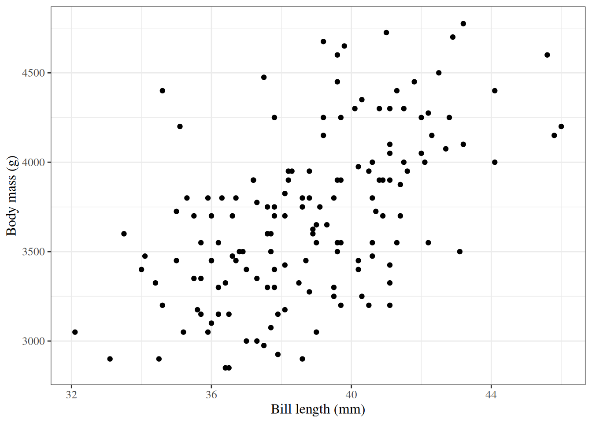
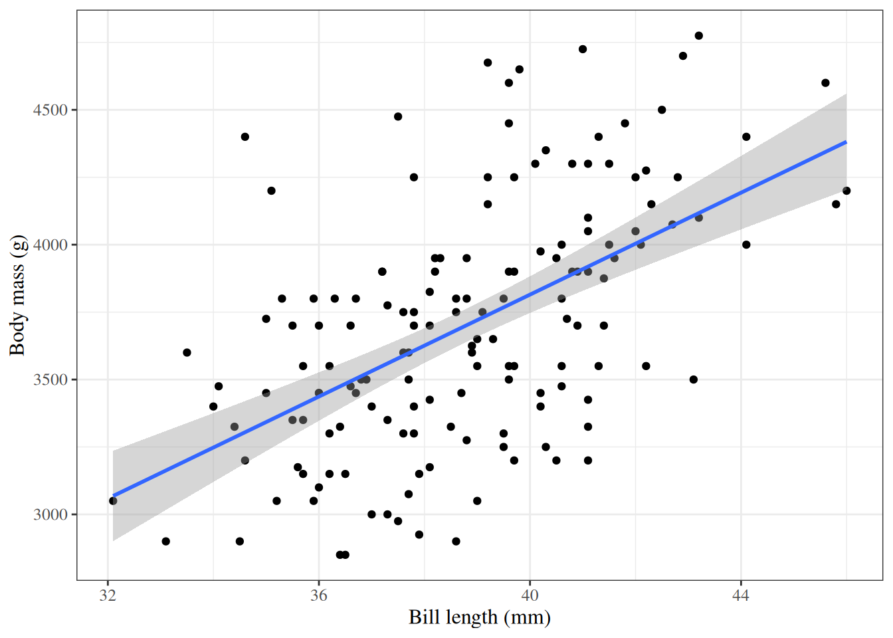
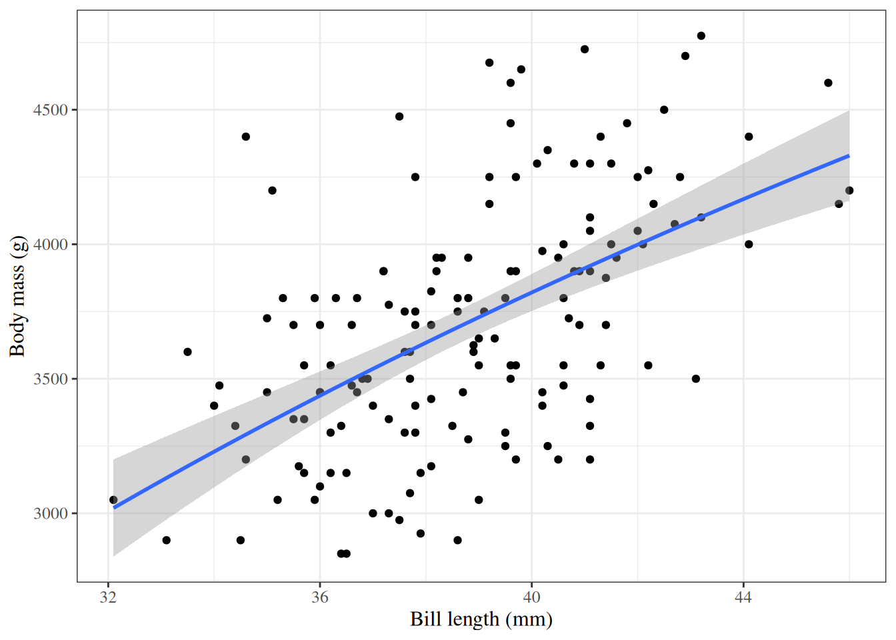
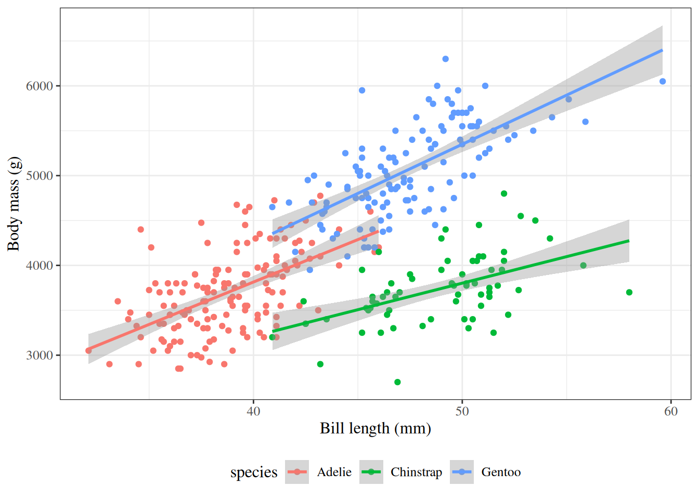
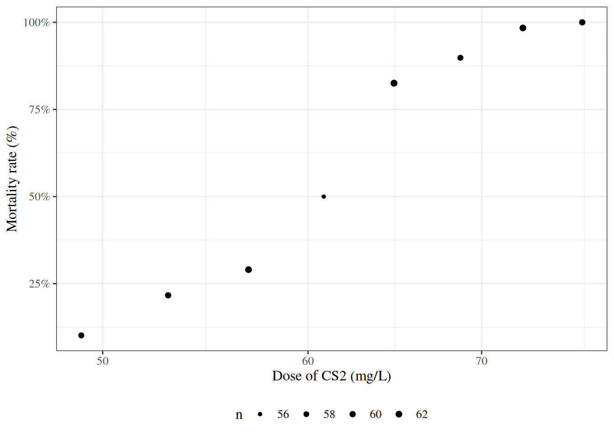
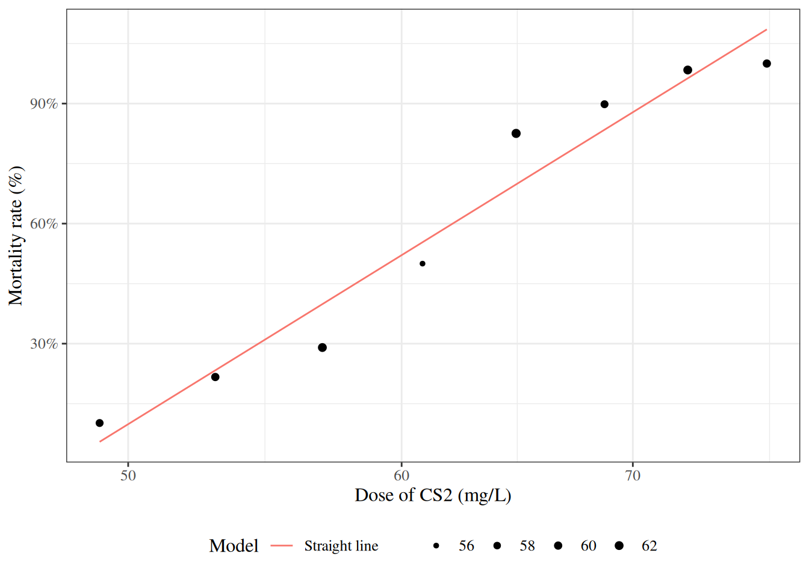
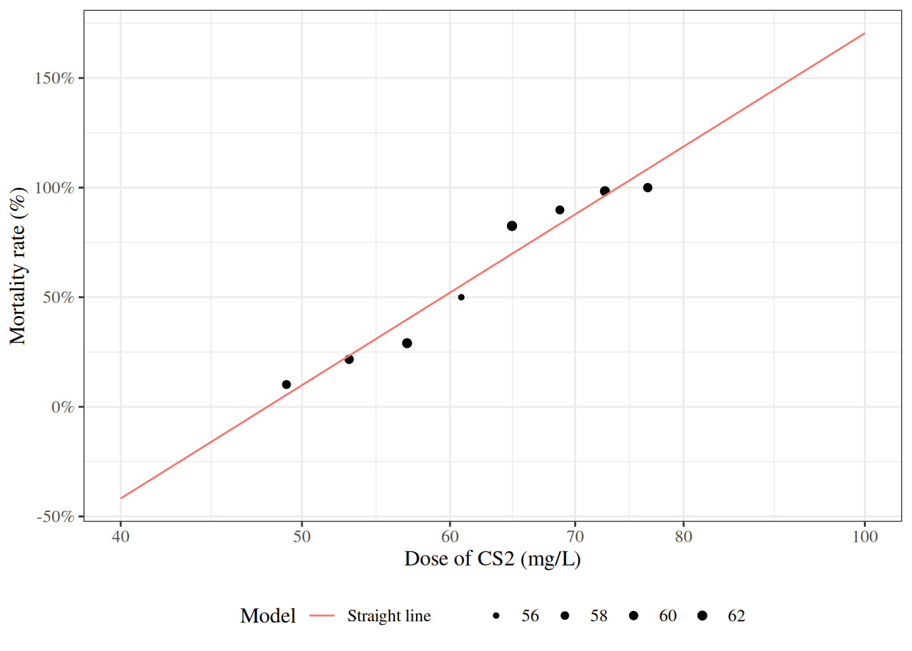
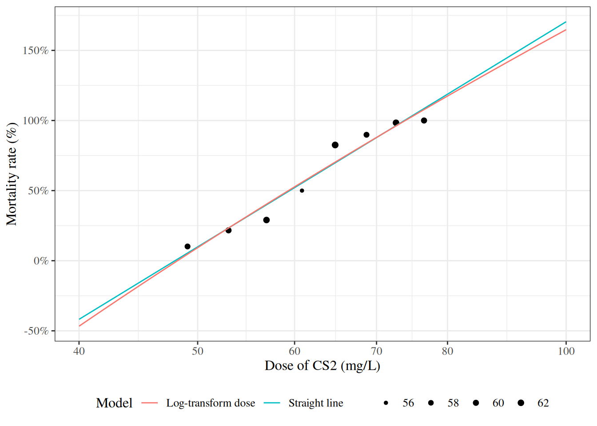
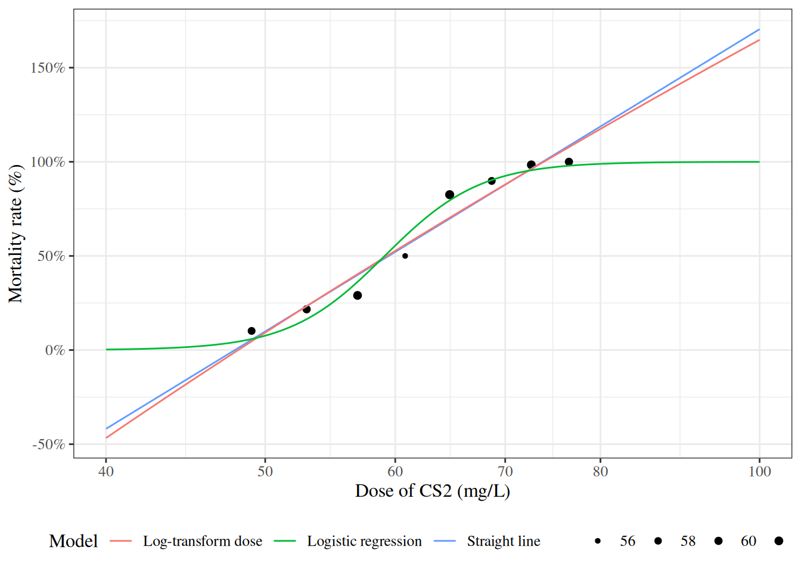
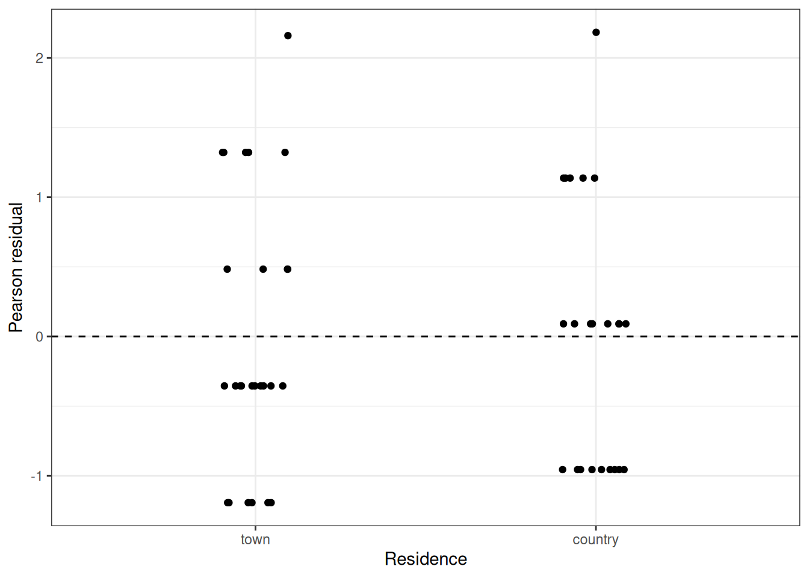

# Introduction to GLMs

Code

- [Show All Code](javascript:void(0))

- [Hide All Code](javascript:void(0))

- 

  ------------------------------------------------------------------------

- [View Source](javascript:void(0))

Published

Last modified: 2026-11-11: 8:26:34 (UTC)

# 1 Introduction

------------------------------------------------------------------------

# Configuring R

Functions from these packages will be used throughout this document:

Show R code

``` downlit
library(conflicted) # check for conflicting function definitions
# printr is not loaded here: it inserts help-file output into markdown output
library(rmarkdown) # Convert R Markdown documents into a variety of formats.
library(pander) # format tables for markdown
library(ggplot2) # graphics
library(ggfortify) # help with graphics
library(dplyr) # manipulate data
library(tibble) # `tibble`s extend `data.frame`s
library(magrittr) # `%>%` and other additional piping tools
library(haven) # import Stata files
library(knitr) # format R output for markdown
library(tidyr) # Tools to help to create tidy data
library(plotly) # interactive graphics
library(dobson) # datasets from Dobson and Barnett 2018
library(parameters) # format model output tables for markdown
library(haven) # import Stata files
library(latex2exp) # use LaTeX in R code (for figures and tables)
library(fs) # filesystem path manipulations
library(survival) # survival analysis
library(survminer) # survival analysis graphics
library(KMsurv) # datasets from Klein and Moeschberger
library(parameters) # format model output tables for
library(webshot2) # convert interactive content to static for pdf
library(forcats) # functions for categorical variables ("factors")
library(stringr) # functions for dealing with strings
library(lubridate) # functions for dealing with dates and times
# Summarizes key information about statistical objects in tidy tibbles
library(broom)
# Provides suite of functions to work with regression model
# `broom::tidy()` tibbles
library(broom.helpers)
```

Here are some R settings I use in this document:

Show R code

``` downlit
rm(list = ls()) # delete any data that's already loaded into R

conflicts_prefer(dplyr::filter)
ggplot2::theme_set(
  ggplot2::theme_bw() +
    # ggplot2::labs(col = "") +
    ggplot2::theme(
      legend.position = "bottom",
      text = ggplot2::element_text(size = 12, family = "serif")
    )
)

knitr::opts_chunk$set(message = FALSE)
options(digits = 6)

panderOptions("big.mark", ",")
pander::panderOptions("table.emphasize.rownames", FALSE)
pander::panderOptions("table.split.table", Inf)
# use the `filter()` function from dplyr() by default
conflicts_prefer(dplyr::filter)
legend_text_size <- 9
run_graphs <- TRUE
```

# 2 Welcome

Welcome to Epidemiology 204: Quantitative Epidemiology III (Statistical Models).

Epi 204 is a course on **regression modeling**.

# 3 What you should already know

> **WARNING:**
>
> Epi 202, Epi 203, and Sta 108 are prerequisites for this course. If you haven’t passed one of these courses, talk to me ASAP.

### 3.0.1 Epi 202: probability models

- Probability distributions
  - [binomial](https://morrison-lab.github.io/pds/distributions.html#def-binomial)
  - [Poisson](https://morrison-lab.github.io/pds/distributions.html#def-poisson)
  - [Gaussian](https://morrison-lab.github.io/pds/random-variables.html#def-normal)
  - [exponential](https://morrison-lab.github.io/pds/random-variables.html#def-exponential)

------------------------------------------------------------------------

- Characteristics of probability distributions
  - [Mean](https://morrison-lab.github.io/pds/expectation.html#def-expectation), median, mode, [quantiles](https://morrison-lab.github.io/pds/random-variables.html#def-quantile-function)
  - [Variance](https://morrison-lab.github.io/pds/variance-covariance.html#def-variance), [standard deviation](https://morrison-lab.github.io/pds/variance-covariance.html#def-sd), [overdispersion](../chapters/count-regression.llms.md#def-overdispersion)

------------------------------------------------------------------------

- Characteristics of samples
  - [independence](https://morrison-lab.github.io/pds/independence.html#def-indpt), dependence, [covariance](https://morrison-lab.github.io/pds/variance-covariance.html#def-cov), [correlation](https://morrison-lab.github.io/pds/variance-covariance.html#def-correlation)
  - ranks, [order statistics](https://morrison-lab.github.io/sds/nonparametric-models.html#def-order-statistics)
  - [identical](https://morrison-lab.github.io/pds/independence.html#def-ident) vs nonidentical distribution (homogeneity vs heterogeneity)
  - Laws of Large Numbers
  - [Central Limit Theorem](https://morrison-lab.github.io/pds/limit-theorems.html#thm-clt) for the mean of an iid sample

### 3.0.2 Epi 203: inference for one or several homogenous populations

- the [maximum likelihood](https://morrison-lab.github.io/sds/intro-MLEs.html#sec-intro-MLEs) inference framework:
  - [likelihood functions](https://morrison-lab.github.io/sds/intro-MLEs.html#def-lik)
  - [log-likelihood functions](https://morrison-lab.github.io/sds/intro-MLEs.html#def-loglik)
  - [score functions](https://morrison-lab.github.io/sds/intro-MLEs.html#def-score)
  - [estimating equations](https://morrison-lab.github.io/sds/intro-MLEs.html#def-score-equation)
  - [information matrices](https://morrison-lab.github.io/sds/intro-MLEs.html#def-oinf)
  - [point estimates](https://morrison-lab.github.io/sds/estimation.html#def-estimate)
  - [standard errors](https://morrison-lab.github.io/sds/estimation.html#def-SE)
  - [confidence intervals](https://morrison-lab.github.io/sds/inference.html#def-confidence-interval)
  - [hypothesis tests](https://morrison-lab.github.io/sds/inference.html#sec-hypothesis-tests)
  - [p-values](https://morrison-lab.github.io/sds/inference.html#def-p-value)

------------------------------------------------------------------------

- Hypothesis tests for one, two, and \>2 groups:
  - [t-tests](https://morrison-lab.github.io/sds/basic-statistical-methods.html#sec-two-sample-t-test)/[ANOVA](https://morrison-lab.github.io/sds/basic-statistical-methods.html#def-one-way-anova) for Gaussian models
  - [chi-square tests](https://morrison-lab.github.io/sds/categorical-tests.html#def-chi-square-test) for binomial and Poisson models
  - nonparametric tests:
    - Wilcoxon signed-rank test for matched pairs
    - Mann–Whitney/Kruskal-Wallis rank sum test for $\geq 2$ independent samples
    - [Fisher’s exact test](https://morrison-lab.github.io/sds/categorical-tests.html#def-fishers-exact) for [contingency tables](https://morrison-lab.github.io/sds/exploratory-descriptive.html#def-contingency-table)
    - Cochran–Mantel–Haenszel-Cox [log-rank test](../chapters/intro-to-survival-analysis.llms.md#def-logrank-test)

------------------------------------------------------------------------

For all of these prerequisite concepts and quantities, and especially for confidence intervals and p-values, you should know how **both**:

- how to compute them
- how to interpret them

------------------------------------------------------------------------

### 3.0.3 Stat 108: linear regression models

- building models for Gaussian outcomes
  - multiple predictors
  - interactions
- [regression diagnostics](../chapters/Linear-models-overview.llms.md#sec-diagnose-LMs)
- fundamentals of R programming; e.g.:
  - Wickham et al. [\[1\]](#ref-r4ds)
  - Dalgaard [\[2\]](#ref-dalgaardintroductory)
- [RMarkdown or Quarto for formatting homework](https://r4ds.hadley.nz/quarto)
  - LaTeX for writing math in RMarkdown/Quarto

# 4 What we will cover in this course

- Linear (Gaussian) regression models (review and more details)

- Regression models for non-Gaussian outcomes

  - binary
  - count
  - time to event

- Statistical analysis using R

We will start where Epi 203 left off: with linear regression models.

The type of the outcome variable $Y$ largely determines which regression model we use ([Table 1](#tbl-outcome-types)).

> **NOTE:**
>
> | Outcome | Examples | Analysis |
> |----|----|----|
> | [binary](https://morrison-lab.github.io/sds/data.html#def-binary-var) | diseased/not; died/survived | [logistic regression](../chapters/logistic-regression.llms.md#def-logistic-regression) |
> | [count](https://morrison-lab.github.io/sds/data.html#def-count) | number of infections per month; number of follow-up visits per patient | Poisson regression |
> | time to event | time from exposure until disease onset; time from onset until recurrence; time from disease onset until disease progression; time from onset until death | survival analysis |
> | [ordered levels](https://morrison-lab.github.io/sds/data.html#def-ordinal-var)[^1] | pain level (0 to 10 scale); approval rating (0 to 5 stars) | ordinal regression |
>
> Table 1: Outcome types, examples, and the regression analyses that match them

# 5 The scientific method and models

As scientists, we attempt to answer factual questions about the world and universe in the past, present, and/or future. In this course, we follow the steps of the [scientific method](https://en.wikipedia.org/wiki/Scientific_method), with a statistical model standing in for the hypothesis:

- conceive a question
- hypothesize a specific version of that model
- propose a study design that would provide data relevant to the model
- analyze the data
- estimate model parameters
- “inference”:
  - quantify uncertainty
  - draw conclusions

Regression models are the family of models we use for these steps.

# 6 Motivations for regression models

> **NOTE:**
>
> **Exercise 1** Why do we need regression models?

> **NOTE:**
>
> *Solution 1*.
>
> - when there’s not enough data to analyze every subgroup of interest individually
>
> - especially when subgroups are defined using continuous predictors

------------------------------------------------------------------------

## 6.1 Uses of regression models

Vittinghoff et al. [\[3, Sec. 1.3\]](#ref-vittinghoff2e) identifies three broad motivations for using multipredictor regression models:

> Multipredictor regression can be a powerful tool for addressing three important practical questions. … \[These\] include prediction, isolating the effect of a single predictor, and understanding multiple predictors.
>
> 1.  **Prediction**: “Multipredictor regression is a powerful and general tool for using multiple measured predictors to make useful predictions for future observations.”
>
> 2.  **Isolating the Effect of a Single Predictor**: “In settings where multiple, related predictors contribute to study outcomes, it will be important to consider multiple predictors even when a single predictor is of interest.” (e.g., to minimize confounding and support causal interpretation)
>
> 3.  **Understanding Multiple Predictors**: “Multipredictor regression can also be used when our aim is to identify multiple independent predictors of a study outcome — independent in the sense that they appear to have an effect over and above other measured variables.” (including mediation and interaction)

Kleinbaum et al. [\[4, Sec. 4.1\]](#ref-kleinbaum2014applied) provides a more granular list of eight overlapping applications of regression analysis:

> In practice, a regression analysis is appropriate for several possibly overlapping situations, including the following:
>
> 1.  **Characterize the association**: “You want to characterize the relationship between the dependent and independent variables by determining the extent, direction, and strength of the association.”
>
> 2.  **Prediction**: “You seek a quantitative formula or equation to describe (e.g., predict) the dependent variable $Y$ as a function of the independent variables $X_1, X_2, \ldots, X_k$.”
>
> 3.  **Controlled description**: “You want to describe quantitatively or qualitatively the relationship between $X_1, X_2, \ldots, X_k$ and $Y$ but control for the effects of still other variables $X_{k+1}, X_{k+2}, \ldots, X_{k+p}$, which you believe have an important relationship with the dependent variable.”
>
> 4.  **Variable selection**: “You want to determine which of several independent variables are important and which are not for describing or predicting a dependent variable. You may want to control for other variables. You may also want to rank independent variables in their order of importance.”
>
> 5.  **Model selection**: “You want to determine the best mathematical model for describing the relationship between a dependent variable and one or more independent variables.”
>
> 6.  **Comparing regression relationships**: “You want to compare several derived regression relationships.” (e.g., whether a relationship between two variables differs across subgroups)
>
> 7.  **Interaction**: “You want to assess the interactive effects of two or more independent variables with regard to a dependent variable.”
>
> 8.  **Adjusted coefficient estimation**: “You want to obtain a valid and precise estimate of one or more regression coefficients from a larger set of regression coefficients in a given model.” (i.e., estimating the effect of one variable after adjusting for others)

### 6.1.1 Relating the two lists

The two lists use different levels of granularity to describe the same landscape of regression uses. Vittinghoff et al. [\[3\]](#ref-vittinghoff2e) provides three broad categories, while Kleinbaum et al. [\[4\]](#ref-kleinbaum2014applied) identifies eight more specific applications.

> **NOTE:**
>
> | Vittinghoff et al. [\[3\]](#ref-vittinghoff2e) category | Kleinbaum et al. [\[4\]](#ref-kleinbaum2014applied) application(s) |
> |----|----|
> | Prediction | Application 2 (prediction) |
> | Isolating the Effect of a Single Predictor | Application 8 (adjusted coefficient estimation) |
> | Understanding Multiple Predictors | Application 1 (characterize association), Application 3 (controlled description), Application 4 (variable selection), Application 5 (model selection), Application 6 (comparing regression relationships), Application 7 (interaction) |
>
> Table 2: Comparing the categorizations of regression model uses in Vittinghoff et al. [\[3, Sec. 1.3\]](#ref-vittinghoff2e) and Kleinbaum et al. [\[4, Sec. 4.1\]](#ref-kleinbaum2014applied)

Applications 6 and 7 are related but distinct: Application 6 asks whether a derived regression relationship (e.g., a coefficient or the overall model) differs across pre-defined groups, typically by comparing models fit separately for each group. Application 7 asks whether two predictors interact within a single model — that is, whether the effect of one predictor on the outcome depends on the value of another predictor. In that sense, Application 6 can be viewed as a special case of Application 7 where the grouping variable is the effect modifier.

The key conceptual distinction made by Vittinghoff et al. [\[3\]](#ref-vittinghoff2e) — but not explicitly highlighted by Kleinbaum et al. [\[4\]](#ref-kleinbaum2014applied) — is between **prediction** (forecasting future outcomes) and **[causal inference](../chapters/causal-inference.llms.md)** (estimating the effect of a specific predictor). This distinction has important implications for model building strategy: prediction models can include any variables that improve predictive accuracy, while causal inference requires careful consideration of [confounding](../chapters/causal-inference.llms.md#def-confounding-obs), [mediation](../chapters/causal-inference.llms.md#def-mediator), and the causal structure of the data.

### 6.1.2 Prediction, Inference, and Causal Inference

The goal of **[prediction](https://morrison-lab.github.io/pds/expectation.html#def-prediction)** is to forecast an outcome $Y$ for new observations, given observed predictor variables $X_1, \ldots, X_p$. In a prediction problem, the model is often treated as a “black box”: we care about predictive accuracy, not about the exact form or interpretation of the relationship between predictors and outcome [\[5, Ch. 2\]](#ref-james2021islr2e).

> **NOTE:**
>
> **Example 1** For example, a clinical prediction model might identify which patients are at highest risk of hospital readmission, using demographics, diagnoses, and laboratory values, without requiring that each predictor be causally related to readmission.

At its core, prediction aspires to minimize uncertainty: the goal is that, by including enough informative predictors and combining them flexibly, we can reduce as much as possible the residual randomness in our forecasts.

**[Statistical inference](https://morrison-lab.github.io/sds/inference.html#def-inference)** also studies the relationship between $Y$ and $X_1, \ldots, X_p$, but the goal shifts from accuracy to understanding: which predictors are associated with the response, in what direction, and by how much [\[5, Ch. 2\]](#ref-james2021islr2e)?

> **NOTE:**
>
> **Example 2** For example, a cohort study might estimate the association between smoking and lung cancer incidence, along with a [confidence interval](https://morrison-lab.github.io/sds/inference.html#def-confidence-interval) quantifying uncertainty about the magnitude of that association.

Unlike prediction, statistical inference treats the uncertainty in outcomes as a meaningful quantity to characterize, not merely residual noise to be minimized.

**Causal inference** asks a distinct third question. A predictive association between a predictor $X$ and an outcome $Y$ does not imply that intervening to change $X$ will change $Y$. Causal inference addresses this gap: it asks what would happen to $Y$ if we were to actively *set* $X$ to a particular value, rather than passively observe it [\[3, Ch. 12\]](#ref-vittinghoff2e).

> **NOTE:**
>
> **Example 3** For example, even if smoking is strongly associated with lung cancer in observational data, causal inference asks whether reducing smoking rates would *cause* a reduction in lung cancer incidence — a question that requires additional assumptions about the data-generating process.

One useful framing of causal inference is as a prediction problem in **counterfactual** worlds: predicting what outcomes would have occurred under treatment conditions that were not actually administered. Under the **[potential outcomes](../chapters/causal-inference.llms.md#def-potential-outcomes) framework** [\[3, Ch. 12\]](#ref-vittinghoff2e), [\[6\]](#ref-neyman1923application), [\[7, pp. 688–701\]](#ref-rubin1974estimating), [individual causal effects](../chapters/causal-inference.llms.md#def-individual-causal-effect) are treated as deterministic in principle — each person has a fixed potential outcome under each treatment condition — and uncertainty arises from the fact that we can observe only one potential outcome per person, and from heterogeneity in effects across individuals.

Accurate causal inference typically requires accounting for **[confounding](../chapters/causal-inference.llms.md#def-confounding-obs)**: in observational data, people who receive a treatment are often systematically different from those who do not in ways that also affect the outcome. These differences can make predictive associations misleading for causal questions.

A useful informal distinction: *prediction* asks which individuals are at highest risk, while *causal inference* asks what is the effect of a particular intervention, and *statistical inference* asks what the association is without necessarily specifying an intervention.

For an accessible introduction to the distinction between prediction and statistical inference, see James et al. [\[5, Ch. 2\]](#ref-james2021islr2e). For coverage of causal inference methods in an epidemiological setting, see Vittinghoff et al. [\[3, Ch. 12\]](#ref-vittinghoff2e) and Hernán and Robins [\[8, Pt. I\]](#ref-hernan2020causal). For an in-depth treatment, see [the causal inference chapter](../chapters/causal-inference.llms.md).

## 6.2 Example: Adelie penguins

> **NOTE:**
>
> [](Intro-to-GLMs_files/figure-html/fig-palmer-1-1.png "Figure 1: Palmer penguins")
>
> Figure 1: Palmer penguins

## 6.3 Linear regression

Show R code

``` downlit
ggpenguins2 <-
  ggpenguins +
  stat_smooth(
    method = "lm",
    formula = y ~ x,
    geom = "smooth"
  )

ggpenguins2 |> print()
```

> **NOTE:**
>
> [](Intro-to-GLMs_files/figure-html/fig-palmer-2-1.png "Figure 2: Palmer penguins with linear regression fit")
>
> Figure 2: Palmer penguins with linear regression fit

## 6.4 Curved regression lines

Show R code

``` downlit
ggpenguins2 <- ggpenguins +
  stat_smooth(
    method = "lm",
    formula = y ~ log(x),
    geom = "smooth"
  ) +
  xlab("Bill length (mm)") +
  ylab("Body mass (g)")
ggpenguins2
```

> **NOTE:**
>
> [](Intro-to-GLMs_files/figure-html/fig-palmer-3-1.png "Figure 3: Palmer penguins - curved regression lines")
>
> Figure 3: Palmer penguins - curved regression lines

## 6.5 Multiple regression

Show R code

``` downlit
ggpenguins <-
  palmerpenguins::penguins |>
  ggplot(
    aes(
      x = bill_length_mm,
      y = body_mass_g,
      color = species
    )
  ) +
  geom_point() +
  stat_smooth(
    method = "lm",
    formula = y ~ x,
    geom = "smooth"
  ) +
  xlab("Bill length (mm)") +
  ylab("Body mass (g)")
ggpenguins |> print()
```

> **NOTE:**
>
> [](Intro-to-GLMs_files/figure-html/fig-palmer-4-1.png "Figure 4: Palmer penguins - multiple groups")
>
> Figure 4: Palmer penguins - multiple groups

## 6.6 Modeling non-Gaussian outcomes

> **NOTE:**
>
> Show R code
>
> ``` downlit
>
> library(glmx)
> data(BeetleMortality)
> beetles <- BeetleMortality |>
>   mutate(
>     pct = died / n,
>     survived = n - died
>   )
>
> plot1 <-
>   beetles |>
>   ggplot(aes(x = 10^dose, y = pct)) +
>   geom_point(aes(size = n)) +
>   scale_x_log10(breaks = c(40, 50, 60, 70, 80, 100)) +
>   xlab("Dose of CS2 (mg/L)") +
>   ylab("Mortality rate (%)") +
>   scale_y_continuous(labels = scales::percent) +
>   scale_size(range = c(1, 2))
>
> print(plot1)
> ```
>
> [](Intro-to-GLMs_files/figure-html/unnamed-chunk-1-1.png "Figure 5: Mortality rates of adult flour beetles after five hours’ exposure to gaseous carbon disulphide (Bliss 1935). The dose column holds the base-10 logarithm of the dose in mg/L, and the models use it as is; the figures show the dose itself, in mg/L, on a log-spaced axis.")
>
> Figure 5: Mortality rates of adult flour beetles after five hours’ exposure to gaseous carbon disulphide (Bliss 1935). The `dose` column holds the base-10 logarithm of the dose in mg/L, and the models use it as is; the figures show the dose itself, in mg/L, on a log-spaced axis.

## 6.7 Why don’t we use linear regression?

> **NOTE:**
>
> Show R code
>
> ``` downlit
> beetles_long <-
>   beetles |>
>   reframe(
>     .by = everything(),
>     outcome = c(
>       rep(1, times = died),
>       rep(0, times = survived)
>     )
>   )
>
> lm1 <-
>   beetles_long |>
>   lm(
>     formula = outcome ~ dose,
>     data = _
>   )
>
> f_linear <- function(x) predict(lm1, newdata = data.frame(dose = log10(x)))
>
> plot2 <-
>   plot1 +
>   geom_function(fun = f_linear, aes(col = "Straight line")) +
>   labs(colour = "Model", size = "")
> print(plot2)
> ```
>
> [](Intro-to-GLMs_files/figure-html/unnamed-chunk-2-1.png "Figure 6: Mortality rates of adult flour beetles after five hours’ exposure to gaseous carbon disulphide (Bliss 1935)")
>
> Figure 6: Mortality rates of adult flour beetles after five hours’ exposure to gaseous carbon disulphide (Bliss 1935)

## 6.8 Zoom out

> **NOTE:**
>
> [](Intro-to-GLMs_files/figure-html/unnamed-chunk-3-1.png "Figure 7: Mortality rates of adult flour beetles after five hours’ exposure to gaseous carbon disulphide (Bliss 1935)")
>
> Figure 7: Mortality rates of adult flour beetles after five hours’ exposure to gaseous carbon disulphide (Bliss 1935)

## 6.9 log transformation of dose?

> **NOTE:**
>
> Show R code
>
> ``` downlit
>
> lm2 <-
>   beetles_long |>
>   lm(formula = outcome ~ log(dose), data = _)
>
> f_linearlog <- function(x) predict(lm2, newdata = data.frame(dose = log10(x)))
>
> plot3 <- plot2 +
>   expand_limits(x = c(40, 100)) +
>   geom_function(fun = f_linearlog, aes(col = "Log-transform dose"))
>
> print(plot3 + expand_limits(x = c(40, 100)))
> ```
>
> [](Intro-to-GLMs_files/figure-html/unnamed-chunk-4-1.png "Figure 8: Mortality rates of adult flour beetles after five hours’ exposure to gaseous carbon disulphide (Bliss 1935)")
>
> Figure 8: Mortality rates of adult flour beetles after five hours’ exposure to gaseous carbon disulphide (Bliss 1935)

## 6.10 Logistic regression

> **NOTE:**
>
> Show R code
>
> ``` downlit
>
> glm1 <- beetles |>
>   glm(formula = cbind(died, survived) ~ dose, family = "binomial")
>
> f <- function(x) {
>   glm1 |> 
>     predict(newdata = data.frame(dose = log10(x)), type = "response")
> }
>
> plot4 <- plot3 + geom_function(fun = f, aes(col = "Logistic regression"))
> print(plot4)
> ```
>
> [](Intro-to-GLMs_files/figure-html/unnamed-chunk-5-1.png "Figure 9: Mortality rates of adult flour beetles after five hours’ exposure to gaseous carbon disulphide (Bliss 1935)")
>
> Figure 9: Mortality rates of adult flour beetles after five hours’ exposure to gaseous carbon disulphide (Bliss 1935)

# 7 Structure of regression models

> **NOTE:**
>
> **Exercise 2** What is a regression model?

> **NOTE:**
>
> **Definition 1 (Regression model)** Regression models are conditional probability distribution models:
>
> $$\mathbb{P}(Y|\mathord{\smash[b]{\underset{\raise.3ex\hbox{$\scriptstyle\sim$}}{X}}\vphantom{X}})$$

> **NOTE:**
>
> **Exercise 3** What are some of the names used for the variables in a regression model $\mathbb{P}(Y|\mathord{\smash[b]{\underset{\raise.3ex\hbox{$\scriptstyle\sim$}}{X}}\vphantom{X}})$?

> **NOTE:**
>
> **Definition 2 (Outcome (response variable, regressand, predicted variable, explained variable, experimental variable, output variable, dependent variable, endogenous variable, target, label))** The **outcome variable** in a regression model is the variable whose distribution is being described; in other words, the variable on the left-hand side of the “\|” (“pipe”) symbol.
>
> It is also called the **response variable**, **regressand**, **predicted variable**, **explained variable**, **experimental variable**, **output variable**, **dependent variable**, **endogenous variable**, **target**, or **label**.
>
> and is typically denoted $Y$.

> **NOTE:**
>
> **Definition 3 (Predictors (regressors, covariates, independent variables, explanatory variables, risk factors, exposure variables, input variables, exogenous variables, candidate variables, carriers, manipulated variables, features))** The **predictor variables** in a regression model are the conditioning variables defining subpopulations among which the outcome distribution might vary.
>
> Predictors are also called **regressors**, **covariates**, **independent variables**, **explanatory variables**, **risk factors**, **exposure variables**, **input variables**, **exogenous variables**, **candidate variables** (Dunn and Smyth [\[9\]](#ref-dunn2018generalized)), **carriers** (Dunn and Smyth [\[9\]](#ref-dunn2018generalized)), **manipulated variables**, or **features** and are typically denoted $\mathord{\smash[b]{\underset{\raise.3ex\hbox{$\scriptstyle\sim$}}{X}}\vphantom{X}}$. [^2]

------------------------------------------------------------------------

> **NOTE:**
>
> | $\mathord{\smash[b]{\underset{\raise.3ex\hbox{$\scriptstyle\sim$}}{X}}\vphantom{X}}$ | $Y$ | usual context |
> |----|----|----|
> | input | output |  |
> | independent | dependent |  |
> | predictor | predicted or response |  |
> | explanatory | explained |  |
> | exogenous | endogenous | econometrics |
> | manipulated | measured | randomized controlled experiments |
> | exposure | outcome | epidemiology |
> | feature | label or target | machine learning |
>
> Table 3: Common pairings of terms for variables $\mathord{\smash[b]{\underset{\raise.3ex\hbox{$\scriptstyle\sim$}}{X}}\vphantom{X}}$ and $Y$ in regression models $P(Y|\mathord{\smash[b]{\underset{\raise.3ex\hbox{$\scriptstyle\sim$}}{X}}\vphantom{X}})$ [^3]

> **NOTE:**
>
> **Exercise 4** What is the general structure of a generalized linear model?

> **NOTE:**
>
> *Solution 2*. Generalized linear models have three components:
>
> 1.  The **outcome distribution** family: $\operatorname{p}(Y|\mu(\mathord{\smash[b]{\underset{\raise.3ex\hbox{$\scriptstyle\sim$}}{x}}\vphantom{x}}))$
>
> 2.  The **link function**: $g(\mu(\mathord{\smash[b]{\underset{\raise.3ex\hbox{$\scriptstyle\sim$}}{x}}\vphantom{x}})) = \eta(\mathord{\smash[b]{\underset{\raise.3ex\hbox{$\scriptstyle\sim$}}{x}}\vphantom{x}})$
>
> 3.  The **linear component**: $\eta(\mathord{\smash[b]{\underset{\raise.3ex\hbox{$\scriptstyle\sim$}}{x}}\vphantom{x}}) = \mathord{\smash[b]{\underset{\raise.3ex\hbox{$\scriptstyle\sim$}}{x}}\vphantom{x}}\cdot \beta$
>
> ------------------------------------------------------------------------
>
> 1.  The **outcome distribution** family (a.k.a. the **random component** of the model)
>
> - Gaussian (normal)
> - [Binomial](https://morrison-lab.github.io/pds/distributions.html#def-binomial)
> - Poisson
> - Exponential
> - Gamma
> - Negative binomial
>
> ------------------------------------------------------------------------
>
> 2.  The **linear component** (a.k.a. the *linear predictor* or *linear functional form*) describing how the covariates combine to define subpopulations:
>
> $$\eta(\mathord{\smash[b]{\underset{\raise.3ex\hbox{$\scriptstyle\sim$}}{x}}\vphantom{x}}) \stackrel{\text{def}}{=}\mathord{\smash[b]{\underset{\raise.3ex\hbox{$\scriptstyle\sim$}}{x}}\vphantom{x}}^{\top} \mathord{\smash[b]{\underset{\raise.3ex\hbox{$\scriptstyle\sim$}}{\beta}}\vphantom{\beta}}= \beta_0 + \beta_1 x_1 + \beta_2 x_2 + ...$$
>
> ------------------------------------------------------------------------
>
> 3.  The **link function** relating the outcome distribution to the linear component, typically through the mean:
>
> - identity: $\mu(y) = \eta(\mathord{\smash[b]{\underset{\raise.3ex\hbox{$\scriptstyle\sim$}}{x}}\vphantom{x}})$
> - logit: ${\operatorname{log}\mathopen{}\left\{\frac{\mu(y)}{1-\mu(y)}\right\}\mathclose{}} = \eta(\mathord{\smash[b]{\underset{\raise.3ex\hbox{$\scriptstyle\sim$}}{x}}\vphantom{x}})$
> - log: ${\operatorname{log}\mathopen{}\left\{\mu(y)\right\}\mathclose{}} = \eta(\mathord{\smash[b]{\underset{\raise.3ex\hbox{$\scriptstyle\sim$}}{x}}\vphantom{x}})$
> - inverse: ${\mathopen{}\left(\mu(y)\right)\mathclose{}}^{-1} = \eta(\mathord{\smash[b]{\underset{\raise.3ex\hbox{$\scriptstyle\sim$}}{x}}\vphantom{x}})$
> - clog-log: ${\operatorname{log}\mathopen{}\left\{-{\operatorname{log}\mathopen{}\left\{1-\mu(y)\right\}\mathclose{}}\right\}\mathclose{}} = \eta(\mathord{\smash[b]{\underset{\raise.3ex\hbox{$\scriptstyle\sim$}}{x}}\vphantom{x}})$
>
> Components 2 and 3 together are sometimes called the **systematic component** of the model (for example, in Dunn and Smyth [\[9\]](#ref-dunn2018generalized)).

> **NOTE:**
>
> **Definition 4 (Linear predictor (linear component))** Let $\mathord{\smash[b]{\underset{\raise.3ex\hbox{$\scriptstyle\sim$}}{x}}\vphantom{x}}\stackrel{\text{def}}{=}{(1, x_1, \ldots, x_p)}^{\top}$ be a covariate vector, with a leading 1 for the intercept, and let $\mathord{\smash[b]{\underset{\raise.3ex\hbox{$\scriptstyle\sim$}}{\beta}}\vphantom{\beta}}\stackrel{\text{def}}{=}{(\beta_0, \beta_1, \ldots, \beta_p)}^{\top}$ be a vector of regression coefficients. The **linear predictor** (or **linear component**) of a regression model is the function
>
> $$\eta(\mathord{\smash[b]{\underset{\raise.3ex\hbox{$\scriptstyle\sim$}}{x}}\vphantom{x}})
> \stackrel{\text{def}}{=}\underbrace{{\mathord{\smash[b]{\underset{\raise.3ex\hbox{$\scriptstyle\sim$}}{x}}\vphantom{x}}}^{\top}}_{1 \times (p+1)} \underbrace{\mathord{\smash[b]{\underset{\raise.3ex\hbox{$\scriptstyle\sim$}}{\beta}}\vphantom{\beta}}}_{(p+1) \times 1}
> = \beta_0 + \beta_1 x_1 + \cdots + \beta_p x_p$$
>
> [\[9, Ch. 5\]](#ref-dunn2018generalized), [\[10, Ch. 3\]](#ref-dobson4e).

> **NOTE:**
>
> **Example 4 (Computing a linear predictor)** Suppose a model has one covariate, dose $x$, with coefficients $\beta_0 = -60$ and $\beta_1 = 34$. At dose $x = 1.8$:
>
> $$\begin{aligned}
> \eta(1.8)
> &= \beta_0 + \beta_1 \cdot 1.8
> && \text{(definition of } \eta\text{, with } p = 1\text{)}
> \\ &= -60 + 34 \cdot 1.8
> && \text{(substitute the coefficients)}
> \\ &= -60 + 61.2
> && \text{(multiply)}
> \\ &= 1.2
> && \text{(add)}
> \end{aligned}$$
>
> The model $\eta(\mathord{\smash[b]{\underset{\raise.3ex\hbox{$\scriptstyle\sim$}}{x}}\vphantom{x}}) = \beta_0 + \beta_1 {\operatorname{log}\mathopen{}\left\{x\right\}\mathclose{}} + \beta_2 x^2$ also has a linear predictor, with covariates $x_1 \stackrel{\text{def}}{=}{\operatorname{log}\mathopen{}\left\{x\right\}\mathclose{}}$ and $x_2 \stackrel{\text{def}}{=}x^2$: it is a weighted sum of covariates with weights $\beta_0, \beta_1, \beta_2$.

> **NOTE:**
>
> *Remark 1* (Linear in the coefficients, not in the covariates). The linear predictor must be linear in the **coefficients** $\mathord{\smash[b]{\underset{\raise.3ex\hbox{$\scriptstyle\sim$}}{\beta}}\vphantom{\beta}}$; it need not be linear in the original covariates, because each $x_j$ can itself be a transformation of the data, such as ${\operatorname{log}\mathopen{}\left\{\text{dose}\right\}\mathclose{}}$, $\text{age}^2$, or a product of two covariates.

> **NOTE:**
>
> **Example 5 (A function that is not a linear predictor)** The function $\eta(x) = \beta_0 + x^{\beta_1}$ is not a linear predictor, because $\beta_1$ enters as an exponent rather than as a multiplier of a covariate. For example, at $x = 2$, increasing $\beta_1$ from 1 to 2 changes $x^{\beta_1}$ from $2$ to $4$, an increase of 2, but increasing $\beta_1$ from 2 to 3 changes $x^{\beta_1}$ from $4$ to $8$, an increase of 4. A linear function of $\beta_1$ would change by the same amount for each equal step in $\beta_1$.

> **NOTE:**
>
> **Definition 5 (Link function)** Let $\mu(\mathord{\smash[b]{\underset{\raise.3ex\hbox{$\scriptstyle\sim$}}{x}}\vphantom{x}}) \stackrel{\text{def}}{=}{\mathbb{E}\mathopen{}\left[Y|\mathord{\smash[b]{\underset{\raise.3ex\hbox{$\scriptstyle\sim$}}{X}}\vphantom{X}}=\mathord{\smash[b]{\underset{\raise.3ex\hbox{$\scriptstyle\sim$}}{x}}\vphantom{x}}\right]\mathclose{}}$ be the conditional mean of the outcome. A **link function** is a monotone, differentiable function $g(\cdot)$ that relates the mean to the linear predictor ([Definition 4](#def-linear-predictor)):
>
> $$g\mathopen{}\left(\mu(\mathord{\smash[b]{\underset{\raise.3ex\hbox{$\scriptstyle\sim$}}{x}}\vphantom{x}})\right)\mathclose{} \stackrel{\text{def}}{=}\eta(\mathord{\smash[b]{\underset{\raise.3ex\hbox{$\scriptstyle\sim$}}{x}}\vphantom{x}})$$
>
> [\[9, Ch. 5\]](#ref-dunn2018generalized), [\[10, Ch. 3\]](#ref-dobson4e).

> **NOTE:**
>
> **Definition 6 (Inverse link)** When $g$ is strictly monotone on the range of possible means, it has an inverse, the **inverse link** $g^{-1}(\cdot)$, which maps the linear predictor back to the mean:
>
> $$\mu(\mathord{\smash[b]{\underset{\raise.3ex\hbox{$\scriptstyle\sim$}}{x}}\vphantom{x}}) = g^{-1}\mathopen{}\left(\eta(\mathord{\smash[b]{\underset{\raise.3ex\hbox{$\scriptstyle\sim$}}{x}}\vphantom{x}})\right)\mathclose{}$$

> **NOTE:**
>
> **Example 6 (Logit and log links)** Take $\eta = 1.2$ from [Example 4](#exm-linear-predictor). With the logit link $g(\mu) = \operatorname{logit}(\mu) = {\operatorname{log}\mathopen{}\left\{\frac{\mu}{1-\mu}\right\}\mathclose{}}$, the inverse link is $g^{-1}(\eta) = \operatorname{expit}(\eta) = \frac{1}{1 + e^{-\eta}}$, so:
>
> $$\begin{aligned}
> \mu
> &= \operatorname{expit}(1.2)
> && \text{(apply the inverse link)}
> \\ &= \frac{1}{1 + e^{-1.2}}
> && \text{(definition of } \operatorname{expit}\text{)}
> \\ &\approx \frac{1}{1 + 0.3012}
> && \text{(evaluate } e^{-1.2}\text{)}
> \\ &= \frac{1}{1.3012}
> && \text{(add)}
> \\ &\approx 0.7685
> && \text{(divide)}
> \end{aligned}$$
>
> Applying the link to this mean recovers the linear predictor:
>
> $$\begin{aligned}
> \frac{\mu}{1-\mu}
> &= \frac{1/(1 + e^{-1.2})}{e^{-1.2}/(1 + e^{-1.2})}
> && \text{(since } 1 - \mu = e^{-1.2}/(1 + e^{-1.2})\text{)}
> \\ &= \frac{1}{e^{-1.2}}
> && \text{(cancel } 1 + e^{-1.2}\text{)}
> \\ &= e^{1.2}
> && \text{(reciprocal of an exponential)}
> \\ \operatorname{logit}(\mu)
> &= {\operatorname{log}\mathopen{}\left\{e^{1.2}\right\}\mathclose{}}
> && \text{(take logs)}
> \\ &= 1.2
> && \text{(log inverts exp)}
> \end{aligned}$$
>
> With the log link $g(\mu) = {\operatorname{log}\mathopen{}\left\{\mu\right\}\mathclose{}}$ instead, the inverse link is $g^{-1}(\eta) = {\operatorname{exp}\mathopen{}\left\{\eta\right\}\mathclose{}}$, so the same linear predictor gives $\mu = e^{1.2} \approx 3.320$.

> **NOTE:**
>
> **Example 7 (A function that is not a link function)** For a Gaussian outcome, whose mean can be any real number, $g(\mu) = \mu^2$ is not a valid link function, because it is not monotone on $(-\infty, \infty)$. Both $\mu = -1$ and $\mu = 1$ give $g(\mu) = 1$, so a linear predictor $\eta(\mathord{\smash[b]{\underset{\raise.3ex\hbox{$\scriptstyle\sim$}}{x}}\vphantom{x}}) = 1$ does not determine the mean, and $g$ has no inverse link.

> **NOTE:**
>
> **Definition 7 (Outcome distribution (random component))** In a regression model ([Definition 1](#def-regression-model)) for an outcome $Y$ given covariates $\mathord{\smash[b]{\underset{\raise.3ex\hbox{$\scriptstyle\sim$}}{X}}\vphantom{X}}= \mathord{\smash[b]{\underset{\raise.3ex\hbox{$\scriptstyle\sim$}}{x}}\vphantom{x}}$, the **outcome distribution** family (the **random component**) is the specified distribution family that $Y$ follows given $\mathord{\smash[b]{\underset{\raise.3ex\hbox{$\scriptstyle\sim$}}{X}}\vphantom{X}}= \mathord{\smash[b]{\underset{\raise.3ex\hbox{$\scriptstyle\sim$}}{x}}\vphantom{x}}$, such as Gaussian, Bernoulli, or Poisson, with conditional mean $\mu(\mathord{\smash[b]{\underset{\raise.3ex\hbox{$\scriptstyle\sim$}}{x}}\vphantom{x}}) \stackrel{\text{def}}{=}{\mathbb{E}\mathopen{}\left[Y|\mathord{\smash[b]{\underset{\raise.3ex\hbox{$\scriptstyle\sim$}}{X}}\vphantom{X}}=\mathord{\smash[b]{\underset{\raise.3ex\hbox{$\scriptstyle\sim$}}{x}}\vphantom{x}}\right]\mathclose{}}$, where observations are independent given their covariates [\[9, Ch. 5\]](#ref-dunn2018generalized), [\[10, Ch. 3\]](#ref-dobson4e).

> **NOTE:**
>
> **Definition 8 (Generalized linear model)** A **generalized linear model (GLM)** is a regression model ([Definition 1](#def-regression-model)) for an outcome $Y$ given covariates $\mathord{\smash[b]{\underset{\raise.3ex\hbox{$\scriptstyle\sim$}}{X}}\vphantom{X}}= \mathord{\smash[b]{\underset{\raise.3ex\hbox{$\scriptstyle\sim$}}{x}}\vphantom{x}}$ with three components [\[9, Ch. 5\]](#ref-dunn2018generalized), [\[10, Ch. 3\]](#ref-dobson4e):
>
> 1.  an outcome distribution family (the random component): given $\mathord{\smash[b]{\underset{\raise.3ex\hbox{$\scriptstyle\sim$}}{X}}\vphantom{X}}= \mathord{\smash[b]{\underset{\raise.3ex\hbox{$\scriptstyle\sim$}}{x}}\vphantom{x}}$, $Y$ follows a specified distribution family, such as Gaussian, Bernoulli, or Poisson, with conditional mean $\mu(\mathord{\smash[b]{\underset{\raise.3ex\hbox{$\scriptstyle\sim$}}{x}}\vphantom{x}}) \stackrel{\text{def}}{=}{\mathbb{E}\mathopen{}\left[Y|\mathord{\smash[b]{\underset{\raise.3ex\hbox{$\scriptstyle\sim$}}{X}}\vphantom{X}}=\mathord{\smash[b]{\underset{\raise.3ex\hbox{$\scriptstyle\sim$}}{x}}\vphantom{x}}\right]\mathclose{}}$, and observations are independent given their covariates ([Definition 7](#def-outcome-distribution));
>
> 2.  a linear predictor $\eta(\mathord{\smash[b]{\underset{\raise.3ex\hbox{$\scriptstyle\sim$}}{x}}\vphantom{x}}) = {\mathord{\smash[b]{\underset{\raise.3ex\hbox{$\scriptstyle\sim$}}{x}}\vphantom{x}}}^{\top}\mathord{\smash[b]{\underset{\raise.3ex\hbox{$\scriptstyle\sim$}}{\beta}}\vphantom{\beta}}$ ([Definition 4](#def-linear-predictor));
>
> 3.  a link function $g$ connecting the two, $g\mathopen{}\left(\mu(\mathord{\smash[b]{\underset{\raise.3ex\hbox{$\scriptstyle\sim$}}{x}}\vphantom{x}})\right)\mathclose{} = \eta(\mathord{\smash[b]{\underset{\raise.3ex\hbox{$\scriptstyle\sim$}}{x}}\vphantom{x}})$ ([Definition 5](#def-link-function)).

A GLM specifies model structure only: its coefficients $\mathord{\smash[b]{\underset{\raise.3ex\hbox{$\scriptstyle\sim$}}{\beta}}\vphantom{\beta}}$ can be estimated by maximum likelihood, by Bayesian methods, or by other inference methods.

> **NOTE:**
>
> **Example 8 (Logistic and linear regression as GLMs)** Let $Y \in \{0, 1\}$ indicate death of a beetle exposed to dose $x$. The model with
>
> 1.  outcome distribution $Y|X=x \sim \operatorname{Bernoulli}\mathopen{}\left(\mu(x)\right)\mathclose{}$,
> 2.  linear predictor $\eta(x) = \beta_0 + \beta_1 x$,
> 3.  logit link $\operatorname{logit}\mathopen{}\left(\mu(x)\right)\mathclose{} = \eta(x)$
>
> is a GLM: logistic regression. With $\beta_0 = -60$ and $\beta_1 = 34$, [Example 4](#exm-linear-predictor) and [Example 6](#exm-link-function) give $\eta(1.8) = 1.2$ and $\mathbb{P}(Y=1|X=1.8) = \mu(1.8) \approx 0.7685$.
>
> The Gaussian linear regression model $Y|X=x \sim {\operatorname{N}\mathopen{}\left(\beta_0 + \beta_1 x, \sigma^2\right)\mathclose{}}$ is also a GLM, with a Gaussian outcome distribution and the identity link $g(\mu) = \mu$, so that $\mu(x) = \eta(x)$.

> **NOTE:**
>
> **Definition 9 (Interaction)** Consider a regression model whose linear predictor $\eta(\mathord{\smash[b]{\underset{\raise.3ex\hbox{$\scriptstyle\sim$}}{x}}\vphantom{x}})$ includes two covariates $x_j$ and $x_k$. The model includes an **interaction** between $x_j$ and $x_k$ when the difference in $\eta(\mathord{\smash[b]{\underset{\raise.3ex\hbox{$\scriptstyle\sim$}}{x}}\vphantom{x}})$ per unit difference in $x_j$, holding the other covariates fixed, depends on the value of $x_k$ [\[10, Ch. 6\]](#ref-dobson4e).

[Definition 9](#def-interaction) describes only how the linear predictor varies across subpopulations, so it makes no causal claim. Interaction is also scale-dependent: [Definition 9](#def-interaction) is stated on the scale of the linear predictor $\eta(\mathord{\smash[b]{\underset{\raise.3ex\hbox{$\scriptstyle\sim$}}{x}}\vphantom{x}})$, which can differ from the scale of the mean $\mu(\mathord{\smash[b]{\underset{\raise.3ex\hbox{$\scriptstyle\sim$}}{x}}\vphantom{x}})$.

> **NOTE:**
>
> **Definition 10 (Interaction term)** An **interaction term** is a term in the linear predictor formed by multiplying two (or more) covariates together, such as $\beta_{jk} x_j x_k$; its coefficient $\beta_{jk}$ is called an **interaction coefficient**. A linear predictor with two covariates and their interaction term has the form:
>
> $$\eta(\mathord{\smash[b]{\underset{\raise.3ex\hbox{$\scriptstyle\sim$}}{x}}\vphantom{x}}) \stackrel{\text{def}}{=}\beta_0 + \beta_j x_j + \beta_k x_k + \beta_{jk} x_j x_k$$

> **NOTE:**
>
> **Example 9 (A linear predictor with an interaction term)** Suppose a model has a numeric covariate $x$, a binary covariate $z \in \{0, 1\}$, and linear predictor
>
> $$\eta(x, z) = 1 + 2x + 3z + 4xz.$$
>
> The difference in $\eta$ per unit difference in $x$, holding $z$ fixed, is:
>
> $$\begin{aligned}
> \eta(x + 1, z) - \eta(x, z)
> &= \mathopen{}\left[1 + 2(x + 1) + 3z + 4(x + 1)z\right]\mathclose{} - \mathopen{}\left[1 + 2x + 3z + 4xz\right]\mathclose{}
> && \text{(substitute into } \eta\text{)}
> \\
> &= \mathopen{}\left[1 + 2x + 2 + 3z + 4xz + 4z\right]\mathclose{} - \mathopen{}\left[1 + 2x + 3z + 4xz\right]\mathclose{}
> && \text{(distribute)}
> \\
> &= 2 + 4z
> && \text{(cancel shared terms)}
> \end{aligned}$$
>
> - When $z = 0$: the difference is $2 + 4 \cdot 0 = 2$.
> - When $z = 1$: the difference is $2 + 4 \cdot 1 = 6$.
>
> The difference per unit of $x$ depends on $z$, so this model includes an interaction between $x$ and $z$, and $4xz$ is its interaction term, with interaction coefficient $4$.

> **NOTE:**
>
> **Example 10 (A linear predictor without an interaction term (counterexample))** Now drop the interaction term, so that $\eta(x, z) = 1 + 2x + 3z$. Then:
>
> $$\begin{aligned}
> \eta(x + 1, z) - \eta(x, z)
> &= \mathopen{}\left[1 + 2(x + 1) + 3z\right]\mathclose{} - \mathopen{}\left[1 + 2x + 3z\right]\mathclose{}
> && \text{(substitute into } \eta\text{)}
> \\
> &= \mathopen{}\left[1 + 2x + 2 + 3z\right]\mathclose{} - \mathopen{}\left[1 + 2x + 3z\right]\mathclose{}
> && \text{(distribute)}
> \\
> &= 2
> && \text{(cancel shared terms)}
> \end{aligned}$$
>
> The difference per unit of $x$ is $2$ at both $z = 0$ and $z = 1$, so this model has no interaction between $x$ and $z$: the lines for $z = 0$ and $z = 1$ are parallel on the scale of $\eta$.

# 8 Why link functions?

So far, we have seen models for Gaussian distributions that vary across subpopulations, and distributions for single populations. A [GLM](#def-glm) combines the two: it describes how a non-Gaussian distribution varies across subpopulations. The [link function](#def-link-function) is the piece that makes this work.

> **NOTE:**
>
> **Exercise 5** Suppose the outcome is a count or a binary variable. Why not model the mean $\mu(\mathord{\smash[b]{\underset{\raise.3ex\hbox{$\scriptstyle\sim$}}{x}}\vphantom{x}})$ as a linear function of the covariates, as in a Gaussian model?

> **NOTE:**
>
> *Solution 3*. A straight line for $\mu(\mathord{\smash[b]{\underset{\raise.3ex\hbox{$\scriptstyle\sim$}}{x}}\vphantom{x}})$ can leave the range of the outcome: it can predict a negative count, or a probability below 0 or above 1. We could try to repair this by transforming each covariate separately and adding interaction terms ([Definition 9](#def-interaction)) until the fitted curve stays in range, but that is hard to get right.
>
> The link function offers a simpler route. We add all the covariate terms together first, to get the [linear predictor](#def-linear-predictor) $\eta(\mathord{\smash[b]{\underset{\raise.3ex\hbox{$\scriptstyle\sim$}}{x}}\vphantom{x}})$, and then transform once, with the inverse link $g^{-1}$. The link $g$ relates the mean to the linear predictor: $g\mathopen{}\left(\mu(\mathord{\smash[b]{\underset{\raise.3ex\hbox{$\scriptstyle\sim$}}{x}}\vphantom{x}})\right)\mathclose{} = \eta(\mathord{\smash[b]{\underset{\raise.3ex\hbox{$\scriptstyle\sim$}}{x}}\vphantom{x}})$. Applying $g^{-1}$ to both sides gives:
>
> $$\mu(\mathord{\smash[b]{\underset{\raise.3ex\hbox{$\scriptstyle\sim$}}{x}}\vphantom{x}}) = g^{-1}\mathopen{}\left(\eta(\mathord{\smash[b]{\underset{\raise.3ex\hbox{$\scriptstyle\sim$}}{x}}\vphantom{x}})\right)\mathclose{}$$
>
> Choosing the inverse link guarantees the model structure we want:
>
> - with the log link, $\mu(\mathord{\smash[b]{\underset{\raise.3ex\hbox{$\scriptstyle\sim$}}{x}}\vphantom{x}}) = {\operatorname{exp}\mathopen{}\left\{\eta(\mathord{\smash[b]{\underset{\raise.3ex\hbox{$\scriptstyle\sim$}}{x}}\vphantom{x}})\right\}\mathclose{}} > 0$, so a mean count is never negative;
> - with the logit link, $\mu(\mathord{\smash[b]{\underset{\raise.3ex\hbox{$\scriptstyle\sim$}}{x}}\vphantom{x}}) = \operatorname{expit}(\eta(\mathord{\smash[b]{\underset{\raise.3ex\hbox{$\scriptstyle\sim$}}{x}}\vphantom{x}}))$ lies in $(0, 1)$, so a probability is never below 0 or above 1.

> **NOTE:**
>
> *Remark 2* (Slopes under a non-identity link). With a non-identity link, interpreting a slope gets harder. A coefficient $\beta_j$ is the change in $g(\mu)$ per unit change in $x_j$, not the change in $\mu$. Even without any interaction terms ([Definition 9](#def-interaction)), the change in $\mu$ per unit change in $x_j$ depends on the values of the other covariates, because $g^{-1}$ is not linear.

> **NOTE:**
>
> **Example 11 (A logistic model with no interaction)** Suppose the mean $\mu$ of a binary outcome, which is its probability, satisfies $\operatorname{logit}(\mu) = -2 + 1 \cdot x + 1.5 \cdot z$, with $z \in \{0, 1\}$. The coefficient of $x$ is the same at both values of $z$, so the odds ratio for a one-unit increase in $x$ is $e^1$ at both values of $z$. The code below computes the change in probability for the same increase in $x$, from $x = 0$ to $x = 1$.
>
> Show R code
>
> ``` downlit
> risk_diff <- function(z) {
>   plogis(-2 + 1 * 1 + 1.5 * z) - plogis(-2 + 1 * 0 + 1.5 * z)
> }
> rd0 <- risk_diff(0)
> rd1 <- risk_diff(1)
> ```
>
> For $z = 0$, the probability rises by 0.15; for $z = 1$, it rises by 0.245. The odds ratio is the same in both subgroups, but the difference in probabilities is not.

# 9 Canonical links

The [link functions](#def-link-function) listed in the structure of a [GLM](#def-glm) are not all on the same footing. For each outcome distribution, the form of its density singles out one link. To say which, we need the density’s *natural parameter*.

> **NOTE:**
>
> **Definition 11 (Exponential dispersion family)** A distribution belongs to the **exponential dispersion family** if its [density](https://morrison-lab.github.io/pds/random-variables.html#def-pdf) (or [probability mass function](https://morrison-lab.github.io/pds/random-variables.html#def-pmf)) can be written as
>
> $$f(y; \theta, \phi)
> = {\operatorname{exp}\mathopen{}\left\{\frac{y\,\theta - b(\theta)}{\phi} + c(y, \phi)\right\}\mathclose{}}$$
>
> for some functions $b(\cdot)$ and $c(\cdot, \cdot)$ [\[9, Ch. 5\]](#ref-dunn2018generalized), [\[10, Ch. 3\]](#ref-dobson4e).

> **NOTE:**
>
> **Definition 12 (Natural parameter)** In an exponential dispersion family ([Definition 11](#def-exponential-dispersion-family)), the parameter $\theta$ is the **natural parameter** [\[9, Ch. 5\]](#ref-dunn2018generalized), [\[10, Ch. 3\]](#ref-dobson4e).

> **NOTE:**
>
> **Definition 13 (Dispersion parameter)** In an exponential dispersion family ([Definition 11](#def-exponential-dispersion-family)), the parameter $\phi > 0$ is the **dispersion parameter** [\[9, Ch. 5\]](#ref-dunn2018generalized), [\[10, Ch. 3\]](#ref-dobson4e).

> **NOTE:**
>
> **Example 12 (Poisson and Bernoulli distributions in exponential dispersion form)** For a [Poisson](https://morrison-lab.github.io/pds/distributions.html#def-poisson) outcome with mean $\mu$,
>
> $$f(y; \mu)
> = \frac{\mu^y e^{-\mu}}{y!}
> = {\operatorname{exp}\mathopen{}\left\{y {\operatorname{log}\mathopen{}\left\{\mu\right\}\mathclose{}} - \mu - {\operatorname{log}\mathopen{}\left\{y!\right\}\mathclose{}}\right\}\mathclose{}},$$
>
> so $\theta \stackrel{\text{def}}{=}{\operatorname{log}\mathopen{}\left\{\mu\right\}\mathclose{}}$, $b(\theta) \stackrel{\text{def}}{=}e^\theta$, and $\phi \stackrel{\text{def}}{=}1$. For a [Bernoulli](https://morrison-lab.github.io/pds/random-variables.html#def-bernoulli) outcome with success probability $\pi$,
>
> $$f(y; \pi)
> = \pi^y (1 - \pi)^{1 - y}
> = {\operatorname{exp}\mathopen{}\left\{y {\operatorname{log}\mathopen{}\left\{\frac{\pi}{1 - \pi}\right\}\mathclose{}} + {\operatorname{log}\mathopen{}\left\{1 - \pi\right\}\mathclose{}}\right\}\mathclose{}},$$
>
> so $\theta \stackrel{\text{def}}{=}\operatorname{logit}(\pi)$, $b(\theta) \stackrel{\text{def}}{=}{\operatorname{log}\mathopen{}\left\{1 + e^\theta\right\}\mathclose{}}$, and $\phi \stackrel{\text{def}}{=}1$.
>
> The code below checks both forms against R’s built-in densities, at $\mu = 3$, $y = 2$ and at $\pi = 0.25$, $y = 1$.
>
> Show R code
>
> ``` downlit
> mu <- 3
> theta_pois <- log(mu)
> y_pois <- 2
> pois_exp_form <- exp(
>   y_pois * theta_pois - exp(theta_pois) - lgamma(y_pois + 1)
> )
> pois_check <- isTRUE(all.equal(pois_exp_form, dpois(y_pois, mu)))
>
> pi_bern <- 0.25
> theta_bern <- qlogis(pi_bern)
> y_bern <- 1
> bern_exp_form <- exp(y_bern * theta_bern - log1p(exp(theta_bern)))
> bern_check <- isTRUE(all.equal(bern_exp_form, dbinom(y_bern, 1, pi_bern)))
> ```
>
> - For the Poisson distribution with $\mu = 3$, the natural parameter is $\theta = \log(3) =$ 1.0986, and the exponential-family form gives $f(2) =$ 0.224, which matches `dpois(2, 3)`: TRUE.
>
> - For the Bernoulli distribution with $\pi = 0.25$, the natural parameter is $\theta = \operatorname{logit}(0.25) =$ -1.0986, and the exponential-family form gives $f(1) =$ 0.25, which matches `dbinom(1, 1, 0.25)`: TRUE.

> **NOTE:**
>
> **Example 13 (The Gaussian distribution in exponential dispersion form)** For a Gaussian outcome $Y \sim {\operatorname{N}\mathopen{}\left(\mu, \sigma^2\right)\mathclose{}}$:
>
> $$\begin{aligned}
> f(y; \mu, \sigma^2)
> &= \frac{1}{\sqrt{2\pi\sigma^2}} {\operatorname{exp}\mathopen{}\left\{-\frac{(y - \mu)^2}{2\sigma^2}\right\}\mathclose{}}
> && \text{(Gaussian density)}
> \\ &= {\operatorname{exp}\mathopen{}\left\{-\frac{(y - \mu)^2}{2\sigma^2} - \frac{1}{2}{\operatorname{log}\mathopen{}\left\{2\pi\sigma^2\right\}\mathclose{}}\right\}\mathclose{}}
> && \text{(write the constant as the exponential of its log)}
> \\ &= {\operatorname{exp}\mathopen{}\left\{-\frac{y^2 - 2y\mu + \mu^2}{2\sigma^2} - \frac{1}{2}{\operatorname{log}\mathopen{}\left\{2\pi\sigma^2\right\}\mathclose{}}\right\}\mathclose{}}
> && \text{(expand the square)}
> \\ &= {\operatorname{exp}\mathopen{}\left\{\frac{y\mu - \mu^2/2}{\sigma^2} - \frac{y^2}{2\sigma^2} - \frac{1}{2}{\operatorname{log}\mathopen{}\left\{2\pi\sigma^2\right\}\mathclose{}}\right\}\mathclose{}}
> && \text{(distribute the division over the sum, and simplify each term)}
> \end{aligned}$$
>
> Matching this last line to [Definition 11](#def-exponential-dispersion-family) gives $\theta \stackrel{\text{def}}{=}\mu$, $b(\theta) \stackrel{\text{def}}{=}\theta^2/2$, $\phi \stackrel{\text{def}}{=}\sigma^2$, and $c(y, \phi) \stackrel{\text{def}}{=}-\frac{y^2}{2\phi} - \frac{1}{2}{\operatorname{log}\mathopen{}\left\{2\pi\phi\right\}\mathclose{}}$.
>
> For instance, take $\mu = 2$, $\sigma^2 = 4$, and $y = 3$. The first term of the exponent is
>
> $$\begin{aligned}
> \frac{y\theta - b(\theta)}{\phi}
> &= \frac{3 \cdot 2 - 2^2/2}{4}
> && \text{(substitute } y = 3,\ \theta = 2,\ \phi = 4\text{)}
> \\ &= \frac{6 - 2}{4}
> && \text{(multiply and square)}
> \\ &= 1
> && \text{(subtract and divide)}
> \end{aligned}$$
>
> and the second term is $c(3, 4) = -\frac{9}{8} - \frac{1}{2}{\operatorname{log}\mathopen{}\left\{8\pi\right\}\mathclose{}}$, so the exponent is $-\frac{1}{8} - \frac{1}{2}{\operatorname{log}\mathopen{}\left\{8\pi\right\}\mathclose{}}$. The Gaussian density’s own exponent is also $-\frac{(3 - 2)^2}{8} - \frac{1}{2}{\operatorname{log}\mathopen{}\left\{8\pi\right\}\mathclose{}} = -\frac{1}{8} - \frac{1}{2}{\operatorname{log}\mathopen{}\left\{8\pi\right\}\mathclose{}}$, and both forms give $f(3) \approx 0.1760$.

> **NOTE:**
>
> **Theorem 1 (Mean and variance in an exponential dispersion family)** Let $Y$ have the density $f(y; \theta, \phi)$ of [Definition 11](#def-exponential-dispersion-family), and suppose that the support of $Y$ does not depend on $\theta$ and that $b$ is twice differentiable. Then
>
> $$\begin{aligned}
> {\mathbb{E}\mathopen{}\left[Y\right]\mathclose{}} &= b'(\theta)
> \\
> {\operatorname{Var}\mathopen{}\left(Y\right)\mathclose{}} &= \phi\, b''(\theta)
> \end{aligned}$$
>
> [\[9, Ch. 5\]](#ref-dunn2018generalized), [\[10, Ch. 3\]](#ref-dobson4e).

> **NOTE:**
>
> *Proof*. We write the proof with integrals; for a probability mass function, replace each integral with a sum. Because the support does not depend on $\theta$, we can differentiate under the integral sign.
>
> The derivative of the density with respect to $\theta$ is
>
> $$\begin{aligned}
> \frac{\partial}{\partial \theta} f(y; \theta, \phi)
> &= f(y; \theta, \phi)
> \frac{\partial}{\partial \theta}\mathopen{}\left[\frac{y\theta - b(\theta)}{\phi} + c(y, \phi)\right]\mathclose{}
> && \text{(chain rule for the exponential)}
> \\ &= f(y; \theta, \phi) \frac{y - b'(\theta)}{\phi}
> && \text{(differentiate term by term)}
> \end{aligned}$$
>
> Every density integrates to 1, for every value of $\theta$, so differentiating that identity once gives the mean:
>
> $$\begin{aligned}
> 0 &= \frac{\partial}{\partial \theta} \int f(y; \theta, \phi)\, dy
> && \text{(derivative of the constant 1)}
> \\ &= \int \frac{\partial}{\partial \theta} f(y; \theta, \phi)\, dy
> && \text{(differentiate under the integral)}
> \\ &= \int \frac{y - b'(\theta)}{\phi} f(y; \theta, \phi)\, dy
> && \text{(derivative of the density)}
> \\ &= \frac{{\mathbb{E}\mathopen{}\left[Y\right]\mathclose{}} - b'(\theta)}{\phi}
> && \text{(definition of expectation, and } \textstyle\int f = 1\text{)}
> \end{aligned}$$
>
> Multiplying both sides by $\phi > 0$ gives ${\mathbb{E}\mathopen{}\left[Y\right]\mathclose{}} = b'(\theta)$.
>
> Differentiating the same identity a second time gives the variance:
>
> $$\begin{aligned}
> 0 &= \frac{\partial}{\partial \theta} \int \frac{y - b'(\theta)}{\phi} f(y; \theta, \phi)\, dy
> && \text{(derivative of the constant 0)}
> \\ &= \int \mathopen{}\left[-\frac{b''(\theta)}{\phi} f(y; \theta, \phi)
> + \frac{y - b'(\theta)}{\phi} \frac{\partial}{\partial \theta} f(y; \theta, \phi)\right]\mathclose{} dy
> && \text{(product rule)}
> \\ &= \int \mathopen{}\left[-\frac{b''(\theta)}{\phi}
> + \frac{\mathopen{}\left(y - b'(\theta)\right)\mathclose{}^2}{\phi^2}\right]\mathclose{} f(y; \theta, \phi)\, dy
> && \text{(derivative of the density)}
> \\ &= -\frac{b''(\theta)}{\phi} + \frac{{\mathbb{E}\mathopen{}\left[\mathopen{}\left(Y - b'(\theta)\right)\mathclose{}^2\right]\mathclose{}}}{\phi^2}
> && \text{(definition of expectation, and } \textstyle\int f = 1\text{)}
> \\ &= -\frac{b''(\theta)}{\phi} + \frac{{\operatorname{Var}\mathopen{}\left(Y\right)\mathclose{}}}{\phi^2}
> && \text{(} b'(\theta) = {\mathbb{E}\mathopen{}\left[Y\right]\mathclose{}}\text{, so this is the variance)}
> \end{aligned}$$
>
> Multiplying both sides by $\phi^2$ and rearranging gives ${\operatorname{Var}\mathopen{}\left(Y\right)\mathclose{}} = \phi\, b''(\theta)$.

> **NOTE:**
>
> **Example 14 (Means and variances from** $b(\theta)$) We apply [Theorem 1](#thm-edf-mean-variance) to the distributions in [Example 12](#exm-edf-poisson-bernoulli) and [Example 13](#exm-edf-gaussian).
>
> - **Gaussian**, with $b(\theta) = \theta^2/2$ and $\phi = \sigma^2$: $b'(\theta) = \theta = \mu$ and $b''(\theta) = 1$, so ${\mathbb{E}\mathopen{}\left[Y\right]\mathclose{}} = \mu$ and ${\operatorname{Var}\mathopen{}\left(Y\right)\mathclose{}} = \sigma^2 \cdot 1 = \sigma^2$. With $\mu = 2$ and $\sigma^2 = 4$, ${\mathbb{E}\mathopen{}\left[Y\right]\mathclose{}} = 2$ and ${\operatorname{Var}\mathopen{}\left(Y\right)\mathclose{}} = 4$.
>
> - **Poisson**, with $b(\theta) = e^\theta$ and $\phi = 1$: $b'(\theta) = b''(\theta) = e^\theta$. With $\mu = 3$, so that $\theta = {\operatorname{log}\mathopen{}\left\{3\right\}\mathclose{}}$, ${\mathbb{E}\mathopen{}\left[Y\right]\mathclose{}} = e^{{\operatorname{log}\mathopen{}\left\{3\right\}\mathclose{}}} = 3$ and ${\operatorname{Var}\mathopen{}\left(Y\right)\mathclose{}} = 1 \cdot e^{{\operatorname{log}\mathopen{}\left\{3\right\}\mathclose{}}} = 3$.
>
> For the **Bernoulli** distribution, $b(\theta) = {\operatorname{log}\mathopen{}\left\{1 + e^\theta\right\}\mathclose{}}$ and $\phi = 1$, so:
>
> $$\begin{aligned}
> b'(\theta)
> &= \frac{e^\theta}{1 + e^\theta}
> && \text{(chain rule for the logarithm)}
> \\ &= \operatorname{expit}(\theta)
> && \text{(definition of } \operatorname{expit}\text{)}
> \\ b''(\theta)
> &= \frac{e^\theta (1 + e^\theta) - e^\theta e^\theta}{(1 + e^\theta)^2}
> && \text{(quotient rule)}
> \\ &= \frac{e^\theta}{(1 + e^\theta)^2}
> && \text{(cancel } e^{2\theta}\text{)}
> \\ &= \frac{e^\theta}{1 + e^\theta} \cdot \frac{1}{1 + e^\theta}
> && \text{(write the fraction as a product of two fractions)}
> \\ &= \operatorname{expit}(\theta)\mathopen{}\left(1 - \operatorname{expit}(\theta)\right)\mathclose{}
> && \text{(since } \textstyle 1 - \frac{e^\theta}{1 + e^\theta} = \frac{1}{1 + e^\theta}\text{)}
> \end{aligned}$$
>
> With $\pi = 0.25$, so that $\theta = \operatorname{logit}(0.25)$ and $\operatorname{expit}(\theta) = 0.25$, ${\mathbb{E}\mathopen{}\left[Y\right]\mathclose{}} = 0.25$ and ${\operatorname{Var}\mathopen{}\left(Y\right)\mathclose{}} = 0.25 \cdot 0.75 = 0.1875$.
>
> Each result matches the familiar mean and variance of that distribution.

> **NOTE:**
>
> **Definition 14 (Variance function)** In an exponential dispersion family ([Definition 11](#def-exponential-dispersion-family)), $V(\mu) \stackrel{\text{def}}{=}b''(\theta)$, written as a function of $\mu \stackrel{\text{def}}{=}b'(\theta)$, is the **variance function**.

> **NOTE:**
>
> **Example 15 (Variance functions of three families)** Rewriting each $b''(\theta)$ from [Example 14](#exm-edf-mean-variance) as a function of the mean $\mu = b'(\theta)$ gives each family’s variance function:
>
> | Family | $b''(\theta)$ | $V(\mu)$ | $\mu$ | $V(\mu)$ |
> |----|----|----|----|----|
> | Gaussian | $1$ | $1$ | 2 | 1 |
> | Poisson | $e^\theta$ | $\mu$ | 3 | 3 |
> | Poisson | $e^\theta$ | $\mu$ | 10 | 10 |
> | Bernoulli | $\operatorname{expit}(\theta)\mathopen{}\left(1 - \operatorname{expit}(\theta)\right)\mathclose{}$ | $\mu(1 - \mu)$ | 0.25 | 0.1875 |
> | Bernoulli | $\operatorname{expit}(\theta)\mathopen{}\left(1 - \operatorname{expit}(\theta)\right)\mathclose{}$ | $\mu(1 - \mu)$ | 0.5 | 0.25 |
>
> The Gaussian variance function is constant, so the variance does not depend on the mean. The Poisson variance function grows with the mean. The Bernoulli variance function is largest at $\mu = 0.5$ and shrinks toward 0 as $\mu$ approaches 0 or 1.

> **NOTE:**
>
> *Remark 3* (The variance function and the variance). By [Theorem 1](#thm-edf-mean-variance) and [Definition 14](#def-variance-function), ${\operatorname{Var}\mathopen{}\left(Y\right)\mathclose{}} = \phi\, V(\mu)$.

> **NOTE:**
>
> **Definition 15 (Canonical link)** In an exponential dispersion family ([Definition 11](#def-exponential-dispersion-family)), the **canonical link** is the link function $g(\cdot)$ ([Definition 5](#def-link-function)) that sets the [linear predictor](#def-linear-predictor) equal to the natural parameter: $g(\mu) \stackrel{\text{def}}{=}\theta$ [\[9, Ch. 5\]](#ref-dunn2018generalized), [\[10, Ch. 3\]](#ref-dobson4e).

> **NOTE:**
>
> **Theorem 2 (The canonical link inverts** $b'$) In an exponential dispersion family ([Definition 11](#def-exponential-dispersion-family)) that satisfies the conditions of [Theorem 1](#thm-edf-mean-variance), with $b''(\theta) > 0$ for every $\theta$, the canonical link is the inverse of $b'$:
>
> $$g(\mu) = {\mathopen{}\left(b'\right)\mathclose{}}^{-1}(\mu)$$

> **NOTE:**
>
> *Proof*. Because $b''(\theta) > 0$ for every $\theta$, $b'$ is strictly increasing, so it has an inverse ${\mathopen{}\left(b'\right)\mathclose{}}^{-1}$ on its range. By [Theorem 1](#thm-edf-mean-variance):
>
> $$\begin{aligned}
> \mu &= b'(\theta)
> && \text{(mean of an exponential dispersion family)}
> \\ {\mathopen{}\left(b'\right)\mathclose{}}^{-1}(\mu) &= \theta
> && \text{(apply } {\mathopen{}\left(b'\right)\mathclose{}}^{-1} \text{ to both sides)}
> \\ &= g(\mu)
> && \text{(definition of the canonical link)}
> \end{aligned}$$

The condition $b''(\theta) > 0$ holds for any distribution whose variance $\phi\, b''(\theta)$ is positive, that is, any distribution that is not concentrated at a single value.

> **NOTE:**
>
> **Example 16 (Canonical links of three families)** We apply [Theorem 2](#thm-canonical-link-inverse), using $b'(\theta)$ from [Example 14](#exm-edf-mean-variance).
>
> - **Gaussian**: $b'(\theta) = \theta$, so ${\mathopen{}\left(b'\right)\mathclose{}}^{-1}(\mu) = \mu$, and the canonical link is the identity link $g(\mu) = \mu$.
>
> - **Poisson**: $\mu = b'(\theta) = e^\theta$, so $\theta = {\operatorname{log}\mathopen{}\left\{\mu\right\}\mathclose{}}$, and the canonical link is the log link $g(\mu) = {\operatorname{log}\mathopen{}\left\{\mu\right\}\mathclose{}}$. At $\mu = 3$, $g(3) = {\operatorname{log}\mathopen{}\left\{3\right\}\mathclose{}} \approx 1.0986$.
>
> For the **Bernoulli** distribution, we solve $\mu = b'(\theta) = \operatorname{expit}(\theta)$ for $\theta$:
>
> $$\begin{aligned}
> \mu &= \frac{e^\theta}{1 + e^\theta}
> && \text{(definition of } \operatorname{expit}\text{)}
> \\ \mu (1 + e^\theta) &= e^\theta
> && \text{(multiply both sides by } 1 + e^\theta\text{)}
> \\ \mu + \mu e^\theta &= e^\theta
> && \text{(distribute)}
> \\ \mu &= e^\theta - \mu e^\theta
> && \text{(subtract } \mu e^\theta \text{ from both sides)}
> \\ &= e^\theta (1 - \mu)
> && \text{(factor out } e^\theta\text{)}
> \\ \frac{\mu}{1 - \mu} &= e^\theta
> && \text{(divide by } 1 - \mu\text{)}
> \\ \operatorname{logit}(\mu) &= \theta
> && \text{(take logs)}
> \end{aligned}$$
>
> So the canonical link is the logit link. At $\mu = 0.25$, $g(0.25) = {\operatorname{log}\mathopen{}\left\{0.25 / 0.75\right\}\mathclose{}} = {\operatorname{log}\mathopen{}\left\{1/3\right\}\mathclose{}} \approx -1.0986$.

> **NOTE:**
>
> **Example 17 (A link that is not canonical)** The probit link $g(\mu) = \Phi^{-1}(\mu)$, where $\Phi$ is the standard Gaussian cumulative distribution function, is a valid link function for a Bernoulli outcome, because it is strictly increasing on $(0, 1)$. It is not the canonical link: at $\mu = 0.25$, $\Phi^{-1}(0.25) \approx -0.6745$, whereas the natural parameter is $\theta = \operatorname{logit}(0.25) \approx -1.0986$ ([Example 16](#exm-canonical-links)).

## 9.1 The score function under a canonical link

> **NOTE:**
>
> **Theorem 3 (Score function of a GLM with a canonical link)** Consider a GLM ([Definition 8](#def-glm)) for independent outcomes $Y_1, \ldots, Y_n$ with covariate vectors $\mathord{\smash[b]{\underset{\raise.3ex\hbox{$\scriptstyle\sim$}}{x}}\vphantom{x}}_1, \ldots, \mathord{\smash[b]{\underset{\raise.3ex\hbox{$\scriptstyle\sim$}}{x}}\vphantom{x}}_n$, whose outcome distribution is an exponential dispersion family ([Definition 11](#def-exponential-dispersion-family)) satisfying the conditions of [Theorem 1](#thm-edf-mean-variance), with natural parameters $\theta_i$ and a common dispersion parameter $\phi$, and whose link is the canonical link ([Definition 15](#def-canonical-link)). Write $\mu_i \stackrel{\text{def}}{=}{\mathbb{E}\mathopen{}\left[Y_i | \mathord{\smash[b]{\underset{\raise.3ex\hbox{$\scriptstyle\sim$}}{X}}\vphantom{X}}_i = \mathord{\smash[b]{\underset{\raise.3ex\hbox{$\scriptstyle\sim$}}{x}}\vphantom{x}}_i\right]\mathclose{}}$. Then the [score function](https://morrison-lab.github.io/sds/intro-MLEs.html#def-score) for $\mathord{\smash[b]{\underset{\raise.3ex\hbox{$\scriptstyle\sim$}}{\beta}}\vphantom{\beta}}$ is
>
> $$\mathord{\smash[b]{\underset{\raise.3ex\hbox{$\scriptstyle\sim$}}{\ell'}}\vphantom{\ell'}}(\mathord{\smash[b]{\underset{\raise.3ex\hbox{$\scriptstyle\sim$}}{\beta}}\vphantom{\beta}})
> = \frac{1}{\phi} \sum_{i=1}^n\underbrace{\mathord{\smash[b]{\underset{\raise.3ex\hbox{$\scriptstyle\sim$}}{x}}\vphantom{x}}_i}_{(p+1) \times 1} \underbrace{(y_i - \mu_i)}_{1 \times 1}
> \tag{1}$$
>
> [\[9, Ch. 6\]](#ref-dunn2018generalized), [\[10, Ch. 4\]](#ref-dobson4e).

> **NOTE:**
>
> *Proof*. With the canonical link, the natural parameter of observation $i$ is its linear predictor:
>
> $$\begin{aligned}
> \theta_i &= g(\mu_i)
> && \text{(definition of the canonical link)}
> \\ &= \eta(\mathord{\smash[b]{\underset{\raise.3ex\hbox{$\scriptstyle\sim$}}{x}}\vphantom{x}}_i)
> && \text{(definition of the link function)}
> \\ &= {\mathord{\smash[b]{\underset{\raise.3ex\hbox{$\scriptstyle\sim$}}{x}}\vphantom{x}}_i}^{\top}\mathord{\smash[b]{\underset{\raise.3ex\hbox{$\scriptstyle\sim$}}{\beta}}\vphantom{\beta}}
> && \text{(definition of the linear predictor)}
> \end{aligned}$$
>
> The log-likelihood contribution of observation $i$ is
>
> $$\ell_i(\mathord{\smash[b]{\underset{\raise.3ex\hbox{$\scriptstyle\sim$}}{\beta}}\vphantom{\beta}})
> \stackrel{\text{def}}{=}\frac{y_i \theta_i - b(\theta_i)}{\phi} + c(y_i, \phi),$$
>
> and its derivative with respect to $\theta_i$ is
>
> $$\begin{aligned}
> \frac{\partial}{\partial \theta_i} \ell_i
> &= \frac{y_i - b'(\theta_i)}{\phi}
> && \text{(differentiate term by term)}
> \\ &= \frac{y_i - \mu_i}{\phi}
> && \text{(the mean is } b'(\theta_i)\text{)}
> \end{aligned}$$
>
> The derivative of $\theta_i = {\mathord{\smash[b]{\underset{\raise.3ex\hbox{$\scriptstyle\sim$}}{x}}\vphantom{x}}_i}^{\top}\mathord{\smash[b]{\underset{\raise.3ex\hbox{$\scriptstyle\sim$}}{\beta}}\vphantom{\beta}}$ with respect to $\mathord{\smash[b]{\underset{\raise.3ex\hbox{$\scriptstyle\sim$}}{\beta}}\vphantom{\beta}}$ is the vector $\underbrace{\mathord{\smash[b]{\underset{\raise.3ex\hbox{$\scriptstyle\sim$}}{x}}\vphantom{x}}_i}_{(p+1) \times 1}$. So, by the chain rule:
>
> $$\begin{aligned}
> \underbrace{\frac{\partial}{\partial \mathord{\smash[b]{\underset{\raise.3ex\hbox{$\scriptstyle\sim$}}{\beta}}\vphantom{\beta}}} \ell_i}_{(p+1) \times 1}
> &= \underbrace{\frac{\partial}{\partial \mathord{\smash[b]{\underset{\raise.3ex\hbox{$\scriptstyle\sim$}}{\beta}}\vphantom{\beta}}} \theta_i}_{(p+1) \times 1} \underbrace{\frac{\partial}{\partial \theta_i} \ell_i}_{1 \times 1}
> && \text{(chain rule)}
> \\ &= \mathord{\smash[b]{\underset{\raise.3ex\hbox{$\scriptstyle\sim$}}{x}}\vphantom{x}}_i \frac{y_i - \mu_i}{\phi}
> && \text{(substitute both derivatives)}
> \end{aligned}$$
>
> The outcomes are independent, so the log-likelihood is the sum $\ell(\mathord{\smash[b]{\underset{\raise.3ex\hbox{$\scriptstyle\sim$}}{\beta}}\vphantom{\beta}}) = \sum_{i=1}^n\ell_i(\mathord{\smash[b]{\underset{\raise.3ex\hbox{$\scriptstyle\sim$}}{\beta}}\vphantom{\beta}})$, and:
>
> $$\begin{aligned}
> \mathord{\smash[b]{\underset{\raise.3ex\hbox{$\scriptstyle\sim$}}{\ell'}}\vphantom{\ell'}}(\mathord{\smash[b]{\underset{\raise.3ex\hbox{$\scriptstyle\sim$}}{\beta}}\vphantom{\beta}})
> &= \sum_{i=1}^n\frac{\partial}{\partial \mathord{\smash[b]{\underset{\raise.3ex\hbox{$\scriptstyle\sim$}}{\beta}}\vphantom{\beta}}} \ell_i
> && \text{(derivative of a sum)}
> \\ &= \sum_{i=1}^n\mathord{\smash[b]{\underset{\raise.3ex\hbox{$\scriptstyle\sim$}}{x}}\vphantom{x}}_i \frac{y_i - \mu_i}{\phi}
> && \text{(substitute each term)}
> \\ &= \frac{1}{\phi} \sum_{i=1}^n\mathord{\smash[b]{\underset{\raise.3ex\hbox{$\scriptstyle\sim$}}{x}}\vphantom{x}}_i (y_i - \mu_i)
> && \text{(factor out } 1/\phi\text{)}
> \end{aligned}$$

> **NOTE:**
>
> **Example 18 (Score of a logistic model)** Logistic regression uses the canonical link for a Bernoulli outcome ([Example 16](#exm-canonical-links)), with $\phi = 1$, so [Equation 1](#eq-canonical-score) applies. Take $n = 3$ observations with $\mathord{\smash[b]{\underset{\raise.3ex\hbox{$\scriptstyle\sim$}}{x}}\vphantom{x}}_i = {(1, x_i)}^{\top}$, $x = (0, 1, 2)$ and $y = (0, 1, 1)$, and evaluate the score at $\mathord{\smash[b]{\underset{\raise.3ex\hbox{$\scriptstyle\sim$}}{\beta}}\vphantom{\beta}}= {(0, 1)}^{\top}$. The fitted means are $\mu_i = \operatorname{expit}(\beta_0 + \beta_1 x_i) = \operatorname{expit}(x_i)$:
>
> | $i$ | $x_i$ | $y_i$ | $\mu_i$ | $y_i - \mu_i$ |
> |-----|-------|-------|---------|---------------|
> | 1   | 0     | 0     | 0.5000  | -0.5000       |
> | 2   | 1     | 1     | 0.7311  | 0.2689        |
> | 3   | 2     | 1     | 0.8808  | 0.1192        |
>
> Then:
>
> $$\begin{aligned}
> \mathord{\smash[b]{\underset{\raise.3ex\hbox{$\scriptstyle\sim$}}{\ell'}}\vphantom{\ell'}}\mathopen{}\left({(0, 1)}^{\top}\right)\mathclose{}
> &= \sum_{i=1}^3 \begin{pmatrix} 1 \\ x_i \end{pmatrix} (y_i - \mu_i)
> && \text{(canonical-link score, with } \phi = 1\text{)}
> \\ &= \begin{pmatrix} -0.5000 + 0.2689 + 0.1192 \\ 0 \cdot (-0.5000) + 1 \cdot 0.2689 + 2 \cdot 0.1192 \end{pmatrix}
> && \text{(substitute the table)}
> \\ &= \begin{pmatrix} -0.1119 \\ 0.5073 \end{pmatrix}
> && \text{(add)}
> \end{aligned}$$
>
> The second component is positive, so increasing $\beta_1$ from 1 would increase the log-likelihood.

The [logistic regression chapter](../chapters/logistic-regression.llms.md#thm-logistic-score-fn) derives this score directly from the Bernoulli likelihood, and the [Poisson score exercise](../chapters/count-regression.llms.md#exr-prac-glm-score) gives the same form for the log link.

> **NOTE:**
>
> **Example 19 (Score of a Poisson model with the identity link (counterexample))** With a non-canonical link, [Equation 1](#eq-canonical-score) need not hold. Take a Poisson outcome with the identity link, so $\mu_i = {\mathord{\smash[b]{\underset{\raise.3ex\hbox{$\scriptstyle\sim$}}{x}}\vphantom{x}}_i}^{\top}\mathord{\smash[b]{\underset{\raise.3ex\hbox{$\scriptstyle\sim$}}{\beta}}\vphantom{\beta}}$. The log-likelihood contribution is $\ell_i = y_i {\operatorname{log}\mathopen{}\left\{\mu_i\right\}\mathclose{}} - \mu_i - {\operatorname{log}\mathopen{}\left\{y_i!\right\}\mathclose{}}$, so:
>
> $$\begin{aligned}
> \frac{\partial}{\partial \mathord{\smash[b]{\underset{\raise.3ex\hbox{$\scriptstyle\sim$}}{\beta}}\vphantom{\beta}}} \ell_i
> &= \frac{\partial}{\partial \mathord{\smash[b]{\underset{\raise.3ex\hbox{$\scriptstyle\sim$}}{\beta}}\vphantom{\beta}}}\mu_i \cdot \frac{\partial}{\partial \mu_i}\ell_i
> && \text{(chain rule)}
> \\ &= \mathord{\smash[b]{\underset{\raise.3ex\hbox{$\scriptstyle\sim$}}{x}}\vphantom{x}}_i \mathopen{}\left(\frac{y_i}{\mu_i} - 1\right)\mathclose{}
> && \text{(differentiate each factor)}
> \\ &= \mathord{\smash[b]{\underset{\raise.3ex\hbox{$\scriptstyle\sim$}}{x}}\vphantom{x}}_i \frac{y_i - \mu_i}{\mu_i}
> && \text{(common denominator)}
> \end{aligned}$$
>
> Each residual is divided by $\mu_i$. For instance, take $\mathord{\smash[b]{\underset{\raise.3ex\hbox{$\scriptstyle\sim$}}{\beta}}\vphantom{\beta}}= {(1, 1)}^{\top}$, $x = (0, 1)$, and $y = (2, 1)$, so $\mu = (1, 2)$. The correct score is ${(1, 0)}^{\top} \cdot \frac{1}{1} + {(1, 1)}^{\top} \cdot \frac{-1}{2} = {(0.5, -0.5)}^{\top}$, whereas [Equation 1](#eq-canonical-score) would give ${(1, 0)}^{\top} \cdot 1 + {(1, 1)}^{\top} \cdot (-1) = {(0, -1)}^{\top}$.

# 10 The model fitting process

The rest of this chapter is adapted from Dobson and Barnett [\[10, Ch. 2\]](#ref-dobson4e).

Dobson and Barnett [\[10, Sec. 2.1\]](#ref-dobson4e) describes the model fitting process as follows:

> The model fitting process described in this book involves four steps:
>
> 1.  Model specification—a model is specified in two parts: an equation linking the response and explanatory variables and the probability distribution of the response variable.
>
> 2.  Estimation of the parameters of the model.
>
> 3.  Checking the adequacy of the model—how well it fits or summarizes the data.
>
> 4.  Inference—for classical or frequentist inference this involves calculating confidence intervals, testing hypotheses about the parameters in the model and interpreting the results.

Note that Dobson and Barnett [\[10\]](#ref-dobson4e) omits exploratory data analysis (EDA) from this initial list, but describes it later as an important preliminary step (Dobson and Barnett [\[10, Sec. 2.3.1\]](#ref-dobson4e)). We will treat EDA as a “step 0” that precedes these four steps.

## 10.1 Step 0: Exploratory data analysis

Dobson and Barnett [\[10, Sec. 2.3.1\]](#ref-dobson4e):

> Any analysis of data should begin with a consideration of each variable separately, both to check on data quality (for example, are the values plausible?) and to help with model formulation.
>
> 1.  What is the scale of measurement? Is it [continuous](https://morrison-lab.github.io/sds/data.html#def-continuous-var) or [categorical](https://morrison-lab.github.io/sds/data.html#def-categorical-var)? If it is categorical, how many categories does it have and are they [nominal](https://morrison-lab.github.io/sds/data.html#def-nominal-var) or [ordinal](https://morrison-lab.github.io/sds/data.html#def-ordinal-var)?
>
> 2.  What is the shape of the distribution? This shape can be examined using frequency tables, dot plots, [histograms](https://morrison-lab.github.io/sds/exploratory-descriptive.html#def-histogram) and other graphical methods.
>
> 3.  How is it associated with other variables? [Cross tabulations](https://morrison-lab.github.io/sds/exploratory-descriptive.html#def-contingency-table) for categorical variables, [scatter plots](https://morrison-lab.github.io/sds/exploratory-descriptive.html#def-scatterplot) for continuous variables, side-by-side [boxplots](https://morrison-lab.github.io/sds/exploratory-descriptive.html#def-boxplot) for continuous scale measurements grouped according to the factor levels of a categorical variable, and other such summaries can help to identify patterns of association. For example, do the points on a scatter plot suggest linear or non-linear associations? Do the group means increase or decrease consistently with an ordinal variable defining the groups?

> **NOTE:**
>
> **Example 20 (Exploring the chronic medical conditions data)** Dobson and Barnett [\[10, Sec. 2.2.1\]](#ref-dobson4e), Table 2.1 reports the number of chronic medical conditions for 26 women living in a town and 23 women living in the country, all attending general practitioners. We will carry this dataset through all four steps of the model fitting process.
>
> | Symbol | Meaning | Column in [`dobson::chronic`](https://rdrr.io/pkg/dobson/man/chronic.html) |
> |----|----|----|
> | $Y_i$ | number of chronic medical conditions reported by woman $i$ | `number` (copied to `conditions`) |
> | $x_i$ | indicator that woman $i$ lives in the country ($1$) rather than the town ($0$) | derived from `place` (stored as `country`) |
>
> Show R code
>
> ``` downlit
> data(chronic, package = "dobson")
> chronic$conditions <- chronic$number
> chronic$country <- as.numeric(chronic$place == "country")
> chronic$residence <- chronic$place
> ```
>
> Following the three questions of Dobson and Barnett [\[10, Sec. 2.3.1\]](#ref-dobson4e):
>
> 1.  The outcome $Y$ is a count, so its scale of measurement is discrete and non-negative; the predictor $x$ is a [binary](https://morrison-lab.github.io/sds/data.html#def-binary-var) ([nominal](https://morrison-lab.github.io/sds/data.html#def-nominal-var)) [indicator](https://morrison-lab.github.io/sds/data.html#def-indicator-variable).
>
> 2.  [Table 4](#tbl-chronic-counts) shows the frequency distribution of $Y$ within each group. Both distributions are right-skewed, with most women reporting zero, one, or two conditions.
>
> 3.  The mean number of conditions among all women might differ between town and country. In these data, the town women report more conditions on average ([sample mean](https://morrison-lab.github.io/sds/exploratory-descriptive.html#def-sample-mean) 1.423) than the country women (sample mean 0.913), so residence might be associated with the outcome.
>
> > **NOTE:**
> >
> > Show R code
> >
> > ``` downlit
> > table(
> >   residence = chronic$residence,
> >   conditions = chronic$conditions
> > )
> > #>          conditions
> > #> residence  0  1  2  3  4
> > #>   town     6 10  4  5  1
> > #>   country  9  8  5  1  0
> > ```
> >
> > Table 4: Frequency distribution of the number of chronic medical conditions, by residence [\[10, Sec. 2.2.1\]](#ref-dobson4e), Table 2.1

## 10.2 Step 1: Model specification

Dobson and Barnett [\[10, Sec. 2.3.2\]](#ref-dobson4e) describes model specification as choosing two parts: an equation linking the expected outcome to the explanatory variables, and a probability distribution for the outcome. For a [generalized linear model](#def-glm), those two parts are the three components in the solution to [Exercise 4](#exr-glm-structure): an outcome distribution, a [linear predictor](#def-linear-predictor) $\eta \stackrel{\text{def}}{=}\mathord{\smash[b]{\underset{\raise.3ex\hbox{$\scriptstyle\sim$}}{x}}\vphantom{x}}\cdot \mathord{\smash[b]{\underset{\raise.3ex\hbox{$\scriptstyle\sim$}}{\beta}}\vphantom{\beta}}$, and a [link function](#def-link-function) $g(\cdot)$ with $g(\mu) = \eta$.

> **NOTE:**
>
> **Example 21 (Specifying a model for the chronic medical conditions data)** The outcome in [Example 20](#exm-chronic-eda) is a count with no fixed upper limit, so a [Poisson distribution](https://morrison-lab.github.io/pds/distributions.html#def-poisson) is a natural first choice. Since a Poisson mean must be positive, we pair the Poisson distribution with the log link (which is also its canonical link; see [Section 9](#sec-canonical-link)):
>
> $$\begin{aligned}
> Y_i \mid x_i &\ \sim_{\perp\!\!\!\perp}\ \operatorname{Pois}(\mu_i), \quad i = 1, \ldots, 49
> \\
> {\operatorname{log}\mathopen{}\left\{\mu_i\right\}\mathclose{}} &= \eta_i
> \\
> \eta_i &\stackrel{\text{def}}{=}\beta_0 + \beta_1 x_i
> \end{aligned}$$
>
> Under this model, $\mu_{\text{town}} \stackrel{\text{def}}{=}{\operatorname{exp}\mathopen{}\left\{\beta_0\right\}\mathclose{}}$ is the mean number of conditions for town women, and $\mu_{\text{country}} \stackrel{\text{def}}{=}{\operatorname{exp}\mathopen{}\left\{\beta_0 + \beta_1\right\}\mathclose{}}$ is the mean for country women, so the ratio of the two group means is
>
> $$\begin{aligned}
> \frac{\mu_{\text{country}}}{\mu_{\text{town}}}
> &= \frac{{\operatorname{exp}\mathopen{}\left\{\beta_0 + \beta_1\right\}\mathclose{}}}{{\operatorname{exp}\mathopen{}\left\{\beta_0\right\}\mathclose{}}}
> && \text{(definitions of the two group means)}
> \\
> &= \frac{{\operatorname{exp}\mathopen{}\left\{\beta_0\right\}\mathclose{}} {\operatorname{exp}\mathopen{}\left\{\beta_1\right\}\mathclose{}}}{{\operatorname{exp}\mathopen{}\left\{\beta_0\right\}\mathclose{}}}
> && \text{(}e^{a + b} = e^a e^b\text{)}
> \\
> &= {\operatorname{exp}\mathopen{}\left\{\beta_1\right\}\mathclose{}}
> && \text{(cancel } {\operatorname{exp}\mathopen{}\left\{\beta_0\right\}\mathclose{}}\text{)}
> \end{aligned}$$

## 10.3 Step 2: Parameter estimation

Dobson and Barnett [\[10, Sec. 2.3.3\]](#ref-dobson4e) describes the next step as estimating the model’s parameters, for example by [maximum likelihood](https://morrison-lab.github.io/sds/intro-MLEs.html#sec-intro-MLEs) or by [least squares](https://morrison-lab.github.io/sds/correlation-regression.html#def-ols). The model structure from Step 1 does not dictate the estimation method; in this chapter we use maximum likelihood, which chooses the parameter values that make the observed data most probable.

> **NOTE:**
>
> **Example 22 (Maximum likelihood estimates for the chronic medical conditions model)** Write $n_{\text{town}} \stackrel{\text{def}}{=}26$ and $n_{\text{country}} \stackrel{\text{def}}{=}23$ for the group sizes, and $\bar{y}_{\text{town}}$ and $\bar{y}_{\text{country}}$ for the group sample means. For the model in [Example 21](#exm-chronic-spec), the [log-likelihood](https://morrison-lab.github.io/sds/intro-MLEs.html#def-loglik) is
>
> $$\begin{aligned}
> {\ell\mathopen{}\left(\beta_0, \beta_1\right)\mathclose{}}
> &\stackrel{\text{def}}{=}\sum_{i=1}^{49} {\operatorname{log}\mathopen{}\left\{\frac{\mu_i^{y_i} e^{-\mu_i}}{y_i!}\right\}\mathclose{}}
> && \text{(independent Poisson outcomes)}
> \\
> &= \sum_{i=1}^{49} \mathopen{}\left[y_i {\operatorname{log}\mathopen{}\left\{\mu_i\right\}\mathclose{}} - \mu_i - {\operatorname{log}\mathopen{}\left\{y_i!\right\}\mathclose{}}\right]\mathclose{}
> && \text{(log of a product and a quotient)}
> \\
> &= \sum_{i=1}^{49} \mathopen{}\left[y_i \eta_i - e^{\eta_i} - {\operatorname{log}\mathopen{}\left\{y_i!\right\}\mathclose{}}\right]\mathclose{}
> && \text{(log link: } {\operatorname{log}\mathopen{}\left\{\mu_i\right\}\mathclose{}} = \eta_i \text{)}
> \\
> &= \sum_{i=1}^{49} \mathopen{}\left[y_i (\beta_0 + \beta_1 x_i) - e^{\beta_0 + \beta_1 x_i} - {\operatorname{log}\mathopen{}\left\{y_i!\right\}\mathclose{}}\right]\mathclose{}
> && \text{(definition of } \eta_i \text{)}
> \end{aligned}$$
>
> Differentiating term by term gives the two components of the [score function](https://morrison-lab.github.io/sds/intro-MLEs.html#def-score):
>
> $$\begin{aligned}
> \frac{\partial \ell}{\partial \beta_0}
> &= \sum_{i=1}^{49} \mathopen{}\left[y_i - e^{\beta_0 + \beta_1 x_i}\right]\mathclose{}
> && \text{(} \partial \eta_i / \partial \beta_0 = 1 \text{)}
> \\
> &= \sum_{i=1}^{49} (y_i - \mu_i)
> && \text{(} \mu_i = e^{\eta_i} \text{)}
> \\
> \frac{\partial \ell}{\partial \beta_1}
> &= \sum_{i=1}^{49} x_i \mathopen{}\left[y_i - e^{\beta_0 + \beta_1 x_i}\right]\mathclose{}
> && \text{(} \partial \eta_i / \partial \beta_1 = x_i \text{)}
> \\
> &= \sum_{i=1}^{49} x_i (y_i - \mu_i)
> && \text{(} \mu_i = e^{\eta_i} \text{)}
> \end{aligned}$$
>
> Since $x_i = 1$ for country women and $x_i = 0$ for town women, setting $\partial \ell/ \partial \beta_1 = 0$ gives
>
> $$\begin{aligned}
> 0 &= \sum_{i:\, x_i = 1} \mathopen{}\left(y_i - e^{\beta_0 + \beta_1}\right)\mathclose{}
> && \text{(drop the terms with } x_i = 0 \text{)}
> \\
> &= n_{\text{country}} \bar{y}_{\text{country}} - n_{\text{country}} e^{\beta_0 + \beta_1}
> && \text{(sum of } n_{\text{country}} \text{ terms)}
> \\
> e^{\beta_0 + \beta_1} &= \bar{y}_{\text{country}}
> && \text{(rearrange and divide by } n_{\text{country}} \text{)}
> \end{aligned}$$
>
> Subtracting the second [score equation](https://morrison-lab.github.io/sds/intro-MLEs.html#def-score-equation) from the first leaves only the town women, since $1 - x_i = 1$ exactly when woman $i$ lives in the town:
>
> $$\begin{aligned}
> 0 &= \sum_{i=1}^{49} (1 - x_i)(y_i - \mu_i)
> && \text{(difference of the two score equations)}
> \\
> &= \sum_{i:\, x_i = 0} \mathopen{}\left(y_i - e^{\beta_0}\right)\mathclose{}
> && \text{(drop the terms with } x_i = 1 \text{)}
> \\
> &= n_{\text{town}} \bar{y}_{\text{town}} - n_{\text{town}} e^{\beta_0}
> && \text{(sum of } n_{\text{town}} \text{ terms)}
> \\
> e^{\beta_0} &= \bar{y}_{\text{town}}
> && \text{(rearrange and divide by } n_{\text{town}} \text{)}
> \end{aligned}$$
>
> Taking logs of both solutions gives the [maximum likelihood estimates](https://morrison-lab.github.io/sds/intro-MLEs.html#def-mle):
>
> $$\begin{aligned}
> \hat{\beta}_0 &= {\operatorname{log}\mathopen{}\left\{\bar{y}_{\text{town}}\right\}\mathclose{}}
> \\
> \hat{\beta}_1 &= {\operatorname{log}\mathopen{}\left\{\bar{y}_{\text{country}}\right\}\mathclose{}} - \hat{\beta}_0
> && \text{(log of } e^{\beta_0 + \beta_1} = \bar{y}_{\text{country}} \text{)}
> \\
> &= {\operatorname{log}\mathopen{}\left\{\bar{y}_{\text{country}}\right\}\mathclose{}} - {\operatorname{log}\mathopen{}\left\{\bar{y}_{\text{town}}\right\}\mathclose{}}
> && \text{(substitute } \hat{\beta}_0 \text{)}
> \\
> &= {\operatorname{log}\mathopen{}\left\{\frac{\bar{y}_{\text{country}}}{\bar{y}_{\text{town}}}\right\}\mathclose{}}
> && \text{(difference of logs)}
> \end{aligned}$$
>
> Show R code
>
> ``` downlit
> ybar_town <- mean(chronic$conditions[chronic$country == 0])
> ybar_country <- mean(chronic$conditions[chronic$country == 1])
> b0_hat <- log(ybar_town)
> b1_hat <- log(ybar_country / ybar_town)
>
> chronic_glm <- glm(
>   conditions ~ country,
>   family = poisson(link = "log"),
>   data = chronic
> )
> coef(chronic_glm)
> #> (Intercept)     country 
> #>    0.352821   -0.443793
> ```
>
> With $\bar{y}_{\text{town}} = 37/26 \approx$ 1.4231 and $\bar{y}_{\text{country}} = 21/23 \approx$ 0.9130, the closed-form estimates are $\hat{\beta}_0 \approx$ 0.3528 and $\hat{\beta}_1 \approx$ -0.4438, matching the coefficients that [`glm()`](https://rdrr.io/r/stats/glm.html) finds numerically. The [fitted means](../chapters/Linear-models-overview.llms.md#def-fitted-value) are the group [sample means](https://morrison-lab.github.io/sds/exploratory-descriptive.html#def-sample-mean): $\hat{\mu}_i = \bar{y}_{\text{town}}$ for town women and $\hat{\mu}_i = \bar{y}_{\text{country}}$ for country women.

> **NOTE:**
>
> **Example 23 (Checking that the chronic medical conditions estimates are a maximum)** To confirm that the estimates in [Example 22](#exm-chronic-mle) maximize the log-likelihood, differentiate the score components once more, using $\partial \mu_i / \partial \beta_0 = \mu_i$ and $\partial \mu_i / \partial \beta_1 = x_i \mu_i$ ([chain rule](https://morrison-lab.github.io/mds/calculus-derivatives.html#thm-chain-rule) applied to $\mu_i = e^{\beta_0 + \beta_1 x_i}$):
>
> $$\begin{aligned}
> \frac{\partial^2 \ell}{\partial \beta_0^2}
> &= -\sum_{i=1}^{49} \mu_i
> \\
> \frac{\partial^2 \ell}{\partial \beta_0 \, \partial \beta_1}
> &= -\sum_{i=1}^{49} x_i \mu_i
> \\
> \frac{\partial^2 \ell}{\partial \beta_1^2}
> &= -\sum_{i=1}^{49} x_i^2 \mu_i
> \end{aligned}$$
>
> Writing $\mathord{\smash[b]{\underset{\raise.3ex\hbox{$\scriptstyle\sim$}}{x}}\vphantom{x}}_i \stackrel{\text{def}}{=}{(1, x_i)}^{\top}$ and $\mathord{\smash[b]{\underset{\raise.3ex\hbox{$\scriptstyle\sim$}}{\beta}}\vphantom{\beta}}\stackrel{\text{def}}{=}{(\beta_0, \beta_1)}^{\top}$, these three second derivatives are the entries of the [Hessian matrix](https://morrison-lab.github.io/mds/vector-calculus.html#def-hessian)
>
> $$\underbrace{{\ell''\mathopen{}\left(\mathord{\smash[b]{\underset{\raise.3ex\hbox{$\scriptstyle\sim$}}{\beta}}\vphantom{\beta}}\right)\mathclose{}}}_{2 \times 2}
> = -\sum_{i=1}^{49} \mu_i
> \underbrace{\mathord{\smash[b]{\underset{\raise.3ex\hbox{$\scriptstyle\sim$}}{x}}\vphantom{x}}_i}_{2 \times 1}
> \underbrace{{\mathord{\smash[b]{\underset{\raise.3ex\hbox{$\scriptstyle\sim$}}{x}}\vphantom{x}}_i}^{\top}}_{1 \times 2},
> \quad \text{since} \quad
> \underbrace{\mathord{\smash[b]{\underset{\raise.3ex\hbox{$\scriptstyle\sim$}}{x}}\vphantom{x}}_i}_{2 \times 1}
> \underbrace{{\mathord{\smash[b]{\underset{\raise.3ex\hbox{$\scriptstyle\sim$}}{x}}\vphantom{x}}_i}^{\top}}_{1 \times 2}
> = \underbrace{\begin{pmatrix}1 & x_i \\ x_i & x_i^2\end{pmatrix}}_{2 \times 2}.$$
>
> For any nonzero vector $\underbrace{\mathord{\smash[b]{\underset{\raise.3ex\hbox{$\scriptstyle\sim$}}{a}}\vphantom{a}}}_{2 \times 1}$, ${\mathord{\smash[b]{\underset{\raise.3ex\hbox{$\scriptstyle\sim$}}{a}}\vphantom{a}}}^{\top} {\ell''\mathopen{}\left(\mathord{\smash[b]{\underset{\raise.3ex\hbox{$\scriptstyle\sim$}}{\beta}}\vphantom{\beta}}\right)\mathclose{}} \mathord{\smash[b]{\underset{\raise.3ex\hbox{$\scriptstyle\sim$}}{a}}\vphantom{a}} = -\sum_{i=1}^{49} \mu_i \mathopen{}\left({\mathord{\smash[b]{\underset{\raise.3ex\hbox{$\scriptstyle\sim$}}{a}}\vphantom{a}}}^{\top} \mathord{\smash[b]{\underset{\raise.3ex\hbox{$\scriptstyle\sim$}}{x}}\vphantom{x}}_i\right)\mathclose{}^2 < 0$, because every $\mu_i > 0$ and both groups contain women (so ${\mathord{\smash[b]{\underset{\raise.3ex\hbox{$\scriptstyle\sim$}}{a}}\vphantom{a}}}^{\top} \mathord{\smash[b]{\underset{\raise.3ex\hbox{$\scriptstyle\sim$}}{x}}\vphantom{x}}_i \neq 0$ for some $i$). The log-likelihood is therefore [strictly concave](https://morrison-lab.github.io/mds/optimization.html#def-strictly-convex), and the [stationary point](https://morrison-lab.github.io/mds/optimization.html#def-stationary-point) we found is its unique maximum.

## 10.4 Step 3: Checking model adequacy

Dobson and Barnett [\[10, Sec. 2.3.4\]](#ref-dobson4e) describes checking a fitted model’s adequacy by examining [residuals](../chapters/Linear-models-overview.llms.md#def-resid-fitted): summaries of how far each observation falls from its [fitted value](../chapters/Linear-models-overview.llms.md#def-fitted-value). In a [generalized linear model](#def-glm) the outcome variance usually changes with the mean, so raw differences $y_i - \hat{\mu}_i$ are not on a common scale; dividing by an estimated [standard deviation](https://morrison-lab.github.io/pds/variance-covariance.html#def-sd) puts them on one.

> **NOTE:**
>
> **Definition 16 (Pearson residual)** For a generalized linear model with variance function $V(\mu)$ ([Definition 14](#def-variance-function)) and dispersion parameter $\phi = 1$, the **Pearson residual** for observation $i$ is
>
> $$r_i \stackrel{\text{def}}{=}\frac{y_i - \hat{\mu}_i}{\sqrt{V(\hat{\mu}_i)}}.$$
>
> [\[9, Ch. 7\]](#ref-dunn2018generalized) and 8

> **NOTE:**
>
> **Definition 17 (Pearson chi-squared statistic)** The **Pearson chi-squared statistic** of a generalized linear model ([Definition 16](#def-pearson-residual-glm)) is $X^2 \stackrel{\text{def}}{=}\sum_{i=1}^n r_i^2$ [\[9, Ch. 7\]](#ref-dunn2018generalized) and 8.

If the model is adequate and the fitted means are not too small, $X^2$ is approximately [chi-squared distributed](https://morrison-lab.github.io/sds/inference.html#def-chi-square-dist) with $n - p$ degrees of freedom, where $p$ is the number of regression coefficients, so $X^2 / (n - p)$ should be close to 1; a ratio well above 1 suggests [overdispersion](../chapters/count-regression.llms.md#def-overdispersion) [\[9, Ch. 7\]](#ref-dunn2018generalized). The [count regression chapter](../chapters/count-regression.llms.md) returns to overdispersion.

> **NOTE:**
>
> **Example 24 (Pearson residuals for the chronic medical conditions model)** The town woman who reports 4 conditions has fitted mean $\hat{\mu}_i = \bar{y}_{\text{town}} = 37/26$ ([Example 22](#exm-chronic-mle)), so her Pearson residual is
>
> $$\begin{aligned}
> r_i
> &= \frac{4 - 37/26}{\sqrt{37/26}}
> && \text{(Pearson residual with } V(\mu) = \mu \text{)}
> \\
> &\approx \frac{4 - 1.4231}{1.1929}
> && \text{(evaluate } 37/26 \text{ and its square root)}
> \\
> &\approx \frac{2.5769}{1.1929}
> && \text{(subtract)}
> \\
> &\approx 2.160
> && \text{(divide)}
> \end{aligned}$$
>
> Show R code
>
> ``` downlit
> r_pearson <- residuals(chronic_glm, type = "pearson")
> x2 <- sum(r_pearson^2)
> df_resid <- df.residual(chronic_glm)
> ```
>
> [Figure 10](#fig-chronic-pearson) plots all 49 Pearson residuals. The largest residual in absolute value is 2.184, and the Pearson chi-squared statistic is $X^2 \approx$ 43.66 on $49 - 2 =$ 47 residual degrees of freedom, so $X^2 / 47 \approx$ 0.929. No residual is extreme, and the ratio is below 1, so the data show no sign of more variability than the Poisson model allows.
>
> > **NOTE:**
> >
> > Show R code
> >
> > ``` downlit
> > library(ggplot2)
> > chronic$pearson <- r_pearson
> > ggplot(chronic, aes(x = residence, y = pearson)) +
> >   geom_hline(yintercept = 0, linetype = "dashed") +
> >   geom_jitter(width = 0.1, height = 0) +
> >   labs(x = "Residence", y = "Pearson residual") +
> >   theme_bw()
> > ```
> >
> > [](Intro-to-GLMs_files/figure-html/unnamed-chunk-9-1.png "Figure 10: Pearson residuals from the Poisson model for the chronic medical conditions data, by residence")
> >
> > Figure 10: Pearson residuals from the Poisson model for the chronic medical conditions data, by residence

## 10.5 Step 4: Inference

The final step is inference: Dobson and Barnett [\[10, Sec. 2.3.5\]](#ref-dobson4e) lists [confidence intervals](https://morrison-lab.github.io/sds/inference.html#def-confidence-interval), [hypothesis tests](https://morrison-lab.github.io/sds/inference.html#sec-hypothesis-tests) about the parameters, and interpretation of the results. By [the central limit theorem for MLEs](https://morrison-lab.github.io/sds/intro-MLEs.html#thm-dist-mle), in large samples $\hat{\beta}$ is approximately Gaussian, with covariance matrix approximated by the inverse of the [observed information](https://morrison-lab.github.io/sds/intro-MLEs.html#def-oinf) $-{\ell''\mathopen{}\left(\hat{\beta}\right)\mathclose{}}$. A 95% [Wald confidence interval](https://morrison-lab.github.io/sds/intro-MLEs.html#def-wald-ci) for $\beta_j$ is then $\hat{\beta}_j \pm 1.96 \cdot {\mathop{\widehat{\operatorname{SE}}}\nolimits\mathopen{}\left(\hat{\beta}_j\right)\mathclose{}}$, and the [Wald statistic](https://morrison-lab.github.io/sds/intro-MLEs.html#def-wald-test) $z_j \stackrel{\text{def}}{=}\hat{\beta}_j / {\mathop{\widehat{\operatorname{SE}}}\nolimits\mathopen{}\left(\hat{\beta}_j\right)\mathclose{}}$ tests $H_0: \beta_j = 0$.

> **NOTE:**
>
> **Example 25 (Comparing town and country women)** In [Example 22](#exm-chronic-mle), the fitted means sum to $\sum_{i:\, x_i = 0} \hat{\mu}_i = n_{\text{town}} \bar{y}_{\text{town}} = 37$ for the town women and $\sum_{i:\, x_i = 1} \hat{\mu}_i = n_{\text{country}} \bar{y}_{\text{country}} = 21$ for the country women. Substituting into the Hessian from [Example 23](#exm-chronic-concavity), the [observed information matrix](https://morrison-lab.github.io/sds/intro-MLEs.html#def-oinf) is
>
> $$\begin{aligned}
> \underbrace{-{\ell''\mathopen{}\left(\hat{\beta}\right)\mathclose{}}}_{2 \times 2}
> &= \sum_{i=1}^{49} \hat{\mu}_i \begin{pmatrix}1 & x_i \\ x_i & x_i^2\end{pmatrix}
> && \text{(Hessian of the log-likelihood)}
> \\
> &= \begin{pmatrix}
>   \sum_{i} \hat{\mu}_i & \sum_{i:\, x_i = 1} \hat{\mu}_i \\
>   \sum_{i:\, x_i = 1} \hat{\mu}_i & \sum_{i:\, x_i = 1} \hat{\mu}_i
> \end{pmatrix}
> && \text{(} x_i \in \{0, 1\} \text{, so } x_i^2 = x_i \text{)}
> \\
> &= \underbrace{\begin{pmatrix}58 & 21 \\ 21 & 21\end{pmatrix}}_{2 \times 2}
> && \text{(} 37 + 21 = 58 \text{)}
> \end{aligned}$$
>
> Its [determinant](https://morrison-lab.github.io/mds/linear-algebra-special-matrices.html#def-determinant) is $58 \cdot 21 - 21 \cdot 21 = 21 \cdot 37 = 777$, so its inverse is
>
> $$\begin{aligned}
> \underbrace{\mathopen{}\left[-{\ell''\mathopen{}\left(\hat{\beta}\right)\mathclose{}}\right]\mathclose{}^{-1}}_{2 \times 2}
> &= \frac{1}{777} \begin{pmatrix}21 & -21 \\ -21 & 58\end{pmatrix}
> && \text{(inverse of a } 2 \times 2 \text{ matrix)}
> \end{aligned}$$
>
> The lower-right entry is the estimated variance of $\hat{\beta}_1$:
>
> $$\begin{aligned}
> {\mathop{\widehat{\operatorname{Var}}}\nolimits\mathopen{}\left(\hat{\beta}_1\right)\mathclose{}}
> &= \frac{58}{777}
> \\
> &= \frac{37 + 21}{37 \cdot 21}
> && \text{(} 58 = 37 + 21 \text{, } 777 = 37 \cdot 21 \text{)}
> \\
> &= \frac{1}{21} + \frac{1}{37}
> && \text{(distribute the division over the sum, then cancel the common factors)}
> \\
> &\approx 0.0746
> \end{aligned}$$
>
> so ${\mathop{\widehat{\operatorname{SE}}}\nolimits\mathopen{}\left(\hat{\beta}_1\right)\mathclose{}} \approx \sqrt{0.0746} \approx 0.2732$.
>
> Show R code
>
> ``` downlit
> se_b1 <- sqrt(1 / 21 + 1 / 37)
> ci_b1 <- b1_hat + c(-1, 1) * qnorm(0.975) * se_b1
> z_b1 <- b1_hat / se_b1
> p_b1 <- 2 * pnorm(-abs(z_b1))
> summary(chronic_glm)$coefficients
> #>              Estimate Std. Error  z value  Pr(>|z|)
> #> (Intercept)  0.352821   0.164399  2.14613 0.0318627
> #> country     -0.443793   0.273214 -1.62434 0.1043026
> ```
>
> - The 95% Wald confidence interval for $\beta_1$ is from -0.979 to 0.092.
> - Exponentiating the estimate and the interval endpoints, the estimated ratio of the country mean to the town mean is ${\operatorname{exp}\mathopen{}\left\{\hat{\beta}_1\right\}\mathclose{}} \approx$ 0.642, with 95% confidence interval from 0.376 to 1.096.
> - The Wald statistic is $z \approx$ -1.624, with two-sided $p$-value $\approx$ 0.104.
>
> These hand calculations match the standard error, $z$ value, and $p$-value that [`summary()`](https://rdrr.io/r/base/summary.html) reports for `country`. On average, country women in this sample reported 36% fewer chronic conditions than town women, but the confidence interval for the ratio includes 1, so these data are also consistent with no difference in the mean number of conditions.

# 11 Choosing a model

The choice of statistical model depends on several considerations, primary among which is the type of response variable.

- Measured continuous values such as protein level, age, or weight can usually be modeled using linear regression, possibly after applying a logarithmic transformation.

- Patient survival times, which may be [right-censored](../chapters/intro-to-survival-analysis.llms.md#def-right-censor), call for time-to-event methods such as [Kaplan-Meier estimation](../chapters/intro-to-survival-analysis.llms.md#def-KM-estimator) or [Cox proportional hazards regression](../chapters/proportional-hazards-models.llms.md#def-ph-model).

- If the outcome is binary (0/1), we can use [logistic regression models](../chapters/logistic-regression.llms.md#def-logistic-regression).

- If the outcome is a [count](https://morrison-lab.github.io/sds/data.html#def-count), we can use [Poisson regression](../chapters/count-regression.llms.md).

- If count data exhibit greater variance than assumed under the Poisson model, we can use [negative binomial](https://morrison-lab.github.io/pds/distributions.html#def-nb) regression or [overdispersed](../chapters/count-regression.llms.md#def-overdispersion) Poisson models.

- Other outcome structures correspond to other families within the [generalized linear model](#def-glm) framework.

In generalized linear modeling, we specify a [linear predictor](#def-linear-predictor) $\eta \stackrel{\text{def}}{=}\mathord{\smash[b]{\underset{\raise.3ex\hbox{$\scriptstyle\sim$}}{x}}\vphantom{x}}\cdot \mathord{\smash[b]{\underset{\raise.3ex\hbox{$\scriptstyle\sim$}}{\beta}}\vphantom{\beta}}$ of the same form as in linear regression. In principle, a linear predictor can yield any real value, whether positive, negative, or zero.

We then select an appropriate outcome distribution matched to the data type (for example, Gaussian for unbounded continuous values, gamma for positive continuous quantities, [binomial](https://morrison-lab.github.io/pds/distributions.html#def-binomial) for binary outcomes, and Poisson for counts).

Finally, we specify a [link function](#def-link-function) $g(\cdot)$ that maps the expected outcome $\mu \stackrel{\text{def}}{=}{\mathbb{E}\mathopen{}\left[Y \mid \mathord{\smash[b]{\underset{\raise.3ex\hbox{$\scriptstyle\sim$}}{X}}\vphantom{X}}= \mathord{\smash[b]{\underset{\raise.3ex\hbox{$\scriptstyle\sim$}}{x}}\vphantom{x}}\right]\mathclose{}}$ onto the real line $(-\infty, \infty)$ of the linear predictor. The inverse link function $g^{-1}(\cdot)$ transforms the linear predictor back to the scale of the expected outcome.

- Standard linear regression uses the identity link function $g(\mu) \stackrel{\text{def}}{=}\mu$ and assumes a Gaussian response distribution.

- When predicting an inherently positive outcome, a log link function $g(\mu) \stackrel{\text{def}}{=}{\operatorname{log}\mathopen{}\left\{\mu\right\}\mathclose{}}$ is often appropriate, since ${\operatorname{exp}\mathopen{}\left\{\eta\right\}\mathclose{}} > 0$ for all real $\eta$.

- An alternative to fitting a generalized linear model with a log link is to apply a log transformation directly to the outcome. While log-transforming the outcome works well for positive continuous measurements, it cannot be applied directly to binary outcomes or to count outcomes that can equal zero.

[Table 5](#tbl-glm-families) lists the outcome families available in R’s [`glm()`](https://rdrr.io/r/stats/glm.html) function, together with the link functions each family accepts (the default link for each family is in bold), and [Table 6](#tbl-glm-links) defines each link function.

> **NOTE:**
>
> | Family | Links |
> |----|----|
> | gaussian | **identity**, log, inverse |
> | binomial | **logit**, probit, cauchit, log, cloglog |
> | gamma | **inverse**, identity, log |
> | inverse.gaussian | **1/mu^2**, inverse, identity, log |
> | Poisson | **log**, identity, sqrt |
> | quasi | **identity**, logit, probit, cloglog, inverse, log, 1/mu^2 and sqrt |
> | quasibinomial | **logit**, probit, identity, cloglog, inverse, log, 1/mu^2 and sqrt |
> | quasipoisson | **log**, identity, logit, probit, cloglog, inverse, 1/mu^2 and sqrt |
>
> Table 5: Families and link functions available in R’s [`glm()`](https://rdrr.io/r/stats/glm.html)

> **NOTE:**
>
> | Name | Domain | Range | Link Function | Inverse Link Function |
> |----|----|----|----|----|
> | identity | $(-\infty, \infty)$ | $(-\infty, \infty)$ | $\eta = \mu$ | $\mu = \eta$ |
> | log | $(0,\infty)$ | $(-\infty, \infty)$ | $\eta = {\operatorname{log}\mathopen{}\left\{\mu\right\}\mathclose{}}$ | $\mu = {\operatorname{exp}\mathopen{}\left\{\eta\right\}\mathclose{}}$ |
> | inverse | $(0, \infty)$ | $(0,\infty)$ | $\eta = 1/\mu$ | $\mu = 1/\eta$ |
> | logit | $(0,1)$ | $(-\infty, \infty)$ | $\eta = {\operatorname{log}\mathopen{}\left\{\mu/(1-\mu)\right\}\mathclose{}}$ | $\mu = {\operatorname{exp}\mathopen{}\left\{\eta\right\}\mathclose{}}/(1+{\operatorname{exp}\mathopen{}\left\{\eta\right\}\mathclose{}})$ |
> | probit | $(0,1)$ | $(-\infty, \infty)$ | $\eta = \Phi^{-1}(\mu)$ | $\mu = \Phi(\eta)$ |
> | cloglog | $(0,1)$ | $(-\infty, \infty)$ | $\eta = {\operatorname{log}\mathopen{}\left\{-{\operatorname{log}\mathopen{}\left\{1-\mu\right\}\mathclose{}}\right\}\mathclose{}}$ | $\mu = {1-{\operatorname{exp}\mathopen{}\left\{-{\operatorname{exp}\mathopen{}\left\{\eta\right\}\mathclose{}}\right\}\mathclose{}}}$ |
> | 1/mu^2 | $(0,\infty)$ | $(0, \infty)$ | $\eta = 1/\mu^2$ | $\mu = 1/\sqrt{\eta}$ |
> | sqrt | $(0,\infty)$ | $(0,\infty)$ | $\eta = \sqrt{\mu}$ | $\mu = \eta^2$ |
>
> Table 6: Link functions available in R’s [`glm()`](https://rdrr.io/r/stats/glm.html), where $\eta \stackrel{\text{def}}{=}\mathord{\smash[b]{\underset{\raise.3ex\hbox{$\scriptstyle\sim$}}{x}}\vphantom{x}}\cdot \mathord{\smash[b]{\underset{\raise.3ex\hbox{$\scriptstyle\sim$}}{\beta}}\vphantom{\beta}}= g(\mu)$

> **NOTE:**
>
> **Example 26 (Matching outcomes to families and links)** Each of the following outcomes calls for a different choice of family and link:
>
> | Outcome | Data type | Family | Link |
> |----|----|----|----|
> | systolic blood pressure (mmHg) | continuous, unbounded in practice | Gaussian | identity |
> | whether a participant develops diabetes during follow-up | binary | binomial | logit |
> | number of chronic medical conditions ([Example 21](#exm-chronic-spec)) | count | Poisson | log |
> | hospital length of stay (days), measured continuously | positive and right-skewed | gamma | log |
>
> For the last outcome, the canonical inverse link of the gamma family would also be allowed, but the log link keeps the fitted means positive for every value of the linear predictor and makes ${\operatorname{exp}\mathopen{}\left\{\beta_j\right\}\mathclose{}}$ a ratio of means, just as in [Example 21](#exm-chronic-spec).

------------------------------------------------------------------------

# Exercises

> **NOTE:**
>
> **Exercise 6 (Identifying GLM components)** (adapted from Dobson and Barnett [\[10\]](#ref-dobson4e), Chapter 4, and Dunn and Smyth [\[9\]](#ref-dunn2018generalized), Chapter 5)
>
> For each of the following scenarios, identify the three components of the GLM: (1) the outcome distribution, (2) the link function $g(\cdot)$, and (3) the linear predictor $\eta = \mathord{\smash[b]{\underset{\raise.3ex\hbox{$\scriptstyle\sim$}}{x}}\vphantom{x}}\cdot \mathord{\smash[b]{\underset{\raise.3ex\hbox{$\scriptstyle\sim$}}{\beta}}\vphantom{\beta}}$.
>
> **(a)** Modeling the probability of a binary outcome (disease/no disease) as a function of continuous predictors, using the logit link.
>
> **(b)** Modeling count data (number of events per person-year) as a function of continuous predictors, using the log link.
>
> **(c)** Modeling a continuous, strictly positive outcome using a gamma distribution and log link.

> **NOTE:**
>
> *Solution*. **(a)** Logistic regression:
>
> 1.  **Outcome distribution**: $Y_i \mid \mathord{\smash[b]{\underset{\raise.3ex\hbox{$\scriptstyle\sim$}}{x}}\vphantom{x}}_i \ \sim_{\perp\!\!\!\perp}\ \text{Bernoulli}(\pi_i)$
> 2.  **Link function**: logit link, $g(\pi) = {\operatorname{log}\mathopen{}\left\{\pi/(1-\pi)\right\}\mathclose{}}$
> 3.  **Linear predictor**: $\eta_i = \beta_0 + \beta_1 x_{i1} + \cdots + \beta_p x_{ip}$
>
> The mean function (inverse link) is: $\pi_i = \operatorname{expit}(\eta_i) = \frac{e^{\eta_i}}{1 + e^{\eta_i}}$.
>
> **(b)** Poisson (log-linear) regression:
>
> 1.  **Outcome distribution**: $Y_i \mid \mathord{\smash[b]{\underset{\raise.3ex\hbox{$\scriptstyle\sim$}}{x}}\vphantom{x}}_i \ \sim_{\perp\!\!\!\perp}\ \operatorname{Pois}(\mu_i)$
> 2.  **Link function**: log link, $g(\mu) = {\operatorname{log}\mathopen{}\left\{\mu\right\}\mathclose{}}$
> 3.  **Linear predictor**: $\eta_i = \beta_0 + \beta_1 x_{i1} + \cdots + \beta_p x_{ip}$
>
> The mean function (inverse link) is: $\mu_i = e^{\eta_i}$.
>
> **(c)** Gamma regression with log link:
>
> 1.  **Outcome distribution**: $Y_i \mid \mathord{\smash[b]{\underset{\raise.3ex\hbox{$\scriptstyle\sim$}}{x}}\vphantom{x}}_i \ \sim_{\perp\!\!\!\perp}\ \text{Gamma}(\text{mean} = \mu_i)$
> 2.  **Link function**: log link, $g(\mu) = {\operatorname{log}\mathopen{}\left\{\mu\right\}\mathclose{}}$
> 3.  **Linear predictor**: $\eta_i = \beta_0 + \beta_1 x_{i1} + \cdots + \beta_p x_{ip}$
>
> The mean function is: $\mu_i = e^{\eta_i}$.

> **NOTE:**
>
> **Exercise 7 (Canonical link functions)** (adapted from Dobson and Barnett [\[10\]](#ref-dobson4e), Chapter 3, and Dunn and Smyth [\[9\]](#ref-dunn2018generalized), Chapter 5)
>
> The *canonical link* for a distribution in the exponential family is the link $g(\cdot)$ such that $g(\mu) = \theta$, where $\theta$ is the natural parameter (see [Canonical links](../chapters/Intro-to-GLMs.llms.md#sec-canonical-link)).
>
> For each listed distribution, state the canonical link function and the corresponding variance function $V(\mu)$, where ${\operatorname{Var}\mathopen{}\left(Y\right)\mathclose{}} = \phi\, V(\mu)$ and $\phi$ is the dispersion parameter:
>
> **(a)** $Y \sim \operatorname{Pois}(\mu)$
>
> **(b)** $Y \sim \operatorname{Bernoulli}(\pi)$
>
> **(c)** $Y \sim \operatorname{N}(\mu, \sigma^2)$
>
> **(d)** $Y \sim \text{Gamma}(\mu, \phi)$, with mean $\mu$ and shape $1/\phi$

> **NOTE:**
>
> *Solution*.
>
> | Distribution | Canonical link | Variance function $V(\mu)$ | ${\operatorname{Var}\mathopen{}\left(Y\right)\mathclose{}} = \phi V(\mu)$ |
> |----|----|----|----|
> | \(a\) Poisson | $g(\mu) = {\operatorname{log}\mathopen{}\left\{\mu\right\}\mathclose{}}$ | $V(\mu) = \mu$ | $\phi = 1$ (fixed) |
> | \(b\) Bernoulli | $g(\pi) = {\operatorname{log}\mathopen{}\left\{\frac{\pi}{1-\pi}\right\}\mathclose{}}$ (logit) | $V(\pi) = \pi(1-\pi)$ | $\phi = 1$ (fixed) |
> | \(c\) Normal | $g(\mu) = \mu$ (identity) | $V(\mu) = 1$ | ${\operatorname{Var}\mathopen{}\left(Y\right)\mathclose{}} = \sigma^2$ |
> | \(d\) Gamma | $g(\mu) = -1/\mu$ (inverse) | $V(\mu) = \mu^2$ | ${\operatorname{Var}\mathopen{}\left(Y\right)\mathclose{}} = \phi\mu^2$ |
>
> Notes:
>
> - For the Poisson distribution, the variance equals the mean. Overdispersion occurs when the empirical variance exceeds the mean.
>
> - For the Bernoulli distribution, the variance is maximized at $\pi = 0.5$.
>
> - For the Normal distribution, the variance does not depend on the mean; the dispersion parameter $\phi = \sigma^2$.
>
> - For the Gamma distribution, the coefficient of variation ${\operatorname{SD}\mathopen{}\left(Y\right)\mathclose{}}/{\mathbb{E}\mathopen{}\left[Y\right]\mathclose{}}$ is constant.
>
> - The sign of the Gamma canonical link is a convention: $\theta = -1/\mu$ in the density’s natural parameterization, while R’s [`Gamma()`](https://rdrr.io/r/stats/family.html) family uses $1/\mu$ as its default inverse link. Either way, the linear predictor can produce a negative $\mu$.
>
> The log link (not the canonical inverse link) is often used for Gamma regression in practice, because it ensures $\mu > 0$ and gives interpretable multiplicative effects.

# References

\[1\]

H. Wickham, M. Çetinkaya-Rundel, and G. Grolemund, *R for data science*. " O’Reilly Media, Inc.", 2023. Available: <https://r4ds.hadley.nz/>

\[2\]

P. Dalgaard, *Introductory statistics with r*. New York, NY: Springer New York, 2008. Available: <https://link.springer.com/book/10.1007/978-0-387-79054-1>

\[3\]

E. Vittinghoff, D. V. Glidden, S. C. Shiboski, and C. E. McCulloch, *Regression methods in biostatistics: Linear, logistic, survival, and repeated measures models*, 2nd ed. Springer, 2012. Available: <https://doi.org/10.1007/978-1-4614-1353-0>

\[4\]

D. G. Kleinbaum, L. L. Kupper, A. Nizam, K. Muller, and E. Rosenberg, *Applied regression analysis and other multivariable methods*, 5th ed. Cengage Learning, 2014. Available: <https://www.cengage.com/c/applied-regression-analysis-and-other-multivariable-methods-5e-kleinbaum/9781285051086/>

\[5\]

G. James, D. Witten, T. Hastie, and R. Tibshirani, *An introduction to statistical learning: With applications in R*, 2nd ed. Springer, 2021. doi: [10.1007/978-1-0716-1418-1](https://doi.org/10.1007/978-1-0716-1418-1).

\[6\]

J. Neyman, “On the application of probability theory to agricultural experiments. Essay on principles. Section 9,” *Statistical Science*, vol. 5, no. 4, pp. 465–472, 1990, doi: [10.1214/ss/1177012031](https://doi.org/10.1214/ss/1177012031).

\[7\]

D. B. Rubin, “Estimating causal effects of treatments in randomized and nonrandomized studies,” *Journal of Educational Psychology*, vol. 66, no. 5, pp. 688–701, 1974, doi: [10.1037/h0037350](https://doi.org/10.1037/h0037350).

\[8\]

M. A. Hernán and J. M. Robins, *Causal inference: What if*. Chapman & Hall/CRC, 2020. Available: <https://www.hsph.harvard.edu/miguel-hernan/causal-inference-book/>

\[9\]

P. K. Dunn and G. K. Smyth, *Generalized linear models with examples in R*, vol. 53. Springer, 2018. Available: <https://link.springer.com/book/10.1007/978-1-4419-0118-7>

\[10\]

A. J. Dobson and A. G. Barnett, *An introduction to generalized linear models*, 4th ed. CRC press, 2018. Available: <https://doi.org/10.1201/9781315182780>

Back to top

## Footnotes

[^1]: Time permitting.

[^2]: The “~” (“tilde”) symbol in the notation $\mathord{\smash[b]{\underset{\raise.3ex\hbox{$\scriptstyle\sim$}}{X}}\vphantom{X}}$ indicates that $\mathord{\smash[b]{\underset{\raise.3ex\hbox{$\scriptstyle\sim$}}{X}}\vphantom{X}}$ is a vector. See [the notation page of the lab’s math notes](https://morrison-lab.github.io/mds/notation.html) for a table of notation used in these notes.

[^3]: adapted from <https://en.wikipedia.org/wiki/Dependent_and_independent_variables#Synonyms>
