# Introduction to Survival Analysis

Code

- [Show All Code](javascript:void(0))

- [Hide All Code](javascript:void(0))

- 

  ------------------------------------------------------------------------

- [View Source](javascript:void(0))

Published

Last modified: 2026-11-11: 8:26:34 (UTC)

------------------------------------------------------------------------

# Configuring R

Functions from these packages will be used throughout this document:

Show R code

``` downlit
library(conflicted) # check for conflicting function definitions
# printr is not loaded here: it inserts help-file output into markdown output
library(rmarkdown) # Convert R Markdown documents into a variety of formats.
library(pander) # format tables for markdown
library(ggplot2) # graphics
library(ggfortify) # help with graphics
library(dplyr) # manipulate data
library(tibble) # `tibble`s extend `data.frame`s
library(magrittr) # `%>%` and other additional piping tools
library(haven) # import Stata files
library(knitr) # format R output for markdown
library(tidyr) # Tools to help to create tidy data
library(plotly) # interactive graphics
library(dobson) # datasets from Dobson and Barnett 2018
library(parameters) # format model output tables for markdown
library(haven) # import Stata files
library(latex2exp) # use LaTeX in R code (for figures and tables)
library(fs) # filesystem path manipulations
library(survival) # survival analysis
library(survminer) # survival analysis graphics
library(KMsurv) # datasets from Klein and Moeschberger
library(parameters) # format model output tables for
library(webshot2) # convert interactive content to static for pdf
library(forcats) # functions for categorical variables ("factors")
library(stringr) # functions for dealing with strings
library(lubridate) # functions for dealing with dates and times
# Summarizes key information about statistical objects in tidy tibbles
library(broom)
# Provides suite of functions to work with regression model
# `broom::tidy()` tibbles
library(broom.helpers)
```

Here are some R settings I use in this document:

Show R code

``` downlit
rm(list = ls()) # delete any data that's already loaded into R

conflicts_prefer(dplyr::filter)
ggplot2::theme_set(
  ggplot2::theme_bw() +
    # ggplot2::labs(col = "") +
    ggplot2::theme(
      legend.position = "bottom",
      text = ggplot2::element_text(size = 12, family = "serif")
    )
)

knitr::opts_chunk$set(message = FALSE)
options(digits = 6)

panderOptions("big.mark", ",")
pander::panderOptions("table.emphasize.rownames", FALSE)
pander::panderOptions("table.split.table", Inf)
# use the `filter()` function from dplyr() by default
conflicts_prefer(dplyr::filter)
legend_text_size <- 9
run_graphs <- TRUE
```

# 1 Overview

> **TIP:**
>
> David Rocke’s Epi 204 lecture [*Introduction to Survival Analysis*](https://dmrocke.ucdavis.edu/Class/EPI204-Spring-2021/EPI204-2021-04-27.mp4) ([slides](https://dmrocke.ucdavis.edu/Class/EPI204-Spring-2021/Lecture9IntroductionSurvivalAnalysis.pdf)) covers censoring, survival, density, and hazard functions, the exponential model and its [maximum likelihood estimate](https://morrison-lab.github.io/sds/intro-MLEs.html#def-mle), the [Kaplan-Meier estimator](#def-KM-estimator), and the [log-rank test](#def-logrank-test) [\[1\]](#ref-rocke2021epi204).

This chapter introduces **survival analysis** (also known as *time-to-event analysis*):

- Survival outcomes and censoring mechanisms
- Key distribution functions: [PDF](https://morrison-lab.github.io/pds/random-variables.html#def-pdf), [CDF](https://morrison-lab.github.io/pds/random-variables.html#def-cdf), [survival function](#def-surv-fn), [inverse survival (quantile) function](#def-inv-surv-fn), [hazard](#def-hazard), and [cumulative hazard](#def-cuhaz)
- Parametric models for survival data ([exponential](https://morrison-lab.github.io/pds/random-variables.html#def-exponential), [Weibull](https://morrison-lab.github.io/pds/distributions.html#def-weibull))
- Nonparametric estimation: the Kaplan-Meier product-limit estimator
- The log-rank test for comparing survival curves
- The [Nelson-Aalen cumulative hazard estimator](#def-na-cuhaz-est)
- The [empirical inverse survival function](#def-emp-inv-surv-fn)

# 2 Time-to-event outcomes

**Survival analysis** is a framework for modeling *time-to-event* outcomes. It is used in:

- clinical trials, where the event is often death or recurrence of disease.
- engineering reliability analysis, where the event is failure of a device or system.
- insurance, particularly life insurance, where the event is death.

> **NOTE:**
>
> The term *survival analysis* is a bit misleading. Survival outcomes can sometimes be analyzed using binomial models ([logistic regression](../chapters/logistic-regression.llms.md#def-logistic-regression)). *Time-to-event models* or *survival time analysis* might be a better name.

# 3 Time-to-event outcome distributions

## 3.1 Distributions of Time-to-Event Data

- The distribution of event times is asymmetric and can be long-tailed, and starts at 0 (that is, $P(T<0) = 0$).
- The base distribution is not [normal](https://morrison-lab.github.io/pds/random-variables.html#def-normal), but [exponential](https://morrison-lab.github.io/pds/random-variables.html#def-exponential).
- There are usually **censored** observations, which are ones in which the failure time is not observed.
- Often, these event times are **[right-censored](#def-right-censor)**, meaning that we know that the event occurred after some known time $t$, but we don’t know the actual event time, as when a patient is still alive at the end of the study.
- Observations can also be **[left-censored](#def-left-censor)**, meaning we know the event has already happened at time $t$, or **[interval-censored](#def-interval-censor)**, meaning that we only know that the event happened between times $t_1$ and $t_2$.
- Analysis is difficult if censoring is associated with treatment.

> **NOTE:**
>
> **Definition 1 (Right Censoring)** **Right censoring** occurs when the observed follow-up time is less than the true event time — we know only that the event has not yet occurred by the time of last contact.

> **NOTE:**
>
> **Example 1 (Right censoring in a cancer clinical trial)**  
>
> - Patients are in a clinical trial for cancer, some on a new treatment and some on standard of care.
> - Some patients in each group have died by the end of the study. We know the survival time (measured for example from time of diagnosis—each person on their own clock).
> - Patients still alive at the end of the study are right censored.
> - Patients who are lost to follow-up or withdraw from the study may be right-censored.

> **NOTE:**
>
> **Definition 2 (Left Censoring)** **Left censoring** occurs when the event is known to have already happened before the first observation time — we know only that the event time is less than some observed time $t$.

> **NOTE:**
>
> **Example 2 (Left censoring in HIV testing)**  
>
> - An individual tests positive for HIV.
> - If the event is infection with HIV, then we only know that it has occurred before the testing time $t$, so this observation is left censored.

> **NOTE:**
>
> **Definition 3 (Interval Censoring)** **Interval censoring** occurs when the event is known to have occurred within a specific time interval $(t_1, t_2]$, but the exact event time is unobserved.

> **NOTE:**
>
> **Example 3 (Interval censoring in HIV testing)**  
>
> - If an individual has a negative HIV test at time $t_1$ and a positive HIV test at time $t_2$, then the infection event is interval censored.

# 4 Distribution functions for time-to-event variables

## 4.1 The Probability Density Function (PDF)

For a time-to-event variable $T$ with a [continuous distribution](https://morrison-lab.github.io/pds/random-variables.html#def-continuous-rv), the **probability density function** is defined as usual (see [probability density function](https://morrison-lab.github.io/pds/random-variables.html#def-pdf)).

In most time-to-event models, this density is assumed to be 0 for all $t<0$; that is, $f(t) = 0, \forall t<0$. In other words, the [support](https://morrison-lab.github.io/mds/indicator-functions.html#def-support) of $T$ is typically $[0,\infty)$.

> **NOTE:**
>
> **Example 4 (exponential distribution)** Recall from Epi 202: the pdf of the [exponential distribution](https://morrison-lab.github.io/pds/random-variables.html#def-exponential) family of models is:
>
> $$p(T=t) = \text{1}_{t \ge 0} \cdot {\lambda}\text{e}^{-{\lambda}t}$$
>
> where ${\lambda}> 0$.
>
> ------------------------------------------------------------------------
>
> Here are some examples of exponential pdfs:
>
> [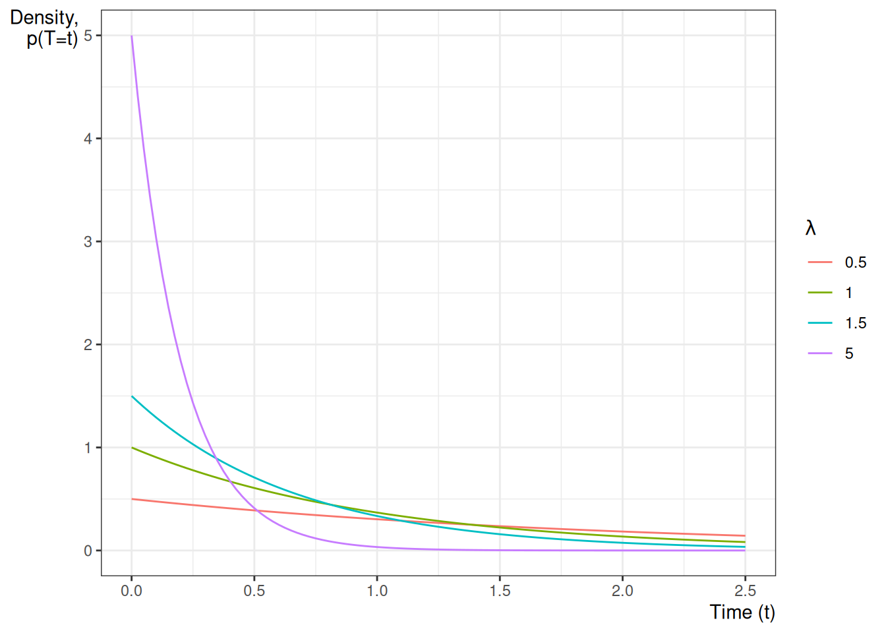](intro-to-survival-analysis_files/figure-html/unnamed-chunk-1-1.png)

## 4.2 The Cumulative Distribution Function (CDF)

The **[cumulative distribution function](https://morrison-lab.github.io/pds/random-variables.html#def-cdf)** is defined as:

$$\begin{aligned}
F(t) &\stackrel{\text{def}}{=}\Pr(T \le t)\\
&=\int_{u=-\infty}^t f(u) du
\end{aligned}$$

> **NOTE:**
>
> **Example 5 (exponential distribution)** Recall from Epi 202: the cdf of the [exponential distribution](https://morrison-lab.github.io/pds/random-variables.html#def-exponential) family of models is:
>
> $$P(T\le t) = \text{1}_{t \ge 0} \cdot (1- \text{e}^{-{\lambda}t})$$ where ${\lambda}> 0$.

Here are some examples of exponential cdfs:

[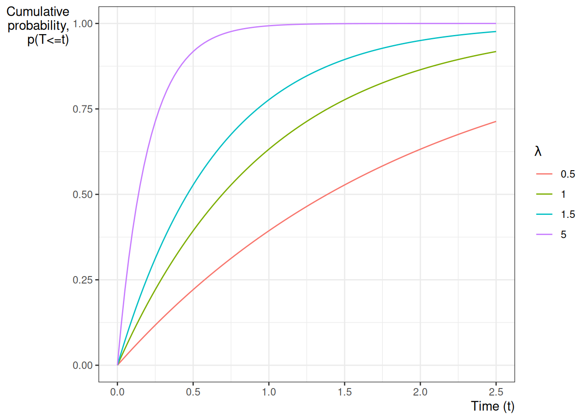](intro-to-survival-analysis_files/figure-html/unnamed-chunk-2-1.png)

## 4.3 The Survival Function

For survival data, a more important quantity is the **survival function**:

> **NOTE:**
>
> **Definition 4 (Survival function (survivor function))**  
>
> Given a [random time-to-event variable](https://morrison-lab.github.io/pds/random-variables.html#def-random-variable) $T$, the **survival function** or **survivor function**, denoted $\operatorname{S}(t)$, is the probability that the event time is later than $t$. If the event in a clinical trial is death, then $\operatorname{S}(t)$ is the [expected](https://morrison-lab.github.io/pds/expectation.html#def-expectation) fraction of the original population at time 0 who have survived up to time $t$ and are still alive at time $t$; that is:
>
> $$\operatorname{S}(t) \stackrel{\text{def}}{=}\Pr(T > t)$$

> **NOTE:**
>
> **Theorem 1 (Equivalent expressions for the survival function)** $$\begin{aligned}
> \operatorname{S}(t) &\stackrel{\text{def}}{=}\Pr(T > t)\\
> &=\int_{u=t}^\infty p(u) du\\
> &=1-F(t)\\
> \end{aligned}$$

> **NOTE:**
>
> **Example 6 (exponential distribution)** Since $\operatorname{S}(t) = 1 - F(t)$, the survival function of the [exponential](https://morrison-lab.github.io/pds/random-variables.html#def-exponential) distribution family of models is:
>
> $$P(T> t) =
> \begin{cases}
> \text{e}^{-{\lambda}t}, & t \ge 0 \\
> 1, & t \le 0
> \end{cases}$$ where ${\lambda}> 0$.
>
> [Figure 1](#fig-exp-survfuns) shows some examples of exponential survival functions.

------------------------------------------------------------------------

Show R code

``` downlit
library(ggplot2)
ggplot() +
  geom_function(
    aes(col = "0.5"),
    fun = pexp,
    args = list(lower.tail = FALSE, rate = 0.5)
  ) +
  geom_function(
    aes(col = "1"),
    fun = pexp,
    args = list(lower.tail = FALSE, rate = 1)
  ) +
  geom_function(
    aes(col = "1.5"),
    fun = pexp,
    args = list(lower.tail = FALSE, rate = 1.5)
  ) +
  geom_function(
    aes(col = "5"),
    fun = pexp,
    args = list(lower.tail = FALSE, rate = 5)
  ) +
  theme_bw() +
  ylab("Survival\nprobability,\nS(t)") +
  guides(col = guide_legend(title = expr(lambda))) +
  xlab("Time (t)") +
  xlim(0, 2.5) +
  theme(
    legend.position = "bottom",
    axis.title.x =
      element_text(
        angle = 0,
        vjust = 1,
        hjust = 1
      ),
    axis.title.y =
      element_text(
        angle = 0,
        vjust = 1,
        hjust = 1
      )
  )
```

> **NOTE:**
>
> [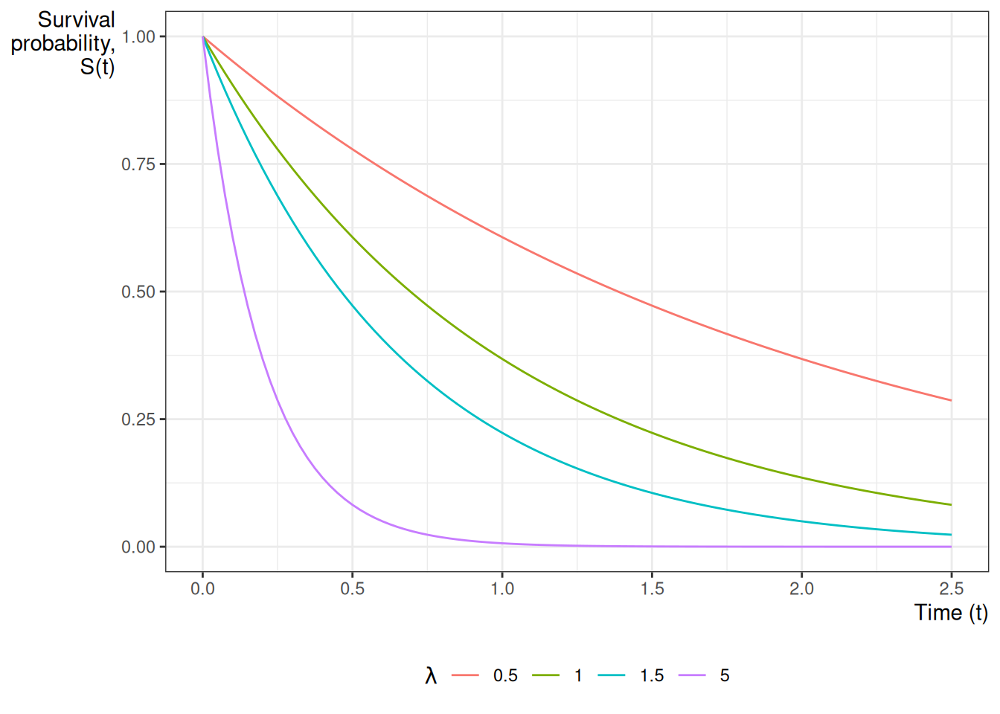](intro-to-survival-analysis_files/figure-html/fig-exp-survfuns-1.png "Figure 1: Exponential Survival Functions")
>
> Figure 1: Exponential Survival Functions

> **NOTE:**
>
> **Theorem 2 (Survival function as expected survival status)** If $A_t$ represents survival status at time $t$, with $A_t = 1$ denoting alive at time $t$ and $A_t = 0$ denoting deceased at time $t$, then:
>
> $$\operatorname{S}(t) = \mathbb{P}(A_t=1) = {\mathbb{E}\mathopen{}\left[A_t\right]\mathclose{}}$$

> **NOTE:**
>
> **Theorem 3 (Mean as the integral of the survival function)** If $T$ is a nonnegative [random variable](https://morrison-lab.github.io/pds/random-variables.html#def-random-variable), then:
>
> $${\mathbb{E}\mathopen{}\left[T\right]\mathclose{}} = \int_{t=0}^{\infty} \operatorname{S}(t)\,dt$$

------------------------------------------------------------------------

> **NOTE:**
>
> *Proof*. Adapted from the StatProofBook proof “Mean of non-negative random variable” [\[2\]](#ref-statproofbook) at <https://statproofbook.github.io/P/mean-nnrvar.html>.
>
> > **NOTE:**
> >
> > Show R code
> >
> > ``` downlit
> > library(ggplot2)
> > u_max <- 6
> > tri_df <- data.frame(t = c(0, u_max, 0), u = c(0, u_max, u_max))
> > ggplot(tri_df, aes(x = t, y = u)) +
> >   geom_polygon(fill = "steelblue", alpha = 0.3) +
> >   geom_abline(slope = 1, intercept = 0, linetype = "dashed") +
> >   annotate(
> >     "text",
> >     x = 0.65 * u_max,
> >     y = 0.15 * u_max,
> >     label = "0 ≤ t ≤ u"
> >   ) +
> >   annotate(
> >     "text",
> >     x = 0.15 * u_max,
> >     y = 0.9 * u_max,
> >     label = "0 ≤ u < ∞"
> >   ) +
> >   coord_fixed() +
> >   theme_bw() +
> >   labs(x = "Time, t", y = "Integration variable, u")
> > library(ggplot2)
> > u_max <- 6
> > tri_df <- data.frame(t = c(0, u_max, 0), u = c(0, u_max, u_max))
> > ggplot(tri_df, aes(x = t, y = u)) +
> >   geom_polygon(fill = "tomato", alpha = 0.3) +
> >   geom_abline(slope = 1, intercept = 0, linetype = "dashed") +
> >   annotate(
> >     "text",
> >     x = 0.15 * u_max,
> >     y = 0.9 * u_max,
> >     label = "0 ≤ t < ∞"
> >   ) +
> >   annotate(
> >     "text",
> >     x = 0.65 * u_max,
> >     y = 0.15 * u_max,
> >     label = "t ≤ u < ∞"
> >   ) +
> >   coord_fixed() +
> >   theme_bw() +
> >   labs(x = "Time, t", y = "Integration variable, u")
> > ```
> >
> > [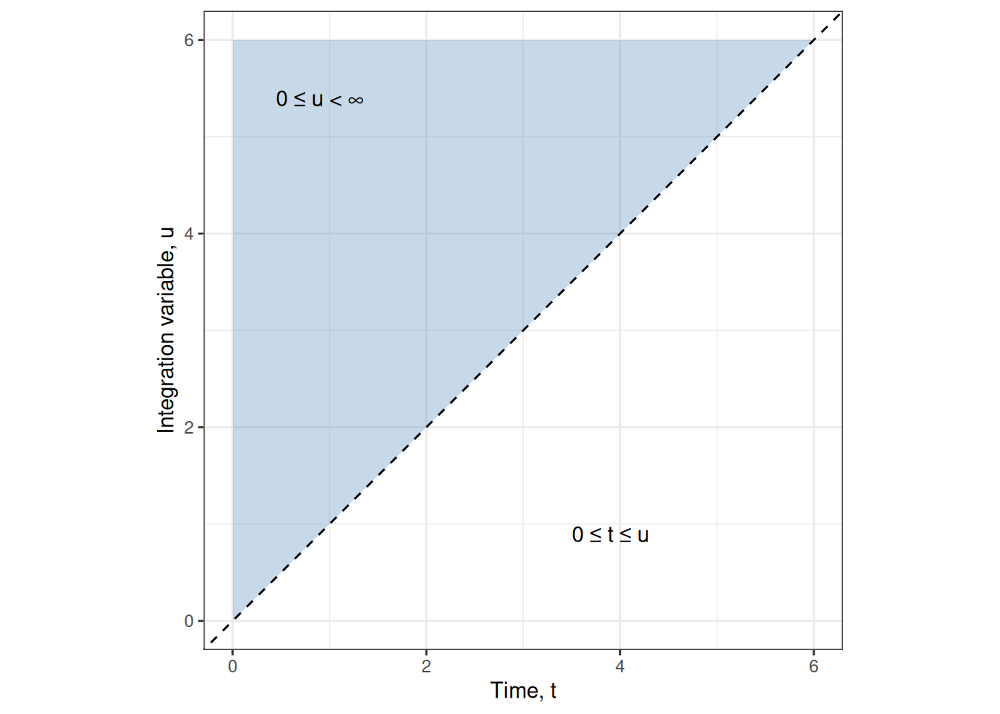](intro-to-survival-analysis_files/figure-html/fig-integration-before-1.png "Figure 2 (a): Original order: for each u, t ranges over [0, u].")
> >
> > \(a\) Original order: for each $u$, $t$ ranges over $[0, u]$.
> >
> > [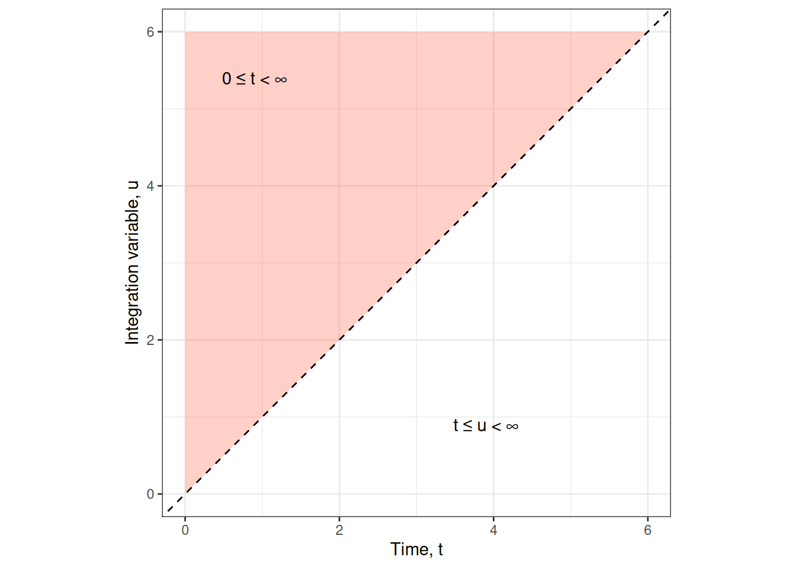](intro-to-survival-analysis_files/figure-html/fig-integration-after-1.png "Figure 2 (b): Reversed order: for each t, u ranges over [t, \infty).")
> >
> > \(b\) Reversed order: for each $t$, $u$ ranges over $[t, \infty)$.
> >
> > Figure 2: The same triangular region in the $(t, u)$-plane, described in two equivalent ways: $0 \le t \le u < \infty$ (left, original order) and $0 \le t < \infty,\ t \le u < \infty$ (right, reversed order).
>
> [Figure 2](#fig-surv-and-mean-integration-bounds) shows the same integration region under the two equivalent orderings. Since $\operatorname{f}(u) \ge 0$, the third equality step swaps the order of integration by [Tonelli’s theorem](https://morrison-lab.github.io/mds/calculus-double-integrals.html#thm-fubini-tonelli) (see the Fubini–Tonelli proof of the [survival-function mean theorem](https://morrison-lab.github.io/pds/expectation.html#thm-surv-mean) in the probability chapter for the formal argument):
>
> $$\begin{aligned}
> {\mathbb{E}\mathopen{}\left[T\right]\mathclose{}}
> &= \int_{u=0}^{\infty} u\operatorname{f}(u)\,du\\
> &= \int_{u=0}^{\infty}\mathopen{}\left(\int_{t=0}^{u} 1\,dt\right)\mathclose{}\operatorname{f}(u)\,du\\
> &= \int_{u=0}^{\infty}\int_{t=0}^{u} \operatorname{f}(u)\,dt\,du\\
> &= \int_{t=0}^{\infty}\int_{u=t}^{\infty} \operatorname{f}(u)\,du\,dt\\
> &= \int_{t=0}^{\infty}\mathbb{P}(T>t)\,dt\\
> &= \int_{t=0}^{\infty}\operatorname{S}(t)\,dt.
> \end{aligned}$$

## 4.4 The Inverse Survival Function

> **NOTE:**
>
> **Definition 5 (Inverse survival function (survival quantile function))** Given a [random time-to-event variable](https://morrison-lab.github.io/pds/random-variables.html#def-random-variable) $T$ with survival function $\operatorname{S}(t)$ ([Definition 4](#def-surv-fn)), the **inverse survival function** (ISF), also called the **survival quantile function** (SQF), $\operatorname{S}^{-1}(p)$ is the earliest time $t$ at which the survival probability has fallen to or below $p$:
>
> $$\operatorname{S}^{-1}(p) \stackrel{\text{def}}{=}\inf\mathopen{}\left\{t \ge 0 : \operatorname{S}(t) \le p\right\}\mathclose{}, \quad 0 < p < 1.$$

> **NOTE:**
>
> **Example 7 (Exponential distribution)** For an [exponential distribution](https://morrison-lab.github.io/pds/random-variables.html#def-exponential) with rate ${\lambda}> 0$, the survival function is $\operatorname{S}(t) = \text{e}^{-{\lambda}t}$.
>
> Setting $\operatorname{S}(t) = p$ and solving for $t$:
>
> $$\begin{aligned}
> \text{e}^{-{\lambda}t} &= p\\
> -{\lambda}t &= {\operatorname{log}\mathopen{}\left\{p\right\}\mathclose{}}\\
> t &= \frac{-{\operatorname{log}\mathopen{}\left\{p\right\}\mathclose{}}}{{\lambda}},
> \end{aligned}$$
>
> so the inverse survival function of the exponential distribution is:
>
> $$\operatorname{S}^{-1}(p) = \frac{-{\operatorname{log}\mathopen{}\left\{p\right\}\mathclose{}}}{{\lambda}}.$$
>
> > **NOTE:**
> >
> > Show R code
> >
> > ``` downlit
> > library(ggplot2)
> >
> > p_seq <- seq(0.001, 0.999, length.out = 500)
> > rates <- c(0.5, 1, 2, 4)
> >
> > df_isf <- do.call(rbind, lapply(rates, function(lam) {
> >   data.frame(
> >     p = p_seq,
> >     isf = -log(p_seq) / lam,
> >     lambda = factor(
> >       paste0("λ = ", lam),
> >       levels = paste0("λ = ", rates)
> >     )
> >   )
> > }))
> >
> > ggplot(df_isf, aes(x = p, y = isf, color = lambda)) +
> >   geom_line() +
> >   labs(
> >     x = expression("Probability, " * p),
> >     y = expression("Survival time, " * S^{-1}*(p)),
> >     color = NULL
> >   ) +
> >   theme_bw()
> > ```
> >
> > [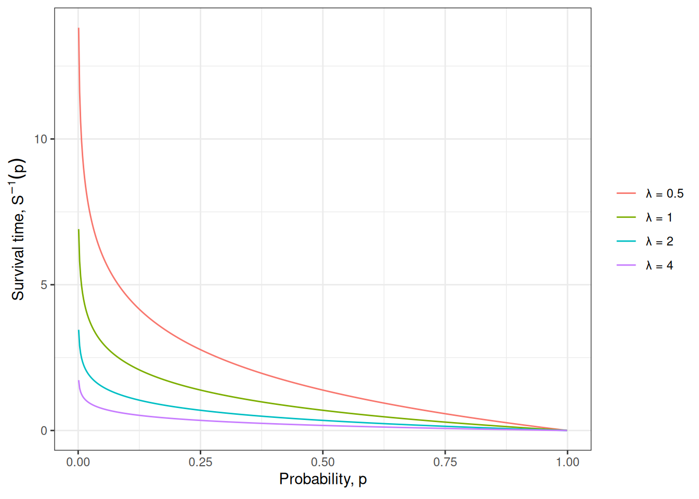](intro-to-survival-analysis_files/figure-html/unnamed-chunk-3-1.png "Figure 3: Exponential inverse survival function \operatorname{S}^{-1}(p) = -\log(p)/{\lambda} for various rate parameters {\lambda}.")
> >
> > Figure 3: Exponential inverse survival function $\operatorname{S}^{-1}(p) = -\log(p)/{\lambda}$ for various rate parameters ${\lambda}$.

> **NOTE:**
>
> **Definition 6 (Median survival time)** Given a random time-to-event variable $T$ with survival function $\operatorname{S}(t)$ ([Definition 4](#def-surv-fn)) and inverse survival function $\operatorname{S}^{-1}(p)$ ([Definition 5](#def-inv-surv-fn)), the **median survival time** $t_{\text{med}}$ is the earliest time by which the survival probability has fallen to or below one half:
>
> $$t_{\text{med}} \stackrel{\text{def}}{=}\operatorname{S}^{-1}(0.5) = \inf\mathopen{}\left\{t \ge 0 : \operatorname{S}(t) \le 0.5\right\}\mathclose{}.$$
>
> [\[3, Ch. 2\]](#ref-klein2003survival)

When $\operatorname{S}(t)$ is continuous and strictly decreasing, $t_{\text{med}}$ is the unique time at which $\operatorname{S}(t_{\text{med}}) = 0.5$: half of the population has experienced the event by $t_{\text{med}}$, and half has not.

> **NOTE:**
>
> **Example 8 (Median survival time of an exponential distribution)** Suppose patients in a clinical trial have exponentially distributed survival times with rate ${\lambda}= 2$ events per year. What is the median survival time ([Definition 6](#def-median-survival))?
>
> Using the exponential inverse survival function from [Example 7](#exm-inv-surv-exp):
>
> $$\begin{aligned}
> t_{\text{med}}
> &= \operatorname{S}^{-1}(0.5)
> && \text{(definition of median survival time)}
> \\
> &= \frac{-{\operatorname{log}\mathopen{}\left\{0.5\right\}\mathclose{}}}{2}
> && \text{(exponential inverse survival function with ${\lambda}= 2$)}
> \\
> &= \frac{{\operatorname{log}\mathopen{}\left\{2\right\}\mathclose{}}}{2}
> && \text{($-{\operatorname{log}\mathopen{}\left\{1/2\right\}\mathclose{}} = {\operatorname{log}\mathopen{}\left\{2\right\}\mathclose{}}$)}
> \\
> &\approx \frac{0.693}{2}
> && \text{(${\operatorname{log}\mathopen{}\left\{2\right\}\mathclose{}} \approx 0.693$)}
> \\
> &\approx 0.347 \text{ years.}
> && \text{(arithmetic)}
> \end{aligned}$$
>
> [Figure 4 (a)](#fig-isf-surv-exp-median) and [Figure 4 (b)](#fig-isf-isf-exp-median) show the survival function $\operatorname{S}(t) = \text{e}^{-2t}$ and the inverse survival function $\operatorname{S}^{-1}(p) = -\log(p)/2$, each with the median survival point highlighted.
>
> > **NOTE:**
> >
> > Show R code
> >
> > ``` downlit
> > library(ggplot2)
> >
> > lam <- 2
> > t_med <- log(2) / lam
> > t_seq <- seq(0, 2, length.out = 500)
> > p_seq <- seq(0.001, 0.999, length.out = 500)
> >
> > ggplot(
> >   data.frame(t = t_seq, s = exp(-lam * t_seq)),
> >   aes(x = t, y = s)
> > ) +
> >   geom_line() +
> >   geom_segment(
> >     aes(x = 0, xend = t_med, y = 0.5, yend = 0.5),
> >     linetype = "dashed", color = "red"
> >   ) +
> >   geom_segment(
> >     aes(x = t_med, xend = t_med, y = 0, yend = 0.5),
> >     linetype = "dashed", color = "red"
> >   ) +
> >   geom_point(aes(x = t_med, y = 0.5), color = "red", size = 3) +
> >   labs(
> >     x = "Time, t (years)",
> >     y = expression("Survival probability, " * S(t))
> >   ) +
> >   theme_bw()
> > ```
> >
> > [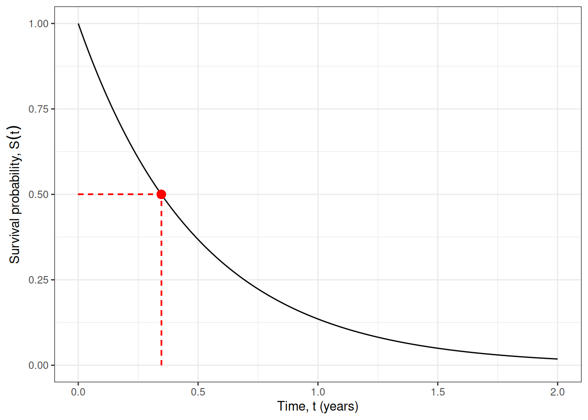](intro-to-survival-analysis_files/figure-html/unnamed-chunk-4-1.png "Figure 4 (a): Survival function \operatorname{S}(t).")
> >
> > \(a\) Survival function $\operatorname{S}(t)$.
> >
> > Show R code
> >
> > ``` downlit
> > ggplot(
> >   data.frame(p = p_seq, isf = -log(p_seq) / lam),
> >   aes(x = p, y = isf)
> > ) +
> >   geom_line() +
> >   geom_segment(
> >     aes(x = 0.5, xend = 0.5, y = 0, yend = t_med),
> >     linetype = "dashed", color = "red"
> >   ) +
> >   geom_segment(
> >     aes(x = 0, xend = 0.5, y = t_med, yend = t_med),
> >     linetype = "dashed", color = "red"
> >   ) +
> >   geom_point(aes(x = 0.5, y = t_med), color = "red", size = 3) +
> >   labs(
> >     x = "Probability, p",
> >     y = expression("Survival time, " * S^{-1} * (p))
> >   ) +
> >   theme_bw()
> > ```
> >
> > [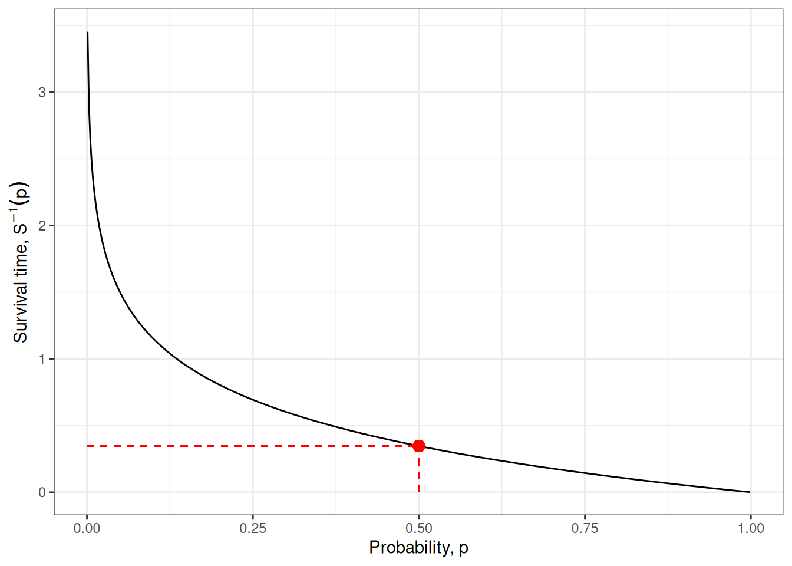](intro-to-survival-analysis_files/figure-html/unnamed-chunk-5-1.png "Figure 4 (b): Inverse survival function \operatorname{S}^{-1}(p).")
> >
> > \(b\) Inverse survival function $\operatorname{S}^{-1}(p)$.
> >
> > Figure 4: For ${\lambda}= 2$, the survival function $\operatorname{S}(t)$ ([Figure 4 (a)](#fig-isf-surv-exp-median)) and inverse survival function $\operatorname{S}^{-1}(p)$ ([Figure 4 (b)](#fig-isf-isf-exp-median)), with the median survival time $\operatorname{S}^{-1}(0.5) \approx 0.347$ years shown as a red point.
>
> In R:
>
> Show R code
>
> ``` downlit
> qexp(p = 0.5, rate = 2)
> #> [1] 0.346574
> ```

> **NOTE:**
>
> **Example 9 (A survival function with no finite median (counterexample))** Suppose 60% of patients are cured and never experience the event, while the other 40% have exponentially distributed event times with rate ${\lambda}= 1$ per year, so that $\operatorname{S}(t) = 0.6 + 0.4\,\text{e}^{-t}$. To find $t_{\text{med}}$ ([Definition 6](#def-median-survival)), we look for times $t$ with $\operatorname{S}(t) \le 0.5$:
>
> $$\begin{aligned}
> \operatorname{S}(t) \le 0.5
> &\iff 0.6 + 0.4\,\text{e}^{-t} \le 0.5
> && \text{(substitute $\operatorname{S}(t)$)}
> \\
> &\iff 0.4\,\text{e}^{-t} \le -0.1
> && \text{(subtract 0.6 from both sides)}
> \\
> &\iff \text{e}^{-t} \le -0.25
> && \text{(divide both sides by $0.4 > 0$)}
> \end{aligned}$$
>
> No $t$ satisfies $\text{e}^{-t} \le -0.25$, because $\text{e}^{-t} > 0$ for every $t$. The set $\mathopen{}\left\{t \ge 0 : \operatorname{S}(t) \le 0.5\right\}\mathclose{}$ is empty, so this population has no finite [median survival time](#def-median-survival) (by the convention $\inf \emptyset = \infty$, $t_{\text{med}} = \infty$).

> **NOTE:**
>
> **Theorem 4 (Inverse survival function is the quantile function)** The inverse survival function equals the $(1-p)$th [population quantile](https://morrison-lab.github.io/pds/random-variables.html#def-quantile-function) of $T$:
>
> $$\operatorname{S}^{-1}(p) = Q(1 - p),$$
>
> where $Q(u) = \inf\mathopen{}\left\{t : \operatorname{F}(t) \ge u\right\}\mathclose{}$ is the quantile function of $T$.

> **NOTE:**
>
> *Proof*. Since $\operatorname{S}(t) = 1 - \operatorname{F}(t)$,
>
> $$\begin{aligned}
> \operatorname{S}(t) \le p
> &\iff 1 - \operatorname{F}(t) \le p\\
> &\iff \operatorname{F}(t) \ge 1 - p.
> \end{aligned}$$
>
> Therefore,
>
> $$\operatorname{S}^{-1}(p)
> = \inf\mathopen{}\left\{t \ge 0 : \operatorname{S}(t) \le p\right\}\mathclose{}
> = \inf\mathopen{}\left\{t \ge 0 : \operatorname{F}(t) \ge 1-p\right\}\mathclose{}.$$
>
> Since $T \ge 0$ almost surely, $\operatorname{F}(t) = 0 < 1-p$ for all $t < 0$ (using $p < 1$), so no $t < 0$ satisfies $\operatorname{F}(t) \ge 1-p$; hence the constraint $t \ge 0$ is redundant and can be dropped:
>
> $$\inf\mathopen{}\left\{t \ge 0 : \operatorname{F}(t) \ge 1-p\right\}\mathclose{}
> = \inf\mathopen{}\left\{t : \operatorname{F}(t) \ge 1-p\right\}\mathclose{}
> = Q(1-p).$$

## 4.5 The Hazard Function

Another important quantity is the **hazard function**:

> **NOTE:**
>
> **Definition 7 (Hazard function, hazard rate, hazard rate function)**  
>
> The **hazard function**, **hazard rate**, **hazard rate function**, for a [random variable](https://morrison-lab.github.io/pds/random-variables.html#def-random-variable) $T$ at value $t$, typically denoted as $\text{h}(t)$ [^1] or $\lambda(t)$, [^2] is the conditional [density](https://morrison-lab.github.io/pds/random-variables.html#def-pdf) of $T$ at $t$, given $T \ge t$. Specifically, the hazard function is defined as:
>
> $${\lambda}(t) \stackrel{\text{def}}{=}\operatorname{p}(T=t|T\ge t)$$

> **NOTE:**
>
> *Remark 1* (Interpretation of the hazard function). If $T$ represents the time at which an event occurs, then ${\lambda}(t)$ is the probability that the event occurs at time $t$, given that it has not occurred prior to time $t$.

> **NOTE:**
>
> *Remark 2* (Naming the hazard by the valence of the event). The name “hazard” carries a connotation that the event is undesirable — death, relapse, equipment failure, etc. When the event in question is neutral or desirable (recovery, conception, graduation, response to treatment), the same quantity ${\lambda}(t)$ is often called the **event incidence rate** instead. This terminology is parallel to the convention that conditional probabilities of undesirable events are called **risks**, while the same conditional probabilities for neutral/desirable events are simply called **probabilities**. The math is identical; only the name changes with the valence of the event.

------------------------------------------------------------------------

> **NOTE:**
>
> **Definition 8 (Incidence rate)** Given a [population](https://morrison-lab.github.io/sds/exploratory-descriptive.html#def-population) of $N$ individuals indexed by $i$, each with their own [hazard rate](#def-hazard) ${\lambda}_i(t)$, the **incidence rate** for that population is the mean hazard rate:
>
> $$\bar{{\lambda}}(t) \stackrel{\text{def}}{=}\frac{1}{N}\sum_{i=1}^N{\lambda}_i(t)$$

> **NOTE:**
>
> **Theorem 5 (Incidence rate in a homogenous population)** If a population of individuals indexed by $i$ all have identical hazard rates ${\lambda}_i(t) = {\lambda}(t)$, then the **incidence rate** for that population is equal to the hazard rate:
>
> $$\bar{{\lambda}}(t) = {\lambda}(t)$$

> **NOTE:**
>
> *Proof*. By [Definition 8](#def-incidence-rate), the incidence rate is:
>
> $$\begin{aligned}
> \bar{{\lambda}}(t)
> &\stackrel{\text{def}}{=}\frac{1}{N}\sum_{i=1}^N{\lambda}_i(t) && \text{(definition of incidence rate)} \\
> &= \frac{1}{N}\sum_{i=1}^N{\lambda}(t) && \text{(since } {\lambda}_i(t) = {\lambda}(t) \text{ for all } i \text{)} \\
> &= \frac{1}{N} \cdot N {\lambda}(t) && \text{(summing } N \text{ identical terms)} \\
> &= {\lambda}(t) && \text{(simplifying)}
> \end{aligned}
> \tag{1}$$

> **NOTE:**
>
> **Example 10 (Incidence rate in a homogenous population)** Suppose a population has $N = 3$ individuals, each with hazard rate ${\lambda}_i(t) = 0.02$ events per [person-year](https://morrison-lab.github.io/mds/algebra-sums.html#def-person-years). By [Definition 8](#def-incidence-rate):
>
> $$\begin{aligned}
> \bar{{\lambda}}(t)
> &= \frac{1}{3}\mathopen{}\left(0.02 + 0.02 + 0.02\right)\mathclose{} && \text{(definition of incidence rate)} \\
> &= \frac{1}{3} \cdot 0.06 && \text{(add)} \\
> &= 0.02 && \text{(divide)}
> \end{aligned}
> \tag{2}$$
>
> which equals the common hazard rate, as [Theorem 5](#thm-homogenous-incidence) says.

> **NOTE:**
>
> **Example 11 (Incidence rate in a heterogeneous population)** If instead the three individuals have hazard rates $0.01$, $0.02$, and $0.06$ events per person-year, then:
>
> $$\begin{aligned}
> \bar{{\lambda}}(t)
> &= \frac{1}{3}\mathopen{}\left(0.01 + 0.02 + 0.06\right)\mathclose{} && \text{(definition of incidence rate)} \\
> &= \frac{1}{3} \cdot 0.09 && \text{(add)} \\
> &= 0.03 && \text{(divide)}
> \end{aligned}
> \tag{3}$$
>
> which differs from every individual’s hazard rate, so the conclusion of [Theorem 5](#thm-homogenous-incidence) needs its assumption of identical hazards.

------------------------------------------------------------------------

The hazard function has an important relationship to the [density](https://morrison-lab.github.io/pds/random-variables.html#def-pdf) and [survival functions](#def-surv-fn), which we can use to derive the hazard function for a given probability distribution ([Theorem 6](#thm-hazard-dens-surv)).

> **NOTE:**
>
> **Lemma 1 (Joint probability of a variable with itself)** $$\operatorname{p}(T=t, T\ge t) = \operatorname{p}(T=t)$$
>
> > **NOTE:**
> >
> > *Proof*. By the [subset property](https://morrison-lab.github.io/pds/probability-basics.html#thm-prob-subset), if $A\subseteq B$ then ${\Pr\mathopen{}\left(A \cap B\right)\mathclose{}} = {\Pr\mathopen{}\left(A\right)\mathclose{}}$. In this chapter, the comma notation $\operatorname{p}(A, B)$ means the joint probability ${\Pr\mathopen{}\left(A \cap B\right)\mathclose{}}$, and $\operatorname{p}(A)$ means ${\Pr\mathopen{}\left(A\right)\mathclose{}}$. Since $\{T=t\} \subseteq \{T\geq t\}$:
> >
> > $$\begin{aligned}
> > \operatorname{p}(T=t, T\ge t)
> > &\stackrel{\text{def}}{=}{\Pr\mathopen{}\left(\{T=t\} \cap \{T\ge t\}\right)\mathclose{}}
> > && \text{(comma notation for joint probability)}
> > \\ &= {\Pr\mathopen{}\left(\{T=t\}\right)\mathclose{}}
> > && \text{(subset property, since } \{T=t\} \subseteq \{T\ge t\} \text{)}
> > \\ &\stackrel{\text{def}}{=}\operatorname{p}(T=t)
> > && \text{(notation for } \Pr \text{)}
> > \end{aligned}$$

> **NOTE:**
>
> **Theorem 6 (Hazard equals density over survival)** $${\lambda}(t)=\frac{f(t)}{\operatorname{S}(t)}$$

------------------------------------------------------------------------

> **NOTE:**
>
> *Proof*. $$\begin{aligned}
> {\lambda}(t) &=p(T=t|T\ge t)\\
> &=\frac{p(T=t, T\ge t)}{p(T \ge t)}\\
> &=\frac{p(T=t)}{p(T \ge t)}\\
> &=\frac{f(t)}{\operatorname{S}(t)}
> \end{aligned}$$

> **NOTE:**
>
> **Example 12 (exponential distribution)** The hazard function of the [exponential distribution](https://morrison-lab.github.io/pds/random-variables.html#def-exponential) family of models is:
>
> $$\begin{aligned}
> P(T=t|T \ge t)
> &= \frac{f(t)}{\operatorname{S}(t)}\\
> &= \frac{\text{1}_{t \ge 0}\cdot {\lambda}\text{e}^{-{\lambda}t}}{\text{e}^{-{\lambda}t}}\\
> &=\text{1}_{t \ge 0}\cdot {\lambda}
> \end{aligned}$$ [Figure 5](#fig-exp-hazard) shows some examples of exponential hazard functions.

------------------------------------------------------------------------

> **NOTE:**
>
> [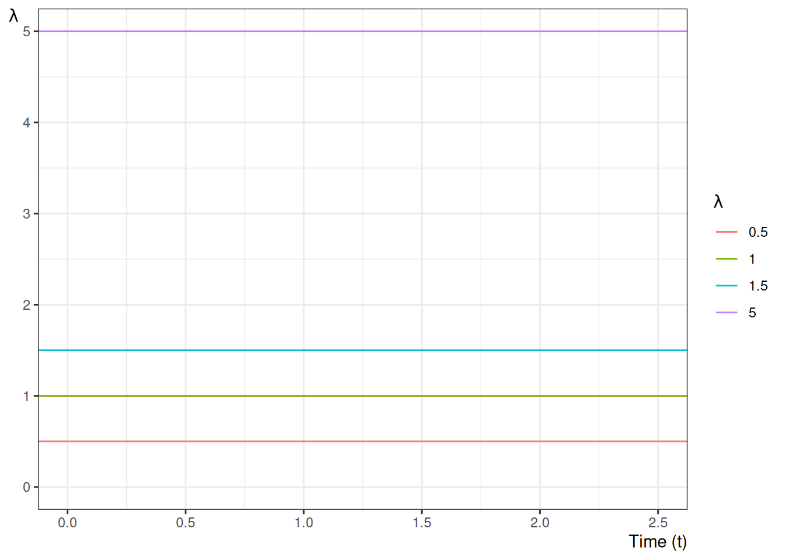](intro-to-survival-analysis_files/figure-html/fig-exp-hazard-1.png "Figure 5: Examples of hazard functions for exponential distributions")
>
> Figure 5: Examples of hazard functions for exponential distributions

------------------------------------------------------------------------

We can also view the hazard function as the [derivative](https://morrison-lab.github.io/mds/calculus-derivatives.html#def-derivative) of the negative of the [logarithm](https://morrison-lab.github.io/mds/algebra-exponentials.html#def-natural-log) of the survival function:

> **NOTE:**
>
> **Theorem 7 (transform survival to hazard)** $${\lambda}(t) = \frac{\partial}{\partial t}\mathopen{}\left\{-\log{\operatorname{S}(t)}\right\}\mathclose{}$$

------------------------------------------------------------------------

> **NOTE:**
>
> *Proof*. $$\begin{aligned}
> {\lambda}(t)
> &= \frac{f(t)}{\operatorname{S}(t)}\\
> &= \frac{-S'(t)}{\operatorname{S}(t)}\\
> &= -\frac{S'(t)}{\operatorname{S}(t)}\\
> &=-\frac{\partial}{\partial t}\log{\operatorname{S}(t)}\\
> &=\frac{\partial}{\partial t}\mathopen{}\left\{-\log{\operatorname{S}(t)}\right\}\mathclose{}
> \end{aligned}$$

> **NOTE:**
>
> **Definition 9 (hazard ratio)** $$\text{ϙ}_{{\lambda}}(t| \mathord{\smash[b]{\underset{\raise.3ex\hbox{$\scriptstyle\sim$}}{x}}\vphantom{x}}: \mathord{{\mathord{\smash[b]{\underset{\raise.3ex\hbox{$\scriptstyle\sim$}}{x}}\vphantom{x}}^*}}) \stackrel{\text{def}}{=}\frac{{\lambda}(t|\mathord{\smash[b]{\underset{\raise.3ex\hbox{$\scriptstyle\sim$}}{x}}\vphantom{x}})}{{\lambda}(t|\mathord{{\mathord{\smash[b]{\underset{\raise.3ex\hbox{$\scriptstyle\sim$}}{x}}\vphantom{x}}^*}})}$$

> **NOTE:**
>
> **Definition 10 (Conditional survival probability at an event time)** At event time $t_i$, the **conditional survival probability** is
>
> $$\kappa_i \stackrel{\text{def}}{=}\operatorname{p}(T > t_i \mid T \ge t_i).$$

> **NOTE:**
>
> **Theorem 8 (Conditional survival is the complement of the discrete hazard increment)** Let ${\lambda}_i \stackrel{\text{def}}{=}\operatorname{p}(T=t_i \mid T \ge t_i)$ be the [discrete hazard increment](#def-discrete-haz-risk) at event time $t_i$. Then $\kappa_i = 1 - {\lambda}_i$.

> **NOTE:**
>
> *Proof*. $$\begin{aligned}
> \kappa_i
> &= \operatorname{p}(T > t_i \mid T \ge t_i) \\
> &= 1 - \operatorname{p}(T \le t_i \mid T \ge t_i) \\
> &= 1 - \operatorname{p}(T = t_i \mid T \ge t_i) \\
> &= 1 - {\lambda}_i.
> \end{aligned}$$

> **NOTE:**
>
> **Example 13 (Time to death in the US in 2004)** The first day is the most dangerous:
>
> > **NOTE:**
> >
> > Show R code
> >
> > ``` downlit
> > # survexp.rda is stored locally in Data/survexp.rda
> > # newer versions of survival dropped the first-year age breakdown
> >
> > fs::path(
> >   here::here(),
> >   "Data",
> >   "survexp.rda"
> > ) |>
> >   load() |>
> >   invisible()
> > s1 <- survexp.us[, "female", "2004"]
> > age1 <- c(
> >   0.5 / 365.25,
> >   4 / 365.25,
> >   17.5 / 365.25,
> >   196.6 / 365.25,
> >   1:109 + 0.5
> > )
> > cols <- rep(1, 113)
> > cols[1] <- 2
> > cols[2] <- 3
> > cols[3] <- 4
> >
> > plot(
> >   age1, s1,
> >   type = "b", lwd = 2,
> >   xlab = "Age", ylab = "Daily Hazard Rate",
> >   col = cols
> > )
> >
> > text(10, .003, "First Day", col = 2)
> > text(18, .00030, "Rest of First Week", col = 3)
> > text(18, .00015, "Rest of First month", col = 4)
> > ```
> >
> > [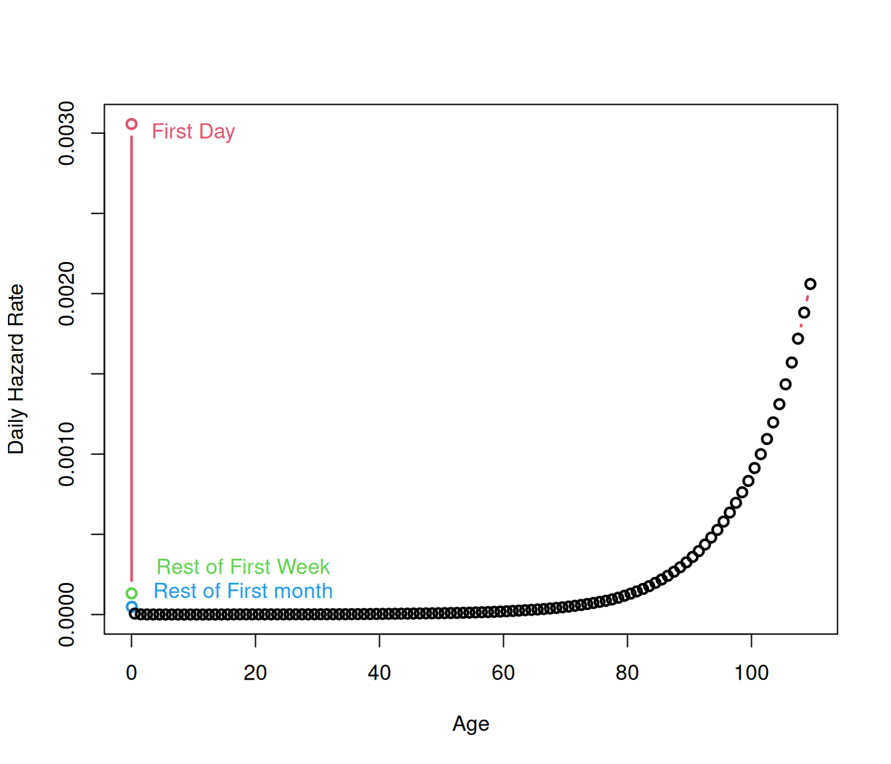](intro-to-survival-analysis_files/figure-html/unnamed-chunk-7-1.png "Figure 6: Daily Hazard Rates in 2004 for US Females")
> >
> > Figure 6: Daily Hazard Rates in 2004 for US Females
>
> > **NOTE:**
> >
> > Show R code
> >
> > ``` downlit
> > yrs <- 1:40
> > s1 <- survexp.us[5:113, "male", "2004"]
> > s2 <- survexp.us[5:113, "female", "2004"]
> >
> > age1 <- 1:109
> >
> > plot(
> >   age1[yrs], s1[yrs],
> >   type = "l", lwd = 2,
> >   xlab = "Age", ylab = "Daily Hazard Rate"
> > )
> > lines(age1[yrs], s2[yrs], col = 2, lwd = 2)
> > legend(5, 5e-6, c("Males", "Females"), col = 1:2, lwd = 2)
> > ```
> >
> > [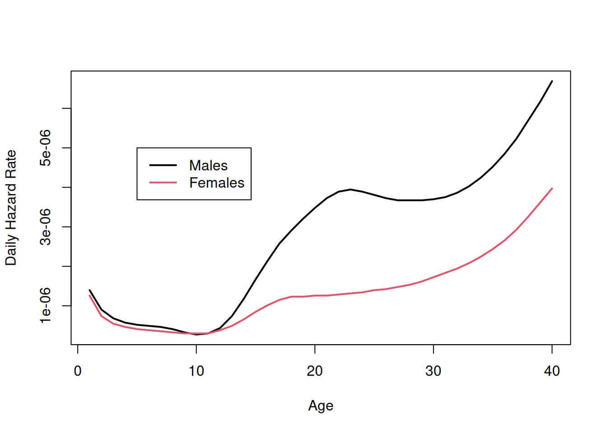](intro-to-survival-analysis_files/figure-html/unnamed-chunk-8-1.png "Figure 7: Daily Hazard Rates in 2004 for US Males and Females 1-40")
> >
> > Figure 7: Daily Hazard Rates in 2004 for US Males and Females 1-40
>
> > **NOTE:**
> >
> > Show R code
> >
> > ``` downlit
> > s1 <- survexp.us[, "female", "2004"]
> >
> > s2 <- 365.25 * s1[5:113]
> > s2 <- c(s1[1], 6 * s1[2], 21 * s1[3], 337.25 * s1[4], s2)
> > cs2 <- cumsum(s2)
> > age2 <- c(1 / 365.25, 7 / 365.25, 28 / 365.25, 1:110)
> > plot(age2, exp(-cs2), type = "l", lwd = 2, xlab = "Age", ylab = "Survival")
> > ```
> >
> > [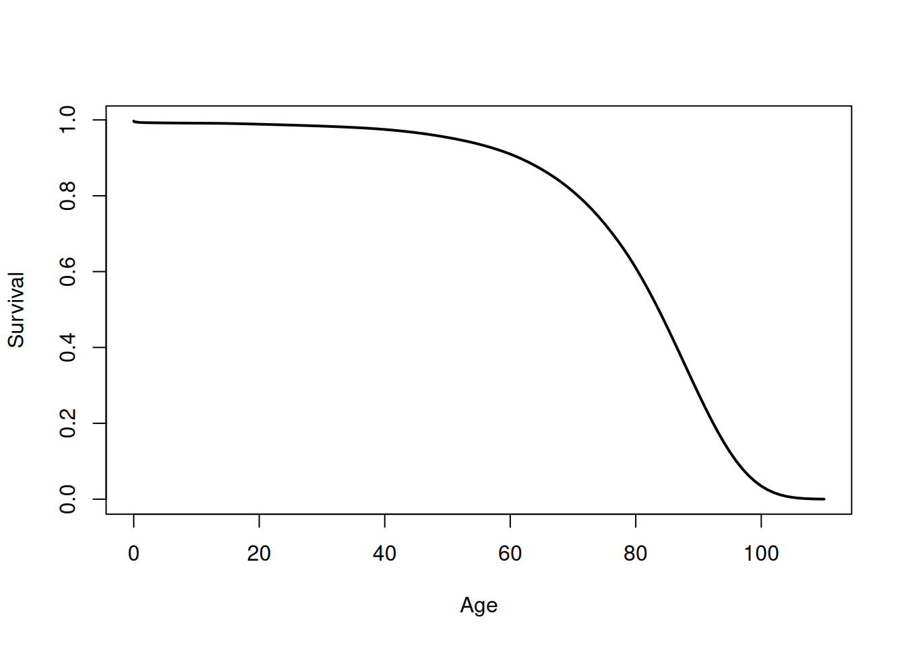](intro-to-survival-analysis_files/figure-html/unnamed-chunk-9-1.png "Figure 8: Survival Curve in 2004 for US Females")
> >
> > Figure 8: Survival Curve in 2004 for US Females

> **NOTE:**
>
> **Exercise 1** Why do the male and female hazard functions in [Figure 7](#fig-haz-mf) differ where they do?

> **NOTE:**
>
> **Exercise 2** Compare and contrast [Figure 8](#fig-surv-US-females) with [Figure 6](#fig-haz-female-US).

## 4.6 The Cumulative Hazard Function

Since ${\lambda}(t) = \frac{\partial}{\partial t}\mathopen{}\left\{-\log{\operatorname{S}(t)}\right\}\mathclose{}$ (see [Theorem 7](#thm-h-logS)), we also have:

> **NOTE:**
>
> **Corollary 1 (Survival function from the cumulative hazard)** $$\operatorname{S}(t) = {\operatorname{exp}\mathopen{}\left\{-\int_{u=0}^t {\lambda}(u)du\right\}\mathclose{}} \tag{4}$$

------------------------------------------------------------------------

The [integral](https://morrison-lab.github.io/mds/calculus-integration.html#def-riemann-integral) in [Equation 4](#eq-surv-int-haz) is important enough to have its own name: **cumulative hazard**.

> **NOTE:**
>
> **Definition 11 (cumulative hazard)** The **cumulative hazard function**, often denoted $\Lambda(t)$ or $\text{H}(t)$, is defined as:
>
> $${\Lambda}(t) \stackrel{\text{def}}{=}\int_{u=0}^t {\lambda}(u) du$$

As shown in [Section 10](#sec-nelson-aalen), ${\Lambda}(t)$ is tractable to estimate, and we can then derive an estimate of the [hazard function](#def-hazard) using an approximate [derivative](https://morrison-lab.github.io/mds/calculus-derivatives.html#def-derivative) of the estimated cumulative hazard.

> **NOTE:**
>
> **Example 14** The cumulative hazard function for the [exponential distribution](https://morrison-lab.github.io/pds/random-variables.html#def-exponential) with rate parameter ${\lambda}$ is:
>
> $${\Lambda}(t) = \mathbb{1}_{t \ge 0}\cdot {\lambda}t$$
>
> [Figure 9](#fig-cuhaz-exp) shows some examples of exponential cumulative hazard functions.

------------------------------------------------------------------------

> **NOTE:**
>
> [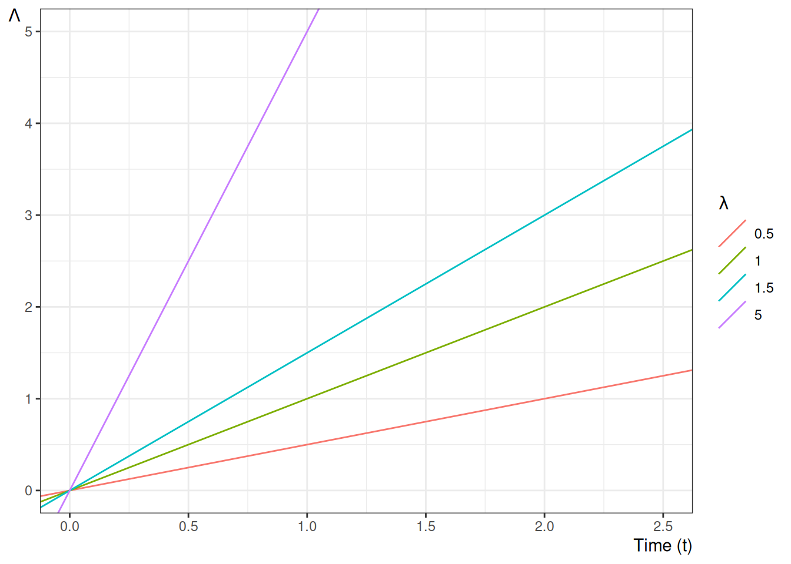](intro-to-survival-analysis_files/figure-html/fig-cuhaz-exp-1.png "Figure 9: Examples of exponential cumulative hazard functions")
>
> Figure 9: Examples of exponential cumulative hazard functions

## 4.7 Some Key Mathematical Relationships among Survival Concepts

#### Diagram:

$$\operatorname{f}(t)
\xleftarrow[\operatorname{S}(t){\lambda}(t)]{-S'(t)}
\operatorname{S}(t)
\xleftarrow[]{{\operatorname{exp}\mathopen{}\left\{-{\Lambda}(t)\right\}\mathclose{}}}
{\Lambda}(t)
\xleftarrow[]{\int_{u=0}^t {\lambda}(u)du}
{\lambda}(t)
\xleftarrow[]{{\operatorname{exp}\mathopen{}\left\{\eta(t)\right\}\mathclose{}}}
\eta(t)$$

$$\operatorname{f}(t)
\xrightarrow[\int_{u=t}^\infty \operatorname{f}(u)du]{\operatorname{f}(t)/{\lambda}(t)}
\operatorname{S}(t)
\xrightarrow[-\log{\operatorname{S}(t)}]{}
{\Lambda}(t)
\xrightarrow[{\Lambda}'(t)]{}
{\lambda}(t)
\xrightarrow[{\operatorname{log}\mathopen{}\left\{{\lambda}(t)\right\}\mathclose{}}]{}
\eta(t)$$

#### Identities:

$$\begin{aligned}
\operatorname{S}(t) &= 1 - \operatorname{F}(t)\\
&= {\operatorname{exp}\mathopen{}\left\{-{\Lambda}(t)\right\}\mathclose{}}\\
\operatorname{S}'(t) &= -f(t)\\
{\Lambda}(t) &= -{\operatorname{log}\mathopen{}\left\{\operatorname{S}(t)\right\}\mathclose{}}\\
{\Lambda}'(t) &= {\lambda}(t)\\
{\lambda}(t) &= \frac{\operatorname{f}(t)}{\operatorname{S}(t)}\\
&= -\frac{\partial}{\partial t}\log{\operatorname{S}(t)} \\
f(t) &= {\lambda}(t)\cdot \operatorname{S}(t)\\
\end{aligned}$$

Some proofs (others left as exercises):

$$\begin{aligned}
\operatorname{S}'(t) &= \frac{\partial}{\partial t}(1-\operatorname{F}(t))\\
&= -\operatorname{F}'(t)\\
&= -\operatorname{f}(t)\\
\end{aligned}$$

$$\begin{aligned}
\frac{\partial}{\partial t}{\operatorname{log}\mathopen{}\left\{\operatorname{S}(t)\right\}\mathclose{}}
&= \frac{\operatorname{S}'(t)}{\operatorname{S}(t)}\\
&= -\frac{\operatorname{f}(t)}{\operatorname{S}(t)}\\
&= -{\lambda}(t)\\
\end{aligned}$$

$$\begin{aligned}
{\Lambda}(t)
&\stackrel{\text{def}}{=}\int_{u=0}^t {\lambda}(u) du\\
&= \int_0^t -\frac{\partial}{\partial u}{\operatorname{log}\mathopen{}\left\{\operatorname{S}(u)\right\}\mathclose{}} du\\
&= \mathopen{}\left[-{\operatorname{log}\mathopen{}\left\{\operatorname{S}(u)\right\}\mathclose{}}\right]\mathclose{}_{u=0}^{u=t}\\
&= \mathopen{}\left[{\operatorname{log}\mathopen{}\left\{\operatorname{S}(u)\right\}\mathclose{}}\right]\mathclose{}_{u=t}^{u=0}\\
&= {\operatorname{log}\mathopen{}\left\{\operatorname{S}(0)\right\}\mathclose{}} - {\operatorname{log}\mathopen{}\left\{\operatorname{S}(t)\right\}\mathclose{}}\\
&= {\operatorname{log}\mathopen{}\left\{1\right\}\mathclose{}} - {\operatorname{log}\mathopen{}\left\{\operatorname{S}(t)\right\}\mathclose{}}\\
&= 0 - {\operatorname{log}\mathopen{}\left\{\operatorname{S}(t)\right\}\mathclose{}}\\
&=-{\operatorname{log}\mathopen{}\left\{\operatorname{S}(t)\right\}\mathclose{}}
\end{aligned}$$

Corollary:

$$\operatorname{S}(t) = {\operatorname{exp}\mathopen{}\left\{-{\Lambda}(t)\right\}\mathclose{}}$$

## 4.8 Hazard versus risk

In discrete time, where follow-up is split into intervals, the hazard and the risk are easy to confuse, because both are probabilities of an event during follow-up. The risk is cumulative from baseline, while the [discrete-time hazard](#def-discrete-haz-risk) concerns a single interval (unlike the [continuous-time hazard](#def-hazard), which is a [rate](https://morrison-lab.github.io/mds/algebra-sums.html#def-rate), not a probability). They answer different questions [\[9, Ch. 17\]](#ref-hernan2020causal), Section 17.2:

> The risk and the hazard are different measures. The denominator of the risk—the number of individuals at baseline—is constant across times $k$ and its numerator—all events between baseline and $k$—is cumulative. That is, the risk will stay flat or increase as $k$ increases. On the other hand, the denominator of the hazard—the number of individuals alive at $k$—varies over time $t$ and its numerator includes only recent events—those during interval $k$. That is, the hazard may increase or decrease over time.

To make that comparison precise, consider an event time $T$ that takes values in $\{1, 2, 3, \ldots\}$, such as the follow-up interval in which an event occurs.

> **NOTE:**
>
> **Definition 12 (Discrete-time risk)** For an event time $T$ that takes values in $\{1, 2, 3, \ldots\}$ and $k = 1, 2, \ldots$, the **risk** by $k$ is $\pi(k) \stackrel{\text{def}}{=}\Pr(T \le k)$, the probability of an event in any interval up to and including $k$ among everyone at baseline.

> **NOTE:**
>
> **Definition 13 (Discrete-time hazard)** For each $k$ with $\Pr(T \ge k) > 0$, so that someone is still event-free at the start of interval $k$, the **discrete-time hazard** at $k$ is ${\lambda}_k \stackrel{\text{def}}{=}\Pr(T = k \mid T \ge k)$, the probability of an event in interval $k$ among those still event-free at the start of interval $k$.

> **NOTE:**
>
> **Example 15 (Hazard versus risk in a cohort)** Suppose 1000 people are followed for four years with no censoring, and 100, 50, 40, and 60 of them have the event in years 1 through 4. The hazard divides each year’s events by the number still event-free at the start of that year; the risk divides the running total of events by the 1000 people at baseline:
>
> | Year $k$ | Events | Event-free at start of $k$ | ${\lambda}_k$ | Total events by $k$ | $\pi(k)$ |
> |---:|---:|---:|---:|---:|---:|
> | 1 | 100 | 1000 | $100/1000 = 0.100$ | 100 | $0.10$ |
> | 2 | 50 | 900 | $50/900 \approx 0.056$ | 150 | $0.15$ |
> | 3 | 40 | 850 | $40/850 \approx 0.047$ | 190 | $0.19$ |
> | 4 | 60 | 810 | $60/810 \approx 0.074$ | 250 | $0.25$ |
>
> The hazard falls and then rises, while the risk increases every year.

While anyone is still event-free, the risk can be recovered from the hazards, and [Theorem 9](#thm-risk-from-haz) shows why it can never decrease.

> **NOTE:**
>
> **Theorem 9 (Risk in terms of discrete-time hazards)** Under [Definition 12](#def-discrete-risk) and [Definition 13](#def-discrete-haz-risk), for each $k$ with $\Pr(T \ge k) > 0$,
>
> $$\pi(k) = 1 - \prod_{j=1}^{k} (1 - {\lambda}_j).
> \tag{5}$$
>
> Since each factor $1 - {\lambda}_j$ lies in $[0, 1]$, the product can only shrink as $k$ grows, so $\pi(k)$ never decreases as $k$ grows.

> **NOTE:**
>
> *Proof*. This proof uses [the definition of conditional probability](https://morrison-lab.github.io/pds/probability-basics.html#def-conditional-prob) and the [subset property](https://morrison-lab.github.io/pds/probability-basics.html#thm-prob-subset). Because $T$ takes integer values, $\{T > j - 1\} = \{T \ge j\}$. For each $j \le k$, $\Pr(T \ge j) \ge \Pr(T \ge k) > 0$ by the subset property, since $\{T \ge k\} \subseteq \{T \ge j\}$; so ${\lambda}_j$ is defined and conditioning on $T > j - 1$ is allowed. For each such $j$:
>
> $$\begin{aligned}
> \Pr(T > j)
> &= \Pr(T > j,\ T > j - 1)
> && \text{(}\{T > j\} \subseteq \{T > j - 1\}\text{)}
> \\
> &= \Pr(T > j \mid T > j - 1)\Pr(T > j - 1)
> && \text{(definition of conditional probability)}
> \\
> &= \Pr(T > j \mid T \ge j)\Pr(T > j - 1)
> && \text{(}T \text{ is integer-valued)}
> \\
> &= \mathopen{}\left[1 - \Pr(T = j \mid T \ge j)\right]\mathclose{}\Pr(T > j - 1)
> && \text{(complement rule, given } T \ge j\text{)}
> \\
> &= (1 - {\lambda}_j)\Pr(T > j - 1)
> && \text{(definition of } {\lambda}_j\text{)}
> \end{aligned}
> \tag{6}$$
>
> Applying [Equation 6](#eq-surv-recursion-haz) for $j = k, k - 1, \ldots, 1$, and using $\Pr(T > 0) = 1$:
>
> $$\begin{aligned}
> \pi(k)
> &= 1 - \Pr(T > k)
> && \text{(complement of } \pi(k) = \Pr(T \le k)\text{)}
> \\
> &= 1 - \prod_{j=1}^{k}(1 - {\lambda}_j)\Pr(T > 0)
> && \text{(apply the identity } k \text{ times)}
> \\
> &= 1 - \prod_{j=1}^{k}(1 - {\lambda}_j)
> && \text{(}\Pr(T > 0) = 1\text{)}
> \end{aligned}
> \tag{7}$$

> **NOTE:**
>
> **Example 16 (Recovering the risk from the hazards)** Using the hazards from [Example 15](#exm-haz-vs-risk), [Theorem 9](#thm-risk-from-haz) gives the four-year risk:
>
> $$\begin{aligned}
> \pi(4)
> &= 1 - (1 - 0.100)\mathopen{}\left(1 - \tfrac{50}{900}\right)\mathclose{}\mathopen{}\left(1 - \tfrac{40}{850}\right)\mathclose{}\mathopen{}\left(1 - \tfrac{60}{810}\right)\mathclose{}
> && \text{(substitute the hazards)}
> \\
> &= 1 - \tfrac{900}{1000} \cdot \tfrac{850}{900} \cdot \tfrac{810}{850} \cdot \tfrac{750}{810}
> && \text{(subtract each hazard from 1)}
> \\
> &= 1 - \tfrac{750}{1000}
> && \text{(cancel the telescoping terms)}
> \\
> &= 0.25
> && \text{(arithmetic)}
> \end{aligned}
> \tag{8}$$
>
> which matches the 250 events out of 1000 people in [Example 15](#exm-haz-vs-risk).

## 4.9 Likelihood with censoring

If an event time $T$ is observed exactly as $T=t$, then the [likelihood](https://morrison-lab.github.io/sds/intro-MLEs.html#def-lik-obs) of that observation is just its [probability density function](https://morrison-lab.github.io/pds/random-variables.html#def-pdf):

$$\begin{aligned}
\mathcal{L}(t)
&= \operatorname{f}(T=t)\\
&\stackrel{\text{def}}{=}\operatorname{f}_T(t)\\
&= {\lambda}_T(t)\operatorname{S}_T(t)\\
\ell(t)
&\stackrel{\text{def}}{=}{\operatorname{log}\mathopen{}\left\{\mathcal{L}(t)\right\}\mathclose{}}\\
&= {\operatorname{log}\mathopen{}\left\{{\lambda}_T(t) \operatorname{S}_T(t)\right\}\mathclose{}}\\
&= {\operatorname{log}\mathopen{}\left\{{\lambda}_T(t)\right\}\mathclose{}} + {\operatorname{log}\mathopen{}\left\{\operatorname{S}_T(t)\right\}\mathclose{}}\\
&= {\operatorname{log}\mathopen{}\left\{{\lambda}_T(t)\right\}\mathclose{}} - {\Lambda}_T(t)\\
\end{aligned}$$

------------------------------------------------------------------------

If instead the event time $T$ is [censored](#def-right-censor) and only known to be after time $y$, then the likelihood of that censored observation is instead the [survival function](#def-surv-fn) evaluated at the censoring time:

$$\begin{aligned}
\mathcal{L}(y)
&=p_T(T>y)\\
&\stackrel{\text{def}}{=}\operatorname{S}_T(y)\\
\ell(y)
&\stackrel{\text{def}}{=}{\operatorname{log}\mathopen{}\left\{\mathcal{L}(y)\right\}\mathclose{}}\\
&={\operatorname{log}\mathopen{}\left\{\operatorname{S}(y)\right\}\mathclose{}}\\
&=-{\Lambda}(y)\\
\end{aligned}$$

------------------------------------------------------------------------

The simplified likelihood formulation is incomplete because it omits the censoring mechanism. We also observed whether or not the observation was censored. Let $C$ denote the time when censoring would occur (if the event did not occur first); let $f_C(y)$ and $S_C(y)$ be the corresponding density and survival functions for the censoring event.

Let $Y$ denote the time when observation ended (either by censoring or by the event of interest occurring), and let $D$ be an [indicator](https://morrison-lab.github.io/sds/data.html#def-indicator-variable) variable for the event occurring at $Y$ (so $D=0$ represents a censored observation and $D=1$ represents an uncensored observation). In other words, let $Y \stackrel{\text{def}}{=}\min(T,C)$ and $D \stackrel{\text{def}}{=}{\mathbb{1}\mathopen{}\left\{T \le C\right\}\mathclose{}}$.

Then the complete likelihood of the observed data $(Y,D)$ is:

$$\begin{aligned}
\mathcal{L}(y,d)
&= \operatorname{p}(Y=y, D=d)\\
&= \mathopen{}\left[\operatorname{p}(T=y,C> y)\right]\mathclose{}^d \cdot \mathopen{}\left[\operatorname{p}(T>y,C=y)\right]\mathclose{}^{1-d}\\
\end{aligned}$$

> **NOTE:**
>
> **Definition 14 (Non-informative censoring)** Let $T$ be the event time and $C$ the censoring time for a participant, let $\theta_T$ denote the parameters of the distribution of $T$, and let $\theta_C$ denote the parameters of the distribution of $C$. Censoring is **non-informative** if both of these conditions hold:
>
> 1.  $T$ and $C$ are independent, $T \perp\!\!\!\perp C$, so that $\operatorname{p}(T > t, C > c) = \operatorname{S}_T(t)\,\operatorname{S}_C(c)$ for all $t, c \ge 0$;
> 2.  $\theta_T$ and $\theta_C$ share no parameters, so that the distribution of $C$ carries no information about $\theta_T$.
>
> [\[3, Ch. 3\]](#ref-klein2003survival)

Terminology varies across textbooks: some authors call condition 1 *independent censoring* and reserve *non-informative censoring* for condition 2 [\[6, Ch. 1\]](#ref-kleinbaum2012survival). In this chapter, “non-informative censoring” means both conditions together, since the likelihood factorization in this section uses both.

> **NOTE:**
>
> **Example 17 (Administrative censoring)** A trial enrolls patients at a steady rate over two years and ends four years after the first enrollment, so each patient’s censoring time $C$ is the time from their enrollment to the end of the study, $C \sim \text{Uniform}(2, 4)$ years. Enrollment dates are set by the recruitment calendar, not by patients’ prognoses, so $T \perp\!\!\!\perp C$; the censoring parameters $\theta_C = (2, 4)$ are unrelated to the event-time parameters, so censoring is non-informative ([Definition 14](#def-noninformative-censoring)).
>
> Suppose $T \sim \text{Exponential}({\lambda})$ with ${\lambda}= 0.2$ per year, and a patient enrolled 3 years before the end of the study is still event-free at the end, so $(y, d) = (3, 0)$. The patient’s likelihood contribution is
>
> $$\begin{aligned}
> \mathcal{L}(3, 0)
> &= \mathopen{}\left[\operatorname{p}(T=3,C> 3)\right]\mathclose{}^0 \cdot \mathopen{}\left[\operatorname{p}(T>3,C=3)\right]\mathclose{}^{1}
> && \text{(likelihood of $(Y, D)$ with $d = 0$)}
> \\
> &= \operatorname{p}(T>3,C=3)
> && \text{($x^0 = 1$ and $x^1 = x$)}
> \\
> &= \operatorname{p}(T>3)\,\operatorname{p}(C=3)
> && \text{(independence of $T$ and $C$)}
> \\
> &= \operatorname{S}_T(3)\,\operatorname{f}_C(3)
> && \text{(definitions of $\operatorname{S}_T$ and $\operatorname{f}_C$)}
> \\
> &= \text{e}^{-0.2 \cdot 3} \cdot \frac{1}{4 - 2}
> && \text{(exponential survival function, uniform density)}
> \\
> &= \text{e}^{-0.6} \cdot 0.5
> && \text{(arithmetic)}
> \\
> &\approx 0.5488 \cdot 0.5
> && \text{($\text{e}^{-0.6} \approx 0.5488$)}
> \\
> &\approx 0.2744.
> && \text{(arithmetic)}
> \end{aligned}$$
>
> The factor $\operatorname{f}_C(3) = 0.5$ does not involve ${\lambda}$, so it does not affect which value of ${\lambda}$ maximizes the likelihood.

> **NOTE:**
>
> **Example 18 (Informative censoring (counterexample))** Suppose half of a cohort is frail, with event time $T = 1$ year, and half is robust, with $T = 5$ years. Frail patients become too sick to attend follow-up visits and drop out at $C = 0.5$ years, while robust patients stay in the study until it ends at $C = 10$ years. Then $\operatorname{p}(C = 0.5 \mid T = 1) = 1$ but $\operatorname{p}(C = 0.5 \mid T = 5) = 0$, so $T$ and $C$ are dependent and censoring is informative.
>
> The true probability of surviving past 2 years is $\operatorname{S}_T(2) = \operatorname{p}(T > 2) = 0.5$. Everyone still under observation just after $0.5$ years is robust, so if we treated the dropouts as representative of the patients still under observation, as independence would justify, we would compute
>
> $$\begin{aligned}
> \operatorname{p}(T > 2)
> &= \operatorname{p}(T > 0.5) \cdot \operatorname{p}(T > 2 \mid T > 0.5)
> && \text{(chain rule; $\mathopen{}\left\{T > 2\right\}\mathclose{} \subseteq \mathopen{}\left\{T > 0.5\right\}\mathclose{}$)}
> \\
> &\approx 1 \cdot \operatorname{p}(T > 2 \mid T > 0.5,\ C > 0.5)
> && \text{(no events before 0.5; treat dropouts as representative)}
> \\
> &= 1 \cdot 1
> && \text{(all observed patients past 0.5 are robust)}
> \\
> &= 1,
> && \text{(arithmetic)}
> \end{aligned}$$
>
> which overstates the true value $0.5$.

Typically, survival analyses assume that censoring is non-informative ([Definition 14](#def-noninformative-censoring)); in particular, $C$ and $T$ are mutually [independent](https://morrison-lab.github.io/pds/independence.html#def-indpt).

Then the joint likelihood $\operatorname{p}(Y,D)$ factors into the product $\operatorname{p}(Y), \operatorname{p}(D)$, and the likelihood reduces to:

$$\begin{aligned}
\mathcal{L}(y,d)
&= \mathopen{}\left[\operatorname{p}(T=y,C> y)\right]\mathclose{}^d\cdot
\mathopen{}\left[\operatorname{p}(T>y,C=y)\right]\mathclose{}^{1-d}\\
&= \mathopen{}\left[\operatorname{p}(T=y)\operatorname{p}(C> y)\right]\mathclose{}^d\cdot
\mathopen{}\left[\operatorname{p}(T>y)\operatorname{p}(C=y)\right]\mathclose{}^{1-d}\\
&= \mathopen{}\left[\operatorname{f}_T(y)\operatorname{S}_C(y)\right]\mathclose{}^d\cdot
\mathopen{}\left[\operatorname{S}(y)\operatorname{f}_C(y)\right]\mathclose{}^{1-d}\\
&= \mathopen{}\left[\operatorname{f}_T(y)^d \operatorname{S}_C(y)^d\right]\mathclose{}\cdot
\mathopen{}\left[\operatorname{S}_T(y)^{1-d} \operatorname{f}_C(y)^{1-d}\right]\mathclose{}\\
&= \mathopen{}\left(\operatorname{f}_T(y)^d \cdot \operatorname{S}_T(y)^{1-d}\right)\mathclose{}\cdot
\mathopen{}\left(\operatorname{f}_C(y)^{1-d} \cdot \operatorname{S}_C(y)^{d}\right)\mathclose{}
\end{aligned}$$

------------------------------------------------------------------------

The corresponding [log-likelihood](https://morrison-lab.github.io/sds/intro-MLEs.html#def-loglik) is:

$$\begin{aligned}
\ell(y,d)
&= {\operatorname{log}\mathopen{}\left\{\mathcal{L}(y,d)\right\}\mathclose{}}\\
&= {\operatorname{log}\mathopen{}\left\{
\mathopen{}\left(f_T(y)^d \cdot S_T(y)^{1-d}\right)\mathclose{}
\cdot
\mathopen{}\left(f_C(y)^{1-d} \cdot S_C(y)^{d}\right)\mathclose{}
\right\}\mathclose{}}
\\
&= {\operatorname{log}\mathopen{}\left\{f_T(y)^d \cdot S_T(y)^{1-d}\right\}\mathclose{}}
+
{\operatorname{log}\mathopen{}\left\{f_C(y)^{1-d} \cdot S_C(y)^{d}\right\}\mathclose{}}
\end{aligned}$$ Let

- $\theta_T$ represent the parameters of $p_T(t)$,
- $\theta_C$ represent the parameters of $p_C(c)$,
- $\theta = (\theta_T, \theta_C)$ be the combined vector of all parameters.

------------------------------------------------------------------------

The corresponding [score function](https://morrison-lab.github.io/sds/intro-MLEs.html#def-score) is:

$$\begin{aligned}
\ell'(y,d)
&= \frac{\partial}{\partial \theta}
\mathopen{}\left[
{\operatorname{log}\mathopen{}\left\{f_T(y)^d \cdot S_T(y)^{1-d}\right\}\mathclose{}}
+
{\operatorname{log}\mathopen{}\left\{f_C(y)^{1-d} \cdot S_C(y)^{d}\right\}\mathclose{}}
\right]\mathclose{}
\\
&=
\mathopen{}\left(
\frac{\partial}{\partial \theta}
{\operatorname{log}\mathopen{}\left\{
f_T(y)^d \cdot S_T(y)^{1-d}
\right\}\mathclose{}}
\right)\mathclose{}
+
\mathopen{}\left(
\frac{\partial}{\partial \theta}
{\operatorname{log}\mathopen{}\left\{
f_C(y)^{1-d} \cdot S_C(y)^{d}
\right\}\mathclose{}}
\right)\mathclose{}
\end{aligned}$$

------------------------------------------------------------------------

As long as $\theta_C$ and $\theta_T$ don’t share any parameters, then if censoring is non-informative, the [partial derivative](https://morrison-lab.github.io/mds/vector-calculus.html#def-partial-derivative) with respect to $\theta_T$ is:

$$\begin{aligned}
\ell'_{\theta_T}(y,d)
&\stackrel{\text{def}}{=}\frac{\partial}{\partial \theta_T}\ell(y,d)\\
&=
\mathopen{}\left(
\frac{\partial}{\partial \theta_T}
\text{log}{\mathopen{}\left\{
f_T(y)^d \cdot S_T(y)^{1-d}
\right\}\mathclose{}}
\right)\mathclose{}
+
\mathopen{}\left(
\frac{\partial}{\partial \theta_T}
\text{log}{\mathopen{}\left\{
f_C(y)^{1-d} \cdot S_C(y)^{d}
\right\}\mathclose{}}
\right)\mathclose{}\\
&=
\mathopen{}\left(
\frac{\partial}{\partial \theta_T}
\text{log}{\mathopen{}\left\{
f_T(y)^d \cdot S_T(y)^{1-d}
\right\}\mathclose{}}
\right)\mathclose{} + 0\\
&=
\frac{\partial}{\partial \theta_T}
\text{log}{\mathopen{}\left\{
f_T(y)^d \cdot S_T(y)^{1-d}
\right\}\mathclose{}}\\
\end{aligned}$$

------------------------------------------------------------------------

Thus, the [MLE](https://morrison-lab.github.io/sds/intro-MLEs.html#def-mle) for $\theta_T$ won’t depend on $\theta_C$, and we can ignore the distribution of $C$ when estimating the parameters of $f_T(t)=p(T=t)$.

Then:

$$\begin{aligned}
\mathcal{L}(y,d)
&= f_T(y)^d \cdot S_T(y)^{1-d}\\
&= \mathopen{}\left(h_T(y)^d  S_T(y)^d\right)\mathclose{} \cdot S_T(y)^{1-d}\\
&= h_T(y)^d  \cdot S_T(y)^d \cdot S_T(y)^{1-d}\\
&= h_T(y)^d \cdot S_T(y)\\
&= S_T(y) \cdot h_T(y)^d \\
\end{aligned}$$

Specifically, if the event occurred at time $y$ (i.e., if $d=1$), then the likelihood of $(Y,D) = (y,d)$ is equal to the [hazard function](#def-hazard) at $y$ times the survival function at $y$. Otherwise, the likelihood is equal to just the survival function at $y$.

------------------------------------------------------------------------

The corresponding log-likelihood is:

$$\begin{aligned}
\ell(y,d)
&=\text{log}{\mathopen{}\left\{\mathcal{L}(y,d)\right\}\mathclose{}}\\
&= \text{log}{\mathopen{}\left\{S_T(y) \cdot h_T(y)^d\right\}\mathclose{}}\\
&= \text{log}{\mathopen{}\left\{S_T(y)\right\}\mathclose{}} + \text{log}{\mathopen{}\left\{h_T(y)^d\right\}\mathclose{}}\\
&= \text{log}{\mathopen{}\left\{S_T(y)\right\}\mathclose{}} + d\cdot \text{log}{\mathopen{}\left\{h_T(y)\right\}\mathclose{}}\\
&= -H_T(y) + d\cdot \text{log}{\mathopen{}\left\{h_T(y)\right\}\mathclose{}}\\
\end{aligned}$$

In other words, the log-likelihood contribution from a single observation $(Y,D) = (y,d)$ is equal to the negative [cumulative hazard](#def-cuhaz) at $y$, plus the log of the hazard at $y$ if the event occurred at time $y$.

# 5 Parametric Models for Time-to-Event Outcomes

## 5.1 Exponential Distribution

- The [exponential distribution](https://morrison-lab.github.io/pds/random-variables.html#def-exponential) is the base distribution for survival analysis.
- The distribution has a constant [hazard](#def-hazard) ${\lambda}$
- The [population mean](https://morrison-lab.github.io/pds/expectation.html#def-expectation) survival time is ${\lambda}^{-1}$

------------------------------------------------------------------------

#### Mathematical details of exponential distribution

$$\begin{aligned}
f(t) &= {\lambda}\text{e}^{-{\lambda}t}
\\
F(t) &= 1-\text{e}^{-{\lambda}t}\\
\operatorname{S}(t)&= \text{e}^{-{\lambda}t}\\
{\operatorname{log}\mathopen{}\left\{\operatorname{S}(t)\right\}\mathclose{}}&=-{\lambda}t\\
{\lambda}(t) &= \frac{f(t)}{\operatorname{S}(t)} = \frac{{\lambda}\text{e}^{-{\lambda}t}}{\text{e}^{-{\lambda}t}}={\lambda}
\\
E(t) &= {\lambda}^{-1}
\\
Var(t) &= {\lambda}^{-2}
\\
{\operatorname{log}\mathopen{}\left\{f(t)\right\}\mathclose{}} &= {\operatorname{log}\mathopen{}\left\{{\lambda}\right\}\mathclose{}} - {\lambda}t
\\
\frac{\partial}{\partial {\lambda}} {\operatorname{log}\mathopen{}\left\{f(t)\right\}\mathclose{}} &= {\lambda}^{-1} - t
\\
&= {\mathbb{E}\mathopen{}\left[t\right]\mathclose{}} - t
\\
&= -({\mathbb{E}\mathopen{}\left[t\right]\mathclose{}} - t)
\\
&= -\varepsilon
\end{aligned}$$

------------------------------------------------------------------------

#### Prediction intervals for time-to-event outcomes

> **NOTE:**
>
> **Exercise 3 (Construct a prediction interval)** Suppose a cancer patient is predicted to have an [expected (mean)](https://morrison-lab.github.io/pds/expectation.html#def-expectation) lifetime of 7 years after diagnosis, and suppose the distribution is exponential.
>
> Construct a 95% [prediction interval](https://morrison-lab.github.io/sds/intro-MLEs.html#def-prediction-interval) for survival.

> **TIP:**
>
> Use the [quantiles](https://morrison-lab.github.io/pds/random-variables.html#def-quantile-function) of the exponential distribution.

> **NOTE:**
>
> *Solution 9*. If the mean is 7 years until death, then the rate parameter ${\lambda}= 1/7$ events (deaths) per year.
>
> The 0.025 quantile of the exponential distribution with ${\lambda}= 1/7$ is `qexp(p 0.025, rate = 1/7)` = 0.177225 and the 0.975 quantile is `qexp(p 0.975, rate = 1/7)` = 25.822156, so the prediction interval is `qexp(p c(.025, 0.975), rate = 1/7)` = (0.177225, 25.822156).

> **NOTE:**
>
> **Exercise 4** Graph the prediction interval as a function of the mean, for [Gaussian](https://morrison-lab.github.io/pds/random-variables.html#def-normal) ($\sigma = 1$), [Binomial](https://morrison-lab.github.io/pds/distributions.html#def-binomial), [Poisson](https://morrison-lab.github.io/pds/distributions.html#def-poisson), and [Exponential](https://morrison-lab.github.io/pds/random-variables.html#def-exponential).

> **NOTE:**
>
> *Solution 10*. Left to the reader for now.

> **NOTE:**
>
> **Exercise 5 (Explain the results)** Why do time-to-event models have such wide predictive intervals?

> **TIP:**
>
> Consider the relationship between the mean, [variance](https://morrison-lab.github.io/pds/variance-covariance.html#def-variance), and [standard deviation](https://morrison-lab.github.io/pds/variance-covariance.html#def-sd) of the exponential distribution, and contrast that relationship with the [Poisson distribution](https://morrison-lab.github.io/pds/distributions.html#def-poisson) and the [Bernoulli distribution](https://morrison-lab.github.io/pds/random-variables.html#def-bernoulli).

> **NOTE:**
>
> *Solution 11*. In the exponential distribution, variance is the square of the mean (hence SD is equal to mean); as opposed to Poisson, where variance was equal to the mean (and SD is the square-root of the mean), or the Bernoulli, where the variance is the mean minus the square of the mean (so the SD is smaller than the square-root of the mean).

------------------------------------------------------------------------

#### Estimating ${\lambda}$

- Suppose we have $m$ exponential survival times of $t_1, t_2,\ldots,t_m$ and $k$ [right-censored](#def-right-censor) values at $u_1,u_2,\ldots,u_k$.

- A survival time of $t_i=10$ means that subject $i$ died at time 10. A right-censored time $u_i=10$ means that at time 10, subject $i$ was still alive and that we have no further follow-up.

- For the moment we will assume that the survival distribution is exponential and that all the subjects have the same parameter ${\lambda}$.

We have $m$ exponential survival times of $t_1, t_2,\ldots,t_m$ and $k$ right-censored values at $u_1,u_2,\ldots,u_k$. The [log-likelihood](https://morrison-lab.github.io/sds/intro-MLEs.html#def-loglik) of an observed survival time $t_i$ is $${\operatorname{log}\mathopen{}\left\{{\lambda}\text{e}^{-{\lambda}t_i}\right\}\mathclose{}} =
{\operatorname{log}\mathopen{}\left\{{\lambda}\right\}\mathclose{}}-{\lambda}t_i$$ and the [likelihood](https://morrison-lab.github.io/sds/intro-MLEs.html#def-lik-obs) of a censored value is the probability of that outcome (survival greater than $u_j$) so the log-likelihood is

$$\begin{aligned}
\ell_j({\lambda}) &= {\operatorname{log}\mathopen{}\left\{\text{e}^{-{\lambda}u_j}\right\}\mathclose{}}
\\ &= -{\lambda}u_j
\end{aligned}$$

> **NOTE:**
>
> **Theorem 10 (MLE of the exponential rate parameter)** Let $T=\sum t_i$ and $U=\sum u_j$. Then:
>
> $$\hat{{\lambda}}_{ML} = \frac{m}{T+U}
> \tag{9}$$

------------------------------------------------------------------------

> **NOTE:**
>
> *Proof*. $$\begin{aligned}
> \ell({\lambda}) &= \sum_{i=1}^m({\operatorname{log}\mathopen{}\left\{{\lambda}\right\}\mathclose{}}-{\lambda}t_i) + \sum_{j=1}^k (-{\lambda}u_j)\\
> &= m {\operatorname{log}\mathopen{}\left\{{\lambda}\right\}\mathclose{}} -(T+U){\lambda}\\
> \ell'({\lambda})
> &=m{\lambda}^{-1} -(T+U)\\
> \hat{{\lambda}} &= \frac{m}{T+U}
> \end{aligned}$$

------------------------------------------------------------------------

$$\begin{aligned}
\ell''&=-m/{\lambda}^2\\
&< 0\\
\hat E[T] &= \hat{\lambda}^{-1}\\
&= \frac{T+U}{m}
\end{aligned}$$

------------------------------------------------------------------------

#### Fisher Information and Standard Error

$$\begin{aligned}
{\mathbb{E}\mathopen{}\left[-\ell''\right]\mathclose{}}
& = m/{\lambda}^2\\
{\operatorname{Var}\mathopen{}\left(\hat{\lambda}\right)\mathclose{}}
&\approx {\mathopen{}\left({\mathbb{E}\mathopen{}\left[-\ell''\right]\mathclose{}}\right)\mathclose{}}^{-1}\\
&={\lambda}^2/m\\
\text{SE}\mathopen{}\left(\hat{\lambda}\right)\mathclose{}
&= \sqrt{{\operatorname{Var}\mathopen{}\left(\hat{\lambda}\right)\mathclose{}}}\\
&\approx {\lambda}/\sqrt{m}
\end{aligned}$$

$\hat{\lambda}$ depends on the censoring times of the censored observations, but ${\operatorname{Var}\mathopen{}\left(\hat{\lambda}\right)\mathclose{}}$ only depends on the number of uncensored observations, $m$, and not on the number of censored observations ($k$).

------------------------------------------------------------------------

## 5.2 Other Parametric Survival Distributions

- Any [density](https://morrison-lab.github.io/pds/random-variables.html#def-pdf) on $[0,\infty)$ can be a survival distribution, but the most useful ones are all skew right.
- The most frequently used generalization of the exponential is the [Weibull](https://morrison-lab.github.io/pds/distributions.html#sec-weibull).
- Other common choices are the gamma, log-normal, log-logistic, Gompertz, inverse Gaussian, and Pareto.
- Most of what we do going forward is non-parametric or semi-parametric, but sometimes these parametric distributions provide a useful approach.

# 6 Nonparametric Survival Analysis

## 6.1 Basic ideas

- Mostly, we work without a parametric model.

- The first task is to estimate a [survival function](#def-surv-fn) from data listing survival times, and censoring times for censored data.

- For example one patient may have relapsed at 10 months. Another might have been followed for 32 months without a relapse having occurred ([censored](#def-right-censor)).

- The minimum information we need for each patient is a time and a censoring variable which is 1 if the event occurred at the indicated time and 0 if this recorded time is a censoring time.

> **NOTE:**
>
> **Example 19 (Clinical Trial for Pediatric Acute Leukemia)**  
>
> ##### Overview of study
>
> This dataset originates from a clinical trial in 1963 for 6-MP treatment vs. placebo for acute leukemia in 42 children [\[10\]](#ref-freireich1963effect).
>
> - Pairs of children:
>
> - matched by remission status at the time of treatment (`remstat`: `1` = partial, `2` = complete)
>
> - randomized to 6-MP (exit times in `t2`) or placebo (exit times in `t1`)
>
> - Followed until relapse or end of study.
>
> - All of the placebo group relapsed, but some of the 6-MP group were censored (which means they were still in remission); indicated by `relapse` variable (`0` = censored, `1` = relapse).
>
> - 6-MP = 6-Mercaptopurine (Purinethol) is an anti-cancer (“antineoplastic” or “cytotoxic”) chemotherapy drug used currently for Acute lymphoblastic leukemia (ALL). It is classified as an antimetabolite.
>
> ##### Study design
>
> - Clinical trial in 1963 for 6-MP treatment vs. placebo for Acute Leukemia in 42 children.
> - Pairs of children:
> - matched by remission status at the time of treatment (`remstat`)
> - `remstat` = 1: partial
> - `remstat` = 2: complete
> - randomized to 6-MP (exit time: `t2`) or placebo (`t1`).
> - Followed until relapse or end of study.
> - All of the placebo group relapsed,
> - Some of the 6-MP group were censored.
>
> Show R code
>
> ``` downlit
> library(KMsurv)
> data(drug6mp)
> drug6mp <- drug6mp |> tibble::as_tibble()
> drug6mp
> ```
>
> > **NOTE:**
> >
> > Table 1: `drug6mp` pediatric acute leukemia data
>
> ##### Data documentation for `drug6mp`
>
> Show R code
>
> ``` downlit
> # library(printr) # inserts help-file output into markdown output
> library(KMsurv)
> ?drug6mp
> ```
>
> ##### Descriptive Statistics
>
> > **NOTE:**
> >
> > Show R code
> >
> > ``` downlit
> > summary(drug6mp)
> > #>       pair       remstat           t1              t2          relapse     
> > #>  Min.   : 1   Min.   :1.00   Min.   : 1.00   Min.   : 6.0   Min.   :0.000  
> > #>  1st Qu.: 6   1st Qu.:2.00   1st Qu.: 4.00   1st Qu.: 9.0   1st Qu.:0.000  
> > #>  Median :11   Median :2.00   Median : 8.00   Median :16.0   Median :0.000  
> > #>  Mean   :11   Mean   :1.76   Mean   : 8.67   Mean   :17.1   Mean   :0.429  
> > #>  3rd Qu.:16   3rd Qu.:2.00   3rd Qu.:12.00   3rd Qu.:23.0   3rd Qu.:1.000  
> > #>  Max.   :21   Max.   :2.00   Max.   :23.00   Max.   :35.0   Max.   :1.000
> > ```
> >
> > Table 2: Summary statistics for `drug6mp` data
>
> - The sample mean time in each group is not useful. Some of the 6-MP patients have not relapsed at the time recorded, while all of the placebo patients have relapsed.
> - The median time is not really useful either because so many of the 6-MP patients have not relapsed (12/21).
> - Both are [biased](https://morrison-lab.github.io/sds/estimation.html#def-bias) down in the 6-MP group. Remember that lower times are worse since they indicate sooner recurrence.
>
> ##### Exponential model
>
> - We *can* compute the [hazard rate](#def-hazard), assuming an [exponential model](https://morrison-lab.github.io/pds/random-variables.html#def-exponential): number of relapses divided by the sum of the exit times ([Equation 9](#eq-mle-exp)).
>
> $$\hat{\lambda}= \frac{\sum_{i=1}^nD_i}{\sum_{i=1}^nY_i}$$
>
> - For the placebo group, the estimated hazard is just the reciprocal of the sample mean time:
>
> $$\begin{aligned}
> \hat {\lambda}_{\text{placebo}}
> &= \frac{\sum_{i=1}^nD_i}{\sum_{i=1}^nY_i}
> \\ &= \frac{\sum_{i=1}^n1}{\sum_{i=1}^nY_i}
> \\ &= \frac{n}{\sum_{i=1}^nY_i}
> \\ &= \frac{1}{\bar{Y}}
> \\ &= \frac{1}{8.666667}
> \\ &= 0.115385
> \end{aligned}$$
>
> - For the 6-MP group, $\hat{\lambda}= 9/359 = 0.025$
>
> $$\begin{aligned}
> \hat {\lambda}_{\text{6-MP}}
> &= \frac{\sum_{i=1}^nD_i}{\sum_{i=1}^nY_i}
> \\ &= \frac{9}{359}
> \\ &= 0.02507
> \end{aligned}$$
>
> - The estimated hazard in the placebo group is 4.6 times as large as in the 6-MP group (assuming the hazard is constant over time).

# 7 The Kaplan-Meier Product Limit Estimator

Before deriving the estimator, we establish two general probability facts its derivation relies on: the [interval failure probability](#def-interval-fail-prob) $q_j(\tau)$, and [a lemma](#lem-cond-surv-ratio) expressing a conditional survival probability as a ratio of [survival function](#def-surv-fn) values.

> **NOTE:**
>
> **Definition 15 (Interval failure probability)** Choose an interval width $\Delta t$ and grid points $\tau$. For subject $j$, the **interval failure probability** at $\tau$ is the [conditional probability](https://morrison-lab.github.io/pds/probability-basics.html#def-conditional-prob) that $j$ fails during $[\tau, \tau + \Delta t)$, given that $j$ is still at risk at $\tau$:
>
> $$q_j(\tau) \stackrel{\text{def}}{=}\Pr\mathopen{}\left[j \text{ fails in } [\tau,\, \tau + \Delta t) \mid j \text{ at risk at } \tau\right]\mathclose{}.$$

> **NOTE:**
>
> **Lemma 2 (Conditional survival as a ratio)** For $\tau_1 < \tau_2$, the conditional probability of surviving past $\tau_2$ given survival past $\tau_1$ is the ratio of [survival function](#def-surv-fn) values:
>
> $$\Pr(T > \tau_2 \mid T > \tau_1) = \frac{\operatorname{S}(\tau_2)}{\operatorname{S}(\tau_1)}.
> \tag{10}$$

> **NOTE:**
>
> *Proof*. Since $\tau_2 > \tau_1$, the event $\{T > \tau_2\}$ is a subset of $\{T > \tau_1\}$, so their intersection is just $\{T > \tau_2\}$ ([subset property](https://morrison-lab.github.io/pds/probability-basics.html#thm-prob-subset)). By the [definition of conditional probability](https://morrison-lab.github.io/pds/probability-basics.html#def-conditional-prob),
>
> $$\begin{aligned}
> \Pr(T > \tau_2 \mid T > \tau_1)
> &= \frac{\Pr(T > \tau_2,\ T > \tau_1)}{\Pr(T > \tau_1)}
> && \text{(definition of conditional probability)}
> \\
> &= \frac{\Pr(T > \tau_2)}{\Pr(T > \tau_1)}
> && \text{(}\{T > \tau_2\} \subseteq \{T > \tau_1\}\text{)}
> \\
> &= \frac{\operatorname{S}(\tau_2)}{\operatorname{S}(\tau_1)} .
> && \text{(definition of the survival function)}
> \end{aligned}$$

> **NOTE:**
>
> **Example 20 (Conditional survival ratio for an exponential lifetime)** Let $T \sim \mathrm{Exponential}(\lambda)$, so $\operatorname{S}(t) = {\operatorname{exp}\mathopen{}\left\{-\lambda t\right\}\mathclose{}}$. The probability of surviving past $\tau_2$ given survival past $\tau_1 < \tau_2$ is
>
> $$\begin{aligned}
> \Pr(T > \tau_2 \mid T > \tau_1)
> &= \frac{\operatorname{S}(\tau_2)}{\operatorname{S}(\tau_1)}
> && \text{(conditional survival ratio)}
> \\
> &= \frac{{\operatorname{exp}\mathopen{}\left\{-\lambda \tau_2\right\}\mathclose{}}}{{\operatorname{exp}\mathopen{}\left\{-\lambda \tau_1\right\}\mathclose{}}}
> && \text{(substitute the exponential survival function)}
> \\
> &= {\operatorname{exp}\mathopen{}\left\{-\lambda(\tau_2 - \tau_1)\right\}\mathclose{}} ,
> && \text{(quotient of exponentials)}
> \end{aligned}$$
>
> which depends only on the elapsed time $\tau_2 - \tau_1$, not on $\tau_1$ itself — the memoryless property of the exponential distribution.

> **NOTE:**
>
> **Example 21 (Interval failure probability: exact value)** Suppose subject $j$ has constant [hazard](#def-hazard) ${\lambda}(t) = 0.1$ per year, and consider the half-year interval $[4.0,\, 4.5)$, so $\Delta t = 0.5$ years. By [Lemma 2](#lem-cond-surv-ratio) and the survival/cumulative-hazard relationship ([Corollary 1](#cor-surv-int-haz)), the exact probability that $j$ fails in this interval, given survival to year $4$, is
>
> $$\begin{aligned}
> q_j(4.0)
> &= \Pr\mathopen{}\left[j \text{ fails in } [4.0,\, 4.5) \mid j \text{ at risk at } 4.0\right]\mathclose{}
> && \text{(definition of } q_j \text{)}
> \\
> &= 1 - \Pr\mathopen{}\left[j \text{ survives past } 4.5 \mid j \text{ at risk at } 4.0\right]\mathclose{}
> && \text{(complement rule)}
> \\
> &= 1 - \frac{\operatorname{S}(4.5)}{\operatorname{S}(4.0)}
> && \text{(conditional survival ratio)}
> \\
> &= 1 - \frac{{\operatorname{exp}\mathopen{}\left\{-\int_{0}^{4.5} {\lambda}(u)\,du\right\}\mathclose{}}}
>             {{\operatorname{exp}\mathopen{}\left\{-\int_{0}^{4.0} {\lambda}(u)\,du\right\}\mathclose{}}}
> && \text{(survival from cumulative hazard)}
> \\
> &= 1 - {\operatorname{exp}\mathopen{}\left\{-\int_{4.0}^{4.5} {\lambda}(u)\,du\right\}\mathclose{}}
> && \text{(quotient of exponentials)}
> \\
> &= 1 - {\operatorname{exp}\mathopen{}\left\{-\int_{4.0}^{4.5} 0.1 \,du\right\}\mathclose{}}
> && \text{(substitute } {\lambda}(u) = 0.1\text{)}
> \\
> &= 1 - {\operatorname{exp}\mathopen{}\left\{-0.1 \times 0.5\right\}\mathclose{}}
> && \text{(constant integrand over width } \Delta t = 0.5\text{)}
> \\
> &= 1 - {\operatorname{exp}\mathopen{}\left\{-0.05\right\}\mathclose{}}
> && \text{(arithmetic)}
> \\
> &\approx 0.0488 .
> && \text{(evaluate } e^{-0.05} \approx 0.9512\text{)}
> \end{aligned}$$

## 7.1 Estimating survival in datasets without censoring

When the data contain no censored observations ([Definition 1](#def-right-censor)), we can easily estimate the survival function ([Definition 4](#def-surv-fn)). We observe every patient’s event time, so for any time $t$ we simply count the fraction of patients whose event time is greater than $t$.

> **NOTE:**
>
> **Definition 16 (Empirical survival function without censoring)**  
>
> Given event times $Y_1, \dots, Y_n$ with no censoring, the **empirical survival function** $\mathop{\hat{\operatorname{S}}}\nolimits(t)$ is the fraction of observed event times greater than $t$:
>
> $$\mathop{\hat{\operatorname{S}}}\nolimits(t) \stackrel{\text{def}}{=}\frac{1}{n}\sum_{i=1}^n{\mathbb{1}\mathopen{}\left(Y_i > t\right)\mathclose{}}$$

> **NOTE:**
>
> **Theorem 11 (Empirical survival function and empirical CDF)** Without censoring, the empirical survival function equals one minus the [empirical CDF](https://morrison-lab.github.io/sds/nonparametric-models.html#def-empirical-cdf) $\mathop{\hat{\operatorname{F}}}\nolimits(t)$ of the event times:
>
> $$\mathop{\hat{\operatorname{S}}}\nolimits(t) = 1 - \mathop{\hat{\operatorname{F}}}\nolimits(t) \tag{11}$$

> **NOTE:**
>
> *Proof*. $$\begin{aligned}
> \mathop{\hat{\operatorname{S}}}\nolimits(t)
> &\stackrel{\text{def}}{=}\frac{1}{n}\sum_{i=1}^n{\mathbb{1}\mathopen{}\left(Y_i > t\right)\mathclose{}}
> \\ &= \frac{1}{n}\sum_{i=1}^n\mathopen{}\left[1 - {\mathbb{1}\mathopen{}\left(Y_i \le t\right)\mathclose{}}\right]\mathclose{}
> \\ &= \frac{1}{n}\sum_{i=1}^n1 - \frac{1}{n}\sum_{i=1}^n{\mathbb{1}\mathopen{}\left(Y_i \le t\right)\mathclose{}}
> \\ &= 1 - \frac{1}{n}\sum_{i=1}^n{\mathbb{1}\mathopen{}\left(Y_i \le t\right)\mathclose{}}
> \\ &= 1 - \mathop{\hat{\operatorname{F}}}\nolimits(t)
> \end{aligned}$$

$\mathop{\hat{\operatorname{S}}}\nolimits(t)$ is a right-continuous step function that starts at $\mathop{\hat{\operatorname{S}}}\nolimits(0) = 1$ and drops by $d_j/n$ at each distinct event time $t_j$, where $d_j$ is the number of events at $t_j$. Without censoring, [Equation 11](#eq-emp-surv-no-cens) matches the [Kaplan-Meier estimator](#def-KM-estimator), as we prove later in [Theorem 13](#thm-KM-est-no-cens).

> **NOTE:**
>
> **Example 22 (Estimated survival function for placebo arm of 6-MP study)**  
>
> In the `drug6mp` dataset ([Example 19](#exm-6mp-leukemia)), all of the placebo patients ($n = 21$) relapsed (exit times `t1`, no censoring), so we can estimate their survival function using [Definition 16](#def-emp-surv-no-cens):
>
> > **NOTE:**
> >
> > Show R code
> >
> > ``` downlit
> > library(KMsurv)
> > library(dplyr)
> > data(drug6mp)
> >
> > placebo_times <- drug6mp$t1
> > emp_cdf <- ecdf(placebo_times)
> >
> > placebo_surv <-
> >   tibble(t = sort(unique(placebo_times))) |>
> >   mutate(
> >     `n with time > t` = purrr::map_int(t, \(time) sum(placebo_times > time)),
> >     `S-hat(t)` = 1 - emp_cdf(t)
> >   )
> >
> > placebo_surv
> > ```
> >
> > Table 3: Empirical survival function $\mathop{\hat{\operatorname{S}}}\nolimits(t)$ for the placebo arm of `drug6mp`
>
> > **NOTE:**
> >
> > Show R code
> >
> > ``` downlit
> > library(ggplot2)
> >
> > placebo_surv_plot <-
> >   placebo_surv |>
> >   select(t, `S-hat(t)`) |>
> >   add_row(t = 0, `S-hat(t)` = 1, .before = 1)
> >
> > ggplot(placebo_surv_plot) +
> >   aes(x = t, y = `S-hat(t)`) +
> >   geom_step(direction = "hv") +
> >   expand_limits(y = c(0, 1)) +
> >   xlab("Time since diagnosis (months)") +
> >   ylab(expression("Survival probability, " * hat(S)(t))) +
> >   theme_bw()
> > ```
> >
> > [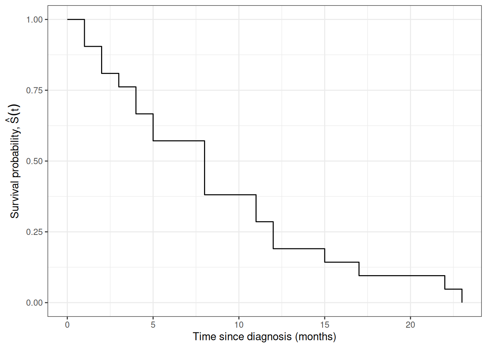](intro-to-survival-analysis_files/figure-html/unnamed-chunk-12-1.png "Figure 10: Empirical survival curve \mathop{\hat{\operatorname{S}}}\nolimits(t) for the placebo arm of drug6mp")
> >
> > Figure 10: Empirical survival curve $\mathop{\hat{\operatorname{S}}}\nolimits(t)$ for the placebo arm of `drug6mp`

## 7.2 Estimating survival in datasets with censoring

- For the 6-MP patients, we cannot ignore the [censored](#def-right-censor) data because we know that the time to relapse is greater than the censoring time.

- For any time $t$ in months, we know that 6-MP patients with times greater than $t$ have not relapsed, and those with relapse time less than $t$ have relapsed, but we don’t know if patients with censored time less than $t$ have relapsed or not.

- The procedure we usually use is the [Kaplan-Meier product-limit](#def-KM-estimator) estimator of the [survival function](#def-surv-fn).

- The Kaplan-Meier estimator is a step function (like the empirical cdf), which changes value only at the event times, not at the censoring times.

- At each event time $t_i$, we compute the [at-risk set](#def-risk-set), which includes all observations whose event time or censoring time is at least $t_i$. Its size is $r_i$.

- If $d_i$ of the observations have an event time (not a censoring time) of $t_i$, then the group of survivors immediately following time $t_i$ is reduced by the fraction $$\frac{r_i-d_i}{r_i}=1-\frac{d_i}{r_i}$$

> **NOTE:**
>
> Show R code
>
> ``` downlit
> risk_cartoon <- tibble::tibble(
>   person = paste("Person", 1:8),
>   exit_time = c(2, 3, 4, 5, 6, 6, 7, 8),
>   status = c(
>     "Event",
>     "Censored",
>     "Event",
>     "Censored",
>     "Event",
>     "Censored",
>     "Event",
>     "Censored"
>   )
> ) |>
>   dplyr::mutate(person_id = dplyr::row_number())
>
> risk_counts <- tibble::tibble(time = c(0, 2, 4, 6, 8)) |>
>   dplyr::mutate(
>     at_risk = purrr::map_int(
>       time,
>       \(current_time) sum(risk_cartoon$exit_time >= current_time)
>     ),
>     label = paste0("At risk at ", time, ": ", at_risk)
>   )
>
> ggplot2::ggplot(risk_cartoon) +
>   ggplot2::aes(y = person_id) +
>   ggplot2::geom_segment(
>     ggplot2::aes(
>       x = 0,
>       xend = exit_time,
>       yend = person_id
>     ),
>     linewidth = 1,
>     color = "grey50"
>   ) +
>   ggplot2::geom_point(
>     ggplot2::aes(
>       x = exit_time,
>       shape = status,
>       fill = status
>     ),
>     size = 3,
>     color = "black"
>   ) +
>   ggplot2::geom_vline(
>     data = dplyr::filter(risk_counts, time > 0),
>     ggplot2::aes(xintercept = time),
>     linetype = "dashed",
>     color = "grey85"
>   ) +
>   ggplot2::geom_text(
>     data = risk_counts,
>     ggplot2::aes(
>       x = time,
>       y = max(risk_cartoon$person_id) + 0.8,
>       label = label
>     ),
>     size = 3.4,
>     vjust = 0
>   ) +
>   ggplot2::scale_shape_manual(values = c(Event = 21, Censored = 22)) +
>   ggplot2::scale_fill_manual(
>     values = c(Event = "#F8766D", Censored = "#00BFC4")
>   ) +
>   ggplot2::scale_y_continuous(
>     breaks = risk_cartoon$person_id,
>     labels = risk_cartoon$person
>   ) +
>   ggplot2::coord_cartesian(ylim = c(0.5, max(risk_cartoon$person_id) + 1.6)) +
>   ggplot2::labs(
>     x = "Time",
>     y = NULL,
>     shape = NULL,
>     fill = NULL
>   ) +
>   ggplot2::theme_minimal() +
>   ggplot2::theme(
>     legend.position = "bottom",
>     panel.grid.minor = ggplot2::element_blank()
>   )
> ```
>
> [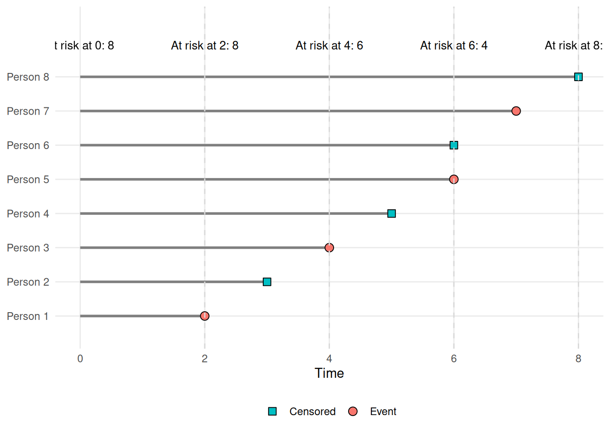](intro-to-survival-analysis_files/figure-html/unnamed-chunk-13-1.png "Figure 11: Cartoon risk-set view showing individual follow-up lines. Filled circles indicate events, filled squares indicate censoring times, and dashed lines mark selected times. Labels in Figure 11 show the number at risk at each marked time.")
>
> Figure 11: Cartoon risk-set view showing individual follow-up lines. Filled circles indicate events, filled squares indicate censoring times, and dashed lines mark selected times. Labels in [Figure 11](#fig-risk-set-dropout-cartoon) show the number at risk at each marked time.

> **NOTE:**
>
> **Definition 17 (Risk Set)** For a survival study with $n$ subjects, let $T_i$ denote the true event time and $C_i$ the censoring time for subject $i$, and let $\tilde{T}_i \stackrel{\text{def}}{=}\min(T_i, C_i)$ be the observed follow-up time. The **risk set at time** $t$ is
>
> $$\mathcal{R}(t) \;\stackrel{\text{def}}{=}\; \mathopen{}\left\{i \in \{1, \ldots, n\} : \tilde{T}_i \geq t\right\}\mathclose{},$$
>
> the set of subjects still under observation (neither having experienced the event nor been censored) immediately before time $t$.

> **NOTE:**
>
> **Example 23** In [Figure 11](#fig-risk-set-dropout-cartoon), the 8-person study has $\tilde{T}_i \in \{2, 3, 4, 5, 6, 6, 7, 8\}$. At time $t = 4$, subjects 3, 4, 5, 6, 7, and 8 still have $\tilde{T}_i \geq 4$, so $\mathcal{R}(4) = \{3, 4, 5, 6, 7, 8\}$.

> **NOTE:**
>
> **Definition 18 (Number at Risk)** The **number at risk at time** $t$ is
>
> $$r(t) \;\stackrel{\text{def}}{=}\; \lvert \mathcal{R}(t) \rvert,$$
>
> the size of the risk set $\mathcal{R}(t)$ ([Definition 17](#def-risk-set)). At each ordered event time $t_i$, this count is written $r_i \stackrel{\text{def}}{=}r(t_i)$.

> **NOTE:**
>
> **Example 24** Continuing [Example 23](#exm-risk-set-cartoon), at time $t = 4$ the risk set is $\mathcal{R}(4) = \{3, 4, 5, 6, 7, 8\}$, so the number at risk is $r(4) = \lvert \mathcal{R}(4) \rvert = 6$.

> **NOTE:**
>
> **Definition 19 (Kaplan-Meier Product-Limit Estimator of Survival Function)** If a time-to-event data set contains $k$ event times $t_i$, ($i \in {1:k}$), where $r_i$ is the [number of individuals at risk](#def-number-at-risk) at time $t_i$ and $d_i$ is the number of events at time $t_i$, then the **Kaplan-Meier Product-Limit Estimator** of the [survival function](#def-surv-fn) is:
>
> $$\hat{{\lambda}}_i = \frac{d_i}{r_i}$$
>
> $$\hat{\kappa}_i = 1 - \hat{{\lambda}}_i = \frac{r_i - d_i}{r_i}$$
>
> $${\mathop{\hat{\operatorname{S}}}\nolimits_{\text{KM}}\mathopen{}\left(t\right)\mathclose{}} \stackrel{\text{def}}{=}\prod_{{\mathopen{}\left\{i:\ t_i \le t\right\}\mathclose{}}} \hat{\kappa}_i$$

To see why multiplying the conditional survival factors estimates marginal survival, write the ordered distinct exit times as $y_1 < y_2 < \cdots < y_m$. Here $Y$ denotes exit time (either event time or censoring time), while $T$ denotes the underlying event time, which is not always observed.

Because $y_{j-1}$ and $y_j$ are consecutive distinct exit times, there are no exits between them. Therefore the [conditional probability](https://morrison-lab.github.io/pds/probability-basics.html#def-conditional-prob) of surviving between these two times is 1:

$$\Pr(Y \geq y_j \mid Y > y_{j-1}) = 1.$$

Then the event $\{Y \geq y_j\}$ is contained in the event $\{Y > y_{j-1}\}$, because $y_j > y_{j-1}$. Therefore intersecting $\{Y \geq y_j\}$ with $\{Y > y_{j-1}\}$ does not change the event:

> **NOTE:**
>
> **Theorem 12 (Consecutive Exit-Time Identity)** If $\Pr(Y \geq y_j \mid Y > y_{j-1}) = 1$, then:
>
> $$\Pr(Y \geq y_j) = \Pr(Y > y_{j-1})$$

> **NOTE:**
>
> *Proof*. $$\begin{aligned}
> \Pr(Y \geq y_j)
> \\
> &= \Pr(Y \geq y_j, Y > y_{j-1})
> \\
> &= \Pr(Y \geq y_j \mid Y > y_{j-1}) \Pr(Y > y_{j-1})
> \\
> &= 1 \Pr(Y > y_{j-1})
> \\
> &= \Pr(Y > y_{j-1})
> \end{aligned}$$

The first equality uses the containment $\{Y \geq y_j\} \subseteq \{Y > y_{j-1}\}$ ([subset property](https://morrison-lab.github.io/pds/probability-basics.html#thm-prob-subset)). The second equality uses the multiplication rule for probabilities, and the third equality uses the between-exit-time survival assumption.

Let $\kappa(y_j) = \Pr(Y > y_j \mid Y \geq y_j)$ denote the conditional probability of surviving past the exit time $y_j$, given survival up to $y_j$. By [Theorem 12](#thm-km-gaps), the conditioning event $\{Y \geq y_j\}$ has the same probability as $\{Y > y_{j-1}\}$, so $\kappa(y_j)$ is really a conditional survival probability spanning the previous exit time to this one; applying [Lemma 2](#lem-cond-surv-ratio) to that pair of times gives:

$$\begin{aligned}
\kappa(y_j)
&\stackrel{\text{def}}{=}\Pr(Y > y_j \mid Y \geq y_j)
&& \text{(definition of } \kappa(y_j)\text{)}
\\
&= \frac{\Pr(Y > y_j,\ Y \geq y_j)}{\Pr(Y \geq y_j)}
&& \text{(definition of conditional probability)}
\\
&= \frac{\Pr(Y > y_j)}{\Pr(Y \geq y_j)}
&& \text{(}\{Y > y_j\} \subseteq \{Y \geq y_j\}\text{)}
\\
&= \frac{\Pr(Y > y_j)}{\Pr(Y > y_{j-1})}
&& \text{(consecutive exit-time identity)}
\\
&= \frac{\Pr(Y > y_j,\ Y > y_{j-1})}{\Pr(Y > y_{j-1})}
&& \text{(}\{Y > y_j\} \subseteq \{Y > y_{j-1}\}\text{)}
\\
&= \Pr(Y > y_j \mid Y > y_{j-1})
&& \text{(definition of conditional probability)}
\\
&= \frac{{\operatorname{S}\mathopen{}\left(y_j\right)\mathclose{}}}{{\operatorname{S}\mathopen{}\left(y_{j-1}\right)\mathclose{}}} ,
&& \text{(conditional survival ratio)}
\end{aligned}$$

so, rearranging, the marginal survival through $y_j$ is written recursively:

$${\operatorname{S}\mathopen{}\left(y_j\right)\mathclose{}} = \kappa(y_j)\,{\operatorname{S}\mathopen{}\left(y_{j-1}\right)\mathclose{}}.$$

The same recursion can be applied repeatedly. If $S_j = \Pr(Y > y_j)$ and $S_0 = 1$, then:

$$\begin{aligned}
S_1
&= \kappa(y_1)S_0\\
&= \kappa(y_1),\\
S_2
&= \kappa(y_2)S_1\\
&= \kappa(y_2)\kappa(y_1),\\
S_3
&= \kappa(y_3)S_2\\
&= \kappa(y_3)\kappa(y_2)\kappa(y_1).
\end{aligned}$$

Continuing in this way gives $S_j = \prod_{k=1}^j \kappa(y_k)$.

To estimate the survival function for the underlying event time $T$, we replace the conditional survival probabilities $\Pr(T > y_k \mid T \geq y_k)$ with their empirical estimates at the observed exit times. Substituting these empirical estimates into the product representation gives the Kaplan-Meier product-limit estimator:

$$\begin{aligned}
\hat{\Pr}(T > t)
&= {\mathop{\hat{\operatorname{S}}}\nolimits_{\text{KM}}\mathopen{}\left(t\right)\mathclose{}}\\
&= \prod_{k:\, y_k \leq t} \hat{\Pr}(T > y_k \mid T \geq y_k)\\
&= \prod_{k:\, y_k \leq t} \hat{\kappa}_k\\
&= \prod_{k:\, y_k \leq t} \frac{r_k - d_k}{r_k}
\end{aligned}$$

where $r_k$ is the number at risk at time $y_k$ and $d_k$ is the number of events (not total exits) at time $y_k$. The empirical factor $(r_k - d_k)/r_k$ estimates $\Pr(T > y_k \mid T \geq y_k)$ by counting only events in the numerator, since censoring times do not provide information about the event time distribution.

For any time $t$ between two consecutive exit times, the estimate stays constant, because the only additional conditional survival factors are 1.

> **NOTE:**
>
> **Exercise 6** [Table 4](#tbl-surv1) lists some simulated survival data, where:
>
> - $Y$ is study exit time
> - $D$ is reason for study exit:
>   - $D=1$: event
>   - $D=0$: censored
> - `S` is the combination of $Y$ and $D$ into a single [`Surv()`](https://rdrr.io/pkg/survival/man/Surv.html) variable.
>
> > **NOTE:**
> >
> > Show R code
> >
> > ``` downlit
> > library(tibble)
> > data1 <- tibble(
> >   Y = c(1, 3, 7, 10, 13, 15, 16, 16, 16),
> >   D = c(1, 1, 1,  1,  0,  1,  0,  0,  0),
> >   S = survival::Surv(Y, D)
> > )
> > knitr::kable(data1)
> > ```
> >
> > |   Y |   D |   S |
> > |----:|----:|----:|
> > |   1 |   1 |   1 |
> > |   3 |   1 |   3 |
> > |   7 |   1 |   7 |
> > |  10 |   1 |  10 |
> > |  13 |   0 | 13+ |
> > |  15 |   1 |  15 |
> > |  16 |   0 | 16+ |
> > |  16 |   0 | 16+ |
> > |  16 |   0 | 16+ |
> >
> > Table 4: Simulated survival data for [Exercise 6](#exr-km-curve-by-hand).
>
> Compute the Kaplan-Meier (KM) estimated survival curve by hand.

> **NOTE:**
>
> *Solution 4*. Let:
>
> - $n$: total sample size
> - $y$: study exit time;
> - $d(y)$: number of events at $y$;
> - $c(y)$: number exiting without events (“censored”) at $y$;
> - $e(y) = d(y) + c(y)$: total exiting at $y$;
> - $E(y)$: cumulative exits prior to $y$;
> - $r(y) = n - E(y)$: number at risk at $y$;
> - $r^*(y) = r(y) - e(y)$: number at risk after $y$;
> - $\hat{\kappa}(y) = \hat{\Pr}(T > y \mid T \geq y) = [r(y) - d(y)]/r(y)$: conditional survival factor;
> - $\hat{{\lambda}}(y) = \hat{\Pr}(T = y \mid T \geq y) = \frac{d(y)}{r(y)} = 1 - \hat{\kappa}(y)$: estimated [discrete hazard](#def-discrete-haz-risk);
> - ${\mathop{\hat{\operatorname{S}}}\nolimits_{\text{KM}}\mathopen{}\left(y\right)\mathclose{}} = \prod_{k:\, y_k \leq y} \hat{\kappa}(y_k)$: Kaplan-Meier survival estimate. At each exit time $y_k$, update the previous estimate: ${\mathop{\hat{\operatorname{S}}}\nolimits_{\text{KM}}\mathopen{}\left(y_k\right)\mathclose{}} = {\mathop{\hat{\operatorname{S}}}\nolimits_{\text{KM}}\mathopen{}\left(y_{k-1}\right)\mathclose{}} \cdot \hat{\kappa}(y_k)$, with ${\mathop{\hat{\operatorname{S}}}\nolimits_{\text{KM}}\mathopen{}\left(y_0\right)\mathclose{}} \stackrel{\text{def}}{=}1$.
>
> > **NOTE:**
> >
> > Show R code
> >
> > ``` downlit
> > library(pander)
> > library(tidyverse)
> >
> > km_curve <-
> >   data1 |>
> >   summarise(.by  = Y,
> >             events = sum(D == 1),
> >             censored = sum(D == 0)) |>
> >   arrange(Y) |>
> >   mutate(
> >     study_size = nrow(data1),
> >     exiting = events + censored,
> >     exited = cumsum(exiting) |> dplyr::lag(default = 0),
> >     at_risk = study_size - exited,
> >     r_star = at_risk - exiting,
> >     hazard = events / at_risk,
> >     km_factor = 1 - hazard,
> >     km_surv_curve = cumprod(km_factor)
> >   ) |>
> >   select(-study_size) |>
> >   relocate(km_factor, .before = hazard)
> > km_curve |>
> >   mutate(
> >     hazard_math = paste0("\\frac{", events, "}{", at_risk, "}"),
> >     km_factor_math = paste0("\\frac{", at_risk - events, "}{", at_risk, "}"),
> >     # update from the previous row's estimate,
> >     # instead of re-multiplying every factor so far:
> >     km_prev = dplyr::lag(round(km_surv_curve, 4)),
> >     km_surv_curve = paste0(
> >       "$",
> >       dplyr::if_else(
> >         is.na(km_prev),
> >         km_factor_math,
> >         paste0(km_prev, " \\times ", km_factor_math)
> >       ),
> >       " = ",
> >       round(km_surv_curve, 4),
> >       "$"
> >     ),
> >     hazard = paste0(
> >       "$", hazard_math, " = ",
> >       round(hazard, 4), "$"
> >     ),
> >     km_factor = paste0(
> >       "$", km_factor_math, " = ",
> >       round(km_factor, 4), "$"
> >     )
> >   ) |>
> >   select(-hazard_math, -km_factor_math, -km_prev) |>
> >   rename(
> >     `$y$`                        = Y,
> >     `$d(y)$`                     = events,
> >     `$c(y)$`                     = censored,
> >     `$e(y)$`                     = exiting,
> >     `$E(y)$`                     = exited,
> >     `$r(y)$`                     = at_risk,
> >     `$r^*(y)$`                   = r_star,
> >     `$\\hat{\\cs}(y)$`         = km_factor,
> >     `$\\hat{\\haz}(y)$`          = hazard,
> >     `$\\eskmf{y}$`            = km_surv_curve
> >   ) |>
> >   pander()
> > ```
> >
> > | $y$ | $d(y)$ | $c(y)$ | $e(y)$ | $E(y)$ | $r(y)$ | $r^*(y)$ | $\hat{\kappa}(y)$ | $\hat{{\lambda}}(y)$ | ${\mathop{\hat{\operatorname{S}}}\nolimits_{\text{KM}}\mathopen{}\left(y\right)\mathclose{}}$ |
> > |:--:|:--:|:--:|:--:|:--:|:--:|:--:|:--:|:--:|:--:|
> > | 1 | 1 | 0 | 1 | 0 | 9 | 8 | $\frac{8}{9} = 0.8889$ | $\frac{1}{9} = 0.1111$ | $\frac{8}{9} = 0.8889$ |
> > | 3 | 1 | 0 | 1 | 1 | 8 | 7 | $\frac{7}{8} = 0.875$ | $\frac{1}{8} = 0.125$ | $0.8889 \times \frac{7}{8} =
> > 0.7778$ |
> > | 7 | 1 | 0 | 1 | 2 | 7 | 6 | $\frac{6}{7} = 0.8571$ | $\frac{1}{7} = 0.1429$ | $0.7778 \times \frac{6}{7} =
> > 0.6667$ |
> > | 10 | 1 | 0 | 1 | 3 | 6 | 5 | $\frac{5}{6} = 0.8333$ | $\frac{1}{6} = 0.1667$ | $0.6667 \times \frac{5}{6} =
> > 0.5556$ |
> > | 13 | 0 | 1 | 1 | 4 | 5 | 4 | $\frac{5}{5} = 1$ | $\frac{0}{5} = 0$ | $0.5556 \times \frac{5}{5} =
> > 0.5556$ |
> > | 15 | 1 | 0 | 1 | 5 | 4 | 3 | $\frac{3}{4} = 0.75$ | $\frac{1}{4} = 0.25$ | $0.5556 \times \frac{3}{4} =
> > 0.4167$ |
> > | 16 | 0 | 3 | 3 | 6 | 3 | 0 | $\frac{3}{3} = 1$ | $\frac{0}{3} = 0$ | $0.4167 \times \frac{3}{3} =
> > 0.4167$ |
> >
> > Table 5: Kaplan-Meier survival curve calculations

> **NOTE:**
>
> **Exercise 7** Implement the [KM survival curve](#def-KM-estimator) [estimator](https://morrison-lab.github.io/sds/estimation.html#def-estimator) in R.

> **NOTE:**
>
> *Solution 5*. See [Table 5](#tbl-km-curve) in [Solution 4](#sol-km-curve-by-hand) for the manual implementation.

> **NOTE:**
>
> **Exercise 8** In the setting of [Exercise 7](#exr-km-survfit), check the output of your implementation against the version in the `survival` package.

> **NOTE:**
>
> *Solution 6*. Compare [Solution 5](#sol-km-survfit) with the version from the `survival` package:
>
> Show R code
>
> ``` downlit
> library(survival)
> data1 |>
>   survfit(Surv(time = Y, event = D) ~ 1, data = _) |>
>   summary()
> #> Call: survfit(formula = Surv(time = Y, event = D) ~ 1, data = data1)
> #> 
> #>  time n.risk n.event survival std.err lower 95% CI upper 95% CI
> #>     1      9       1    0.889   0.105        0.706        1.000
> #>     3      8       1    0.778   0.139        0.549        1.000
> #>     7      7       1    0.667   0.157        0.420        1.000
> #>    10      6       1    0.556   0.166        0.310        0.997
> #>    15      4       1    0.417   0.173        0.185        0.940
> ```

> **NOTE:**
>
> **Exercise 9** Graph the KM estimated survival curve for the data in [Table 4](#tbl-surv1).

> **NOTE:**
>
> *Solution 7*.
>
> Show R code
>
> ``` downlit
> library(ggplot2)
> km_curve |>
>   ggplot(aes(x = Y, y = km_surv_curve)) +
>   geom_step() +
>   geom_point(data = km_curve |> filter(censored > 0), shape = 3) +
>   ylab("KM Survival Curve") +
>   expand_limits(y = c(0, 1), x = 0) +
>   scale_y_continuous(labels = scales::percent)
> ```
>
> [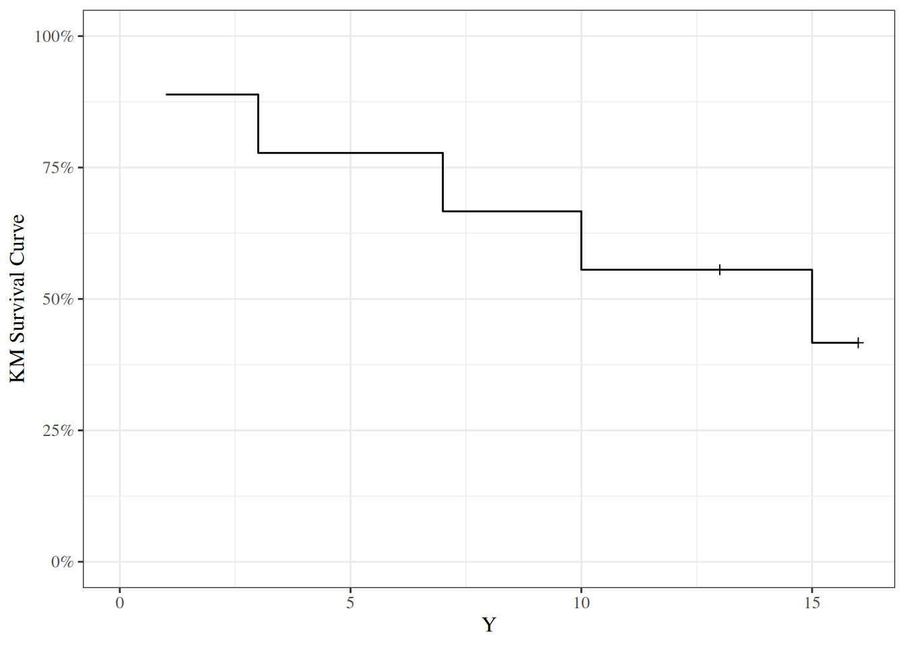](intro-to-survival-analysis_files/figure-html/km-fig-1.png)
>
> or
>
> Show R code
>
> ``` downlit
> library(ggfortify)
> data1 <- data1 |>
>   mutate(
>     surv = Surv(time = Y, event = D)
>   )
> KM_model <- data1 |> survfit(formula = surv ~ 1)
> KM_model |> autoplot()
> ```
>
> [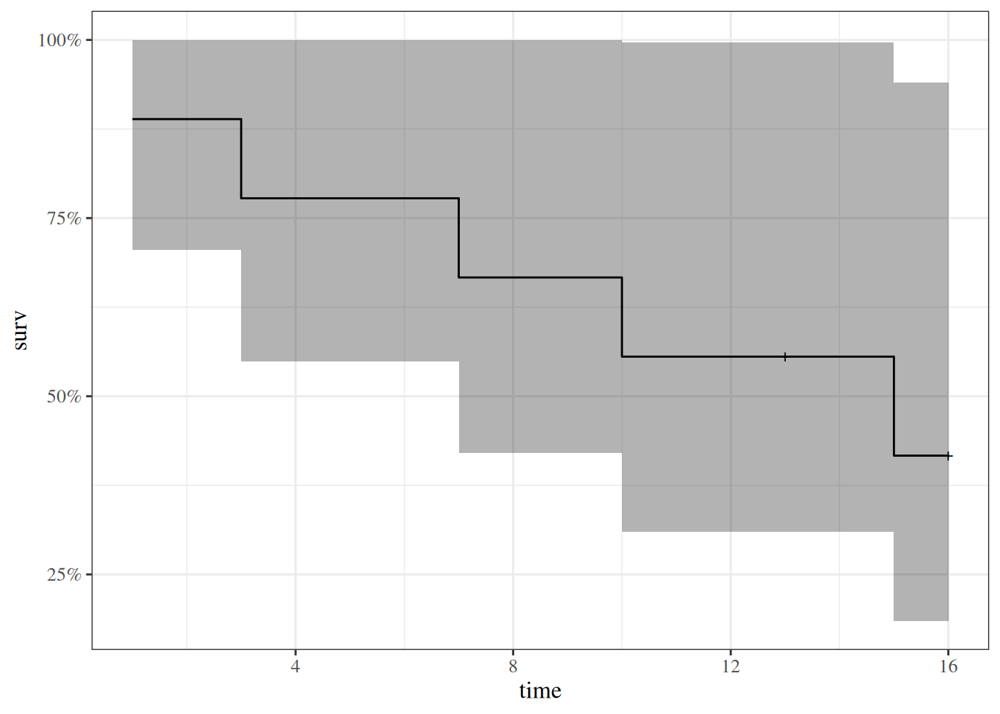](intro-to-survival-analysis_files/figure-html/autoplot-fig-1.png)

> **NOTE:**
>
> **Exercise 10** Find the KM estimate of [median survival time](#def-median-survival).

> **NOTE:**
>
> *Solution 8*.
>
> Show R code
>
> ``` downlit
> KM_model |> quantile(prob = 0.5) |> as_tibble()
> ```

> **NOTE:**
>
> **Theorem 13 (Kaplan-Meier Estimate with No Censored Observations)** If there are no censored data, and there are $n$ data points, then just after (say) the third event time
>
> $$\begin{aligned}
> \mathop{\hat{\operatorname{S}}}\nolimits(t)
> &= \prod_{t_i \le t}\mathopen{}\left[1-\frac{d_i}{r_i}\right]\mathclose{}
> \\ &= \mathopen{}\left[\frac{n-d_1}{n}\right]\mathclose{} \mathopen{}\left[\frac{n-d_1-d_2}{n-d_1}\right]\mathclose{} \mathopen{}\left[\frac{n-d_1-d_2-d_3}{n-d_1-d_2}\right]\mathclose{}
> \\ &= \frac{n-d_1-d_2-d_3}{n}
> \\ &=1-\frac{d_1+d_2+d_3}{n}
> \\ &=1-\mathop{\hat{\operatorname{F}}}\nolimits(t)
> \end{aligned}$$
>
> where $\mathop{\hat{\operatorname{F}}}\nolimits(t)$ is the usual empirical CDF estimate.

## 7.3 Variance of the Kaplan-Meier estimator

The estimated [variance](https://morrison-lab.github.io/pds/variance-covariance.html#def-variance) of $\mathop{\hat{\operatorname{S}}}\nolimits(t)$ at a single time point $t$ is given by **Greenwood’s formula**:

> **NOTE:**
>
> **Theorem 14 (Greenwood’s estimator for variance of Kaplan-Meier survival estimator)** $${\mathop{\widehat{\operatorname{Var}}}\nolimits\mathopen{}\left(\mathop{\hat{\operatorname{S}}}\nolimits(t)\right)\mathclose{}} = \mathop{\hat{\operatorname{S}}}\nolimits(t)^2\sum_{t_i \le t}\frac{d_i}{r_i(r_i-d_i)}
> \tag{12}$$
>
> [\[3, Sec. 4.2\]](#ref-klein2003survival), eq. (4.2.2)

We can use [Equation 12](#eq-var-est-surv) for [confidence intervals](https://morrison-lab.github.io/sds/inference.html#def-confidence-interval) for a survival function or a difference of [survival functions](#def-surv-fn).

### 7.3.1 Understanding Greenwood’s formula (optional)

To see where Greenwood’s formula comes from, let $x_i = r_i - d_i$. We approximate the solution treating each time as [independent](https://morrison-lab.github.io/pds/independence.html#def-indpt), with $r_i$ fixed and ignore randomness in times of failure and we treat $x_i$ as independent [binomials](https://morrison-lab.github.io/pds/distributions.html#def-binomial) ${\operatorname{Bin}\mathopen{}\left(r_i, p_i\right)\mathclose{}}$. Letting $\operatorname{S}(t)$ be the “true” survival function

$$\begin{aligned}
\mathop{\hat{\operatorname{S}}}\nolimits(t) &=\prod_{t_i \le t}x_i/r_i\\
\operatorname{S}(t)&=\prod_{t_i \le t}p_i
\end{aligned}$$

$$\begin{aligned}
\frac{\mathop{\hat{\operatorname{S}}}\nolimits(t)}{\operatorname{S}(t)}
&= \prod_{t_i \le t} \frac{x_i}{p_i r_i}
\\ &= \prod_{t_i \le t} \frac{\hat p_i}{p_i}
\\ &= \prod_{t_i \le t} \mathopen{}\left(1+\frac{\hat p_i-p_i}{p_i}\right)\mathclose{}
\\ &\approx 1+\sum_{t_i \le t} \frac{\hat p_i-p_i}{p_i}
\end{aligned}$$

$$\begin{aligned}
{\operatorname{Var}\mathopen{}\left(\frac{\mathop{\hat{\operatorname{S}}}\nolimits(t)}{\operatorname{S}(t)}\right)\mathclose{}}
&\approx {\operatorname{Var}\mathopen{}\left(1+\sum_{t_i \le t} \frac{\hat p_i-p_i}{p_i}\right)\mathclose{}}
\\ &=\sum_{t_i \le t} \frac{1}{p_i^2}\frac{p_i(1-p_i)}{r_i}
\\ &= \sum_{t_i \le t} \frac{(1-p_i)}{p_i r_i}
\\ &\approx\sum_{t_i \le t} \frac{(1-x_i/r_i)}{x_i}
\\ &=\sum_{t_i \le t} \frac{r_i-x_i}{x_i r_i}
\\ &=\sum_{t_i \le t} \frac{d_i}{r_i(r_i-d_i)}
\\ \therefore{\operatorname{Var}\mathopen{}\left(\mathop{\hat{\operatorname{S}}}\nolimits(t)\right)\mathclose{}}
&\approx \mathop{\hat{\operatorname{S}}}\nolimits(t)^2\sum_{t_i \le t} \frac{d_i}{r_i(r_i-d_i)}
\end{aligned}$$

> **NOTE:**
>
> **Example 25 (Kaplan-Meier curve for `drug6mp` data)** Here is the [Kaplan-Meier](#def-KM-estimator) estimated survival curve for the patients who received 6-MP in the `drug6mp` dataset (we will see code to produce figures like this one shortly):
>
> > **NOTE:**
> >
> > Show R code
> >
> > ``` downlit
> > library(KMsurv)
> > data(drug6mp)
> > library(dplyr)
> > library(survival)
> >
> > km_model1 <-
> >   drug6mp |>
> >   mutate(surv = Surv(t2, relapse)) |>
> >   survfit(formula = surv ~ 1, data = _)
> >
> > library(ggfortify)
> > km_model1 |>
> >   autoplot(
> >     mark.time = TRUE,
> >     conf.int = FALSE
> >   ) +
> >   expand_limits(y = 0) +
> >   xlab("Time since diagnosis (months)") +
> >   ylab("KM Survival Curve")
> > ```
> >
> > [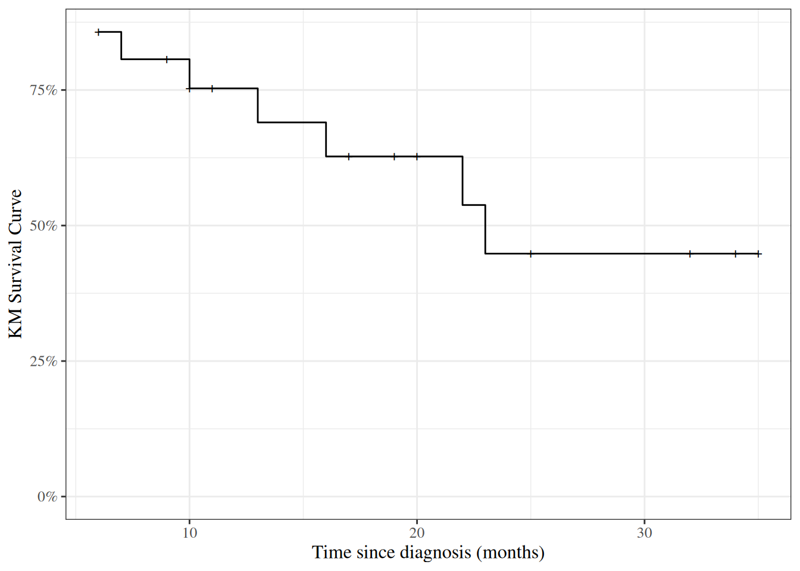](intro-to-survival-analysis_files/figure-html/unnamed-chunk-16-1.png "Figure 12: Kaplan-Meier Survival Curve for 6-MP Patients")
> >
> > Figure 12: Kaplan-Meier Survival Curve for 6-MP Patients

## 7.4 Kaplan-Meier calculations

Let’s compute these estimates and build the chart by hand:

Show R code

``` downlit
library(KMsurv)
library(dplyr)
data(drug6mp)

data_v2 <-
  drug6mp |>
  as_tibble() |>
  mutate(
    remstat = remstat |>
      case_match(
        1 ~ "partial",
        2 ~ "complete"
      ),
    # renaming to "outcome" while relabeling is just a style choice:
    outcome = relapse |>
      case_match(
        0 ~ "censored",
        1 ~ "relapsed"
      )
  )

km_table <-
  data_v2 |>
  summarize(
    .by = t2,
    Relapses = sum(outcome == "relapsed"),
    Censored = sum(outcome == "censored")
  ) |>
  # here we add a start time row, so the graph starts at time 0:
  bind_rows(
    tibble(
      t2 = 0,
      Relapses = 0,
      Censored = 0
    )
  ) |>
  # sort in time order:
  arrange(t2) |>
  mutate(
    Exiting = Relapses + Censored,
    `Study Size` = sum(Exiting),
    Exited = cumsum(Exiting) |> dplyr::lag(default = 0),
    `At Risk` = `Study Size` - Exited,
    Hazard = Relapses / `At Risk`,
    `KM Factor` = 1 - Hazard,
    `Cumulative Hazard` = cumsum(`Hazard`),
    `KM Survival Curve` = cumprod(`KM Factor`)
  )

library(pander)
pander(km_table)
```

| t2 | Relapses | Censored | Exiting | Study Size | Exited | At Risk | Hazard | KM Factor | Cumulative Hazard | KM Survival Curve |
|:--:|:--:|:--:|:--:|:--:|:--:|:--:|:--:|:--:|:--:|:--:|
| 0 | 0 | 0 | 0 | 21 | 0 | 21 | 0 | 1 | 0 | 1 |
| 6 | 3 | 1 | 4 | 21 | 0 | 21 | 0.1429 | 0.8571 | 0.1429 | 0.8571 |
| 7 | 1 | 0 | 1 | 21 | 4 | 17 | 0.05882 | 0.9412 | 0.2017 | 0.8067 |
| 9 | 0 | 1 | 1 | 21 | 5 | 16 | 0 | 1 | 0.2017 | 0.8067 |
| 10 | 1 | 1 | 2 | 21 | 6 | 15 | 0.06667 | 0.9333 | 0.2683 | 0.7529 |
| 11 | 0 | 1 | 1 | 21 | 8 | 13 | 0 | 1 | 0.2683 | 0.7529 |
| 13 | 1 | 0 | 1 | 21 | 9 | 12 | 0.08333 | 0.9167 | 0.3517 | 0.6902 |
| 16 | 1 | 0 | 1 | 21 | 10 | 11 | 0.09091 | 0.9091 | 0.4426 | 0.6275 |
| 17 | 0 | 1 | 1 | 21 | 11 | 10 | 0 | 1 | 0.4426 | 0.6275 |
| 19 | 0 | 1 | 1 | 21 | 12 | 9 | 0 | 1 | 0.4426 | 0.6275 |
| 20 | 0 | 1 | 1 | 21 | 13 | 8 | 0 | 1 | 0.4426 | 0.6275 |
| 22 | 1 | 0 | 1 | 21 | 14 | 7 | 0.1429 | 0.8571 | 0.5854 | 0.5378 |
| 23 | 1 | 0 | 1 | 21 | 15 | 6 | 0.1667 | 0.8333 | 0.7521 | 0.4482 |
| 25 | 0 | 1 | 1 | 21 | 16 | 5 | 0 | 1 | 0.7521 | 0.4482 |
| 32 | 0 | 2 | 2 | 21 | 17 | 4 | 0 | 1 | 0.7521 | 0.4482 |
| 34 | 0 | 1 | 1 | 21 | 19 | 2 | 0 | 1 | 0.7521 | 0.4482 |
| 35 | 0 | 1 | 1 | 21 | 20 | 1 | 0 | 1 | 0.7521 | 0.4482 |

### 7.4.1 Summary

For the 6-MP patients at time 6 months, there are 21 patients [at risk](#def-number-at-risk). At $t=6$ there are 3 relapses and 1 censored observations.

The Kaplan-Meier factor is $(21-3)/21 = 0.857$. The number at risk for the next time ($t=7$) is $21-3-1=17$.

At time 7 months, there are 17 patients at risk. At $t=7$ there is 1 relapse and 0 censored observations. The Kaplan-Meier factor is $(17-1)/17 = 0.941$. The [Kaplan Meier estimate](#def-KM-estimator) is $0.857\times0.941=0.807$. The number at risk for the next time ($t=9$) is $17-1=16$.

Now, let’s graph this estimated survival curve using [`ggplot()`](https://ggplot2.tidyverse.org/reference/ggplot.html):

Show R code

``` downlit
library(ggplot2)
conflicts_prefer(dplyr::filter)
km_table |>
  ggplot(aes(x = t2, y = `KM Survival Curve`)) +
  geom_step() +
  geom_point(data = km_table |> filter(Censored > 0), shape = 3) +
  expand_limits(y = c(0, 1), x = 0) +
  xlab("Time since diagnosis (months)") +
  ylab("KM Survival Curve") +
  scale_y_continuous(labels = scales::percent)
```

> **NOTE:**
>
> [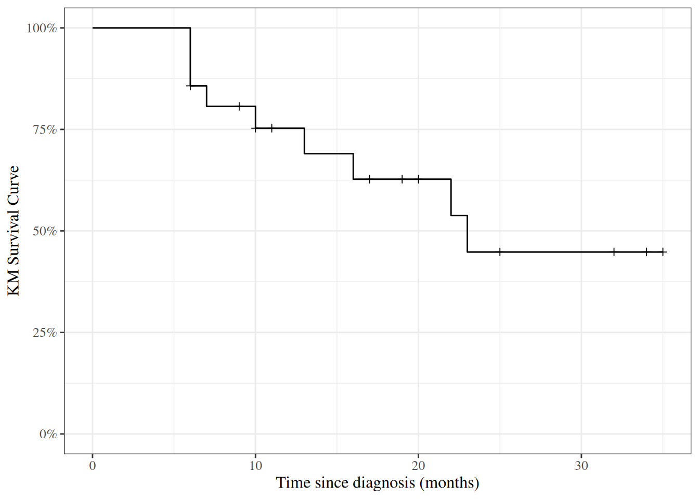](intro-to-survival-analysis_files/figure-html/fig-km-by-hand-1.png "Figure 13: KM curve for 6MP patients, calculated by hand")
>
> Figure 13: KM curve for 6MP patients, calculated by hand

> **NOTE:**
>
> **Exercise 11 (Construct a prediction interval)** Suppose a cancer patient is predicted to have an [expected (mean)](https://morrison-lab.github.io/pds/expectation.html#def-expectation) lifetime of 7 years after diagnosis, and suppose the distribution is exponential.
>
> Construct a 95% [prediction interval](https://morrison-lab.github.io/sds/intro-MLEs.html#def-prediction-interval) for survival.

> **TIP:**
>
> Use the [quantiles](https://morrison-lab.github.io/pds/random-variables.html#def-quantile-function) of the exponential distribution.

> **NOTE:**
>
> *Solution 9*. If the mean is 7 years until death, then the rate parameter ${\lambda}= 1/7$ events (deaths) per year.
>
> The 0.025 quantile of the exponential distribution with ${\lambda}= 1/7$ is `qexp(p 0.025, rate = 1/7)` = 0.177225 and the 0.975 quantile is `qexp(p 0.975, rate = 1/7)` = 25.822156, so the prediction interval is `qexp(p c(.025, 0.975), rate = 1/7)` = (0.177225, 25.822156).

> **NOTE:**
>
> **Exercise 12** Graph the prediction interval as a function of the mean, for [Gaussian](https://morrison-lab.github.io/pds/random-variables.html#def-normal) ($\sigma = 1$), [Binomial](https://morrison-lab.github.io/pds/distributions.html#def-binomial), [Poisson](https://morrison-lab.github.io/pds/distributions.html#def-poisson), and [Exponential](https://morrison-lab.github.io/pds/random-variables.html#def-exponential).

> **NOTE:**
>
> *Solution 10*. Left to the reader for now.

> **NOTE:**
>
> **Exercise 13 (Explain the results)** Why do time-to-event models have such wide predictive intervals?

> **TIP:**
>
> Consider the relationship between the mean, [variance](https://morrison-lab.github.io/pds/variance-covariance.html#def-variance), and [standard deviation](https://morrison-lab.github.io/pds/variance-covariance.html#def-sd) of the exponential distribution, and contrast that relationship with the [Poisson distribution](https://morrison-lab.github.io/pds/distributions.html#def-poisson) and the [Bernoulli distribution](https://morrison-lab.github.io/pds/random-variables.html#def-bernoulli).

> **NOTE:**
>
> *Solution 11*. In the exponential distribution, variance is the square of the mean (hence SD is equal to mean); as opposed to Poisson, where variance was equal to the mean (and SD is the square-root of the mean), or the Bernoulli, where the variance is the mean minus the square of the mean (so the SD is smaller than the square-root of the mean).

# 8 Using the `survival` package in R

We don’t have to do these calculations by hand every time; the `survival` package and several others have functions available to automate many of these tasks (full list: <https://cran.r-project.org/web/views/Survival.html>).

## 8.1 The `Surv` function

To use the `survival` package, the first step is telling R how to combine the exit time and exit reason (censoring versus event) columns. The [`Surv()`](https://rdrr.io/pkg/survival/man/Surv.html) function accomplishes this task.

> **NOTE:**
>
> **Example 26 ([`Surv()`](https://rdrr.io/pkg/survival/man/Surv.html) with `drug6mp` data)**  
>
> Show R code
>
> ``` numberSource
> library(survival)
> data_v3 <-
>   data_v2 |>
>   mutate(
>     surv2 = Surv(
>       time = t2,
>       event = (outcome == "relapsed")
>     )
>   )
>
> print(data_v3)
> #> # A tibble: 21 × 7
> #>     pair remstat     t1    t2 relapse outcome   surv2
> #>    <int> <chr>    <int> <int>   <int> <chr>    <Surv>
> #>  1     1 partial      1    10       1 relapsed    10 
> #>  2     2 complete    22     7       1 relapsed     7 
> #>  3     3 complete     3    32       0 censored    32+
> #>  4     4 complete    12    23       1 relapsed    23 
> #>  5     5 complete     8    22       1 relapsed    22 
> #>  6     6 partial     17     6       1 relapsed     6 
> #>  7     7 complete     2    16       1 relapsed    16 
> #>  8     8 complete    11    34       0 censored    34+
> #>  9     9 complete     8    32       0 censored    32+
> #> 10    10 complete    12    25       0 censored    25+
> #> # ℹ 11 more rows
> ```
>
> The output of [`Surv()`](https://rdrr.io/pkg/survival/man/Surv.html) is a vector of objects with class `Surv`. When we print this vector:
>
> - observations where the event was observed are printed as the event time (for example, `surv2 = 10` on line 1)
>
> - observations where the event was [right-censored](#def-right-censor) are printed as the censoring time with a plus sign (`+`; for example, `surv2 = 32+` on line 3).

## 8.2 The `survfit` function

Once we have constructed our `Surv` variable, we can calculate the [Kaplan-Meier estimate](#def-KM-estimator) of the [survival curve](#def-surv-fn) using the [`survfit()`](https://rdrr.io/pkg/survival/man/survfit.html) function.

> **NOTE:**
>
> The documentation for [`?survfit`](https://rdrr.io/pkg/survival/man/survfit.html) isn’t too helpful; the `survfit.formula` documentation is better.

> **NOTE:**
>
> **Example 27 ([`survfit()`](https://rdrr.io/pkg/survival/man/survfit.html) with `drug6mp` data)** Here we use [`survfit()`](https://rdrr.io/pkg/survival/man/survfit.html) to create a `survfit` object, which contains the Kaplan-Meier estimate:
>
> Show R code
>
> ``` downlit
> km_model <- survfit(
>   formula = surv2 ~ 1,
>   data = data_v3
> )
> ```
>
> `print.survfit()` just gives some summary statistics:
>
> Show R code
>
> ``` downlit
> print(km_model)
> #> Call: survfit(formula = surv2 ~ 1, data = data_v3)
> #> 
> #>       n events median 0.95LCL 0.95UCL
> #> [1,] 21      9     23      16      NA
> ```
>
> `summary.survfit()` shows us the underlying Kaplan-Meier table:
>
> Show R code
>
> ``` downlit
> summary(km_model)
> #> Call: survfit(formula = surv2 ~ 1, data = data_v3)
> #> 
> #>  time n.risk n.event survival std.err lower 95% CI upper 95% CI
> #>     6     21       3    0.857  0.0764        0.720        1.000
> #>     7     17       1    0.807  0.0869        0.653        0.996
> #>    10     15       1    0.753  0.0963        0.586        0.968
> #>    13     12       1    0.690  0.1068        0.510        0.935
> #>    16     11       1    0.627  0.1141        0.439        0.896
> #>    22      7       1    0.538  0.1282        0.337        0.858
> #>    23      6       1    0.448  0.1346        0.249        0.807
> ```
>
> We can specify which time points we want using the `times` argument:
>
> Show R code
>
> ``` downlit
> summary(
>   km_model,
>   times = c(0, data_v3$t2)
> )
> #> Call: survfit(formula = surv2 ~ 1, data = data_v3)
> #> 
> #>  time n.risk n.event survival std.err lower 95% CI upper 95% CI
> #>     0     21       0    1.000  0.0000        1.000        1.000
> #>    10     15       1    0.753  0.0963        0.586        0.968
> #>     7     17       1    0.807  0.0869        0.653        0.996
> #>    32      4       0    0.448  0.1346        0.249        0.807
> #>    23      6       1    0.448  0.1346        0.249        0.807
> #>    22      7       1    0.538  0.1282        0.337        0.858
> #>     6     21       3    0.857  0.0764        0.720        1.000
> #>    16     11       1    0.627  0.1141        0.439        0.896
> #>    34      2       0    0.448  0.1346        0.249        0.807
> #>    32      4       0    0.448  0.1346        0.249        0.807
> #>    25      5       0    0.448  0.1346        0.249        0.807
> #>    11     13       0    0.753  0.0963        0.586        0.968
> #>    20      8       0    0.627  0.1141        0.439        0.896
> #>    19      9       0    0.627  0.1141        0.439        0.896
> #>     6     21       3    0.857  0.0764        0.720        1.000
> #>    17     10       0    0.627  0.1141        0.439        0.896
> #>    35      1       0    0.448  0.1346        0.249        0.807
> #>     6     21       3    0.857  0.0764        0.720        1.000
> #>    13     12       1    0.690  0.1068        0.510        0.935
> #>     9     16       0    0.807  0.0869        0.653        0.996
> #>     6     21       3    0.857  0.0764        0.720        1.000
> #>    10     15       1    0.753  0.0963        0.586        0.968
> ```
>
> Show R code
>
> ``` downlit
> ?summary.survfit
> ```

## 8.3 Plotting estimated survival functions

We can plot `survfit` objects with [`plot()`](https://rdrr.io/r/graphics/plot.default.html), [`autoplot()`](https://ggplot2.tidyverse.org/reference/autoplot.html), or [`ggsurvplot()`](https://rdrr.io/pkg/survminer/man/ggsurvplot.html):

Show R code

``` downlit
library(ggfortify)
autoplot(km_model)
```

[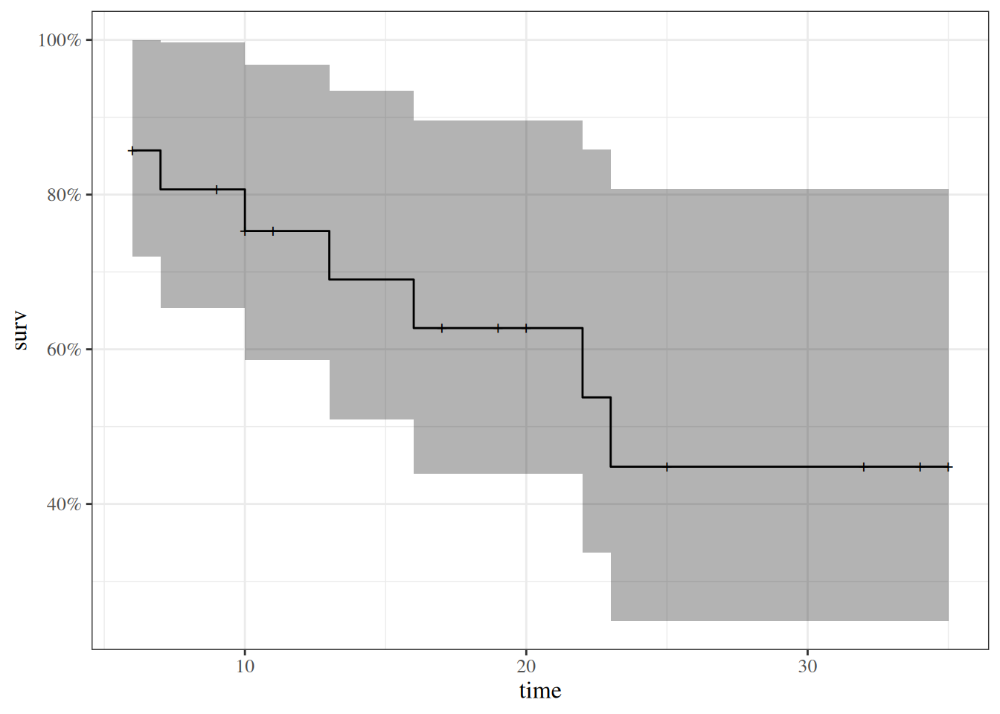](intro-to-survival-analysis_files/figure-html/unnamed-chunk-26-1.png "Kaplan-Meier Survival Curve for 6-MP Patients")

Kaplan-Meier Survival Curve for 6-MP Patients

### 8.3.1 quantiles of survival curve

We can extract [quantiles](https://morrison-lab.github.io/pds/random-variables.html#def-quantile-function) with [`quantile()`](https://rdrr.io/r/stats/quantile.html):

Show R code

``` numberSource
km_model |>
  quantile(p = c(.25, .5)) |>
  as_tibble() |>
  mutate(p = c(.25, .5)) |>
  relocate(p, .before = everything())
```

## 8.4 R Packages Ecosystem for Survival Analysis

R provides a rich ecosystem of packages for survival analysis, ranging from core functionality to specialized visualization tools and advanced modeling capabilities.

### 8.4.1 Visualization Packages

#### ggsurvfit

**[`ggsurvfit`](https://danieldsjoberg.com/ggsurvfit/)** is a modern package for creating publication-ready survival plots using ggplot2.

- Developed by [Daniel D. Sjoberg](https://www.danieldsjoberg.com/) and collaborators
- Seamlessly integrates with ggplot2, allowing full customization using familiar ggplot2 syntax
- Key features:
  - Create [Kaplan-Meier](#def-KM-estimator) plots with `ggsurvfit()`
  - Add [confidence intervals](https://morrison-lab.github.io/sds/inference.html#def-confidence-interval) with `add_confidence_interval()`
  - Add risk tables with `add_risktable()`
  - Add quantile annotations with `add_quantile()`
  - Support for [competing risks](../chapters/proportional-hazards-models.llms.md#def-competing-risks) with `ggcuminc()`
- Produces publication-ready legends without showing raw variable names
- All plot elements are native ggplot2 layers, making customization straightforward
- Available on [CRAN](https://cran.r-project.org/web/packages/ggsurvfit/index.html) and [GitHub](https://github.com/pharmaverse/ggsurvfit)

#### survminer

**[`survminer`](https://cran.r-project.org/web/packages/survminer/index.html)** is another popular visualization package for survival analysis.

- Creates ggplot2-based survival plots using [`ggsurvplot()`](https://rdrr.io/pkg/survminer/man/ggsurvplot.html)
- Provides functions for visualizing [Cox model](../chapters/proportional-hazards-models.llms.md#def-ph-model) results
- Includes tools for testing [proportional hazards](../chapters/proportional-hazards-models.llms.md#def-pha) assumptions
- Offers built-in themes and color palettes for publication-quality plots
- Can display risk tables, cumulative events, and censoring counts

#### ggfortify

**[`ggfortify`](https://cran.r-project.org/web/packages/ggfortify/index.html)** extends ggplot2 with automatic plotting capabilities.

- Provides [`autoplot()`](https://ggplot2.tidyverse.org/reference/autoplot.html) method for `survfit` objects (demonstrated in [Example 27](#exm-survfit-drug6mp))
- One-line code to create survival curves with confidence intervals
- Automatically handles grouping variables and creates legends
- Shows censoring marks on plots by default
- Returns ggplot2 objects for further customization
- Also supports many other statistical objects beyond survival analysis

### 8.4.2 Additional Modeling Packages

Several packages extend the modeling capabilities beyond the core `survival` package:

- **[`flexsurv`](https://cran.r-project.org/web/packages/flexsurv/index.html)**: Flexible parametric survival models with a wide range of distributions
- **[`rms`](https://cran.r-project.org/web/packages/rms/index.html)** (Regression Modeling Strategies): Advanced regression modeling including survival models with tools for model validation and calibration
- **[`cmprsk`](https://cran.r-project.org/web/packages/cmprsk/index.html)**: Competing risks regression using the Fine-Gray model
- **[`mstate`](https://cran.r-project.org/web/packages/mstate/index.html)**: Multi-state survival models for complex event histories
- **[`timereg`](https://cran.r-project.org/web/packages/timereg/index.html)**: Flexible regression models for survival data, including additive hazards models
- **[`frailtypack`](https://cran.r-project.org/web/packages/frailtypack/index.html)**: Frailty models for clustered or recurrent event data
- **[`riskRegression`](https://cran.r-project.org/web/packages/riskRegression/index.html)**: Risk prediction models and performance evaluation
- **[`pec`](https://cran.r-project.org/web/packages/pec/index.html)**: Prediction error curves for survival model validation
- **[`prodlim`](https://cran.r-project.org/web/packages/prodlim/index.html)**: Fast estimation of survival models including competing risks

### 8.4.3 Package Selection Guidance

For most standard survival analyses:

- Use **`survival`** for core functionality (Kaplan-Meier, Cox models, parametric models)
- Choose **`ggsurvfit`** for modern, customizable survival plots if you’re familiar with ggplot2
- Consider **`survminer`** as an alternative visualization package with many built-in features
- Use **`ggfortify`** if you want quick, automatic plots with minimal code

For specialized analyses:

- **Competing risks**: `cmprsk` or `riskRegression`
- **Multi-state models**: `mstate`
- **Flexible parametric models**: `flexsurv`
- **Clustered/recurrent events**: `frailtypack`
- **Model validation**: `rms` or `pec`

The [CRAN Survival Analysis Task View](https://cran.r-project.org/web/views/Survival.html) provides the most comprehensive and up-to-date list of available packages.

# 9 The log-rank test

(a.k.a. the Mantel-Cox test)

> **NOTE:**
>
> **Exercise 14** How do we test the [null hypothesis](https://morrison-lab.github.io/sds/inference.html#def-null-hypothesis) that two or more groups have the same time-to-event distribution?

> **NOTE:**
>
> *Solution 12*. One option is the **log-rank test**, which compares the [Kaplan-Meier estimates](#def-KM-estimator) of the [survival functions](#def-surv-fn) of those groups.

Adapted from [\[6, Sec. IV\]](#ref-kleinbaum2012survival), pp. 67–68:

- The log-rank test is a large-sample [chi-square](https://morrison-lab.github.io/sds/inference.html#def-chi-square-dist) test.

- The log-rank test uses a [test statistic](https://morrison-lab.github.io/sds/inference.html#def-test-statistic) that compares KM curves between groups across all survival times.

- Like many other statistics used in chi-square tests, the log-rank statistic compares observed versus expected cell counts over categories of outcomes.

- The categories for the log-rank statistic are defined by each of the ordered failure times for the entire set of data being analyzed.

## 9.1 Notation

Suppose we are comparing $G \ge 2$ groups, indexed by $g = 1, \ldots, G$. Pool the failure times across all groups and let

- $t_1 < t_2 < \cdots < t_k$ be the **distinct ordered failure times** in the pooled data ($i = 1, \ldots, k$ indexes these times).

For each ordered failure time $t_i$ and each group $g$, define:

| Symbol | Meaning |
|----|----|
| $d_{gi}$ | number of failures in group $g$ at time $t_i$ |
| $r_{gi}$ | [number at risk](#def-number-at-risk) in group $g$ just before time $t_i$ |
| $d_i = \sum_{g=1}^{G} d_{gi}$ | total failures at $t_i$ (pooled across groups) |
| $r_i = \sum_{g=1}^{G} r_{gi}$ | total at risk at $t_i$ (pooled across groups) |

This notation matches the $(d_i, r_i)$ notation used for the [Kaplan-Meier estimator](#def-KM-estimator) elsewhere in this chapter; here we additionally split each count by group.

Kleinbaum [\[6, pp. 67–69\]](#ref-kleinbaum2012survival) uses $m_{if}$ and $n_{if}$ in place of $d_{gi}$ and $r_{gi}$; we changed letters here to stay consistent with the $(d_i, r_i)$ already used throughout this chapter.

## 9.2 Expected counts under the null

The [null hypothesis](https://morrison-lab.github.io/sds/inference.html#def-null-hypothesis) is

$$H_0:\; \text{all $G$ groups have the same survival function.}$$

Under $H_0$, the pooled marginal [hazard](#def-hazard) estimate at time $t_i$ is

$$\hat{{\lambda}}_i = \frac{d_i}{r_i}.$$

The **expected** number of failures in group $g$ at time $t_i$ under $H_0$ is the pooled hazard applied to that group’s [risk set](#def-risk-set) [\[6, p. 68\]](#ref-kleinbaum2012survival), “expected-cell-counts” box:

$$e_{gi}
\;=\; r_{gi}\,\hat{{\lambda}}_i
\;=\; \underbrace{\frac{r_{gi}}{r_i}}_{\text{fraction at risk}}\;\cdot\;
      \underbrace{d_i}_{\text{total failures}}
\tag{13}$$

The **summed observed minus expected score** for group $g$ over all failure times is:

$$O_g - E_g \;\stackrel{\text{def}}{=}\; \sum_{i=1}^{k} \mathopen{}\left(d_{gi} - e_{gi}\right)\mathclose{}.$$

## 9.3 Log-rank statistic (two groups)

For two groups ($G = 2$), the observed-minus-expected scores satisfy $O_1 - E_1 = -(O_2 - E_2)$ (the total failures at each $t_i$ are by definition partitioned across the two groups), so it does not matter which group we use to form the [test statistic](https://morrison-lab.github.io/sds/inference.html#def-test-statistic).

> **NOTE:**
>
> **Theorem 15 (Log-rank statistic, two groups)** For either $g \in \{1, 2\}$,
>
> $$\chi^2_{\text{LR}}
> \;=\; \frac{(O_g - E_g)^2}{\widehat{{\operatorname{Var}\mathopen{}\left(O_g - E_g\right)\mathclose{}}}}
> \;\stackrel{H_0}{\sim}\; \chi^2_1
> \tag{14}$$
>
> where $r_{1i}$ and $r_{2i}$ are the at-risk counts for groups 1 and 2 at time $t_i$ (i.e., $r_{gi}$ from [Section 9.1](#sec-logrank-notation) for $g = 1, 2$), and the [variance](https://morrison-lab.github.io/pds/variance-covariance.html#def-variance) estimate is
>
> $$\widehat{{\operatorname{Var}\mathopen{}\left(O_g - E_g\right)\mathclose{}}}
> \;=\; \sum_{i=1}^{k}
>    \frac{r_{1i}\, r_{2i}\, d_i\, (r_i - d_i)}{r_i^2\,(r_i - 1)}.
> \tag{15}$$
>
> For two groups, the variance is the same whether computed for group 1 or group 2.
>
> [\[6, pp. 69–70\]](#ref-kleinbaum2012survival), two-group variance formula

[Equation 15](#eq-logrank-var-2grp) is the hypergeometric variance for the count of failures from group 1 at $t_i$ conditional on $(d_i, r_{1i}, r_{2i})$, summed over failure times. Each summand has the form $r_{1i} r_{2i} d_i (r_i - d_i) / [r_i^2 (r_i - 1)]$.

> **NOTE:**
>
> **Definition 20 (Log-rank test (Mantel-Cox test))** The **log-rank test** (also called the **Mantel-Cox test**) for two groups is the hypothesis test of
>
> $$H_0:\; \operatorname{S}_1(t) = \operatorname{S}_2(t) \text{ for all } t \ge 0,$$
>
> where $\operatorname{S}_g(t)$ is the survival function of group $g$ (the $G = 2$ case of the null hypothesis in [Section 9.1](#sec-logrank-notation)), that uses the log-rank statistic $\chi^2_{\text{LR}}$ ([Equation 14](#eq-logrank-stat-2grp)) as its test statistic and the $\chi^2_1$ distribution ([Theorem 15](#thm-logrank-two-group)) as its large-sample reference distribution. Its p-value is
>
> $$p \stackrel{\text{def}}{=}{\Pr\mathopen{}\left(X \ge \chi^2_{\text{LR}}\right)\mathclose{}}, \quad X \sim \chi^2_1,$$
>
> and at significance level $\alpha$ the test rejects $H_0$ when $\chi^2_{\text{LR}}$ exceeds the $(1 - \alpha)$ quantile of $\chi^2_1$.
>
> [\[3, Ch. 7\]](#ref-klein2003survival), [\[6, Ch. 2\]](#ref-kleinbaum2012survival)

> **NOTE:**
>
> **Example 28 (A log-rank test by hand)** Group 1 has two participants, with events at times 1 and 2. Group 2 has two participants, one with an event at time 3 and one censored at time 4. The distinct failure times in the pooled data are $t_1 = 1$, $t_2 = 2$, and $t_3 = 3$, with the counts ([Section 9.1](#sec-logrank-notation)) in [Table 6](#tbl-logrank-hand).
>
> > **NOTE:**
> >
> > | $i$ | $t_i$ | $r_{1i}$ | $r_{2i}$ | $r_i$ | $d_{1i}$ | $d_i$ |
> > |-----|-------|----------|----------|-------|----------|-------|
> > | 1   | 1     | 2        | 2        | 4     | 1        | 1     |
> > | 2   | 2     | 1        | 2        | 3     | 1        | 1     |
> > | 3   | 3     | 0        | 2        | 2     | 0        | 1     |
> >
> > Table 6: Risk-set and failure counts for the hand-computed [log-rank test](#def-logrank-test).
>
> Using group $g = 1$, the observed count is $O_1 = 1 + 1 + 0 = 2$, and the expected count ([Equation 13](#eq-logrank-expected)) is
>
> $$\begin{aligned}
> E_1
> &= \sum_{i=1}^{3} \frac{r_{1i}}{r_i}\, d_i
> && \text{(sum of @eq-logrank-expected over failure times)}
> \\
> &= \frac{2}{4} \cdot 1 + \frac{1}{3} \cdot 1 + \frac{0}{2} \cdot 1
> && \text{(substitute counts from @tbl-logrank-hand)}
> \\
> &= \frac{1}{2} + \frac{1}{3} + 0
> && \text{(arithmetic)}
> \\
> &= \frac{5}{6},
> && \text{(common denominator 6)}
> \end{aligned}$$
>
> so $O_1 - E_1 = 2 - 5/6 = 7/6$. The variance estimate ([Equation 15](#eq-logrank-var-2grp)) is
>
> $$\begin{aligned}
> {\mathop{\widehat{\operatorname{Var}}}\nolimits\mathopen{}\left(O_1 - E_1\right)\mathclose{}}
> &= \sum_{i=1}^{3}
>    \frac{r_{1i}\, r_{2i}\, d_i\, (r_i - d_i)}{r_i^2\,(r_i - 1)}
> && \text{(@eq-logrank-var-2grp)}
> \\
> &= \frac{2 \cdot 2 \cdot 1 \cdot 3}{4^2 \cdot 3}
> + \frac{1 \cdot 2 \cdot 1 \cdot 2}{3^2 \cdot 2}
> + \frac{0 \cdot 2 \cdot 1 \cdot 1}{2^2 \cdot 1}
> && \text{(substitute counts from @tbl-logrank-hand)}
> \\
> &= \frac{12}{48} + \frac{4}{18} + 0
> && \text{(arithmetic)}
> \\
> &= \frac{1}{4} + \frac{2}{9}
> && \text{(reduce fractions)}
> \\
> &= \frac{17}{36}.
> && \text{(common denominator 36)}
> \end{aligned}$$
>
> The log-rank statistic ([Equation 14](#eq-logrank-stat-2grp)) is then
>
> $$\begin{aligned}
> \chi^2_{\text{LR}}
> &= \frac{(O_1 - E_1)^2}{{\mathop{\widehat{\operatorname{Var}}}\nolimits\mathopen{}\left(O_1 - E_1\right)\mathclose{}}}
> && \text{(@eq-logrank-stat-2grp)}
> \\
> &= \frac{(7/6)^2}{17/36}
> && \text{(substitute)}
> \\
> &= \frac{49/36}{17/36}
> && \text{(square the numerator)}
> \\
> &= \frac{49}{17}
> && \text{(cancel the common factor $1/36$)}
> \\
> &\approx 2.88.
> && \text{(arithmetic)}
> \end{aligned}$$
>
> The $0.95$ quantile of $\chi^2_1$ is approximately $3.84$, and $2.88 < 3.84$, so the log-rank test ([Definition 20](#def-logrank-test)) does not reject $H_0$ at $\alpha = 0.05$ (the p-value is approximately $0.09$). With only four participants, the large-sample $\chi^2_1$ approximation is rough; this example only illustrates the arithmetic.

## 9.4 Log-rank statistic (more than two groups)

For $G \ge 2$ groups, the log-rank statistic still uses the observed-minus-expected scores $O_g - E_g$, but the [variance–covariance](https://morrison-lab.github.io/pds/variance-covariance.html#def-cov-vec-x) matrix of the vector $\mathbf{O} - \mathbf{E} \stackrel{\text{def}}{=}(O_1 - E_1, \ldots, O_G - E_G)'$ is nontrivial because the scores are [linearly dependent](https://morrison-lab.github.io/mds/linear-algebra-subspaces.html#def-linearly-independent) ($\sum_g (O_g - E_g) = 0$). The statistic takes the matrix-quadratic form

$$\chi^2_{\text{LR}}
\;=\; (\mathbf{O} - \mathbf{E})'\,\widehat{\Sigma}^{-}\,(\mathbf{O} - \mathbf{E})
\;\stackrel{H_0}{\sim}\; \chi^2_{G - 1}$$

where $\widehat\Sigma$ is the estimated variance–covariance matrix of $\mathbf{O} - \mathbf{E}$ and $\widehat\Sigma^{-}$ is a generalized inverse (any $G - 1$ of the rows/columns suffice, since the scores sum to zero).

[\[6, pp. 71–72\]](#ref-kleinbaum2012survival) and Chapter 2 Appendix for the matrix formula

In practice we don’t compute this by hand — every standard survival package ([`survival::survdiff`](https://rdrr.io/pkg/survival/man/survdiff.html) in R, `sts test` in Stata, `LIFETEST` in SAS) returns the exact log-rank statistic.

## 9.5 Approximate (Pearson-style) statistic

When only $(O_g, E_g)$ are available — e.g., from a printed summary — the variance–covariance matrix can be replaced by the diagonal $E_g$ entries to yield the classic Pearson-style approximation:

$$X^2 \;\approx\; \sum_{g=1}^{G} \frac{(O_g - E_g)^2}{E_g}.$$

This approximate statistic is what some textbooks call “the log-rank test”; it is approximately equal to the exact statistic.

[\[6, p. 70\]](#ref-kleinbaum2012survival) (approximate formula)

## 9.6 The `survdiff` function

Show R code

``` downlit
?survdiff
```

> **NOTE:**
>
> **Example 29 ([`survdiff()`](https://rdrr.io/pkg/survival/man/survdiff.html) with `drug6mp` data)** Now we are going to compare the placebo and 6-MP data. We need to reshape the data to make it usable with the standard `survival` workflow:
>
> Show R code
>
> ``` downlit
> library(survival)
> library(tidyr)
> data_v4 <-
>   data_v3 |>
>   select(pair, remstat, t1, t2, outcome) |>
>   # here we are going to change the data from a wide format to long:
>   pivot_longer(
>     cols = c(t1, t2),
>     names_to = "treatment",
>     values_to = "exit_time"
>   ) |>
>   mutate(
>     treatment = treatment |>
>       case_match(
>         "t1" ~ "placebo",
>         "t2" ~ "6-MP"
>       ),
>     outcome = if_else(
>       treatment == "placebo",
>       "relapsed",
>       outcome
>     ),
>     surv = Surv(
>       time = exit_time,
>       event = (outcome == "relapsed")
>     )
>   )
> ```
>
> Using this long data format, we can fit a [Kaplan-Meier curve](#def-KM-estimator) for each treatment group simultaneously:
>
> Show R code
>
> ``` downlit
> km_model2 <-
>   survfit(
>     formula = surv ~ treatment,
>     data = data_v4
>   )
> ```
>
> We can plot the curves in the same graph:
>
> Show R code
>
> ``` downlit
> km_model2 |> autoplot()
> ```
>
> [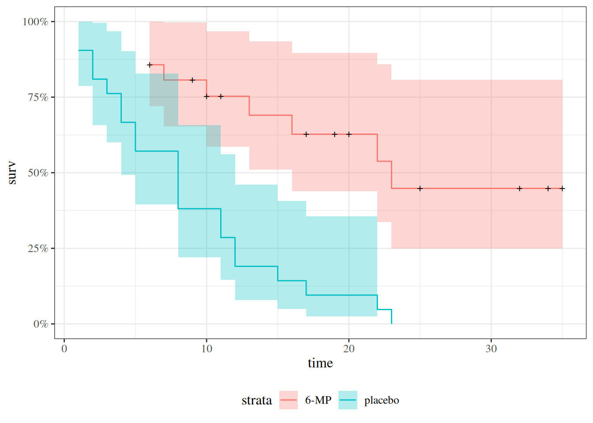](intro-to-survival-analysis_files/figure-html/unnamed-chunk-31-1.png)
>
> We can also perform something like a [t-test](https://morrison-lab.github.io/sds/basic-statistical-methods.html#def-two-sample-t-test), where the [null hypothesis](https://morrison-lab.github.io/sds/inference.html#def-null-hypothesis) is that the curves are the same. [Table 7](#tbl-logrank-6mp) shows the per-time $(d_{gi}, r_{gi})$ counts and the expected counts $e_{gi}$ from [Equation 13](#eq-logrank-expected):
>
> > **NOTE:**
> >
> > Show R code
> >
> > ``` downlit
> > o_e <- data_v4 |>
> >   arrange(exit_time) |>
> >   mutate(
> >     .by = treatment,
> >     n_exited = row_number(),
> >     n_at_risk = n() - n_exited + 1
> >   ) |>
> >   dplyr::summarize(
> >     .by = all_of(c("exit_time", "treatment")),
> >     n_at_risk = max(n_at_risk),
> >     n_events = sum(outcome == "relapsed")
> >   ) |>
> >   tidyr::pivot_wider(
> >     names_from = "treatment",
> >     values_from = c(n_at_risk, n_events)
> >   ) |>
> >   tidyr::fill(
> >     starts_with("n_at_risk"),
> >     .direction = "up"
> >   ) |>
> >   replace_na(list("n_events_placebo" = 0,
> >                   "n_events_6-MP" = 0)) |>
> >   mutate(
> >     n_at_risk = rowSums(across(starts_with("n_at_risk"))),
> >     n_events = rowSums(across(starts_with("n_events"))),
> >     marginal_hazard = n_events / n_at_risk,
> >     expected_6mp = marginal_hazard * `n_at_risk_6-MP`,
> >     expected_plc = marginal_hazard * n_at_risk_placebo,
> >     diff_6mp = `n_events_6-MP` - expected_6mp,
> >     diff_plc = n_events_placebo - expected_plc
> >   ) |>
> >   filter(n_events > 0)
> >
> > o_e
> > ```
> >
> > Table 7: Observed and expected event counts for the 6-MP data, for the log-rank test. Columns: `exit_time` is $t_i$; `n_at_risk_placebo`/`n_at_risk_6-MP` are $r_{gi}$; `n_events_placebo`/`n_events_6-MP` are $d_{gi}$; `n_at_risk`/`n_events` are pooled $r_i$, $d_i$; `marginal_hazard` is $\hat{{\lambda}}_i = d_i / r_i$; `expected_*` are $e_{gi}$ from [Equation 13](#eq-logrank-expected); `diff_*` are the per-time contributions $d_{gi} - e_{gi}$ to $O_g - E_g$.
>
> The summed observed $O_g$ and expected $E_g$ totals (one row, one column per group):
>
> > **NOTE:**
> >
> > Show R code
> >
> > ``` downlit
> > o_e_summ <- o_e |>
> >   summarize(
> >     across(starts_with("expected"), sum),
> >     across(starts_with("n_events_"), sum)
> >   )
> > pander::pander(o_e_summ)
> > ```
> >
> > | expected_6mp | expected_plc | n_events_placebo | n_events_6-MP |
> > |:------------:|:------------:|:----------------:|:-------------:|
> > |    19.25     |    10.75     |        21        |       9       |
> >
> > Table 8: Sums of observed and expected events for the 6-MP data.
>
> The Pearson-style approximation to [Equation 14](#eq-logrank-stat-2grp) is
>
> $$X^2 \;\approx\; \sum_{g} \frac{(O_g - E_g)^2}{E_g}$$
>
> which we compute directly from [Table 8](#tbl-sum-obs-exp):
>
> Show R code
>
> ``` downlit
> with(
>   o_e_summ,
>   tibble(
>     "6mp" = (`n_events_6-MP` - expected_6mp)^2 / expected_6mp,
>     "placebo" = (n_events_placebo - expected_plc)^2 / expected_plc,
>     sum = `6mp` + placebo
>   )
> ) |>
>   pander::pander()
> ```
>
> |  6mp  | placebo |  sum  |
> |:-----:|:-------:|:-----:|
> | 5.458 |  9.775  | 15.23 |
>
> R gives us both the exact and approximate results:
>
> Show R code
>
> ``` downlit
> survdiff(
>   formula = surv ~ treatment,
>   data = data_v4
> )
> #> Call:
> #> survdiff(formula = surv ~ treatment, data = data_v4)
> #> 
> #>                    N Observed Expected (O-E)^2/E (O-E)^2/V
> #> treatment=6-MP    21        9     19.3      5.46      16.8
> #> treatment=placebo 21       21     10.7      9.77      16.8
> #> 
> #>  Chisq= 16.8  on 1 degrees of freedom, p= 4e-05
> ```
>
> By default, [`survdiff()`](https://rdrr.io/pkg/survival/man/survdiff.html) ignores any pairing, but we can use [`strata()`](https://rdrr.io/pkg/survival/man/strata.html) to perform something similar to a [paired t-test](https://morrison-lab.github.io/sds/basic-statistical-methods.html#def-paired-t-test):
>
> Show R code
>
> ``` downlit
> lrank_test <- survdiff(
>   formula = surv ~ treatment + strata(pair),
>   data = data_v4
> )
> lrank_test
> #> Call:
> #> survdiff(formula = surv ~ treatment + strata(pair), data = data_v4)
> #> 
> #>                    N Observed Expected (O-E)^2/E (O-E)^2/V
> #> treatment=6-MP    21        9     16.5      3.41      10.7
> #> treatment=placebo 21       21     13.5      4.17      10.7
> #> 
> #>  Chisq= 10.7  on 1 degrees of freedom, p= 0.001
> ```
>
> Interestingly, accounting for pairing reduces the significance of the difference.

> **NOTE:**
>
> **Example 30 (Bone Marrow Transplant Data)** Data from Copelan et al. [\[11\]](#ref-copelan1991treatment)
>
> > **NOTE:**
> >
> > [](../images/bone%20marrow%20multi-stage%20model.png "Figure 14: Recovery process from a bone marrow transplant (Fig. 1.1 from @klein2003survival)")
> >
> > Figure 14: Recovery process from a bone marrow transplant (Fig. 1.1 from Klein and Moeschberger [\[3\]](#ref-klein2003survival))
>
> ##### Study design
>
> ###### Treatment
>
> - **allogeneic** (from a donor) **bone marrow transplant therapy**
>
> ###### Inclusion criteria
>
> - **acute myeloid leukemia (AML)**
> - **acute lymphoblastic leukemia (ALL).**
>
> ###### Possible intermediate events
>
> - **graft vs. host disease (GVHD)**: an immunological rejection response to the transplant
> - **platelet recovery**: a return of platelet count to normal levels.
>
> One or the other, both in either order, or neither may occur.
>
> ###### End point events
>
> - relapse of the disease
> - death
>
> Any or all of these events may be censored.
>
> ##### `KMsurv::bmt` data in R
>
> Show R code
>
> ``` downlit
> library(KMsurv)
> ?bmt
> ```
>
> ##### Analysis plan
>
> - We concentrate for now on disease-free survival (`t2` and `d3`) for the three risk groups, ALL, AML Low Risk, and AML High Risk.
> - We will construct the Kaplan-Meier survival curves, compare them, and test for differences.
> - We will construct the [cumulative hazard](#def-cuhaz) curves and compare them.
> - We will estimate the [hazard functions](#def-hazard), interpret, and compare them.
>
> ##### Kaplan-Meier survival curves
>
> code to preprocess and model `bmt` data
>
> ``` downlit
> library(KMsurv)
> library(survival)
> data(bmt)
>
> bmt <-
>   bmt |>
>   as_tibble() |>
>   mutate(
>     group = group |>
>       factor(
>         labels = c("ALL", "Low Risk AML", "High Risk AML")
>       ),
>     surv = Surv(t2, d3)
>   )
>
> km_model1 <- survfit(
>   formula = surv ~ group,
>   data = bmt
> )
> ```
>
> Show R code
>
> ``` downlit
> library(ggfortify)
> autoplot(
>   km_model1,
>   conf.int = TRUE,
>   ylab = "Pr(disease-free survival)",
>   xlab = "Time since transplant (days)"
> ) +
>   theme_bw() +
>   theme(legend.position = "bottom")
> ```
>
> > **NOTE:**
> >
> > [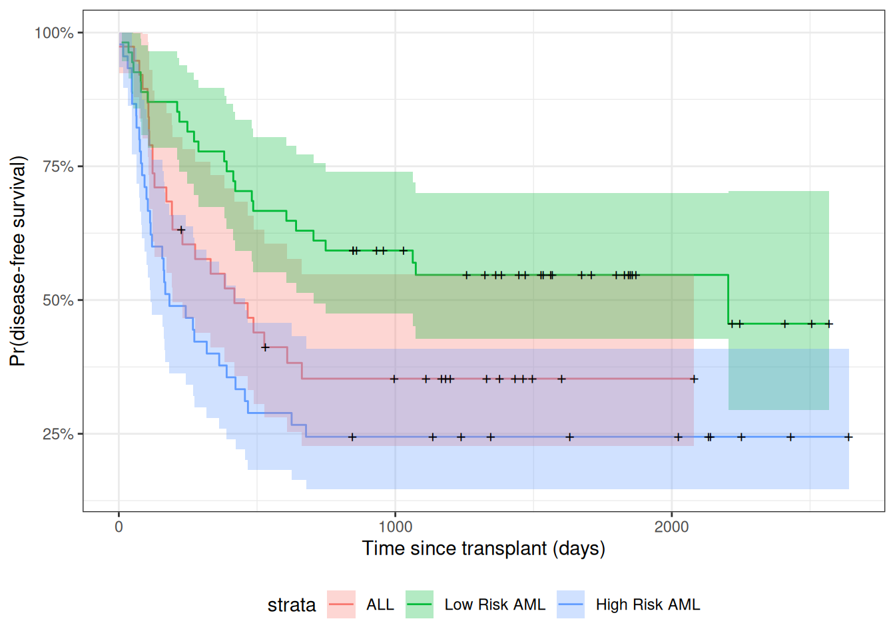](intro-to-survival-analysis_files/figure-html/fig-km-bmt-1.png "Figure 15: Disease-Free Survival by Disease Group")
> >
> > Figure 15: Disease-Free Survival by Disease Group
>
> ##### Test for differences among the disease groups
>
> Here we compute a chi-square test for assocation between disease group (`group`) and disease-free survival:
>
> Show R code
>
> ``` downlit
> survdiff(surv ~ group, data = bmt)
> #> Call:
> #> survdiff(formula = surv ~ group, data = bmt)
> #> 
> #>                      N Observed Expected (O-E)^2/E (O-E)^2/V
> #> group=ALL           38       24     21.9     0.211     0.289
> #> group=Low Risk AML  54       25     40.0     5.604    11.012
> #> group=High Risk AML 45       34     21.2     7.756    10.529
> #> 
> #>  Chisq= 13.8  on 2 degrees of freedom, p= 0.001
> ```
>
> ##### Cumulative Hazard Curves for Bone-Marrow Transplant (`bmt`) data
>
> The cumulative hazard ${\Lambda}(t)$ is defined in [Definition 11](#def-cuhaz), and the Kaplan-Meier (product-limit) estimator $\hat{\Lambda}(t) = -{\operatorname{log}\mathopen{}\left\{\mathop{\hat{\operatorname{S}}}\nolimits(t)\right\}\mathclose{}}$ is discussed in [Section 10](#sec-nelson-aalen) alongside the [Nelson-Aalen estimator](#def-na-cuhaz-est).
>
> Show R code
>
> ``` downlit
> autoplot(
>   fun = "cumhaz",
>   km_model1,
>   conf.int = FALSE,
>   ylab = "Cumulative hazard (disease-free survival)",
>   xlab = "Time since transplant (days)"
> ) +
>   theme_bw() +
>   theme(legend.position = "bottom")
> ```
>
> > **NOTE:**
> >
> > [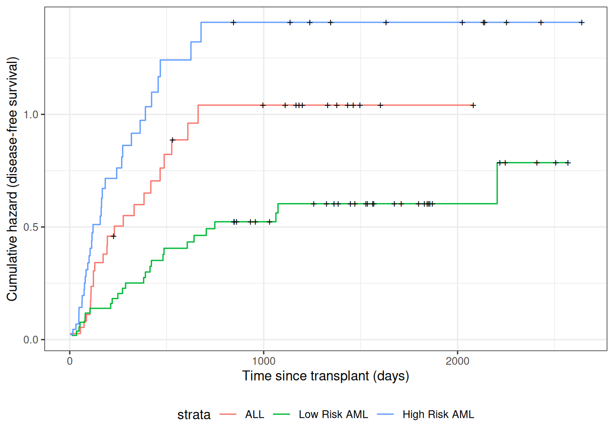](intro-to-survival-analysis_files/figure-html/fig-cuhaz-bmt-1.png "Figure 16: Disease-Free Cumulative Hazard by Disease Group")
> >
> > Figure 16: Disease-Free Cumulative Hazard by Disease Group

# 10 Nelson-Aalen Estimates of Cumulative Hazard and Survival

> **TIP:**
>
> David Rocke’s Epi 204 lecture [*Survival Regression with the Cox Model I*](https://dmrocke.ucdavis.edu/Class/EPI204-Spring-2021/EPI204-2021-05-04.mp4) ([slides](https://dmrocke.ucdavis.edu/Class/EPI204-Spring-2021/Lecture10ProportionalHazardsModel.pdf)) covers [Greenwood’s variance](#thm-greenwood) for the [Kaplan-Meier estimator](#def-KM-estimator), the [cumulative hazard](#def-cuhaz), and the [Nelson-Aalen estimator](#def-na-cuhaz-est), using the `bmt` data [\[1\]](#ref-rocke2021epi204).

> **NOTE:**
>
> **Definition 21 (Nelson-Aalen Cumulative Hazard Estimator)**  
>
> The point [hazard](#def-hazard) at time $t_i$ can be estimated by $d_i/r_i$, which leads to the **Nelson-Aalen estimator of the cumulative hazard**:
>
> $$\hat{{\Lambda}}_{NA}(t) \stackrel{\text{def}}{=}\sum_{{\mathopen{}\left\{i:\ t_i \le t\right\}\mathclose{}}}\hat{{\lambda}}_i$$

> **NOTE:**
>
> **Theorem 16 (Variance of Nelson-Aalen estimator)**  
>
> The [variance](https://morrison-lab.github.io/pds/variance-covariance.html#def-variance) of this [estimator](https://morrison-lab.github.io/sds/estimation.html#def-estimator) is approximately:
>
> $$\begin{aligned}
> \hat{\text{Var}}\mathopen{}\left(\hat{{\Lambda}}_{NA} (t)\right)\mathclose{}
> &= \sum_{t_i \le t}\frac{(d_i/r_i)(1-d_i/r_i)}{r_i}\\
> &\approx \sum_{t_i \le t}\frac{d_i}{r_i^2}
> \end{aligned}
> \tag{16}$$

------------------------------------------------------------------------

Since $\operatorname{S}(t)={\operatorname{exp}\mathopen{}\left\{-{\Lambda}(t)\right\}\mathclose{}}$, the Nelson-Aalen cumulative hazard estimate can be converted into an alternate estimate of the [survival function](#def-surv-fn):

$$\begin{aligned}
{\mathop{\hat{\operatorname{S}}}\nolimits_{\text{NA}}\mathopen{}\left(t\right)\mathclose{}}
&= {\operatorname{exp}\mathopen{}\left\{-\hat{{\Lambda}}_{NA}(t)\right\}\mathclose{}}\\
&= {\operatorname{exp}\mathopen{}\left\{-\sum_{t_i \le t}\frac{d_i}{r_i}\right\}\mathclose{}}\\
&= \prod_{t_i \le t}{\operatorname{exp}\mathopen{}\left\{-\frac{d_i}{r_i}\right\}\mathclose{}}\\
&= \prod_{t_i \le t}\hat{\kappa}^{NA}_i
\end{aligned}$$

where $\hat{\kappa}^{NA}_i = {\operatorname{exp}\mathopen{}\left\{-\hat{{\lambda}}_i\right\}\mathclose{}} = {\operatorname{exp}\mathopen{}\left\{-d_i/r_i\right\}\mathclose{}}$ is the Nelson-Aalen conditional survival factor (compare with the KM factor $\hat{\kappa}^{KM}_i = 1 - d_i/r_i$).

------------------------------------------------------------------------

Compare these with the corresponding Kaplan-Meier estimates:

$$\begin{aligned}
\hat{{\Lambda}}_{KM}(t) &= -\sum_{t_i \le t}{\operatorname{log}\mathopen{}\left\{1-\frac{d_i}{r_i}\right\}\mathclose{}}\\
{\mathop{\hat{\operatorname{S}}}\nolimits_{\text{KM}}\mathopen{}\left(t\right)\mathclose{}} &= \prod_{t_i \le t}\mathopen{}\left[1-\frac{d_i}{r_i}\right]\mathclose{}
\end{aligned}$$

The product limit estimate and the Nelson-Aalen estimate often do not differ by much. The latter is considered more accurate in small samples and also directly estimates the cumulative hazard. The `"fleming-harrington"` method for [`survfit()`](https://rdrr.io/pkg/survival/man/survfit.html) reduces to Nelson-Aalen when the data are unweighted. We can also estimate the cumulative hazard as the negative log of the KM survival function estimate.

## 10.1 Application to `bmt` dataset

Show R code

``` downlit
na_fit <- survfit(
  formula = surv ~ group,
  type = "fleming-harrington",
  data = bmt
)

km_fit <- survfit(
  formula = surv ~ group,
  type = "kaplan-meier",
  data = bmt
)

km_and_na <-
  bind_rows(
    .id = "model",
    "Kaplan-Meier" = km_fit |> fortify(surv.connect = TRUE),
    "Nelson-Aalen" = na_fit |> fortify(surv.connect = TRUE)
  ) |>
  as_tibble()
```

Show R code

``` downlit
km_and_na |>
  ggplot(aes(x = time, y = surv, col = model)) +
  geom_step() +
  facet_grid(. ~ strata) +
  theme_bw() +
  ylab("Survival probability, S(t) = P(T>t)") +
  xlab("Survival time (t, days)") +
  theme(legend.position = "bottom")
```

[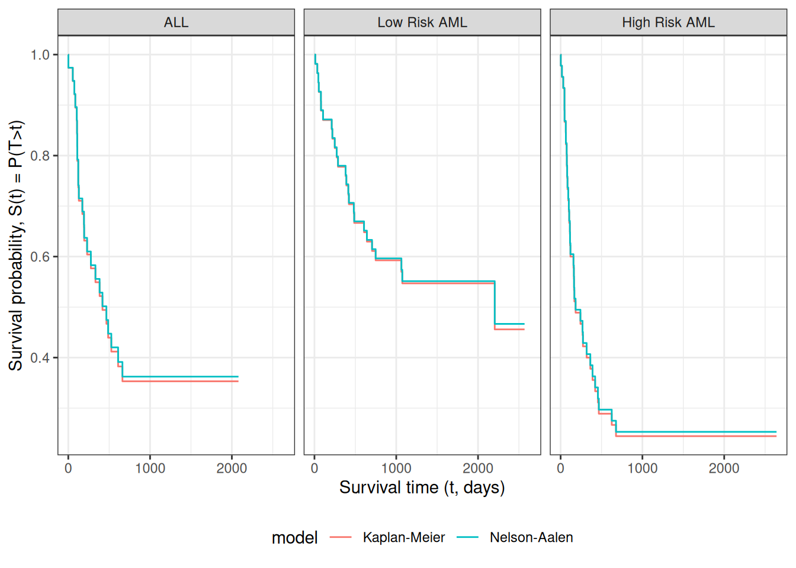](intro-to-survival-analysis_files/figure-html/unnamed-chunk-41-1.png "Kaplan-Meier and Nelson-Aalen Survival Function Estimates, stratified by disease group")

Kaplan-Meier and Nelson-Aalen Survival Function Estimates, stratified by disease group

The Kaplan-Meier and Nelson-Aalen survival estimates are very similar for this dataset.

> **NOTE:**
>
> **Exercise 15** Compute the Nelson-Aalen (NA) estimated survival curve for the data in [Table 4](#tbl-surv1), by hand.

> **NOTE:**
>
> *Solution 13*. Let:
>
> - $n$: total sample size
> - $y$: study exit time;
> - $d(y)$: number of events at $y$;
> - $c(y)$: number exiting without events (“censored”) at $y$
> - $e(y) = d(y) + c(y)$: total exiting at $y$;
> - $E(y)$: cumulative exits prior to $y$;
> - $r(y) = n - E(y)$: [number at risk](#def-number-at-risk) at $y$;
> - $r^*(y) = r(y) - e(y)$: number at risk after $y$;
> - $\hat{{\lambda}}(y) = \frac{d(y)}{r(y)}$: Nelson-Aalen hazard increment;
> - $\hat{\kappa}(y) = {\operatorname{exp}\mathopen{}\left\{-\hat{{\lambda}}(y)\right\}\mathclose{}}$: Nelson-Aalen conditional survival factor;
> - $\hat{{\Lambda}}_{NA}(y) = \sum_{k:\, y_k \leq y} \hat{{\lambda}}(y_k)$: Nelson-Aalen cumulative hazard estimate; at each exit time $y_k$, update the previous estimate: $\hat{{\Lambda}}_{NA}(y_k) = \hat{{\Lambda}}_{NA}(y_{k-1}) + \hat{{\lambda}}(y_k)$, with $\hat{{\Lambda}}_{NA}(y_0) \stackrel{\text{def}}{=}0$;
> - ${\mathop{\hat{\operatorname{S}}}\nolimits_{\text{NA}}\mathopen{}\left(y\right)\mathclose{}} = {\operatorname{exp}\mathopen{}\left\{-\hat{{\Lambda}}_{NA}(y)\right\}\mathclose{}} = \prod_{k:\, y_k \leq y} \hat{\kappa}(y_k)$: Nelson-Aalen survival estimate.
>
> > **NOTE:**
> >
> > Show R code
> >
> > ``` downlit
> > library(dplyr)
> > na_curve <-
> >   data1 |>
> >   summarise(.by  = Y,
> >             events = sum(D == 1),
> >             censored = sum(D == 0)) |>
> >   arrange(Y) |>
> >   mutate(
> >     study_size = nrow(data1),
> >     exiting = events + censored,
> >     exited = cumsum(exiting) |> dplyr::lag(default = 0),
> >     at_risk = study_size - exited,
> >     r_star = at_risk - exiting,
> >     hazard = events / at_risk,
> >     kappa = exp(-hazard),
> >     cusum_hazard = cumsum(hazard),
> >     na_surv_curve = exp(-cusum_hazard)
> >   ) |>
> >   select(-study_size)
> > na_curve |>
> >   mutate(
> >     hazard_math = paste0("\\frac{", events, "}{", at_risk, "}"),
> >     cusum_hazard_round = round(cusum_hazard, 4),
> >     na_surv_curve = paste0(
> >       "$\\expf{-", cusum_hazard_round, "}",
> >       " = ",
> >       round(na_surv_curve, 4),
> >       "$"
> >     ),
> >     # update from the previous row's estimate,
> >     # instead of re-adding every increment so far:
> >     cusum_prev = dplyr::lag(cusum_hazard_round),
> >     cusum_hazard = paste0(
> >       "$",
> >       dplyr::if_else(
> >         is.na(cusum_prev),
> >         hazard_math,
> >         paste0(cusum_prev, " + ", hazard_math)
> >       ),
> >       " = ",
> >       cusum_hazard_round,
> >       "$"
> >     ),
> >     kappa = paste0(
> >       "$\\expf{-", hazard_math, "} = ",
> >       round(kappa, 4), "$"
> >     ),
> >     hazard = paste0(
> >       "$", hazard_math, " = ",
> >       round(hazard, 4), "$"
> >     )
> >   ) |>
> >   select(-hazard_math, -cusum_hazard_round, -cusum_prev) |>
> >   rename(
> >     `$y$`                                  = Y,
> >     `$d(y)$`                               = events,
> >     `$c(y)$`                               = censored,
> >     `$e(y)$`                               = exiting,
> >     `$E(y)$`                               = exited,
> >     `$r(y)$`                               = at_risk,
> >     `$r^*(y)$`                             = r_star,
> >     `$\\hat{\\haz}(y)$`                    = hazard,
> >     `$\\hat{\\cs}(y)$`                     = kappa,
> >     `$\\hat{\\cuhaz}_{NA}(y)$`             = cusum_hazard,
> >     `$\\esnaaf{y}$`                     = na_surv_curve
> >   ) |>
> >   pander()
> > ```
> >
> > | $y$ | $d(y)$ | $c(y)$ | $e(y)$ | $E(y)$ | $r(y)$ | $r^*(y)$ | $\hat{{\lambda}}(y)$ | $\hat{\kappa}(y)$ | $\hat{{\Lambda}}_{NA}(y)$ | ${\mathop{\hat{\operatorname{S}}}\nolimits_{\text{NA}}\mathopen{}\left(y\right)\mathclose{}}$ |
> > |:--:|:--:|:--:|:--:|:--:|:--:|:--:|:--:|:--:|:--:|:--:|
> > | 1 | 1 | 0 | 1 | 0 | 9 | 8 | $\frac{1}{9} = 0.1111$ | ${\operatorname{exp}\mathopen{}\left\{-\frac{1}{9}\right\}\mathclose{}} = 0.8948$ | $\frac{1}{9} = 0.1111$ | ${\operatorname{exp}\mathopen{}\left\{-0.1111\right\}\mathclose{}} = 0.8948$ |
> > | 3 | 1 | 0 | 1 | 1 | 8 | 7 | $\frac{1}{8} = 0.125$ | ${\operatorname{exp}\mathopen{}\left\{-\frac{1}{8}\right\}\mathclose{}} = 0.8825$ | $0.1111 + \frac{1}{8} =
> > 0.2361$ | ${\operatorname{exp}\mathopen{}\left\{-0.2361\right\}\mathclose{}} = 0.7897$ |
> > | 7 | 1 | 0 | 1 | 2 | 7 | 6 | $\frac{1}{7} = 0.1429$ | ${\operatorname{exp}\mathopen{}\left\{-\frac{1}{7}\right\}\mathclose{}} = 0.8669$ | $0.2361 + \frac{1}{7} = 0.379$ | ${\operatorname{exp}\mathopen{}\left\{-0.379\right\}\mathclose{}} = 0.6846$ |
> > | 10 | 1 | 0 | 1 | 3 | 6 | 5 | $\frac{1}{6} = 0.1667$ | ${\operatorname{exp}\mathopen{}\left\{-\frac{1}{6}\right\}\mathclose{}} = 0.8465$ | $0.379 + \frac{1}{6} = 0.5456$ | ${\operatorname{exp}\mathopen{}\left\{-0.5456\right\}\mathclose{}} = 0.5795$ |
> > | 13 | 0 | 1 | 1 | 4 | 5 | 4 | $\frac{0}{5} = 0$ | ${\operatorname{exp}\mathopen{}\left\{-\frac{0}{5}\right\}\mathclose{}} = 1$ | $0.5456 + \frac{0}{5} =
> > 0.5456$ | ${\operatorname{exp}\mathopen{}\left\{-0.5456\right\}\mathclose{}} = 0.5795$ |
> > | 15 | 1 | 0 | 1 | 5 | 4 | 3 | $\frac{1}{4} = 0.25$ | ${\operatorname{exp}\mathopen{}\left\{-\frac{1}{4}\right\}\mathclose{}} = 0.7788$ | $0.5456 + \frac{1}{4} =
> > 0.7956$ | ${\operatorname{exp}\mathopen{}\left\{-0.7956\right\}\mathclose{}} = 0.4513$ |
> > | 16 | 0 | 3 | 3 | 6 | 3 | 0 | $\frac{0}{3} = 0$ | ${\operatorname{exp}\mathopen{}\left\{-\frac{0}{3}\right\}\mathclose{}} = 1$ | $0.7956 + \frac{0}{3} =
> > 0.7956$ | ${\operatorname{exp}\mathopen{}\left\{-0.7956\right\}\mathclose{}} = 0.4513$ |
> >
> > Table 9: Nelson-Aalen survival curve calculations

> **NOTE:**
>
> **Exercise 16** Implement the NA [survival curve](#def-surv-fn) [estimator](https://morrison-lab.github.io/sds/estimation.html#def-estimator) in R.

> **NOTE:**
>
> *Solution 14*. See [Table 9](#tbl-na-curve) in [Solution 13](#sol-na-curve-by-hand) for the manual implementation.

> **NOTE:**
>
> **Exercise 17** In the setting of [Exercise 16](#exr-na-survfit), check the output of your implementation against the version in the `survival` package.

> **NOTE:**
>
> *Solution 15*. Compare [Solution 14](#sol-na-survfit) with the version from the `survival` package:
>
> Show R code
>
> ``` downlit
> NA_model <-
>   data1 |>
>   survfit(formula = surv ~ 1,
>           type = "fleming-harrington")
>
> NA_model |> summary()
> #> Call: survfit(formula = surv ~ 1, data = data1, type = "fleming-harrington")
> #> 
> #>  time n.risk n.event survival std.err lower 95% CI upper 95% CI
> #>     1      9       1    0.895  0.0994        0.720        1.000
> #>     3      8       1    0.790  0.1321        0.569        1.000
> #>     7      7       1    0.685  0.1506        0.445        1.000
> #>    10      6       1    0.579  0.1599        0.337        0.995
> #>    15      4       1    0.451  0.1680        0.218        0.936
> ```

> **NOTE:**
>
> **Exercise 18** Add the NA estimated survival curve to the graph from [Exercise 9](#exr-km-graph-1).

> **NOTE:**
>
> *Solution 16*.
>
> Show R code
>
> ``` downlit
> km_and_na <-
>   bind_rows(
>     .id = "model",
>     "Kaplan-Meier" = KM_model |> fortify(surv.connect = FALSE),
>     "Nelson-Aalen" = NA_model |> fortify(surv.connect = FALSE)
>   ) |>
>   as_tibble()
>
> km_and_na |>
>   ggplot(aes(x = time, y = surv, col = model)) +
>   geom_step() +
>   theme_bw() +
>   ylab("Survival probability, S(t) = P(T>t)") +
>   xlab("Survival time (t, days)") +
>   theme(legend.position = "bottom")
> ```
>
> [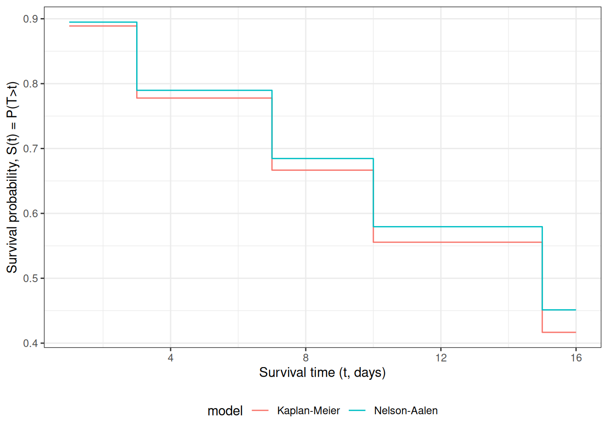](intro-to-survival-analysis_files/figure-html/km-na-fig-1.png)

> **NOTE:**
>
> **Exercise 19** Find the NA estimate of [median survival time](#def-median-survival).

> **NOTE:**
>
> *Solution 17*.
>
> Show R code
>
> ``` downlit
> NA_model |> quantile(prob = 0.5) |> as_tibble()
> ```

> **NOTE:**
>
> **Exercise 20** Describe the similarities and differences between the graphs of the KM and NA survival function estimates.

> **NOTE:**
>
> *Solution 18*. The curves are very similar for this data set, with the KM curve returning slightly lower estimates of survival.

# 11 Empirical Inverse Survival Function

> **NOTE:**
>
> **Definition 22 (Empirical inverse survival function (empirical survival quantile function))** Given a time-to-event dataset, the **empirical inverse survival function** (empirical ISF), also called the **empirical survival quantile function** (empirical SQF), $\mathop{\hat{\operatorname{S}}}\nolimits^{-1}(p)$ replaces the population [survival function](#def-surv-fn) $\operatorname{S}(t)$ with an estimated survival function $\mathop{\hat{\operatorname{S}}}\nolimits(t)$:
>
> $$\mathop{\hat{\operatorname{S}}}\nolimits^{-1}(p) \stackrel{\text{def}}{=}\inf\mathopen{}\left\{t \ge 0 : \mathop{\hat{\operatorname{S}}}\nolimits(t) \le p\right\}\mathclose{}, \quad 0 < p < 1.$$

Since $\mathop{\hat{\operatorname{S}}}\nolimits(t)$ is a non-increasing step function, $\mathop{\hat{\operatorname{S}}}\nolimits^{-1}(p)$ equals the smallest observed event time at which the estimated survival probability has dropped to or below $p$.

**From the Kaplan-Meier estimator.** Substituting ${\mathop{\hat{\operatorname{S}}}\nolimits_{\text{KM}}\mathopen{}\left(t\right)\mathclose{}}$ from [Definition 19](#def-KM-estimator):

$$\mathop{\hat{\operatorname{S}}}\nolimits_{\text{KM}}^{-1}(p)
= \inf\mathopen{}\left\{t \ge 0 : \prod_{t_i \le t}\mathopen{}\left[1 - \frac{d_i}{r_i}\right]\mathclose{} \le p\right\}\mathclose{}.$$

**From the Nelson-Aalen estimator.** Substituting ${\mathop{\hat{\operatorname{S}}}\nolimits_{\text{NA}}\mathopen{}\left(t\right)\mathclose{}} = {\operatorname{exp}\mathopen{}\left\{-\hat{{\Lambda}}_{NA}(t)\right\}\mathclose{}}$ from [Definition 21](#def-na-cuhaz-est):

$$\mathop{\hat{\operatorname{S}}}\nolimits_{\text{NA}}^{-1}(p)
= \inf\mathopen{}\left\{t \ge 0 : {\operatorname{exp}\mathopen{}\left\{-\sum_{t_i \le t}\frac{d_i}{r_i}\right\}\mathclose{}} \le p\right\}\mathclose{}.$$

In R, both estimators are computed from a [`survfit()`](https://rdrr.io/pkg/survival/man/survfit.html) object using [`quantile()`](https://rdrr.io/r/stats/quantile.html).

> **NOTE:**
>
> **Example 31 (Empirical ISF for 6-MP patients)** Using the `drug6mp` dataset, we compute the empirical ISF for the 6-MP patients. The KM and Nelson-Aalen survival estimates at each event time are:
>
> Show R code
>
> ``` downlit
> library(KMsurv)
> library(dplyr)
> library(survival)
> data(drug6mp)
>
> km_fit <- drug6mp |>
>   mutate(surv = Surv(t2, relapse)) |>
>   survfit(formula = surv ~ 1, data = _)
>
> na_fit <- drug6mp |>
>   mutate(surv = Surv(t2, relapse)) |>
>   survfit(formula = surv ~ 1, type = "fleming-harrington", data = _)
>
> tbl <- tibble(
>   time = km_fit$time,
>   n.risk = km_fit$n.risk,
>   n.event = km_fit$n.event,
>   surv_km = km_fit$surv,
>   surv_na = na_fit$surv
> ) |>
>   filter(n.event > 0)
>
> library(knitr)
> kable(
>   tbl,
>   digits = 3,
>   col.names = c(
>     "Time (months)",
>     "At risk $r_i$",
>     "Events $d_i$",
>     "$\\eskmf{t}$",
>     "$\\esnaaf{t}$"
>   )
> )
> ```
>
> | Time (months) | At risk $r_i$ | Events $d_i$ | ${\mathop{\hat{\operatorname{S}}}\nolimits_{\text{KM}}\mathopen{}\left(t\right)\mathclose{}}$ | ${\mathop{\hat{\operatorname{S}}}\nolimits_{\text{NA}}\mathopen{}\left(t\right)\mathclose{}}$ |
> |---:|---:|---:|---:|---:|
> | 6 | 21 | 3 | 0.857 | 0.867 |
> | 7 | 17 | 1 | 0.807 | 0.817 |
> | 10 | 15 | 1 | 0.753 | 0.765 |
> | 13 | 12 | 1 | 0.690 | 0.704 |
> | 16 | 11 | 1 | 0.627 | 0.642 |
> | 22 | 7 | 1 | 0.538 | 0.557 |
> | 23 | 6 | 1 | 0.448 | 0.471 |
>
> > **NOTE:**
> >
> > Show R code
> >
> > ``` downlit
> > library(ggplot2)
> >
> > surv_steps <- rbind(
> >   data.frame(
> >     time = c(0, km_fit$time), surv = c(1, km_fit$surv),
> >     estimator = "Kaplan-Meier"
> >   ),
> >   data.frame(
> >     time = c(0, na_fit$time), surv = c(1, na_fit$surv),
> >     estimator = "Nelson-Aalen"
> >   )
> > )
> >
> > cens_marks <- rbind(
> >   data.frame(
> >     time = km_fit$time[km_fit$n.censor > 0],
> >     surv = km_fit$surv[km_fit$n.censor > 0],
> >     estimator = "Kaplan-Meier"
> >   ),
> >   data.frame(
> >     time = na_fit$time[na_fit$n.censor > 0],
> >     surv = na_fit$surv[na_fit$n.censor > 0],
> >     estimator = "Nelson-Aalen"
> >   )
> > )
> >
> > ev_idx_km <- km_fit$n.event > 0
> > s_after_km <- km_fit$surv[ev_idx_km]
> > s_before_km <- c(1, head(s_after_km, -1))
> > ev_idx_na <- na_fit$n.event > 0
> > s_after_na <- na_fit$surv[ev_idx_na]
> > s_before_na <- c(1, head(s_after_na, -1))
> >
> > open_surv <- rbind(
> >   data.frame(
> >     time = km_fit$time[ev_idx_km],
> >     surv = s_before_km,
> >     estimator = "Kaplan-Meier"
> >   ),
> >   data.frame(
> >     time = na_fit$time[ev_idx_na],
> >     surv = s_before_na,
> >     estimator = "Nelson-Aalen"
> >   )
> > )
> > closed_surv <- rbind(
> >   data.frame(
> >     time = km_fit$time[ev_idx_km],
> >     surv = s_after_km,
> >     estimator = "Kaplan-Meier"
> >   ),
> >   data.frame(
> >     time = na_fit$time[ev_idx_na],
> >     surv = s_after_na,
> >     estimator = "Nelson-Aalen"
> >   )
> > )
> >
> > ggplot(surv_steps, aes(x = time, y = surv, color = estimator)) +
> >   geom_step() +
> >   geom_point(data = cens_marks, shape = 3, size = 2, show.legend = FALSE) +
> >   geom_point(data = open_surv, shape = 1, size = 2) +
> >   geom_point(data = closed_surv, shape = 19, size = 2) +
> >   scale_color_manual(
> >     values = c("Kaplan-Meier" = "steelblue", "Nelson-Aalen" = "darkorange")
> >   ) +
> >   coord_cartesian(ylim = c(0, 1.05)) +
> >   labs(
> >     x = "Time (months)",
> >     y = expression("Survival probability, " * widehat(S)(t)),
> >     color = NULL
> >   ) +
> >   theme_bw() +
> >   theme(legend.position = "top")
> > ```
> >
> > [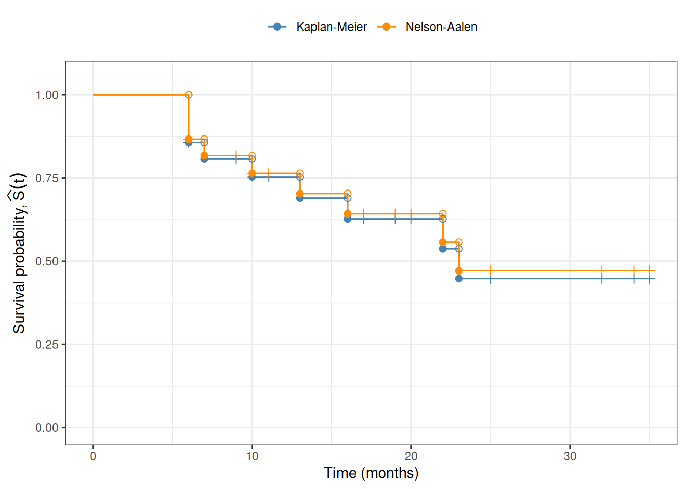](intro-to-survival-analysis_files/figure-html/unnamed-chunk-43-1.png "Figure 17: Estimated survival functions for 6-MP patients from the KM and Nelson-Aalen estimators.")
> >
> > Figure 17: Estimated survival functions for 6-MP patients from the KM and Nelson-Aalen estimators.
>
> > **NOTE:**
> >
> > Show R code
> >
> > ``` downlit
> > ev_km <- km_fit$n.event > 0
> > t_ev_km <- km_fit$time[ev_km]
> > s_ev_km <- km_fit$surv[ev_km]
> >
> > ev_na <- na_fit$n.event > 0
> > t_ev_na <- na_fit$time[ev_na]
> > s_ev_na <- na_fit$surv[ev_na]
> >
> > isf_steps <- rbind(
> >   data.frame(
> >     p = c(1, s_ev_km), t = c(t_ev_km[1], t_ev_km),
> >     estimator = "Kaplan-Meier"
> >   ),
> >   data.frame(
> >     p = c(1, s_ev_na), t = c(t_ev_na[1], t_ev_na),
> >     estimator = "Nelson-Aalen"
> >   )
> > )
> > isf_steps <- isf_steps[order(isf_steps$estimator, isf_steps$p), ]
> >
> > open_isf <- rbind(
> >   data.frame(
> >     p = head(s_ev_km, -1),
> >     t = tail(t_ev_km, -1),
> >     estimator = "Kaplan-Meier"
> >   ),
> >   data.frame(
> >     p = head(s_ev_na, -1),
> >     t = tail(t_ev_na, -1),
> >     estimator = "Nelson-Aalen"
> >   )
> > )
> > closed_isf <- rbind(
> >   data.frame(p = s_ev_km, t = t_ev_km, estimator = "Kaplan-Meier"),
> >   data.frame(p = s_ev_na, t = t_ev_na, estimator = "Nelson-Aalen")
> > )
> >
> > ggplot(isf_steps, aes(x = p, y = t, color = estimator)) +
> >   geom_step() +
> >   geom_point(data = open_isf, shape = 1, size = 2) +
> >   geom_point(data = closed_isf, shape = 19, size = 2) +
> >   scale_color_manual(
> >     values = c("Kaplan-Meier" = "steelblue", "Nelson-Aalen" = "darkorange")
> >   ) +
> >   coord_cartesian(xlim = c(0, 1)) +
> >   labs(
> >     x = "Probability, p",
> >     y = expression("Survival time, " * widehat(S)^{-1} * (p)),
> >     color = NULL
> >   ) +
> >   theme_bw() +
> >   theme(legend.position = "top")
> > ```
> >
> > [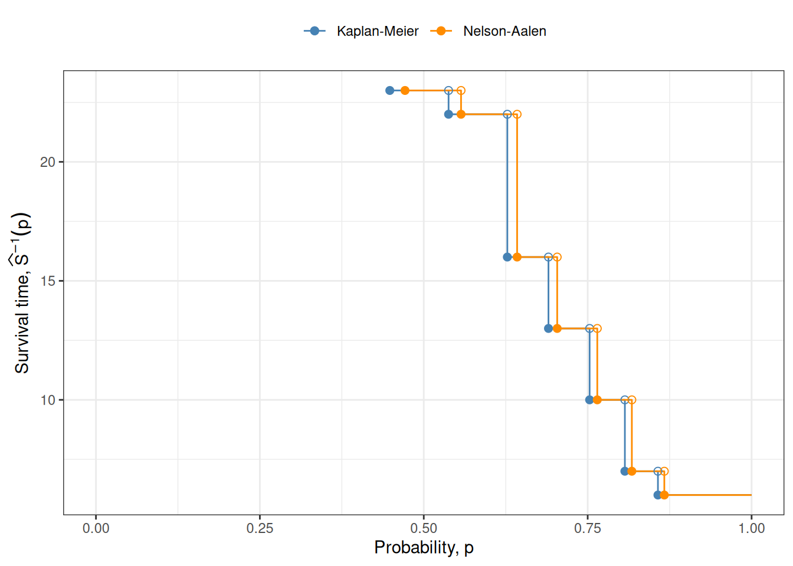](intro-to-survival-analysis_files/figure-html/unnamed-chunk-44-1.png "Figure 18: Empirical inverse survival function \mathop{\hat{\operatorname{S}}}\nolimits^{-1}(p) for 6-MP patients from the KM and Nelson-Aalen estimators.")
> >
> > Figure 18: Empirical inverse survival function $\mathop{\hat{\operatorname{S}}}\nolimits^{-1}(p)$ for 6-MP patients from the KM and Nelson-Aalen estimators.
>
> The rightmost step is drawn out to $p = 1$ for visual continuity only. The [inverse survival function](#def-inv-surv-fn) is defined for $0 < p < 1$; at the boundary, $\mathop{\hat{\operatorname{S}}}\nolimits^{-1}(1) = \inf\mathopen{}\left\{t \ge 0 : \mathop{\hat{\operatorname{S}}}\nolimits(t) \le 1\right\}\mathclose{} = 0$, since $\mathop{\hat{\operatorname{S}}}\nolimits(0) = 1$.
>
> The empirical [median survival time](#def-median-survival) is the smallest event time $t$ at which the estimated survival probability falls to or below 0.5.
>
> From the table:
>
> - ${\mathop{\hat{\operatorname{S}}}\nolimits_{\text{KM}}\mathopen{}\left(22\right)\mathclose{}} \approx 0.538 > 0.5$ and ${\mathop{\hat{\operatorname{S}}}\nolimits_{\text{KM}}\mathopen{}\left(23\right)\mathclose{}} \approx 0.448 \le 0.5$, so $\mathop{\hat{\operatorname{S}}}\nolimits_{\text{KM}}^{-1}(0.5) = 23$ months.
>
> - ${\mathop{\hat{\operatorname{S}}}\nolimits_{\text{NA}}\mathopen{}\left(22\right)\mathclose{}} \approx 0.557 > 0.5$ and ${\mathop{\hat{\operatorname{S}}}\nolimits_{\text{NA}}\mathopen{}\left(23\right)\mathclose{}} \approx 0.471 \le 0.5$, so $\mathop{\hat{\operatorname{S}}}\nolimits_{\text{NA}}^{-1}(0.5) = 23$ months.
>
> In R:
>
> Show R code
>
> ``` downlit
> quantile(km_fit, probs = 0.5)
> #> $quantile
> #> 50 
> #> 23 
> #> 
> #> $lower
> #> 50 
> #> 16 
> #> 
> #> $upper
> #> 50 
> #> NA
> ```
>
> Show R code
>
> ``` downlit
> quantile(na_fit, probs = 0.5)
> #> $quantile
> #> 50 
> #> 23 
> #> 
> #> $lower
> #> 50 
> #> 16 
> #> 
> #> $upper
> #> 50 
> #> NA
> ```
>
> Both the KM and Nelson-Aalen estimators give an estimated median relapse-free survival time of **23 months** for the 6-MP patients.

# 12 Interval Censoring

This section is adapted from [\[5, Ch. 6\]](#ref-vittinghoff2e).

Standard survival analysis assumes that the time of events occurring during the study is known more or less exactly. This situation is almost always the case for well-documented events like:

- Death
- Hospitalization
- Diagnosis of AIDS

However, the timing of many events is not observed with this level of precision.

## 12.1 What is Interval Censoring?

> **NOTE:**
>
> **Definition 23 (Interval Censoring)** **Interval censoring** occurs when the exact time of an event is not known, but we know it occurred within a specific time interval.

## 12.2 Common Examples

1.  **HIV infection in prospective cohort studies**: Participants are tested for infection at semi-annual visits. The actual time of infection is only known to fall between the last negative test and the first positive test.

2.  **Development of cervical abnormalities**: Clinical exams may be performed periodically, months or years apart. Newly observed changes may have occurred at any time since the last exam.

## 12.3 Approaches to Interval Censoring

**When intervals are regularly spaced:**

- Pooled [logistic regression](../chapters/logistic-regression.llms.md#def-logistic-regression) [\[5, Sec. 5.5.2\]](#ref-vittinghoff2e) can handle [interval censoring](#def-interval-censoring) when intervals arise from a regular study follow-up schedule

**When intervals are irregular:**

- Unequal spacing between intervals
- Intervals that vary by individual
- Requires specialized methods beyond the scope of these notes

## 12.4 Numerical Example: MIRA HSV-2 Study

The `mira_hsv` dataset from the `rmb` package contains data from the MIRA [randomized trial](../chapters/causal-inference.llms.md#sec-causal-rct) evaluating HIV prevention [\[12\]](#ref-debruyn2011mira). Participants were tested for HSV-2 antibodies every 3 months.

The data have a **panel structure**: one row per participant per visit, with the HSV-2 test result at each visit.

> **NOTE:**
>
> Show R code
>
> ``` downlit
> library(rmb)
>
> # Show panel data for three example participants
> example_ids <- c(28, 103, 119)
>
> mira_hsv_example <- mira_hsv[
>   mira_hsv$id %in% example_ids,
>   c("id", "mos", "hsv2")
> ]
>
> knitr::kable(
>   mira_hsv_example,
>   col.names = c("Subject ID", "Months", "HSV-2 positive")
> )
> ```
>
> | Subject ID | Months | HSV-2 positive |
> |-----------:|-------:|---------------:|
> |         28 |      3 |              0 |
> |         28 |      6 |              0 |
> |         28 |      9 |              0 |
> |         28 |     12 |              0 |
> |         28 |     15 |              0 |
> |         28 |     18 |              1 |
> |        103 |      3 |              0 |
> |        103 |      6 |              0 |
> |        103 |      9 |              0 |
> |        103 |     12 |              0 |
> |        103 |     15 |              0 |
> |        103 |     18 |              1 |
> |        119 |      3 |              0 |
> |        119 |      6 |              0 |
> |        119 |      9 |              0 |
> |        119 |     12 |              1 |
>
> Table 10: HSV-2 test results for three example participants in the MIRA study. For subjects 28 and 103, the seroconversion time is known only to fall in the interval (15, 18\] months. For subject 119, seroconversion occurred in (9, 12\] months.

For participants who seroconverted, the exact time of infection is unknown, but bounded by the last negative and first positive test. This uncertainty is the defining feature of [interval censoring](#def-interval-censoring).

The interval-censored structure for these three participants is:

| Subject | Last negative visit (months) | First positive visit (months) | Interval |
|----|----|----|----|
| 28 | 15 | 18 | (15, 18\] |
| 103 | 15 | 18 | (15, 18\] |
| 119 | 9 | 12 | (9, 12\] |

Since visits occur every 3 months, the infection time is known to within a 3-month window. This regular spacing allows pooled [logistic regression](../chapters/logistic-regression.llms.md#def-logistic-regression) to handle the interval censoring, as described in [\[5, Sec. 5.5.2\]](#ref-vittinghoff2e).

# 13 Left-Truncation

This section is adapted from [\[5, Ch. 6\]](#ref-vittinghoff2e).

## 13.1 Choosing the Time Origin

Survival times are measured from some initial time, with more than one possible choice of origin.

> **NOTE:**
>
> **Example 32 (Time origin choice in the PBC study)** In the Dickson et al. [\[13\]](#ref-dickson1989prognosis) Primary Biliary Cholangitis (PBC) study, survival time could be measured from:
>
> - **Cohort enrollment**: time from when the patient entered the study
> - **Diagnosis**: time from PBC diagnosis (more biologically meaningful)
>
> When using time-since-diagnosis as the timescale, patients who had already survived some time since diagnosis before enrolling introduce **[left-truncation](#def-left-truncation)**.

## 13.2 What is Left-Truncation?

**Left-truncation** occurs when some survival times are not observed because the sampling scheme tends to miss short survival times.

> **NOTE:**
>
> **Definition 24 (Left-Truncation)** **Left-truncated** data arise when individuals can only enter the study if they survive beyond a certain time point. Those who experience the event before that time point are never observed.

**Key feature:** There must be a time delay between:

1.  The event that defines the time origin (e.g., diagnosis)
2.  Entry into the study cohort (e.g., enrollment)

## 13.3 Left-Truncation vs. Staggered Entry

**Important distinction:**

- **Staggered entry**: Participants enroll at different calendar times
  - Does NOT necessarily imply [left-truncation](#def-left-truncation)
  - Example: enrolling patients at the time of diagnosis (truncation times = 0)
- **Left-truncation**: Participants must survive some period before they can be enrolled
  - Example: recruiting from a referral center where months/years elapse between diagnosis and enrollment

## 13.4 Why Left-Truncation Matters

Patients with rapid disease progression are less likely to be enrolled because they may:

- Die before referral to the study center
- Die before recruitment into the study

This recruitment mechanism leads to:

- **Undercounting** of short survival times
- **Selection bias** toward longer survivors
- **Overestimation** of survival probabilities if ignored

## 13.5 Truncated vs. Censored Data

**Censored data:**

- Event time falls outside the follow-up period
- Data are **incomplete** but the individual is observed

**Truncated data:**

- Individual is not observed at all if they would have had an event outside the observation window
- Truncated individuals leave no trace
  - Called “ghosts” in the survival analysis literature

## 13.6 Independent Truncation Assumption

Analysis under left-truncation requires the **independent truncation assumption**:

The time of delayed entry and subsequent survival are [independent](https://morrison-lab.github.io/pds/independence.html#def-indpt).

This independence condition is satisfied when:

- Disease incidence and post-diagnosis survival are independent

## 13.7 Implementation

Denote:

- $V$: truncation time (delay between origin and study entry)
- $X$: follow-up time relative to the time origin
- $\delta$: censoring [indicator](https://morrison-lab.github.io/sds/data.html#def-indicator-variable)

**In R:**

Use the [`Surv()`](https://rdrr.io/pkg/survival/man/Surv.html) function with entry time:

``` downlit
Surv(time  = entry_time,
     time2 = exit_time,
     event = status)
```

**In Stata:**

``` stata
stset years_since_diag, failure(status) entry(disease_dur)
```

## 13.8 Numerical Example: PBC Study

The `pbc` dataset from the `rmb` package contains data from a clinical trial of D-penicillamine treatment in primary biliary cholangitis (PBC) [\[13\]](#ref-dickson1989prognosis).

Here we demonstrate the effect of [left-truncation](#def-left-truncation) by comparing analyses using two different time scales:

1.  Time from enrollment (standard approach, no truncation)
2.  Age as the time scale (introduces left-truncation, since patients are observed from their current age, not from birth)

> **NOTE:**
>
> Show R code
>
> ``` downlit
> library(rmb)
> library(survival)
> library(ggplot2)
> library(dplyr)
>
> pbc_data <- rmb::pbc
>
> # Analysis 1: time from enrollment (no truncation)
> km_enroll <- survfit(
>   Surv(years, as.numeric(status) == 1) ~ 1,
>   data = pbc_data
> )
>
> # Analysis 2: age as time scale (left-truncated)
> km_age <- survfit(
>   Surv(time = age, time2 = age + years, event = as.numeric(status) == 1) ~ 1,
>   data = pbc_data
> )
>
> # Extract KM estimates at specific times for each analysis
> km1_summary <- summary(km_enroll, times = seq(0, 12, by = 0.5))
> km2_summary <- summary(km_age, times = seq(26, 78, by = 0.5))
>
> km1_df <- tibble(
>   time = km1_summary$time,
>   surv = km1_summary$surv,
>   analysis = "Time from enrollment"
> )
>
> km2_df <- tibble(
>   time = km2_summary$time - median(pbc_data$age),
>   surv = km2_summary$surv,
>   analysis = paste0(
>     "Age as time scale\n",
>     "(left-truncated; centered at median enrollment age)"
>   )
> )
>
> km_combined <- bind_rows(km1_df, km2_df)
>
> ggplot(km_combined) +
>   aes(x = time, y = surv, color = analysis) +
>   geom_step() +
>   labs(
>     x = "Time (years)",
>     y = "Estimated survival probability",
>     color = "Analysis",
>     caption = "Data: rmb::pbc (PBC clinical trial, Dickson et al. 1989)"
>   ) +
>   scale_y_continuous(limits = c(0, 1)) +
>   theme_bw() +
>   theme(legend.position = "bottom")
> ```
>
> [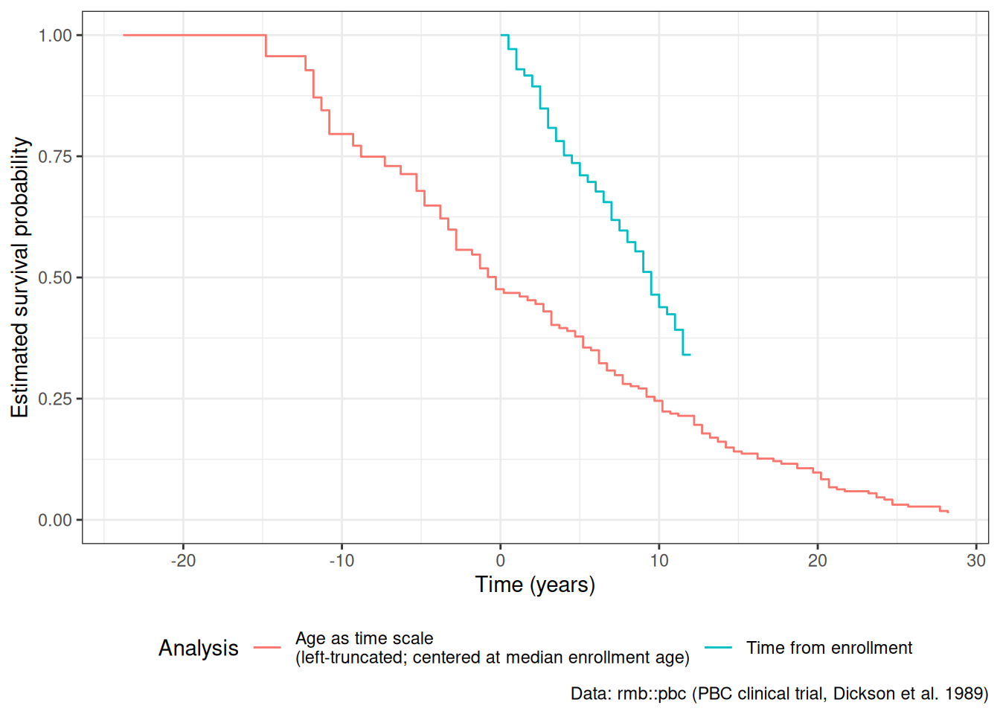](intro-to-survival-analysis_files/figure-html/unnamed-chunk-48-1.png "Figure 19: Kaplan-Meier survival curves for the PBC study using two different time scales: time from enrollment (no truncation) vs. age centered at the median enrollment age (left-truncated).")
>
> Figure 19: [Kaplan-Meier](#def-KM-estimator) survival curves for the PBC study using two different time scales: time from enrollment (no truncation) vs. age centered at the median enrollment age (left-truncated).

The curve using age as the time scale accounts for the fact that participants were only observed from their age at enrollment. When centered at the median enrollment age, the two analyses can be compared on a common scale. Note that ignoring this truncation would lead to overestimated survival: participants who died at younger ages — before reaching their enrollment age — were never observed and are excluded from the data, leading to a [risk set](#def-risk-set) that over-represents longer survivors.

## 13.9 Effect of Ignoring Left-Truncation

When left-truncation is ignored:

- Survival probabilities are **overestimated** (especially at early time points)
- The analysis fails to account for undersampling of short survival times
- [Hazard ratios](#def-hazard-ratio) in [Cox models](../chapters/proportional-hazards-models.llms.md#def-ph-model) may be attenuated (effect is less predictable)

The following example illustrates the [bias](https://morrison-lab.github.io/sds/estimation.html#def-bias) using the PBC data. The naive analysis treats all participants as entering the [risk set](#def-risk-set) at the earliest observed age, whereas the proper analysis uses counting-process notation to enter each participant at their actual enrollment age.

Show R code

``` downlit
km_naive_age <- survfit(
  Surv(age + years, as.numeric(status) == 1) ~ 1,
  data = pbc_data
)

# Extract estimates at age 60 for comparison
surv_naive_at_sixty  <- summary(km_naive_age, times = 60)$surv
surv_proper_at_sixty <- summary(km_age, times = 60)$surv
```

At age 60, the naive analysis (ignoring delayed entry) estimates survival at 64.8%, compared to 22.3% with the proper left-truncation correction.

The naive estimate is inflated because the risk set at each age incorrectly includes participants who had not yet been enrolled (and thus had not actually been observed to be at risk).

## 13.10 Right-Truncation

**Right-truncation** can also occur if:

- Study recruits based on an endpoint
- People with large event times (or who never had the event) are not recruited

**Example:** A fecundability study that excludes couples who never conceive exhibits right-truncation.

# References

\[1\]

D. M. Rocke, “Epi 204 lecture notes, Spring 2021.” University of California, Davis, 2021. Available: <https://dmrocke.ucdavis.edu/Class/EPI204-Spring-2021/EPI204-Spring-2021.html>

\[2\]

J. Soch, Ed., *The book of statistical proofs*. Zenodo, 2023. Available: <https://doi.org/10.5281/ZENODO.4305949>

\[3\]

J. P. Klein and M. L. Moeschberger, *Survival analysis: Techniques for censored and truncated data*, vol. 1230. Springer, 2003. Available: <https://link.springer.com/book/10.1007/b97377>

\[4\]

A. J. Dobson and A. G. Barnett, *An introduction to generalized linear models*, 4th ed. CRC press, 2018. Available: <https://doi.org/10.1201/9781315182780>

\[5\]

E. Vittinghoff, D. V. Glidden, S. C. Shiboski, and C. E. McCulloch, *Regression methods in biostatistics: Linear, logistic, survival, and repeated measures models*, 2nd ed. Springer, 2012. Available: <https://doi.org/10.1007/978-1-4614-1353-0>

\[6\]

D. G. Kleinbaum and M. Klein, *Survival analysis: A self-learning text*, 3rd ed. Springer, 2012. Available: <https://link.springer.com/book/10.1007/978-1-4419-6646-9>

\[7\]

K. J. Rothman, T. L. Lash, T. J. VanderWeele, and S. Haneuse, *Modern epidemiology*, Fourth edition. Philadelphia: Wolters Kluwer, 2021.

\[8\]

J. D. Kalbfleisch and R. L. Prentice, *The statistical analysis of failure time data*. John Wiley & Sons, 2011.

\[9\]

M. A. Hernán and J. M. Robins, *Causal inference: What if*. Chapman & Hall/CRC, 2020. Available: <https://www.hsph.harvard.edu/miguel-hernan/causal-inference-book/>

\[10\]

E. J. Freireich *et al.*, “The effect of 6-mercaptopurine on the duration of steroid-induced remissions in acute leukemia,” *Blood*, vol. 21, pp. 699–716, 1963.

\[11\]

E. A. Copelan *et al.*, “Treatment for acute myelocytic leukemia with allogeneic bone marrow transplantation following preparation with BuCy2,” 1991, doi: [10.1182/blood.V78.3.838.838](https://doi.org/10.1182/blood.V78.3.838.838).

\[12\]

G. de Bruyn *et al.*, “Safety and effectiveness of the diaphragm used with lubricant gel for prevention of HIV acquisition in southern african women: A randomised controlled trial,” *Sexually Transmitted Infections*, vol. 87, no. 4, pp. 309–315, 2011, doi: [10.1136/sti.2010.044990](https://doi.org/10.1136/sti.2010.044990).

\[13\]

E. R. Dickson, P. M. Grambsch, T. R. Fleming, L. D. Fisher, and A. Langworthy, “Prognosis in primary biliary cirrhosis: Model for decision making,” *Hepatology*, vol. 10, no. 1, pp. 1–7, 1989, doi: [10.1002/hep.1840100102](https://doi.org/10.1002/hep.1840100102).

Back to top

## Footnotes

[^1]: for example in Dobson and Barnett [\[4\]](#ref-dobson4e), Vittinghoff et al. [\[5\]](#ref-vittinghoff2e), Klein and Moeschberger [\[3\]](#ref-klein2003survival), and Kleinbaum and Klein [\[6\]](#ref-kleinbaum2012survival)

[^2]: for example, in Rothman et al. [\[7\]](#ref-me4) and Kalbfleisch and Prentice [\[8\]](#ref-kalbfleisch2011statistical)
