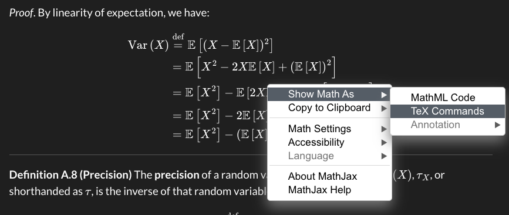

# Regression Models for Epidemiology

Code

Published

Last modified: 2026-11-11: 9:52:22 (UTC)

# Preface

This web-book is derived from my lecture slides for Epidemiology 204: “Quantitative Epidemiology III: Statistical Models”, at UC Davis.

I have drawn these materials from many sources, including but not limited to:

- [David Rocke](https://dmrocke.ucdavis.edu/)’s materials from the [2021 edition of this course](https://dmrocke.ucdavis.edu/Class/EPI204-Spring-2021/EPI204-Spring-2021.html)

- Kyoungmi Kim’s and Susan Stewart’s materials from the 2022 edition of this course

- [Hua Zhou](https://hua-zhou.github.io/)’s materials from the [2020 edition of Biostat 200C at UCLA](https://ucla-biostat-200c-2020spring.github.io/schedule/schedule.html)

- Ron Brookmeyer’s materials from the Winter 2017 edition of Biostat 100B at UCLA

- Weng Kee Wong’s materials from the Spring 2017 edition of Biostat 200C at UCLA

- Jonathan Taylor’s materials from Stat 191 at Stanford University (see <https://web.stanford.edu/class/stats191> for the current version)

- Vittinghoff et al. [\[1\]](#ref-vittinghoff2e)

- Dobson and Barnett [\[2\]](#ref-dobson4e)

- Harrell [\[3\]](#ref-rms2e)

> **IMPORTANT:**
>
> I do not claim any of this content as my own original intellectual work. I have attempted to provide more detailed disclaimers for specific sections that are heavily derivative of, or even copied directly from, external sources.
>
> Please see also the list of contributors on GitHub: <https://github.com/Morrison-Lab/rme/graphs/contributors>

## Using these lecture notes

This website provides lecture notes for Epidemiology 204: Quantitative Epidemiology III (Statistical Models) at UC Davis.

The notes are available online at <https://morrison-lab.github.io/rme/> and are searchable and continuously updated[^1].

### Multiple Format Options

Each chapter is available in three formats:

1.  **HTML (Website)**: Browse chapters online with navigation and search
2.  **RevealJS Slides**: Presentation slides for teaching (e.g., `logistic-regression-slides.html`)
3.  **PDF Handouts**: Printable documents for each chapter (e.g., `logistic-regression-handout.pdf`)

### Compiling chapters locally

To compile chapters from source:

1.  [Install Quarto](https://quarto.org/docs/get-started/)

2.  Clone the project repository from [GitHub](https://github.com/Morrison-Lab/rme), including the `latex-macros` [submodule](https://git-scm.com/book/en/v2/Git-Tools-Submodules):

``` bash
git clone --recurse-submodules https://github.com/Morrison-Lab/rme.git
cd rme
```

If you have already cloned the repository without the submodule, you can initialize it with:

``` bash
git submodule update --init --recursive
```

3.  Install R package dependencies:

``` r
library(devtools)
devtools::install_deps()
```

4.  Render all output formats (HTML website, RevealJS slides, and PDF handouts):

``` bash
quarto render
```

------------------------------------------------------------------------

### Extracting LaTeX commands from the online version of the notes

If you want to extract the LaTeX commands for any math expressions in the online lecture notes, you should be able to right-click and get this pop-up menu:

> **NOTE:**
>
> [](../images/latex-popup-1.png "Figure 1: Pop-up menu produced by right-clicking on math in online notes")
>
> Figure 1: Pop-up menu produced by right-clicking on math in online notes

If you select “TeX commands”, you will get a window with LaTeX code.[^2]

> **NOTE:**
>
> [](../images/latex-popup-2.png "Figure 2: LaTeX source code window")
>
> Figure 2: LaTeX source code window

You can also grab the TeX commands from the Quarto source files on GitHub, but those files use custom macros (maintained at <https://github.com/d-morrison/macros>), so it’s a little harder to reuse code from the source files.

------------------------------------------------------------------------

### Using the LaTeX macros in your own project

The custom LaTeX macros used in these notes are maintained in a separate repository: <https://github.com/d-morrison/macros>. You can reuse them in your own Quarto project in two ways:

#### Option 1: Copy `macros.qmd` directly

Download or copy `macros.qmd` from <https://github.com/d-morrison/macros/blob/main/macros.qmd> into your project directory, then include it immediately after the YAML front matter of each `.qmd` file that uses the macros:

``` markdown

```

#### Option 2: Add as a git submodule

Add the macros repository as a [git submodule](https://git-scm.com/book/en/v2/Git-Tools-Submodules) so that your project always tracks a specific version of the macros:

``` bash
git submodule add -b main https://github.com/d-morrison/macros.git latex-macros
```

Then include the macros immediately after the YAML front matter of each `.qmd` file:

``` markdown

```

When cloning a repository that uses this submodule, run:

``` bash
git clone --recurse-submodules <your-repo-url>
```

Or, if you have already cloned the repository without the submodule:

``` bash
git submodule update --init --recursive
```

------------------------------------------------------------------------

### Dark Mode

The online notes have two color palette themes: light and dark. You can toggle between them using the oval button near the top-left corner:

> **NOTE:**
>
> [](../images/dark-mode.png "Figure 3: Palette toggle")
>
> Figure 3: Palette toggle

## Other resources

These notes represent my still-developing perspective on regression models in epidemiology. Many other statisticians and epidemiologists have published their own perspectives, and I encourage you to explore your many options and find ones that resonate with you. I have attempted to cite my sources throughout these notes.

Here are some additional resources that I’ve come across; I haven’t had time to read some of them thoroughly yet, but they’re all on my to-do list. I’ll add my thoughts on them over time.

- Dobson and Barnett [\[2\]](#ref-dobson4e) is a classic textbook on [GLMs](../chapters/Intro-to-GLMs.llms.md#def-glm). It was used in UCLA Biostatistics’s MS-level GLMs course (Biostat 200C) when I took it, and it helped me a lot. It is fairly mathematically rigorous and concise, bordering on terse. It covers GLMs in detail, and survival analysis briefly, and it also has helpful chapters on Bayesian methods. I have adapted examples and explanations from it extensively in these notes.

- Wakefield [\[4\]](#ref-wakefield2013) covers GLMs and hierarchical models using both Bayesian and frequentist inference;

  - statistics PhD level
  - author: UW biostatistics professor [Jon Wakefield](https://www.biostat.washington.edu/people/jon-wakefield)
  - used in [UCLA Biostat 250C](https://donatello-telesca.com/biostatistics-251-)

- Hosmer et al. [\[5\]](#ref-hosmer2013applied) is a classic text on logistic regression. I haven’t read it yet.

- Agresti [\[6\]](#ref-agresti2012categorical) is another classic text for GLMs. I haven’t read it yet.

- Agresti [\[7\]](#ref-agresti2018introcat) appears to be a more applied version of Agresti [\[6\]](#ref-agresti2012categorical). I haven’t read it yet. There are [extra exercises](https://bcs.wiley.com/he-bcs/Books?action=resource&bcsId=11293&itemId=1119405262&resourceId=44770) and other resources available on the [Student Companion Site](https://bcs.wiley.com/he-bcs/Books?action=index&itemId=1119405262&bcsId=11293)

- Agresti [\[8\]](#ref-agresti2015foundations) has “More than 400 exercises for readers to practice and extend the theory, methods, and data analysis”; might be more theoretical?

- Agresti [\[9\]](#ref-agresti2010ordinal) is specifically about ordinal data.

- Dunn and Smyth [\[10\]](#ref-dunn2018generalized) is a recent textbook on GLMs. It doesn’t cover time-to-event models, and it doesn’t use the modern [`tidyverse`](https://tidyverse.org/) packages ([`ggplot2`](https://ggplot2.tidyverse.org/), [`dplyr`](https://dplyr.tidyverse.org/), etc.), but otherwise it seems great. Edelmann [\[11\]](#ref-Edelmann2019) reviews this book formally.

- Moore [\[12\]](#ref-moore2016applied) is a recent textbook on survival analysis. It also doesn’t use the `tidyverse`, but otherwise seems great.

- Klein and Moeschberger [\[13\]](#ref-klein2003survival) is a classic text for survival analysis. I read most of it in grad school, and it was very helpful. Examples and explanations from it are borrowed extensively in the second half of these notes (partially filtered through David Rocke’s course notes.)

- Kalbfleisch and Prentice [\[14\]](#ref-kalbfleisch2011statistical) is another classic survival analysis text; I haven’t read it yet.

- Kleinbaum and Klein [\[15\]](#ref-kleinbaum2010logistic) is a mostly applied-level “self-learning” text for logistic regression; I read it cover-to-cover before grad school, and found it very helpful.

- Kleinbaum and Klein [\[16\]](#ref-kleinbaum2012survival) is the corresponding “self-learning” text for survival analysis; I read it cover-to-cover before grad school, and found it very helpful.

- Kleinbaum et al. [\[17\]](#ref-kleinbaumEpi), by the same authors, has a solutions manual (Kleinbaum et al. [\[18\]](#ref-kleinbaumEpiSols))

- Kleinbaum et al. [\[19\]](#ref-kleinbaum2014applied) is also by the same group, in a similar style

- Harrell [\[3\]](#ref-rms2e) is another popular textbook. It uses [`ggplot2`](https://ggplot2.tidyverse.org/) but not [`dplyr`](https://dplyr.tidyverse.org/), and covers logistic regression and survival analysis (no Poisson or NB models?). An abbreviated but continuously updated version with audio clips is available at <https://hbiostat.org/rmsc/>. His presentation [Tips for Biostatisticians Collaborating with Non-Biostatistician Medical Researchers](https://hbiostat.org/talks/collab.html#1) offers valuable guidance on statistical collaboration (“Your job is not to give the investigator what she wants; Your job is to give her what she needs”).

- Fox [\[20\]](#ref-fox2015applied) is another standard text. [^3]

- McCullagh and Nelder [\[21\]](#ref-mccullaghnelder) is a classic, theoretical textbook on GLMs [^4]

- Dalgaard [\[22\]](#ref-dalgaardintroductory) covers GLMs and survival analysis at an applied level, using base R

- Vittinghoff et al. [\[1\]](#ref-vittinghoff2e) covers GLMs, survival analysis, and causal inference, using Stata. The authors are UCSF professors, and it is used for the core Epi PhD courses there. I read this book nearly cover-to-cover before grad school, and it was hugely helpful for me, both for statistical modeling and for causal inference (I think it provided my first exposure to DAGs).

- McCulloch et al. [\[23\]](#ref-mcculloch2008generalized) is also by UCSF professors

- Faraway [\[24\]](#ref-faraway2016extending) has GLMs but not survival analysis

- Selvin [\[25\]](#ref-selvin2001epidemiologic) provides worked-out examples of applications for a wide range of statistical analysis techniques. The [Author](https://publichealth.berkeley.edu/people/steve-selvin) is a retired UC Berkeley Biostatistics professor; he used it in a graduate-level biostat/epi course.

- Selvin [\[26\]](#ref-selvin2004) is by the same author

  - recommended by Jewell [\[27\]](#ref-jewell2003statistics) for Poisson regression

- Jewell [\[27\]](#ref-jewell2003statistics) is by another UC Berkeley [professor](https://publichealth.berkeley.edu/people/nicholas-jewell); it mostly covers logistic regression, with one chapter on survival analysis.

- <https://ucla-biostat-200c-2020spring.github.io/schedule/schedule.html> provides course notes for “Biostat 200C - Methods in Biostatistics C” at UCLA, which is at the Biostatistics MS level.

- <https://online.stat.psu.edu/stat504/book/> provides course notes for “STAT 504 - Analysis of Discrete Data” at Penn State University. It includes logistic regression and Poisson regression, as well as 2-way tables and other related topics, and includes SAS code.

- Nahhas [\[28\]](#ref-NahhasIRMPHR) is currently in-development

- Clayton and Hills [\[29\]](#ref-clayton2013statistical) covers binary regression, count regression, and survival analysis. Haven’t started it yet.

- <https://thomaselove.github.io/2020-432-book/index.html> is another set of lecture notes.

- Woodward [\[30\]](#ref-woodward2013epidemiology) covers GLMs and survival; haven’t read it yet, but it looks comprehensive.

- Roback and Legler [\[31\]](#ref-roback2021beyond) is recent and uses the `tidyverse`; doesn’t appear to cover survival analysis.

- Wood [\[32\]](#ref-wood2017generalized) is about generalized *additive* models but includes a detailed summary of GLMs.

- Kutoyants [\[33\]](#ref-kutoyants2023introduction) appears to be a complete book on Poisson models.

- Hardin and Hilbe [\[34\]](#ref-hardin2007generalized) uses Stata.

- Andrews and Herzberg [\[35\]](#ref-andrews2012data) is a classic “learn-by-example” book with many datasets amenable to GLMs

- Cannell and Livingston [\[36\]](#ref-r4epi) is another open-source, online textbook like this one; it is primarily about statistical programming, but it includes full chapters on [linear regression](https://www.r4epi.com/linear-regression), [logistic regression](https://www.r4epi.com/linear-regression-1), and [Poisson regression](https://www.r4epi.com/poisson-regression). There is currently (2024/06) a placeholder chapter for [survival analysis](https://www.r4epi.com/cox-proportional-hazards-regression).

- Gelman and Hill [\[37\]](#ref-gelman2006data) covers GLMs as well as hierarchical extensions of GLMs. No survival models?

- In-development new Gelman et al book: <https://bookdown.org/jl5522/MRP-case-studies/>

- Soch [\[38\]](#ref-statproofbook) is a collection of proofs for results in probability, statistics, and related computational sciences.

- Suárez et al. [\[39\]](#ref-suarez2017applications) covers GLMs but not survival analysis

- Greenland [\[40\]](#ref-Greenland2014) is a lengthy chapter from the Handbook of Epidemiology

- Rothman et al. [\[41\]](#ref-me4) contains several chapters on regression analyses in epidemiology

- Rawlings et al. [\[42\]](#ref-rawlings.regression) is used in [PLS 206](https://catalog.ucdavis.edu/search/?q=PLS+206)

- Bolker [\[43\]](#ref-bolker.ecol.R) is used in [PLS 207](https://catalog.ucdavis.edu/search/?q=PLS+207)

- [Ken Rice](https://www.biostat.washington.edu/people/ken-rice)’s slides from Stat/Biostat 570 at University of Washington are also useful: <https://drive.google.com/file/d/1VwosGvHtRtKnC7P3ja7RAUawvvudgc9T/view>

- <https://web.stanford.edu/class/stats202/intro.html> provides course notes for “Stats 202” at Stanford University, covering regression, classification, cross-validation, and other statistical and machine learning topics.

- [StatQuest with Josh Starmer](https://statquest.org/) provides clear, step-by-step video tutorials on core statistical and machine learning concepts, including linear models and logistic regression.

- [AmstatVideos (American Statistical Association YouTube Channel)](https://www.youtube.com/@AmstatVideos) features lectures, webinars, and historical interviews with prominent statisticians, including the [Distinguished Statistician series](https://www.youtube.com/watch?v=rSg5e0w8uTE&list=PLKO-pS4OmDhE) featuring Jerzy Neyman.

- [Stanford Mini Med School](https://www.youtube.com/playlist?list=PLD7B0DBD8C28BDEA2) is a YouTube playlist of lectures by Stanford School of Medicine faculty that introduces human biology, health and disease to a general audience. It gives background on the diseases and conditions that the examples in these notes model.

- Cameron et al. [\[44\]](#ref-cameron2011robust) proposes a variance estimator extending one-way cluster-robust (“sandwich”) standard errors to two-way or multiway non-nested clustering (e.g., clustering by both firm and year and their intersection), for OLS as well as nonlinear estimators like logit, probit, and GMM. It is the standard reference for multiway-clustered standard errors in applied econometrics and is easily implemented in any package that already supports one-way cluster-robust standard errors.

- [`delicatessen`](https://deli.readthedocs.io/en/latest/index.html) is a Python library, by Paul Zivich and colleagues, for estimating parameters defined by estimating equations (also called M-estimation). It computes the point estimates together with empirical sandwich variance estimates, confidence intervals, and P-values, and its documentation includes worked examples from epidemiology, causal inference, missing data, and survival analysis.

### 0.0.1 Machine Learning

- James et al. [\[45\]](#ref-james2021islr2e) is a classic, highly accessible textbook on statistical learning. An online version is available for free at <https://www.statlearning.com/>.

- [Stats Learning Notes](https://github.com/tdg5/stats-learning-notes) provides comprehensive, chapter-by-chapter notes on *An Introduction to Statistical Learning*.

- [ISLR Notes](https://github.com/eugene123tw/ISLR_notes) is another set of study and reference notes for *An Introduction to Statistical Learning*.

- [Introduction to Machine Learning](https://m-clark.github.io/introduction-to-machine-learning/) is a beginner-friendly online textbook covering machine learning concepts.

- [ISLP Book Club](https://github.com/r4ds/bookclub-islp) contains learning materials and resources from the book club covering *An Introduction to Statistical Learning with Applications in Python*.

- [Data Science Learning Community (DSLC)](https://dslc.io/) is a supportive community for learning data science, which hosts book clubs and lists various learning resources.

Other similar courses at UC Davis:

- MPM [202](https://catalog.ucdavis.edu/search/?q=MPM+202), [203](https://catalog.ucdavis.edu/search/?q=MPM+203), [204](https://catalog.ucdavis.edu/search/?q=MPM+204) “Medical Statistics I-III”
- [PHR 266/SPH 266](https://catalog.ucdavis.edu/search/?q=PHR+266) “Applied Analytic Epidemiology”
  - covers similar content; that course was designed for professional Master’s students (e.g., MPVM, MPH) and does not assume a knowledge of mathematical statistics.
- [PLS 206](https://catalog.ucdavis.edu/search/?q=PLS+206) “Applied Multivariate Modeling in Agricultural & Environmental Sciences”
- [STA 101](https://catalog.ucdavis.edu/search/?q=STA+101) “Advanced Applied Statistics for the Biological Sciences”
- [STA 138](https://catalog.ucdavis.edu/search/?q=STA+138) “Analysis of Categorical Data”
  - emphasizes methods for analyzing categorical outcomes and predictors (i.e. contingency tables).
- [STA 207](https://catalog.ucdavis.edu/search/?q=STA+207) “Statistical Methods for Research II”

## License

This book is licensed to you under [Creative Commons Attribution-NonCommercial-NoDerivatives 4.0 International License](http://creativecommons.org/licenses/by-nc-nd/4.0/).

The code samples in this book are licensed under [Creative Commons CC0 1.0 Universal (CC0 1.0)](https://creativecommons.org/publicdomain/zero/1.0/), i.e. public domain.

# References

\[1\]

E. Vittinghoff, D. V. Glidden, S. C. Shiboski, and C. E. McCulloch, *Regression methods in biostatistics: Linear, logistic, survival, and repeated measures models*, 2nd ed. Springer, 2012. Available: <https://doi.org/10.1007/978-1-4614-1353-0>

\[2\]

A. J. Dobson and A. G. Barnett, *An introduction to generalized linear models*, 4th ed. CRC press, 2018. Available: <https://doi.org/10.1201/9781315182780>

\[3\]

F. E. Harrell, *Regression modeling strategies: With applications to linear models, logistic regression, and survival analysis*, 2nd ed. Springer, 2015. doi: [10.1007/978-3-319-19425-7](https://doi.org/10.1007/978-3-319-19425-7).

\[4\]

Jon. Wakefield, *Bayesian and frequentist regression methods*, 1st ed. 2013. in Springer series in statistics. New York, NY: Springer New York, 2013.

\[5\]

D. W. Hosmer, S. Lemeshow, and R. X. Sturdivant, *Applied logistic regression*. John Wiley & Sons, 2013. Available: <https://onlinelibrary.wiley.com/doi/book/10.1002/9781118548387>

\[6\]

A. Agresti, *Categorical data analysis*, vol. 792. John Wiley & Sons, 2012. Available: <https://www.wiley.com/en-us/Categorical+Data+Analysis%2C+3rd+Edition-p-9780470463635>

\[7\]

A. Agresti, *An introduction to categorical data analysis*. John Wiley & Sons, 2018. Available: <https://www.wiley.com/en-us/An+Introduction+to+Categorical+Data+Analysis%2C+3rd+Edition-p-9781119405283>

\[8\]

A. Agresti, *Foundations of linear and generalized linear models*. John Wiley & Sons, 2015. Available: <https://www.wiley.com/en-us/Foundations+of+Linear+and+Generalized+Linear+Models-p-9781118730034>

\[9\]

A. Agresti, *Analysis of ordinal categorical data*, vol. 656. John Wiley & Sons, 2010.

\[10\]

P. K. Dunn and G. K. Smyth, *Generalized linear models with examples in R*, vol. 53. Springer, 2018. Available: <https://link.springer.com/book/10.1007/978-1-4419-0118-7>

\[11\]

D. Edelmann, “Generalized linear models with examples in r. Peter k.dunnand gordon k.smyth (2018). Berlin, germany: Springer science+business media, pp. 562 pages, ISBN: 978‐1‐4419‐0118‐7,” *Biometrical Journal*, vol. 62, no. 1, pp. 253–253, Sep. 2019, doi: [10.1002/bimj.201900264](https://doi.org/10.1002/bimj.201900264).

\[12\]

D. F. Moore, *Applied survival analysis using R*, vol. 473. Springer, 2016. doi: [10.1007/978-3-319-31245-3](https://doi.org/10.1007/978-3-319-31245-3).

\[13\]

J. P. Klein and M. L. Moeschberger, *Survival analysis: Techniques for censored and truncated data*, vol. 1230. Springer, 2003. Available: <https://link.springer.com/book/10.1007/b97377>

\[14\]

J. D. Kalbfleisch and R. L. Prentice, *The statistical analysis of failure time data*. John Wiley & Sons, 2011.

\[15\]

D. G. Kleinbaum and M. Klein, *Logistic regression: A self-learning text*, 3rd ed. Springer, 2010. Available: <https://link.springer.com/book/10.1007/978-1-4419-1742-3>

\[16\]

D. G. Kleinbaum and M. Klein, *Survival analysis: A self-learning text*, 3rd ed. Springer, 2012. Available: <https://link.springer.com/book/10.1007/978-1-4419-6646-9>

\[17\]

D. G. Kleinbaum, L. L. Kupper, and H. Morgenstern, *Epidemiologic research : Principles and quantitative methods*. Belmont, Calif: Lifetime Learning Publications, 1982.

\[18\]

D. G. Kleinbaum, L. L. Kupper, and H. Morgenstern, *Solutions manual for epidemiologic research : Principles and quantitative methods*. Belmont, Calif: Lifetime Learning Publications, 1983.

\[19\]

D. G. Kleinbaum, L. L. Kupper, A. Nizam, K. Muller, and E. Rosenberg, *Applied regression analysis and other multivariable methods*, 5th ed. Cengage Learning, 2014. Available: <https://www.cengage.com/c/applied-regression-analysis-and-other-multivariable-methods-5e-kleinbaum/9781285051086/>

\[20\]

J. Fox, *Applied regression analysis and generalized linear models*. Sage publications, 2015.

\[21\]

P. McCullagh and J. A. Nelder, *Generalized linear models*, 2nd ed. Routledge, 1989. Available: <https://www.utstat.toronto.edu/~brunner/oldclass/2201s11/readings/glmbook.pdf>

\[22\]

P. Dalgaard, *Introductory statistics with r*. New York, NY: Springer New York, 2008. Available: <https://link.springer.com/book/10.1007/978-0-387-79054-1>

\[23\]

C. E. McCulloch, Searle Shayle R, and J. M. Neuhaus, *Generalized, linear, and mixed models*, 2nd ed., vol. 651. John Wiley & Sons, 2008.

\[24\]

J. J. Faraway, *Extending the linear model with r: Generalized linear, mixed effects and nonparametric regression models*, 2nd ed. Chapman; Hall/CRC, 2016. doi: [10.1201/9781315382722](https://doi.org/10.1201/9781315382722).

\[25\]

S. Selvin, *Epidemiologic analysis: A case-oriented approach*. Oxford University Press, 2001.

\[26\]

S. Selvin, *Statistical analysis of epidemiologic data*, 3rd ed. in Monographs in epidemiology and biostatistics ; v. 35. Oxford ; Oxford University Press, 2004.

\[27\]

N. P. Jewell, *Statistics for epidemiology*. Oxford, UK: Chapman; Hall/CRC, 2003. Available: <https://www.routledge.com/Statistics-for-Epidemiology/Jewell/p/book/9781584884330>

\[28\]

R. W. Nahhas, *Introduction to regression methods for public health using R*. CRC Press, 2024. Available: <https://www.bookdown.org/rwnahhas/RMPH/>

\[29\]

D. Clayton and M. Hills, *Statistical models in epidemiology*. Oxford University Press, 2013. Available: <https://global.oup.com/academic/product/statistical-models-in-epidemiology-9780199671182>

\[30\]

M. Woodward, *Epidemiology: Study design and data analysis*. CRC press, 2013. Available: <https://www.routledge.com/Epidemiology-Study-Design-and-Data-Analysis-Third-Edition/Woodward/p/book/9781439839706>

\[31\]

P. Roback and J. Legler, *Beyond multiple linear regression: Applied generalized linear models and multilevel models in r*. Chapman; Hall/CRC, 2021. Available: <https://bookdown.org/roback/bookdown-BeyondMLR/>

\[32\]

S. N. Wood, *Generalized additive models: An introduction with r*, 2nd ed. Chapman; Hall/CRC, 2017.

\[33\]

Y. A. Kutoyants, *Introduction to the statistics of poisson processes and applications*. Springer Nature, 2023. Available: <https://link.springer.com/book/10.1007/978-3-031-37054-0>

\[34\]

J. W. Hardin and J. M. Hilbe, *Generalized linear models and extensions*, 4th ed. Stata Press, 2018.

\[35\]

D. F. Andrews and A. M. Herzberg, *Data: A collection of problems from many fields for the student and research worker*. Springer Science & Business Media, 2012. Available: <https://link.springer.com/book/10.1007/978-1-4612-5098-2>

\[36\]

B. Cannell and M. Livingston, *R for epidemiology*. Online, 2024. Available: <https://www.r4epi.com/>

\[37\]

A. Gelman and J. Hill, *Data analysis using regression and multilevel/hierarchical models*. in Analytical methods for social research. Cambridge, MA: Cambridge University Press, 2007.

\[38\]

J. Soch, Ed., *The book of statistical proofs*. Zenodo, 2023. Available: <https://doi.org/10.5281/ZENODO.4305949>

\[39\]

E. Suárez, C. M. Pérez, R. Rivera, and M. N. Martı́nez, *Applications of regression models in epidemiology*. John Wiley & Sons, 2017.

\[40\]

S. Greenland, “Regression methods for epidemiological analysis,” in *Handbook of epidemiology*, W. Ahrens and I. Pigeot, Eds., New York, NY: Springer New York, 2014, pp. 1087–1159. doi: [10.1007/978-0-387-09834-0_17](https://doi.org/10.1007/978-0-387-09834-0_17).

\[41\]

K. J. Rothman, T. L. Lash, T. J. VanderWeele, and S. Haneuse, *Modern epidemiology*, Fourth edition. Philadelphia: Wolters Kluwer, 2021.

\[42\]

J. O. Rawlings, S. G. Pantula, and D. A. Dickey, *Applied regression analysis : A research tool*, 2nd ed. in Springer texts in statistics. New York, NY: Springer New York, 1998. doi: [10.1007/b98890](https://doi.org/10.1007/b98890).

\[43\]

B. M. Bolker, *Ecological models and data in R*, 1st ed. Princeton: Princeton University Press, 2008.

\[44\]

A. C. Cameron, J. B. Gelbach, and D. L. Miller, “Robust inference with multiway clustering,” *Journal of Business & Economic Statistics*, vol. 29, no. 2, pp. 238–249, 2011, doi: [10.1198/jbes.2010.07136](https://doi.org/10.1198/jbes.2010.07136).

\[45\]

G. James, D. Witten, T. Hastie, and R. Tibshirani, *An introduction to statistical learning: With applications in R*, 2nd ed. Springer, 2021. doi: [10.1007/978-1-0716-1418-1](https://doi.org/10.1007/978-1-0716-1418-1).

Back to top

## Footnotes

[^1]: see the source file repository for recent changes: <https://github.com/Morrison-Lab/rme>

[^2]: [MathJax](https://www.mathjax.org/) is more or less a dialect of LaTeX

[^3]: I don’t have anything to say about this book, because I haven’t opened it yet, but I’ve heard it’s great!

[^4]: haven’t opened it either
