# Linear (Gaussian) Models

Code

- [Show All Code](javascript:void(0))

- [Hide All Code](javascript:void(0))

- 

  ------------------------------------------------------------------------

- [View Source](javascript:void(0))

Published

Last modified: 2026-11-11: 9:55:21 (UTC)

------------------------------------------------------------------------

# Configuring R

Functions from these packages will be used throughout this document:

Show R code

``` downlit
library(conflicted) # check for conflicting function definitions
# printr is not loaded here: it inserts help-file output into markdown output
library(rmarkdown) # Convert R Markdown documents into a variety of formats.
library(pander) # format tables for markdown
library(ggplot2) # graphics
library(ggfortify) # help with graphics
library(dplyr) # manipulate data
library(tibble) # `tibble`s extend `data.frame`s
library(magrittr) # `%>%` and other additional piping tools
library(haven) # import Stata files
library(knitr) # format R output for markdown
library(tidyr) # Tools to help to create tidy data
library(plotly) # interactive graphics
library(dobson) # datasets from Dobson and Barnett 2018
library(parameters) # format model output tables for markdown
library(haven) # import Stata files
library(latex2exp) # use LaTeX in R code (for figures and tables)
library(fs) # filesystem path manipulations
library(survival) # survival analysis
library(survminer) # survival analysis graphics
library(KMsurv) # datasets from Klein and Moeschberger
library(parameters) # format model output tables for
library(webshot2) # convert interactive content to static for pdf
library(forcats) # functions for categorical variables ("factors")
library(stringr) # functions for dealing with strings
library(lubridate) # functions for dealing with dates and times
# Summarizes key information about statistical objects in tidy tibbles
library(broom)
# Provides suite of functions to work with regression model
# `broom::tidy()` tibbles
library(broom.helpers)
```

Here are some R settings I use in this document:

Show R code

``` downlit
rm(list = ls()) # delete any data that's already loaded into R

conflicts_prefer(dplyr::filter)
ggplot2::theme_set(
  ggplot2::theme_bw() +
    # ggplot2::labs(col = "") +
    ggplot2::theme(
      legend.position = "bottom",
      text = ggplot2::element_text(size = 12, family = "serif")
    )
)

knitr::opts_chunk$set(message = FALSE)
options(digits = 6)

panderOptions("big.mark", ",")
pander::panderOptions("table.emphasize.rownames", FALSE)
pander::panderOptions("table.split.table", Inf)
# use the `filter()` function from dplyr() by default
conflicts_prefer(dplyr::filter)
legend_text_size <- 9
run_graphs <- TRUE
```

Show R code

``` downlit
include_reference_lines <- FALSE
```

------------------------------------------------------------------------

> **NOTE:**
>
> This content is adapted from:
>
> - Dobson and Barnett [\[1\]](#ref-dobson4e), Chapters 2-6
> - Dunn and Smyth [\[2\]](#ref-dunn2018generalized), Chapters 2-3
> - Vittinghoff et al. [\[3\]](#ref-vittinghoff2e), Chapter 4
>
> There are numerous textbooks specifically for linear regression, including:
>
> - Kutner et al. [\[4\]](#ref-kutner2005applied): used for UCLA Biostatistics MS level linear models class
> - Chatterjee and Hadi [\[5\]](#ref-chatterjee2015regression): used for Stanford MS-level linear models class
> - Seber and Lee [\[6\]](#ref-seber2012linear): used for UCLA Biostatistics PhD level linear models class and UC Davis STA 108.
> - Kleinbaum et al. [\[7\]](#ref-kleinbaum2014applied): same first author as Kleinbaum and Klein [\[8\]](#ref-kleinbaum2010logistic) and Kleinbaum and Klein [\[9\]](#ref-kleinbaum2012survival)
> - *Linear Models with R* [\[10\]](#ref-Faraway2025-io)
> - *Applied Linear Regression* by Sanford Weisberg [\[11\]](#ref-weisberg2005applied)
>
> For more recommendations, see the discussion on [Reddit](https://www.reddit.com/r/statistics/comments/qwgctl/q_books_on_applied_linear_modelsregression_for/).
>
> - see also <https://web.stanford.edu/class/stats191> [^1]
> - see also the course materials for UC Berkeley’s Stat 151A, *Linear Modeling*, taught by Gaston Sanchez: <https://github.com/gastonstat/stat151a>
> - see also the course materials for Duke’s STA 211, *The Mathematics of Regression* (Spring 2023, Yue Jiang), a theory course on linear models and [GLMs](../chapters/Intro-to-GLMs.llms.md#def-glm): <https://www2.stat.duke.edu/courses/Spring23/sta211.01/>

# 1 Overview

> **TIP:**
>
> Richard McElreath’s [*Geocentric Models*](https://www.youtube.com/watch?v=JX_UyidsQNg) (Statistical Rethinking 2026, Lecture A03) accompanies Chapter 4 of McElreath [\[12\]](#ref-statrethink2e), which introduces Gaussian linear regression. The lecture fits these models using Bayesian inference rather than the least-squares and [maximum likelihood estimation](https://morrison-lab.github.io/sds/intro-MLEs.html#def-mle) used in this chapter [\[13\]](#ref-mcelreath2026rethinking).

## 1.1 Why this course includes linear regression

- This course is about [*generalized linear models*](../chapters/Intro-to-GLMs.llms.md#def-glm) (for non-Gaussian outcomes)

- UC Davis STA 108 (“Applied Statistical Methods: Regression Analysis”) is a prerequisite for this course, so everyone here should have some understanding of linear regression already.

- We will review linear regression to:
- make sure everyone is caught up
- provide an epidemiological perspective on model interpretation.

## 1.2 Chapter overview

- [Section 2](#sec-understand-LMs): how to interpret [linear regression models](#def-lm-general-form)

- [Section 3](#sec-est-LMs): how to estimate linear [regression models](../chapters/Intro-to-GLMs.llms.md#def-regression-model)

- [Section 4](#sec-assess-LMs): how to tell if your model is insufficiently complex

- [Section 5](#sec-infer-LMs): how to quantify uncertainty about our estimates and generate predictions

# 2 Understanding Gaussian Linear Regression Models

## 2.1 General form of a Gaussian linear regression model

> **NOTE:**
>
> **Definition 1 (General form of a Gaussian linear regression model)** A Gaussian linear [regression model](../chapters/Intro-to-GLMs.llms.md#def-regression-model) has two components:
>
> 1.  The **random part**
>
>     (the **outcome distribution model**):
>
>     $$Y_i|\mathord{\smash[b]{\underset{\raise.3ex\hbox{$\scriptstyle\sim$}}{x}}\vphantom{x}}_i \ \sim_{\perp\!\!\!\perp}\ \operatorname{N}(\mu_i,\sigma^2)$$
>
>     Here $\mathord{\smash[b]{\underset{\raise.3ex\hbox{$\scriptstyle\sim$}}{x}}\vphantom{x}}_i$ is the observed covariate vector for unit $i$. Here $\ \sim_{\perp\!\!\!\perp}\$ means independently distributed. Conditional on $\mathord{\smash[b]{\underset{\raise.3ex\hbox{$\scriptstyle\sim$}}{x}}\vphantom{x}}_1,\ldots,\mathord{\smash[b]{\underset{\raise.3ex\hbox{$\scriptstyle\sim$}}{x}}\vphantom{x}}_n$, the responses are [independent](https://morrison-lab.github.io/pds/independence.html#def-indpt) across units, and each $Y_i|\mathord{\smash[b]{\underset{\raise.3ex\hbox{$\scriptstyle\sim$}}{x}}\vphantom{x}}_i$ follows the same conditional distributional form with common [variance](https://morrison-lab.github.io/pds/variance-covariance.html#def-variance) $\sigma^2$ while allowing $\mu_i$ to vary by observation.
>
> 2.  The **systematic part**
>
>     (the **[linear predictor](../chapters/Intro-to-GLMs.llms.md#def-linear-predictor) component**):
>
>     $$\begin{aligned}
>     \mu_i
>     &= \mathord{\smash[b]{\underset{\raise.3ex\hbox{$\scriptstyle\sim$}}{\beta}}\vphantom{\beta}} \cdot \mathord{\smash[b]{\underset{\raise.3ex\hbox{$\scriptstyle\sim$}}{x}}\vphantom{x}}_i
>     \\
>     &= \beta_0 + \beta_1 x_{i1} + \cdots + \beta_p x_{ip}
>     \end{aligned}$$

For the systematic part of the model, here $\mathord{\smash[b]{\underset{\raise.3ex\hbox{$\scriptstyle\sim$}}{\beta}}\vphantom{\beta}}\stackrel{\text{def}}{=}(\beta_0,\beta_1,\ldots,\beta_p)$ is the coefficient vector.

Here $p$ is the number of [covariates](../chapters/Intro-to-GLMs.llms.md#def-predictors) excluding the intercept. The vector $\mathord{\smash[b]{\underset{\raise.3ex\hbox{$\scriptstyle\sim$}}{x}}\vphantom{x}}_i$ includes an intercept entry equal to 1, so $\mathord{\smash[b]{\underset{\raise.3ex\hbox{$\scriptstyle\sim$}}{x}}\vphantom{x}}_i$ has length $p+1$.

Terminology varies across texts. [\[1, p. 36\]](#ref-dobson4e) uses this two-part formulation explicitly (probability distribution + mean/link equation/linear component). [\[3, pp. 72–73\]](#ref-vittinghoff2e) uses the labels **systematic part** and **random part**. [\[2, p. 11\]](#ref-dunn2018generalized) uses the labels **random component** and **systematic component**.

------------------------------------------------------------------------

## 2.2 Motivating example: birthweights and gestational age

Suppose we want to learn about the distributions of birthweights (*outcome* $Y$) for (human) babies born at different gestational ages (*covariate* $A$) and with different chromosomal sexes (*covariate* $S$) (Dobson and Barnett [\[1\]](#ref-dobson4e) Example 2.2.2).

## 2.3 Dobson `birthweight` data

### 2.3.1 Data as table

Show R code

``` downlit
library(dobson)
data("birthweight", package = "dobson")
birthweight
```

> **NOTE:**
>
> Table 1: `birthweight` data (Dobson and Barnett [\[1\]](#ref-dobson4e) Example 2.2.2)

### 2.3.2 Reshape data for graphing

Show R code

``` downlit
library(tidyverse)
bw <-
  birthweight |>
  pivot_longer(
    cols = everything(),
    names_to = c("sex", ".value"),
    names_sep = "s "
  ) |>
  rename(age = `gestational age`) |>
  mutate(
    id = row_number(),
    sex = sex |>
      case_match(
        "boy" ~ "male",
        "girl" ~ "female"
      ) |>
      factor(levels = c("female", "male")),
    male = sex == "male",
    female = sex == "female"
  )

bw
```

> **NOTE:**
>
> Table 2: `birthweight` data reshaped

### 2.3.3 Data as graph

Show R code

``` downlit
plot1 <- bw |>
  ggplot(aes(
    x = age,
    y = weight,
    shape = sex,
    col = sex
  )) +
  theme_bw() +
  xlab("Gestational age (weeks)") +
  ylab("Birthweight (grams)") +
  theme(legend.position = "bottom") +
  # expand_limits(y = 0, x = 0) +
  geom_point(alpha = .7)
print(plot1 + facet_wrap(~sex))
```

> **NOTE:**
>
> [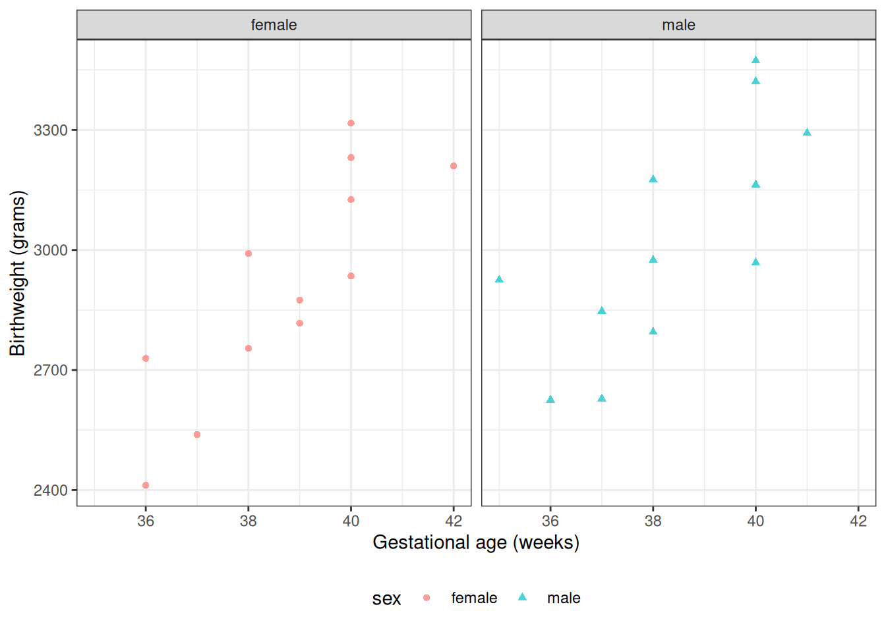](Linear-models-overview_files/figure-html/fig-plot-birthweight1-1.png "Figure 1: birthweight data (@dobson4e Example 2.2.2)")
>
> Figure 1: `birthweight` data (Dobson and Barnett [\[1\]](#ref-dobson4e) Example 2.2.2)

------------------------------------------------------------------------

### 2.3.4 Data notation

Let’s define some notation to represent this data:

- $Y$: birthweight (measured in grams)
- $S$: chromosomal sex: “male” (XY) or “female” (XX)
- $M$: [indicator variable](https://morrison-lab.github.io/sds/data.html#def-indicator-variable) for $S$ = “male”[^2]
  - $M = 0$ if $S$ = “female”
  - $M = 1$ if $S$ = “male”
- $F$: indicator variable for $S$ = “female”[^3]
  - $F = 1$ if $S$ = “female”
  - $F = 0$ if $S$ = “male”
- $A$: estimated gestational age at birth (measured in weeks).

Female is the **[reference level](https://morrison-lab.github.io/sds/data.html#def-reference-level)** for the [categorical variable](https://morrison-lab.github.io/sds/data.html#def-categorical-var) $S$ (chromosomal sex) and corresponding indicator variable $M$ . The choice of a reference level is arbitrary and does not limit what we can do with the resulting model; it only makes it more computationally convenient to make inferences about comparisons involving that reference group.

$M$ and $F$ are called **[dummy variables](https://morrison-lab.github.io/sds/data.html#def-dummy-variable)**; together, they are a numeric representation of the categorical variable $S$. Dummy variables with values 0 and 1 are also called **indicator variables**. There are other ways to construct dummy variables, such as using the values -1 and 1 (see Dobson and Barnett [\[1\]](#ref-dobson4e) §2.4 for details).

## 2.4 Parallel lines regression

c.f. Dunn and Smyth [\[2\]](#ref-dunn2018generalized) [§2.10.3](https://link.springer.com/chapter/10.1007/978-1-4419-0118-7_2#Sec31).

We don’t have enough data to model the distribution of birth weight separately for each combination of gestational age and sex, so let’s instead consider a (relatively) simple model for how that distribution varies with gestational age and sex:

$$\begin{aligned}
Y|M,A &\ \sim_{\operatorname{ciid}}\ N(\mu(M,A), \sigma^2)\\
\mu(m,a) &= \beta_0 + \beta_M m + \beta_A a
\end{aligned}
\tag{1}$$

[Table 3](#tbl-lm-parallel) shows the parameter estimates from R. [Figure 2](#fig-parallel-fit1) shows the estimated model, superimposed on the data.

> **NOTE:**
>
> Show R code
>
> ``` downlit
> bw_lm1 <- lm(
>   formula = weight ~ sex + age,
>   data = bw
> )
>
> library(parameters)
> bw_lm1 |>
>   parameters::parameters() |>
>   parameters::print_md(
>     include_reference = include_reference_lines,
>     select = "{estimate}"
>   )
> ```
>
> | Parameter   | Coefficient |
> |:------------|:-----------:|
> | (Intercept) |  -1773.32   |
> | sex (male)  |   163.04    |
> | age         |   120.89    |
>
> Table 3: Regression parameter estimates for [Model 1](#eq-lm-parallel) of `birthweight` data

> **NOTE:**
>
> Show R code
>
> ``` downlit
> bw <-
>   bw |>
>   mutate(`E[Y|X=x]` = fitted(bw_lm1)) |>
>   arrange(sex, age)
>
> plot2 <-
>   plot1 %+% bw +
>   geom_line(aes(y = `E[Y|X=x]`))
>
> print(plot2)
> ```
>
> [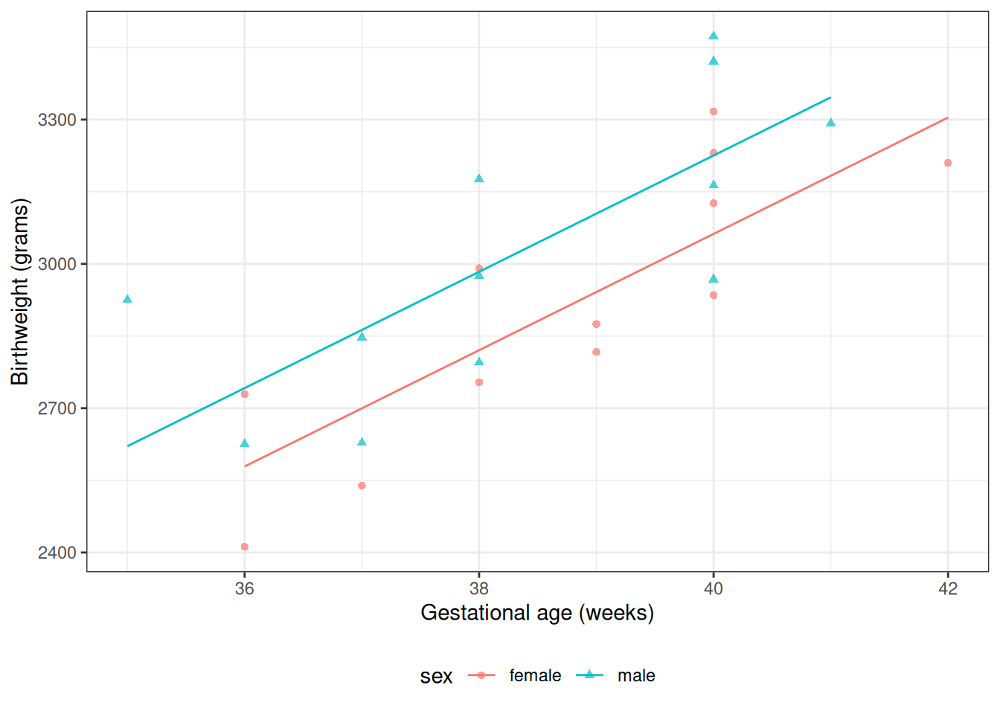](Linear-models-overview_files/figure-html/unnamed-chunk-3-1.png "Figure 2: Graph of Model 1 for birthweight data")
>
> Figure 2: Graph of [Model 1](#eq-lm-parallel) for `birthweight` data

------------------------------------------------------------------------

### 2.4.1 Model assumptions and predictions

To learn what this model is assuming, let’s plug in a few values.

> **NOTE:**
>
> **Exercise 1** What’s the mean birthweight for a female born at 36 weeks?
>
> | Parameter   | Coefficient |
> |:------------|:-----------:|
> | (Intercept) |  -1773.32   |
> | sex (male)  |   163.04    |
> | age         |   120.89    |
>
> Estimated coefficients for [model 1](#eq-lm-parallel) {.caption-top .table .table-sm .table-striped .small}

------------------------------------------------------------------------

> **NOTE:**
>
> *Solution*.  
>
> | Parameter   | Coefficient |
> |:------------|:-----------:|
> | (Intercept) |  -1773.32   |
> | sex (male)  |   163.04    |
> | age         |   120.89    |
>
> Estimated coefficients for [model 1](#eq-lm-parallel) {.caption-top .table .table-sm .table-striped .small}
>
> Show R code
>
> ``` downlit
> pred_female <- coef(bw_lm1)["(Intercept)"] + coef(bw_lm1)["age"] * 36
> ## or using built-in prediction:
> pred_female_alt <- predict(bw_lm1, newdata = tibble(sex = "female", age = 36))
> ```
>
> $$\begin{aligned}
> E[Y|M = 0, A = 36]
> &= \beta_0 + \mathopen{}\left(\beta_M \cdot 0\right)\mathclose{}+ \mathopen{}\left(\beta_A \cdot 36\right)\mathclose{} \\
> &= -1773.321839 + \mathopen{}\left(163.039303 \cdot 0\right)\mathclose{}
> + \mathopen{}\left(120.894327 \cdot 36\right)\mathclose{} \\
> &=  2578.873934
> \end{aligned}$$

> **NOTE:**
>
> **Exercise 2** What’s the mean birthweight for a male born at 36 weeks?
>
> | Parameter   | Coefficient |
> |:------------|:-----------:|
> | (Intercept) |  -1773.32   |
> | sex (male)  |   163.04    |
> | age         |   120.89    |
>
> Estimated coefficients for [model 1](#eq-lm-parallel) {.caption-top .table .table-sm .table-striped .small}

------------------------------------------------------------------------

> **NOTE:**
>
> *Solution*.  
>
> | Parameter   | Coefficient |
> |:------------|:-----------:|
> | (Intercept) |  -1773.32   |
> | sex (male)  |   163.04    |
> | age         |   120.89    |
>
> Estimated coefficients for [model 1](#eq-lm-parallel) {.caption-top .table .table-sm .table-striped .small}
>
> Show R code
>
> ``` downlit
> pred_male <-
>   coef(bw_lm1)["(Intercept)"] +
>   coef(bw_lm1)["sexmale"] +
>   coef(bw_lm1)["age"] * 36
> ```
>
> $$\begin{aligned}
> E[Y|M = 1, A = 36]
> &= \beta_0 + \beta_M \cdot 1+ \beta_A \cdot 36 \\
> &=  2741.913237
> \end{aligned}$$

> **NOTE:**
>
> **Exercise 3** What’s the difference in mean birthweights between males born at 36 weeks and females born at 36 weeks?

Show R code

``` downlit
coef(bw_lm1)
#> (Intercept)     sexmale         age 
#>   -1773.322     163.039     120.894
```

------------------------------------------------------------------------

> **NOTE:**
>
> *Solution*. $$\begin{aligned}
> & E[Y|M = 1, A = 36] - E[Y|M = 0, A = 36]\\
> &=
> 2741.913237 - 2578.873934\\
> &=
> 163.039303
> \end{aligned}$$
>
> Shortcut:
>
> $$\begin{aligned}
> & E[Y|M = 1, A = 36] - E[Y|M = 0, A = 36]\\
> &= (\beta_0 + \beta_M \cdot 1+ \beta_A \cdot 36) -
> (\beta_0 + \beta_M \cdot 0+ \beta_A \cdot 36) \\
> &= \beta_M \\
> &=  163.039303
> \end{aligned}$$

Age cancels out in this difference. In other words, according to this model, the difference between females and males with the same gestational age is the same for every age.

This characteristic is an assumption of the model specified by [Equation 1](#eq-lm-parallel). It’s hardwired into the parametric model structure, even before we estimated values for those parameters.

------------------------------------------------------------------------

### 2.4.2 Coefficient Interpretation

Recall [Model 1](#eq-lm-parallel):

$$E[Y|M=m,A=a] = \mu(m,a) = \beta_0 + \beta_M m + \beta_A a$$

Slope (of the mean with respect to age) for males: $$\begin{aligned}
\frac{d}{da}\mu(1,a) &= \frac{d}{da}(\beta_0 + \beta_M \cdot 1 + {\color{red}{\beta_A}} \cdot a)\\
&= \mathopen{}\left(\frac{d}{da}\beta_0 + \frac{d}{da}\beta_M \cdot 1 + \frac{d}{da}({\color{red}{\beta_A}} \cdot a)\right)\mathclose{}\\
&= (0 + 0 + {\color{red}{\beta_A}}) \\
&= {\color{red}{\beta_A}}
\end{aligned}$$

Slope for females:

$$\begin{aligned}
\frac{d}{da}\mu(0,a) &= \frac{d}{da}(\beta_0 + \beta_M \cdot 0 + {\color{red}{\beta_A}} \cdot a)\\
&= \mathopen{}\left(\frac{d}{da}\beta_0 + \frac{d}{da}\beta_M \cdot 0 + \frac{d}{da}({\color{red}{\beta_A}} \cdot a)\right)\mathclose{}\\
&= (0 + 0 + {\color{red}{\beta_A}}) \\
&= {\color{red}{\beta_A}}
\end{aligned}$$

> **NOTE:**
>
> **Exercise 4** What is the interpretation of $\beta_A$ in [Model 1](#eq-lm-parallel)?

------------------------------------------------------------------------

> **NOTE:**
>
> *Solution*. $$\begin{aligned}
> \frac{d}{da}\mu(m,a) &= \frac{d}{da}(\beta_0 + \beta_M \cdot m + {\color{red}{\beta_A}} \cdot a)\\
> &= \mathopen{}\left(\frac{d}{da}\beta_0 + \frac{d}{da}\beta_M \cdot m + \frac{d}{da}({\color{red}{\beta_A}} \cdot a)\right)\mathclose{}\\
> &= (0 + 0 + {\color{red}{\beta_A}}) \\
> &= {\color{red}{\beta_A}}
> \end{aligned}$$
>
> Conclusion:
>
> $$\beta_A = \frac{d}{da}\mu(m,a)$$

$\beta_A$ is the slope of mean birthweight with respect to gestational age, adjusting for sex.

Or we can plug in the definition of slope:

$$\beta_A = E[Y|M = m, A = a+1] - E[Y|M = m, A = a]$$

Exchangeability and consistency have not been assessed; so we are not discussing potential outcomes (causality), only observed outcomes.

> **NOTE:**
>
> **Exercise 5** What is the interpretation of $\beta_M$ in [Model 1](#eq-lm-parallel)?

------------------------------------------------------------------------

> **NOTE:**
>
> *Solution*.
>
> More precisely written: $${\mathbb{E}\mathopen{}\left[Y|M=m,A=a\right]\mathclose{}} = \mu(m,a) = \begin{cases}
> \beta_0 + \beta_M m +\beta_A a, & \text{for } m\in {\mathopen{}\left\{0,1\right\}\mathclose{}} \\
> \text{undefined}, & \text{for } m \notin {\mathopen{}\left\{0,1\right\}\mathclose{}}
> \end{cases}$$ The model is undefined for $m \notin {\mathopen{}\left\{0,1\right\}\mathclose{}}$, so the [derivative](https://morrison-lab.github.io/mds/calculus-derivatives.html#def-derivative) with respect to $m$ doesn’t exist.
>
> $$\begin{aligned}
> E[Y|M = 1,A = a] &= \beta_0 + {\color{red}{\beta_M}} 1 + \beta_A a \\
> & = \beta_0 + {\color{red}{\beta_M}} + \beta_A a \\
> E[Y|M = 0,A = a] &= \beta_0 + {\color{red}{\beta_M}} 0 + \beta_A a \\
> & = \beta_0 + \beta_A a
> \end{aligned}$$ So: $$\begin{aligned}
> E[Y|M = 1,A = a] - E[Y|M = 0,A = a] &= (\beta_0 + {\color{red}{\beta_M}} + \beta_A a) - (\beta_0 + \beta_A a) \\
> &= {\color{red}{\beta_M}}
> \end{aligned}$$ Therefore: $$\begin{aligned}
> \beta_M &= E[Y|M = 1,A = a] - E[Y|M = 0,A = a]\\
> & =\mu(1,a) - \mu(0,a)\\
> \end{aligned}$$
>
> In words: $\beta_M$ is the difference in mean birthweight between males and females adjusting for age.

> **NOTE:**
>
> **Exercise 6** $\beta_0 = ?$

------------------------------------------------------------------------

> **NOTE:**
>
> *Solution*. $$\begin{aligned}
> {\mathbb{E}\mathopen{}\left[Y|M = 0,A = 0\right]\mathclose{}} &= \mu(0,0)\\
> &= {\color{red}{\beta_0}} + \beta_M 0 + \beta_A 0\\
> &= {\color{red}{\beta_0}}\\
> {\color{red}{\beta_0}} &= {\mathbb{E}\mathopen{}\left[Y|M = 0,A = 0\right]\mathclose{}} = \mu(0,0)
> \end{aligned}$$
>
> $\beta_0$ is the mean birthweight for a female with gestational age 0 weeks.

## 2.5 Interactions

What if we don’t like that parallel lines assumption?

Then we need to allow an “interaction” ([definition](../chapters/Intro-to-GLMs.llms.md#def-interaction)) between age $A$ and sex $S$:

$$E[Y|S=s,A=a] = \beta_0 + \beta_A a+ \beta_M m + \beta_{AM} (a \cdot m) \tag{2}$$

Now, the slope of mean birthweight $E[Y|A,S]$ with respect to gestational age $A$ depends on the value of sex $S$.

Show R code

``` downlit
bw_lm2 <- lm(weight ~ sex + age + sex:age, data = bw)
bw_lm2 |>
  parameters() |>
  parameters::print_md(
    include_reference = include_reference_lines,
    select = "{estimate}"
  )
```

> **NOTE:**
>
> | Parameter        | Coefficient |
> |:-----------------|:-----------:|
> | (Intercept)      |  -2141.67   |
> | sex (male)       |   872.99    |
> | age              |   130.40    |
> | sex (male) × age |   -18.42    |
>
> Table 4: Birthweight model with interaction term

Show R code

``` downlit
bw <-
  bw |>
  mutate(
    predlm2 = predict(bw_lm2)
  ) |>
  arrange(sex, age)

plot1_interact <-
  plot1 %+% bw +
  geom_line(aes(y = predlm2))

print(plot1_interact)
```

> **NOTE:**
>
> [](Linear-models-overview_files/figure-html/fig-bw-interaction-1.png "Figure 3: Birthweight model with interaction term")
>
> Figure 3: Birthweight model with interaction term

Now we can see that the lines aren’t parallel.

------------------------------------------------------------------------

Here’s another way we could rewrite this model (by collecting terms involving $S$):

$$E[Y|M,A] = \beta_0 + \beta_M M+ (\beta_A + \beta_{AM} M) A$$

If you want to understand a coefficient in a model with interactions, collect terms for the corresponding variable, and you will see which other covariates interact with the variable whose coefficient you are interested in. In this case, the association between $A$ (age) varies between males and females (that is, by sex $S$). [^4] So the slope of $Y$ with respect to $A$ depends on the value of $M$. According to this model, there is no such thing as “*the* slope of birthweight with respect to age”. There are two slopes, one for each sex. We can only talk about “the slope of birthweight with respect to age among males” and “the slope of birthweight with respect to age among females”. Then: each non-interaction slope coefficient is the difference in means per unit difference in its corresponding variable, when all interacting variables are set to 0.

> **NOTE:**
>
> *Remark 1* (Interactions and the number of subgroups). If every subgroup has its own line, then each line is estimated from less data: the more subgroups we compare, the fewer observations each one has. When there are too many subgroups, we restrict how they may differ. The parallel-lines model without an interaction ([Equation 2](#eq-BW-lm-interact) with $\beta_{AM} = 0$) is one such restriction: the subgroups share one slope, and only their intercepts differ. Adding the interaction term relaxes the restriction, so that the slopes can also differ.
>
> This relaxation is symmetric. If the slope of birthweight with respect to age differs by sex, then the difference in mean birthweight between the sexes differs by age, which is visible in [Figure 3](#fig-bw-interaction) as vertical gaps that are narrower at some ages than at others.
>
> The same idea applies to two numeric covariates. The slope of the outcome with respect to one numeric covariate $A$ may depend on the value of another numeric covariate $Z$. Then each value of $Z$ defines its own subgroup and its own slope, so there are as many subgroups as there are distinct values of $Z$, and most of them contain no observations at all. To make progress, we have to assume a restrictive shape for how the slope changes with $Z$; a product term $\beta_{AZ}\, a \cdot z$ assumes that the slope changes linearly with $Z$.

To learn what this model is assuming, let’s plug in a few values.

> **NOTE:**
>
> **Exercise 7** According to this model, what’s the mean birthweight for a female born at 36 weeks?

| Parameter        | Coefficient |
|:-----------------|:-----------:|
| (Intercept)      |  -2141.67   |
| sex (male)       |   872.99    |
| age              |   130.40    |
| sex (male) × age |   -18.42    |

------------------------------------------------------------------------

> **NOTE:**
>
> *Solution*.  
>
> | Parameter        | Coefficient |
> |:-----------------|:-----------:|
> | (Intercept)      |  -2141.67   |
> | sex (male)       |   872.99    |
> | age              |   130.40    |
> | sex (male) × age |   -18.42    |
>
> Show R code
>
> ``` downlit
> pred_female <- coef(bw_lm2)["(Intercept)"] + coef(bw_lm2)["age"] * 36
> ```
>
> $$E[Y|M = 0, A = 36] =
> \beta_0 + \beta_M \cdot 0+ \beta_A \cdot 36 + \beta_{AM} \cdot (0 * 36)
> =  2552.733333$$

> **NOTE:**
>
> **Exercise 8** What’s the mean birthweight for a male born at 36 weeks?
>
> | Parameter        | Coefficient |
> |:-----------------|:-----------:|
> | (Intercept)      |  -2141.67   |
> | sex (male)       |   872.99    |
> | age              |   130.40    |
> | sex (male) × age |   -18.42    |

------------------------------------------------------------------------

> **NOTE:**
>
> *Solution*.  
>
> | Parameter        | Coefficient |
> |:-----------------|:-----------:|
> | (Intercept)      |  -2141.67   |
> | sex (male)       |   872.99    |
> | age              |   130.40    |
> | sex (male) × age |   -18.42    |
>
> Show R code
>
> ``` downlit
> pred_male <-
>   coef(bw_lm2)["(Intercept)"] +
>   coef(bw_lm2)["sexmale"] +
>   coef(bw_lm2)["age"] * 36 +
>   coef(bw_lm2)["sexmale:age"] * 36
> ```
>
> $$\begin{aligned}
> E[Y|M = 1, A = 36]
> &= \beta_0 + \beta_M \cdot 1+ \beta_A \cdot 36 + \beta_{AM} \cdot 1 \cdot 36\\
> &= 2762.706897
> \end{aligned}$$

> **NOTE:**
>
> **Exercise 9** What’s the difference in mean birthweights between males born at 36 weeks and females born at 36 weeks?

------------------------------------------------------------------------

> **NOTE:**
>
> *Solution*. $$\begin{aligned}
> & E[Y|M = 1, A = 36] - E[Y|M = 0, A = 36]\\
> &= (\beta_0 + \beta_M \cdot 1+ \beta_A \cdot 36 + \beta_{AM} \cdot 1 \cdot 36)\\
> &\ \ \ \ \  -(\beta_0 + \beta_M \cdot 0+ \beta_A \cdot 36 + \beta_{AM} \cdot 0 \cdot 36) \\
> &= \beta_M + \beta_{AM}\cdot 36\\
> &=  209.973563
> \end{aligned}$$

Note that age now does show up in the difference: in other words, according to this model, the difference in mean birthweights between females and males with the same gestational age can vary by gestational age.

That’s how the lines in the graph ended up non-parallel.

------------------------------------------------------------------------

### 2.5.1 Coefficient Interpretation

> **NOTE:**
>
> **Exercise 10** What is the interpretation of $\beta_{M}$ in [Model 2](#eq-BW-lm-interact)?

------------------------------------------------------------------------

> **NOTE:**
>
> *Solution*.  
>
> Mean birthweight among males with gestational age 0 weeks: $$\begin{aligned}
> \mu(1,0) &= {\mathbb{E}\mathopen{}\left[Y|M = 1,A = 0\right]\mathclose{}}\\
> &= \beta_0 + {\color{red}{\beta_M}} \cdot 1 + \beta_A \cdot 0 + \beta_{AM}\cdot 1 \cdot 0\\
> &= \beta_0 + {\color{red}{\beta_M}}
> \end{aligned}$$ Mean birthweight among females with gestational age 0 weeks: $$\begin{aligned}
> \mu(0,0) &= {\mathbb{E}\mathopen{}\left[Y|M = 0,A = 0\right]\mathclose{}}\\
> &= \beta_0 + {\color{red}{\beta_M}} \cdot 0 + \beta_A \cdot 0 + \beta_{AM}\cdot 0 \cdot 0\\
> &= \beta_0
> \end{aligned}$$
>
> $$\begin{aligned}
> \beta_{M} &= \mu(1,0) - \mu(0,0) \\
> &= {\mathbb{E}\mathopen{}\left[Y|M = 1,A = 0\right]\mathclose{}} - {\mathbb{E}\mathopen{}\left[Y|M = 0,A = 0\right]\mathclose{}}
> \end{aligned}$$ $\beta_M$ is the difference in mean birthweight between males with gestational age 0 weeks and females with gestational age 0 weeks.

> **NOTE:**
>
> **Exercise 11** What is the interpretation of $\beta_{AM}$ in [Model 2](#eq-BW-lm-interact)?

------------------------------------------------------------------------

> **NOTE:**
>
> *Solution*.  
>
> Slope among males: $$\begin{aligned}
> \frac{\partial}{\partial a}\mu(1,a) &= \frac{\partial}{\partial a}\mathopen{}\left(\beta_0 + \beta_M\cdot 1 + {\color{blue}{\beta_A}}\cdot a + {\color{red}{\beta_{AM}}}\cdot 1 \cdot a\right)\mathclose{}\\
> &= \frac{\partial}{\partial a}\mathopen{}\left(\beta_0 + \beta_M + {\color{blue}{\beta_A}}\cdot a + {\color{red}{\beta_{AM}}} \cdot a\right)\mathclose{}\\
> &= {\color{blue}{\beta_A}} + {\color{red}{\beta_{AM}}}
> \end{aligned}$$ or $$\begin{aligned}
> E[Y|1,a+1] - E[Y|1,a] = &\beta_0 + \beta_M \cdot 1 + {\color{blue}{\beta_A}}\cdot(a+1) + {\color{red}{\beta_{AM}}} \cdot 1 \cdot (a+1)\\
>   &- (\beta_0 + \beta_M \cdot 1 + {\color{blue}{\beta_A}}\cdot a + {\color{red}{\beta_{AM}}} \cdot 1 \cdot a)\\
> = &{\color{blue}{\beta_A}} + {\color{red}{\beta_{AM}}}
> \end{aligned}$$
>
> Slope among females: $$\begin{aligned}
> \frac{\partial}{\partial a}\mu(0,a) &= \frac{\partial}{\partial a}\mathopen{}\left(\beta_0 + \beta_M\cdot 0 + {\color{blue}{\beta_A}}\cdot a + {\color{red}{\beta_{AM}}}\cdot 0 \cdot a\right)\mathclose{}\\
> &= \frac{\partial}{\partial a}\mathopen{}\left(\beta_0 + {\color{blue}{\beta_A}}\cdot a\right)\mathclose{}\\
> &= {\color{blue}{\beta_A}} \\
> \end{aligned}$$ or $$\begin{aligned}
> E[Y|0,a+1] - E[Y|0,a] = &\beta_0 + \beta_M \cdot 0 + {\color{blue}{\beta_A}}\cdot(a+1) + {\color{red}{\beta_{AM}}} \cdot 0 \cdot (a+1) \\
> &- (\beta_0 + \beta_M \cdot 0 + {\color{blue}{\beta_A}}\cdot a + {\color{red}{\beta_{AM}}} \cdot 0 \cdot a)\\
> = &\beta_0 + {\color{blue}{\beta_A}}\cdot(a+1) - (\beta_0 + {\color{blue}{\beta_A}}\cdot a)\\
> = &{\color{blue}{\beta_A}}
> \end{aligned}$$
>
> Difference in slopes: $$\begin{aligned}
> \frac{\partial}{\partial a}\mu(1,a) - \frac{\partial}{\partial a}\mu(0,a) &= {\color{blue}{\beta_A}} + {\color{red}{\beta_{AM}}} - {\color{blue}{\beta_A}}\\
> &= {\color{red}{\beta_{AM}}}
> \end{aligned}$$ or $$\begin{aligned}
> (E[Y|1,a+1] - E[Y|1,a]) - (E[Y|0,a+1] - E[Y|0,a]) &= {\color{blue}{\beta_A}} + {\color{red}{\beta_{AM}}} - {\color{blue}{\beta_A}}\\
> &= {\color{red}{\beta_{AM}}}
> \end{aligned}$$
>
> Therefore $$\begin{aligned}
> \beta_{AM} = &\frac{\partial}{\partial a}\mu(1,a) - \frac{\partial}{\partial a}\mu(0,a)\\
> = &(E[Y|M = 1,A = a+1] - E[Y|M = 1,A = a])\\
> &- (E[Y|M = 0,A = a+1] - E[Y|M = 0,A = a])
> \end{aligned}$$
>
> $\beta_{AM}$ is the difference in slope of mean birthweight with respect to gestational age between males and females.

------------------------------------------------------------------------

### 2.5.2 Compare coefficient interpretations

> **NOTE:**
>
> | $\mu(m,a)$ | $\beta_0 + \beta_M m + \beta_A a$ | $\beta_0 + \beta_M m + \beta_A a + {\color{red}{\beta_{AM} ma}}$ |
> |----|----|----|
> | $\beta_0$ | $\mu(0,0)$ | $\mu(0,0)$ |
> | $\beta_A$ | $\frac{\partial}{\partial a}\mu({\color{blue}{m}},a)$ | $\frac{\partial}{\partial a}\mu({\color{red}{0}},a)$ |
> | $\beta_M$ | $\mu(1, {\color{blue}{a}}) - \mu(0, {\color{blue}{a}})$ | $\mu(1, {\color{red}{0}}) - \mu(0,{\color{red}{0}})$ |
> | $\beta_{AM}$ |  | $\frac{\partial}{\partial a}\mu(1,a) - \frac{\partial}{\partial a}\mu(0,a)$ |
>
> Table 5: Coefficient interpretations, by model structure

In the model with an interaction term multiplying $A\times M$, the interpretation of $\beta_A$ involves the reference level of $M$, and interpretation of $\beta_M$ involves the reference level of $A$ ([Table 5](#tbl-compare-coef-interps)).

### 2.5.3 General procedure for interpreting coefficients

> **NOTE:**
>
> **Definition 2 (General procedure for interpreting a regression coefficient)** To derive the interpretation of coefficient $\beta_j$ in a model with [linear predictor](../chapters/Intro-to-GLMs.llms.md#def-linear-predictor) $\eta(\mathord{\smash[b]{\underset{\raise.3ex\hbox{$\scriptstyle\sim$}}{x}}\vphantom{x}}) = \eta(x_1, \ldots, x_p)$:
>
> 1.  **Write down the linear predictor** $\eta(x_1, \ldots, x_p)$.
>
> 2.  **Differentiate or difference** $\eta$ with respect to $x_j$:
>
>     1.  If $x_j$ is **continuous**: compute the [partial derivative](https://morrison-lab.github.io/mds/vector-calculus.html#def-partial-derivative) $\frac{\partial}{\partial x_j}\eta(\mathord{\smash[b]{\underset{\raise.3ex\hbox{$\scriptstyle\sim$}}{x}}\vphantom{x}})$.
>
>     2.  If $x_j$ is **discrete**: compute the one-unit difference $\left.{\eta(\mathord{\smash[b]{\underset{\raise.3ex\hbox{$\scriptstyle\sim$}}{x}}\vphantom{x}})}\right|_{x_j = a+1} - \left.{\eta(\mathord{\smash[b]{\underset{\raise.3ex\hbox{$\scriptstyle\sim$}}{x}}\vphantom{x}})}\right|_{x_j = a}$.
>
>     For an **interaction coefficient** $\beta_{jk}$ (multiplying the product $x_j \cdot x_k$), apply this step twice in sequence: first differentiate or difference $\eta$ with respect to $x_j$ to obtain the **slope of** $x_j$ as a function of $x_k$; then differentiate or difference that slope with respect to $x_k$ (choosing continuous/discrete as appropriate for $x_k$) to obtain the **change in slopes**, which equals $\beta_{jk}$.
>
> 3.  **If any covariates remain, set them to their reference levels**. If [covariates](../chapters/Intro-to-GLMs.llms.md#def-predictors) other than the one(s) used in step 2 still appear in the resulting expression, substitute each covariate’s [reference level](https://morrison-lab.github.io/sds/data.html#def-reference-level) for it. This substitution eliminates the corresponding interaction terms and isolates $\beta_j$ alone on the right-hand side.
>
> 4.  **Identify** $\beta_j$: the expression from the previous steps equals $\beta_j$; write $\beta_j = \cdots$ to state the interpretation explicitly.
>
> **Special case — intercept (**$\beta_0$): If the coefficient of interest is the intercept $\beta_0$, skip step 2. Apply step 3 directly by setting all covariates to their reference levels: $\beta_0 = \eta(\text{reference pattern})$.

This procedure gives the interpretation on the **linear predictor scale**. For Gaussian linear regression (identity link), $\eta(\mathord{\smash[b]{\underset{\raise.3ex\hbox{$\scriptstyle\sim$}}{x}}\vphantom{x}}) = {\mathbb{E}\mathopen{}\left[Y|\mathord{\smash[b]{\underset{\raise.3ex\hbox{$\scriptstyle\sim$}}{x}}\vphantom{x}}\right]\mathclose{}}$, so the resulting interpretation is directly on the mean outcome scale. For other [GLMs](../chapters/Intro-to-GLMs.llms.md#def-glm) and for proportional hazards models, the linear predictor is a transformed version of the mean (e.g., the log-odds for logistic regression, the log-rate for Poisson regression, or the log-hazard for Cox models), so an additional step — applying the inverse link or exponentiating — translates the interpretation to the scale of the outcome.

The reference covariate pattern used in step 3 is not arbitrary: setting remaining covariates to $0$ is correct when $0$ is their reference level (as coded in the model). If the reference level for some covariate is not $0$, substitute the actual reference value instead.

> **NOTE:**
>
> **Example 1 (Applying the procedure to [Model 1](#eq-lm-parallel))** For the birthweight parallel-lines model $${\mathbb{E}\mathopen{}\left[Y|M=m, A=a\right]\mathclose{}} = \beta_0 + \beta_M m + \beta_A a,$$ where $M \in \{0,1\}$ (sex; $1$ = male, $0$ = female) and $A$ is gestational age (weeks):
>
> $\beta_A$ (gestational age, continuous): $\frac{\partial}{\partial a}\eta(m,a) = \beta_A$, so $\beta_A = \frac{\partial}{\partial a}{\mathbb{E}\mathopen{}\left[Y|M=m, A=a\right]\mathclose{}}$. (Step 3 not needed: no remaining covariates appear after differentiating.)
>
> $\beta_M$ (sex, discrete):
>
> $$\begin{aligned}
> \left.{\eta(m,a)}\right|_{m=1} - \left.{\eta(m,a)}\right|_{m=0}
> &= (\beta_0 + \beta_M + \beta_A a) - (\beta_0 + \beta_A a)
> \\
> &= \beta_M,
> \end{aligned}$$
>
> so $\beta_M = {\mathbb{E}\mathopen{}\left[Y|M=1, A=a\right]\mathclose{}} - {\mathbb{E}\mathopen{}\left[Y|M=0, A=a\right]\mathclose{}}$. (Step 3 not needed: $a$ cancels in the differencing, so the result holds for all values of $A$.)
>
> $\beta_0$ (intercept, special case): Skip step 2; set $m=0$ and $a=0$ (the reference levels) in step 3: $\beta_0 = \eta(0,0) = {\mathbb{E}\mathopen{}\left[Y|M=0, A=0\right]\mathclose{}}$.

## 2.6 Stratified regression

We could re-write the [interaction](../chapters/Intro-to-GLMs.llms.md#def-interaction) model as a stratified model, with a slope and intercept for each sex:

$${\mathbb{E}\mathopen{}\left[Y|A=a, S=s\right]\mathclose{}} =
\beta_M m + \beta_{AM} (a \cdot m) +
\beta_F f + \beta_{AF} (a \cdot f)
\tag{3}$$

Compare this stratified model ([Equation 3](#eq-model-strat)) with our interaction model, [Equation 2](#eq-BW-lm-interact):

$${\mathbb{E}\mathopen{}\left[Y|A=a, S=s\right]\mathclose{}} =
\beta_0 + \beta_A a + \beta_M m + \beta_{AM} (a \cdot m)$$

In the stratified model, the intercept term $\beta_0$ has been relabeled as $\beta_F$.

Show R code

``` downlit
bw_lm2 <- lm(weight ~ sex + age + sex:age, data = bw)
bw_lm2 |>
  parameters() |>
  print_md(
    include_reference = include_reference_lines,
    select = "{estimate}"
  )
```

> **NOTE:**
>
> | Parameter        | Coefficient |
> |:-----------------|:-----------:|
> | (Intercept)      |  -2141.67   |
> | sex (male)       |   872.99    |
> | age              |   130.40    |
> | sex (male) × age |   -18.42    |
>
> Table 6: Birthweight model with interaction term

Show R code

``` downlit
bw_lm_strat <-
  bw |>
  lm(
    formula = weight ~ sex + sex:age - 1,
    data = _
  )

bw_lm_strat |>
  parameters() |>
  print_md(
    select = "{estimate}"
  )
```

> **NOTE:**
>
> | Parameter          | Coefficient |
> |:-------------------|:-----------:|
> | sex (female)       |  -2141.67   |
> | sex (male)         |  -1268.67   |
> | sex (female) × age |   130.40    |
> | sex (male) × age   |   111.98    |
>
> Table 7: Birthweight model - stratified betas

## 2.7 Curved-line regression

If we transform some of our covariates ($X$s) and plot the resulting model on the original covariate scale, we end up with curved regression lines:

Show R code

``` downlit
bw_lm3 <- lm(weight ~ sex:log(age) - 1, data = bw)

ggbw <-
  bw |>
  ggplot(
    aes(x = age, y = weight)
  ) +
  geom_point() +
  xlab("Gestational Age (weeks)") +
  ylab("Birth Weight (g)")

ggbw2 <- ggbw +
  stat_smooth(
    method = "lm",
    formula = y ~ log(x),
    geom = "smooth"
  ) +
  xlab("Gestational Age (weeks)") +
  ylab("Birth Weight (g)")


ggbw2 |> print()
```

> **NOTE:**
>
> [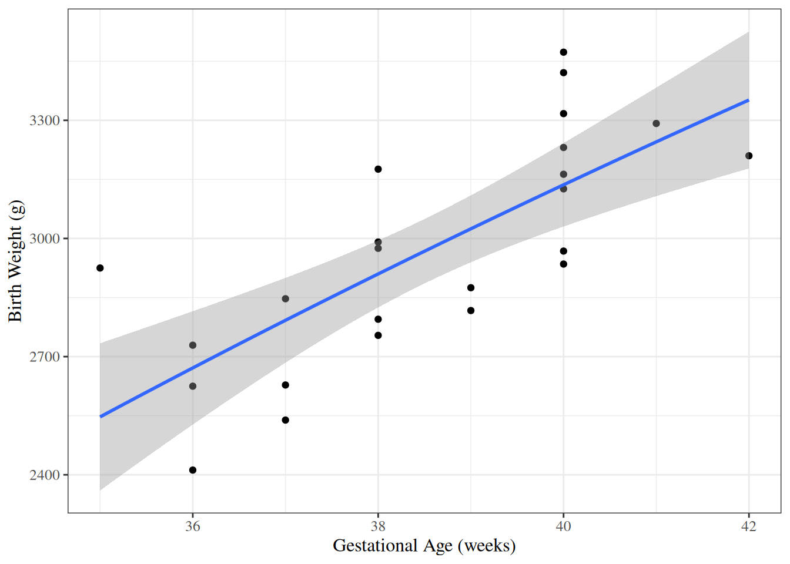](Linear-models-overview_files/figure-html/fig-birthweight-log-x-1.png "Figure 4: birthweight model with age entering on log scale")
>
> Figure 4: `birthweight` model with `age` entering on log scale

------------------------------------------------------------------------

[Figure 5](#fig-penguins-log-x) displays an example with a slightly more obvious curve.

Show R code

``` downlit
library(palmerpenguins)

ggpenguins <-
  palmerpenguins::penguins |>
  dplyr::filter(species == "Adelie") |>
  ggplot(
    aes(x = bill_length_mm, y = body_mass_g)
  ) +
  geom_point() +
  xlab("Bill length (mm)") +
  ylab("Body mass (g)")

ggpenguins2 <- ggpenguins +
  stat_smooth(
    method = "lm",
    formula = y ~ log(x),
    geom = "smooth"
  ) +
  xlab("Bill length (mm)") +
  ylab("Body mass (g)")


ggpenguins2 |> print()
```

> **NOTE:**
>
> [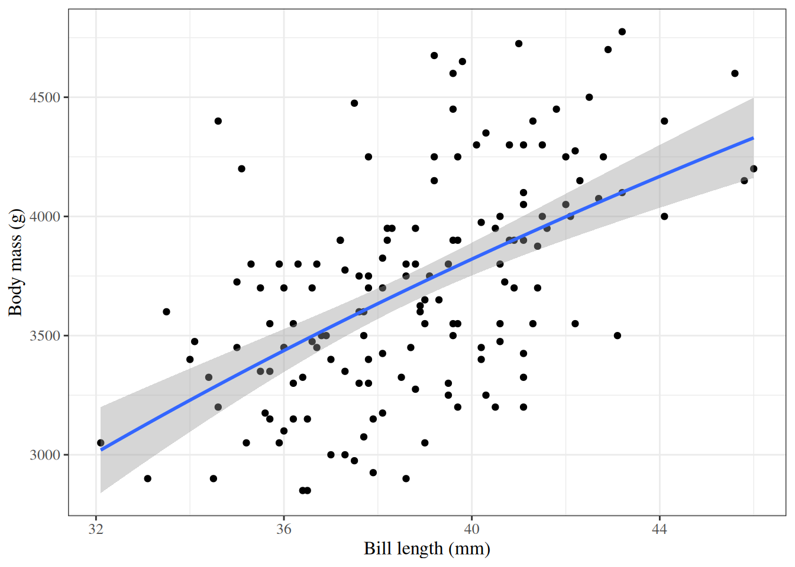](Linear-models-overview_files/figure-html/fig-penguins-log-x-1.png "Figure 5: palmerpenguins model with bill_length entering on log scale")
>
> Figure 5: `palmerpenguins` model with `bill_length` entering on log scale

## 2.8 Rescaling

Centering [covariates](../chapters/Intro-to-GLMs.llms.md#def-predictors) (subtracting a constant from them) can make coefficient interpretations more meaningful, particularly for the intercept and main effect terms in models with [interactions](../chapters/Intro-to-GLMs.llms.md#def-interaction).

### 2.8.1 Rescale age

For example, the intercept $\beta_0$ in our interaction model represents the mean birthweight for females at age = 0 weeks, which is not a biologically plausible scenario. If we center age at 36 weeks instead, $\beta_0$ will represent the mean birthweight for females at 36 weeks, which is more interpretable.

------------------------------------------------------------------------

> **NOTE:**
>
> **Exercise 12** Let $A^* = A - 32$ weeks.
>
> Consider a new version of [Model 2](#eq-BW-lm-interact), with $A^*$ in place of $A$:
>
> $${\mathbb{E}\mathopen{}\left[Y|M=m, A^*=a^*\right]\mathclose{}} = \gamma_0 + \gamma_M m + \gamma_{A^*} a^* + \gamma_{A^*M} (m \cdot a^*)
> \tag{4}$$
>
> Let the coefficients of this model be $\gamma$s instead of $\beta$s.
>
> What are the interpretations of the $\gamma$s? How do they relate to the $\beta$s in [Model 2](#eq-BW-lm-interact)? Which have the same interpretation? Which are different, and how do they differ? What is the pattern?

------------------------------------------------------------------------

> **NOTE:**
>
> *Solution*. **Interpretation of** $\gamma_0$:
>
> From [Model 4](#eq-BW-lm-interact-rescaled), $\gamma_0$ is the mean birthweight among females ($M = 0$) with $A^* = 0$ (i.e., $A = 32$ weeks):
>
> $$\gamma_0 = {\mathbb{E}\mathopen{}\left[Y|M=0, A^*=0\right]\mathclose{}} = {\mathbb{E}\mathopen{}\left[Y|M=0, A=32\right]\mathclose{}}$$
>
> Substituting into [Model 2](#eq-BW-lm-interact):
>
> $$\begin{aligned}
> \gamma_0
> &= \beta_0 + \beta_M \cdot 0 + \beta_A \cdot 32 + \beta_{AM} \cdot 0 \cdot 32\\
> &= \beta_0 + 32\beta_A
> \end{aligned}$$
>
> This centered intercept parameter differs from $\beta_0 = {\mathbb{E}\mathopen{}\left[Y|M=0, A=0\right]\mathclose{}}$, which is the mean birthweight among females at $A = 0$ weeks.
>
> **Interpretation of** $\gamma_M$:
>
> From [Model 4](#eq-BW-lm-interact-rescaled), $\gamma_M$ is the sex difference in mean birthweight at $A^* = 0$ (i.e., $A = 32$ weeks):
>
> $$\begin{aligned}
> \gamma_M
> &= {\mathbb{E}\mathopen{}\left[Y|M=1, A^*=0\right]\mathclose{}} - {\mathbb{E}\mathopen{}\left[Y|M=0, A^*=0\right]\mathclose{}}\\
> &= {\mathbb{E}\mathopen{}\left[Y|M=1, A=32\right]\mathclose{}} - {\mathbb{E}\mathopen{}\left[Y|M=0, A=32\right]\mathclose{}}
> \end{aligned}$$
>
> Substituting into [Model 2](#eq-BW-lm-interact):
>
> $$\begin{aligned}
> \gamma_M
> &= (\beta_0 + \beta_M + \beta_A \cdot 32 + \beta_{AM} \cdot 32) - (\beta_0 + \beta_A \cdot 32)\\
> &= \beta_M + 32\beta_{AM}
> \end{aligned}$$
>
> This male main-effect parameter differs from $\beta_M$, which is the sex difference at $A = 0$ weeks.
>
> **Interpretation of** $\gamma_{A^*}$:
>
> From [Model 4](#eq-BW-lm-interact-rescaled), $\gamma_{A^*}$ is the slope of mean birthweight with respect to $A^*$ among females ($M = 0$):
>
> $$\begin{aligned}
> \gamma_{A^*}
> &= \frac{d}{da^*}{\mathbb{E}\mathopen{}\left[Y|M=0, A^*=a^*\right]\mathclose{}}\\
> &= \frac{d}{da^*}{\mathbb{E}\mathopen{}\left[Y|M=0, A=a^*+32\right]\mathclose{}}\\
> &= \frac{d}{da}{\mathbb{E}\mathopen{}\left[Y|M=0, A=a\right]\mathclose{}}
> \end{aligned}$$
>
> Substituting into [Model 2](#eq-BW-lm-interact):
>
> $$\begin{aligned}
> \gamma_{A^*}
> &= \frac{d}{da}\mathopen{}\left(\beta_0 + \beta_A \cdot a\right)\mathclose{}\\
> &= \beta_A
> \end{aligned}$$
>
> Since shifting $A$ by a constant does not change the slope, $\gamma_{A^*} = \beta_A$: these two coefficients have the same value and interpretation.
>
> **Interpretation of** $\gamma_{A^*M}$:
>
> From [Model 4](#eq-BW-lm-interact-rescaled), $\gamma_{A^*M}$ is the difference in slope with respect to $A^*$ between males and females:
>
> $$\begin{aligned}
> \gamma_{A^*M}
> &= \frac{d}{da^*}{\mathbb{E}\mathopen{}\left[Y|M=1, A^*=a^*\right]\mathclose{}} - \frac{d}{da^*}{\mathbb{E}\mathopen{}\left[Y|M=0, A^*=a^*\right]\mathclose{}}\\
> &= \frac{d}{da}{\mathbb{E}\mathopen{}\left[Y|M=1, A=a\right]\mathclose{}} - \frac{d}{da}{\mathbb{E}\mathopen{}\left[Y|M=0, A=a\right]\mathclose{}}
> \end{aligned}$$
>
> Substituting into [Model 2](#eq-BW-lm-interact):
>
> $$\begin{aligned}
> \gamma_{A^*M}
> &= (\beta_A + \beta_{AM}) - \beta_A\\
> &= \beta_{AM}
> \end{aligned}$$
>
> Since shifting $A$ by a constant does not change slopes, $\gamma_{A^*M} = \beta_{AM}$: these two coefficients have the same value and interpretation.
>
> **The pattern:**
>
> Slope coefficients ($\gamma_{A^*}$ and $\gamma_{A^*M}$) are unchanged by rescaling: they have the same values and interpretations as the corresponding $\beta$s.
>
> Coefficients change only for variables that have interactions with the rescaled variable $A$. This set of modified coefficients includes the intercept (which can be viewed as the main effect of a variable that interacts with $A$ via $\beta_A$), and the main effect of $M$ (which interacts with $A$ via $\beta_{AM}$). Shifting $A$ by 32 weeks changes the reference point from $A = 0$ to $A = 32$, so these coefficients now represent quantities evaluated at $A = 32$ weeks rather than at $A = 0$ weeks.

> **NOTE:**
>
> **Exercise 13** Using R, fit the rescaled interaction model with $A^* = A - 36$ weeks in place of $A$ in [Model 2](#eq-BW-lm-interact). Compare the coefficient estimates with those from the original model. Which coefficients change, and which remain the same?

------------------------------------------------------------------------

> **NOTE:**
>
> *Solution*.
>
> Show R code
>
> ``` downlit
> bw <-
>   bw |>
>   mutate(
>     `age - mean` = age - mean(age),
>     `age - 36wks` = age - 36
>   )
>
> lm1_c <- lm(weight ~ sex + `age - 36wks`, data = bw)
>
> lm2_c <- lm(weight ~ sex + `age - 36wks` + sex:`age - 36wks`, data = bw)
>
> parameters(lm2_c, ci_method = "wald") |> print_md()
> ```
>
> | Parameter                | Coefficient |   SE   |       95% CI       | t(20) |    p    |
> |:-------------------------|:-----------:|:------:|:------------------:|:-----:|:-------:|
> | (Intercept)              |   2552.73   | 97.59  | (2349.16, 2756.30) | 26.16 | \< .001 |
> | sex (male)               |   209.97    | 129.75 |  (-60.68, 480.63)  | 1.62  |  0.121  |
> | age - 36wks              |   130.40    | 30.00  |  (67.82, 192.98)   | 4.35  | \< .001 |
> | sex (male) × age - 36wks |   -18.42    | 41.76  |  (-105.52, 68.68)  | -0.44 |  0.664  |
>
> Compare with what we got without rescaling:
>
> Show R code
>
> ``` downlit
> parameters(bw_lm2, ci_method = "wald") |> print_md()
> ```
>
> | Parameter        | Coefficient |   SE    |       95% CI        | t(20) |    p    |
> |:-----------------|:-----------:|:-------:|:-------------------:|:-----:|:-------:|
> | (Intercept)      |  -2141.67   | 1163.60 | (-4568.90, 285.56)  | -1.84 |  0.081  |
> | sex (male)       |   872.99    | 1611.33 | (-2488.18, 4234.17) | 0.54  |  0.594  |
> | age              |   130.40    |  30.00  |   (67.82, 192.98)   | 4.35  | \< .001 |
> | sex (male) × age |   -18.42    |  41.76  |  (-105.52, 68.68)   | -0.44 |  0.664  |
>
> Notice that the slope coefficients (`age - 36wks` and `sexmale:age - 36wks`) remain the same, but the intercept and `sexmale` coefficient have changed to reflect means at age = 36 weeks rather than age = 0 weeks.

------------------------------------------------------------------------

### 2.8.2 Centering gestational age does not change predictions

Centering gestational age changes the coefficient parameterization, but it does not change [fitted values](#def-fitted-value), confidence bands, or prediction bands.

The next output reports maximum absolute differences between the uncentered and centered models. All values should be near zero (up to floating-point rounding), which confirms that centering changes parameterization only.

Show R code

``` downlit
bw_centered <-
  bw |>
  dplyr::mutate(
    age_mean_centered = age - mean(age)
  )

bw_lm2_centered <-
  lm(
    weight ~ sex + age_mean_centered + sex:age_mean_centered,
    data = bw_centered
  )

pred_uncentered_ci <-
  predict(
    bw_lm2,
    newdata = bw_centered,
    interval = "confidence"
  ) |>
  tibble::as_tibble()

pred_centered_ci <-
  predict(
    bw_lm2_centered,
    newdata = bw_centered,
    interval = "confidence"
  ) |>
  tibble::as_tibble()

pred_uncentered_pi <-
  predict(
    bw_lm2,
    newdata = bw_centered,
    interval = "predict"
  ) |>
  tibble::as_tibble()

pred_centered_pi <-
  predict(
    bw_lm2_centered,
    newdata = bw_centered,
    interval = "predict"
  ) |>
  tibble::as_tibble()

tibble::tibble(
  fitted_max_abs_diff = max(abs(pred_uncentered_ci$fit - pred_centered_ci$fit)),
  ci_lwr_max_abs_diff = max(abs(pred_uncentered_ci$lwr - pred_centered_ci$lwr)),
  ci_upr_max_abs_diff = max(abs(pred_uncentered_ci$upr - pred_centered_ci$upr)),
  pi_lwr_max_abs_diff = max(abs(pred_uncentered_pi$lwr - pred_centered_pi$lwr)),
  pi_upr_max_abs_diff = max(abs(pred_uncentered_pi$upr - pred_centered_pi$upr))
)
```

> **NOTE:**
>
> Show R code
>
> ``` downlit
> comparison_plot_data <-
>   dplyr::bind_rows(
>     bw_centered |>
>       dplyr::bind_cols(
>         pred_uncentered_ci |>
>           dplyr::transmute(
>             fit,
>             ci_lwr = lwr,
>             ci_upr = upr
>           ),
>         pred_uncentered_pi |>
>           dplyr::transmute(
>             pred_lwr = lwr,
>             pred_upr = upr
>           )
>       ) |>
>       dplyr::transmute(
>         age,
>         weight,
>         sex,
>         model = "Without centering age",
>         fit,
>         ci_lwr,
>         ci_upr,
>         pred_lwr,
>         pred_upr
>       ),
>     bw_centered |>
>       dplyr::bind_cols(
>         pred_centered_ci |>
>           dplyr::transmute(
>             fit,
>             ci_lwr = lwr,
>             ci_upr = upr
>           ),
>         pred_centered_pi |>
>           dplyr::transmute(
>             pred_lwr = lwr,
>             pred_upr = upr
>           )
>       ) |>
>       dplyr::transmute(
>         age,
>         weight,
>         sex,
>         model = "With centered age",
>         fit,
>         ci_lwr,
>         ci_upr,
>         pred_lwr,
>         pred_upr
>       )
>   ) |>
>   dplyr::mutate(
>     model = factor(
>       model,
>       levels = c("Without centering age", "With centered age")
>     )
>   )
>
> comparison_plot_data |>
>   ggplot2::ggplot(
>     ggplot2::aes(
>       x = age,
>       y = weight,
>       col = sex,
>       fill = sex,
>       group = sex
>     )
>   ) +
>   ggplot2::geom_point(alpha = 0.5) +
>   ggplot2::geom_ribbon(
>     ggplot2::aes(
>       ymin = pred_lwr,
>       ymax = pred_upr
>     ),
>     alpha = 0.15,
>     col = NA
>   ) +
>   ggplot2::geom_ribbon(
>     ggplot2::aes(
>       ymin = ci_lwr,
>       ymax = ci_upr
>     ),
>     alpha = 0.3,
>     col = NA
>   ) +
>   ggplot2::geom_line(
>     ggplot2::aes(y = fit)
>   ) +
>   ggplot2::facet_wrap(~model) +
>   ggplot2::theme_bw() +
>   ggplot2::theme(legend.position = "bottom") +
>   ggplot2::labs(
>     x = "Gestational age (weeks)",
>     y = "Birthweight (grams)",
>     col = "Sex",
>     fill = "Sex"
>   )
> ```
>
> [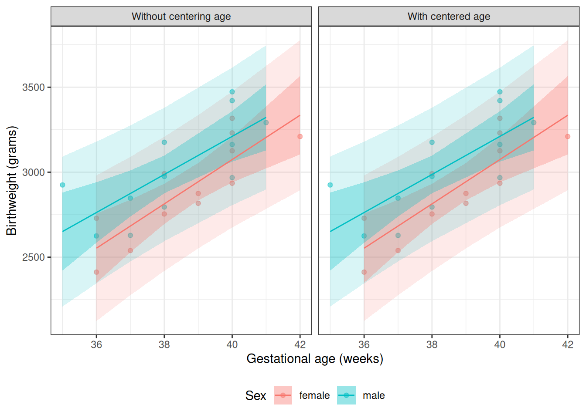](Linear-models-overview_files/figure-html/unnamed-chunk-20-1.png "Figure 6: Two-panel comparison of the fitted birthweight model bw_lm2 with and without centering gestational age, showing identical fitted values, confidence bands, and prediction bands in both panels.")
>
> Figure 6: Two-panel comparison of the fitted `birthweight` model `bw_lm2` with and without centering gestational age, showing identical fitted values, confidence bands, and prediction bands in both panels.

## 2.9 Categorical covariates with more than two levels

### 2.9.1 Example: `birthweight`

In the birthweight example, the variable `sex` had only two observed values:

Show R code

``` downlit
unique(bw$sex)
#> [1] female male  
#> Levels: female male
```

If there are more than two observed values, we can’t just use a single variable with 0s and 1s.

### 2.9.2 Example: `iris`

For example, [Table 8](#tbl-iris-data) shows the [(in)famous](https://www.meganstodel.com/posts/no-to-iris/) `iris` data (Anderson [\[14\]](#ref-anderson1935irises)), and [Table 9](#tbl-iris-summary) provides summary statistics. The data include three species: “setosa”, “versicolor”, and “virginica”.

Show R code

``` downlit
head(iris)
```

> **NOTE:**
>
> Table 8: The `iris` data

Show R code

``` downlit
library(table1)
table1(
  x = ~ . | Species,
  data = iris,
  overall = FALSE
)
```

> **NOTE:**
>
> [TABLE]
>
> Table 9: Summary statistics for the `iris` data

------------------------------------------------------------------------

If we want to model `Sepal.Length` by species, we could create a variable $X$ that represents “setosa” as $X=1$, “virginica” as $X=2$, and “versicolor” as $X=3$.

Show R code

``` downlit
data(iris) # this step is not always necessary, but ensures you're starting
# from the original version of a dataset stored in a loaded package

iris <-
  iris |>
  tibble() |>
  mutate(
    X = case_when(
      Species == "setosa" ~ 1,
      Species == "virginica" ~ 2,
      Species == "versicolor" ~ 3
    )
  )

iris |>
  distinct(Species, X)
```

> **NOTE:**
>
> Table 10: `iris` data with numeric coding of species

Then we could fit a model like:

Show R code

``` downlit
iris_lm1 <- lm(Sepal.Length ~ X, data = iris)
iris_lm1 |>
  parameters() |>
  print_md()
```

> **NOTE:**
>
> | Parameter   | Coefficient |  SE  |    95% CI    | t(148) |    p    |
> |:------------|:-----------:|:----:|:------------:|:------:|:-------:|
> | (Intercept) |    4.91     | 0.16 | (4.60, 5.23) | 30.83  | \< .001 |
> | X           |    0.46     | 0.07 | (0.32, 0.61) |  6.30  | \< .001 |
>
> Table 11: Model of `iris` data with numeric coding of `Species`

------------------------------------------------------------------------

Let’s see how that model looks:

Show R code

``` downlit
iris_plot1 <- iris |>
  ggplot(
    aes(
      x = X,
      y = Sepal.Length
    )
  ) +
  geom_point(alpha = .1) +
  geom_abline(
    intercept = coef(iris_lm1)[1],
    slope = coef(iris_lm1)[2]
  ) +
  theme_bw(base_size = 18)
print(iris_plot1)
```

> **NOTE:**
>
> [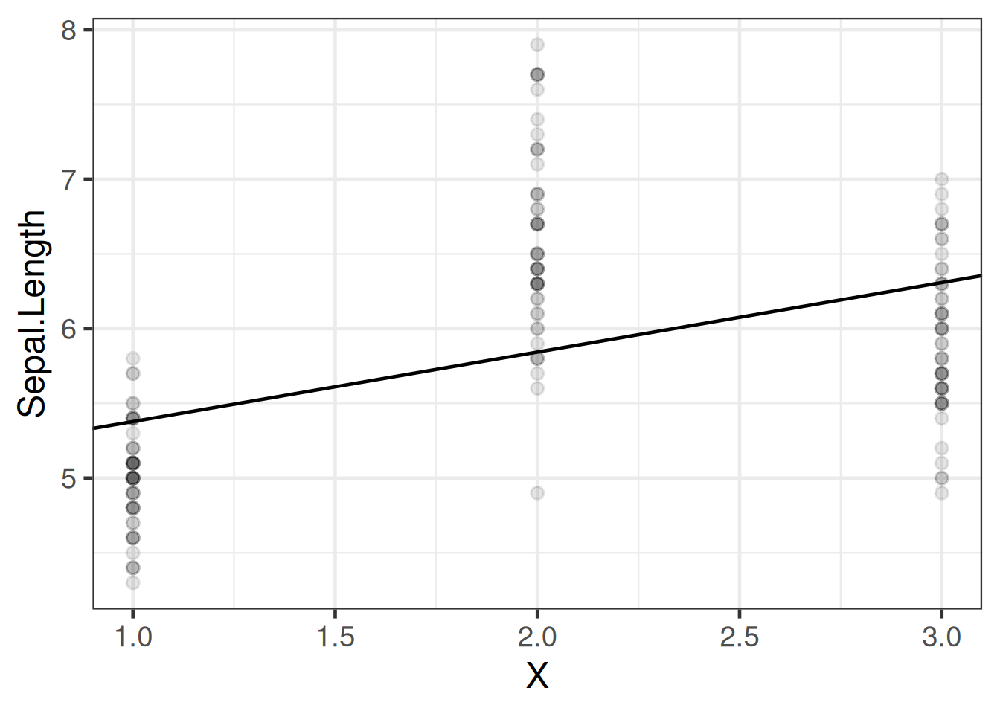](Linear-models-overview_files/figure-html/fig-iris-numeric-species-model-1.png "Figure 7: Model of iris data with numeric coding of Species")
>
> Figure 7: Model of `iris` data with numeric coding of `Species`

We have forced the model to use a straight line for the three estimated means. Maybe not a good idea?

### 2.9.3 Let’s see what R does with categorical variables by default:

Show R code

``` downlit
iris_lm2 <- lm(Sepal.Length ~ Species, data = iris)
iris_lm2 |>
  parameters() |>
  print_md()
```

> **NOTE:**
>
> | Parameter            | Coefficient |  SE  |    95% CI    | t(147) |    p    |
> |:---------------------|:-----------:|:----:|:------------:|:------:|:-------:|
> | (Intercept)          |    5.01     | 0.07 | (4.86, 5.15) | 68.76  | \< .001 |
> | Species (versicolor) |    0.93     | 0.10 | (0.73, 1.13) |  9.03  | \< .001 |
> | Species (virginica)  |    1.58     | 0.10 | (1.38, 1.79) | 15.37  | \< .001 |
>
> Table 12: Model of `iris` data with `Species` as a categorical variable

### 2.9.4 Re-parametrize with no intercept

If you don’t want the default and offset option, you can use “-1” like we’ve seen previously:

Show R code

``` downlit
iris_lm2_no_int <- lm(Sepal.Length ~ Species - 1, data = iris)
iris_lm2_no_int |>
  parameters() |>
  print_md()
```

> **NOTE:**
>
> | Parameter            | Coefficient |  SE  |    95% CI    | t(147) |    p    |
> |:---------------------|:-----------:|:----:|:------------:|:------:|:-------:|
> | Species (setosa)     |    5.01     | 0.07 | (4.86, 5.15) | 68.76  | \< .001 |
> | Species (versicolor) |    5.94     | 0.07 | (5.79, 6.08) | 81.54  | \< .001 |
> | Species (virginica)  |    6.59     | 0.07 | (6.44, 6.73) | 90.49  | \< .001 |
>
> Table 13

### 2.9.5 Let’s see what these new models look like:

Show R code

``` downlit
iris_plot2 <-
  iris |>
  mutate(
    predlm2 = predict(iris_lm2)
  ) |>
  arrange(X) |>
  ggplot(aes(x = X, y = Sepal.Length)) +
  geom_point(alpha = .1) +
  geom_line(aes(y = predlm2), col = "red") +
  geom_abline(
    intercept = coef(iris_lm1)[1],
    slope = coef(iris_lm1)[2]
  ) +
  theme_bw(base_size = 18)

print(iris_plot2)
```

> **NOTE:**
>
> [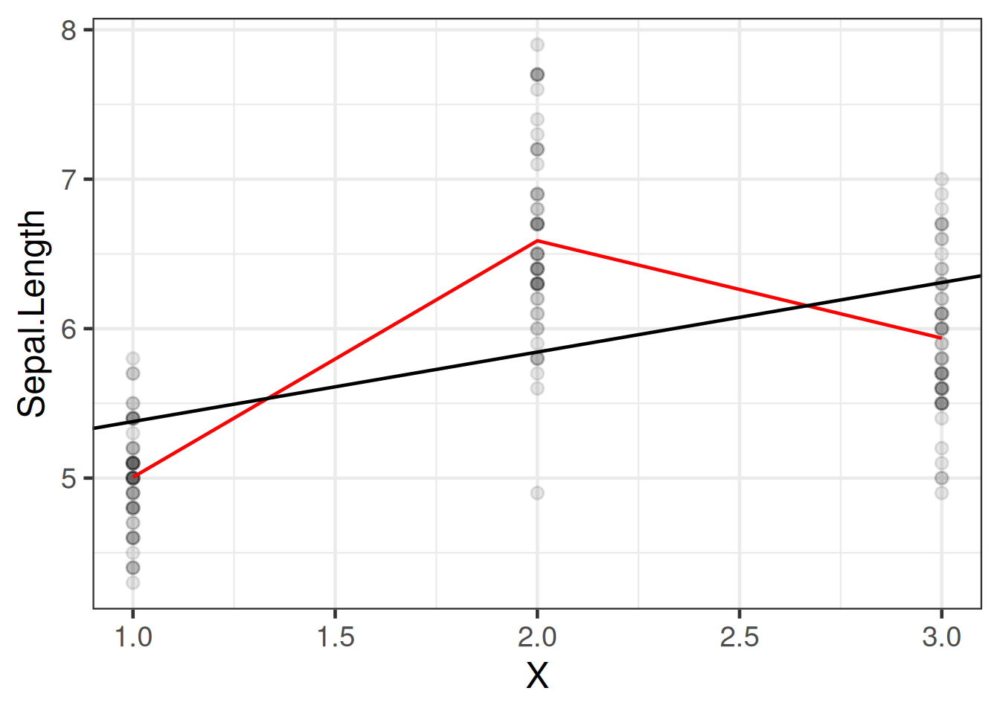](Linear-models-overview_files/figure-html/fig-iris-no-intcpt-1.png "Figure 8: ")
>
> Figure 8

### 2.9.6 Let’s see how R did that:

Show R code

``` downlit
formula(iris_lm2)
#> Sepal.Length ~ Species
model.matrix(iris_lm2) |>
  as_tibble() |>
  unique()
```

> **NOTE:**
>
> Table 14

This format is called a “corner point parametrization” (e.g., in Dobson and Barnett [\[1\]](#ref-dobson4e)) or “treatment coding” (e.g., in Dunn and Smyth [\[2\]](#ref-dunn2018generalized)).

The default contrasts are controlled by `options("contrasts")`:

Show R code

``` downlit
options("contrasts")
#> $contrasts
#>         unordered           ordered 
#> "contr.treatment"      "contr.poly"
```

See [`?options`](https://rdrr.io/r/base/options.html) for more details.

------------------------------------------------------------------------

Show R code

``` downlit
formula(iris_lm2_no_int)
#> Sepal.Length ~ Species - 1
model.matrix(iris_lm2_no_int) |>
  as_tibble() |>
  unique()
```

> **NOTE:**
>
> Table 15

This format is called a “group point parametrization” (e.g., in Dobson and Barnett [\[1\]](#ref-dobson4e)).

There are more options; see Dobson and Barnett [\[1\]](#ref-dobson4e) §6.4.1 and the [`codingMatrices` package](https://CRAN.R-project.org/package=codingMatrices) [vignette](https://cran.r-project.org/web/packages/codingMatrices/vignettes/codingMatrices.pdf) (Venables [\[15\]](#ref-venablescodingMatrices)).

## 2.10 Ordinal covariates

(c.f. Dobson and Barnett [\[1\]](#ref-dobson4e) §2.4.4)

------------------------------------------------------------------------

We can create [ordinal variables](https://morrison-lab.github.io/sds/data.html#def-ordinal-var) in R using the [`ordered()`](https://rdrr.io/r/base/factor.html) function[^5].

> **NOTE:**
>
> **Example 2** The `hers` data [\[3\]](#ref-vittinghoff2e) is available in the `rmb` package:
>
> Show R code
>
> ``` downlit
> hers <- rmb::hers |> haven::zap_labels()
> ```
>
> > **NOTE:**
> >
> > Show R code
> >
> > ``` downlit
> > hers |> head()
> > ```
> >
> > Table 16: HERS data
>
> The `physact` variable records each participant’s self-reported physical activity, relative to other women her age, on an ordered five-level scale (1 = much less active, …, 5 = much more active). We make it an ordered factor so that [`lm()`](https://rdrr.io/r/stats/lm.html) uses polynomial contrasts, which respect the ordering, instead of the default treatment contrasts:
>
> Show R code
>
> ``` downlit
> hers <- hers |>
>   dplyr::mutate(physact_ord = ordered(physact))
>
> lm_physact <- lm(LDL ~ physact_ord, data = hers)
> ```
>
> > **NOTE:**
> >
> > Show R code
> >
> > ``` downlit
> > lm_physact |>
> >   parameters::model_parameters() |>
> >   parameters::print_md()
> > ```
> >
> > | Parameter                | Coefficient |  SE  |      95% CI      | t(2747) |    p    |
> > |:-------------------------|:-----------:|:----:|:----------------:|:-------:|:-------:|
> > | (Intercept)              |   144.71    | 0.85 | (143.05, 146.38) | 170.10  | \< .001 |
> > | physact ord (linear)     |    -0.31    | 2.29 |  (-4.80, 4.18)   |  -0.14  |  0.892  |
> > | physact ord (quadratic)  |    -1.86    | 2.05 |  (-5.88, 2.15)   |  -0.91  |  0.363  |
> > | physact ord (cubic)      |    0.47     | 1.74 |  (-2.94, 3.89)   |  0.27   |  0.785  |
> > | physact ord (4th degree) |    -0.58    | 1.42 |  (-3.36, 2.21)   |  -0.40  |  0.686  |
> >
> > Table 17: Mean LDL by physical-activity level, using polynomial contrasts
>
> With polynomial contrasts, each coefficient summarizes a trend component across the ordered levels: the linear term measures the strength and direction of a straight-line (monotone) trend in mean LDL across the levels, and the quadratic and higher terms capture curvature. The contrasts are orthonormal, so the linear coefficient is scaled by the contrast normalization; it is not the raw change in mean LDL per level. Here the linear-trend coefficient is small and not [statistically significant](https://morrison-lab.github.io/sds/inference.html#def-statistically-significant), so these data show little evidence of a monotone association between physical-activity level and mean LDL cholesterol.

------------------------------------------------------------------------

For ordinal variables, we might want to use contrasts that respect the ordering of the categories. The default treatment contrasts don’t account for ordering.

> **NOTE:**
>
> When working with [ordinal covariates](https://morrison-lab.github.io/sds/data.html#def-ordinal-var) in linear models:
>
> 1.  Use [`ordered()`](https://rdrr.io/r/base/factor.html) or `factor(ordered = TRUE)` to create the variable
> 2.  Consider using polynomial contrasts (`contr.poly`) which respect ordering
> 3.  Alternatively, treat the ordinal variable as numeric if equal spacing is reasonable
> 4.  Check `?codingMatrices::contr.diff` for additional contrast options
>
> See Dobson and Barnett [\[1\]](#ref-dobson4e) §2.4.4 for more details on contrasts for ordinal variables.

# 3 Fitting linear models

> **TIP:**
>
> Josh Starmer’s StatQuest video [*Linear Regression, Clearly Explained!!!*](https://www.youtube.com/watch?v=nk2CQITm_eo) explains fitting a line by [least squares](https://morrison-lab.github.io/sds/correlation-regression.html#def-ols), $R^2$, and the $p$-value for $R^2$ [\[16\]](#ref-starmer-statquest).

In EPI 203 and [our review of MLEs](https://morrison-lab.github.io/sds/intro-MLEs.html#sec-intro-MLEs), we learned how to fit outcome-only models of the form $p(X=x|\theta)$ to [iid](https://morrison-lab.github.io/pds/independence.html#def-iid) data $\mathord{\smash[b]{\underset{\raise.3ex\hbox{$\scriptstyle\sim$}}{x}}\vphantom{x}}= (x_1,…,x_n)$ using [maximum likelihood estimation](https://morrison-lab.github.io/sds/intro-MLEs.html#def-mle).

Now, we apply the same procedure to [linear regression models](#def-lm-general-form):

------------------------------------------------------------------------

## 3.1 Likelihood

$$\begin{aligned}
\mathcal{L}_i
&\stackrel{\text{def}}{=}p(Y_i=y_i|\mathord{\smash[b]{\underset{\raise.3ex\hbox{$\scriptstyle\sim$}}{X}}\vphantom{X}}_i = \mathord{\smash[b]{\underset{\raise.3ex\hbox{$\scriptstyle\sim$}}{x}}\vphantom{x}}_i)
&& \text{(conditional likelihood for observation } i\text{)}
\\
&= (2\pi\sigma^2)^{-1/2} {\operatorname{exp}\mathopen{}\left\{-\frac{1}{2\sigma^2}\varepsilon_i^2\right\}\mathclose{}}
&& \text{(Gaussian density evaluation)}
\\
\varepsilon_i
&\stackrel{\text{def}}{=}y_i - \mu_i
&& \text{(definition of the deviation, or error)}
\\
\mu_i
&\stackrel{\text{def}}{=}\mu(\mathord{\smash[b]{\underset{\raise.3ex\hbox{$\scriptstyle\sim$}}{x}}\vphantom{x}}_i)
&& \text{(conditional expectation function)}
\\
&= \mathord{\smash[b]{\underset{\raise.3ex\hbox{$\scriptstyle\sim$}}{x}}\vphantom{x}}_i \cdot \mathord{\smash[b]{\underset{\raise.3ex\hbox{$\scriptstyle\sim$}}{\beta}}\vphantom{\beta}}
&& \text{(linear predictor structure)}
\end{aligned}$$

------------------------------------------------------------------------

$$\begin{aligned}
\mathcal{L}
&\stackrel{\text{def}}{=}\mathcal{L}(\mathord{\smash[b]{\underset{\raise.3ex\hbox{$\scriptstyle\sim$}}{y}}\vphantom{y}}\mid \mathbf{x}, \mathord{\smash[b]{\underset{\raise.3ex\hbox{$\scriptstyle\sim$}}{\beta}}\vphantom{\beta}}, \sigma^2)
&& \text{(definition of joint likelihood)}
\\
&\stackrel{\text{def}}{=}\operatorname{p}(\mathord{\smash[b]{\underset{\raise.3ex\hbox{$\scriptstyle\sim$}}{Y}}\vphantom{Y}}= \mathord{\smash[b]{\underset{\raise.3ex\hbox{$\scriptstyle\sim$}}{y}}\vphantom{y}}\mid \mathbf{X}= \mathbf{x})
&& \text{(definition via joint density)}
\\
&= \prod_{i=1}^n\mathcal{L}_i
&& \text{(product over independent observations)}
\end{aligned}
\tag{5}$$

------------------------------------------------------------------------

## 3.2 Log-likelihood

$$\begin{aligned}
\ell_i
&\stackrel{\text{def}}{=}{\operatorname{log}\mathopen{}\left\{\mathcal{L}_i\right\}\mathclose{}}
&& \text{(definition of individual log-likelihood)}
\\
&= {\operatorname{log}\mathopen{}\left\{(2\pi\sigma^2)^{-1/2} {\operatorname{exp}\mathopen{}\left\{-\frac{1}{2\sigma^2}\varepsilon_i^2\right\}\mathclose{}}\right\}\mathclose{}}
&& \text{(substitute individual density)}
\\
&= -\frac{1}{2}{\operatorname{log}\mathopen{}\left\{2\pi\sigma^2\right\}\mathclose{}} -\frac{1}{2\sigma^2}\varepsilon_i^2
&& \text{(logarithm product rule)}
\end{aligned}$$

------------------------------------------------------------------------

$$\begin{aligned}
\ell
&\stackrel{\text{def}}{=}\ell(\mathord{\smash[b]{\underset{\raise.3ex\hbox{$\scriptstyle\sim$}}{y}}\vphantom{y}}\mid \mathbf{x}, \mathord{\smash[b]{\underset{\raise.3ex\hbox{$\scriptstyle\sim$}}{\beta}}\vphantom{\beta}}, \sigma^2)
&& \text{(definition of total log-likelihood)}
\\
&\stackrel{\text{def}}{=}{\operatorname{log}\mathopen{}\left\{\mathcal{L}(\mathord{\smash[b]{\underset{\raise.3ex\hbox{$\scriptstyle\sim$}}{y}}\vphantom{y}}\mid \mathbf{x}, \mathord{\smash[b]{\underset{\raise.3ex\hbox{$\scriptstyle\sim$}}{\beta}}\vphantom{\beta}}, \sigma^2)\right\}\mathclose{}}
&& \text{(logarithm of likelihood function)}
\\
&= {\operatorname{log}\mathopen{}\left\{\prod_{i=1}^n\mathcal{L}_i\right\}\mathclose{}}
&& \text{(substitute product likelihood)}
\\
&= \sum_{i=1}^n{\operatorname{log}\mathopen{}\left\{\mathcal{L}_i\right\}\mathclose{}}
&& \text{(logarithm of product is sum of logs)}
\\
&= \sum_{i=1}^n\ell_i
&& \text{(substitute individual log-likelihood symbol)}
\\
&= \sum_{i=1}^n\mathopen{}\left(-\frac{1}{2}{\operatorname{log}\mathopen{}\left\{2\pi\sigma^2\right\}\mathclose{}} -\frac{1}{2\sigma^2}\varepsilon_i^2\right)\mathclose{}
&& \text{(substitute explicit log-likelihood form)}
\\
&= -\frac{n}{2}{\operatorname{log}\mathopen{}\left\{2\pi\sigma^2\right\}\mathclose{}} - \frac{1}{2\sigma^2}\sum_{i=1}^n\varepsilon_i^2
&& \text{(distribute summation)}
\\
&= -\frac{n}{2}{\operatorname{log}\mathopen{}\left\{2\pi\sigma^2\right\}\mathclose{}} - \frac{1}{2\sigma^2}\mathopen{}\left(\mathord{\smash[b]{\underset{\raise.3ex\hbox{$\scriptstyle\sim$}}{\varepsilon}}\vphantom{\varepsilon}}\cdot \mathord{\smash[b]{\underset{\raise.3ex\hbox{$\scriptstyle\sim$}}{\varepsilon}}\vphantom{\varepsilon}}\right)\mathclose{}
&& \text{(express sum of squared deviations as dot product)}
\\
&= -\frac{n}{2}{\operatorname{log}\mathopen{}\left\{2\pi\sigma^2\right\}\mathclose{}} - \frac{1}{2\sigma^2}\mathopen{}\left((\mathord{\smash[b]{\underset{\raise.3ex\hbox{$\scriptstyle\sim$}}{y}}\vphantom{y}}- \mathord{\smash[b]{\underset{\raise.3ex\hbox{$\scriptstyle\sim$}}{\mu}}\vphantom{\mu}}) \cdot (\mathord{\smash[b]{\underset{\raise.3ex\hbox{$\scriptstyle\sim$}}{y}}\vphantom{y}}- \mathord{\smash[b]{\underset{\raise.3ex\hbox{$\scriptstyle\sim$}}{\mu}}\vphantom{\mu}})\right)\mathclose{}
&& \text{(substitute deviation vector } \mathord{\smash[b]{\underset{\raise.3ex\hbox{$\scriptstyle\sim$}}{\varepsilon}}\vphantom{\varepsilon}}= \mathord{\smash[b]{\underset{\raise.3ex\hbox{$\scriptstyle\sim$}}{y}}\vphantom{y}}- \mathord{\smash[b]{\underset{\raise.3ex\hbox{$\scriptstyle\sim$}}{\mu}}\vphantom{\mu}}\text{)}
\\
&= -\frac{n}{2}{\operatorname{log}\mathopen{}\left\{2\pi\sigma^2\right\}\mathclose{}} - \frac{1}{2\sigma^2}\mathopen{}\left((\mathord{\smash[b]{\underset{\raise.3ex\hbox{$\scriptstyle\sim$}}{y}}\vphantom{y}}- \mathbf{X}\mathord{\smash[b]{\underset{\raise.3ex\hbox{$\scriptstyle\sim$}}{\beta}}\vphantom{\beta}}) \cdot (\mathord{\smash[b]{\underset{\raise.3ex\hbox{$\scriptstyle\sim$}}{y}}\vphantom{y}}- \mathbf{X}\mathord{\smash[b]{\underset{\raise.3ex\hbox{$\scriptstyle\sim$}}{\beta}}\vphantom{\beta}})\right)\mathclose{}
&& \text{(substitute mean vector } \mathord{\smash[b]{\underset{\raise.3ex\hbox{$\scriptstyle\sim$}}{\mu}}\vphantom{\mu}}= \mathbf{X}\mathord{\smash[b]{\underset{\raise.3ex\hbox{$\scriptstyle\sim$}}{\beta}}\vphantom{\beta}}\text{)}
\\
&= -\frac{n}{2}{\operatorname{log}\mathopen{}\left\{2\pi\sigma^2\right\}\mathclose{}} - \frac{1}{2\sigma^2}\sum_{i=1}^n\mathopen{}\left(y_i - \mathopen{}\left(\mathord{\smash[b]{\underset{\raise.3ex\hbox{$\scriptstyle\sim$}}{x}}\vphantom{x}}_i\cdot \mathord{\smash[b]{\underset{\raise.3ex\hbox{$\scriptstyle\sim$}}{\beta}}\vphantom{\beta}}\right)\mathclose{}\right)\mathclose{}^2
&& \text{(return to scalar summation form)}
\end{aligned}
\tag{6}$$

## 3.3 Score function

$$\begin{aligned}
\mu_i'
&\stackrel{\text{def}}{=}\frac{\partial}{\partial \mathord{\smash[b]{\underset{\raise.3ex\hbox{$\scriptstyle\sim$}}{\beta}}\vphantom{\beta}}} \mu_i
&& \text{(gradient of conditional mean w.r.t. } \mathord{\smash[b]{\underset{\raise.3ex\hbox{$\scriptstyle\sim$}}{\beta}}\vphantom{\beta}}\text{)}
\\
&= \frac{\partial}{\partial \mathord{\smash[b]{\underset{\raise.3ex\hbox{$\scriptstyle\sim$}}{\beta}}\vphantom{\beta}}} \mathopen{}\left(\mathord{\smash[b]{\underset{\raise.3ex\hbox{$\scriptstyle\sim$}}{x}}\vphantom{x}}_i \cdot \mathord{\smash[b]{\underset{\raise.3ex\hbox{$\scriptstyle\sim$}}{\beta}}\vphantom{\beta}}\right)\mathclose{}
&& \text{(substitute } \mu_i = \mathord{\smash[b]{\underset{\raise.3ex\hbox{$\scriptstyle\sim$}}{x}}\vphantom{x}}_i \cdot \mathord{\smash[b]{\underset{\raise.3ex\hbox{$\scriptstyle\sim$}}{\beta}}\vphantom{\beta}}\text{)}
\\
&= \mathopen{}\left(\frac{\partial}{\partial \mathord{\smash[b]{\underset{\raise.3ex\hbox{$\scriptstyle\sim$}}{\beta}}\vphantom{\beta}}} \mathord{\smash[b]{\underset{\raise.3ex\hbox{$\scriptstyle\sim$}}{\beta}}\vphantom{\beta}}\right)\mathclose{} \mathord{\smash[b]{\underset{\raise.3ex\hbox{$\scriptstyle\sim$}}{x}}\vphantom{x}}_i
&& \text{(apply matrix calculus rule)}
\\
&= \underbrace{\mathbb{I}}_{(p+1) \times (p+1)} \underbrace{\mathord{\smash[b]{\underset{\raise.3ex\hbox{$\scriptstyle\sim$}}{x}}\vphantom{x}}_i}_{(p+1) \times 1}
&& \text{(derivative of vector w.r.t. itself is identity matrix)}
\\
&= \underbrace{\mathord{\smash[b]{\underset{\raise.3ex\hbox{$\scriptstyle\sim$}}{x}}\vphantom{x}}_i}_{(p+1) \times 1}
&& \text{(identity matrix multiplication)}
\end{aligned}$$

------------------------------------------------------------------------

$$\begin{aligned}
\varepsilon'_i
&\stackrel{\text{def}}{=}\frac{\partial}{\partial \mathord{\smash[b]{\underset{\raise.3ex\hbox{$\scriptstyle\sim$}}{\beta}}\vphantom{\beta}}}\varepsilon_i
&& \text{(gradient of deviation w.r.t. } \mathord{\smash[b]{\underset{\raise.3ex\hbox{$\scriptstyle\sim$}}{\beta}}\vphantom{\beta}}\text{)}
\\
&= \frac{\partial}{\partial \mathord{\smash[b]{\underset{\raise.3ex\hbox{$\scriptstyle\sim$}}{\beta}}\vphantom{\beta}}} (y_i - \mu_i)
&& \text{(substitute definition of the deviation)}
\\
&= \frac{\partial}{\partial \mathord{\smash[b]{\underset{\raise.3ex\hbox{$\scriptstyle\sim$}}{\beta}}\vphantom{\beta}}} y_i - \frac{\partial}{\partial \mathord{\smash[b]{\underset{\raise.3ex\hbox{$\scriptstyle\sim$}}{\beta}}\vphantom{\beta}}} \mu_i
&& \text{(linearity of differentiation)}
\\
&= \mathbf{0}_{(p+1) \times 1} - \mathord{\smash[b]{\underset{\raise.3ex\hbox{$\scriptstyle\sim$}}{x}}\vphantom{x}}_i
&& \text{(outcome } y_i \text{ does not depend on } \mathord{\smash[b]{\underset{\raise.3ex\hbox{$\scriptstyle\sim$}}{\beta}}\vphantom{\beta}}\text{)}
\\
&= -\mathord{\smash[b]{\underset{\raise.3ex\hbox{$\scriptstyle\sim$}}{x}}\vphantom{x}}_i
&& \text{(subtract zero vector)}
\end{aligned}$$

------------------------------------------------------------------------

$$\begin{aligned}
\ell'_i
&\stackrel{\text{def}}{=}\frac{\partial}{\partial \mathord{\smash[b]{\underset{\raise.3ex\hbox{$\scriptstyle\sim$}}{\beta}}\vphantom{\beta}}}\ell_i
&& \text{(individual score function w.r.t. } \mathord{\smash[b]{\underset{\raise.3ex\hbox{$\scriptstyle\sim$}}{\beta}}\vphantom{\beta}}\text{)}
\\
&= \frac{\partial}{\partial \mathord{\smash[b]{\underset{\raise.3ex\hbox{$\scriptstyle\sim$}}{\beta}}\vphantom{\beta}}} \mathopen{}\left(-\frac{1}{2}{\operatorname{log}\mathopen{}\left\{2\pi\sigma^2\right\}\mathclose{}} -\frac{1}{2\sigma^2}\varepsilon_i^2\right)\mathclose{}
&& \text{(substitute individual log-likelihood)}
\\
&= \frac{\partial}{\partial \mathord{\smash[b]{\underset{\raise.3ex\hbox{$\scriptstyle\sim$}}{\beta}}\vphantom{\beta}}}\mathopen{}\left(-\frac{1}{2}{\operatorname{log}\mathopen{}\left\{2\pi\sigma^2\right\}\mathclose{}}\right)\mathclose{} - \frac{\partial}{\partial \mathord{\smash[b]{\underset{\raise.3ex\hbox{$\scriptstyle\sim$}}{\beta}}\vphantom{\beta}}}\frac{1}{2\sigma^2}\varepsilon_i^2
&& \text{(linearity of differentiation)}
\\
&= \mathbf{0}_{(p+1) \times 1} - \frac{1}{2\sigma^2}\frac{\partial}{\partial \mathord{\smash[b]{\underset{\raise.3ex\hbox{$\scriptstyle\sim$}}{\beta}}\vphantom{\beta}}}\varepsilon_i^2
&& \text{(constant term derivative vanishes)}
\\
&= - \frac{1}{2\sigma^2} \cdot 2 \mathopen{}\left(\varepsilon_i'\right)\mathclose{} \varepsilon_i
&& \text{(chain rule for scalar squared term)}
\\
&= - \frac{1}{\sigma^2} \mathopen{}\left(-\mathord{\smash[b]{\underset{\raise.3ex\hbox{$\scriptstyle\sim$}}{x}}\vphantom{x}}_i \varepsilon_i\right)\mathclose{}
&& \text{(substitute } \varepsilon_i' = -\mathord{\smash[b]{\underset{\raise.3ex\hbox{$\scriptstyle\sim$}}{x}}\vphantom{x}}_i\text{)}
\\
&= \frac{1}{\sigma^2} \mathord{\smash[b]{\underset{\raise.3ex\hbox{$\scriptstyle\sim$}}{x}}\vphantom{x}}_i \varepsilon_i
&& \text{(simplify double negative)}
\end{aligned}$$

------------------------------------------------------------------------

$$\begin{aligned}
\ell'_{\mathord{\smash[b]{\underset{\raise.3ex\hbox{$\scriptstyle\sim$}}{\beta}}\vphantom{\beta}}}
&\stackrel{\text{def}}{=}\frac{\partial}{\partial \mathord{\smash[b]{\underset{\raise.3ex\hbox{$\scriptstyle\sim$}}{\beta}}\vphantom{\beta}}}\ell
&& \text{(total log-likelihood score vector w.r.t. } \mathord{\smash[b]{\underset{\raise.3ex\hbox{$\scriptstyle\sim$}}{\beta}}\vphantom{\beta}}\text{)}
\\
&= \frac{\partial}{\partial \mathord{\smash[b]{\underset{\raise.3ex\hbox{$\scriptstyle\sim$}}{\beta}}\vphantom{\beta}}} \sum_{i=1}^n\ell_i
&& \text{(substitute total log-likelihood sum)}
\\
&= \sum_{i=1}^n\frac{\partial}{\partial \mathord{\smash[b]{\underset{\raise.3ex\hbox{$\scriptstyle\sim$}}{\beta}}\vphantom{\beta}}} \ell_i
&& \text{(exchange summation and derivative)}
\\
&= \sum_{i=1}^n\ell_i'
&& \text{(substitute individual score symbol)}
\\
&= \sum_{i=1}^n\frac{1}{\sigma^2} \mathord{\smash[b]{\underset{\raise.3ex\hbox{$\scriptstyle\sim$}}{x}}\vphantom{x}}_i \varepsilon_i
&& \text{(substitute individual score expression)}
\\
&= \frac{1}{\sigma^2} \sum_{i=1}^n\mathord{\smash[b]{\underset{\raise.3ex\hbox{$\scriptstyle\sim$}}{x}}\vphantom{x}}_i \varepsilon_i
&& \text{(factor out constant scalar } \frac{1}{\sigma^2}\text{)}
\\
&= \frac{1}{\sigma^2} \underbrace{{\mathbf{X}}^{\top}}_{(p+1) \times n} \underbrace{\mathord{\smash[b]{\underset{\raise.3ex\hbox{$\scriptstyle\sim$}}{\varepsilon}}\vphantom{\varepsilon}}}_{n \times 1}
&& \text{(matrix-vector formulation of the weighted sum)}
\end{aligned}$$

## 3.4 Solving the score equation

To find the [maximum likelihood estimator](https://morrison-lab.github.io/sds/intro-MLEs.html#def-mle) (MLE), we set the score vector equal to the zero vector. The [score equation](https://morrison-lab.github.io/sds/intro-MLEs.html#def-score-equation) for $\mathord{\smash[b]{\underset{\raise.3ex\hbox{$\scriptstyle\sim$}}{\beta}}\vphantom{\beta}}$ is:

$$\ell'_{\mathord{\smash[b]{\underset{\raise.3ex\hbox{$\scriptstyle\sim$}}{\beta}}\vphantom{\beta}}} = \mathbf{0}_{(p+1) \times 1}$$

Since $\sigma^2> 0$, multiplying by $\sigma^2$ gives the equivalent condition:

$$\sum_{i=1}^n\mathord{\smash[b]{\underset{\raise.3ex\hbox{$\scriptstyle\sim$}}{x}}\vphantom{x}}_i \varepsilon_i = \mathbf{0}_{(p+1) \times 1}$$

Substituting $\varepsilon_i = y_i - (\mathord{\smash[b]{\underset{\raise.3ex\hbox{$\scriptstyle\sim$}}{x}}\vphantom{x}}_i \cdot \mathord{\smash[b]{\underset{\raise.3ex\hbox{$\scriptstyle\sim$}}{\beta}}\vphantom{\beta}})$:

$$\begin{aligned}
\mathbf{0}_{(p+1) \times 1}
&= \sum_{i=1}^n\mathord{\smash[b]{\underset{\raise.3ex\hbox{$\scriptstyle\sim$}}{x}}\vphantom{x}}_i \mathopen{}\left(y_i - (\mathord{\smash[b]{\underset{\raise.3ex\hbox{$\scriptstyle\sim$}}{x}}\vphantom{x}}_i \cdot \mathord{\smash[b]{\underset{\raise.3ex\hbox{$\scriptstyle\sim$}}{\beta}}\vphantom{\beta}})\right)\mathclose{}
&& \text{(substitute explicit deviation expression)}
\\
&= \sum_{i=1}^n\mathord{\smash[b]{\underset{\raise.3ex\hbox{$\scriptstyle\sim$}}{x}}\vphantom{x}}_i y_i - \sum_{i=1}^n\mathord{\smash[b]{\underset{\raise.3ex\hbox{$\scriptstyle\sim$}}{x}}\vphantom{x}}_i (\mathord{\smash[b]{\underset{\raise.3ex\hbox{$\scriptstyle\sim$}}{x}}\vphantom{x}}_i \cdot \mathord{\smash[b]{\underset{\raise.3ex\hbox{$\scriptstyle\sim$}}{\beta}}\vphantom{\beta}})
&& \text{(distribute summation across terms)}
\end{aligned}$$

So the vector score equation becomes:

$$\sum_{i=1}^n\mathord{\smash[b]{\underset{\raise.3ex\hbox{$\scriptstyle\sim$}}{x}}\vphantom{x}}_i (\mathord{\smash[b]{\underset{\raise.3ex\hbox{$\scriptstyle\sim$}}{x}}\vphantom{x}}_i \cdot \mathord{\smash[b]{\underset{\raise.3ex\hbox{$\scriptstyle\sim$}}{\beta}}\vphantom{\beta}}) = \sum_{i=1}^n\mathord{\smash[b]{\underset{\raise.3ex\hbox{$\scriptstyle\sim$}}{x}}\vphantom{x}}_i y_i$$

Assume the [design matrix](https://morrison-lab.github.io/mds/linear-algebra-projections.html#def-design-matrix) $\mathbf{X}$ has [full column rank](https://morrison-lab.github.io/mds/linear-algebra-subspaces.html#def-full-column-rank) $p+1$. This rank condition implies that $\sum_{i=1}^n\mathord{\smash[b]{\underset{\raise.3ex\hbox{$\scriptstyle\sim$}}{x}}\vphantom{x}}_i {\mathord{\smash[b]{\underset{\raise.3ex\hbox{$\scriptstyle\sim$}}{x}}\vphantom{x}}_i}^{\top} = {\mathbf{X}}^{\top}\mathbf{X}$ is an [invertible](https://morrison-lab.github.io/mds/linear-algebra-special-matrices.html#def-invertible-matrix) $(p+1) \times (p+1)$ matrix. To solve for $\mathord{\smash[b]{\underset{\raise.3ex\hbox{$\scriptstyle\sim$}}{\beta}}\vphantom{\beta}}$, use the identity $\mathord{\smash[b]{\underset{\raise.3ex\hbox{$\scriptstyle\sim$}}{x}}\vphantom{x}}_i (\mathord{\smash[b]{\underset{\raise.3ex\hbox{$\scriptstyle\sim$}}{x}}\vphantom{x}}_i \cdot \mathord{\smash[b]{\underset{\raise.3ex\hbox{$\scriptstyle\sim$}}{\beta}}\vphantom{\beta}}) = (\mathord{\smash[b]{\underset{\raise.3ex\hbox{$\scriptstyle\sim$}}{x}}\vphantom{x}}_i {\mathord{\smash[b]{\underset{\raise.3ex\hbox{$\scriptstyle\sim$}}{x}}\vphantom{x}}_i}^{\top})\mathord{\smash[b]{\underset{\raise.3ex\hbox{$\scriptstyle\sim$}}{\beta}}\vphantom{\beta}}$:

$$\begin{aligned}
\mathopen{}\left(\sum_{i=1}^n\mathord{\smash[b]{\underset{\raise.3ex\hbox{$\scriptstyle\sim$}}{x}}\vphantom{x}}_i {\mathord{\smash[b]{\underset{\raise.3ex\hbox{$\scriptstyle\sim$}}{x}}\vphantom{x}}_i}^{\top}\right)\mathclose{}\mathord{\smash[b]{\underset{\raise.3ex\hbox{$\scriptstyle\sim$}}{\beta}}\vphantom{\beta}}
&= \sum_{i=1}^n\mathord{\smash[b]{\underset{\raise.3ex\hbox{$\scriptstyle\sim$}}{x}}\vphantom{x}}_i y_i
&& \text{(factor out vector } \mathord{\smash[b]{\underset{\raise.3ex\hbox{$\scriptstyle\sim$}}{\beta}}\vphantom{\beta}}\text{)}
\\
\mathord{\smash[b]{\underset{\raise.3ex\hbox{$\scriptstyle\sim$}}{\beta}}\vphantom{\beta}}
&= \mathopen{}\left(\sum_{i=1}^n\mathord{\smash[b]{\underset{\raise.3ex\hbox{$\scriptstyle\sim$}}{x}}\vphantom{x}}_i {\mathord{\smash[b]{\underset{\raise.3ex\hbox{$\scriptstyle\sim$}}{x}}\vphantom{x}}_i}^{\top}\right)\mathclose{}^{-1}\sum_{i=1}^n\mathord{\smash[b]{\underset{\raise.3ex\hbox{$\scriptstyle\sim$}}{x}}\vphantom{x}}_i y_i
&& \text{(multiply by inverse matrix)}
\\
\hat{\mathord{\smash[b]{\underset{\raise.3ex\hbox{$\scriptstyle\sim$}}{\beta}}\vphantom{\beta}}}
&= \mathopen{}\left(\underbrace{{\mathbf{X}}^{\top}}_{(p+1) \times n} \underbrace{\mathbf{X}}_{n \times (p+1)}\right)\mathclose{}^{-1}
\underbrace{{\mathbf{X}}^{\top}}_{(p+1) \times n} \underbrace{\mathord{\smash[b]{\underset{\raise.3ex\hbox{$\scriptstyle\sim$}}{y}}\vphantom{y}}}_{n \times 1}
&& \text{(matrix formulation of ordinary least squares / MLE vector)}
\end{aligned}$$

------------------------------------------------------------------------

## 3.5 Hessian

$$\begin{aligned}
\ell_i''
&\stackrel{\text{def}}{=}\frac{\partial}{\partial {\mathord{\smash[b]{\underset{\raise.3ex\hbox{$\scriptstyle\sim$}}{\beta}}\vphantom{\beta}}}^{\top}}\frac{\partial}{\partial \mathord{\smash[b]{\underset{\raise.3ex\hbox{$\scriptstyle\sim$}}{\beta}}\vphantom{\beta}}} \ell_i
&& \text{(individual Hessian matrix definition)}
\\
&= \frac{\partial}{\partial {\mathord{\smash[b]{\underset{\raise.3ex\hbox{$\scriptstyle\sim$}}{\beta}}\vphantom{\beta}}}^{\top}} \ell_i'
&& \text{(derivative of individual score vector)}
\\
&= \frac{\partial}{\partial {\mathord{\smash[b]{\underset{\raise.3ex\hbox{$\scriptstyle\sim$}}{\beta}}\vphantom{\beta}}}^{\top}} \mathopen{}\left(\frac{1}{\sigma^2} \mathord{\smash[b]{\underset{\raise.3ex\hbox{$\scriptstyle\sim$}}{x}}\vphantom{x}}_i \varepsilon_i\right)\mathclose{}
&& \text{(substitute individual score)}
\\
&= \frac{1}{\sigma^2} \mathord{\smash[b]{\underset{\raise.3ex\hbox{$\scriptstyle\sim$}}{x}}\vphantom{x}}_i \frac{\partial}{\partial {\mathord{\smash[b]{\underset{\raise.3ex\hbox{$\scriptstyle\sim$}}{\beta}}\vphantom{\beta}}}^{\top}} \varepsilon_i
&& \text{(factor out constant vector term } \mathord{\smash[b]{\underset{\raise.3ex\hbox{$\scriptstyle\sim$}}{x}}\vphantom{x}}_i\text{)}
\\
&= \frac{1}{\sigma^2} \mathord{\smash[b]{\underset{\raise.3ex\hbox{$\scriptstyle\sim$}}{x}}\vphantom{x}}_i (-{\mathord{\smash[b]{\underset{\raise.3ex\hbox{$\scriptstyle\sim$}}{x}}\vphantom{x}}_i}^{\top})
&& \text{(substitute transpose derivative } \frac{\partial}{\partial {\mathord{\smash[b]{\underset{\raise.3ex\hbox{$\scriptstyle\sim$}}{\beta}}\vphantom{\beta}}}^{\top}}\varepsilon_i = -{\mathord{\smash[b]{\underset{\raise.3ex\hbox{$\scriptstyle\sim$}}{x}}\vphantom{x}}_i}^{\top}\text{)}
\\
&= -\frac{1}{\sigma^2} \mathord{\smash[b]{\underset{\raise.3ex\hbox{$\scriptstyle\sim$}}{x}}\vphantom{x}}_i {\mathord{\smash[b]{\underset{\raise.3ex\hbox{$\scriptstyle\sim$}}{x}}\vphantom{x}}_i}^{\top}
&& \text{(simplify outer product term)}
\end{aligned}$$

------------------------------------------------------------------------

$$\begin{aligned}
\ell''
&\stackrel{\text{def}}{=}\frac{\partial}{\partial {\mathord{\smash[b]{\underset{\raise.3ex\hbox{$\scriptstyle\sim$}}{\beta}}\vphantom{\beta}}}^{\top}}\frac{\partial}{\partial \mathord{\smash[b]{\underset{\raise.3ex\hbox{$\scriptstyle\sim$}}{\beta}}\vphantom{\beta}}} \ell
&& \text{(total Hessian matrix definition)}
\\
&= \frac{\partial}{\partial {\mathord{\smash[b]{\underset{\raise.3ex\hbox{$\scriptstyle\sim$}}{\beta}}\vphantom{\beta}}}^{\top}} \ell'
&& \text{(derivative of total score vector)}
\\
&= \frac{\partial}{\partial {\mathord{\smash[b]{\underset{\raise.3ex\hbox{$\scriptstyle\sim$}}{\beta}}\vphantom{\beta}}}^{\top}} \sum_{i=1}^n\ell_i'
&& \text{(substitute sum of individual scores)}
\\
&= \sum_{i=1}^n\frac{\partial}{\partial {\mathord{\smash[b]{\underset{\raise.3ex\hbox{$\scriptstyle\sim$}}{\beta}}\vphantom{\beta}}}^{\top}} \ell_i'
&& \text{(exchange summation and derivative)}
\\
&= \sum_{i=1}^n\ell_i''
&& \text{(substitute individual Hessian symbol)}
\\
&= \sum_{i=1}^n\mathopen{}\left(-\frac{1}{\sigma^2} \mathord{\smash[b]{\underset{\raise.3ex\hbox{$\scriptstyle\sim$}}{x}}\vphantom{x}}_i {\mathord{\smash[b]{\underset{\raise.3ex\hbox{$\scriptstyle\sim$}}{x}}\vphantom{x}}_i}^{\top}\right)\mathclose{}
&& \text{(substitute individual Hessian expression)}
\\
&= -\frac{1}{\sigma^2} \sum_{i=1}^n\mathord{\smash[b]{\underset{\raise.3ex\hbox{$\scriptstyle\sim$}}{x}}\vphantom{x}}_i {\mathord{\smash[b]{\underset{\raise.3ex\hbox{$\scriptstyle\sim$}}{x}}\vphantom{x}}_i}^{\top}
&& \text{(factor out constant scalar } -\frac{1}{\sigma^2}\text{)}
\\
&= -\frac{1}{\sigma^2} \underbrace{{\mathbf{X}}^{\top}}_{(p+1) \times n} \underbrace{\mathbf{X}}_{n \times (p+1)}
&& \text{(express summation as matrix product)}
\end{aligned}$$

Expressed as a summation, the [Hessian matrix](https://morrison-lab.github.io/mds/vector-calculus.html#def-hessian) is given by:

$$\ell''= -\frac{1}{\sigma^2} \sum_{i=1}^n\mathord{\smash[b]{\underset{\raise.3ex\hbox{$\scriptstyle\sim$}}{x}}\vphantom{x}}_i {\mathord{\smash[b]{\underset{\raise.3ex\hbox{$\scriptstyle\sim$}}{x}}\vphantom{x}}_i}^{\top} \tag{7}$$

------------------------------------------------------------------------

## 3.6 Alternative approach using matrix derivatives

We can obtain the score function and Hessian directly in matrix-vector form without differentiating and summing term-by-term for each observation.

The total log-likelihood gradient with respect to $\mathord{\smash[b]{\underset{\raise.3ex\hbox{$\scriptstyle\sim$}}{\beta}}\vphantom{\beta}}$ is:

$$\begin{aligned}
\ell'_{\mathord{\smash[b]{\underset{\raise.3ex\hbox{$\scriptstyle\sim$}}{\beta}}\vphantom{\beta}}}(\mathord{\smash[b]{\underset{\raise.3ex\hbox{$\scriptstyle\sim$}}{y}}\vphantom{y}}\mid \mathbf{x}, \mathord{\smash[b]{\underset{\raise.3ex\hbox{$\scriptstyle\sim$}}{\beta}}\vphantom{\beta}}, \sigma^2)
&\stackrel{\text{def}}{=}\frac{\partial}{\partial \mathord{\smash[b]{\underset{\raise.3ex\hbox{$\scriptstyle\sim$}}{\beta}}\vphantom{\beta}}}\ell(\mathord{\smash[b]{\underset{\raise.3ex\hbox{$\scriptstyle\sim$}}{y}}\vphantom{y}}\mid \mathbf{x}, \mathord{\smash[b]{\underset{\raise.3ex\hbox{$\scriptstyle\sim$}}{\beta}}\vphantom{\beta}}, \sigma^2)
&& \text{(definition of score vector)}
\\
&= -\frac{1}{2\sigma^2}\frac{\partial}{\partial \mathord{\smash[b]{\underset{\raise.3ex\hbox{$\scriptstyle\sim$}}{\beta}}\vphantom{\beta}}}\mathopen{}\left(\sum_{i=1}^n\mathopen{}\left(y_i - \mathopen{}\left(\mathord{\smash[b]{\underset{\raise.3ex\hbox{$\scriptstyle\sim$}}{x}}\vphantom{x}}_i\cdot \mathord{\smash[b]{\underset{\raise.3ex\hbox{$\scriptstyle\sim$}}{\beta}}\vphantom{\beta}}\right)\mathclose{}\right)\mathclose{}^2\right)\mathclose{}
&& \text{(substitute scalar sum of squares)}
\end{aligned}
\tag{8}$$

------------------------------------------------------------------------

Let’s switch to matrix-vector notation:

The sum of squared deviations can be rewritten in vector notation using the inner product:

$$\sum_{i=1}^n(y_i - {\mathord{\smash[b]{\underset{\raise.3ex\hbox{$\scriptstyle\sim$}}{x}}\vphantom{x}}_i}^{\top} \mathord{\smash[b]{\underset{\raise.3ex\hbox{$\scriptstyle\sim$}}{\beta}}\vphantom{\beta}})^2 = (\mathord{\smash[b]{\underset{\raise.3ex\hbox{$\scriptstyle\sim$}}{y}}\vphantom{y}}- \mathbf{X}\mathord{\smash[b]{\underset{\raise.3ex\hbox{$\scriptstyle\sim$}}{\beta}}\vphantom{\beta}}) \cdot (\mathord{\smash[b]{\underset{\raise.3ex\hbox{$\scriptstyle\sim$}}{y}}\vphantom{y}}- \mathbf{X}\mathord{\smash[b]{\underset{\raise.3ex\hbox{$\scriptstyle\sim$}}{\beta}}\vphantom{\beta}}) = {(\mathord{\smash[b]{\underset{\raise.3ex\hbox{$\scriptstyle\sim$}}{y}}\vphantom{y}}- \mathbf{X}\mathord{\smash[b]{\underset{\raise.3ex\hbox{$\scriptstyle\sim$}}{\beta}}\vphantom{\beta}})}^{\top}(\mathord{\smash[b]{\underset{\raise.3ex\hbox{$\scriptstyle\sim$}}{y}}\vphantom{y}}- \mathbf{X}\mathord{\smash[b]{\underset{\raise.3ex\hbox{$\scriptstyle\sim$}}{\beta}}\vphantom{\beta}})$$

------------------------------------------------------------------------

Expanding this quadratic vector form gives:

$$\begin{aligned}
{(\mathord{\smash[b]{\underset{\raise.3ex\hbox{$\scriptstyle\sim$}}{y}}\vphantom{y}}- \mathbf{X}\mathord{\smash[b]{\underset{\raise.3ex\hbox{$\scriptstyle\sim$}}{\beta}}\vphantom{\beta}})}^{\top}(\mathord{\smash[b]{\underset{\raise.3ex\hbox{$\scriptstyle\sim$}}{y}}\vphantom{y}}- \mathbf{X}\mathord{\smash[b]{\underset{\raise.3ex\hbox{$\scriptstyle\sim$}}{\beta}}\vphantom{\beta}})
&= \mathopen{}\left({\mathord{\smash[b]{\underset{\raise.3ex\hbox{$\scriptstyle\sim$}}{y}}\vphantom{y}}}^{\top} - {\mathord{\smash[b]{\underset{\raise.3ex\hbox{$\scriptstyle\sim$}}{\beta}}\vphantom{\beta}}}^{\top}{\mathbf{X}}^{\top}\right)\mathclose{}(\mathord{\smash[b]{\underset{\raise.3ex\hbox{$\scriptstyle\sim$}}{y}}\vphantom{y}}- \mathbf{X}\mathord{\smash[b]{\underset{\raise.3ex\hbox{$\scriptstyle\sim$}}{\beta}}\vphantom{\beta}})
&& \text{(transpose of difference)}
\\
&= {\mathord{\smash[b]{\underset{\raise.3ex\hbox{$\scriptstyle\sim$}}{y}}\vphantom{y}}}^{\top}\mathord{\smash[b]{\underset{\raise.3ex\hbox{$\scriptstyle\sim$}}{y}}\vphantom{y}}- {\mathord{\smash[b]{\underset{\raise.3ex\hbox{$\scriptstyle\sim$}}{\beta}}\vphantom{\beta}}}^{\top}{\mathbf{X}}^{\top}\mathord{\smash[b]{\underset{\raise.3ex\hbox{$\scriptstyle\sim$}}{y}}\vphantom{y}}- {\mathord{\smash[b]{\underset{\raise.3ex\hbox{$\scriptstyle\sim$}}{y}}\vphantom{y}}}^{\top}\mathbf{X}\mathord{\smash[b]{\underset{\raise.3ex\hbox{$\scriptstyle\sim$}}{\beta}}\vphantom{\beta}}+ {\mathord{\smash[b]{\underset{\raise.3ex\hbox{$\scriptstyle\sim$}}{\beta}}\vphantom{\beta}}}^{\top}{\mathbf{X}}^{\top}\mathbf{X}\mathord{\smash[b]{\underset{\raise.3ex\hbox{$\scriptstyle\sim$}}{\beta}}\vphantom{\beta}}
&& \text{(expand matrix product)}
\\
&= {\mathord{\smash[b]{\underset{\raise.3ex\hbox{$\scriptstyle\sim$}}{y}}\vphantom{y}}}^{\top}\mathord{\smash[b]{\underset{\raise.3ex\hbox{$\scriptstyle\sim$}}{y}}\vphantom{y}}- 2{\mathord{\smash[b]{\underset{\raise.3ex\hbox{$\scriptstyle\sim$}}{y}}\vphantom{y}}}^{\top}\mathbf{X}\mathord{\smash[b]{\underset{\raise.3ex\hbox{$\scriptstyle\sim$}}{\beta}}\vphantom{\beta}}+ {\mathord{\smash[b]{\underset{\raise.3ex\hbox{$\scriptstyle\sim$}}{\beta}}\vphantom{\beta}}}^{\top}{\mathbf{X}}^{\top}\mathbf{X}\mathord{\smash[b]{\underset{\raise.3ex\hbox{$\scriptstyle\sim$}}{\beta}}\vphantom{\beta}}
&& \text{(combine scalar transpose terms } {\mathord{\smash[b]{\underset{\raise.3ex\hbox{$\scriptstyle\sim$}}{\beta}}\vphantom{\beta}}}^{\top}{\mathbf{X}}^{\top}\mathord{\smash[b]{\underset{\raise.3ex\hbox{$\scriptstyle\sim$}}{y}}\vphantom{y}}= {\mathord{\smash[b]{\underset{\raise.3ex\hbox{$\scriptstyle\sim$}}{y}}\vphantom{y}}}^{\top}\mathbf{X}\mathord{\smash[b]{\underset{\raise.3ex\hbox{$\scriptstyle\sim$}}{\beta}}\vphantom{\beta}}\text{)}
\end{aligned}$$

------------------------------------------------------------------------

We will use some results from [vector calculus](https://morrison-lab.github.io/mds/vector-calculus.html):

Differentiating each term in the expanded sum-of-squared-deviations quadratic form with respect to $\mathord{\smash[b]{\underset{\raise.3ex\hbox{$\scriptstyle\sim$}}{\beta}}\vphantom{\beta}}$:

$$\begin{aligned}
\frac{\partial}{\partial \mathord{\smash[b]{\underset{\raise.3ex\hbox{$\scriptstyle\sim$}}{\beta}}\vphantom{\beta}}}\mathopen{}\left(\sum_{i=1}^n(y_i - {\mathord{\smash[b]{\underset{\raise.3ex\hbox{$\scriptstyle\sim$}}{x}}\vphantom{x}}_i}^{\top} \mathord{\smash[b]{\underset{\raise.3ex\hbox{$\scriptstyle\sim$}}{\beta}}\vphantom{\beta}})^2\right)\mathclose{}
&= \frac{\partial}{\partial \mathord{\smash[b]{\underset{\raise.3ex\hbox{$\scriptstyle\sim$}}{\beta}}\vphantom{\beta}}} {(\mathord{\smash[b]{\underset{\raise.3ex\hbox{$\scriptstyle\sim$}}{y}}\vphantom{y}}- \mathbf{X}\mathord{\smash[b]{\underset{\raise.3ex\hbox{$\scriptstyle\sim$}}{\beta}}\vphantom{\beta}})}^{\top}(\mathord{\smash[b]{\underset{\raise.3ex\hbox{$\scriptstyle\sim$}}{y}}\vphantom{y}}- \mathbf{X}\mathord{\smash[b]{\underset{\raise.3ex\hbox{$\scriptstyle\sim$}}{\beta}}\vphantom{\beta}})
&& \text{(express in matrix vector form)}
\\
&= \frac{\partial}{\partial \mathord{\smash[b]{\underset{\raise.3ex\hbox{$\scriptstyle\sim$}}{\beta}}\vphantom{\beta}}} \mathopen{}\left({\mathord{\smash[b]{\underset{\raise.3ex\hbox{$\scriptstyle\sim$}}{y}}\vphantom{y}}}^{\top}\mathord{\smash[b]{\underset{\raise.3ex\hbox{$\scriptstyle\sim$}}{y}}\vphantom{y}}- 2{\mathord{\smash[b]{\underset{\raise.3ex\hbox{$\scriptstyle\sim$}}{y}}\vphantom{y}}}^{\top}\mathbf{X}\mathord{\smash[b]{\underset{\raise.3ex\hbox{$\scriptstyle\sim$}}{\beta}}\vphantom{\beta}}+ {\mathord{\smash[b]{\underset{\raise.3ex\hbox{$\scriptstyle\sim$}}{\beta}}\vphantom{\beta}}}^{\top}{\mathbf{X}}^{\top}\mathbf{X}\mathord{\smash[b]{\underset{\raise.3ex\hbox{$\scriptstyle\sim$}}{\beta}}\vphantom{\beta}}\right)\mathclose{}
&& \text{(substitute expanded form)}
\\
&= \mathbf{0}_{(p+1) \times 1} - 2{\mathbf{X}}^{\top}\mathord{\smash[b]{\underset{\raise.3ex\hbox{$\scriptstyle\sim$}}{y}}\vphantom{y}}+ 2{\mathbf{X}}^{\top}\mathbf{X}\mathord{\smash[b]{\underset{\raise.3ex\hbox{$\scriptstyle\sim$}}{\beta}}\vphantom{\beta}}
&& \text{(matrix derivatives w.r.t. } \mathord{\smash[b]{\underset{\raise.3ex\hbox{$\scriptstyle\sim$}}{\beta}}\vphantom{\beta}}\text{)}
\\
&= -2{\mathbf{X}}^{\top}(\mathord{\smash[b]{\underset{\raise.3ex\hbox{$\scriptstyle\sim$}}{y}}\vphantom{y}}- \mathbf{X}\mathord{\smash[b]{\underset{\raise.3ex\hbox{$\scriptstyle\sim$}}{\beta}}\vphantom{\beta}})
&& \text{(factor out } -2{\mathbf{X}}^{\top}\text{)}
\\
&= -2{\mathbf{X}}^{\top}(\mathord{\smash[b]{\underset{\raise.3ex\hbox{$\scriptstyle\sim$}}{y}}\vphantom{y}}- {\mathbb{E}\mathopen{}\left[\mathord{\smash[b]{\underset{\raise.3ex\hbox{$\scriptstyle\sim$}}{Y}}\vphantom{Y}}\mid \mathbf{X}\right]\mathclose{}})
&& \text{(substitute conditional mean } {\mathbb{E}\mathopen{}\left[\mathord{\smash[b]{\underset{\raise.3ex\hbox{$\scriptstyle\sim$}}{Y}}\vphantom{Y}}\mid \mathbf{X}\right]\mathclose{}} = \mathbf{X}\mathord{\smash[b]{\underset{\raise.3ex\hbox{$\scriptstyle\sim$}}{\beta}}\vphantom{\beta}}\text{)}
\\
&= -2{\mathbf{X}}^{\top} \mathord{\smash[b]{\underset{\raise.3ex\hbox{$\scriptstyle\sim$}}{\varepsilon}}\vphantom{\varepsilon}}
&& \text{(substitute deviation vector } \mathord{\smash[b]{\underset{\raise.3ex\hbox{$\scriptstyle\sim$}}{\varepsilon}}\vphantom{\varepsilon}}= \mathord{\smash[b]{\underset{\raise.3ex\hbox{$\scriptstyle\sim$}}{y}}\vphantom{y}}- \mathbf{X}\mathord{\smash[b]{\underset{\raise.3ex\hbox{$\scriptstyle\sim$}}{\beta}}\vphantom{\beta}}\text{)}
\end{aligned}
\tag{9}$$

Multiplying the sum-of-squared-deviations gradient by the scalar factor $-\frac{1}{2\sigma^2}$ yields the full log-likelihood score vector $\ell'_{\mathord{\smash[b]{\underset{\raise.3ex\hbox{$\scriptstyle\sim$}}{\beta}}\vphantom{\beta}}}$:

$$\begin{aligned}
\ell'_{\mathord{\smash[b]{\underset{\raise.3ex\hbox{$\scriptstyle\sim$}}{\beta}}\vphantom{\beta}}}
&= -\frac{1}{2\sigma^2} \mathopen{}\left(-2{\mathbf{X}}^{\top}\mathord{\smash[b]{\underset{\raise.3ex\hbox{$\scriptstyle\sim$}}{\varepsilon}}\vphantom{\varepsilon}}\right)\mathclose{}
&& \text{(scale gradient by log-likelihood factor)}
\\
&= \frac{1}{\sigma^2}{\mathbf{X}}^{\top}\mathord{\smash[b]{\underset{\raise.3ex\hbox{$\scriptstyle\sim$}}{\varepsilon}}\vphantom{\varepsilon}}
&& \text{(simplify factor } -\frac{1}{2\sigma^2} \cdot (-2) = \frac{1}{\sigma^2}\text{)}
\end{aligned}$$

------------------------------------------------------------------------

Setting the log-likelihood score vector equal to the zero vector:

$$\begin{aligned}
\mathbf{0}_{(p+1) \times 1}
&= \frac{1}{\sigma^2}{\mathbf{X}}^{\top}(\mathord{\smash[b]{\underset{\raise.3ex\hbox{$\scriptstyle\sim$}}{y}}\vphantom{y}}- \mathbf{X}\mathord{\smash[b]{\underset{\raise.3ex\hbox{$\scriptstyle\sim$}}{\beta}}\vphantom{\beta}})
&& \text{(set score vector to zero vector)}
\\
\mathbf{0}_{(p+1) \times 1}
&= {\mathbf{X}}^{\top}(\mathord{\smash[b]{\underset{\raise.3ex\hbox{$\scriptstyle\sim$}}{y}}\vphantom{y}}- \mathbf{X}\mathord{\smash[b]{\underset{\raise.3ex\hbox{$\scriptstyle\sim$}}{\beta}}\vphantom{\beta}})
&& \text{(multiply by } \sigma^2> 0\text{)}
\\
\mathbf{0}_{(p+1) \times 1}
&= {\mathbf{X}}^{\top}\mathord{\smash[b]{\underset{\raise.3ex\hbox{$\scriptstyle\sim$}}{y}}\vphantom{y}}- {\mathbf{X}}^{\top}\mathbf{X}\mathord{\smash[b]{\underset{\raise.3ex\hbox{$\scriptstyle\sim$}}{\beta}}\vphantom{\beta}}
&& \text{(distribute } {\mathbf{X}}^{\top} \text{ across difference)}
\\
{\mathbf{X}}^{\top}\mathord{\smash[b]{\underset{\raise.3ex\hbox{$\scriptstyle\sim$}}{y}}\vphantom{y}}
&= {\mathbf{X}}^{\top}\mathbf{X}\mathord{\smash[b]{\underset{\raise.3ex\hbox{$\scriptstyle\sim$}}{\beta}}\vphantom{\beta}}
&& \text{(rearrange terms)}
\\
\hat{\mathord{\smash[b]{\underset{\raise.3ex\hbox{$\scriptstyle\sim$}}{\beta}}\vphantom{\beta}}}
&= ({\mathbf{X}}^{\top}\mathbf{X})^{-1}{\mathbf{X}}^{\top}\mathord{\smash[b]{\underset{\raise.3ex\hbox{$\scriptstyle\sim$}}{y}}\vphantom{y}}
&& \text{(multiply by inverse matrix } ({\mathbf{X}}^{\top}\mathbf{X})^{-1}\text{)}
\end{aligned}$$

------------------------------------------------------------------------

### 3.6.1 Hessian

The Hessian (second derivative matrix) using matrix calculus is:

$$\begin{aligned}
\ell_{\mathord{\smash[b]{\underset{\raise.3ex\hbox{$\scriptstyle\sim$}}{\beta}}\vphantom{\beta}}, {\mathord{\smash[b]{\underset{\raise.3ex\hbox{$\scriptstyle\sim$}}{\beta}}\vphantom{\beta}}}^{\top}}''(\mathord{\smash[b]{\underset{\raise.3ex\hbox{$\scriptstyle\sim$}}{y}}\vphantom{y}}\mid \mathbf{x}, \mathord{\smash[b]{\underset{\raise.3ex\hbox{$\scriptstyle\sim$}}{\beta}}\vphantom{\beta}}, \sigma^2)
&\stackrel{\text{def}}{=}\frac{\partial}{\partial {\mathord{\smash[b]{\underset{\raise.3ex\hbox{$\scriptstyle\sim$}}{\beta}}\vphantom{\beta}}}^{\top}} \mathopen{}\left(\frac{1}{\sigma^2} {\mathbf{X}}^{\top}(\mathord{\smash[b]{\underset{\raise.3ex\hbox{$\scriptstyle\sim$}}{y}}\vphantom{y}}- \mathbf{X}\mathord{\smash[b]{\underset{\raise.3ex\hbox{$\scriptstyle\sim$}}{\beta}}\vphantom{\beta}})\right)\mathclose{}
&& \text{(differentiate score vector w.r.t. } {\mathord{\smash[b]{\underset{\raise.3ex\hbox{$\scriptstyle\sim$}}{\beta}}\vphantom{\beta}}}^{\top}\text{)}
\\
&= -\frac{1}{\sigma^2}{\mathbf{X}}^{\top}\mathbf{X}
&& \text{(matrix derivative of linear term w.r.t. } {\mathord{\smash[b]{\underset{\raise.3ex\hbox{$\scriptstyle\sim$}}{\beta}}\vphantom{\beta}}}^{\top}\text{)}
\end{aligned}$$

The Hessian matrix $-\frac{1}{\sigma^2}{\mathbf{X}}^{\top}\mathbf{X}$ is negative definite when $\mathbf{X}$ has full column rank $p+1$, confirming that $\hat{\mathord{\smash[b]{\underset{\raise.3ex\hbox{$\scriptstyle\sim$}}{\beta}}\vphantom{\beta}}}= ({\mathbf{X}}^{\top}\mathbf{X})^{-1}{\mathbf{X}}^{\top}\mathord{\smash[b]{\underset{\raise.3ex\hbox{$\scriptstyle\sim$}}{y}}\vphantom{y}}$ uniquely maximizes the log-likelihood and is the maximum likelihood estimator for $\mathord{\smash[b]{\underset{\raise.3ex\hbox{$\scriptstyle\sim$}}{\beta}}\vphantom{\beta}}$.

------------------------------------------------------------------------

Similarly (not shown):

$$\hat{\sigma}^2_{\text{ML}} = \frac{1}{n} {(\mathord{\smash[b]{\underset{\raise.3ex\hbox{$\scriptstyle\sim$}}{y}}\vphantom{y}}- \mathbf{X}\hat{\mathord{\smash[b]{\underset{\raise.3ex\hbox{$\scriptstyle\sim$}}{\beta}}\vphantom{\beta}}})}^{\top}(\mathord{\smash[b]{\underset{\raise.3ex\hbox{$\scriptstyle\sim$}}{y}}\vphantom{y}}- \mathbf{X}\hat{\mathord{\smash[b]{\underset{\raise.3ex\hbox{$\scriptstyle\sim$}}{\beta}}\vphantom{\beta}}})$$

------------------------------------------------------------------------

## 3.7 Residual Standard Deviation

$\hat{\sigma}$ represents an *estimate* of the *Residual Standard Deviation* parameter, $\sigma$. We can extract $\hat{\sigma}$ from the fitted model, using the [`sigma()`](https://rdrr.io/r/stats/sigma.html) function:

Show R code

``` downlit
sigma(bw_lm2)
#> [1] 180.613
```

------------------------------------------------------------------------

### 3.7.1 $\sigma$ is NOT “Residual standard error”

In the [`summary.lm()`](https://rdrr.io/r/stats/summary.lm.html) output, this estimate is labeled as `"Residual standard error"`:

Show R code

``` downlit
summary(bw_lm2)
#> 
#> Call:
#> lm(formula = weight ~ sex + age + sex:age, data = bw)
#> 
#> Residuals:
#>    Min     1Q Median     3Q    Max 
#> -246.7 -138.1  -39.1  176.6  274.3 
#> 
#> Coefficients:
#>             Estimate Std. Error t value Pr(>|t|)    
#> (Intercept)  -2141.7     1163.6   -1.84  0.08057 .  
#> sexmale        873.0     1611.3    0.54  0.59395    
#> age            130.4       30.0    4.35  0.00031 ***
#> sexmale:age    -18.4       41.8   -0.44  0.66389    
#> ---
#> Signif. codes:  0 '***' 0.001 '**' 0.01 '*' 0.05 '.' 0.1 ' ' 1
#> 
#> Residual standard error: 181 on 20 degrees of freedom
#> Multiple R-squared:  0.643,  Adjusted R-squared:  0.59 
#> F-statistic:   12 on 3 and 20 DF,  p-value: 0.000101
```

However, this label is a misnomer: see note in [`?stats::sigma`](https://rdrr.io/r/stats/sigma.html)

------------------------------------------------------------------------

## 3.8 Predicted and fitted values

> **NOTE:**
>
> **Definition 3 (Predicted value)** In a [regression model](../chapters/Intro-to-GLMs.llms.md#def-regression-model) $\operatorname{p}(y|\mathord{\smash[b]{\underset{\raise.3ex\hbox{$\scriptstyle\sim$}}{x}}\vphantom{x}})$, the **predicted value** of $y$ given $\mathord{\smash[b]{\underset{\raise.3ex\hbox{$\scriptstyle\sim$}}{x}}\vphantom{x}}$ is the estimated mean of $Y$ given $\mathord{\smash[b]{\underset{\raise.3ex\hbox{$\scriptstyle\sim$}}{X}}\vphantom{X}}=\mathord{\smash[b]{\underset{\raise.3ex\hbox{$\scriptstyle\sim$}}{x}}\vphantom{x}}$:
>
> $$\hat y \stackrel{\text{def}}{=}{\mathop{\hat{\mathbb{E}}}\nolimits\mathopen{}\left[Y|\mathord{\smash[b]{\underset{\raise.3ex\hbox{$\scriptstyle\sim$}}{X}}\vphantom{X}}=\mathord{\smash[b]{\underset{\raise.3ex\hbox{$\scriptstyle\sim$}}{x}}\vphantom{x}}\right]\mathclose{}}$$

------------------------------------------------------------------------

For linear models, the [predicted value](#def-predicted-value) can be straightforwardly calculated by multiplying each predictor value $x_j$ by its corresponding coefficient $\beta_j$ and adding up the results:

$$\begin{aligned}
\hat y &= {\mathop{\hat{\mathbb{E}}}\nolimits\mathopen{}\left[Y|\mathord{\smash[b]{\underset{\raise.3ex\hbox{$\scriptstyle\sim$}}{X}}\vphantom{X}}=\mathord{\smash[b]{\underset{\raise.3ex\hbox{$\scriptstyle\sim$}}{x}}\vphantom{x}}\right]\mathclose{}} \\
&= {\mathord{\smash[b]{\underset{\raise.3ex\hbox{$\scriptstyle\sim$}}{x}}\vphantom{x}}}^{\top}\hat\beta \\
&= \hat\beta_0\cdot 1 + \hat\beta_1 x_1 + ... + \hat\beta_p x_p
\end{aligned}$$

> **NOTE:**
>
> **Definition 4 (Fitted value)** For a given dataset $(\mathord{\smash[b]{\underset{\raise.3ex\hbox{$\scriptstyle\sim$}}{Y}}\vphantom{Y}}, \mathbf{X})$ and corresponding fitted model $\operatorname{p}_{\hat{\beta}}(\mathord{\smash[b]{\underset{\raise.3ex\hbox{$\scriptstyle\sim$}}{y}}\vphantom{y}}|\mathbf{x})$, the **fitted value** of $y_i$ is the predicted value (see [Definition 3](#def-predicted-value)) of $y$ when $\mathord{\smash[b]{\underset{\raise.3ex\hbox{$\scriptstyle\sim$}}{X}}\vphantom{X}}=\mathord{\smash[b]{\underset{\raise.3ex\hbox{$\scriptstyle\sim$}}{x}}\vphantom{x}}_i$ using the estimated parameters $\hat{\beta}$:
>
> $$\hat y_i \stackrel{\text{def}}{=}{\mathop{\hat{\mathbb{E}}}\nolimits\mathopen{}\left[Y_i|\mathord{\smash[b]{\underset{\raise.3ex\hbox{$\scriptstyle\sim$}}{X}}\vphantom{X}}=\mathord{\smash[b]{\underset{\raise.3ex\hbox{$\scriptstyle\sim$}}{x}}\vphantom{x}}_i\right]\mathclose{}} = {\mathord{\smash[b]{\underset{\raise.3ex\hbox{$\scriptstyle\sim$}}{x}}\vphantom{x}}_i}^{\top}\hat{\beta}$$

> **NOTE:**
>
> *Remark 2* (Fitted values versus predicted values). [Fitted values](#def-fitted-value) and predicted values use the same formula, but they answer different questions:
>
> - A **fitted value** $\hat y_i$ describes an observation that is already in the dataset. Its outcome $y_i$ helped determine $\hat{\beta}$, so the model has already “seen” $y_i$.
> - A **predicted value** $\hat y$ describes a new or hypothetical observation with covariate vector $\mathord{\smash[b]{\underset{\raise.3ex\hbox{$\scriptstyle\sim$}}{x}}\vphantom{x}}$, whose outcome was not used to estimate $\hat{\beta}$ (and $\mathord{\smash[b]{\underset{\raise.3ex\hbox{$\scriptstyle\sim$}}{x}}\vphantom{x}}$ need not match any $\mathord{\smash[b]{\underset{\raise.3ex\hbox{$\scriptstyle\sim$}}{x}}\vphantom{x}}_i$ in the data).
>
> Because each observation pulls the fitted line toward itself, fitted values tend to be closer to their observed outcomes than predicted values are to the outcomes of new observations. So the [residuals](#def-resid-fitted) $y_i - \hat y_i$ tend to understate how far off the model’s predictions will be for new data.

> **NOTE:**
>
> **Example 3 (Fitted versus predicted value for one `birthweight` observation)** Take the first observation in the `birthweight` data. Its fitted value comes from `bw_lm1`, which was estimated using that observation. To predict the same observation as if it were new, refit the model without it and predict at its covariate values:
>
> ``` downlit
> bw_lm1_data <- model.frame(bw_lm1)
> bw_lm1_drop1 <- update(bw_lm1, data = bw_lm1_data[-1, ])
> tibble(
>   observed = bw_lm1_data$weight[1],
>   fitted = fitted(bw_lm1)[[1]],
>   predicted_without_obs = predict(bw_lm1_drop1, newdata = bw_lm1_data[1, ])
> )
> ```
>
> The fitted value is closer to the observed weight than the prediction from the model that never saw this observation.

------------------------------------------------------------------------

#### Example: prediction for the `birthweight` data

Show R code

``` downlit
x <- c(1, 1, 40)
sum(x * coef(bw_lm1))
#> [1] 3225.49
```

R has built-in functions for prediction:

Show R code

``` downlit
x <- tibble(age = 40, sex = "male")
bw_lm1 |> predict(newdata = x)
#>       1 
#> 3225.49
```

If you don’t provide `newdata`, R will use the covariate values from the original dataset:

Show R code

``` downlit
predict(bw_lm1)
#>       1       2       3       4       5       6       7       8       9      10 
#> 3225.49 3062.45 2983.70 2578.87 3225.49 3062.45 2621.02 2820.66 2741.91 3304.24 
#>      11      12      13      14      15      16      17      18      19      20 
#> 2862.81 2941.56 3346.38 3062.45 3225.49 2699.77 2862.81 2578.87 2983.70 2820.66 
#>      21      22      23      24 
#> 3225.49 2941.56 2983.70 3062.45
```

These special predictions are called the **fitted values** of the dataset (see [Definition 4](#def-fitted-value)).

R has an extra function to get these values:

Show R code

``` downlit
fitted(bw_lm1)
#>       1       2       3       4       5       6       7       8       9      10 
#> 3225.49 3062.45 2983.70 2578.87 3225.49 3062.45 2621.02 2820.66 2741.91 3304.24 
#>      11      12      13      14      15      16      17      18      19      20 
#> 2862.81 2941.56 3346.38 3062.45 3225.49 2699.77 2862.81 2578.87 2983.70 2820.66 
#>      21      22      23      24 
#> 3225.49 2941.56 2983.70 3062.45
```

# 4 Assessing model fit

## 4.1 Goodness of fit

### 4.1.1 AIC and BIC

This section is adapted from Vittinghoff et al. [\[3, Sec. 4.5\]](#ref-vittinghoff2e) and Kleinbaum et al. [\[7, Sec. 15\]](#ref-kleinbaum2014applied).

When we use [likelihood ratio tests](../chapters/logistic-regression.llms.md#def-lrt), we are comparing how well different models fit the data.

Likelihood ratio tests require **nested** models: one must be a special case of the other.

[AIC](#def-aic) and [BIC](#def-bic) can be used to compare both nested and non-nested models.

------------------------------------------------------------------------

### 4.1.2 Formulas

> **NOTE:**
>
> **Definition 5 (Akaike Information Criterion (AIC))** $$\text{AIC} = -2 \ell(\hat\theta) + 2 p$$
>
> where $\ell(\hat\theta)$ is the [log-likelihood](https://morrison-lab.github.io/sds/intro-MLEs.html#def-loglik) evaluated at the maximum-likelihood estimates $\hat\theta$, $p$ is the number of estimated parameters (including $\hat\sigma^2$ for Gaussian models), and $n$ is the number of observations.

> **NOTE:**
>
> **Definition 6 (Bayesian Information Criterion (BIC))** $$\text{BIC} = -2 \ell(\hat\theta) + p \log(n)$$
>
> where $\ell(\hat\theta)$, $p$, and $n$ are defined as in [Definition 5](#def-aic).

------------------------------------------------------------------------

### 4.1.3 Conceptual basis

Each criterion has two components:

- **Fit term** ($-2\ell(\hat\theta)$): measures lack of fit — lower is better. A model with more parameters will always achieve a higher (or equal) log-likelihood on the observed data.

- **Penalty term** ($2 p$ for AIC; $p \log(n)$ for BIC): penalizes model complexity to guard against [overfitting](../chapters/predictor-selection.llms.md#def-overfitting).

Together, they balance **goodness of fit** against **parsimony**.

The AIC was introduced by Akaike [\[17\]](#ref-akaike1974new) and is grounded in information theory (specifically, the Kullback-Leibler divergence). The BIC was introduced by Schwarz [\[18\]](#ref-schwarz1978estimating) as an approximation to the Bayes factor for model comparison.

------------------------------------------------------------------------

### 4.1.4 AIC vs. BIC

| Criterion | Penalty per parameter | Tends to select |
|-----------|-----------------------|-----------------|
| AIC       | $2$                   | larger models   |
| BIC       | $\log(n)$             | smaller models  |

The BIC penalty exceeds the AIC penalty whenever $\log(n) > 2$, i.e., when $n > e^2 \approx 7.4$. In practice, BIC almost always penalizes additional parameters more heavily than AIC and therefore tends to select simpler (more parsimonious) models [\[3\]](#ref-vittinghoff2e), [\[7\]](#ref-kleinbaum2014applied).

------------------------------------------------------------------------

#### AIC in R

Show R code

``` downlit
-2 * logLik(bw_lm2) |> as.numeric() +
  2 * (length(coef(bw_lm2)) + 1) # sigma counts as a parameter here
#> [1] 323.159

AIC(bw_lm2)
#> [1] 323.159
```

#### BIC in R

Show R code

``` downlit
-2 * logLik(bw_lm2) |> as.numeric() +
  (length(coef(bw_lm2)) + 1) * log(nobs(bw_lm2))
#> [1] 329.049

BIC(bw_lm2)
#> [1] 329.049
```

------------------------------------------------------------------------

### 4.1.5 Interpretation

- **Lower values are better.** There are no [hypothesis tests](https://morrison-lab.github.io/sds/inference.html#sec-hypothesis-tests) or [p-values](https://morrison-lab.github.io/sds/inference.html#def-p-value) associated with these criteria.

- To compare models, calculate the criterion for each model and choose the model with the **smallest value**.

- Differences of less than 2 units are generally considered negligible; differences greater than 10 are considered strong evidence in favor of the lower-criterion model.

- BIC tends to favor simpler models than AIC, especially when the sample size is large.

### 4.1.6 (Residual) Deviance

Let $q$ be the number of distinct covariate combinations in a data set.

Show R code

``` downlit
bw_X_unique <-
  bw |>
  count(sex, age)

n_unique_bw <- nrow(bw_X_unique)
```

For example, in the `birthweight` data, there are $q = 12$ unique patterns ([Table 18](#tbl-bw-x-combos)).

> **NOTE:**
>
> Show R code
>
> ``` downlit
> bw_X_unique
> ```
>
> Table 18: Unique covariate combinations in the `birthweight` data, with replicate counts

> **NOTE:**
>
> **Definition 7 (Replicates)** If a given covariate pattern has more than one observation in a dataset, those observations are called **replicates**.

> **NOTE:**
>
> **Example 4 (Replicates in the `birthweight` data)** In the `birthweight` dataset, there are 2 [replicates](#def-replicates) of the combination “female, age 36” ([Table 18](#tbl-bw-x-combos)).

> **NOTE:**
>
> **Exercise 14 (Replicates in the `birthweight` data)** Which covariate pattern(s) in the `birthweight` data has the most replicates?

> **NOTE:**
>
> *Solution 1* (Replicates in the `birthweight` data). Two covariate patterns are tied for most replicates: males at age 40 weeks and females at age 40 weeks. 40 weeks is the usual length for human pregnancy (Polin et al. [\[19\]](#ref-polin2011fetal)), so this result makes sense.
>
> Show R code
>
> ``` downlit
> bw_X_unique |> dplyr::filter(n == max(n))
> ```

------------------------------------------------------------------------

#### Saturated models

The most complicated model we could fit would have one parameter (a mean) for each covariate pattern, plus a [variance](https://morrison-lab.github.io/pds/variance-covariance.html#def-variance) parameter. For the `birthweight` data, each covariate pattern is a combination $(s, a)$ of sex $S$ and gestational age $A$ that appears in the data, so this model has the structure:

$$\begin{aligned}
Y \mid S=s, A=a &\sim {\operatorname{N}\mathopen{}\left(\mu_{s,a}, \sigma^2\right)\mathclose{}}
\\
\mu_{s,a} &\stackrel{\text{def}}{=}{\mathbb{E}\mathopen{}\left[Y \mid S=s, A=a\right]\mathclose{}}
\end{aligned}$$

with a separate mean parameter $\mu_{s,a}$ for each observed pattern $(s, a)$ and a single variance parameter $\sigma^2$ shared by all patterns.

Written as a linear model, the mean is a sum of indicator terms, one per observed pattern $(s', a')$, with no intercept:

$${\mathbb{E}\mathopen{}\left[Y \mid S=s, A=a\right]\mathclose{}}
= \sum_{(s', a')} \mu_{s',a'} {\mathbb{1}\mathopen{}\left(s=s', a=a'\right)\mathclose{}}$$

That model is what the R formula `weight ~ sex:age - 1` fits, after converting `age` to a factor ([Table 19](#tbl-bw-model-sat)). Because exactly one indicator equals 1 for each observation, each coefficient $\mu_{s,a}$ is estimated by the [sample mean](https://morrison-lab.github.io/sds/exploratory-descriptive.html#def-sample-mean) of $Y$ among the observations with pattern $(s, a)$.

> **NOTE:**
>
> Show R code
>
> ``` downlit
> lm_max <-
>   bw |>
>   mutate(age = factor(age)) |>
>   lm(
>     formula = weight ~ sex:age - 1,
>     data = _
>   )
>
> lm_max |>
>   parameters() |>
>   print_md()
> ```
>
> | Parameter            | Coefficient |   SE   |       95% CI       | t(12) |    p    |
> |:---------------------|:-----------:|:------:|:------------------:|:-----:|:-------:|
> | sex (male) × age35   |   2925.00   | 187.92 | (2515.55, 3334.45) | 15.56 | \< .001 |
> | sex (female) × age36 |   2570.50   | 132.88 | (2280.98, 2860.02) | 19.34 | \< .001 |
> | sex (male) × age36   |   2625.00   | 187.92 | (2215.55, 3034.45) | 13.97 | \< .001 |
> | sex (female) × age37 |   2539.00   | 187.92 | (2129.55, 2948.45) | 13.51 | \< .001 |
> | sex (male) × age37   |   2737.50   | 132.88 | (2447.98, 3027.02) | 20.60 | \< .001 |
> | sex (female) × age38 |   2872.50   | 132.88 | (2582.98, 3162.02) | 21.62 | \< .001 |
> | sex (male) × age38   |   2982.00   | 108.50 | (2745.60, 3218.40) | 27.48 | \< .001 |
> | sex (female) × age39 |   2846.00   | 132.88 | (2556.48, 3135.52) | 21.42 | \< .001 |
> | sex (female) × age40 |   3152.25   | 93.96  | (2947.52, 3356.98) | 33.55 | \< .001 |
> | sex (male) × age40   |   3256.25   | 93.96  | (3051.52, 3460.98) | 34.66 | \< .001 |
> | sex (male) × age41   |   3292.00   | 187.92 | (2882.55, 3701.45) | 17.52 | \< .001 |
> | sex (female) × age42 |   3210.00   | 187.92 | (2800.55, 3619.45) | 17.08 | \< .001 |
>
> Table 19: Saturated model for the `birthweight` data

We call this model the **full**, **maximal**, or **saturated** model for this dataset.

> **NOTE:**
>
> **Definition 8 (Saturated model (full model, maximal model))** Consider a dataset with $q$ distinct covariate patterns $\mathord{\smash[b]{\underset{\raise.3ex\hbox{$\scriptstyle\sim$}}{x}}\vphantom{x}}_1, \ldots, \mathord{\smash[b]{\underset{\raise.3ex\hbox{$\scriptstyle\sim$}}{x}}\vphantom{x}}_q$, and an outcome distribution family (for example, Gaussian, Bernoulli, or Poisson). The **saturated model** for that dataset and family (also called the **full model** or **maximal model**) gives each distinct covariate pattern its own free mean parameter:
>
> $${\mathbb{E}\mathopen{}\left[Y \mid \mathord{\smash[b]{\underset{\raise.3ex\hbox{$\scriptstyle\sim$}}{X}}\vphantom{X}}= \mathord{\smash[b]{\underset{\raise.3ex\hbox{$\scriptstyle\sim$}}{x}}\vphantom{x}}_k\right]\mathclose{}} \stackrel{\text{def}}{=}\mu_k,
> \quad k = 1, \ldots, q,$$
>
> plus any dispersion parameter of the family (such as $\sigma^2$ for the Gaussian family), shared by all patterns [\[1, Ch. 5\]](#ref-dobson4e).

The term “full model” has a second use: in model selection, it often means the model that includes all candidate predictors [\[1, Ch. 6\]](#ref-dobson4e). That model is generally smaller than the saturated model, which has one free mean parameter per covariate pattern.

[Definition 8](#def-saturated-model) describes a model structure. When the saturated model is fit by maximum likelihood in the Gaussian, Bernoulli, or Poisson family, the estimate $\hat{\mu}_k$ is the sample mean of the outcomes among the observations with pattern $\mathord{\smash[b]{\underset{\raise.3ex\hbox{$\scriptstyle\sim$}}{x}}\vphantom{x}}_k$, so the saturated model reproduces every observed pattern mean exactly.

> **NOTE:**
>
> **Example 5 (Saturated model for a small dataset)** Suppose we observe $n = 6$ outcomes at $q = 3$ covariate patterns $x \in \{0, 1, 2\}$, with two replicates ([Definition 7](#def-replicates)) per pattern:
>
> | $x$ | $y$ values | pattern mean $\bar{y}_x$ |
> |-----|------------|--------------------------|
> | 0   | 1, 3       | $(1 + 3)/2 = 2$          |
> | 1   | 5, 7       | $(5 + 7)/2 = 6$          |
> | 2   | 6, 8       | $(6 + 8)/2 = 7$          |
>
> The Gaussian saturated model for these data has three mean parameters, $\mu_0$, $\mu_1$, and $\mu_2$, plus one variance parameter $\sigma^2$. Its maximum likelihood estimates of the means are the pattern means: $\hat{\mu}_0 = 2$, $\hat{\mu}_1 = 6$, and $\hat{\mu}_2 = 7$.

> **NOTE:**
>
> **Example 6 (A model that is not saturated (counterexample))** For the same data as [Example 5](#exm-saturated-model), the simple linear regression model ${\mathbb{E}\mathopen{}\left[Y \mid X = x\right]\mathclose{}} = \beta_0 + \beta_1 x$ has only $p = 2$ mean parameters, fewer than the $q = 3$ covariate patterns. Because the three pattern means $2$, $6$, and $7$ do not lie on a straight line (the differences between consecutive means are $6 - 2 = 4$ and $7 - 6 = 1$, which are unequal), no choice of $\beta_0$ and $\beta_1$ reproduces all three pattern means, so this model is not saturated.

------------------------------------------------------------------------

> **NOTE:**
>
> Show R code
>
> ``` downlit
> plot_PIs_and_CIs(bw, bw_lm2)
> ```
>
> [](Linear-models-overview_files/figure-html/unnamed-chunk-41-1.png "Figure 9 (a): Model 2 (linear with age:sex interaction)")
>
> \(a\) Model [2](#eq-BW-lm-interact) (linear with age:sex [interaction](../chapters/Intro-to-GLMs.llms.md#def-interaction))
>
> Show R code
>
> ``` downlit
> plot_PIs_and_CIs(bw |> mutate(age = factor(age)), lm_max)
> ```
>
> [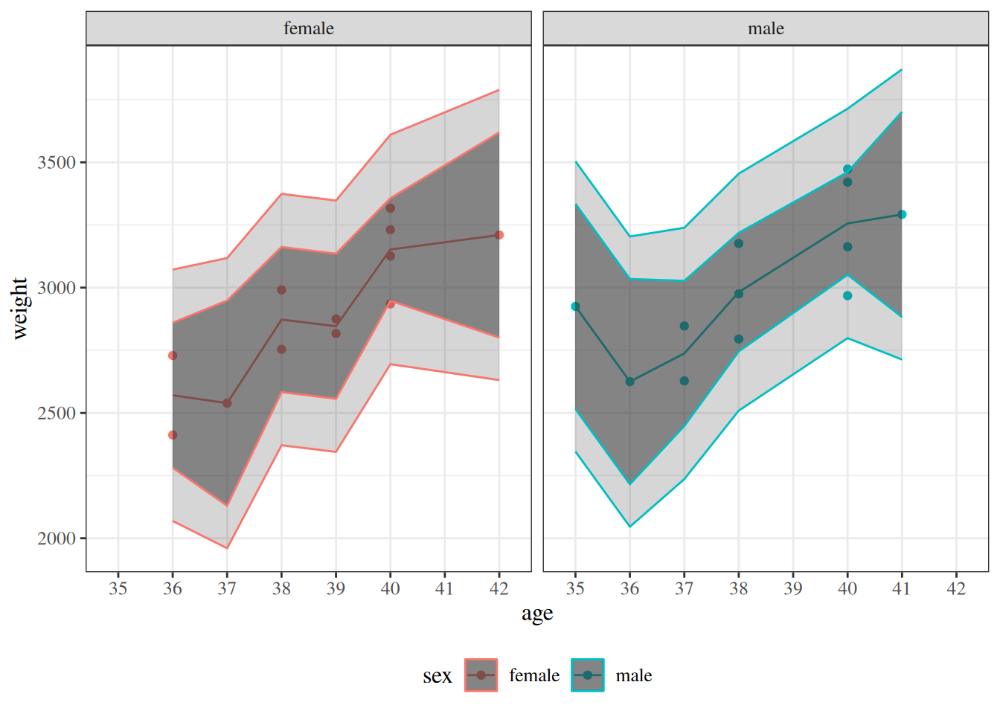](Linear-models-overview_files/figure-html/unnamed-chunk-42-1.png "Figure 9 (b): Saturated model")
>
> \(b\) Saturated model
>
> Figure 9: Model [2](#eq-BW-lm-interact) and saturated model for `birthweight` data, with confidence and [prediction intervals](https://morrison-lab.github.io/sds/intro-MLEs.html#def-prediction-interval)

------------------------------------------------------------------------

We can calculate the log-likelihood of this model as usual:

Show R code

``` downlit
logLik(lm_max)
#> 'log Lik.' -151.402 (df=13)
```

We can compare this model to our other models using chi-square tests, as usual:

Show R code

``` downlit
library(lmtest)
lrtest(lm_max, bw_lm2)
```

The [likelihood ratio statistic](https://morrison-lab.github.io/sds/intro-MLEs.html#def-lrt-stat) for this test is $$\lambda = 2 * (\ell_{\text{full}} - \ell) = 10.355374$$ where:

- $\ell_{\text{full}}$ is the log-likelihood of the full model: -151.401601
- $\ell$ is the log-likelihood of our comparison model (two slopes, two intercepts): -156.579288

This statistic is called the **deviance** or **residual deviance** for our two-slopes and two-intercepts model; it tells us how much the likelihood of that model deviates from the likelihood of the maximal model.

The corresponding p-value tells us whether there we have enough evidence to detect that our two-slopes, two-intercepts model is a worse fit for the data than the maximal model; in other words, it tells us if there’s evidence that we missed any important patterns. (Remember, a nonsignificant p-value could mean that we didn’t miss anything and a more complicated model is unnecessary, or it could mean we just don’t have enough data to tell the difference between these models.)

> **NOTE:**
>
> **Definition 9 (Deviance and residual deviance)** Let $\ell_{\text{sat}}$ be the maximized log-likelihood of the saturated model ([Definition 8](#def-saturated-model)), and let $\ell(\hat{\mathord{\smash[b]{\underset{\raise.3ex\hbox{$\scriptstyle\sim$}}{\beta}}\vphantom{\beta}}})$ be the maximized log-likelihood of a model $M$ with the same outcome distribution family. The **deviance** of model $M$, also called its **residual deviance**, is:
>
> $$D \stackrel{\text{def}}{=}2\mathopen{}\left(\ell_{\text{sat}} - \ell(\hat{\mathord{\smash[b]{\underset{\raise.3ex\hbox{$\scriptstyle\sim$}}{\beta}}\vphantom{\beta}}})\right)\mathclose{}$$
>
> When the family has a dispersion parameter (such as $\sigma^2$ in a Gaussian model), both log-likelihoods are evaluated at the same value of that dispersion parameter.

The likelihood ratio statistics computed with [`lrtest()`](https://rdrr.io/pkg/lmtest/man/lrtest.html) in this section estimate $\sigma^2$ separately in each model, so they are not exactly equal to the deviances in [Definition 9](#def-deviance), which hold $\sigma^2$ at one common value.

> **NOTE:**
>
> **Definition 10 (Null model)** The **null model** is the model with a single mean parameter shared by all observations (${\mathbb{E}\mathopen{}\left[Y \mid \mathord{\smash[b]{\underset{\raise.3ex\hbox{$\scriptstyle\sim$}}{X}}\vphantom{X}}= \mathord{\smash[b]{\underset{\raise.3ex\hbox{$\scriptstyle\sim$}}{x}}\vphantom{x}}\right]\mathclose{}} = \beta_0$, an intercept only).

> **NOTE:**
>
> **Definition 11 (Null deviance)** The **null deviance** $D_0$ is the deviance ([Definition 9](#def-deviance)) of the null model ([Definition 10](#def-null-model)):
>
> $$D_0 \stackrel{\text{def}}{=}2\mathopen{}\left(\ell_{\text{sat}} - \ell_0\right)\mathclose{}$$
>
> where $\ell_0$ is the maximized log-likelihood of the null model [\[1, Ch. 5\]](#ref-dobson4e).

> **NOTE:**
>
> **Example 7 (Residual and null deviance for a small dataset)** Use the data from [Example 5](#exm-saturated-model), and suppose that the variance $\sigma^2 = 1$ is known. With $\sigma^2$ fixed, a Gaussian log-likelihood depends on the data only through the residual sum of squares (RSS): $\ell= -\frac{n}{2}{\operatorname{log}\mathopen{}\left\{2\pi\sigma^2\right\}\mathclose{}} - \frac{\text{RSS}}{2\sigma^2}$. For a model $M$ with residual sum of squares $\text{RSS}_M$:
>
> $$\begin{aligned}
> D
> &= 2\mathopen{}\left(\ell_{\text{sat}} - \ell(\hat{\mathord{\smash[b]{\underset{\raise.3ex\hbox{$\scriptstyle\sim$}}{\beta}}\vphantom{\beta}}})\right)\mathclose{}
> && \text{(definition of deviance)}
> \\
> &= 2\mathopen{}\left(\mathopen{}\left[-\frac{n}{2}{\operatorname{log}\mathopen{}\left\{2\pi\sigma^2\right\}\mathclose{}} - \frac{\text{RSS}_{\text{sat}}}{2\sigma^2}\right]\mathclose{}
> - \mathopen{}\left[-\frac{n}{2}{\operatorname{log}\mathopen{}\left\{2\pi\sigma^2\right\}\mathclose{}} - \frac{\text{RSS}_M}{2\sigma^2}\right]\mathclose{}\right)\mathclose{}
> && \text{(substitute log-likelihoods)}
> \\
> &= 2\mathopen{}\left(\frac{\text{RSS}_M}{2\sigma^2} - \frac{\text{RSS}_{\text{sat}}}{2\sigma^2}\right)\mathclose{}
> && \text{(cancel log terms)}
> \\
> &= \frac{\text{RSS}_M - \text{RSS}_{\text{sat}}}{\sigma^2}
> && \text{(simplify)}
> \end{aligned}$$
>
> **Saturated model:** the fitted values are the pattern means $2$, $6$, and $7$, so $\text{RSS}_{\text{sat}} = (1-2)^2 + (3-2)^2 + (5-6)^2 + (7-6)^2 + (6-7)^2 + (8-7)^2 = 6$.
>
> **Simple linear regression model:** the least-squares estimates use ${\bar{x}}= 1$ and $\bar{y} = 30/6 = 5$:
>
> $$\begin{aligned}
> \hat{\beta}_1
> &= \frac{\sum_{i=1}^n(x_i - {\bar{x}})(y_i - \bar{y})}{\sum_{i=1}^n(x_i - {\bar{x}})^2}
> && \text{(least-squares slope)}
> \\
> &= \frac{(-1)(-4) + (-1)(-2) + 0 + 0 + (1)(1) + (1)(3)}{1 + 1 + 0 + 0 + 1 + 1}
> && \text{(substitute data)}
> \\
> &= \frac{10}{4} = 2.5
> && \text{(arithmetic)}
> \\
> \hat{\beta}_0
> &= \bar{y} - \hat{\beta}_1 {\bar{x}}= 5 - 2.5 \cdot 1 = 2.5
> && \text{(least-squares intercept)}
> \end{aligned}$$
>
> The fitted values are $2.5$, $5$, and $7.5$ at $x = 0, 1, 2$, so $\text{RSS}_M = (1-2.5)^2 + (3-2.5)^2 + (5-5)^2 + (7-5)^2 + (6-7.5)^2 + (8-7.5)^2 = 9$, and the residual deviance is $D = (9 - 6)/1 = 3$.
>
> **Null model:** the fitted value is $\bar{y} = 5$ for every observation, so $\text{RSS}_0 = (1-5)^2 + (3-5)^2 + (5-5)^2 + (7-5)^2 + (6-5)^2 + (8-5)^2 = 34$, and the null deviance is $D_0 = (34 - 6)/1 = 28$.
>
> The linear model’s residual deviance ($3$) is much smaller than the null deviance ($28$): the linear model captures most of the variation in pattern means that the null model misses.

### 4.1.7 Null Deviance

Similarly, the *least* complicated model we could fit would have only one mean parameter, an intercept:

$${\mathbb{E}\mathopen{}\left[Y|X=x\right]\mathclose{}} = \beta_0$$

We can fit this model in R like so:

Show R code

``` downlit
lm0 <- lm(weight ~ 1, data = bw)

lm0 |>
  parameters() |>
  print_md()
```

| Parameter   | Coefficient |  SE   |       95% CI       | t(23) |    p    |
|:------------|:-----------:|:-----:|:------------------:|:-----:|:-------:|
| (Intercept) |   2967.67   | 57.58 | (2848.56, 3086.77) | 51.54 | \< .001 |

------------------------------------------------------------------------

> **NOTE:**
>
> Show R code
>
> ``` downlit
> plot_PIs_and_CIs(bw, lm0)
> ```
>
> [](Linear-models-overview_files/figure-html/unnamed-chunk-46-1.png "Figure 10 (a): Null model")
>
> \(a\) Null model
>
> Show R code
>
> ``` downlit
> plot_PIs_and_CIs(bw, bw_lm2)
> ```
>
> [](Linear-models-overview_files/figure-html/unnamed-chunk-47-1.png "Figure 10 (b): Model 2 (linear with age:sex interaction)")
>
> \(b\) Model [2](#eq-BW-lm-interact) (linear with age:sex interaction)
>
> Figure 10: Null model and model [2](#eq-BW-lm-interact) for `birthweight` data, with 95% confidence and prediction intervals.

------------------------------------------------------------------------

This model also has a likelihood:

Show R code

``` downlit
logLik(lm0)
#> 'log Lik.' -168.955 (df=2)
```

And we can compare it to more complicated models using a likelihood ratio test:

Show R code

``` downlit
lrtest(bw_lm2, lm0)
```

The likelihood ratio statistic for the test comparing the null model to the maximal model is $$\lambda = 2 * (\ell_{\text{full}} - \ell_{0}) = 35.106732$$ where:

- $\ell_{\text{0}}$ is the log-likelihood of the null model: -168.954967
- $\ell_{\text{full}}$ is the log-likelihood of the maximal model: -151.401601

In R, this test is:

Show R code

``` downlit
lrtest(lm_max, lm0)
```

This log-likelihood ratio statistic is called the **null deviance** ([Definition 11](#def-null-deviance)). It tells us whether we have enough data to detect a difference between the null and full models.

------------------------------------------------------------------------

> **NOTE:**
>
> Show R code
>
> ``` downlit
> plot_PIs_and_CIs(bw, lm0)
> ```
>
> [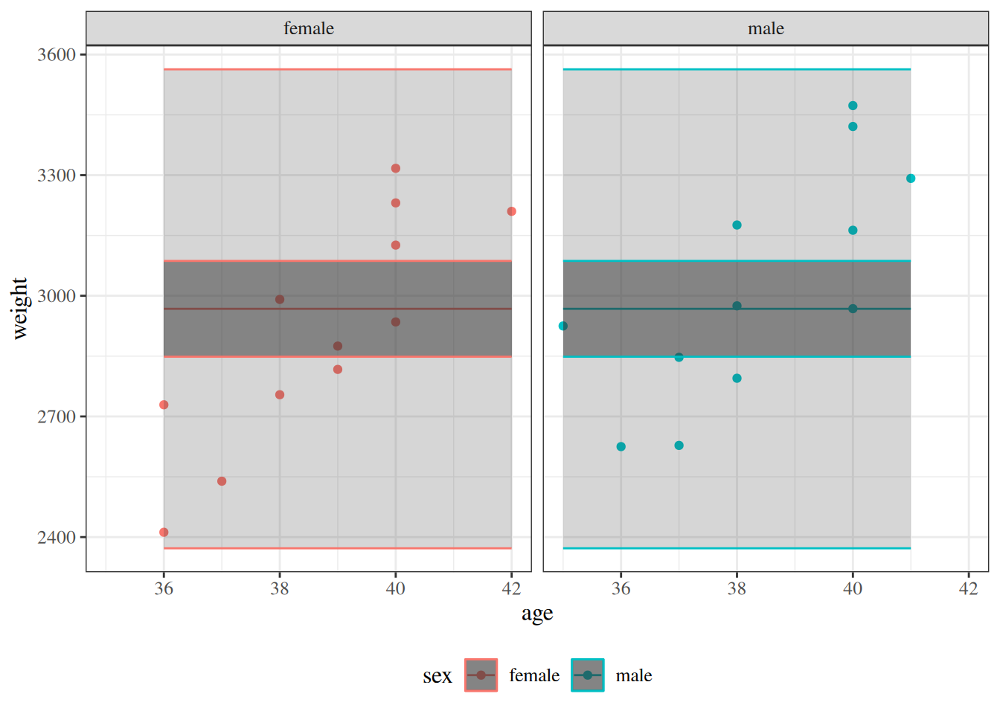](Linear-models-overview_files/figure-html/unnamed-chunk-51-1.png "Figure 11 (a): Null model")
>
> \(a\) Null model
>
> Show R code
>
> ``` downlit
> plot_PIs_and_CIs(bw, bw_lm1)
> ```
>
> [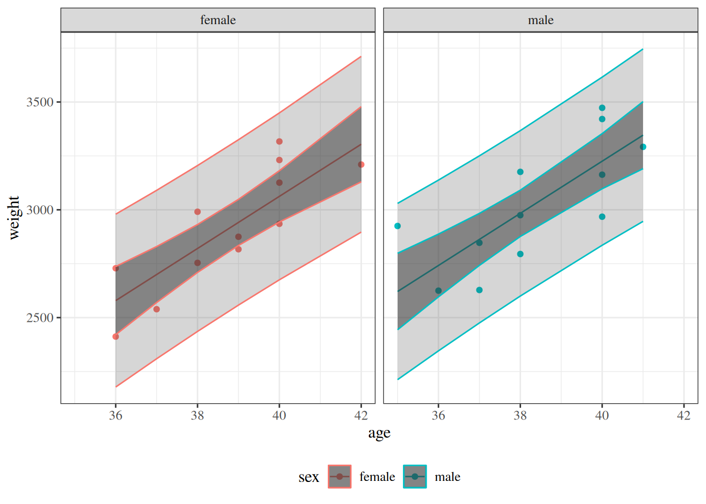](Linear-models-overview_files/figure-html/unnamed-chunk-52-1.png "Figure 11 (b): No-interactions model (parallel slopes)")
>
> \(b\) No-interactions model (parallel slopes)
>
> Show R code
>
> ``` downlit
> plot_PIs_and_CIs(bw, bw_lm2)
> ```
>
> [](Linear-models-overview_files/figure-html/unnamed-chunk-53-1.png "Figure 11 (c): Model 2 (linear with age:sex interaction)")
>
> \(c\) Model [2](#eq-BW-lm-interact) (linear with age:sex interaction)
>
> Show R code
>
> ``` downlit
> plot_PIs_and_CIs(bw |> mutate(age = factor(age)), lm_max)
> ```
>
> [](Linear-models-overview_files/figure-html/unnamed-chunk-54-1.png "Figure 11 (d): Saturated model")
>
> \(d\) Saturated model
>
> Figure 11: Four models for `birthweight` data, with 95% confidence and prediction intervals. The spectrum from null to saturated includes many other possible models, such as quadratic [polynomial](https://morrison-lab.github.io/mds/algebra-exponentials.html#def-polynomial) models (with or without interactions) and generalized additive models (GAMs).

### 4.1.8 Gaussian Deviance vs. GLM Deviance

The residual deviance is a general concept that applies to all [GLMs](../chapters/Intro-to-GLMs.llms.md#def-glm), including Gaussian linear regression. For any GLM, the residual deviance ([Definition 9](#def-deviance)) is:

$$D = 2(\ell_{\text{sat}} - \ell(\hat\beta)) \tag{10}$$

where $\ell_{\text{sat}}$ is the log-likelihood of the saturated model ([Definition 8](#def-saturated-model)) and $\ell(\hat\beta)$ is the log-likelihood of the fitted model. However, this formula simplifies differently depending on the distribution family, and the resulting test statistics have different null distributions.

#### Gaussian linear regression deviance

From [Equation 6](#eq-linreg-loglik), the Gaussian log-likelihood is:

$$\ell(\hat\beta, \hat\sigma^2)
= -\frac{n}{2}\log(2\pi\hat\sigma^2)
- \frac{1}{2\hat\sigma^2}
  \sum_{i=1}^n(y_i - \hat{y}_i)^2$$

The saturated model has one free mean parameter per distinct covariate pattern. When there are no replicates (each covariate pattern appears exactly once), it sets $\hat\mu_i = y_i$ for every observation, so its residual sum of squares is zero:

$$\ell_{\text{sat}}(\hat\sigma^2) = -\frac{n}{2}\log(2\pi\hat\sigma^2)$$

Substituting into [Equation 10](#eq-deviance-general), the Gaussian deviance simplifies to the **residual sum of squares** (RSS), scaled by $\hat\sigma^2$:

$$D
= 2(\ell_{\text{sat}} - \ell(\hat\beta))
= \frac{\sum_{i=1}^n(y_i - \hat{y}_i)^2}{\hat\sigma^2}
= \frac{\text{RSS}}{\hat\sigma^2}$$

Because $\sigma^2$ is unknown and must be estimated, comparing deviances between two nested Gaussian models uses an **F-test**, which is exact under Gaussian assumptions. Substituting $D = \text{RSS}/\hat\sigma^2$, the $\hat\sigma^2$ factors cancel:

$$F = \frac{(D_1 - D_2) / (p_2 - p_1)}{D_2 / (n - p_2)}
= \frac{(\text{RSS}_1 - \text{RSS}_2) / (p_2 - p_1)}{\text{RSS}_2 / (n - p_2)}
\ \sim \ F_{p_2 - p_1,\; n - p_2}$$

In R, [`deviance()`](https://rdrr.io/r/stats/deviance.html) applied to an `lm` object returns **RSS** (the unscaled deviance):

``` downlit
deviance(bw_lm2)
#> [1] 652425
sum(residuals(bw_lm2)^2)
#> [1] 652425
```

The two expressions return the same value.

The Gaussian linear regression model can equivalently be fit as a GLM with `family = gaussian`, which also returns RSS as the deviance:

``` downlit
bw_glm2 <- glm(
  weight ~ sex + age + sex:age,
  data = bw,
  family = gaussian
)

deviance(bw_lm2)
#> [1] 652425
deviance(bw_glm2)
#> [1] 652425
```

`deviance(bw_lm2)` and `deviance(bw_glm2)` return the same value, confirming that Gaussian linear regression is a special case of the GLM framework where the deviance equals RSS.

#### Non-Gaussian GLM deviance

For non-Gaussian GLMs, the deviance does **not** simplify to RSS. The formula depends on the distribution family:

**Poisson:**

$$D = 2\sum_{i=1}^n
\mathopen{}\left[y_i \log\!\mathopen{}\left(\frac{y_i}{\hat\mu_i}\right)\mathclose{} - (y_i - \hat\mu_i)\right]\mathclose{}$$

**Binomial:**

$$D = 2\sum_{i=1}^n
\mathopen{}\left[y_i \log\!\mathopen{}\left(\frac{y_i}{\hat\pi_i}\right)\mathclose{}
+ (n_i - y_i)\log\!\mathopen{}\left(\frac{n_i - y_i}{n_i - \hat\pi_i}\right)\mathclose{}\right]\mathclose{}$$

For Poisson and Binomial models, the dispersion parameter $\phi = 1$ is **fixed** rather than estimated. Consequently, the difference in deviances between two nested models follows an approximate $\chi^2$ distribution:

$$D_1 - D_2 \;\dot \sim\; \chi^2_{p_2 - p_1}$$

This asymptotic result replaces the exact F-test used for Gaussian models.

#### Saturated vs. fully parametrized models with replicates

When some covariate patterns appear more than once (i.e., when there are **replicates**), it is important to distinguish between two special models:

- The **saturated model** has one free mean parameter per **distinct covariate pattern** ($q$ parameters, where $q \leq n$ is the number of unique patterns).
- The **fully parametrized model** has one free mean parameter per **observation** ($n$ parameters).

When there are no replicates ($q = n$), these two coincide. When there are replicates ($q < n$), the saturated model constrains all observations sharing a covariate pattern to have the same mean, but places no constraint on means across different patterns. See Kleinbaum and Klein [\[8\]](#ref-kleinbaum2010logistic) for further discussion of this distinction.

Deviance is always measured relative to the **saturated model**, not the fully parametrized model.

##### Gaussian deviance with replicates

When covariate pattern $k$ has $n_k$ replicates with sample mean $\bar{y}_k$, the saturated model fits $\hat\mu_k = \bar{y}_k$ for each pattern $k$, so its residual sum of squares equals the **within-group (pure error) SS**:

$$\text{RSS}_{\text{sat}}
= \sum_{k=1}^q \sum_{i: \mathord{\smash[b]{\underset{\raise.3ex\hbox{$\scriptstyle\sim$}}{x}}\vphantom{x}}_i = \mathord{\smash[b]{\underset{\raise.3ex\hbox{$\scriptstyle\sim$}}{x}}\vphantom{x}}_k} (y_i - \bar{y}_k)^2$$

This within-group residual sum of squares is nonzero whenever any covariate pattern has replicates with different response values. The Gaussian deviance relative to the saturated model is therefore:

$$D
= 2(\ell_{\text{sat}} - \ell(\hat\beta))
= \frac{\text{RSS} - \text{RSS}_{\text{sat}}}{\hat\sigma^2}$$

> **NOTE:**
>
> R’s [`deviance()`](https://rdrr.io/r/stats/deviance.html) applied to an `lm` object returns the **total fitted-model RSS**, not the deviance relative to the saturated model. To compute the deviance relative to the saturated model, subtract the saturated model’s RSS: `deviance(lm_fit) - deviance(lm_saturated)`.

For the `birthweight` data, we can verify this directly using `bw_lm2` (the interaction model) and `lm_max` (the saturated model):

``` downlit
deviance(bw_lm2)                      # total RSS of fitted model
#> [1] 652425
deviance(lm_max)                      # within-group (pure error) SS
#> [1] 423783
deviance(bw_lm2) - deviance(lm_max)   # lack-of-fit SS (deviance vs. saturated)
#> [1] 228642
```

The lack-of-fit SS (`deviance(bw_lm2) - deviance(lm_max)`) measures how much additional unexplained variation remains after accounting for pure measurement error within covariate patterns.

##### GLM deviance with replicates

For a Binomial GLM fit to data **grouped by covariate pattern** (with $y_k$ events and $n_k$ observations for pattern $k$), the saturated model sets $\hat\pi_k^{\text{sat}} = y_k / n_k$ for each pattern $k$. R’s [`deviance()`](https://rdrr.io/r/stats/deviance.html) correctly computes $2(\ell_{\text{sat}} - \ell(\hat\beta))$ using this grouping:

$$D = 2\sum_{k=1}^q
\mathopen{}\left[
  y_k \log\!\mathopen{}\left(\frac{y_k / n_k}{\hat\pi_k}\right)\mathclose{}
  + (n_k - y_k)\log\!\mathopen{}\left(\frac{1 - y_k/n_k}{1 - \hat\pi_k}\right)\mathclose{}
\right]\mathclose{}$$

By convention, terms with $y_k = 0$ or $y_k = n_k$ contribute zero to the sum, since $0\log(0) = 0$ in the limit.

When binomial data is **ungrouped** (individual Bernoulli observations, $n_i = 1$), R uses the **fully parametrized** model as its reference — assigning $\hat\pi_i = y_i \in \{0, 1\}$ to each individual observation. Since each predicted probability is exactly 0 or 1, every Bernoulli likelihood contribution equals 1, and hence $\ell_{\text{fp}} = 0$. Thus R’s [`deviance()`](https://rdrr.io/r/stats/deviance.html) returns $-2\ell(\hat\beta)$.

We can verify this directly: observations are ungrouped Bernoulli with repeated covariate patterns ($x \in \{0, 1\}$ appears three times each).

``` downlit
set.seed(42)
x_ug <- rep(0:1, each = 3)
y_ug <- c(0L, 1L, 0L, 1L, 1L, 0L)
fit_ug <- glm(y_ug ~ x_ug, family = binomial)
deviance(fit_ug)                     # R's deviance
#> [1] 7.63817
-2 * as.numeric(logLik(fit_ug))      # -2 * log-likelihood (using ell_fp = 0)
#> [1] 7.63817
```

The two values are equal, confirming that R uses $\ell_{\text{fp}} = 0$ as its reference when data are ungrouped.

> **NOTE:**
>
> This reference model is the **fully parametrized** model (one parameter per observation), not the **saturated** model (one parameter per distinct covariate pattern). They coincide only when there are no repeated covariate patterns ($q = n$). When patterns do repeat ($q < n$), the saturated model sets $\hat\pi_k = y_k/n_k$ per pattern, giving $\ell_{\text{sat}} < 0$.
>
> [`deviance()`](https://rdrr.io/r/stats/deviance.html) for ungrouped data **cannot** be used as a goodness-of-fit test against the $\chi^2$ distribution when $q < n$. The correct GOF statistic is $2(\ell_{\text{sat}} - \ell(\hat\beta))$, but R’s [`deviance()`](https://rdrr.io/r/stats/deviance.html) for ungrouped data returns $-2\ell(\hat\beta)$ (using $\ell_{\text{fp}} = 0$). These two quantities differ by $-2\ell_{\text{sat}} > 0$ whenever $q < n$. Even if each covariate pattern has many replicates (large $n_k$), R’s ungrouped deviance is the wrong statistic to compare against $\chi^2(q - p)$. To obtain a valid GOF test when patterns repeat, fit the model using **grouped** data (one row per pattern with $y_k$ and $n_k$), so that R uses the saturated model as its reference.
>
> For further discussion, see Dunn and Smyth [\[2, Ch. 9\]](#ref-dunn2018generalized) and [this Stats Stack Exchange thread](https://stats.stackexchange.com/questions/626597/is-there-a-justification-for-the-bernoulli-deviance-in-the-r-stats-package).

#### Summary

| Feature | Gaussian linear regression | Non-Gaussian GLMs (e.g., Poisson, Binomial) |
|----|----|----|
| Deviance formula | $(\text{RSS} - \text{RSS}_{\text{sat}})/\hat\sigma^2$ | $2(\ell_{\text{sat}} - \ell(\hat\beta))$ |
| [`deviance()`](https://rdrr.io/r/stats/deviance.html) in R | Returns total RSS | Returns $2(\ell_{\text{sat}} - \ell(\hat\beta))$ |
| Saturated model reference | Per covariate pattern | Per covariate pattern (grouped) or per observation (ungrouped) |
| Dispersion $\phi$ | Unknown; estimated as $s^2 = \text{RSS}/(n-p)$ | Fixed ($\phi = 1$) |
| Test for nested models | F-test (exact) | $\chi^2$-test (asymptotic) |

## 4.2 Diagnostics

> **TIP:**
>
> This section is adapted from Dobson and Barnett [\[1, Secs. 6.2–6.3\]](#ref-dobson4e) and Dunn and Smyth [\[2\]](#ref-dunn2018generalized) [Chapter 3](https://link.springer.com/chapter/10.1007/978-1-4419-0118-7_3).

### 4.2.1 Assumptions in linear regression models

$$Y_i|\mathord{\smash[b]{\underset{\raise.3ex\hbox{$\scriptstyle\sim$}}{X}}\vphantom{X}}_i \sim_{{\color{red}{\perp\!\!\!\perp}}} {\color{blue}{\operatorname{N}}}({\color{orange}{\mu_i}}, {\color{green}{\sigma^2}})$$ $${\color{orange}{\mu_i = \mathord{\smash[b]{\underset{\raise.3ex\hbox{$\scriptstyle\sim$}}{x}}\vphantom{x}}\cdot \mathord{\smash[b]{\underset{\raise.3ex\hbox{$\scriptstyle\sim$}}{\beta}}\vphantom{\beta}}}}$$

1.  **Normality**

The model assumes that the distribution conditional on a given $X$ value is Gaussian.

2.  **Correct Functional Form** of Conditional Mean Structure (Linear Component)

The model assumes that the [conditional means](https://morrison-lab.github.io/pds/expectation.html#def-cond-expectation) have the structure: $${\mathbb{E}\mathopen{}\left[Y|\mathord{\smash[b]{\underset{\raise.3ex\hbox{$\scriptstyle\sim$}}{X}}\vphantom{X}}= \mathord{\smash[b]{\underset{\raise.3ex\hbox{$\scriptstyle\sim$}}{x}}\vphantom{x}}\right]\mathclose{}} = {\mathord{\smash[b]{\underset{\raise.3ex\hbox{$\scriptstyle\sim$}}{x}}\vphantom{x}}}^{\top}\mathord{\smash[b]{\underset{\raise.3ex\hbox{$\scriptstyle\sim$}}{\beta}}\vphantom{\beta}}$$

3.  **Homoskedasticity**

The model assumes that [variance](https://morrison-lab.github.io/pds/variance-covariance.html#def-variance) $\sigma^2$ is constant (with respect to $\mathord{\smash[b]{\underset{\raise.3ex\hbox{$\scriptstyle\sim$}}{x}}\vphantom{x}}$).

4.  **Independence**

The model assumes that the observations are statistically [independent](https://morrison-lab.github.io/pds/independence.html#def-indpt).

### 4.2.2 Direct visualization

The most direct way to examine the fit of a model is to compare it to the raw observed data.

Show R code

``` downlit
bw <-
  bw |>
  mutate(
    predlm2 = predict(bw_lm2)
  ) |>
  arrange(sex, age)

plot1_interact <-
  plot1 %+% bw +
  geom_line(aes(y = predlm2))

print(plot1_interact)
```

> **NOTE:**
>
> [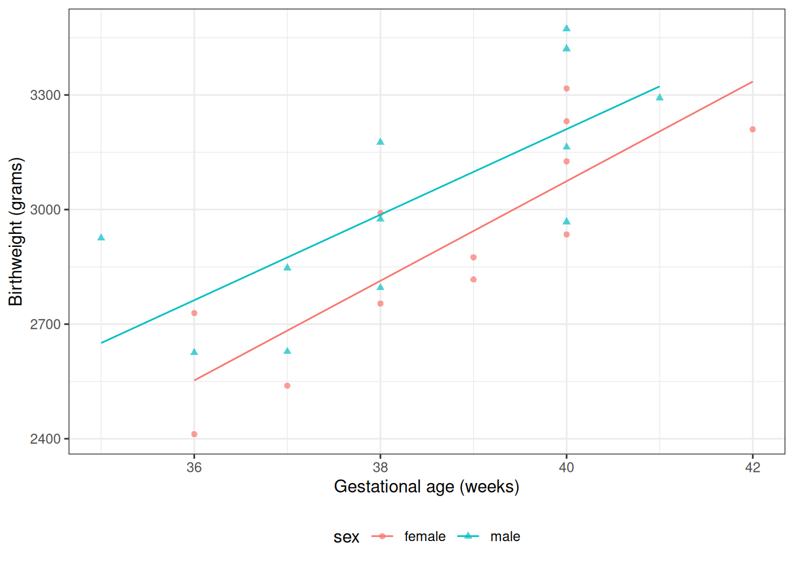](Linear-models-overview_files/figure-html/fig-bw-interaction2-1.png "Figure 12: Birthweight model with interaction term")
>
> Figure 12: Birthweight model with interaction term

It’s not easy to assess these assumptions from this model. If there are multiple [continuous covariates](https://morrison-lab.github.io/sds/data.html#def-continuous-var), it becomes even harder to visualize the raw data.

------------------------------------------------------------------------

#### Fitted model for `hers` data

Consider the `hers` data from Vittinghoff et al. [\[3\]](#ref-vittinghoff2e).

The “heart and estrogen/progestin study” (HERS) was a clinical trial of hormone therapy for prevention of recurrent heart attacks and death among 2,763 post-menopausal women with existing coronary heart disease (CHD) [\[20\]](#ref-HulleyStephen1998RToE).

The trial was conducted at 20 US clinical centers. Participants were randomized to receive either conjugated equine estrogens (0.625 mg/day) plus medroxyprogesterone acetate (2.5 mg/day) or a matching placebo [\[20\]](#ref-HulleyStephen1998RToE). Women were followed for a sample mean of 4.1 years [\[20\]](#ref-HulleyStephen1998RToE).

The primary outcome was nonfatal myocardial infarction or CHD death [\[20\]](#ref-HulleyStephen1998RToE).

> **NOTE:**
>
> Show R code
>
> ``` downlit
> hers <- rmb::hers |> haven::zap_labels()
> hers
> ```
>
> Table 20: `hers` data

------------------------------------------------------------------------

Suppose we consider models with and without intercept terms (i.e., possibly forcing the intercept to go through 0):

Show R code

``` downlit
hers_lm_with_int <- lm(
  na.action = na.exclude,
  LDL ~ smoking * age, data = hers
)


library(equatiomatic)
equatiomatic::extract_eq(hers_lm_with_int)
```

$$\operatorname{LDL} = \alpha + \beta_{1}(\operatorname{smoking}) + \beta_{2}(\operatorname{age}) + \beta_{3}(\operatorname{smoking} \times \operatorname{age}) + \epsilon$$

Show R code

``` downlit
hers_lm_no_int <- lm(
  na.action = na.exclude,
  LDL ~ age + smoking:age - 1, data = hers
)

library(equatiomatic)
equatiomatic::extract_eq(hers_lm_no_int)
```

$$\operatorname{LDL} = \beta_{1}(\operatorname{age}) + \beta_{2}(\operatorname{age} \times \operatorname{age}_{\operatorname{smoking}}) + \epsilon$$

> **NOTE:**
>
> Show R code
>
> ``` downlit
> library(gtsummary)
> hers_lm_with_int |> 
>   tbl_regression(intercept = TRUE)
> ```
>
> | **Characteristic**                     | **Beta** | **95% CI**  | **p-value** |
> |:---------------------------------------|:---------|:------------|:------------|
> | (Intercept)                            | 154      | 138, 170    | \<0.001     |
> | current smoker                         | 54       | 15, 94      | 0.007       |
> | age in years                           | -0.14    | -0.38, 0.09 | 0.2         |
> | current smoker \* age in years         | -0.79    | -1.4, -0.17 | 0.012       |
> | Abbreviation: CI = Confidence Interval |          |             |             |
>
> \(a\) With intercept
>
> Show R code
>
> ``` downlit
> hers_lm_no_int |> 
>   tbl_regression(intercept = TRUE)
> ```
>
> | **Characteristic**                     | **Beta** | **95% CI** | **p-value** |
> |:---------------------------------------|:---------|:-----------|:------------|
> | age in years                           | 2.1      | 2.1, 2.2   | \<0.001     |
> | age in years \* current smoker         | 0.19     | 0.12, 0.26 | \<0.001     |
> | Abbreviation: CI = Confidence Interval |          |            |             |
>
> \(b\) No intercept
>
> Table 21: `hers` data models with and without intercepts

------------------------------------------------------------------------

> **NOTE:**
>
> Show R code
>
> ``` downlit
> library(sjPlot)
>
> hers_plot1 <- hers_lm_no_int |>
>   sjPlot::plot_model(
>     type = "pred",
>     terms = c("age", "smoking"),
>     show.data = TRUE
>   ) +
>   facet_wrap(~group_col, ncol = 1) +
>   expand_limits(y = 0) +
>   theme(legend.position = "bottom")
>
> hers_plot1
> ```
>
> [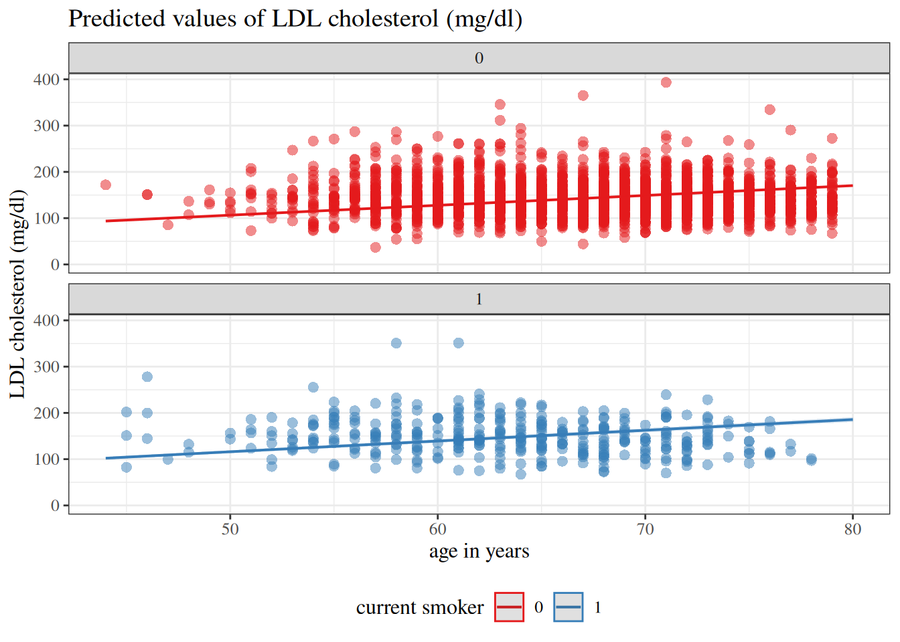](Linear-models-overview_files/figure-html/unnamed-chunk-64-1.png "Figure 13 (a): No intercept")
>
> \(a\) No intercept
>
> Show R code
>
> ``` downlit
> library(sjPlot)
>
> hers_plot2 <- hers_lm_with_int |>
>   sjPlot::plot_model(
>     type = "pred",
>     terms = c("age", "smoking"),
>     show.data = TRUE
>   ) +
>   facet_wrap(~group_col, ncol = 1) +
>   expand_limits(y = 0) +
>   theme(legend.position = "bottom")
>
> hers_plot2
> ```
>
> [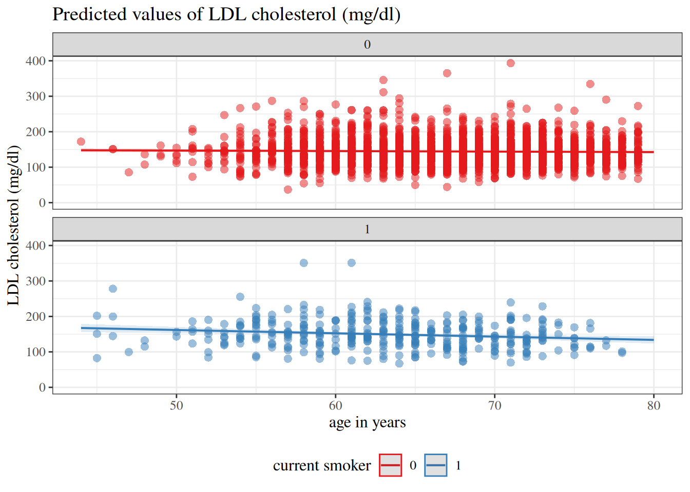](Linear-models-overview_files/figure-html/unnamed-chunk-65-1.png "Figure 13 (b): With intercept")
>
> \(b\) With intercept
>
> Figure 13: `hers` data models with and without intercepts

### 4.2.3 Residuals

Maybe we can transform the data and model in some way to make it easier to inspect.

> **NOTE:**
>
> **Definition 12 (Deviation of an observation from its subpopulation mean)** The **deviation of an observation from its subpopulation mean** in a probabilistic model $p(Y \mid X)$, is the difference between an observed value and its model-implied mean given [covariates](../chapters/Intro-to-GLMs.llms.md#def-predictors):
>
> $$\mathbb{d}(y_i) \stackrel{\text{def}}{=}y_i - {\mathbb{E}\mathopen{}\left[Y_i \mid X_i\right]\mathclose{}} \tag{11}$$

Many sources call deviations “error” or “noise.” The model-implied mean can be viewed as an estimate of $Y_i$, before $y_i$ is observed. However, an estimation error is defined as an estimate minus its estimand (see [estimation error](https://morrison-lab.github.io/sds/estimation.html#def-estimation-error)), and deviation is the observed value minus its estimand, so the deviation is actually the *negative* of the estimation error of the mean ${\mathbb{E}\mathopen{}\left[Y_i \mid X_i\right]\mathclose{}}$ with respect to its estimand $Y_i$:

$$\mathbb{d}(y_i) = -\mathopen{}\left({\mathbb{E}\mathopen{}\left[Y_i \mid X_i\right]\mathclose{}} - y_i\right)\mathclose{}$$

On the other hand, each observation $y_i$ can be viewed as a nonparametric estimate of $\mu_i = {\mathbb{E}\mathopen{}\left[Y_i \mid X_i\right]\mathclose{}}$ (albeit an imprecise one, individually, since $n=1$):

$$y_i = \hat{\mu}_i^{(NP)}$$

where $\hat{\mu}_i^{(NP)}$ denotes the nonparametric estimate from a single observed value $y_i$.

Thus, the deviation can be interpreted as the estimation error of $y_i$ with respect to ${\mathbb{E}\mathopen{}\left[Y_i \mid X_i\right]\mathclose{}}$:

$$\begin{aligned}
\mathbb{d}(y_i)
&= y_i - \mu_i
\\
&= \hat{\mu}_i^{(NP)} - \mu_i
\\
&= {\varepsilon\mathopen{}\left(\hat{\mu}_i^{(NP)}\right)\mathclose{}}
\end{aligned}$$

------------------------------------------------------------------------

We can rearrange [Equation 11](#eq-def-deviation-subpop-mean) to view $y_i$ as the sum of its mean plus the deviation (often called error/noise):

$$y_i = {\mathbb{E}\mathopen{}\left[Y_i \mid X_i\right]\mathclose{}} + \mathbb{d}(y_i)$$

> **NOTE:**
>
> **Definition 13 (Signal (statistical sense))** In statistical modeling, the **signal** is the deterministic part of the model. For mean-based models, the signal is the model-implied [mean function](https://morrison-lab.github.io/sds/model-validation.html#def-mean-function), for example ${\mathbb{E}\mathopen{}\left[Y \mid X\right]\mathclose{}}$ (or ${\mathbb{E}\mathopen{}\left[Y\right]\mathclose{}}$ when there are no [covariates](../chapters/Intro-to-GLMs.llms.md#def-predictors)).

> **NOTE:**
>
> **Theorem 1 (Deviations in Gaussian models)** If $Y$ has a [Gaussian distribution](https://morrison-lab.github.io/pds/random-variables.html#def-normal), then $\mathbb{d}(Y)$ also has a Gaussian distribution, and vice versa.

> **NOTE:**
>
> *Proof*. By [Definition 12](#def-deviation-subpop-mean), $\mathbb{d}(Y \mid X = x) = Y - {\mathbb{E}\mathopen{}\left[Y \mid X = x\right]\mathclose{}}$. Let $\mu(x) = {\mathbb{E}\mathopen{}\left[Y \mid X = x\right]\mathclose{}}$. Since $\mathbb{d}(Y \mid X = x) = Y - \mu(x)$ is an affine function of $Y$, and Gaussian distributions are closed under affine transformations, if $Y \mid X = x \sim \operatorname{N}(\mu(x), \sigma^2)$, then:
>
> $$\mathbb{d}(Y \mid X = x) = Y - \mu(x) \sim \operatorname{N}(\mu(x) - \mu(x), \sigma^2) = \operatorname{N}(0, \sigma^2)$$
>
> Conversely, since $Y = {\mathbb{E}\mathopen{}\left[Y \mid X = x\right]\mathclose{}} + \mathbb{d}(Y \mid X = x) = \mu(x) + \mathbb{d}(Y \mid X = x)$, if $\mathbb{d}(Y \mid X = x) \sim \operatorname{N}(0, \sigma^2)$, then $Y \mid X = x = \mu(x) + \mathbb{d}(Y \mid X = x) \sim \operatorname{N}(\mu(x), \sigma^2)$.

> **NOTE:**
>
> **Definition 14 (Residuals)** A **residual** is the difference between an observed value and its corresponding [fitted value](#def-fitted-value), $\hat y$: $$\begin{aligned}
> \hat{\varepsilon}&\stackrel{\text{def}}{=}y - \hat y
> \end{aligned}$$
>
> For indexed observations, the residual is defined as: $$\hat{\varepsilon}_i \stackrel{\text{def}}{=}y_i - \hat y_i$$
>
> For a particular fitted model, each residual $\hat{\varepsilon}_i$ is tied to its corresponding fitted value $\hat y_i$. The fitted value $\hat y_i$ is often a [sample mean](https://morrison-lab.github.io/sds/exploratory-descriptive.html#def-sample-mean) or fitted [conditional mean](https://morrison-lab.github.io/pds/expectation.html#def-cond-expectation), but not always.

> **NOTE:**
>
> **Example 8 (Residuals in `birthweight` data)**  
>
> > **NOTE:**
> >
> > Show R code
> >
> > ``` downlit
> > plot1_interact +
> >   facet_wrap(~sex) +
> >   geom_segment(
> >     aes(
> >       x = age,
> >       y = predlm2,
> >       xend = age,
> >       yend = weight,
> >       col = sex,
> >       group = id
> >     ),
> >     linetype = "dotted"
> >   )
> > ```
> >
> > [](Linear-models-overview_files/figure-html/unnamed-chunk-66-1.png "Figure 14: Fitted values and residuals for interaction model for birthweight data")
> >
> > Figure 14: [Fitted values](#def-fitted-value) and [residuals](#def-resid-fitted) for [interaction](../chapters/Intro-to-GLMs.llms.md#def-interaction) model for `birthweight` data

> **NOTE:**
>
> **Theorem 2 (Residuals are orthogonal to the covariates)** Fit a linear regression model by maximum likelihood, with design matrix $\mathbf{X}$ of full column rank, coefficient estimate $\hat{\mathord{\smash[b]{\underset{\raise.3ex\hbox{$\scriptstyle\sim$}}{\beta}}\vphantom{\beta}}}$, fitted values $\hat{\mathord{\smash[b]{\underset{\raise.3ex\hbox{$\scriptstyle\sim$}}{y}}\vphantom{y}}} \stackrel{\text{def}}{=}\mathbf{X}\hat{\mathord{\smash[b]{\underset{\raise.3ex\hbox{$\scriptstyle\sim$}}{\beta}}\vphantom{\beta}}}$, and residual vector $\mathord{\smash[b]{\underset{\raise.3ex\hbox{$\scriptstyle\sim$}}{\hat{\varepsilon}}}\vphantom{\hat{\varepsilon}}}\stackrel{\text{def}}{=}\mathord{\smash[b]{\underset{\raise.3ex\hbox{$\scriptstyle\sim$}}{y}}\vphantom{y}}- \hat{\mathord{\smash[b]{\underset{\raise.3ex\hbox{$\scriptstyle\sim$}}{y}}\vphantom{y}}}$. Then:
>
> $$\underbrace{{\mathbf{X}}^{\top}}_{(p+1) \times n} \underbrace{\mathord{\smash[b]{\underset{\raise.3ex\hbox{$\scriptstyle\sim$}}{\hat{\varepsilon}}}\vphantom{\hat{\varepsilon}}}}_{n \times 1} = \underbrace{\mathord{\smash[b]{\underset{\raise.3ex\hbox{$\scriptstyle\sim$}}{0}}\vphantom{0}}}_{(p+1) \times 1}
> \tag{12}$$
>
> In particular, if the model has an intercept, the residuals add up to zero, $\sum_{i=1}^n\hat{\varepsilon}_i = 0$, and the residuals are orthogonal to the fitted values, $\sum_{i=1}^n\hat y_i \hat{\varepsilon}_i = 0$.

> **NOTE:**
>
> *Proof*. In [Section 3](#sec-est-LMs), setting the score equal to zero showed that $\hat{\mathord{\smash[b]{\underset{\raise.3ex\hbox{$\scriptstyle\sim$}}{\beta}}\vphantom{\beta}}}$ solves ${\mathbf{X}}^{\top}\mathbf{X}\hat{\mathord{\smash[b]{\underset{\raise.3ex\hbox{$\scriptstyle\sim$}}{\beta}}\vphantom{\beta}}}= {\mathbf{X}}^{\top}\mathord{\smash[b]{\underset{\raise.3ex\hbox{$\scriptstyle\sim$}}{y}}\vphantom{y}}$. Then:
>
> $$\begin{aligned}
> {\mathbf{X}}^{\top}\mathord{\smash[b]{\underset{\raise.3ex\hbox{$\scriptstyle\sim$}}{\hat{\varepsilon}}}\vphantom{\hat{\varepsilon}}}
> &= {\mathbf{X}}^{\top}\mathopen{}\left(\mathord{\smash[b]{\underset{\raise.3ex\hbox{$\scriptstyle\sim$}}{y}}\vphantom{y}}- \mathbf{X}\hat{\mathord{\smash[b]{\underset{\raise.3ex\hbox{$\scriptstyle\sim$}}{\beta}}\vphantom{\beta}}}\right)\mathclose{}
> && \text{(definition of } \mathord{\smash[b]{\underset{\raise.3ex\hbox{$\scriptstyle\sim$}}{\hat{\varepsilon}}}\vphantom{\hat{\varepsilon}}}\text{ and } \hat{\mathord{\smash[b]{\underset{\raise.3ex\hbox{$\scriptstyle\sim$}}{y}}\vphantom{y}}} \text{)}
> \\
> &= {\mathbf{X}}^{\top}\mathord{\smash[b]{\underset{\raise.3ex\hbox{$\scriptstyle\sim$}}{y}}\vphantom{y}}- {\mathbf{X}}^{\top}\mathbf{X}\hat{\mathord{\smash[b]{\underset{\raise.3ex\hbox{$\scriptstyle\sim$}}{\beta}}\vphantom{\beta}}}
> && \text{(distribute } {\mathbf{X}}^{\top} \text{)}
> \\
> &= {\mathbf{X}}^{\top}\mathord{\smash[b]{\underset{\raise.3ex\hbox{$\scriptstyle\sim$}}{y}}\vphantom{y}}- {\mathbf{X}}^{\top}\mathord{\smash[b]{\underset{\raise.3ex\hbox{$\scriptstyle\sim$}}{y}}\vphantom{y}}
> && \text{(} \hat{\mathord{\smash[b]{\underset{\raise.3ex\hbox{$\scriptstyle\sim$}}{\beta}}\vphantom{\beta}}}\text{ solves the score equation)}
> \\
> &= \mathord{\smash[b]{\underset{\raise.3ex\hbox{$\scriptstyle\sim$}}{0}}\vphantom{0}}_{(p+1) \times 1}
> && \text{(subtract)}
> \end{aligned}$$
>
> If the model has an intercept, the first column of $\mathbf{X}$ is all ones, so the first entry of [Equation 12](#eq-ols-resid-orthogonal) is $\sum_{i=1}^n1 \cdot \hat{\varepsilon}_i = 0$. For the fitted values:
>
> $$\begin{aligned}
> \sum_{i=1}^n\hat y_i \hat{\varepsilon}_i
> &= {\hat{\mathord{\smash[b]{\underset{\raise.3ex\hbox{$\scriptstyle\sim$}}{y}}\vphantom{y}}}}^{\top} \mathord{\smash[b]{\underset{\raise.3ex\hbox{$\scriptstyle\sim$}}{\hat{\varepsilon}}}\vphantom{\hat{\varepsilon}}}
> && \text{(sum of products as an inner product)}
> \\
> &= {\mathopen{}\left(\mathbf{X}\hat{\mathord{\smash[b]{\underset{\raise.3ex\hbox{$\scriptstyle\sim$}}{\beta}}\vphantom{\beta}}}\right)\mathclose{}}^{\top} \mathord{\smash[b]{\underset{\raise.3ex\hbox{$\scriptstyle\sim$}}{\hat{\varepsilon}}}\vphantom{\hat{\varepsilon}}}
> && \text{(definition of } \hat{\mathord{\smash[b]{\underset{\raise.3ex\hbox{$\scriptstyle\sim$}}{y}}\vphantom{y}}} \text{)}
> \\
> &= {\hat{\mathord{\smash[b]{\underset{\raise.3ex\hbox{$\scriptstyle\sim$}}{\beta}}\vphantom{\beta}}}}^{\top} {\mathbf{X}}^{\top} \mathord{\smash[b]{\underset{\raise.3ex\hbox{$\scriptstyle\sim$}}{\hat{\varepsilon}}}\vphantom{\hat{\varepsilon}}}
> && \text{(transpose of a product)}
> \\
> &= {\hat{\mathord{\smash[b]{\underset{\raise.3ex\hbox{$\scriptstyle\sim$}}{\beta}}\vphantom{\beta}}}}^{\top} \mathord{\smash[b]{\underset{\raise.3ex\hbox{$\scriptstyle\sim$}}{0}}\vphantom{0}}_{(p+1) \times 1}
> && \text{(the orthogonality just shown)}
> \\
> &= 0
> && \text{(multiply)}
> \end{aligned}$$

> **NOTE:**
>
> **Example 9 (Residual sums in the `birthweight` model)** For the `birthweight` model with an interaction term (`bw_lm2`), we can compute ${\mathbf{X}}^{\top}\mathord{\smash[b]{\underset{\raise.3ex\hbox{$\scriptstyle\sim$}}{\hat{\varepsilon}}}\vphantom{\hat{\varepsilon}}}$, $\sum_{i=1}^n\hat{\varepsilon}_i$, and $\sum_{i=1}^n\hat y_i \hat{\varepsilon}_i$ directly:
>
> Show R code
>
> ``` downlit
> bw_resid <- resid(bw_lm2)
> crossprod(model.matrix(bw_lm2), bw_resid)
> #>                     [,1]
> #> (Intercept)  2.84217e-13
> #> sexmale     -1.13687e-13
> #> age          1.09139e-11
> #> sexmale:age -9.09495e-13
> sum(bw_resid)
> #> [1] 1.82965e-13
> sum(fitted(bw_lm2) * bw_resid)
> #> [1] -2.98314e-10
> ```
>
> All three are zero up to floating-point rounding error, as [Theorem 2](#thm-ols-resid-orthogonal) guarantees. Because the model includes an indicator for male babies, the entry of ${\mathbf{X}}^{\top}\mathord{\smash[b]{\underset{\raise.3ex\hbox{$\scriptstyle\sim$}}{\hat{\varepsilon}}}\vphantom{\hat{\varepsilon}}}$ for that indicator is zero too: the residuals for the male babies add up to zero, and so, subtracting from the overall sum, do the residuals for the female babies.

> **NOTE:**
>
> **Example 10 (Without an intercept, the residuals need not add up to zero)** If we drop the intercept and regress birthweight on gestational age alone, $\mathbf{X}$ has a single column, the ages, so [Theorem 2](#thm-ols-resid-orthogonal) only guarantees $\sum_{i=1}^n\text{age}_i \hat{\varepsilon}_i = 0$:
>
> Show R code
>
> ``` downlit
> bw_lm0 <- lm(weight ~ 0 + age, data = bw)
> sum(resid(bw_lm0))
> #> [1] -75.7726
> sum(bw$age * resid(bw_lm0))
> #> [1] -1.00044e-11
> ```
>
> The age-weighted sum of the residuals is zero up to rounding error, but the residuals themselves do not add up to zero.

------------------------------------------------------------------------

## 4.3 Residuals of fitted values vs subpopulation-mean deviations

The residual is a plug-in estimate of the deviation of an observation from its subpopulation mean:

$$\begin{aligned}
\mathbb{d}(y_i) &= y_i - {\mathbb{E}\mathopen{}\left[Y_i \mid X_i\right]\mathclose{}}
\\
\hat{\mathbb{d}}(y_i) &= y_i - \hat y_i
\\
&= \hat{\varepsilon}_i
\end{aligned}$$

Different sources are not fully consistent about these terms. For terminology in this course, we use:

- **deviation** for deviation of an observation from its population mean (typically conditional on [covariates](../chapters/Intro-to-GLMs.llms.md#def-predictors)). This quantity is often called **error** in other sources, even though it doesn’t directly involve an estimate; cf., <https://en.wikipedia.org/wiki/Errors_and_residuals>;
- **[estimation error](https://morrison-lab.github.io/sds/estimation.html#def-estimation-error)** for deviation of an estimate from its [estimand](https://morrison-lab.github.io/sds/estimation.html#def-estimand);
- **residual** for deviation of an observed value from a [fitted value](#def-fitted-value).

------------------------------------------------------------------------

## 4.4 General characteristics of residuals

> **NOTE:**
>
> **Definition 15 (Hat matrix)** For an [ordinary least squares](https://morrison-lab.github.io/sds/correlation-regression.html#def-ols) linear model with [design matrix](https://morrison-lab.github.io/mds/linear-algebra-projections.html#def-design-matrix) $\mathbf{X}$, the **hat matrix** is
>
> $$H= \mathbf{X}({\mathbf{X}}^{\top}\mathbf{X})^{-1}{\mathbf{X}}^{\top}$$
>
> so the [fitted values](#def-fitted-value) satisfy
>
> $$\hat{\mathord{\smash[b]{\underset{\raise.3ex\hbox{$\scriptstyle\sim$}}{Y}}\vphantom{Y}}} = H\mathord{\smash[b]{\underset{\raise.3ex\hbox{$\scriptstyle\sim$}}{Y}}\vphantom{Y}}$$

> **NOTE:**
>
> **Theorem 3 (Mean and variance of residuals)** For an ordinary least squares linear model with fitted values $\hat y_i = \mathord{\smash[b]{\underset{\raise.3ex\hbox{$\scriptstyle\sim$}}{x}}\vphantom{x}}_i \cdot \mathord{\smash[b]{\underset{\raise.3ex\hbox{$\scriptstyle\sim$}}{\beta}}\vphantom{\beta}}$ (and fitted-value vector $\hat{\mathord{\smash[b]{\underset{\raise.3ex\hbox{$\scriptstyle\sim$}}{Y}}\vphantom{Y}}}$), if the [conditional mean](https://morrison-lab.github.io/pds/expectation.html#def-cond-expectation) is correctly specified so that:
>
> $${\mathbb{E}\mathopen{}\left[\mathord{\smash[b]{\underset{\raise.3ex\hbox{$\scriptstyle\sim$}}{Y}}\vphantom{Y}}\mid \mathbf{X}\right]\mathclose{}} = \mathbf{X}\beta$$
>
> equivalently:
>
> $${\mathbb{E}\mathopen{}\left[\hat{\mathord{\smash[b]{\underset{\raise.3ex\hbox{$\scriptstyle\sim$}}{Y}}\vphantom{Y}}} \mid \mathbf{X}\right]\mathclose{}} = {\mathbb{E}\mathopen{}\left[\mathord{\smash[b]{\underset{\raise.3ex\hbox{$\scriptstyle\sim$}}{Y}}\vphantom{Y}}\mid \mathbf{X}\right]\mathclose{}}$$
>
> and if the errors are [homoskedastic](https://morrison-lab.github.io/pds/variance-covariance.html#def-homosked) so that ${\operatorname{Var}\mathopen{}\left(\mathord{\smash[b]{\underset{\raise.3ex\hbox{$\scriptstyle\sim$}}{Y}}\vphantom{Y}}\mid \mathbf{X}\right)\mathclose{}} = \sigma^2\mathbb{I}_n$ where $\mathbb{I}_n$ is the $n \times n$ [identity matrix](https://morrison-lab.github.io/mds/linear-algebra-matrices.html#def-identity-matrix), then, treating $\mathbf{X}$ as fixed in this derivation, the residual moments are:
>
> $${\mathbb{E}\mathopen{}\left[\mathord{\smash[b]{\underset{\raise.3ex\hbox{$\scriptstyle\sim$}}{\hat{\varepsilon}}}\vphantom{\hat{\varepsilon}}} \mid \mathbf{X}\right]\mathclose{}} = 0 \tag{13}$$ $${\operatorname{Var}\mathopen{}\left(\hat{\varepsilon}_i \mid \mathbf{X}\right)\mathclose{}} = \sigma^2(1-h_{ii}) \tag{14}$$
>
> The conditional mean result ([Equation 13](#eq-mean-resid-unbiased)) uses unbiasedness of fitted values. The [conditional variance](https://morrison-lab.github.io/pds/variance-covariance.html#def-cond-variance) result ([Equation 14](#eq-var-resid-leverage)) uses the homoskedasticity condition with the OLS hat-matrix representation.
>
> When [leverage](https://morrison-lab.github.io/sds/model-validation.html#def-leverage) is roughly uniform, $h_{ii} \approx k/n$, where $k = \mathrm{rank}(\mathbf{X})$ (so $k = p + 1$ for a full-rank model with an intercept and $p$ [predictors](../chapters/Intro-to-GLMs.llms.md#def-predictors)), so ${\operatorname{Var}\mathopen{}\left(\hat{\varepsilon}_i\right)\mathclose{}} \approx \sigma^2$ as $n$ grows.

------------------------------------------------------------------------

> **NOTE:**
>
> *Proof*. [Equation 13](#eq-mean-resid-unbiased):
>
> $$\begin{aligned}
> {\mathbb{E}\mathopen{}\left[{\mathord{\smash[b]{\underset{\raise.3ex\hbox{$\scriptstyle\sim$}}{\hat{\varepsilon}}}\vphantom{\hat{\varepsilon}}}} \mid \mathbf{X}\right]\mathclose{}} &= {\mathbb{E}\mathopen{}\left[\mathord{\smash[b]{\underset{\raise.3ex\hbox{$\scriptstyle\sim$}}{Y}}\vphantom{Y}}- \hat{\mathord{\smash[b]{\underset{\raise.3ex\hbox{$\scriptstyle\sim$}}{Y}}\vphantom{Y}}} \mid \mathbf{X}\right]\mathclose{}}
> \\ &= {\mathbb{E}\mathopen{}\left[\mathord{\smash[b]{\underset{\raise.3ex\hbox{$\scriptstyle\sim$}}{Y}}\vphantom{Y}}\mid \mathbf{X}\right]\mathclose{}} - {\mathbb{E}\mathopen{}\left[\hat{\mathord{\smash[b]{\underset{\raise.3ex\hbox{$\scriptstyle\sim$}}{Y}}\vphantom{Y}}} \mid \mathbf{X}\right]\mathclose{}}
> \\ &= {\mathbb{E}\mathopen{}\left[\mathord{\smash[b]{\underset{\raise.3ex\hbox{$\scriptstyle\sim$}}{Y}}\vphantom{Y}}\mid \mathbf{X}\right]\mathclose{}} - {\mathbb{E}\mathopen{}\left[H\mathord{\smash[b]{\underset{\raise.3ex\hbox{$\scriptstyle\sim$}}{Y}}\vphantom{Y}}\mid \mathbf{X}\right]\mathclose{}}
> \\ &= {\mathbb{E}\mathopen{}\left[\mathord{\smash[b]{\underset{\raise.3ex\hbox{$\scriptstyle\sim$}}{Y}}\vphantom{Y}}\mid \mathbf{X}\right]\mathclose{}} - H{\mathbb{E}\mathopen{}\left[\mathord{\smash[b]{\underset{\raise.3ex\hbox{$\scriptstyle\sim$}}{Y}}\vphantom{Y}}\mid \mathbf{X}\right]\mathclose{}}
> \\ &= {\mathbb{E}\mathopen{}\left[\mathord{\smash[b]{\underset{\raise.3ex\hbox{$\scriptstyle\sim$}}{Y}}\vphantom{Y}}\mid \mathbf{X}\right]\mathclose{}} - H\mathbf{X}\beta
> \\ &= \mathbf{X}\beta- H\mathbf{X}\beta
> \\ &= \mathbf{X}\beta- \mathbf{X}\beta
> \\ &= \mathord{\smash[b]{\underset{\raise.3ex\hbox{$\scriptstyle\sim$}}{0}}\vphantom{0}}
> \end{aligned}$$
>
> [Equation 14](#eq-var-resid-leverage):
>
> $$\begin{aligned}
> {\mathord{\smash[b]{\underset{\raise.3ex\hbox{$\scriptstyle\sim$}}{\hat{\varepsilon}}}\vphantom{\hat{\varepsilon}}}} &= (\mathbb{I}_n-H)\mathord{\smash[b]{\underset{\raise.3ex\hbox{$\scriptstyle\sim$}}{Y}}\vphantom{Y}}
> \\ {\operatorname{Var}\mathopen{}\left({\mathord{\smash[b]{\underset{\raise.3ex\hbox{$\scriptstyle\sim$}}{\hat{\varepsilon}}}\vphantom{\hat{\varepsilon}}}} \mid \mathbf{X}\right)\mathclose{}} &= {\operatorname{Var}\mathopen{}\left((\mathbb{I}_n-H)\mathord{\smash[b]{\underset{\raise.3ex\hbox{$\scriptstyle\sim$}}{Y}}\vphantom{Y}}\mid \mathbf{X}\right)\mathclose{}}
> \\ &= (\mathbb{I}_n-H){\operatorname{Var}\mathopen{}\left(\mathord{\smash[b]{\underset{\raise.3ex\hbox{$\scriptstyle\sim$}}{Y}}\vphantom{Y}}\mid \mathbf{X}\right)\mathclose{}}{(\mathbb{I}_n-H)}^{\top}
> \\ &= (\mathbb{I}_n-H)\sigma^2\mathbb{I}_n{(\mathbb{I}_n-H)}^{\top}
> \\ &= \sigma^2(\mathbb{I}_n-H){(\mathbb{I}_n-H)}^{\top}
> \\ &= \sigma^2(\mathbb{I}_n-H)^2
> \\ &= \sigma^2(\mathbb{I}_n - 2H+ H^2)
> \\ &= \sigma^2(\mathbb{I}_n-H) \qquad (\text{since } H^2 = H)
> \\ {\operatorname{Var}\mathopen{}\left(\hat{\varepsilon}_i \mid \mathbf{X}\right)\mathclose{}} &= \mathopen{}\left[{\operatorname{Var}\mathopen{}\left({\mathord{\smash[b]{\underset{\raise.3ex\hbox{$\scriptstyle\sim$}}{\hat{\varepsilon}}}\vphantom{\hat{\varepsilon}}}} \mid \mathbf{X}\right)\mathclose{}}\right]\mathclose{}_{ii}
> \\ &= \mathopen{}\left[\sigma^2(\mathbb{I}_n-H)\right]\mathclose{}_{ii}
> \\ &= \sigma^2(1-h_{ii})
> \end{aligned}$$

> **NOTE:**
>
> **Theorem 4 (Conditional distribution of residuals in Gaussian models)** In a [Gaussian linear regression model](#def-lm-general-form), the [residuals](#def-resid-fitted) $\hat{\varepsilon}_i$, conditional on the design matrix $\mathbf{X}$, are normally distributed:
>
> $$\hat{\varepsilon}_i \mid \mathbf{X}\sim \operatorname{N}\mathopen{}\left(0,\; \sigma^2(1 - h_{ii})\right)\mathclose{}
> \tag{15}$$
>
> where $h_{ii}$ is the $i$-th diagonal element of the hat matrix ([Definition 15](#def-hat-matrix)). When leverage is roughly uniform, $\sigma^2(1-h_{ii}) \approx \sigma^2$ for large $n$; replacing the unknown $\sigma^2$ with its estimate $\hat{\sigma}^2$ gives:
>
> $$\hat{\varepsilon}_i \approx \operatorname{N}(0, \hat{\sigma}^2) \tag{16}$$

------------------------------------------------------------------------

> **NOTE:**
>
> *Proof*. Using the [hat matrix](#def-hat-matrix) ([Definition 15](#def-hat-matrix)), the residual vector is $\mathord{\smash[b]{\underset{\raise.3ex\hbox{$\scriptstyle\sim$}}{\hat{\varepsilon}}}\vphantom{\hat{\varepsilon}}} = (\mathbb{I}_n-H)\mathord{\smash[b]{\underset{\raise.3ex\hbox{$\scriptstyle\sim$}}{Y}}\vphantom{Y}}$, so the $i$-th residual is a [linear combination](https://morrison-lab.github.io/mds/linear-algebra-vectors.html#def-linear-combination) of the observations:
>
> $$\hat{\varepsilon}_i = [(\mathbb{I}_n-H)\mathord{\smash[b]{\underset{\raise.3ex\hbox{$\scriptstyle\sim$}}{Y}}\vphantom{Y}}]_i = \sum_{j=1}^n (\delta_{ij} - h_{ij})\, Y_j$$
>
> where $\delta_{ij}$ is the Kronecker delta ($\delta_{ij} = 1$ if $i = j$, else $\delta_{ij} = 0$).
>
> Given $\mathbf{X}$, the [random variables](https://morrison-lab.github.io/pds/random-variables.html#def-random-variable) $Y_1, \ldots, Y_n$ are [conditionally independent](https://morrison-lab.github.io/pds/independence.html#def-cind) Gaussians by the Gaussian model assumption. Therefore, conditional on $\mathbf{X}$, the residual $\hat{\varepsilon}_i$ is a linear combination of [independent](https://morrison-lab.github.io/pds/independence.html#def-indpt) Gaussians, so $\hat{\varepsilon}_i$ is Gaussian.
>
> The mean and [variance](https://morrison-lab.github.io/pds/variance-covariance.html#def-variance) follow from [Theorem 3](#thm-resid-unbiased):
>
> $$\begin{aligned}
> {\mathbb{E}\mathopen{}\left[\hat{\varepsilon}_i \mid \mathbf{X}\right]\mathclose{}} &= 0
> \\ {\operatorname{Var}\mathopen{}\left(\hat{\varepsilon}_i \mid \mathbf{X}\right)\mathclose{}} &= \sigma^2(1 - h_{ii})
> \end{aligned}$$
>
> Therefore $\hat{\varepsilon}_i \mid \mathbf{X}\sim \operatorname{N}(0, \sigma^2(1 - h_{ii}))$.

------------------------------------------------------------------------

## 4.5 Computing residuals in R

R provides a function for [residuals](#def-resid-fitted):

Show R code

``` downlit
resid(bw_lm2)
#>         1         2         3         4         5         6         7         8 
#>  176.2667 -140.7333 -144.1333  -59.5333  177.4667 -126.9333  -68.9333  242.6667 
#>         9        10        11        12        13        14        15        16 
#> -139.3333   51.6667  156.6667 -125.1333  274.2759 -137.7069  -27.6897 -246.6897 
#>        17        18        19        20        21        22        23        24 
#> -191.6724  189.3276  -11.6724 -242.6379  -47.6379  262.3621  210.3621  -30.6207
```

> **NOTE:**
>
> **Exercise 15** Check R’s output by computing the residuals directly.

> **NOTE:**
>
> *Solution*.
>
> Show R code
>
> ``` downlit
> bw$weight - fitted(bw_lm2)
> #>         1         2         3         4         5         6         7         8 
> #>  176.2667 -140.7333 -144.1333  -59.5333  177.4667 -126.9333  -68.9333  242.6667 
> #>         9        10        11        12        13        14        15        16 
> #> -139.3333   51.6667  156.6667 -125.1333  274.2759 -137.7069  -27.6897 -246.6897 
> #>        17        18        19        20        21        22        23        24 
> #> -191.6724  189.3276  -11.6724 -242.6379  -47.6379  262.3621  210.3621  -30.6207
> ```
>
> This manually calculated vector matches R’s output!

------------------------------------------------------------------------

## 4.6 Graphing the residuals

> **NOTE:**
>
> Show R code
>
> ``` downlit
> plot1_interact +
>   facet_wrap(~sex) +
>   geom_segment(
>     aes(
>       x = age,
>       y = predlm2,
>       xend = age,
>       yend = weight,
>       col = sex,
>       group = id
>     ),
>     linetype = "dotted"
>   )
> ```
>
> [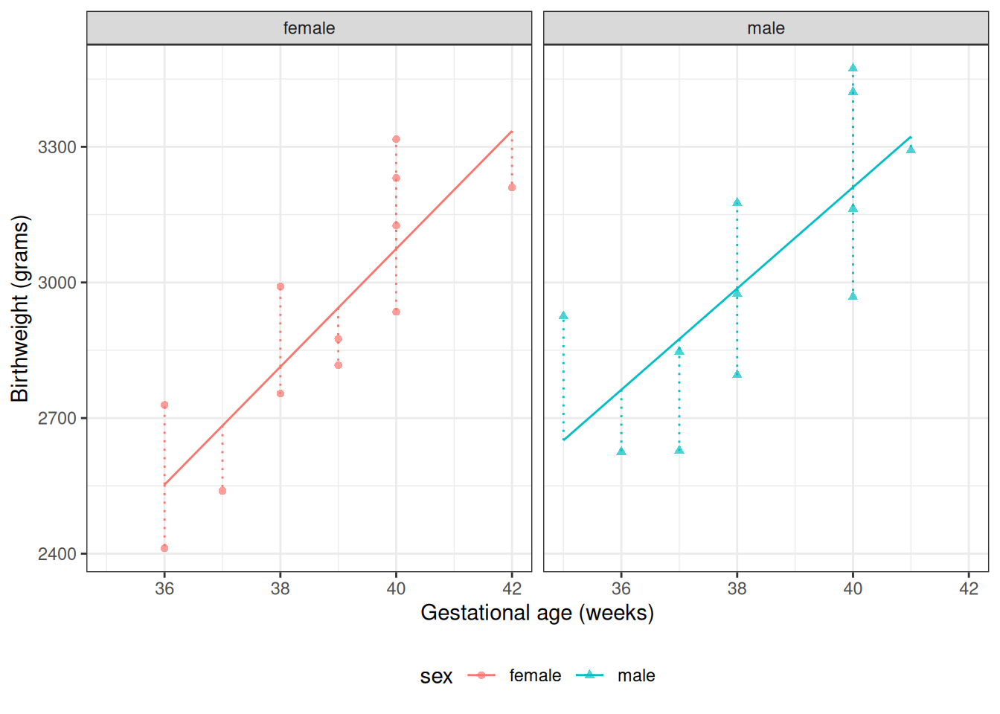](Linear-models-overview_files/figure-html/unnamed-chunk-69-1.png "Figure 15 (a): fitted values")
>
> \(a\) [fitted values](#def-fitted-value)
>
> Show R code
>
> ``` downlit
>
> bw <- bw |>
>   mutate(
>     resids_intxn =
>       weight - fitted(bw_lm2)
>   )
>
> plot_bw_resid <-
>   bw |>
>   ggplot(aes(
>     x = age,
>     y = resids_intxn,
>     linetype = sex,
>     shape = sex,
>     col = sex
>   )) +
>   theme_bw() +
>   xlab("Gestational age (weeks)") +
>   ylab("residuals (grams)") +
>   theme(legend.position = "bottom") +
>   geom_hline(aes(
>     yintercept = 0,
>     col = sex
>   )) +
>   geom_segment(
>     aes(yend = 0),
>     linetype = "dotted"
>   ) +
>   geom_point(alpha = .7)
> # expand_limits(y = 0, x = 0)
> print(plot_bw_resid + facet_wrap(~sex))
> ```
>
> [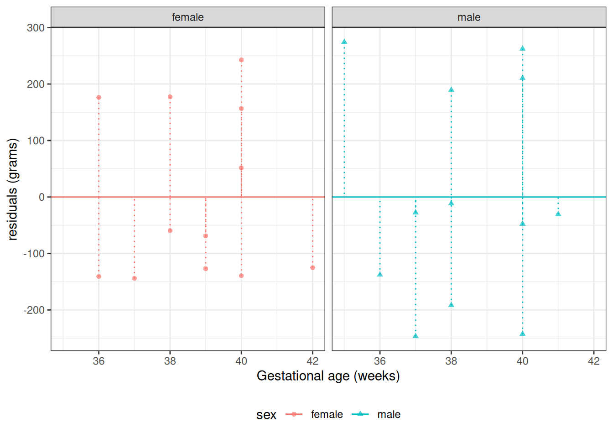](Linear-models-overview_files/figure-html/unnamed-chunk-70-1.png "Figure 15 (b): Residuals")
>
> \(b\) [Residuals](#def-resid-fitted)
>
> Figure 15: Fitted values and residuals for [interaction](../chapters/Intro-to-GLMs.llms.md#def-interaction) model for `birthweight` data

------------------------------------------------------------------------

## 4.7 Residuals versus predictors

Show R code

``` downlit
hers <- hers |>
  mutate(
    resids_no_intcpt =
      LDL - fitted(hers_lm_no_int),
    resids_with_intcpt =
      LDL - fitted(hers_lm_with_int)
  )
```

> **NOTE:**
>
> Show R code
>
> ``` downlit
> hers |>
>   arrange(age) |>
>   ggplot() +
>   aes(x = age, y = resids_no_intcpt, col = factor(smoking)) +
>   geom_point() +
>   geom_hline(aes(yintercept = 0, col = factor(smoking))) +
>   facet_wrap(~smoking, labeller = "label_both") +
>   theme(legend.position = "bottom") +
>   geom_smooth(col = "blue")
> ```
>
> [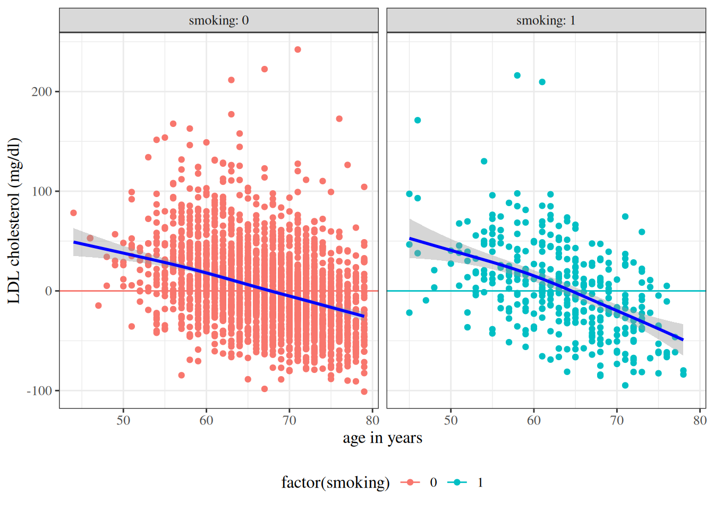](Linear-models-overview_files/figure-html/unnamed-chunk-72-1.png "Figure 16 (a): no intercept")
>
> \(a\) no intercept
>
> Show R code
>
> ``` downlit
> hers |>
>   arrange(age) |>
>   ggplot() +
>   aes(x = age, y = resids_with_intcpt, col = factor(smoking)) +
>   geom_point() +
>   geom_hline(aes(yintercept = 0, col = factor(smoking))) +
>   facet_wrap(~smoking, labeller = "label_both") +
>   theme(legend.position = "bottom") +
>   geom_smooth(col = "blue")
> ```
>
> [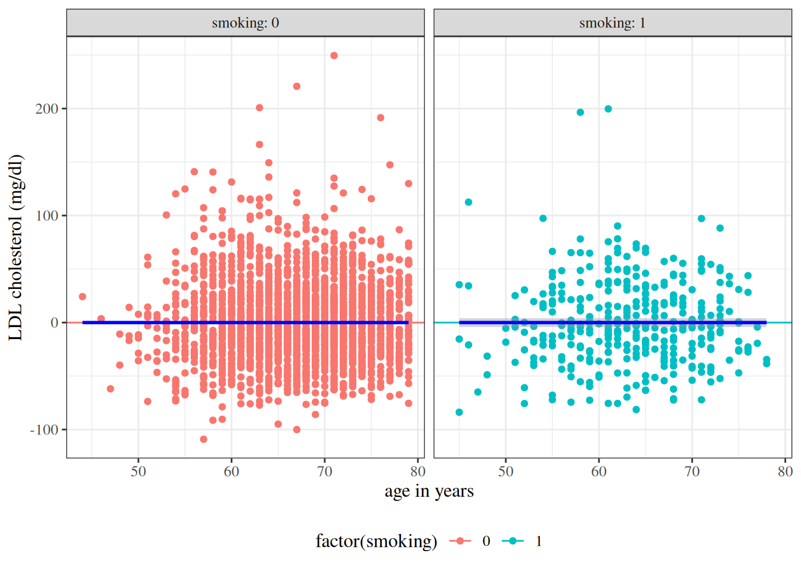](Linear-models-overview_files/figure-html/unnamed-chunk-73-1.png "Figure 16 (b): with intercept")
>
> \(b\) with intercept
>
> Figure 16: [Residuals](#def-resid-fitted) of `hers` data vs [predictors](../chapters/Intro-to-GLMs.llms.md#def-predictors)

------------------------------------------------------------------------

## 4.8 Residuals versus fitted values

If the model contains multiple [continuous covariates](https://morrison-lab.github.io/sds/data.html#def-continuous-var), how do we check for errors in the mean structure assumption?

Show R code

``` downlit
library(ggfortify)
hers_lm_no_int |>
  update(na.action = na.omit) |>
  autoplot(
    which = 1,
    ncol = 1,
    smooth.colour = NA
  ) +
  geom_hline(yintercept = 0, col = "red")
```

> **NOTE:**
>
> [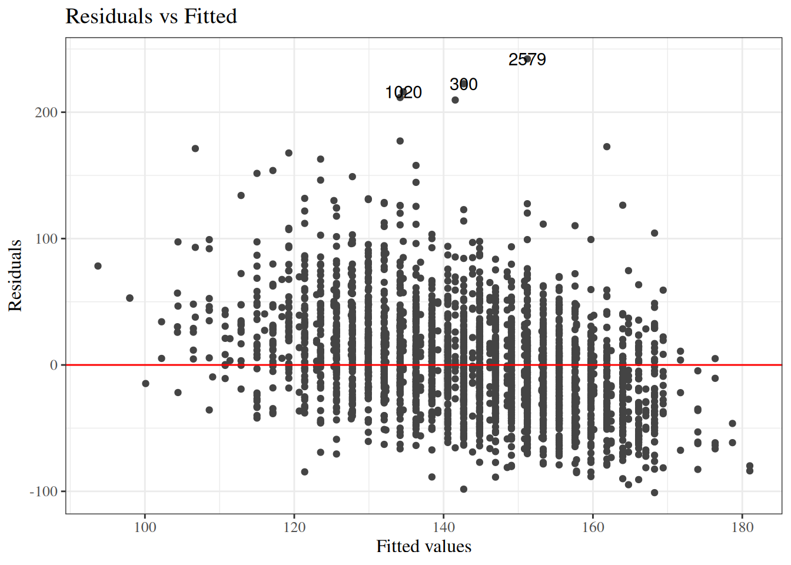](Linear-models-overview_files/figure-html/fig-resids-intxn-hers-1.png "Figure 17: Residuals of interaction model for hers data")
>
> Figure 17: Residuals of interaction model for `hers` data

------------------------------------------------------------------------

We can add a LOESS smooth to visualize where the residual mean is nonzero:

Show R code

``` downlit
library(ggfortify)
hers_lm_no_int |>
  update(na.action = na.omit) |>
  autoplot(
    which = 1,
    ncol = 1
  ) +
  geom_hline(yintercept = 0, col = "red")
```

> **NOTE:**
>
> [](Linear-models-overview_files/figure-html/fig-resids-intxn-hers-smooth-no-int-1.png "Figure 18: Residuals of interaction model for hers data, no intercept term")
>
> Figure 18: Residuals of interaction model for `hers` data, no intercept term

------------------------------------------------------------------------

> **NOTE:**
>
> Show R code
>
> ``` downlit
> library(ggfortify)
> hers_lm_no_int |>
>   update(na.action = na.omit) |>
>   autoplot(
>     which = 1,
>     ncol = 1
>   ) +
>   geom_hline(yintercept = 0, col = "red")
> ```
>
> [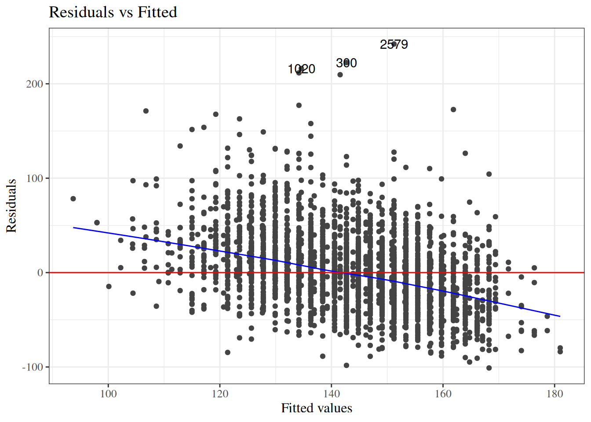](Linear-models-overview_files/figure-html/unnamed-chunk-74-1.png "Figure 19 (a): no intercept term")
>
> \(a\) no intercept term
>
> Show R code
>
> ``` downlit
> hers_lm_with_int |>
>   update(na.action = na.omit) |>
>   autoplot(
>     which = 1,
>     ncol = 1
>   ) +
>   geom_hline(yintercept = 0, col = "red")
> ```
>
> [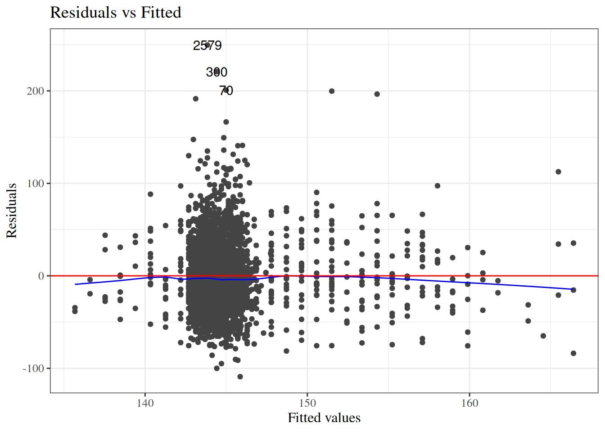](Linear-models-overview_files/figure-html/unnamed-chunk-75-1.png "Figure 19 (b): with intercept term")
>
> \(b\) with intercept term
>
> Figure 19: [Residuals](#def-resid-fitted) of [interaction](../chapters/Intro-to-GLMs.llms.md#def-interaction) model for `hers` data, with and without intercept term

> **NOTE:**
>
> **Definition 16 (Standardized residuals)** For an ordinary linear model, the estimated [standard deviation](https://morrison-lab.github.io/pds/variance-covariance.html#def-sd) of the $i$th residual is
>
> $${\mathop{\widehat{\operatorname{SD}}}\nolimits\mathopen{}\left(\hat{\varepsilon}_i\right)\mathclose{}} = \hat{\sigma}\sqrt{1-h_{ii}}$$
>
> so the standardized residual is
>
> $${\hat{\varepsilon}'{}}_i = \frac{\hat{\varepsilon}_i}{{\mathop{\widehat{\operatorname{SD}}}\nolimits\mathopen{}\left(\hat{\varepsilon}_i\right)\mathclose{}}}
> = \frac{\hat{\varepsilon}_i}{\hat{\sigma}\sqrt{1-h_{ii}}}$$

Hence, with enough data and a correct model, each [standardized residual](#def-stred) has an approximately [standard Gaussian](https://morrison-lab.github.io/pds/random-variables.html#def-std-normal) **marginal** distribution; that is,

$${\hat{\varepsilon}'{}}_i \ \dot{\sim} \ N(0,1)$$

but they are not [independent](https://morrison-lab.github.io/pds/independence.html#def-indpt). If $H$ is the [hat matrix](#def-hat-matrix) with entries $h_{ij}$, then

$${\operatorname{Cov}\mathopen{}\left(\hat{\varepsilon}_i,\hat{\varepsilon}_j \mid \mathbf{X}\right)\mathclose{}}
=
\begin{cases}
\sigma^2(1-h_{ii}), & i=j,\\
-\sigma^2h_{ij}, & i\neq j,
\end{cases}$$

and therefore

$${\operatorname{Cov}\mathopen{}\left({\hat{\varepsilon}'{}}_i,{\hat{\varepsilon}'{}}_j \mid \mathbf{X}\right)\mathclose{}}
\approx
\begin{cases}
1, & i=j,\\
\dfrac{-h_{ij}}{\sqrt{(1-h_{ii})(1-h_{jj})}}, & i\neq j,
\end{cases}$$

In particular, for $i \neq j$, these [covariances](https://morrison-lab.github.io/pds/variance-covariance.html#def-cov) are generally nonzero.

### 4.8.1 Marginal distributions of residuals

To look for problems with our model, we can check whether the [residuals](#def-resid-fitted) $\hat{\varepsilon}_i$ and [standardized residuals](#def-stred) ${\hat{\varepsilon}'{}}_i$ look like they have the distributions that they are supposed to have, according to the model.

------------------------------------------------------------------------

#### Standardized residuals in R

Show R code

``` downlit
h_ii <- hatvalues(bw_lm2)
manual_std_resid <- resid(bw_lm2) / (sigma(bw_lm2) * sqrt(1 - h_ii))
manual_std_resid
#>          1          2          3          4          5          6          7 
#>  1.1598166 -0.9260109 -0.8747917 -0.3472255  1.0350665 -0.7347315 -0.3990086 
#>          8          9         10         11         12         13         14 
#>  1.4375164 -0.8253872  0.3060646  0.9280669 -0.8761592  1.9142780 -0.8655921 
#>         15         16         17         18         19         20         21 
#> -0.1642993 -1.4637574 -1.1101599  1.0965787 -0.0676062 -1.4615865 -0.2869582 
#>         22         23         24 
#>  1.5803994  1.2671652 -0.1980543
rstandard(bw_lm2)
#>          1          2          3          4          5          6          7 
#>  1.1598166 -0.9260109 -0.8747917 -0.3472255  1.0350665 -0.7347315 -0.3990086 
#>          8          9         10         11         12         13         14 
#>  1.4375164 -0.8253872  0.3060646  0.9280669 -0.8761592  1.9142780 -0.8655921 
#>         15         16         17         18         19         20         21 
#> -0.1642993 -1.4637574 -1.1101599  1.0965787 -0.0676062 -1.4615865 -0.2869582 
#>         22         23         24 
#>  1.5803994  1.2671652 -0.1980543
```

These residual vectors are nearly identical. Any differences are from numerical rounding.

------------------------------------------------------------------------

Show R code

``` downlit
rstandard_compare_plot <-
  tibble(
    x = resid(bw_lm2) / (sigma(bw_lm2) * sqrt(1 - h_ii)),
    y = rstandard(bw_lm2)
  ) |>
  ggplot(aes(x = x, y = y)) +
  geom_point() +
  theme_bw() +
  coord_equal() +
  xlab("resid(bw_lm2)/(sigma(bw_lm2)*sqrt(1-h_ii))") +
  ylab("rstandard(bw_lm2)") +
  geom_abline(
    aes(
      intercept = 0,
      slope = 1,
      col = "x=y"
    )
  ) +
  labs(colour = "") +
  scale_colour_manual(values = "red")

print(rstandard_compare_plot)
```

[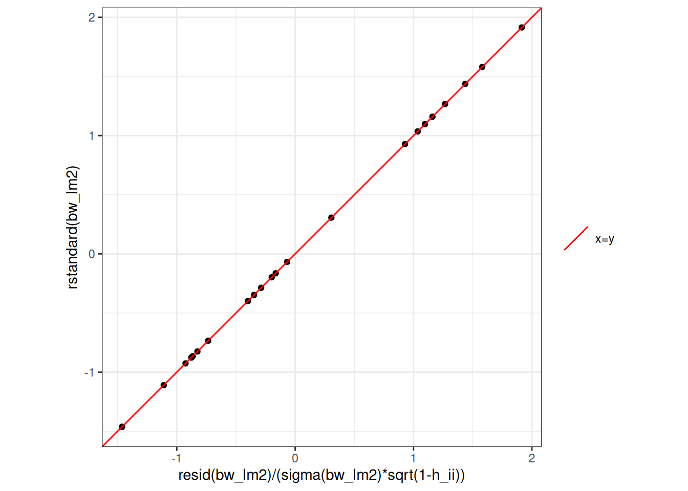](Linear-models-overview_files/figure-html/unnamed-chunk-77-1.png)

------------------------------------------------------------------------

Let’s add these residuals to the `tibble` of our dataset:

Show R code

``` downlit
bw <-
  bw |>
  mutate(
    fitted_lm2 = fitted(bw_lm2),
    resid_lm2 = resid(bw_lm2),
    resid_lm2_alt = weight - fitted_lm2,
    std_resid_lm2 = rstandard(bw_lm2),
    std_resid_lm2_alt =
      resid_lm2 / (sigma(bw_lm2) * sqrt(1 - h_ii))
  )

bw |>
  select(
    sex,
    age,
    weight,
    fitted_lm2,
    resid_lm2,
    std_resid_lm2
  )
```

------------------------------------------------------------------------

Now let’s build [histograms](https://morrison-lab.github.io/sds/exploratory-descriptive.html#def-histogram):

Show R code

``` downlit
resid_marginal_hist <-
  bw |>
  ggplot(aes(x = resid_lm2)) +
  geom_histogram()

print(resid_marginal_hist)
```

> **NOTE:**
>
> [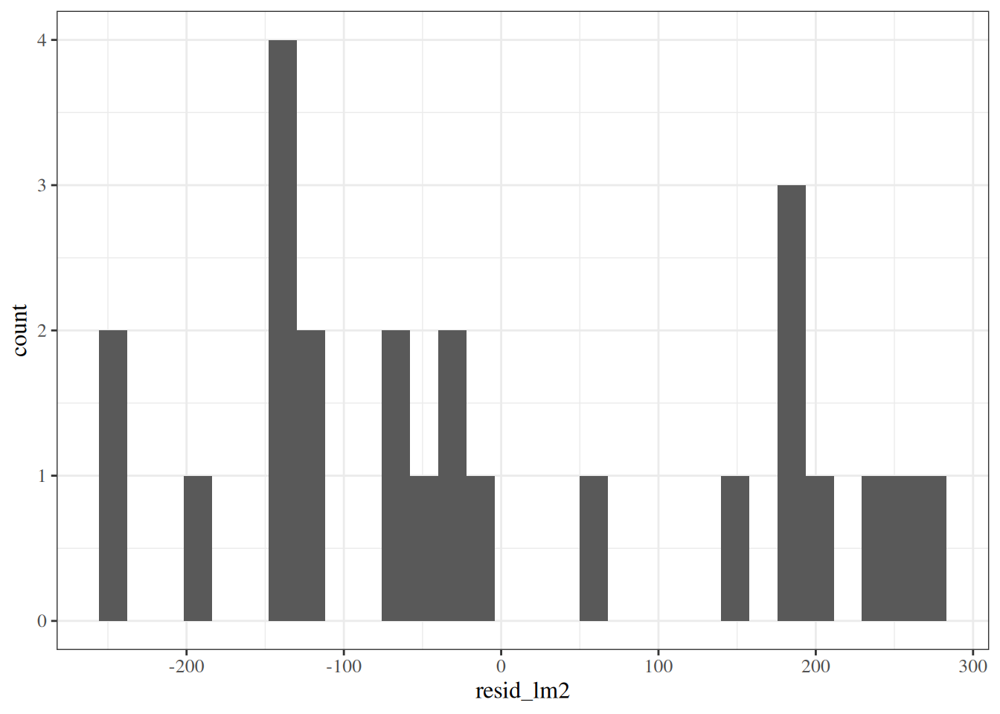](Linear-models-overview_files/figure-html/fig-marg-dist-resid-1.png "Figure 20: Marginal distribution of (nonstandardized) residuals")
>
> Figure 20: Marginal distribution of (nonstandardized) residuals

Hard to tell with this small amount of data, but I’m a bit concerned that the histogram doesn’t show a bell-curve shape.

------------------------------------------------------------------------

Show R code

``` downlit
std_resid_marginal_hist <-
  bw |>
  ggplot(aes(x = std_resid_lm2)) +
  geom_histogram()

print(std_resid_marginal_hist)
```

> **NOTE:**
>
> [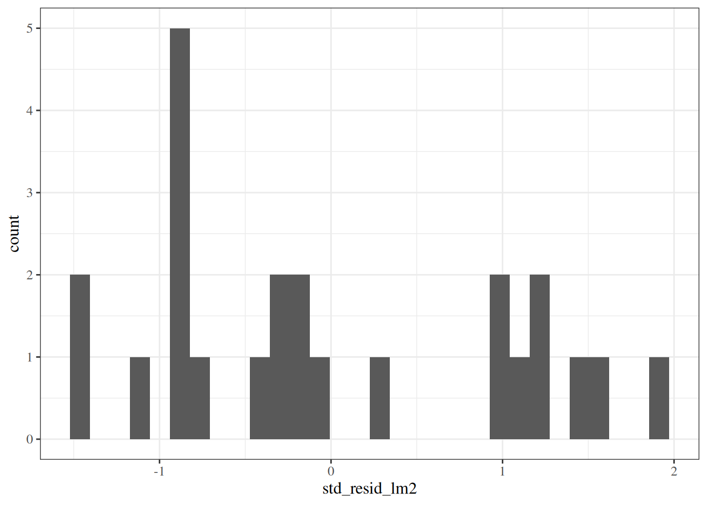](Linear-models-overview_files/figure-html/fig-marg-stresd-1.png "Figure 21: Marginal distribution of standardized residuals")
>
> Figure 21: Marginal distribution of standardized residuals

This standardized residual histogram looks similar, although the scale of the x-axis got narrower, because we divided by $\hat\sigma$ (roughly speaking).

Still hard to tell if the distribution is Gaussian.

------------------------------------------------------------------------

### 4.8.2 QQ plot of standardized residuals

Another way to assess whether the [standardized residuals](#def-stred) follow a [standard normal distribution](https://morrison-lab.github.io/pds/random-variables.html#def-std-normal) is a **quantile-quantile (QQ) plot**.

A [QQ plot](https://morrison-lab.github.io/sds/exploratory-descriptive.html#def-qq-plot) compares the empirical distribution of a dataset to a theoretical reference distribution. Each point corresponds to one observation:

- The **x-axis** (Theoretical Quantiles) shows the $N(0,1)$ quantile corresponding to the plotting position $p_i$ used for the $i$th ordered residual. In R, [`qqnorm()`](https://rdrr.io/r/stats/qqnorm.html) obtains these plotting positions from `ppoints(n)`.
- The **y-axis** (Standardized Residuals) shows the observed standardized residuals, plotted in increasing order as $r_{(1)}\le\cdots\le r_{(n)}$. In QQ-plot terminology, these ordered values are [sample quantiles](https://morrison-lab.github.io/sds/nonparametric-models.html#def-sample-quantile). The QQ plot uses points $$\mathopen{}\left(\Phi^{-1}(p_i),\, r_{(i)}\right)\mathclose{}, \quad i = 1, \ldots, n,$$ where $p_i$ denotes the plotting positions returned by `ppoints(n)`. For the common midpoint choice $p_i=(i-0.5)/n$, the sample quantile at $p_i$ equals $r_{(i)}$. More generally, [`qqnorm()`](https://rdrr.io/r/stats/qqnorm.html) pairs the $i$th ordered residual with the corresponding theoretical quantile computed from its plotting position. So both labels are correct: [`qqnorm()`](https://rdrr.io/r/stats/qqnorm.html) emphasizes the quantile role (“Sample Quantiles”), while `autoplot.lm()` emphasizes the underlying ordered values (“Standardized residuals”).

If the standardized residuals approximately follow $N(0,1)$, the points should fall approximately on a straight line.

Show R code

``` downlit
library(ggfortify)
# needed to make ggplot2::autoplot() work for `lm` objects

qqplot_lm2_auto <-
  bw_lm2 |>
  autoplot(
    which = 2, # options are 1:6; can do multiple at once
    ncol = 1
  ) +
  theme_classic()

print(qqplot_lm2_auto)
```

[](Linear-models-overview_files/figure-html/unnamed-chunk-79-1.png)

If the Gaussian model were correct, the points should fall approximately on the reference line.

The **reference line** passes through the pairs of theoretical and empirical quantiles at probabilities 0.25 and 0.75: it connects $(\Phi^{-1}(0.25),\, \hat{Q}_{0.25})$ and $(\Phi^{-1}(0.75),\, \hat{Q}_{0.75})$, where $\Phi^{-1}$ is the standard normal [quantile function](https://morrison-lab.github.io/pds/random-variables.html#def-quantile-function) and $\hat{Q}_p$ is the $p$-th sample quantile of the standardized residuals. If the standardized residuals are approximately $N(0,1)$, this line should be close to the identity line $y = x$, and the points should fall roughly along a straight line.

Systematic deviations from the line suggest departures from normality:

- **S-shaped curves**: heavier or lighter tails than the [normal distribution](https://morrison-lab.github.io/pds/random-variables.html#def-normal)
- **Concave or convex curves**: skewness
- **Individual points far from the line**: potential outliers

Fig 2.4 panel (c) in Dobson and Barnett [\[1\]](#ref-dobson4e) is a little different; they didn’t specify how they produced it, but other statistical analysis systems do things differently from R.

See also Dunn and Smyth [\[2\]](#ref-dunn2018generalized) [§3.5.4](https://link.springer.com/chapter/10.1007/978-1-4419-0118-7_3#Sec14:~:text=3.5.4%20Q%E2%80%93Q%20Plots%20and%20Normality).

------------------------------------------------------------------------

#### QQ plot: typical patterns

> **NOTE:**
>
> Show R code
>
> ``` downlit
> set.seed(36) # seed chosen for Fig. 3.6 reproduction
> n <- 150     # sample size as in @dunn2018generalized Fig. 3.6
>
> sims <- list(
>   "Right skewed"    = rchisq(n, df = 3),
>   "Left skewed"     = -rchisq(n, df = 3),
>   "Tails too heavy" = rt(n, df = 3),
>   "Tails too light" = runif(n, -sqrt(3), sqrt(3)),
>   "True normal"     = rnorm(n),
>   "Bimodal"         = c(rnorm(n / 2, -2.5), rnorm(n / 2, 2.5))
> )
>
> old_par <- par(
>   mfcol = c(2, 6),
>   mar = c(3, 3, 2, 0.5),
>   oma = c(0, 0, 0, 0)
> )
>
> for (nm in names(sims)) {
>   qqnorm(
>     sims[[nm]],
>     main = nm,
>     xlab = "Theoretical Quantiles",
>     ylab = "Sample Quantiles",
>     pch = 1,
>     cex = 0.6
>   )
>   qqline(sims[[nm]])
>   hist(
>     sims[[nm]],
>     main = "",
>     xlab = "Residuals",
>     ylab = "Frequency",
>     col = "grey70",
>     border = "white",
>     breaks = 15
>   )
> }
> ```
>
> Show R code
>
> ``` downlit
>
> par(old_par)
> ```
>
> [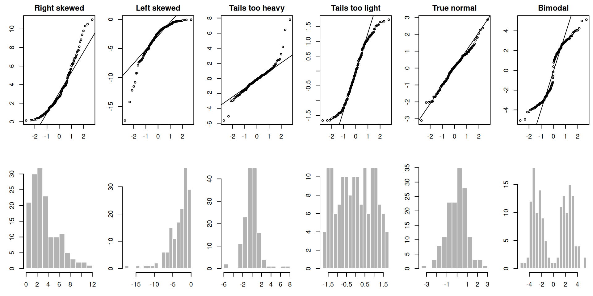](Linear-models-overview_files/figure-html/unnamed-chunk-80-1.png "Figure 22: Typical QQ-plot patterns for six types of residual distribution. Adapted from @dunn2018generalized [Fig. 3.6], with thanks to the authors; reproduced here using simulated data (n = 150). Each column shows one distribution scenario: a QQ plot (top) paired with a histogram of the simulated data (bottom).")
>
> Figure 22: Typical QQ-plot patterns for six types of residual distribution. Adapted from Dunn and Smyth [\[2, Fig. 3.6\]](#ref-dunn2018generalized), with thanks to the authors; reproduced here using simulated data ($n = 150$). Each column shows one distribution scenario: a QQ plot (top) paired with a [histogram](https://morrison-lab.github.io/sds/exploratory-descriptive.html#def-histogram) of the simulated data (bottom).

------------------------------------------------------------------------

### 4.8.3 QQ plot - how it’s built

To construct a QQ plot by hand:

1.  Assign each standardized residual a **plotting position** $p_i$ based on its rank among the $n$ observations. R’s default formula for $n > 10$ is: $$p_i = \frac{\text{rank}_i - 0.5}{n}$$
2.  Compute the **theoretical quantile**: $q_i = \Phi^{-1}(p_i)$, the value from $N(0,1)$ that corresponds to probability $p_i$.
3.  Plot $(q_i, {\hat{\varepsilon}'{}}_i)$ — theoretical quantile $q_i$ on the x-axis, observed standardized residual ${\hat{\varepsilon}'{}}_i$ (see [Definition 16](#def-stred)) on the y-axis.
4.  Add the **reference line** through the pairs of theoretical and empirical quantiles at probabilities 0.25 and 0.75.

Show R code

``` downlit
bw <- bw |>
  mutate(
    # plotting position: (rank - 0.5) / n
    p = (rank(std_resid_lm2) - 1 / 2) / n(),
    expected_quantiles_lm2 = qnorm(p)
  )

qqplot_lm2 <-
  bw |>
  ggplot(
    aes(
      x = expected_quantiles_lm2,
      y = std_resid_lm2,
      col = sex,
      shape = sex
    )
  ) +
  geom_point() +
  theme_classic() +
  theme(legend.position = "none") + # removing the plot legend
  ggtitle("Normal Q-Q") +
  xlab("Theoretical Quantiles") +
  ylab("Standardized residuals")

# find the reference line through the (theoretical, empirical) quantile pairs
# at probabilities 0.25 and 0.75:

ps <- c(.25, .75) # reference probabilities
a <- quantile(rstandard(bw_lm2), ps) # empirical quantiles
b <- qnorm(ps) # theoretical quantiles

qq_slope <- diff(a) / diff(b)
qq_intcpt <- a[1] - b[1] * qq_slope

qqplot_lm2 <-
  qqplot_lm2 +
  geom_abline(slope = qq_slope, intercept = qq_intcpt)
```

> **NOTE:**
>
> Show R code
>
> ``` downlit
> print(qqplot_lm2)
> ```
>
> [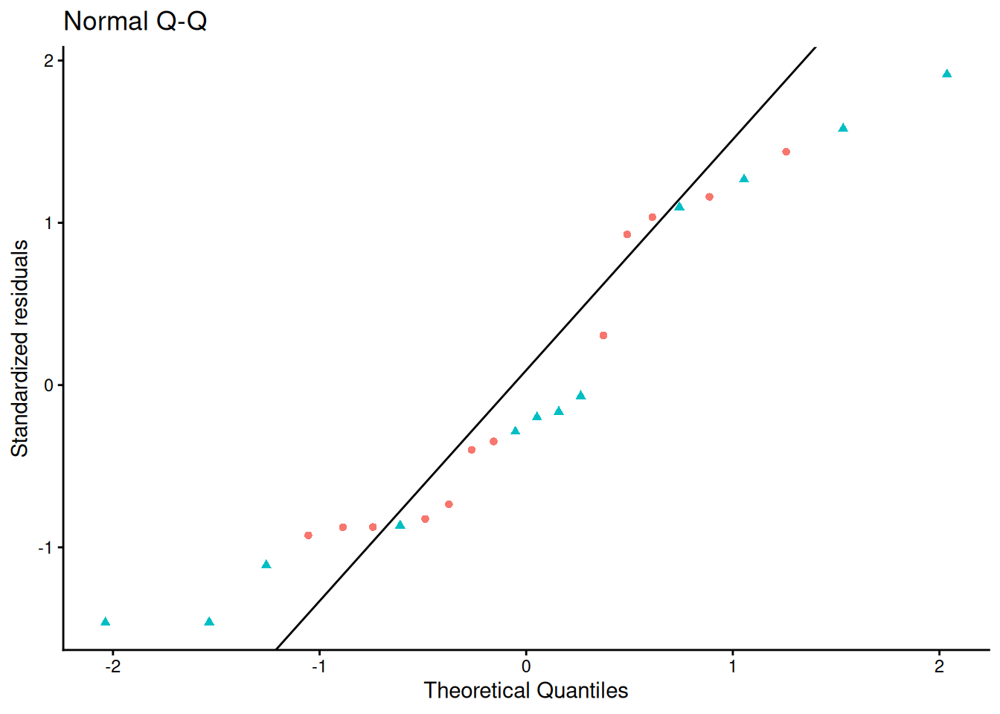](Linear-models-overview_files/figure-html/unnamed-chunk-82-1.png "Figure 23 (a): ggplot2 (manual construction)")
>
> \(a\) `ggplot2` (manual construction)
>
> Show R code
>
> ``` downlit
> std_resid_lm2 <- rstandard(bw_lm2)
>
> qqnorm(
>   std_resid_lm2,
>   main = "Normal Q-Q",
>   xlab = "Theoretical Quantiles",
>   ylab = "Standardized residuals"
> )
> qqline(std_resid_lm2)
> ```
>
> [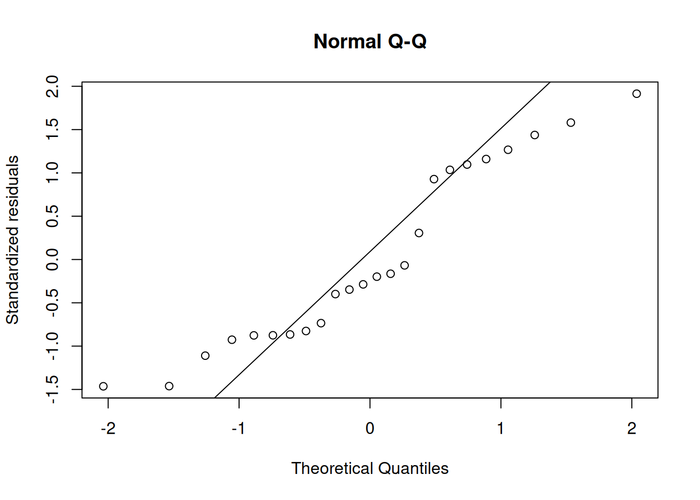](Linear-models-overview_files/figure-html/unnamed-chunk-83-1.png "Figure 23 (b): base R (qqnorm + qqline)")
>
> \(b\) base R (`qqnorm` + `qqline`)
>
> Show R code
>
> ``` downlit
> library(ggfortify)
> autoplot(
>   bw_lm2,
>   which = 2,
>   ncol = 1
> ) +
>   theme_classic()
> ```
>
> [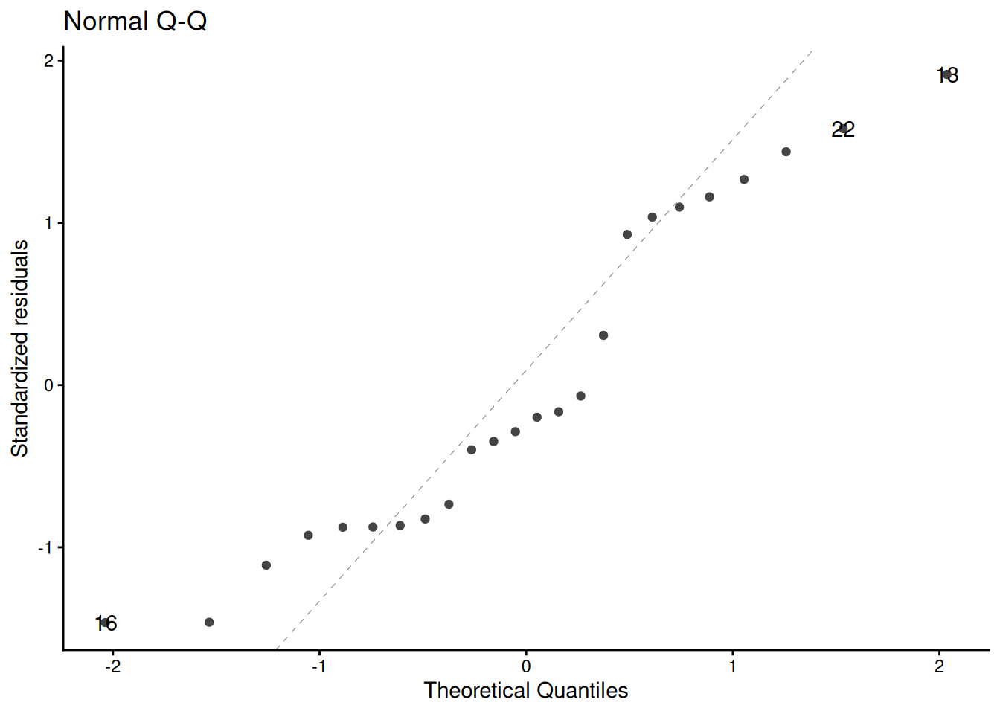](Linear-models-overview_files/figure-html/unnamed-chunk-84-1.png "Figure 23 (c): ggfortify::autoplot()")
>
> \(c\) `ggfortify::autoplot()`
>
> Figure 23: Three equivalent ways to produce a QQ plot of the standardized residuals for the `birthweight` model ([Equation 2](#eq-BW-lm-interact)). All three plots show the same data and reference line.

------------------------------------------------------------------------

### 4.8.4 Formal diagnostic tests for linear regression assumptions

Graphical diagnostics are usually the first step, but formal tests can provide numerical summaries.

For linear regression [residuals](#def-resid-fitted), four common tests are:

- [`fligner.test()`](https://rdrr.io/r/stats/fligner.test.html) for equal [variances](https://morrison-lab.github.io/pds/variance-covariance.html#def-variance) across groups (the Fligner–Killeen test).
- Levene / Brown–Forsythe test (a median-centered Levene variant, where standard Levene centers on group sample means, and Brown–Forsythe centers on group medians for more robustness; e.g., via `car::leveneTest(..., center = median)` or equivalent code).
- [`lmtest::bptest()`](https://rdrr.io/pkg/lmtest/man/bptest.html) for error variance that changes with the [covariates](../chapters/Intro-to-GLMs.llms.md#def-predictors) (the [Breusch–Pagan test](#def-breusch-pagan)).
- [`shapiro.test()`](https://rdrr.io/r/stats/shapiro.test.html) / [Shapiro–Wilk test](https://en.wikipedia.org/wiki/Shapiro%E2%80%93Wilk_test) for normality.

------------------------------------------------------------------------

#### Fligner–Killeen test (homoskedasticity across groups)

Suppose residuals are split into groups ($g = 1, \ldots, G$), for example by a [categorical predictor](https://morrison-lab.github.io/sds/data.html#def-categorical-var).

The test starts from absolute deviations from each group median: $$d_{gi} = |e_{gi} - \text{median}(e_{g1}, \ldots, e_{g,n_g})|.$$

After ranking the pooled $d_{gi}$ values, the Fligner–Killeen statistic is built from normal scores of those ranks.

Under the [null hypothesis](https://morrison-lab.github.io/sds/inference.html#def-null-hypothesis) of equal variances, the [test statistic](https://morrison-lab.github.io/sds/inference.html#def-test-statistic) is approximately $\chi^2_{G-1}$. Small [p-values](https://morrison-lab.github.io/sds/inference.html#def-p-value) suggest [heteroskedasticity](https://morrison-lab.github.io/pds/variance-covariance.html#def-heterosked).

------------------------------------------------------------------------

#### Levene / Brown–Forsythe test (homoskedasticity across groups)

Levene’s test transforms residuals to within-group absolute deviations: $$z_{gi} = |e_{gi} - c_g|,$$ where $c_g$ is the group center.

Classical Levene uses the group sample mean for $c_g$. Brown–Forsythe uses the group median, which is more robust.

Then run a [one-way ANOVA](https://morrison-lab.github.io/sds/basic-statistical-methods.html#def-one-way-anova) on $z_{gi}$ by group: $$F = \frac{\text{MS}_{\text{between}}}{\text{MS}_{\text{within}}}
\sim F_{G-1, N-G}
\quad\text{under }H_0.$$

Small p-values suggest unequal residual variance.

For [simple linear regression](https://morrison-lab.github.io/sds/correlation-regression.html#def-slr), Kutner et al. [\[4, pp. 116–117\]](#ref-kutner2005applied) describes the Brown–Forsythe test by splitting observations into two $X$-level groups (low versus high), computing absolute deviations from each group median, and applying a two-sample pooled-variance t test: let $$z_{ij} = |e_{ij} - \tilde e_i|,$$ where $j$ indexes observations within group $i$, and $\tilde e_i$ is the median residual in group $i$. Then: $$t_{\text{BF}} =
\frac{\bar z_{1} - \bar z_{2}}
{s_p \sqrt{1/n_{1} + 1/n_{2}}},
\quad
t_{\text{BF}} \approx t_{n_{1}+n_{2}-2}
\text{ under }H_0.$$ Here, $\bar z_{1}$ and $\bar z_{2}$ are the sample means of the $z_{ij}$ values in groups $i=1$ and $i=2$, $s_p$ is their pooled [standard deviation](https://morrison-lab.github.io/pds/variance-covariance.html#def-sd), and $n_{1}, n_{2}$ are the two group sample sizes. Large $|t_{\text{BF}}|$ indicates nonconstant residual variance.

#### Breusch–Pagan test (variance changing with covariates)

The Fligner–Killeen and Levene tests compare residual [variances](https://morrison-lab.github.io/pds/variance-covariance.html#def-variance) across the levels of a grouping variable. The [Breusch–Pagan test](#def-breusch-pagan) instead asks whether the error variance changes with the [covariates](../chapters/Intro-to-GLMs.llms.md#def-predictors) themselves, which can be continuous [\[21\]](#ref-breusch1979simple).

> **NOTE:**
>
> **Definition 17 (Auxiliary regression)** Let $\hat{\varepsilon}_1, \ldots, \hat{\varepsilon}_n$ be the [residuals](#def-resid-fitted) from a fitted [linear regression model](#def-lm-general-form), and let $z_i$ be a vector of $q$ covariates for observation $i$ (by default, the model’s own predictors, without the intercept).
>
> The **auxiliary regression** is the ordinary least-squares regression of the squared residuals $\hat{\varepsilon}_i^2$ on $z_i$, with an intercept; let $R^2_{\text{aux}}$ be its [coefficient of determination](https://morrison-lab.github.io/sds/correlation-regression.html#def-r-squared).

> **NOTE:**
>
> **Definition 18 (Studentized Breusch–Pagan statistic)** With $R^2_{\text{aux}}$ the coefficient of determination of the auxiliary regression ([Definition 17](#def-auxiliary-regression)), the **studentized Breusch–Pagan statistic** [\[22\]](#ref-koenker1981note) is:
>
> $$\text{BP} \stackrel{\text{def}}{=}n R^2_{\text{aux}}
> \tag{17}$$

> **NOTE:**
>
> **Definition 19 (Original Breusch–Pagan statistic)** In contrast to [Equation 17](#eq-breusch-pagan-stat), the **original Breusch–Pagan statistic** [\[21\]](#ref-breusch1979simple) uses $\hat{\sigma}^2 \stackrel{\text{def}}{=}\frac{1}{n}\sum_{i=1}^n\hat{\varepsilon}_i^2$ and regresses $g_i \stackrel{\text{def}}{=}\hat{\varepsilon}_i^2 / \hat{\sigma}^2$ on $z_i$; the statistic is half of that regression’s explained sum of squares.

> **NOTE:**
>
> **Theorem 5 (Null distribution of the Breusch–Pagan statistic)** Under the [null hypothesis](https://morrison-lab.github.io/sds/inference.html#def-null-hypothesis) that the error variance is constant, ${\operatorname{Var}\mathopen{}\left(Y_i \mid z_i\right)\mathclose{}} = \sigma^2$ for every $i$, both versions of the Breusch–Pagan statistic are approximately $\chi^2_q$ in large samples. The original version also assumes Gaussian errors [\[21\]](#ref-breusch1979simple); the studentized version does not [\[22\]](#ref-koenker1981note).

The proof uses large-sample score-test theory, which is beyond the scope of these notes; see Breusch and Pagan [\[21\]](#ref-breusch1979simple) and Koenker [\[22\]](#ref-koenker1981note).

The null hypothesis concerns the errors, not the residuals: even when the error variance is constant, the residual variances differ with [leverage](https://morrison-lab.github.io/sds/model-validation.html#def-leverage) ([Equation 14](#eq-var-resid-leverage)).

Large values of the statistic, and small [p-values](https://morrison-lab.github.io/sds/inference.html#def-p-value), suggest that the error variance changes with $z_i$.

> **NOTE:**
>
> **Example 11 (Breusch–Pagan test for the `birthweight` interaction model)** For the `birthweight` interaction model ([Equation 2](#eq-BW-lm-interact)), $z_i$ holds sex, gestational age, and their interaction, so $q = 3$. We fit both auxiliary regressions by hand and compare the results with [`lmtest::bptest()`](https://rdrr.io/pkg/lmtest/man/bptest.html):
>
> Show R code
>
> ``` downlit
> bp_data <-
>   bw |>
>   mutate(
>     resid_sq = resid(bw_lm2)^2,
>     g = resid_sq / mean(resid_sq)
>   )
>
> bp_n <- nobs(bw_lm2)
>
> bp_aux <- lm(resid_sq ~ sex + age + sex:age, data = bp_data)
> bp_r2 <- summary(bp_aux)$r.squared
> bp_stat <- bp_n * bp_r2
> bp_p <- pchisq(bp_stat, df = 3, lower.tail = FALSE)
>
> bp_aux_g <- lm(g ~ sex + age + sex:age, data = bp_data)
> bp_ess <- sum((fitted(bp_aux_g) - mean(bp_data$g))^2)
> bp_orig <- bp_ess / 2
> bp_orig_p <- pchisq(bp_orig, df = 3, lower.tail = FALSE)
>
> lmtest::bptest(bw_lm2)
> #> 
> #>  studentized Breusch-Pagan test
> #> 
> #> data:  bw_lm2
> #> BP = 2.504, df = 3, p-value = 0.475
> lmtest::bptest(bw_lm2, studentize = FALSE)
> #> 
> #>  Breusch-Pagan test
> #> 
> #> data:  bw_lm2
> #> BP = 0.8871, df = 3, p-value = 0.829
> ```
>
> By [Definition 18](#def-breusch-pagan), the studentized statistic is:
>
> $$\begin{aligned}
> \text{BP}
> &\stackrel{\text{def}}{=}n R^2_{\text{aux}}
> && \text{(definition of the studentized statistic)}
> \\
> &= 24 \times 0.10435
> && \text{(substitute } n \text{ and } R^2_{\text{aux}}\text{)}
> \\
> &\approx 2.504
> && \text{(arithmetic)}
> \end{aligned}
> \tag{18}$$
>
> and the original statistic is:
>
> $$\begin{aligned}
> \text{BP}_{\text{orig}}
> &\stackrel{\text{def}}{=}\tfrac{1}{2} \text{ESS}_g
> && \text{(definition of the original statistic)}
> \\
> &= \tfrac{1}{2} \times 1.7742
> && \text{(substitute the explained sum of squares)}
> \\
> &\approx 0.887
> && \text{(arithmetic)}
> \end{aligned}
> \tag{19}$$
>
> Comparing each value with a $\chi^2_3$ distribution ([Theorem 5](#thm-breusch-pagan-null)) gives $p \approx 0.47$ for the studentized statistic and $p \approx 0.83$ for the original statistic, which match [`bptest()`](https://rdrr.io/pkg/lmtest/man/bptest.html). Neither test gives evidence that the error [variance](https://morrison-lab.github.io/pds/variance-covariance.html#def-variance) changes with sex or gestational age. The two statistics differ noticeably. The original statistic divides the explained sum of squares by 2, which is the variance of $\varepsilon_i^2 / \sigma^2$ when the errors are Gaussian, and so the variance that $g_i$ approaches in large samples under Gaussian errors; the studentized statistic equals the same explained sum of squares divided by the mean squared deviation of the $g_i$ values (their variance with divisor $n$) instead, which here is about 0.71. A non-significant result from only 24 babies is weak evidence that the variance is constant, so we would still look at the residual plots.

------------------------------------------------------------------------

#### Shapiro–Wilk test (normality of standardized residuals)

For ordered [standardized residuals](#def-stred) $r_{(1)} \le \cdots \le r_{(n)}$, the Shapiro–Wilk statistic is: $$W =
\frac{\mathopen{}\left(\sum_{i=1}^n a_i r_{(i)}\right)\mathclose{}^2}
{\sum_{i=1}^n (r_i - \bar r)^2},$$ where $a_i$ are constants from normal-order-statistic moments. The numerator uses ordered residuals $r_{(i)}$, while the denominator uses the original (unordered) residuals.

If residuals are Gaussian, $W$ tends to be close to 1. Small $W$ (and small p-value) indicates departure from normality.

------------------------------------------------------------------------

#### Numerical example (`birthweight` interaction model)

Show R code

``` downlit
diag_bw <-
  broom::augment(bw_lm2, data = bw) |>
  transmute(
    sex,
    resid_lm2 = .resid,
    std_resid_lm2 = .std.resid
  )

fligner_bw <- fligner.test(resid_lm2 ~ sex, data = diag_bw)

levene_bw <-
  diag_bw |>
  group_by(sex) |>
  mutate(
    med_resid = median(resid_lm2),
    abs_dev = abs(resid_lm2 - med_resid)
  ) |>
  ungroup()

levene_fit <- aov(abs_dev ~ sex, data = levene_bw)
levene_tab <- summary(levene_fit)[[1]]
levene_F <- unname(levene_tab[1, "F value"])
levene_p <- unname(levene_tab[1, "Pr(>F)"])

shapiro_bw <- shapiro.test(diag_bw$std_resid_lm2)

tibble(
  test = c(
    "Fligner--Killeen: equal variance by sex",
    "Levene/Brown--Forsythe: equal variance by sex",
    "Shapiro--Wilk: normality of standardized residuals"
  ),
  statistic = c(
    unname(fligner_bw$statistic),
    levene_F,
    unname(shapiro_bw$statistic)
  ),
  p_value = c(
    fligner_bw$p.value,
    levene_p,
    shapiro_bw$p.value
  )
) |>
  mutate(
    statistic = signif(statistic, 4),
    p_value = signif(p_value, 4)
  )
```

Interpretation rule: for all three tests in this table, a small p-value is evidence against the corresponding model assumption.

Compared with visual diagnostics:

- Fligner–Killeen / Levene summarizes the same heteroskedasticity signal that we inspect in residuals-vs-fitted ([Figure 24](#fig-bw_lm2-resid-vs-fitted)) and scale-location ([Figure 32](#fig-bw-scale-loc)) plots.
- Shapiro–Wilk summarizes the same normality signal that we inspect in [QQ plots](https://morrison-lab.github.io/sds/exploratory-descriptive.html#def-qq-plot) ([Figure 23 (c)](#fig-qqplot-autoplot)) and standardized-residual [histograms](https://morrison-lab.github.io/sds/exploratory-descriptive.html#def-histogram) ([Figure 21](#fig-marg-stresd)).
- Use tests and plots together: the tests provide a single numerical summary, while the plots show the shape and practical size of departures.

------------------------------------------------------------------------

### 4.8.5 Conditional distributions of residuals

If our [Gaussian linear regression model](#def-lm-general-form) is correct, the [residuals](#def-resid-fitted) $\hat{\varepsilon}_i$ and [standardized residuals](#def-stred) ${\hat{\varepsilon}'{}}_i$ should have:

- an approximately [Gaussian distribution](https://morrison-lab.github.io/pds/random-variables.html#def-normal), with:
- a mean of 0
- a [constant variance](https://morrison-lab.github.io/pds/variance-covariance.html#def-homosked)

This mean and [variance](https://morrison-lab.github.io/pds/variance-covariance.html#def-variance) structure should be true **for every** value of $x$.

------------------------------------------------------------------------

If we didn’t correctly guess the functional form of the linear component of the mean, for covariate vector $x = (x_1,\ldots,x_p)$, $${\mathbb{E}\mathopen{}\left[Y \mid X=x\right]\mathclose{}} = \beta_0 + \beta_1 x_1 + \cdots + \beta_p x_p$$

Then the residuals might have nonzero mean.

Regardless of whether we guessed the [mean function](https://morrison-lab.github.io/sds/model-validation.html#def-mean-function) correctly, the variance of the residuals might differ between values of $x$.

------------------------------------------------------------------------

#### Residuals versus fitted values

To look for these issues, we can plot the residuals $\hat{\varepsilon}_i$ against the [fitted values](#def-fitted-value) $\hat y_i$ ([Figure 24](#fig-bw_lm2-resid-vs-fitted)).

> **NOTE:**
>
> Show R code
>
> ``` downlit
> autoplot(bw_lm2, which = 1, ncol = 1) |> print()
> ```
>
> [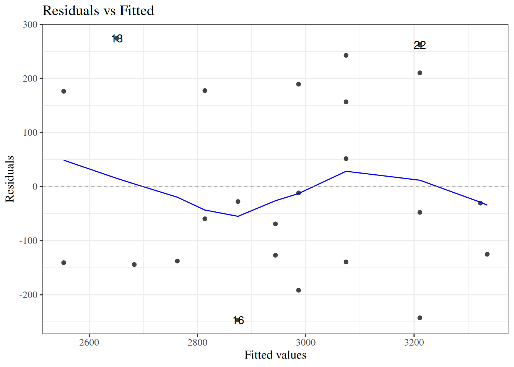](Linear-models-overview_files/figure-html/unnamed-chunk-87-1.png "Figure 24: birthweight model (Equation 2): residuals versus fitted values")
>
> Figure 24: `birthweight` model ([Equation 2](#eq-BW-lm-interact)): residuals versus fitted values

If the model is correct, the blue line should stay flat and close to 0, and the cloud of dots should have the same vertical spread regardless of the fitted value.

If not, we probably need to change the functional form of the linear component of the mean, $${\mathbb{E}\mathopen{}\left[Y \mid X=x\right]\mathclose{}} = \beta_0 + \beta_1 x_1 + \cdots + \beta_p x_p$$

------------------------------------------------------------------------

#### Example: PLOS Medicine title length data

(Adapted from Dobson and Barnett [\[1\]](#ref-dobson4e), §6.7.1)

Show R code

``` downlit
data(PLOS, package = "dobson")
library(ggplot2)
fig1 = 
  PLOS |> 
  ggplot(
    aes(x = authors,
        y = nchar)
  ) +
  geom_point() +
  theme(legend.position = "bottom") +
  labs(col = "") +
  guides(col=guide_legend(ncol=3))
fig1
```

> **NOTE:**
>
> [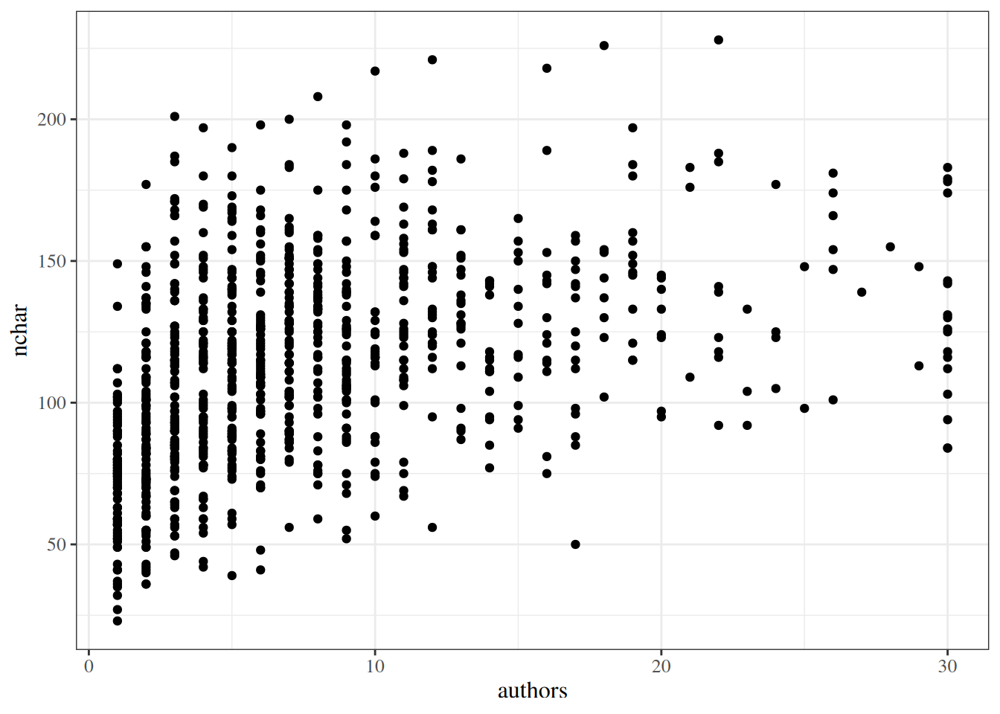](Linear-models-overview_files/figure-html/fig-plos-1.png "Figure 25: Number of authors versus title length in PLOS Medicine articles")
>
> Figure 25: Number of authors versus title length in *PLOS Medicine* articles

------------------------------------------------------------------------

##### Linear fit

Show R code

``` downlit
lm_PLOS_linear = lm(
  formula = nchar ~ authors, 
  data = PLOS)
```

> **NOTE:**
>
> Show R code
>
> ``` downlit
> fig2 = fig1 +
>   geom_smooth(
>     method = "lm", 
>               fullrange = TRUE,
>               aes(col = "lm(y ~ x)"))
> fig2
>
> library(ggfortify)
> autoplot(lm_PLOS_linear, which = 1, ncol = 1)
> ```
>
> [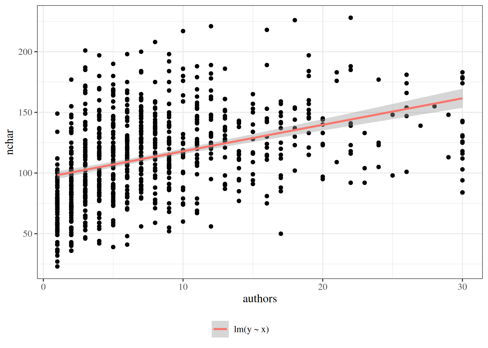](Linear-models-overview_files/figure-html/fig-plos-lm-1.png "Figure 26 (a): Data and fit")
>
> \(a\) Data and fit
>
> [](Linear-models-overview_files/figure-html/fig-plos-lm-2.png "Figure 26 (b): Residuals vs fitted")
>
> \(b\) Residuals vs fitted
>
> Figure 26: Number of authors versus title length in *PLOS Medicine*, with linear model fit

------------------------------------------------------------------------

##### Quadratic fit

Show R code

``` downlit
lm_PLOS_quad = lm(
  formula = nchar ~ authors + I(authors^2), 
  data = PLOS)
```

> **NOTE:**
>
> Show R code
>
> ``` downlit
> fig3 = 
>   fig2 + 
> geom_smooth(
>     method = "lm",
>     fullrange = TRUE,
>     formula = y ~ x + I(x ^ 2),
>     aes(col = "lm(y ~ x + I(x^2))")
>   )
> fig3
>
> autoplot(lm_PLOS_quad, which = 1, ncol = 1)
> ```
>
> [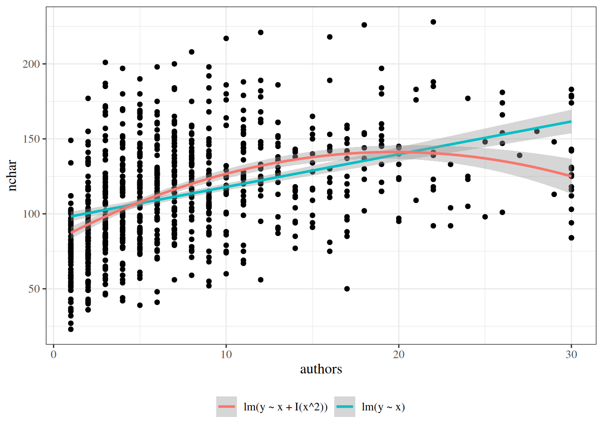](Linear-models-overview_files/figure-html/fig-plos-lm-quad-1.png "Figure 27 (a): Data and fit")
>
> \(a\) Data and fit
>
> [](Linear-models-overview_files/figure-html/fig-plos-lm-quad-2.png "Figure 27 (b): Residuals vs fitted")
>
> \(b\) Residuals vs fitted
>
> Figure 27: Number of authors versus title length in *PLOS Medicine*, with quadratic model fit

------------------------------------------------------------------------

##### Linear versus quadratic fits

> **NOTE:**
>
> Show R code
>
> ``` downlit
> library(ggfortify)
> autoplot(lm_PLOS_linear, which = 1, ncol = 1)
>
> autoplot(lm_PLOS_quad, which = 1, ncol = 1)
> ```
>
> [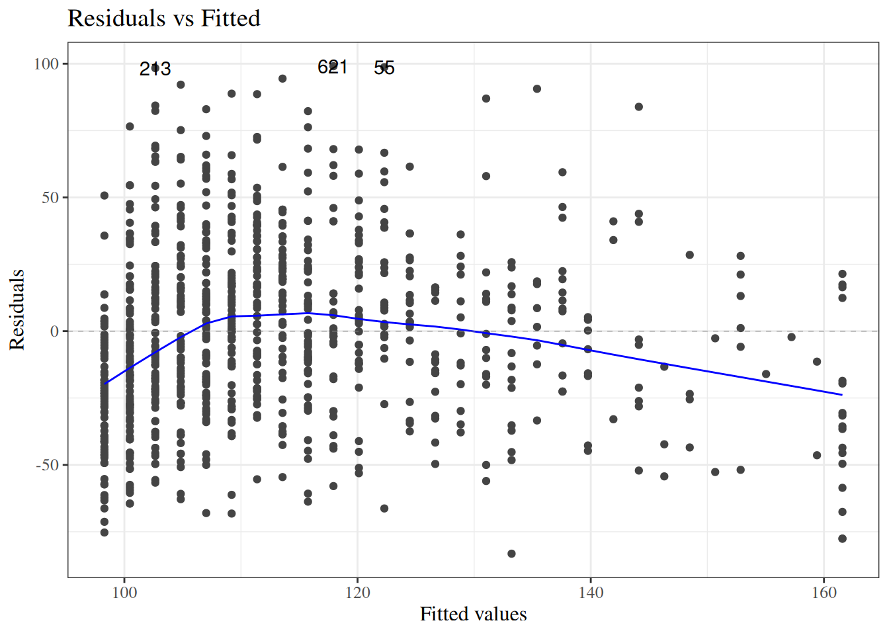](Linear-models-overview_files/figure-html/fig-plos-lm-resid2-1.png "Figure 28 (a): Linear")
>
> \(a\) Linear
>
> [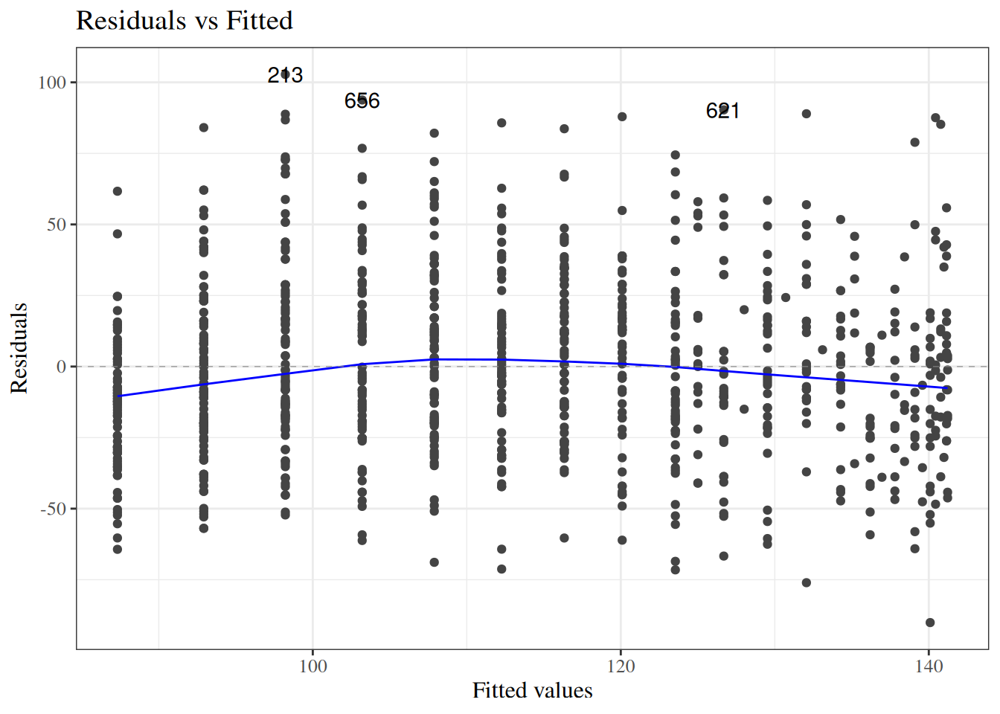](Linear-models-overview_files/figure-html/fig-plos-lm-resid2-2.png "Figure 28 (b): Quadratic")
>
> \(b\) Quadratic
>
> Figure 28: Residuals versus fitted plot for linear and quadratic fits to `PLOS` data

------------------------------------------------------------------------

##### Cubic fit

Show R code

``` downlit
lm_PLOS_cub = lm(
  formula = nchar ~ authors + I(authors^2) + I(authors^3), 
  data = PLOS)
```

> **NOTE:**
>
> Show R code
>
> ``` downlit
> fig4 = 
>   fig3 + 
> geom_smooth(
>     method = "lm",
>     fullrange = TRUE,
>     formula = y ~ x + I(x ^ 2) + I(x ^ 3),
>     aes(col = "lm(y ~ x + I(x^2) + I(x ^ 3))")
>   )
> fig4
>
> autoplot(lm_PLOS_cub, which = 1, ncol = 1)
> ```
>
> [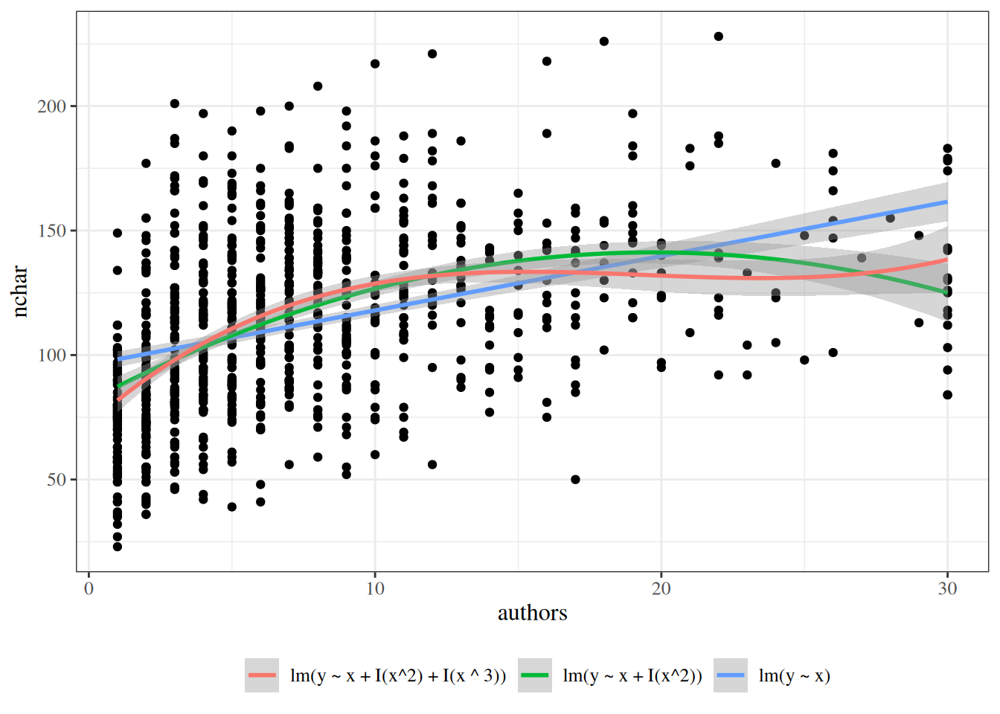](Linear-models-overview_files/figure-html/fig-plos-lm-cubic-1.png "Figure 29 (a): Data and fit")
>
> \(a\) Data and fit
>
> [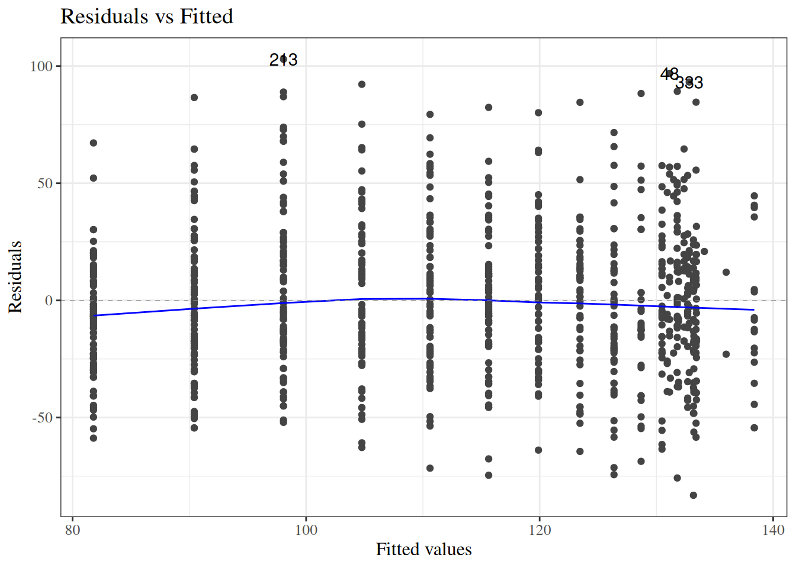](Linear-models-overview_files/figure-html/fig-plos-lm-cubic-2.png "Figure 29 (b): Residuals vs fitted")
>
> \(b\) Residuals vs fitted
>
> Figure 29: Number of authors versus title length in *PLOS Medicine*, with cubic model fit

------------------------------------------------------------------------

##### Logarithmic fit

Show R code

``` downlit
lm_PLOS_log = lm(nchar ~ log(authors), data = PLOS)
```

> **NOTE:**
>
> Show R code
>
> ``` downlit
> fig5 = fig4 + 
>   geom_smooth(
>     method = "lm",
>     fullrange = TRUE,
>     formula = y ~ log(x),
>     aes(col = "lm(y ~ log(x))")
>   )
> fig5
>
> autoplot(lm_PLOS_log, which = 1, ncol = 1)
> ```
>
> [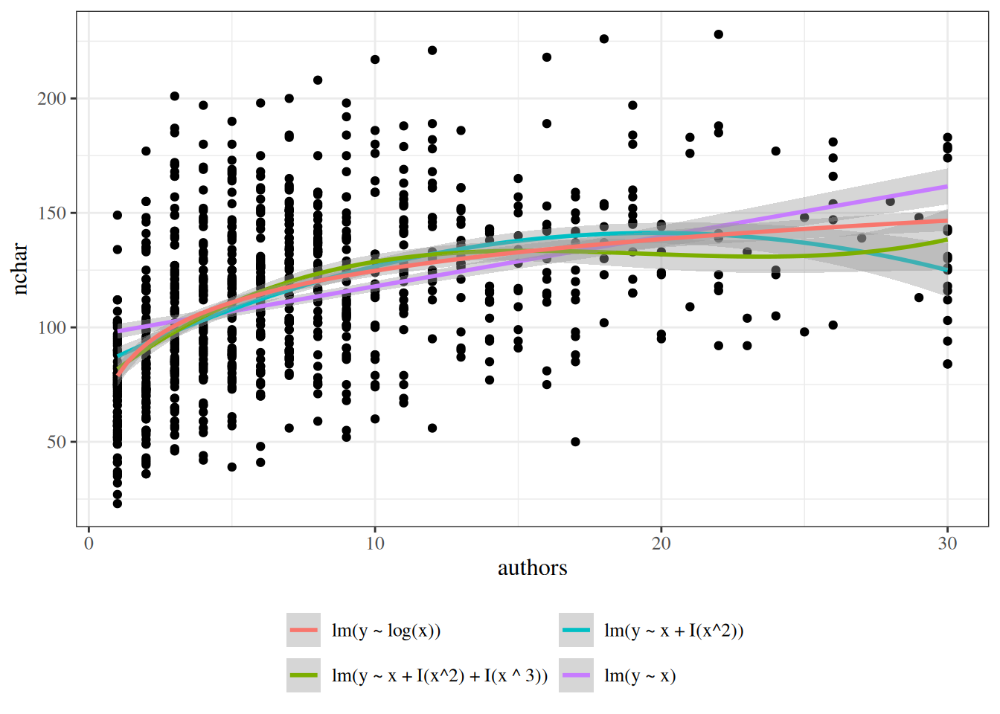](Linear-models-overview_files/figure-html/fig-plos-log-1.png "Figure 30 (a): Data and fit")
>
> \(a\) Data and fit
>
> [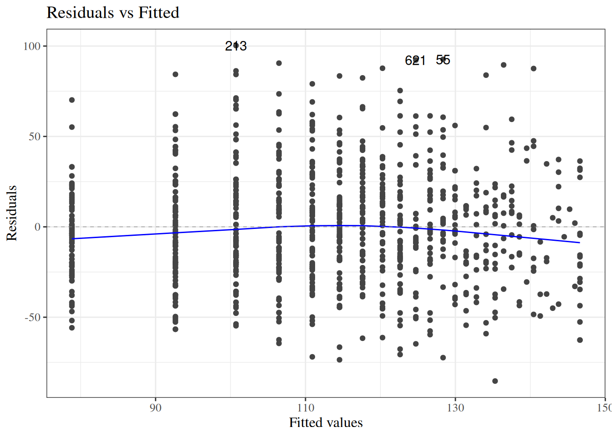](Linear-models-overview_files/figure-html/fig-plos-log-2.png "Figure 30 (b): Residuals vs fitted")
>
> \(b\) Residuals vs fitted
>
> Figure 30: logarithmic fit

------------------------------------------------------------------------

##### Model selection

Show R code

``` downlit
anova(lm_PLOS_linear, lm_PLOS_quad)
```

> **NOTE:**
>
> Table 22: linear vs quadratic

Show R code

``` downlit
anova(lm_PLOS_quad, lm_PLOS_cub)
```

> **NOTE:**
>
> Table 23: quadratic vs cubic

------------------------------------------------------------------------

##### AIC/BIC

Show R code

``` downlit
AIC(lm_PLOS_quad)
#> [1] 8567.61
AIC(lm_PLOS_cub)
#> [1] 8554.51
```

Show R code

``` downlit
AIC(lm_PLOS_cub)
#> [1] 8554.51
AIC(lm_PLOS_log)
#> [1] 8543.63
```

Show R code

``` downlit
BIC(lm_PLOS_cub)
#> [1] 8578.4
BIC(lm_PLOS_log)
#> [1] 8557.97
```

------------------------------------------------------------------------

##### Extrapolation is dangerous

Show R code

``` downlit
fig_all = fig5 +
  xlim(0, 60)
fig_all
```

> **NOTE:**
>
> [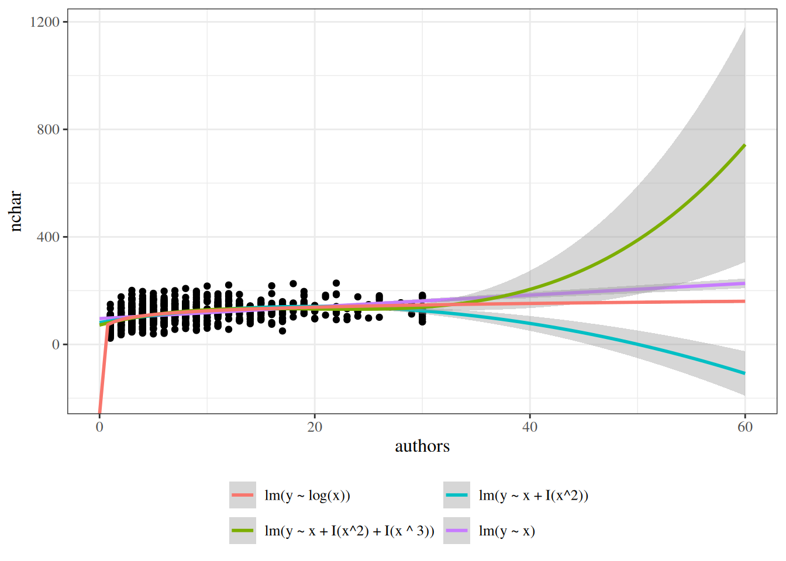](Linear-models-overview_files/figure-html/fig-plos-multifit-1.png "Figure 31: Number of authors versus title length in PLOS Medicine")
>
> Figure 31: Number of authors versus title length in *PLOS Medicine*

------------------------------------------------------------------------

#### Scale-location plot

> **NOTE:**
>
> **Definition 20 (Scale-location plot)** A **scale-location plot** graphs $\sqrt{\mathopen{}\left|{\hat{\varepsilon}'{}}_i\right|\mathclose{}}$, the square root of the absolute value of each [standardized residual](#def-stred), against the corresponding [fitted value](#def-fitted-value) $\hat y_i$.

Taking the absolute value folds the negative [residuals](#def-resid-fitted) onto the positive ones, so the height of the cloud of points tracks the spread of the residuals instead of their sign. Taking the square root then shrinks the large values of $\mathopen{}\left|{\hat{\varepsilon}'{}}_i\right|\mathclose{}$, which makes the cloud less skewed.

> **NOTE:**
>
> **Example 12 (Scale-location plot for the `birthweight` model)** [Figure 32](#fig-bw-scale-loc) shows the [scale-location plot](#def-scale-location-plot) for the `birthweight` model with interactions ([Equation 2](#eq-BW-lm-interact)).
>
> > **NOTE:**
> >
> > Show R code
> >
> > ``` downlit
> > autoplot(bw_lm2, which = 3, ncol = 1) |> print()
> > ```
> >
> > [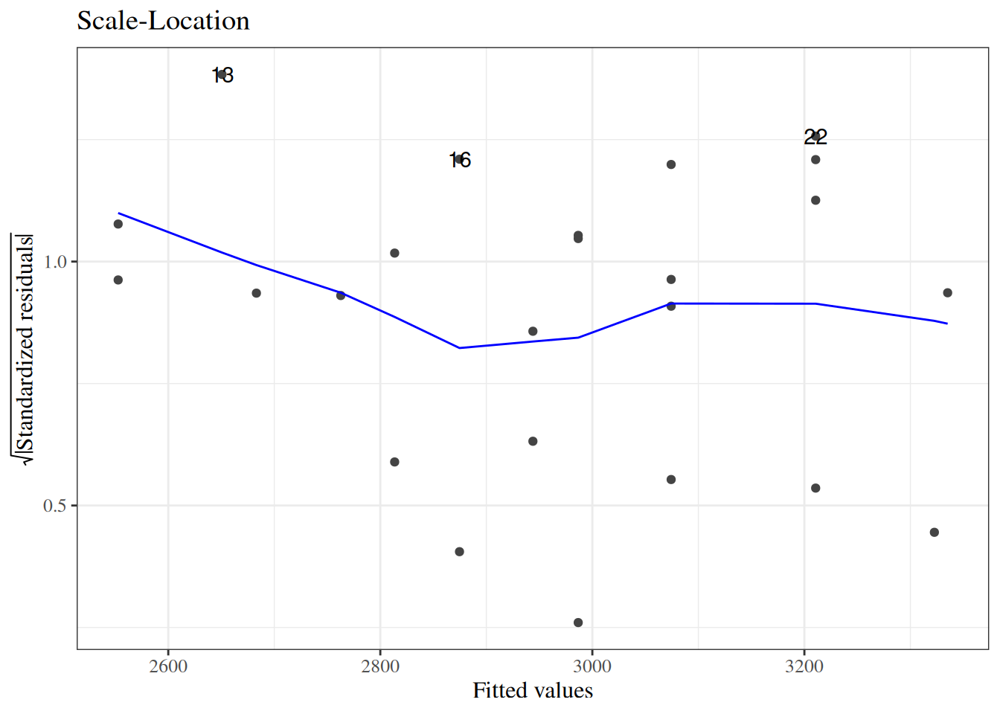](Linear-models-overview_files/figure-html/unnamed-chunk-93-1.png "Figure 32: Scale-location plot of birthweight data")
> >
> > Figure 32: Scale-location plot of `birthweight` data
>
> The blue trend line is roughly flat, so this plot shows no clear sign that the residual [variance](https://morrison-lab.github.io/pds/variance-covariance.html#def-variance) changes with the fitted value.

Unlike the residuals-versus-fitted plot ([Figure 24](#fig-bw_lm2-resid-vs-fitted)), the blue line in a scale-location plot doesn’t need to be near 0, but it should be flat. If the standardized residuals have a standard [Gaussian distribution](https://morrison-lab.github.io/pds/random-variables.html#def-normal), the line should sit near ${\mathbb{E}\mathopen{}\left[\sqrt{\mathopen{}\left|Z\right|\mathclose{}}\right]\mathclose{}} \approx 0.82$, where $Z \sim {\operatorname{N}\mathopen{}\left(0,1\right)\mathclose{}}$:

``` downlit
gamma(3 / 4) * 2^(1 / 4) / sqrt(pi)
#> [1] 0.822179
```

If the line trends upward or downward, the residual variance $\sigma^2$ might not be constant. In a residuals-versus-fitted plot, the same problem shows up as a funnel shape; transforming the outcome $Y$ (for example, with $\log{Y}$ or $\sqrt{Y}$) or using a model that allows non-constant variance can help [\[23, Sec. 3.3.3\]](#ref-james2021islr2e).

> **NOTE:**
>
> **Example 13 (Scale-location plot when the variance is not constant)** [Figure 33](#fig-scale-loc-hetero) shows a scale-location plot for simulated data whose residual [standard deviation](https://morrison-lab.github.io/pds/variance-covariance.html#def-sd) grows in proportion to the mean. The blue line slopes clearly upward, which is the pattern that signals non-constant variance.
>
> > **NOTE:**
> >
> > Show R code
> >
> > ``` downlit
> > set.seed(1)
> > sim_hetero <- tibble::tibble(
> >   x = runif(200, min = 1, max = 10),
> >   y = rnorm(200, mean = 2 * x, sd = 0.5 * x)
> > )
> > lm(y ~ x, data = sim_hetero) |>
> >   autoplot(which = 3, ncol = 1) |>
> >   print()
> > ```
> >
> > [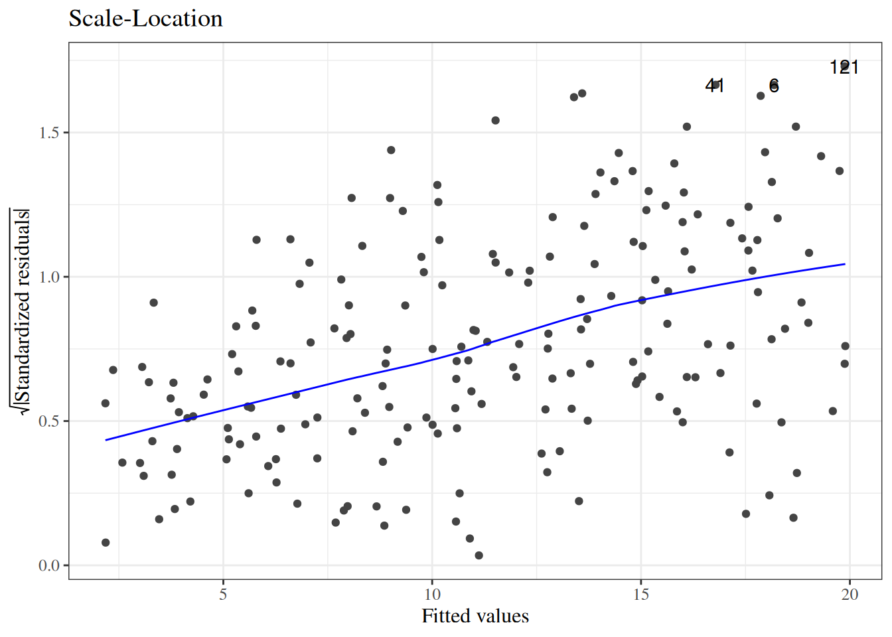](Linear-models-overview_files/figure-html/unnamed-chunk-95-1.png "Figure 33: Scale-location plot for simulated data with non-constant variance")
> >
> > Figure 33: Scale-location plot for simulated data with non-constant variance

------------------------------------------------------------------------

#### Residuals versus leverage

We can also plot our standardized residuals against “[leverage](https://morrison-lab.github.io/sds/model-validation.html#def-leverage)”, which roughly speaking is a measure of how unusual each $x_i$ value is. Very unusual $x_i$ values can have extreme effects on the model fit, so we might want to remove those observations as outliers, particularly if they have large residuals.

> **NOTE:**
>
> Show R code
>
> ``` downlit
> autoplot(bw_lm2, which = 5, ncol = 1) |> print()
> ```
>
> [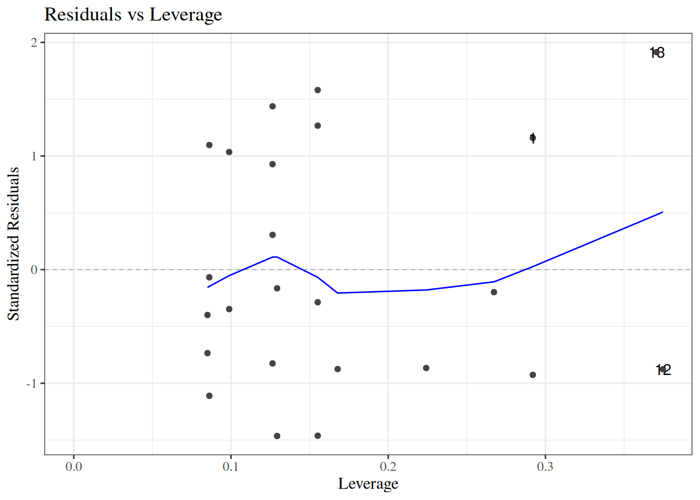](Linear-models-overview_files/figure-html/unnamed-chunk-96-1.png "Figure 34: birthweight model with interactions (Equation 2): residuals versus leverage")
>
> Figure 34: `birthweight` model with interactions ([Equation 2](#eq-BW-lm-interact)): residuals versus leverage

The blue line should be relatively flat and close to 0 here. The curved dashed contour lines show where [Cook’s distance](#def-cooks-distance) equals 0.5 and 1; observations near or beyond those contours have substantial influence on the fit (see [Section 4.8.6](#sec-cooks-distance)).

------------------------------------------------------------------------

### 4.8.6 Cook’s distance

> **TIP:**
>
> This section is adapted from Dobson and Barnett [\[1, Sec. 6.3\]](#ref-dobson4e).

[Residuals](#def-resid-fitted) and [leverage](https://morrison-lab.github.io/sds/model-validation.html#def-leverage) each capture one aspect of an observation’s influence on the model fit. [Cook’s distance](#def-cooks-distance) [\[24\]](#ref-cook1977detection) combines them into a single diagnostic.

> **NOTE:**
>
> **Definition 21 (Cook’s distance)** For [ordinary least squares](https://morrison-lab.github.io/sds/correlation-regression.html#def-ols) with $p$ parameters, the **Cook’s distance** for observation $i$ is
>
> $$D_i
> \stackrel{\text{def}}{=}\frac{{(\hat{\mathord{\smash[b]{\underset{\raise.3ex\hbox{$\scriptstyle\sim$}}{\beta}}\vphantom{\beta}}}_{(-i)} - \hat{\mathord{\smash[b]{\underset{\raise.3ex\hbox{$\scriptstyle\sim$}}{\beta}}\vphantom{\beta}}})}^{\top}
> {\mathbf{X}}^{\top}\mathbf{X}
> (\hat{\mathord{\smash[b]{\underset{\raise.3ex\hbox{$\scriptstyle\sim$}}{\beta}}\vphantom{\beta}}}_{(-i)} - \hat{\mathord{\smash[b]{\underset{\raise.3ex\hbox{$\scriptstyle\sim$}}{\beta}}\vphantom{\beta}}})}{p\,\hat{\sigma}^2}
> \tag{20}$$
>
> where $\hat{\mathord{\smash[b]{\underset{\raise.3ex\hbox{$\scriptstyle\sim$}}{\beta}}\vphantom{\beta}}}_{(-i)}$ is the least-squares estimate obtained after deleting observation $i$.

Because refitting the model $n$ times is expensive, [Equation 20](#eq-cooks-distance-def) has an equivalent closed-form expression that uses only quantities from the full-data fit:

$$D_i = \frac{({\hat{\varepsilon}'{}}_i)^2}{p} \cdot \frac{h_{ii}}{1-h_{ii}}
\tag{21}$$

where ${\hat{\varepsilon}'{}}_i$ is the [standardized residual](#def-stred) ([Definition 16](#def-stred)) and $h_{ii}$ is the leverage (diagonal of the [hat matrix](#def-hat-matrix), [Definition 15](#def-hat-matrix)).

> **NOTE:**
>
> **Example 14** Consider a regression with $p = 2$ parameters. Suppose observation $i$ has standardized residual ${\hat{\varepsilon}'{}}_i = 2$ and leverage $h_{ii} = 0.3$. Applying [Equation 21](#eq-cooks-distance-formula),
>
> $$D_i = \frac{(2)^2}{2} \cdot \frac{0.3}{1 - 0.3} = 2 \cdot 0.43 \approx 0.86.$$

[Equation 21](#eq-cooks-distance-formula) shows that influence has two ingredients:

- **Residual size** ($({\hat{\varepsilon}'{}}_i)^2$): a poorly fitted observation pushes $D_i$ up regardless of its leverage.
- **Leverage** ($h_{ii}/(1-h_{ii})$): high leverage amplifies the effect of even a moderate residual.

An observation must be both unusual in its predictor values *and* poorly fitted to have a large Cook’s distance.

#### Cook’s distance plot

We can visualize Cook’s distances for all observations using `autoplot` with `which = 4` ([Figure 35](#fig-bw-cooks-distance)).

> **NOTE:**
>
> Show R code
>
> ``` downlit
> autoplot(bw_lm2, which = 4, ncol = 1) |> print()
> ```
>
> [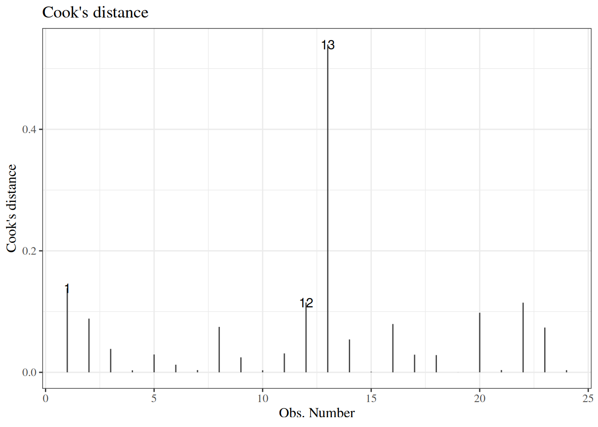](Linear-models-overview_files/figure-html/unnamed-chunk-97-1.png "Figure 35: Cook’s distance for birthweight model with interactions (Equation 2)")
>
> Figure 35: Cook’s distance for `birthweight` model with interactions ([Equation 2](#eq-BW-lm-interact))

A commonly cited rule of thumb [\[1, Sec. 6.3\]](#ref-dobson4e) flags observation $i$ as influential if

$$D_i > 1$$

A more conservative threshold is $D_i > 4/n$ [\[25\]](#ref-bollen1990regression).

Observations exceeding either threshold warrant closer inspection: check whether they represent genuine data or recording errors, and consider refitting the model with and without them to assess sensitivity.

The residuals-versus-leverage plot ([Figure 34](#fig-bw_lm2_resid-vs-leverage)) also displays Cook’s distance contours as curved dashed lines. An observation lying near or beyond a contour line has substantial influence on the fit.

Computing Cook’s distances in R:

Show R code

``` downlit
cooks.distance(bw_lm2)
#>           1           2           3           4           5           6 
#> 0.138666533 0.088394496 0.038580119 0.003306326 0.029380480 0.012546308 
#>           7           8           9          10          11          12 
#> 0.003700182 0.074772987 0.024651000 0.003389576 0.031165758 0.115007141 
#>          13          14          15          16          17          18 
#> 0.539629434 0.054112479 0.001002262 0.079551451 0.029067335 0.028360493 
#>          19          20          21          22          23          24 
#> 0.000107797 0.098092422 0.003781150 0.114688577 0.073731478 0.003576445
```

> **NOTE:**
>
> **Exercise 16** Verify [Equation 21](#eq-cooks-distance-formula) for the observations in `bw_lm2`: compute $D_i$ using the [standardized residuals](#def-stred) and [leverage](https://morrison-lab.github.io/sds/model-validation.html#def-leverage) values.

> **NOTE:**
>
> *Solution 2*.
>
> Show R code
>
> ``` downlit
> r_prime <- rstandard(bw_lm2)
> h <- hatvalues(bw_lm2)
> p <- length(coef(bw_lm2))
>
> D_manual <- (r_prime^2 / p) * (h / (1 - h))
> head(D_manual, 3)
> #>         1         2         3 
> #> 0.1386665 0.0883945 0.0385801
> ```

> **NOTE:**
>
> **Exercise 17** In the setting of [Exercise 16](#exr-cooks-d-formula), check that your computed $D_i$ values match `cooks.distance(bw_lm2)`.

> **NOTE:**
>
> *Solution 3*. Compare `D_manual` from [Solution 2](#sol-cooks-d-formula) with the built-in values:
>
> Show R code
>
> ``` downlit
> cbind(manual = D_manual, builtin = cooks.distance(bw_lm2)) |> head(3)
> #>      manual   builtin
> #> 1 0.1386665 0.1386665
> #> 2 0.0883945 0.0883945
> #> 3 0.0385801 0.0385801
> ```

### 4.8.7 Diagnostics constructed by hand

Show R code

``` downlit
bw <-
  bw |>
  mutate(
    predlm2 = predict(bw_lm2),
    residlm2 = weight - predlm2,
    std_resid = residlm2 / sigma(bw_lm2),
    # std_resid_builtin = rstandard(bw_lm2), # uses leverage
    sqrt_abs_std_resid = std_resid |> abs() |> sqrt()
  )
```

##### Residuals vs fitted

Show R code

``` downlit
resid_vs_fit <- bw |>
  ggplot(
    aes(x = predlm2, y = residlm2, col = sex, shape = sex)
  ) +
  geom_point() +
  theme_classic() +
  geom_hline(yintercept = 0)

print(resid_vs_fit)
```

[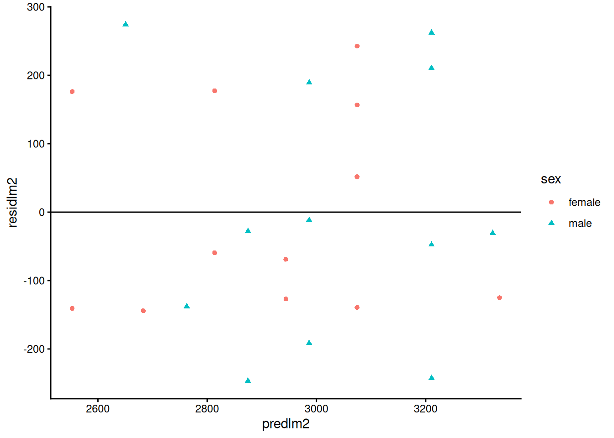](Linear-models-overview_files/figure-html/unnamed-chunk-102-1.png)

##### Standardized residuals vs fitted

Show R code

``` downlit
bw |>
  ggplot(
    aes(x = predlm2, y = std_resid, col = sex, shape = sex)
  ) +
  geom_point() +
  theme_classic() +
  geom_hline(yintercept = 0)
```

[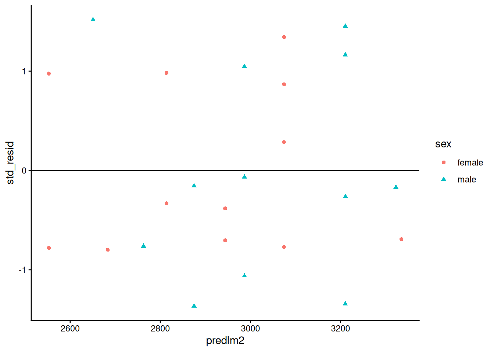](Linear-models-overview_files/figure-html/unnamed-chunk-103-1.png)

##### Standardized residuals vs gestational age

Show R code

``` downlit
bw |>
  ggplot(
    aes(x = age, y = std_resid, col = sex, shape = sex)
  ) +
  geom_point() +
  theme_classic() +
  geom_hline(yintercept = 0)
```

[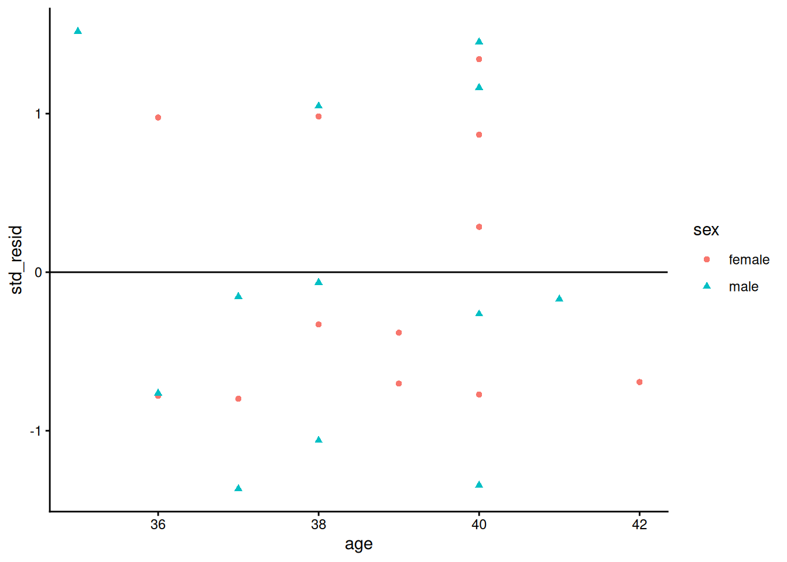](Linear-models-overview_files/figure-html/unnamed-chunk-104-1.png)

##### `sqrt(abs(std_resid))` vs fitted

Compare with `autoplot(bw_lm2, 3)` (note: `autoplot` uses leverage-adjusted [`rstandard()`](https://rdrr.io/r/stats/influence.measures.html))

Show R code

``` downlit
bw |>
  ggplot(
    aes(x = predlm2, y = sqrt_abs_std_resid, col = sex, shape = sex)
  ) +
  geom_point() +
  theme_classic() +
  geom_hline(yintercept = 0)
```

[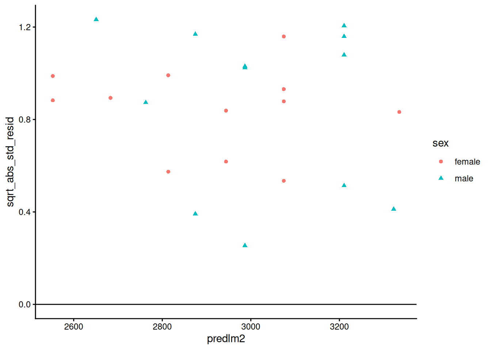](Linear-models-overview_files/figure-html/unnamed-chunk-105-1.png)

### 4.8.8 Diagnostics for the independence assumption

The [independence](https://morrison-lab.github.io/pds/independence.html#def-indpt) assumption means that the model errors are independent, or at least [uncorrelated](https://morrison-lab.github.io/pds/variance-covariance.html#def-uncorrelated), across observations after conditioning on the [predictors](../chapters/Intro-to-GLMs.llms.md#def-predictors) in the model. Because those errors are unobserved, we usually assess this assumption using residual-based plots and formal tests.

For data with a natural ordering (for example, time, spatial location, or clinic visit sequence), we usually assess independence with both plots and formal tests [\[4, Ch. 12\]](#ref-kutner2005applied), [\[5, Ch. 6\]](#ref-chatterjee2015regression).

> **NOTE:**
>
> **Definition 22 (Common diagnostics for independence)**  
>
> 1.  [Residuals](#def-resid-fitted) versus observation order (or time) plots: patterns, runs, or drifts can indicate dependence [\[4, Ch. 12\]](#ref-kutner2005applied).
>
> 2.  Correlograms: plot the sample autocorrelation function (ACF), and often the partial autocorrelation function (PACF), to look for serial structure [\[5, Ch. 6\]](#ref-chatterjee2015regression).
>
> 3.  [Durbin-Watson test](#def-durbin-watson-diagnostic): tests for first-order serial [correlation](https://morrison-lab.github.io/pds/variance-covariance.html#def-correlation) in regression residuals [\[4, Ch. 12\]](#ref-kutner2005applied), [\[5, Ch. 9\]](#ref-chatterjee2015regression).
>
> 4.  [Breusch-Godfrey test](#def-breusch-godfrey-diagnostic): tests for higher-order serial correlation, and is more flexible than Durbin-Watson in many regression settings [\[4, Ch. 12\]](#ref-kutner2005applied), [\[5, Ch. 9\]](#ref-chatterjee2015regression).

#### Mathematical details for Durbin-Watson and Breusch-Godfrey

Suppose the observations have a meaningful order, indexed by $t = 1, \ldots, n$. Let $e_t$ denote the [OLS](https://morrison-lab.github.io/sds/correlation-regression.html#def-ols) residual from a fitted [regression model](../chapters/Intro-to-GLMs.llms.md#def-regression-model).

> **NOTE:**
>
> **Definition 23 (Durbin-Watson diagnostic)** The [test statistic](https://morrison-lab.github.io/sds/inference.html#def-test-statistic) is $$\begin{aligned}
> d
> &= \frac{\sum_{t = 2}^{n} (e_t - e_{t-1})^2}
> {\sum_{t = 1}^{n} e_t^2}
> \end{aligned}$$ which is approximately $2(1 - \hat r_1)$, where $\hat r_1$ is the sample lag-1 residual autocorrelation [\[4, Ch. 12\]](#ref-kutner2005applied), [\[5, Ch. 6\]](#ref-chatterjee2015regression). This approximation is most useful in standard large-sample linear-model settings, and is less straightforward in models with lagged outcomes [\[4, Ch. 12\]](#ref-kutner2005applied).
>
> The null and alternatives are typically framed through an AR(1) error model: $$\varepsilon_t = \rho \varepsilon_{t-1} + u_t.$$ Here, $\varepsilon_t$ is the autocorrelated regression error process, and $u_t$ is a white-noise innovation term. The null is $H_0: \rho = 0$, and alternatives can be one-sided or two-sided, depending on whether we suspect positive, negative, or any serial [correlation](https://morrison-lab.github.io/pds/variance-covariance.html#def-correlation) [\[4, Ch. 12\]](#ref-kutner2005applied).

> **NOTE:**
>
> **Definition 24 (Breusch-Godfrey diagnostic)** For a test of order $p$, we run an auxiliary regression of [residuals](#def-resid-fitted) on: the original regressors, and lagged residuals $e_{t-1}, \ldots, e_{t-p}$. If $R^2_{\text{aux}}$ is from that auxiliary model, the LM statistic is $$\text{LM} = (n - p)R^2_{\text{aux}},$$ and under $H_0: \rho_1 = \cdots = \rho_p = 0$, it is asymptotically $\chi^2_p$ [\[5, Ch. 6\]](#ref-chatterjee2015regression), [\[26, Ch. 11\]](#ref-draper2014applied).

> **NOTE:**
>
> **Example 15 (Simulated example for independence diagnostics)** The following simulation generates ordered data with positively autocorrelated errors. This serial [correlation](https://morrison-lab.github.io/pds/variance-covariance.html#def-correlation) creates a setting where [independence](https://morrison-lab.github.io/pds/independence.html#def-indpt) should fail. We generate the error term from an AR(1) process with coefficient 0.7, matching the notation in the mathematical details section.
>
> ``` downlit
> set.seed(204)
>
> n_obs <- 120
> x <- seq(-1, 1, length.out = n_obs)
> ar_errors <- as.numeric(arima.sim(model = list(ar = 0.7), n = n_obs, sd = 1))
> y <- 2 + 1.5 * x + ar_errors
>
> serial_dep_exm <- tibble::tibble(
>   time_index = seq_len(n_obs),
>   x = x,
>   y = y
> )
>
> serial_dep_exm_lm <- lm(y ~ x, data = serial_dep_exm)
>
> summary(serial_dep_exm_lm)
> #> 
> #> Call:
> #> lm(formula = y ~ x, data = serial_dep_exm)
> #> 
> #> Residuals:
> #>     Min      1Q  Median      3Q     Max 
> #> -2.6747 -0.9128 -0.0552  1.0087  2.5022 
> #> 
> #> Coefficients:
> #>             Estimate Std. Error t value Pr(>|t|)    
> #> (Intercept)    1.998      0.110   18.13  < 2e-16 ***
> #> x              1.773      0.189    9.37  6.4e-16 ***
> #> ---
> #> Signif. codes:  0 '***' 0.001 '**' 0.01 '*' 0.05 '.' 0.1 ' ' 1
> #> 
> #> Residual standard error: 1.21 on 118 degrees of freedom
> #> Multiple R-squared:  0.426,  Adjusted R-squared:  0.422 
> #> F-statistic: 87.7 on 1 and 118 DF,  p-value: 6.36e-16
> ```
>
> [Residuals](#def-resid-fitted) versus order:
>
> Show R code
>
> ``` downlit
> serial_dep_exm |>
>   dplyr::mutate(resid = resid(serial_dep_exm_lm)) |>
>   ggplot(aes(x = time_index, y = resid)) +
>   geom_hline(yintercept = 0, linetype = "dashed", color = "gray50") +
>   geom_line(color = "steelblue") +
>   theme_classic() +
>   labs(
>     x = "Observation order",
>     y = "Residual"
>   )
> ```
>
> > **NOTE:**
> >
> > [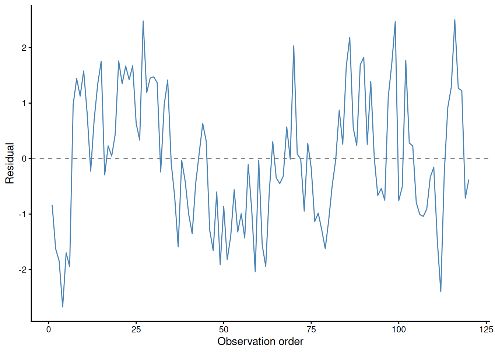](Linear-models-overview_files/figure-html/fig-independence-resid-order-1.png "Figure 36: Residuals versus observation order for simulated data")
> >
> > Figure 36: Residuals versus observation order for simulated data
>
> Correlogram diagnostics:
>
> Show R code
>
> ``` downlit
> local({
>   op <- par(no.readonly = TRUE)
>   on.exit(par(op), add = TRUE)
>   par(mfrow = c(1, 2))
>   acf(
>     resid(serial_dep_exm_lm),
>     main = "Residual ACF"
>   )
>   pacf(
>     resid(serial_dep_exm_lm),
>     main = "Residual PACF"
>   )
> })
> ```
>
> > **NOTE:**
> >
> > [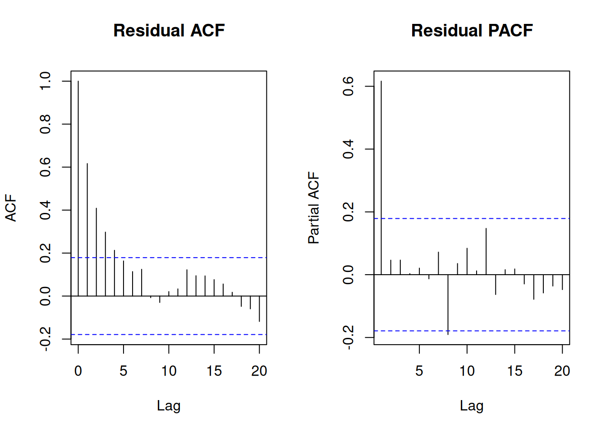](Linear-models-overview_files/figure-html/fig-independence-correlogram-1.png "Figure 37: Residual ACF and PACF for simulated data")
> >
> > Figure 37: Residual ACF and PACF for simulated data
>
> [Durbin-Watson](#def-durbin-watson-diagnostic) and [Breusch-Godfrey](#def-breusch-godfrey-diagnostic) tests:
>
> ``` downlit
> lmtest::dwtest(serial_dep_exm_lm, alternative = "two.sided")
> #> 
> #>  Durbin-Watson test
> #> 
> #> data:  serial_dep_exm_lm
> #> DW = 0.7623, p-value = 4.16e-12
> #> alternative hypothesis: true autocorrelation is not 0
> lmtest::bgtest(serial_dep_exm_lm, order = 4)
> #> 
> #>  Breusch-Godfrey test for serial correlation of order up to 4
> #> 
> #> data:  serial_dep_exm_lm
> #> LM test = 45.94, df = 4, p-value = 2.53e-09
> ```
>
> In this example, the residual-order plot and correlogram suggest serial dependence, and both formal tests reject independence.

> **NOTE:**
>
> **Example 16 (Real-data examples for independence diagnostics)** We can also run the same diagnostics on real ordered data sets.
>
> ##### Nile annual river flow
>
> ``` downlit
> nile_df <- tibble::tibble(
>   year = as.numeric(time(datasets::Nile)),
>   flow = as.numeric(datasets::Nile)
> )
>
> nile_lm <- lm(flow ~ year, data = nile_df)
>
> summary(nile_lm)
> #> 
> #> Call:
> #> lm(formula = flow ~ year, data = nile_df)
> #> 
> #> Residuals:
> #>    Min     1Q Median     3Q    Max 
> #> -483.7  -98.2  -23.2  111.4  368.7 
> #> 
> #> Coefficients:
> #>             Estimate Std. Error t value Pr(>|t|)    
> #> (Intercept) 6132.174   1001.758    6.12  1.9e-08 ***
> #> year          -2.714      0.522   -5.20  1.1e-06 ***
> #> ---
> #> Signif. codes:  0 '***' 0.001 '**' 0.01 '*' 0.05 '.' 0.1 ' ' 1
> #> 
> #> Residual standard error: 151 on 98 degrees of freedom
> #> Multiple R-squared:  0.217,  Adjusted R-squared:  0.209 
> #> F-statistic: 27.1 on 1 and 98 DF,  p-value: 1.07e-06
> lmtest::dwtest(nile_lm, alternative = "two.sided")
> #> 
> #>  Durbin-Watson test
> #> 
> #> data:  nile_lm
> #> DW = 1.247, p-value = 9.37e-05
> #> alternative hypothesis: true autocorrelation is not 0
> lmtest::bgtest(nile_lm, order = 4)
> #> 
> #>  Breusch-Godfrey test for serial correlation of order up to 4
> #> 
> #> data:  nile_lm
> #> LM test = 15.94, df = 4, p-value = 0.0031
> ```
>
> Show R code
>
> ``` downlit
> nile_df |>
>   dplyr::mutate(resid = resid(nile_lm)) |>
>   ggplot(aes(x = year, y = resid)) +
>   geom_hline(yintercept = 0, linetype = "dashed", color = "gray50") +
>   geom_line(color = "steelblue") +
>   theme_classic() +
>   labs(
>     x = "Year",
>     y = "Residual"
>   )
> ```
>
> > **NOTE:**
> >
> > [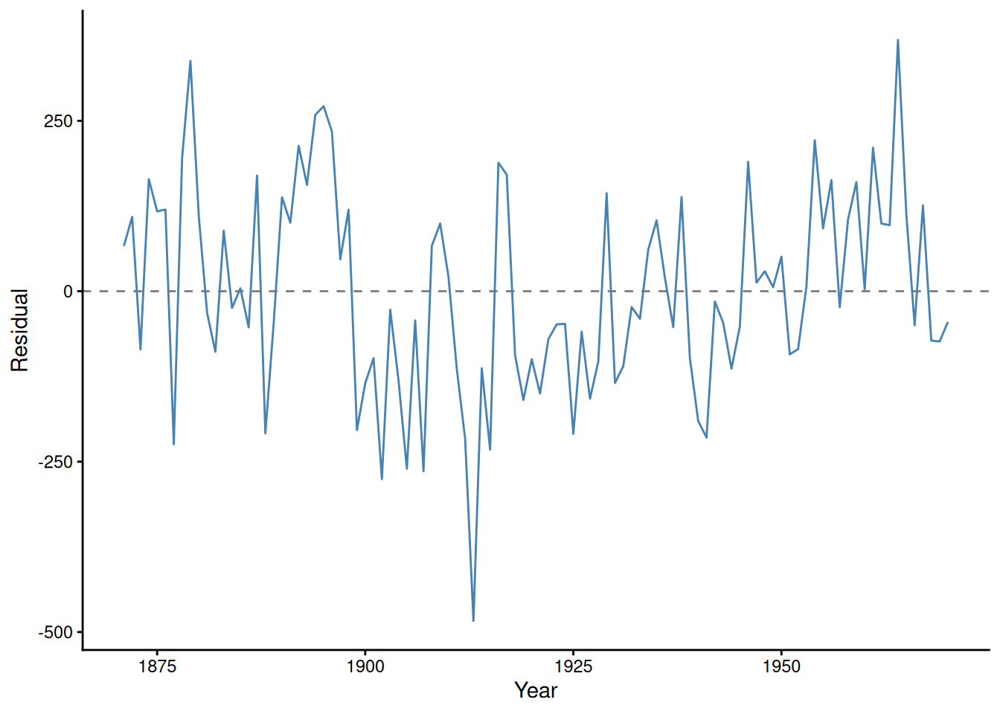](Linear-models-overview_files/figure-html/fig-independence-real-nile-resid-order-1.png "Figure 38: Residuals versus year for Nile flow model")
> >
> > Figure 38: Residuals versus year for Nile flow model
>
> ##### Mauna Loa atmospheric carbon dioxide (`co2`)
>
> ``` downlit
> co2_df <- tibble::tibble(
>   decimal_year = as.numeric(time(datasets::co2)),
>   co2_ppm = as.numeric(datasets::co2)
> )
>
> co2_lm <- lm(co2_ppm ~ decimal_year, data = co2_df)
>
> summary(co2_lm)
> #> 
> #> Call:
> #> lm(formula = co2_ppm ~ decimal_year, data = co2_df)
> #> 
> #> Residuals:
> #>    Min     1Q Median     3Q    Max 
> #> -6.040 -1.948 -0.002  1.911  6.515 
> #> 
> #> Coefficients:
> #>               Estimate Std. Error t value Pr(>|t|)    
> #> (Intercept)  -2.25e+03   2.13e+01    -106   <2e-16 ***
> #> decimal_year  1.31e+00   1.07e-02     122   <2e-16 ***
> #> ---
> #> Signif. codes:  0 '***' 0.001 '**' 0.01 '*' 0.05 '.' 0.1 ' ' 1
> #> 
> #> Residual standard error: 2.62 on 466 degrees of freedom
> #> Multiple R-squared:  0.969,  Adjusted R-squared:  0.969 
> #> F-statistic: 1.48e+04 on 1 and 466 DF,  p-value: <2e-16
> lmtest::dwtest(co2_lm, alternative = "two.sided")
> #> 
> #>  Durbin-Watson test
> #> 
> #> data:  co2_lm
> #> DW = 0.2124, p-value <2e-16
> #> alternative hypothesis: true autocorrelation is not 0
> lmtest::bgtest(co2_lm, order = 12)
> #> 
> #>  Breusch-Godfrey test for serial correlation of order up to 12
> #> 
> #> data:  co2_lm
> #> LM test = 453.9, df = 12, p-value <2e-16
> ```
>
> For both real-data examples, the diagnostics indicate residual dependence, consistent with their time-ordered structure.

No single diagnostic is definitive. In practice, we combine visual and formal diagnostics, and interpret them in the context of study design [\[4, Ch. 12\]](#ref-kutner2005applied), [\[26, Ch. 11\]](#ref-draper2014applied).

## 4.9 Model selection

(adapted from Dobson and Barnett [\[1\]](#ref-dobson4e) §6.3.3; for more information on prediction, see James et al. [\[27\]](#ref-james2013introduction) and Harrell [\[28\]](#ref-rms2e)).

If we have a lot of [covariates](../chapters/Intro-to-GLMs.llms.md#def-predictors) in our dataset, we might want to choose a small subset to use in our model.

There are a few possible metrics to consider for choosing a “best” model.

### 4.9.1 DAGs for variable selection

For explanatory models, variable inclusion should not rely on automated algorithms alone. Directed acyclic graphs (DAGs) can help us encode substantive assumptions about which variables are [confounders](../chapters/causal-inference.llms.md#def-confounder), [mediators](../chapters/causal-inference.llms.md#def-mediator), or [colliders](../chapters/causal-inference.llms.md#def-collider).

In a Dobson-style workflow, we use the DAG first to decide a defensible adjustment set, then compare candidate [regression models](../chapters/Intro-to-GLMs.llms.md#def-regression-model) within that set using predictive or likelihood-based criteria. This approach keeps model selection aligned with study design, rather than only with numerical fit.

In this workflow, the DAG encodes hypothesized time ordering and causal pathways. This structure helps us decide which variables belong in the candidate model set before we run [stepwise](../chapters/predictor-selection.llms.md#sec-pred-sel-stepwise), subset, or penalized selection methods. The key point is that a variable can improve apparent fit while still distorting the effect we care about if it sits on a causal pathway or induces collider bias [\[1, Sec. 6.3.3\]](#ref-dobson4e).

> **NOTE:**
>
> **Example 17 (high temperatures and mortality)** Suppose the research question is: “What is the effect of high temperatures on deaths?”
>
> A plausible DAG includes: high temperatures $\rightarrow$ deaths, high temperatures $\rightarrow$ blackouts, high temperatures $\rightarrow$ forest fires, blackouts $\rightarrow$ deaths, forest fires $\rightarrow$ air pollution, and both forest fires and air pollution $\rightarrow$ deaths [\[1, Sec. 6.3.3\]](#ref-dobson4e).
>
> Show R code
>
> ``` downlit
> dag_heat_deaths <- ggdag::dagify(
>   D ~ T + B + F + P,
>   B ~ T,
>   F ~ T,
>   P ~ F,
>   exposure = "T",
>   outcome = "D",
>   labels = c(
>     T = "High temperatures",
>     D = "Deaths",
>     B = "Blackouts",
>     F = "Forest fires",
>     P = "Air pollution"
>   )
> )
>
> dag_heat_deaths |>
>   ggdag::ggdag(use_labels = "label") +
>   ggdag::theme_dag()
> ```
>
> > **NOTE:**
> >
> > [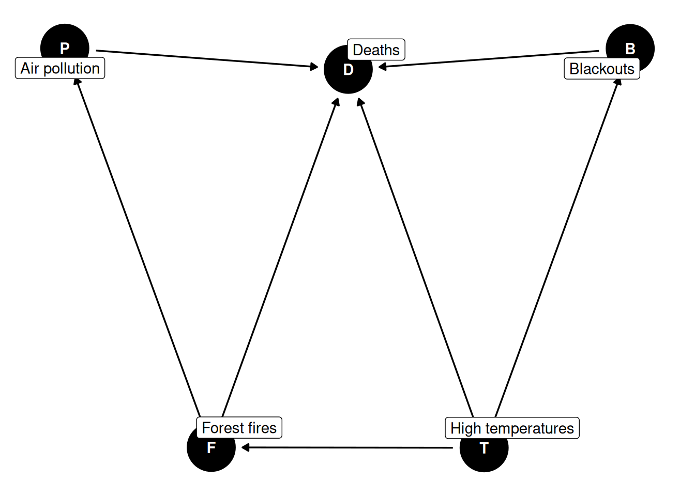](Linear-models-overview_files/figure-html/fig-dag-heat-deaths-1.png "Figure 39: DAG for the high temperatures and mortality example.")
> >
> > Figure 39: DAG for the high temperatures and mortality example.
>
> If our [estimand](https://morrison-lab.github.io/sds/estimation.html#def-estimand) is the total effect of high temperatures on deaths, then blackouts, forest fires, and air pollution are mediators on downstream pathways. Adjusting for them would remove part of the effect we are trying to estimate.
>
> But if the estimand changes to the effect of blackouts on deaths, then high temperatures become a confounder because they are a common cause of both blackouts and deaths. So the same variable can be “adjust for” or “do not adjust for” depending on the causal question.

> **NOTE:**
>
> **Example 18 (salmonellosis and weather)** For daily salmonellosis counts, a plausible DAG has temperature and rainfall as direct causes of risk, with both variables also affecting humidity. If humidity has no direct arrow to salmonellosis, then humidity is not a causal driver; it mainly reflects shared variation from temperature and rainfall. Including humidity in the regression is therefore usually unnecessary for estimating the weather effects, and it may reduce interpretability because humidity is a collider of temperature and rainfall. Conditioning on humidity can induce misleading associations and bias weather-effect estimates when that conditioning opens a path between temperature and rainfall that is not otherwise blocked [\[1, Sec. 6.3.3\]](#ref-dobson4e).
>
> Show R code
>
> ``` downlit
> dag_salmonellosis_weather <- ggdag::dagify(
>   S ~ T + R + C,
>   H ~ T + R,
>   T ~ Se,
>   R ~ Se,
>   labels = c(
>     S = "Salmonellosis",
>     T = "Temperature",
>     R = "Rainfall",
>     H = "Humidity",
>     C = "Test change",
>     Se = "Season"
>   )
> )
>
> dag_salmonellosis_weather |>
>   ggdag::ggdag(use_labels = "label") +
>   ggdag::theme_dag()
> ```
>
> > **NOTE:**
> >
> > [](Linear-models-overview_files/figure-html/fig-dag-salmonellosis-weather-1.png "Figure 40: DAG for the salmonellosis and weather example.")
> >
> > Figure 40: DAG for the salmonellosis and weather example.
>
> The same DAG can include a “change in test” indicator when surveillance switched to a more sensitive diagnostic test. That variable can improve predictive accuracy and face validity, but omitting it does not invalidate causal interpretation for temperature and rainfall effects if it is not on their causal paths [\[1, Sec. 6.3.3\]](#ref-dobson4e).
>
> Likewise, season may cause both temperature and rainfall, but if season has no direct path to salmonellosis beyond those weather variables, including season can obscure interpretation of the proximal weather effects [\[1, Sec. 6.3.3\]](#ref-dobson4e).
>
> Finally, DAG-informed variable definitions matter. In one intensive-care example, a “nutrition score” looked highly predictive of mortality until investigators clarified that people near death were often coded as zero because no assessment was completed. So the recorded variable combined nutrition with prognosis, and naive selection would overstate its scientific meaning [\[1, Sec. 6.3.3\]](#ref-dobson4e).

### 4.9.2 Mean squared error

We might want to minimize the **[population mean squared error (pMSE)](https://morrison-lab.github.io/sds/estimation.html#def-mse)**, ${\mathbb{E}\mathopen{}\left[(y-\hat y)^2\right]\mathclose{}}$, for new observations that weren’t in our data set when we fit the model.

Unfortunately, $$\frac{1}{n}\sum_{i=1}^n (y_i-\hat y_i)^2$$ gives a biased estimate of ${\mathbb{E}\mathopen{}\left[(y-\hat y)^2\right]\mathclose{}}$ for new data. If we want an [unbiased](https://morrison-lab.github.io/sds/estimation.html#def-unbiased) estimate, we will have to be clever.

This optimism in sample fit is one reason that $R^2$ is not enough for model selection. $R^2$ does not decrease as we add explanatory variables, even when those variables do not improve out-of-sample prediction. Selecting a model by maximizing $R^2$ alone can lead to [overfitting](../chapters/predictor-selection.llms.md#def-overfitting), since $R^2$ does not penalize this non-decreasing property.

With a training/test split, we estimate coefficients in the [training data](https://morrison-lab.github.io/sds/model-validation.html#def-training-set) and compute [prediction error](https://morrison-lab.github.io/sds/prediction.html#def-prediction-error) in held-out data. The root mean squared error in the held-out data is the **[sample root mean squared error (sRMSE)](https://morrison-lab.github.io/sds/model-validation.html#def-prediction-rmse)**:

$$\hat\beta_{\text{train}} =
({X_{\text{train}}}^{\top}X_{\text{train}})^{-1}
{X_{\text{train}}}^{\top}y_{\text{train}}$$

$$\hat e_{i,\text{test}} =
y_{\text{test},i} -
\mathopen{}\left\{
\hat\beta_{0,\text{train}} +
\sum_{j=1}^p \hat\beta_{j,\text{train}}x_{\text{test},ij}
\right\}\mathclose{},
\quad i \in \text{test set}$$

$$\operatorname{sRMSE}= \sqrt{
\frac{1}{n_{\text{test}}}
\sum_{i \in \text{test set}} (\hat e_{i,\text{test}})^2
}$$

## 4.10 Train/validation/test splits

In many applications, we split the data into training, validation, and [test sets](https://morrison-lab.github.io/sds/model-validation.html#def-test-set). This validation approach extends the basic train/test split by separating model tuning from final model assessment. This framework follows [\[23, pp. 198–201\]](#ref-james2021islr2e).

- Use the **[training set](https://morrison-lab.github.io/sds/model-validation.html#def-training-set)** to estimate model parameters.
- Use the **[validation set](https://morrison-lab.github.io/sds/model-validation.html#def-validation-set)** to compare candidate models, choose transformations, or tune hyperparameters.
- Use the **test set** once at the end to estimate final out-of-sample performance.

Keeping the test set untouched during model building helps avoid optimistic bias from repeatedly trying many models. If data are limited, $k$-fold cross-validation can replace a single validation split for more stable tuning.

> **NOTE:**
>
> **Example 19 (Numerical example)** The following example ([Example 19](#exm-train-validation-test-split)) uses R’s built-in `mtcars` dataset ($n=32$ cars) to predict fuel efficiency (`mpg`) from vehicle weight (`wt`). It uses one random split to compare linear, quadratic, cubic, and quartic models (`mpg ~ wt`, `mpg ~ wt + I(wt^2)`, `mpg ~ wt + I(wt^2) + I(wt^3)`, and `mpg ~ wt + I(wt^2) + I(wt^3) + I(wt^4)`) on a validation set, then reports the chosen model’s test [sRMSE](https://morrison-lab.github.io/sds/model-validation.html#def-prediction-rmse) on untouched test data [\[23, p. 213\]](#ref-james2021islr2e).
>
> ``` downlit
> set.seed(108)
> n <- nrow(mtcars)
>
> n_train <- floor(0.6 * n)
> n_valid <- floor(0.2 * n)
>
> idx_train <- sample.int(n, size = n_train)
> idx_remaining <- setdiff(seq_len(n), idx_train)
> idx_valid <- sample(idx_remaining, size = n_valid)
> idx_test <- setdiff(idx_remaining, idx_valid)
>
> split_sizes <- tibble::tibble(
>   split = c("training", "validation", "test"),
>   n = c(length(idx_train), length(idx_valid), length(idx_test))
> )
> ```
>
> > **NOTE:**
> >
> > Show R code
> >
> > ``` downlit
> > split_sizes
> > ```
> >
> > Table 24: Sizes of the training, validation, and test splits
>
> Show R code
>
> ``` downlit
> train_dat <- mtcars[idx_train, ]
> valid_dat <- mtcars[idx_valid, ]
> test_dat <- mtcars[idx_test, ]
>
> model_linear <- lm(mpg ~ wt, data = train_dat)
> model_quadratic <- lm(mpg ~ wt + I(wt^2), data = train_dat)
> model_cubic <- lm(mpg ~ wt + I(wt^2) + I(wt^3), data = train_dat)
> model_quartic <- lm(
>   mpg ~ wt + I(wt^2) + I(wt^3) + I(wt^4),
>   data = train_dat
> )
>
> compute_rmse <- function(model, data) {
>   sqrt(mean((data$mpg - predict(model, newdata = data))^2))
> }
>
> candidate_models <- list(
>   linear = model_linear,
>   quadratic = model_quadratic,
>   cubic = model_cubic,
>   quartic = model_quartic
> )
>
> validation_results <- tibble::tibble(
>   model = names(candidate_models)
> ) |>
>   dplyr::mutate(
>     training_sRMSE = purrr::map_dbl(
>       model,
>       \(model_name) compute_rmse(candidate_models[[model_name]], train_dat)
>     ),
>     validation_sRMSE = purrr::map_dbl(
>       model,
>       \(model_name) compute_rmse(candidate_models[[model_name]], valid_dat)
>     )
>   )
>
> model_labels <- c(
>   linear = "linear model",
>   quadratic = "quadratic model",
>   cubic = "cubic model",
>   quartic = "quartic model"
> )
>
> chosen_model_name <-
>   validation_results |>
>   dplyr::arrange(validation_sRMSE) |>
>   dplyr::slice(1) |>
>   dplyr::pull(model)
>
> chosen_model_label <- model_labels[[chosen_model_name]]
>
> chosen_model <- candidate_models[[chosen_model_name]]
> chosen_model_validation_rmse <- compute_rmse(chosen_model, valid_dat)
>
> performance_comparison <- tibble::tibble(
>   split = c("validation", "test"),
>   model = chosen_model_name,
>   sRMSE = c(
>     chosen_model_validation_rmse,
>     compute_rmse(chosen_model, test_dat)
>   )
> )
> ```
>
> Show R code
>
> ``` downlit
> partition_colors <- c(
>   training = "#1b9e77",
>   validation = "#d95f02",
>   test = "#7570b3"
> )
> partition_shapes <- c(
>   training = 16,
>   validation = 17,
>   test = 15
> )
> wt_range <- range(c(train_dat$wt, valid_dat$wt, test_dat$wt))
> mpg_range <- range(c(train_dat$mpg, valid_dat$mpg, test_dat$mpg))
> wt_grid <- seq(wt_range[1], wt_range[2], length.out = 200)
> ```
>
> Show R code
>
> ``` downlit
> plot(
>   train_dat$wt,
>   train_dat$mpg,
>   xlab = "wt",
>   ylab = "mpg",
>   pch = partition_shapes[["training"]],
>   xlim = wt_range,
>   ylim = mpg_range,
>   col = partition_colors[["training"]]
> )
> points(
>   valid_dat$wt,
>   valid_dat$mpg,
>   pch = partition_shapes[["validation"]],
>   col = partition_colors[["validation"]]
> )
> points(
>   test_dat$wt,
>   test_dat$mpg,
>   pch = partition_shapes[["test"]],
>   col = partition_colors[["test"]]
> )
> abline(model_linear, col = "blue", lwd = 2)
> legend(
>   "topright",
>   legend = c("training", "validation", "test", "linear fit"),
>   col = c(unname(partition_colors), "blue"),
>   pch = c(unname(partition_shapes), NA),
>   lty = c(NA, NA, NA, 1),
>   lwd = c(NA, NA, NA, 2),
>   bty = "n"
> )
> ```
>
> > **NOTE:**
> >
> > [](Linear-models-overview_files/figure-html/fig-linear-model-superimposed-1.png "Figure 41: Linear model fit superimposed on data partitions")
> >
> > Figure 41: Linear model fit superimposed on data partitions
>
> Show R code
>
> ``` downlit
> plot(
>   train_dat$wt,
>   train_dat$mpg,
>   xlab = "wt",
>   ylab = "mpg",
>   pch = partition_shapes[["training"]],
>   xlim = wt_range,
>   ylim = mpg_range,
>   col = partition_colors[["training"]]
> )
> points(
>   valid_dat$wt,
>   valid_dat$mpg,
>   pch = partition_shapes[["validation"]],
>   col = partition_colors[["validation"]]
> )
> points(
>   test_dat$wt,
>   test_dat$mpg,
>   pch = partition_shapes[["test"]],
>   col = partition_colors[["test"]]
> )
> quadratic_pred <- predict(
>   model_quadratic,
>   newdata = data.frame(wt = wt_grid)
> )
> lines(wt_grid, quadratic_pred, col = "blue", lwd = 2)
> legend(
>   "topright",
>   legend = c("training", "validation", "test", "quadratic fit"),
>   col = c(unname(partition_colors), "blue"),
>   pch = c(unname(partition_shapes), NA),
>   lty = c(NA, NA, NA, 1),
>   lwd = c(NA, NA, NA, 2),
>   bty = "n"
> )
> ```
>
> > **NOTE:**
> >
> > [](Linear-models-overview_files/figure-html/fig-quadratic-model-superimposed-1.png "Figure 42: Quadratic model fit superimposed on data partitions")
> >
> > Figure 42: Quadratic model fit superimposed on data partitions
>
> Show R code
>
> ``` downlit
> plot(
>   train_dat$wt,
>   train_dat$mpg,
>   xlab = "wt",
>   ylab = "mpg",
>   pch = partition_shapes[["training"]],
>   xlim = wt_range,
>   ylim = mpg_range,
>   col = partition_colors[["training"]]
> )
> points(
>   valid_dat$wt,
>   valid_dat$mpg,
>   pch = partition_shapes[["validation"]],
>   col = partition_colors[["validation"]]
> )
> points(
>   test_dat$wt,
>   test_dat$mpg,
>   pch = partition_shapes[["test"]],
>   col = partition_colors[["test"]]
> )
> cubic_pred <- predict(
>   model_cubic,
>   newdata = data.frame(wt = wt_grid)
> )
> lines(wt_grid, cubic_pred, col = "blue", lwd = 2)
> legend(
>   "topright",
>   legend = c("training", "validation", "test", "cubic fit"),
>   col = c(unname(partition_colors), "blue"),
>   pch = c(unname(partition_shapes), NA),
>   lty = c(NA, NA, NA, 1),
>   lwd = c(NA, NA, NA, 2),
>   bty = "n"
> )
> ```
>
> > **NOTE:**
> >
> > [](Linear-models-overview_files/figure-html/fig-cubic-model-superimposed-1.png "Figure 43: Cubic model fit superimposed on data partitions")
> >
> > Figure 43: Cubic model fit superimposed on data partitions
>
> Show R code
>
> ``` downlit
> plot(
>   train_dat$wt,
>   train_dat$mpg,
>   xlab = "wt",
>   ylab = "mpg",
>   pch = partition_shapes[["training"]],
>   xlim = wt_range,
>   ylim = mpg_range,
>   col = partition_colors[["training"]]
> )
> points(
>   valid_dat$wt,
>   valid_dat$mpg,
>   pch = partition_shapes[["validation"]],
>   col = partition_colors[["validation"]]
> )
> points(
>   test_dat$wt,
>   test_dat$mpg,
>   pch = partition_shapes[["test"]],
>   col = partition_colors[["test"]]
> )
> quartic_pred <- predict(
>   model_quartic,
>   newdata = data.frame(wt = wt_grid)
> )
> lines(wt_grid, quartic_pred, col = "blue", lwd = 2)
> legend(
>   "topright",
>   legend = c("training", "validation", "test", "quartic fit"),
>   col = c(unname(partition_colors), "blue"),
>   pch = c(unname(partition_shapes), NA),
>   lty = c(NA, NA, NA, 1),
>   lwd = c(NA, NA, NA, 2),
>   bty = "n"
> )
> ```
>
> > **NOTE:**
> >
> > [](Linear-models-overview_files/figure-html/fig-quartic-model-superimposed-1.png "Figure 44: Quartic model fit superimposed on data partitions")
> >
> > Figure 44: Quartic model fit superimposed on data partitions
>
> > **NOTE:**
> >
> > Show R code
> >
> > ``` downlit
> > validation_results
> > ```
> >
> > Table 25: Training and validation sRMSE for candidate models
>
> The chosen model is the linear model, because it has the lower validation sRMSE.
>
> > **NOTE:**
> >
> > Show R code
> >
> > ``` downlit
> > performance_comparison
> > ```
> >
> > Table 26: Validation and test sRMSE for the chosen model

------------------------------------------------------------------------

## 4.11 Cross-validation

Rather than one arbitrary split, $k$-fold cross-validation repeatedly partitions the data into training and test folds. For each split we compute [prediction error](https://morrison-lab.github.io/sds/prediction.html#def-prediction-error), then summarize errors across folds and replications. The preferred model has lower prediction error, with simpler models favored when errors are similar.

When the number of candidate explanatory variables is small, we can compare all possible subsets ($2^p$ models) using the same cross-validation metric.

Show R code

``` downlit
data("carbohydrate", package = "dobson")
library(cvTools)
full_model <- lm(carbohydrate ~ ., data = carbohydrate)
cv_full <-
  full_model |> cvFit(
    data = carbohydrate, K = 5, R = 10,
    y = carbohydrate$carbohydrate
  )

reduced_model <- full_model |> update(formula = ~ . - age)

cv_reduced <-
  reduced_model |> cvFit(
    data = carbohydrate, K = 5, R = 10,
    y = carbohydrate$carbohydrate
  )
```

------------------------------------------------------------------------

Show R code

``` downlit
results_reduced <-
  tibble(
    model = "wgt+protein",
    errs = cv_reduced$reps[]
  )
results_full <-
  tibble(
    model = "wgt+age+protein",
    errs = cv_full$reps[]
  )

cv_results <-
  bind_rows(results_reduced, results_full)

cv_results |>
  ggplot(aes(y = model, x = errs)) +
  geom_boxplot()
```

[](Linear-models-overview_files/figure-html/unnamed-chunk-112-1.png)

------------------------------------------------------------------------

### 4.11.1 comparing metrics

Show R code

``` downlit
compare_results <- tribble(
  ~model, ~cv_sRMSE, ~r.squared, ~adj.r.squared, ~train_sRMSE, ~loglik,
  "full",
  cv_full$cv,
  summary(full_model)$r.squared,
  summary(full_model)$adj.r.squared,
  sigma(full_model),
  logLik(full_model) |> as.numeric(),
  "reduced",
  cv_reduced$cv,
  summary(reduced_model)$r.squared,
  summary(reduced_model)$adj.r.squared,
  sigma(reduced_model),
  logLik(reduced_model) |> as.numeric()
)

compare_results
```

------------------------------------------------------------------------

Show R code

``` downlit
anova(full_model, reduced_model)
```

------------------------------------------------------------------------

## 4.12 Best subset selection

When the number of candidate [predictors](../chapters/Intro-to-GLMs.llms.md#def-predictors) is modest, we can use **best subset selection**. For each model size $k = 0, 1, \ldots, p$, we fit all $\binom{p}{k}$ models and keep the best model of size $k$ (e.g., by lowest RSS in the [training data](https://morrison-lab.github.io/sds/model-validation.html#def-training-set)).

Best subset selection yields at most $p+1$ candidate models to compare across model sizes, using criteria such as cross-validated [prediction error](https://morrison-lab.github.io/sds/prediction.html#def-prediction-error), $C_p$, [AIC](#def-aic)/BIC, or adjusted $R^2$. In that sense, best subset selection is more exhaustive than one-path methods like forward or backward [stepwise selection](../chapters/predictor-selection.llms.md#sec-pred-sel-stepwise).

For a full algorithmic treatment, including validation and criterion-based comparison across model size, see the ISLR treatment of best subset selection [\[27\]](#ref-james2013introduction).

Show R code

``` downlit
hers_subset <- rmb::hers |> haven::zap_labels() |>
  dplyr::select(LDL, age, weight, BMI, HDL, TG, SBP) |>
  tidyr::drop_na()

hers_lm_subset <- lm(
  LDL ~ age + weight + BMI + HDL + TG + SBP,
  data = hers_subset
)

hers_best_subset <- olsrr::ols_step_best_subset(hers_lm_subset)

hers_best_subset$metrics |>
  dplyr::arrange(dplyr::desc(adjr)) |>
  dplyr::slice_head(n = 5)
```

------------------------------------------------------------------------

## 4.13 Stepwise regression

[Stepwise](../chapters/predictor-selection.llms.md#sec-pred-sel-stepwise) methods are another common approach. Forward selection adds variables one at a time. Backward selection starts with the full model and removes variables sequentially. Both approaches can select different models from the same data.

> **WARNING:**
>
> [Stepwise regression](../chapters/predictor-selection.llms.md#sec-pred-sel-stepwise) has several known problems:
>
> - It tends to select too many variables ([overfitting](../chapters/predictor-selection.llms.md#def-overfitting))
> - [P-values](https://morrison-lab.github.io/sds/inference.html#def-p-value) and [confidence intervals](https://morrison-lab.github.io/sds/inference.html#def-confidence-interval) are biased after selection
> - It ignores model uncertainty
> - Results can be unstable across different samples
>
> Consider using [cross-validation](../chapters/predictor-selection.llms.md#sec-pred-sel-cv), [penalized methods](../chapters/predictor-selection.llms.md#sec-pred-sel-lasso) (like Lasso), or subject-matter knowledge instead. See Harrell [\[28\]](#ref-rms2e) and Heinze et al. [\[29\]](#ref-heinze2018variable) for more discussion.

Show R code

``` downlit
olsrr::ols_step_both_aic(full_model)
#> 
#> 
#>                              Stepwise Summary                              
#> -------------------------------------------------------------------------
#> Step    Variable         AIC        SBC       SBIC       R2       Adj. R2 
#> -------------------------------------------------------------------------
#>  0      Base Model     140.773    142.764    83.068    0.00000    0.00000 
#>  1      protein (+)    137.950    140.937    80.438    0.21427    0.17061 
#>  2      weight (+)     132.981    136.964    77.191    0.44544    0.38020 
#> -------------------------------------------------------------------------
#> 
#> Final Model Output 
#> ------------------
#> 
#>                          Model Summary                          
#> ---------------------------------------------------------------
#> R                       0.667       RMSE                 5.505 
#> R-Squared               0.445       MSE                 30.301 
#> Adj. R-Squared          0.380       Coef. Var           15.879 
#> Pred R-Squared          0.236       AIC                132.981 
#> MAE                     4.593       SBC                136.964 
#> ---------------------------------------------------------------
#>  RMSE: Root Mean Square Error 
#>  MSE: Mean Square Error 
#>  MAE: Mean Absolute Error 
#>  AIC: Akaike Information Criteria 
#>  SBC: Schwarz Bayesian Criteria 
#> 
#>                                ANOVA                                
#> -------------------------------------------------------------------
#>                 Sum of                                             
#>                Squares        DF    Mean Square      F        Sig. 
#> -------------------------------------------------------------------
#> Regression     486.778         2        243.389    6.827    0.0067 
#> Residual       606.022        17         35.648                    
#> Total         1092.800        19                                   
#> -------------------------------------------------------------------
#> 
#>                                   Parameter Estimates                                    
#> ----------------------------------------------------------------------------------------
#>       model      Beta    Std. Error    Std. Beta      t        Sig      lower     upper 
#> ----------------------------------------------------------------------------------------
#> (Intercept)    33.130        12.572                  2.635    0.017     6.607    59.654 
#>     protein     1.824         0.623        0.534     2.927    0.009     0.509     3.139 
#>      weight    -0.222         0.083       -0.486    -2.662    0.016    -0.397    -0.046 
#> ----------------------------------------------------------------------------------------
```

------------------------------------------------------------------------

## 4.14 Lasso

[Lasso](../chapters/predictor-selection.llms.md#sec-pred-sel-lasso) is a penalized regression method that shrinks coefficient estimates toward zero. It adds an $L_1$ penalty term to the objective function, creating a trade-off between model fit and parsimony. The intercept is not penalized.

As the tuning parameter $\lambda$ increases, more coefficients are shrunken strongly, and some become exactly zero. So lasso both regularizes the model and performs variable selection. In practice, $\lambda$ is usually chosen by [cross-validation](../chapters/predictor-selection.llms.md#sec-pred-sel-cv) to minimize [prediction error](https://morrison-lab.github.io/sds/prediction.html#def-prediction-error).

For [Gaussian linear models](#def-lm-general-form), the penalized least-squares forms are:

$$\hat\beta^{\text{lasso}} =
\arg\min_{\beta_0,\ldots,\beta_p}
\mathopen{}\left\{
\sum_{i=1}^n
\mathopen{}\left\{
y_i - \beta_0 - \sum_{j=1}^p \beta_j x_{ij}
\right\}\mathclose{}^2
+
\lambda \sum_{j=1}^p |\beta_j|
\right\}\mathclose{}$$

$$\hat\beta^{\text{ridge}} =
\arg\min_{\beta_0,\ldots,\beta_p}
\mathopen{}\left\{
\sum_{i=1}^n
\mathopen{}\left\{
y_i - \beta_0 - \sum_{j=1}^p \beta_j x_{ij}
\right\}\mathclose{}^2
+
\lambda \sum_{j=1}^p \beta_j^2
\right\}\mathclose{}$$

$$\hat\beta^{\text{elastic-net}} =
\arg\min_{\beta_0,\ldots,\beta_p}
\mathopen{}\left\{
\sum_{i=1}^n
\mathopen{}\left\{
y_i - \beta_0 - \sum_{j=1}^p \beta_j x_{ij}
\right\}\mathclose{}^2
+
\lambda
\mathopen{}\left\{
\alpha\sum_{j=1}^p |\beta_j|
+
\frac{1-\alpha}{2}\sum_{j=1}^p \beta_j^2
\right\}\mathclose{}
\right\}\mathclose{}$$

Show R code

``` downlit
library(glmnet)
y <- carbohydrate$carbohydrate
x <- carbohydrate |>
  select(age, weight, protein) |>
  as.matrix()
fit <- glmnet(x, y)
```

------------------------------------------------------------------------

Show R code

``` downlit
autoplot(fit, xvar = "lambda")
```

> **NOTE:**
>
> [](Linear-models-overview_files/figure-html/fig-carbs-lasso-1.png "Figure 45: Lasso selection")
>
> Figure 45: Lasso selection

------------------------------------------------------------------------

Show R code

``` downlit
cvfit <- cv.glmnet(x, y)
plot(cvfit)
```

[](Linear-models-overview_files/figure-html/unnamed-chunk-118-1.png)

------------------------------------------------------------------------

Show R code

``` downlit
coef(cvfit, s = "lambda.1se")
#> 4 x 1 sparse Matrix of class "dgCMatrix"
#>             lambda.1se
#> (Intercept) 34.5502388
#> age          .        
#> weight      -0.0510494
#> protein      0.5472281
```

------------------------------------------------------------------------

### 4.14.1 Likelihood ratio test for nested models

For a general MLE-focused discussion of likelihood-ratio tests, see [Likelihood ratio tests for MLEs](https://morrison-lab.github.io/sds/intro-MLEs.html#sec-lrt-mles).

A **[likelihood ratio test](../chapters/logistic-regression.llms.md#def-lrt) (LRT)** compares two [nested models](#def-nested-lm) by computing twice the difference in their [log-likelihoods](https://morrison-lab.github.io/sds/intro-MLEs.html#def-loglik):

$$2(\ell_1 - \ell_0) \dot \sim \chi^2_q \quad \text{(asymptotically under } H_0 \text{)}$$

where $q = p_2 - p_1$ is the number of extra parameters in the full model.

------------------------------------------------------------------------

Show R code

``` downlit
logLik(bw_lm2)
#> 'log Lik.' -156.579 (df=5)
logLik(bw_lm1)
#> 'log Lik.' -156.695 (df=4)

log_LR <- (logLik(bw_lm2) - logLik(bw_lm1)) |> as.numeric()
delta_df <- (bw_lm1$df.residual - df.residual(bw_lm2))


x_max <- 1
```

------------------------------------------------------------------------

Show R code

``` downlit
d_log_LR <- function(x, df = delta_df) dchisq(x, df = df)

chisq_plot <-
  ggplot() +
  geom_function(fun = d_log_LR) +
  stat_function(
    fun = d_log_LR,
    xlim = c(2 * log_LR, x_max),
    geom = "area",
    fill = "gray"
  ) +
  geom_segment(
    aes(
      x = 2 * log_LR,
      xend = 2 * log_LR,
      y = 0,
      yend = d_log_LR(2 * log_LR)
    ),
    col = "red"
  ) +
  xlim(0.0001, x_max) +
  ylim(0, 4) +
  ylab("Density, p(X=x)") +
  xlab("Likelihood-ratio test statistic [x] = 2 * log(likelihood ratio)") +
  theme_classic()
chisq_plot |> print()
```

> **NOTE:**
>
> [](Linear-models-overview_files/figure-html/fig-chisq-plot-1.png "Figure 46: Chi-square distribution")
>
> Figure 46: Chi-square distribution

------------------------------------------------------------------------

Now we can get the [p-value](https://morrison-lab.github.io/sds/inference.html#def-p-value):

Show R code

``` downlit
pchisq(
  q = 2 * log_LR,
  df = delta_df,
  lower = FALSE
) |>
  print()
#> [1] 0.629806
```

------------------------------------------------------------------------

In practice you don’t have to do this by hand; there are functions to do it for you:

Show R code

``` downlit
# built in
lmtest::lrtest(bw_lm2, bw_lm1)
```

------------------------------------------------------------------------

### 4.14.2 Partial F-test for nested linear models

See Vittinghoff et al. [\[3, Sec. 4.3\]](#ref-vittinghoff2e) and Dobson and Barnett [\[1, Sec. 6.3\]](#ref-dobson4e) for further discussion.

#### Setup

Suppose we have two **nested** [linear regression models](#def-lm-general-form):

> **NOTE:**
>
> **Definition 25 (Nested linear models)** $${\mathbb{E}\mathopen{}\left[Y \mid \mathord{\smash[b]{\underset{\raise.3ex\hbox{$\scriptstyle\sim$}}{x}}\vphantom{x}}\right]\mathclose{}}
> = {\mathord{\smash[b]{\underset{\raise.3ex\hbox{$\scriptstyle\sim$}}{x}}\vphantom{x}}}^{\top}\mathord{\smash[b]{\underset{\raise.3ex\hbox{$\scriptstyle\sim$}}{\beta}}\vphantom{\beta}}
> = \beta_0 + \beta_1 x_1 + \cdots + \beta_{p_1 - 1} x_{p_1 - 1}
> \tag{22}$$
>
> $${\mathbb{E}\mathopen{}\left[Y \mid \mathord{\smash[b]{\underset{\raise.3ex\hbox{$\scriptstyle\sim$}}{x}}\vphantom{x}}, \mathord{\smash[b]{\underset{\raise.3ex\hbox{$\scriptstyle\sim$}}{z}}\vphantom{z}}\right]\mathclose{}}
> = {\mathord{\smash[b]{\underset{\raise.3ex\hbox{$\scriptstyle\sim$}}{x}}\vphantom{x}}}^{\top}\mathord{\smash[b]{\underset{\raise.3ex\hbox{$\scriptstyle\sim$}}{\beta}}\vphantom{\beta}}+ {\mathord{\smash[b]{\underset{\raise.3ex\hbox{$\scriptstyle\sim$}}{z}}\vphantom{z}}}^{\top}\mathord{\smash[b]{\underset{\raise.3ex\hbox{$\scriptstyle\sim$}}{\gamma}}\vphantom{\gamma}}
> = \beta_0 + \beta_1 x_1 + \cdots + \beta_{p_1 - 1} x_{p_1 - 1}
>   + \gamma_1 z_1 + \cdots + \gamma_q z_q
> \tag{23}$$
>
> The **reduced model** ([Equation 22](#eq-lm-reduced)) has $p_1$ parameters. The **full model** ([Equation 23](#eq-lm-full)) adds $q$ extra [predictors](../chapters/Intro-to-GLMs.llms.md#def-predictors) and has $p_2 = p_1 + q$ parameters. The reduced model is a special case of the full model with the constraint $\mathord{\smash[b]{\underset{\raise.3ex\hbox{$\scriptstyle\sim$}}{\gamma}}\vphantom{\gamma}} = \mathord{\smash[b]{\underset{\raise.3ex\hbox{$\scriptstyle\sim$}}{0}}\vphantom{0}}$.

------------------------------------------------------------------------

The null and [alternative hypotheses](https://morrison-lab.github.io/sds/inference.html#def-alternative-hypothesis) are:

$$H_0: \mathord{\smash[b]{\underset{\raise.3ex\hbox{$\scriptstyle\sim$}}{\gamma}}\vphantom{\gamma}} = \mathord{\smash[b]{\underset{\raise.3ex\hbox{$\scriptstyle\sim$}}{0}}\vphantom{0}} \qquad \text{(reduced model)}$$ $$H_A: \mathord{\smash[b]{\underset{\raise.3ex\hbox{$\scriptstyle\sim$}}{\gamma}}\vphantom{\gamma}} \neq \mathord{\smash[b]{\underset{\raise.3ex\hbox{$\scriptstyle\sim$}}{0}}\vphantom{0}} \qquad \text{(full model)}$$

> **NOTE:**
>
> **Example 20 (Nested models: `birthweight` data)** In the `birthweight` example, the **reduced model** has $p_1 = 3$ parameters:
>
> $${\mathbb{E}\mathopen{}\left[\text{weight} \mid \text{sex}, \text{age}\right]\mathclose{}} = \beta_0 + \beta_{\text{sex}} \cdot \text{sex} + \beta_A \cdot \text{age}$$
>
> The **full model** adds an [interaction term](../chapters/Intro-to-GLMs.llms.md#def-interaction-term) ($q = 1$ extra parameter, $p_2 = 4$):
>
> $${\mathbb{E}\mathopen{}\left[\text{weight} \mid \text{sex}, \text{age}\right]\mathclose{}} = \beta_0 + \beta_{\text{sex}} \cdot \text{sex} + \beta_A \cdot \text{age} + \beta_{AM} \cdot \text{sex} \cdot \text{age}$$
>
> $H_0: \beta_{AM} = 0$ vs. $H_A: \beta_{AM} \neq 0$.

------------------------------------------------------------------------

#### F-statistic

> **NOTE:**
>
> **Definition 26 (Partial F-statistic)** Let $\text{RSS}_0$ and $\text{RSS}_1$ denote the [residual sums of squares](https://morrison-lab.github.io/sds/correlation-regression.html#def-rss) from the reduced and full models, respectively. The **partial F-statistic** is:
>
> $$F
> = \frac{(\text{RSS}_0 - \text{RSS}_1) \,/\, q}
>        {\text{RSS}_1 \,/\, (n - p_2)}
> \tag{24}$$
>
> where:
>
> - $\text{RSS}_0 = \sum_{i=1}^n(y_i - \hat{y}_i^{(0)})^2$ is the residual SS under $H_0$
> - $\text{RSS}_1 = \sum_{i=1}^n(y_i - \hat{y}_i^{(1)})^2$ is the residual SS under $H_A$
> - $q = p_2 - p_1$ is the number of constraints (extra parameters in the full model)
> - $n - p_2$ is the residual degrees of freedom of the full model

> **NOTE:**
>
> **Theorem 6 (Null distribution of the partial F-statistic)** Under $H_0$ and the Gaussian linear regression assumptions,
>
> $$F \ \sim \ F_{q,\; n - p_2}
> \tag{25}$$
>
> This exact distribution is non-asymptotic: it holds for any sample size $n$ when the errors $\epsilon_i \ \sim_{\operatorname{iid}}\ N(0, \sigma^2)$.

------------------------------------------------------------------------

> **NOTE:**
>
> *Proof*. Under $H_0$, the extra predictors $\mathord{\smash[b]{\underset{\raise.3ex\hbox{$\scriptstyle\sim$}}{z}}\vphantom{z}}$ contribute nothing, so the numerator $\text{RSS}_0 - \text{RSS}_1 \ \sim \ \sigma^2 \chi^2_q$ and the denominator $\text{RSS}_1 \ \sim \ \sigma^2 \chi^2_{n-p_2}$ are [independent](https://morrison-lab.github.io/pds/independence.html#def-indpt) chi-squared [random variables](https://morrison-lab.github.io/pds/random-variables.html#def-random-variable) (this independence property follows from the Gauss-Markov theorem and the properties of projections in the column spaces of the [design matrices](https://morrison-lab.github.io/mds/linear-algebra-projections.html#def-design-matrix)). Therefore,
>
> $$F
> = \frac{(\text{RSS}_0 - \text{RSS}_1)/q}{\text{RSS}_1/(n - p_2)}
> = \frac{\chi^2_q / q}{\chi^2_{n-p_2} / (n-p_2)}
> \ \sim \ F_{q,\; n-p_2}.$$

------------------------------------------------------------------------

#### Connection to deviance

From [Section 4.1.8](#sec-compare-lm-glm-deviance), the Gaussian [deviance](#def-deviance) of model $k$ is $D_k = \text{RSS}_k / \hat\sigma^2$, where $\hat\sigma^2$ is an estimate of $\sigma^2$. Because $\hat\sigma^2$ appears in both the numerator and denominator of [Equation 24](#eq-partial-F), it cancels:

$$F
= \frac{(D_0 - D_1) \,/\, q}{D_1 \,/\, (n - p_2)}
= \frac{(\text{RSS}_0 - \text{RSS}_1) \,/\, q}{\text{RSS}_1 \,/\, (n - p_2)}
\tag{26}$$

The denominator $s^2 \stackrel{\text{def}}{=}\text{RSS}_1/(n - p_2)$ is an [unbiased](https://morrison-lab.github.io/sds/estimation.html#def-unbiased) estimator of $\sigma^2$ under both $H_0$ and $H_A$.

------------------------------------------------------------------------

#### Connection to the likelihood ratio test

The **approximate [likelihood ratio test](../chapters/logistic-regression.llms.md#def-lrt)** (LRT) for [MLEs](https://morrison-lab.github.io/sds/intro-MLEs.html#def-mle) (see the [table of Gaussian vs. MLE-based tests](https://morrison-lab.github.io/sds/intro-MLEs.html#tbl-gaussian-vs-mle-tests) and [Section 4.1.8](#sec-compare-lm-glm-deviance)) uses the statistic:

$$\lambda = 2(\ell_1 - \ell_0) \dot \sim \chi^2_q
\quad \text{under } H_0 \text{ (asymptotically)}
\tag{27}$$

For Gaussian linear regression, the MLE of $\sigma^2$ under model $k$ is $\hat\sigma^2_k = \text{RSS}_k / n$, so the [log-likelihood](https://morrison-lab.github.io/sds/intro-MLEs.html#def-loglik) at the MLE is:

$$\begin{aligned}
\ell_k
&= -\frac{n}{2}\log(2\pi\hat\sigma^2_k) - \frac{n}{2}
\\
&= -\frac{n}{2}\log\!\mathopen{}\left(\frac{2\pi\, \text{RSS}_k}{n}\right)\mathclose{} - \frac{n}{2}
\end{aligned}
\tag{28}$$

Substituting into [Equation 27](#eq-LRT-stat):

$$\begin{aligned}
\lambda
&= 2(\ell_1 - \ell_0)
\\
&= 2\mathopen{}\left[
   -\frac{n}{2}\log\!\mathopen{}\left(\frac{\text{RSS}_1}{n}\right)\mathclose{}
   +\frac{n}{2}\log\!\mathopen{}\left(\frac{\text{RSS}_0}{n}\right)\mathclose{}
   \right]\mathclose{}
\\
&= n \log\!\mathopen{}\left(\frac{\text{RSS}_0}{\text{RSS}_1}\right)\mathclose{}
\end{aligned}
\tag{29}$$

------------------------------------------------------------------------

##### Asymptotic equivalence of F-test and LRT

For large $n$, $F$ and $\lambda$ are approximately related by:

$$\lambda \approx q \cdot F
\tag{30}$$

This approximation follows because when $H_0$ is true and $n$ is large, $(\text{RSS}_0 - \text{RSS}_1) / \text{RSS}_1$ is small, and:

$$\begin{aligned}
\lambda
&= n \log\!\mathopen{}\left(\frac{\text{RSS}_0}{\text{RSS}_1}\right)\mathclose{}
\\
&= n \log\!\mathopen{}\left(1 + \frac{\text{RSS}_0 - \text{RSS}_1}{\text{RSS}_1}\right)\mathclose{}
\\
&\approx n \cdot \frac{\text{RSS}_0 - \text{RSS}_1}{\text{RSS}_1}
\end{aligned}$$

$$\begin{aligned}
q \cdot F
&= q \cdot \frac{(\text{RSS}_0 - \text{RSS}_1)/q}{\text{RSS}_1/(n-p_2)}
\\
&= (n - p_2) \cdot \frac{\text{RSS}_0 - \text{RSS}_1}{\text{RSS}_1}
\\
&\approx n \cdot \frac{\text{RSS}_0 - \text{RSS}_1}{\text{RSS}_1}
\end{aligned}$$

So $\lambda \approx q \cdot F$ for large $n$, and both statistics have the same asymptotic null distribution $\chi^2_q$ (since $q \cdot F_{q, n-p_2} \dot \sim \chi^2_q$ as $n \to \infty$).

------------------------------------------------------------------------

> **NOTE:**
>
> For Gaussian linear regression:
>
> - The **F-test** is **exact** — it has the correct $F_{q,n-p_2}$ null distribution for any sample size $n$, provided the errors are Gaussian. It accounts for the estimation of $\sigma^2$ via the residual degrees of freedom.
>
> - The **LRT** is **approximate** — it relies on the asymptotic $\chi^2_q$ distribution, which requires large $n$ and treats $\sigma^2$ as known (fixed at its MLE).
>
> Both tests give similar [p-values](https://morrison-lab.github.io/sds/inference.html#def-p-value) for large $n$. For small to moderate $n$, the F-test is preferred because it is exact.
>
> For non-Gaussian GLMs (Poisson, Binomial), the F-test is not applicable; the LRT (or [Wald test](https://morrison-lab.github.io/sds/intro-MLEs.html#def-wald-test)) is the standard approach.

------------------------------------------------------------------------

#### In R

In R, the [partial F-test](#sec-partial-F-test) for two nested `lm` models is performed with [`anova()`](https://rdrr.io/r/stats/anova.html):

``` downlit
anova(bw_lm1, bw_lm2)
```

> **NOTE:**
>
> Table 27

`anova(bw_lm1, bw_lm2)` performs the partial F-test comparing the reduced model `bw_lm1` (parallel slopes, no interaction) against the full model `bw_lm2` (with sex-age interaction). The output shows the RSS for each model, the difference, the F-statistic, and the p-value.

------------------------------------------------------------------------

For comparison, the approximate likelihood ratio test using the `lmtest` package:

``` downlit
lmtest::lrtest(bw_lm1, bw_lm2)
```

> **NOTE:**
>
> Table 28

Compare the p-values from [`anova()`](https://rdrr.io/r/stats/anova.html) (exact F-test) and [`lmtest::lrtest()`](https://rdrr.io/pkg/lmtest/man/lrtest.html) (approximate LRT). They are similar but not identical: the F-test uses the $F_{1, n-4}$ distribution, while the LRT uses the asymptotic $\chi^2_1$ distribution. For large $n$, these p-values converge.

------------------------------------------------------------------------

##### Extracting F-test components by hand

To understand the computation, we can replicate the F-statistic manually:

> **NOTE:**
>
> ``` downlit
> rss0 <- deviance(bw_lm1)   # RSS of reduced model
> rss1 <- deviance(bw_lm2)   # RSS of full model
> n    <- nobs(bw_lm2)
> p2   <- length(coef(bw_lm2))
> q    <- length(coef(bw_lm2)) - length(coef(bw_lm1))
> s2   <- rss1 / (n - p2)    # residual variance estimate from full model
>
> F_stat <- ((rss0 - rss1) / q) / s2
> p_val  <- pf(F_stat, df1 = q, df2 = n - p2, lower.tail = FALSE)
>
> cat("RSS_0 =", rss0, "\n")
> #> RSS_0 = 658771
> cat("RSS_1 =", rss1, "\n")
> #> RSS_1 = 652425
> cat("q     =", q,    "\n")
> #> q     = 1
> cat("s^2   =", s2,   "\n")
> #> s^2   = 32621.2
> cat("F     =", F_stat, "\n")
> #> F     = 0.194543
> cat("p-val =", p_val,  "\n")
> #> p-val = 0.663893
> ```
>
> Table 29

The LRT statistic $\lambda = n \log(\text{RSS}_0 / \text{RSS}_1) \approx q \cdot F$ for large $n$.

> **NOTE:**
>
> ``` downlit
> lambda <- n * log(rss0 / rss1)
> cat("LRT statistic lambda =", lambda, "\n")
> #> LRT statistic lambda = 0.232323
> cat("q * F               =", q * F_stat, "\n")
> #> q * F               = 0.194543
> cat("LRT p-val (chi^2)   =", pchisq(lambda, df = q, lower.tail = FALSE), "\n")
> #> LRT p-val (chi^2)   = 0.629806
> ```
>
> Table 30

The LRT statistic $\lambda$ and $q \cdot F$ are close in value, illustrating the asymptotic equivalence [Equation 30](#eq-F-LRT-approx).

# 5 Inference about Gaussian Linear Regression Models

## 5.1 Motivating example: `birthweight` data

Research question: is there really an [interaction](../chapters/Intro-to-GLMs.llms.md#def-interaction) between sex and age?

$H_0: \beta_{AM} = 0$

$H_A: \beta_{AM} \neq 0$

$P(|\hat\beta_{AM}| > |-18.417241| \mid H_0)$ = ?

## 5.2 Inference for individual predictor coefficients

### 5.2.1 Sampling distribution of $\hat\beta$

The [Fisher information](https://morrison-lab.github.io/sds/intro-MLEs.html#def-einf) for $\beta$ is:

$$\begin{aligned}
\mathcal I_{\beta} &= {\mathbb{E}\mathopen{}\left[-\ell_{\beta, \beta'}''(Y|X,\beta, \sigma^2)\right]\mathclose{}}\\
&= \frac{1}{\sigma^2}\mathbf{X}'\mathbf{X}
\end{aligned}$$

------------------------------------------------------------------------

Therefore:

$${\operatorname{Var}\mathopen{}\left(\hat \beta\right)\mathclose{}} \approx (\mathcal I_{\beta})^{-1} = \sigma^2 (\mathbf{X}'\mathbf{X})^{-1}$$

and

$$\hat\beta \dot \sim N(\beta, \mathcal I_{\beta}^{-1})$$

These distribution properties are all results you have hopefully seen before.

For Gaussian linear regression, the covariance formula holds exactly rather than approximately, and $\hat{\mathord{\smash[b]{\underset{\raise.3ex\hbox{$\scriptstyle\sim$}}{\beta}}\vphantom{\beta}}}$ is unbiased:

> **NOTE:**
>
> **Theorem 7 (Exact mean and covariance of** $\hat{\mathord{\smash[b]{\underset{\raise.3ex\hbox{$\scriptstyle\sim$}}{\beta}}\vphantom{\beta}}}$) Under the Gaussian linear regression model ([Definition 1](#def-lm-general-form)), let $\mathbf{X}$ be the $n \times (p+1)$ design matrix whose rows are ${\mathord{\smash[b]{\underset{\raise.3ex\hbox{$\scriptstyle\sim$}}{x}}\vphantom{x}}_i}^{\top}$, and suppose $\mathbf{X}$ has [full column rank](https://morrison-lab.github.io/mds/linear-algebra-subspaces.html#def-full-column-rank). Then, conditional on $\mathbf{X}$, the maximum likelihood estimator $\hat{\mathord{\smash[b]{\underset{\raise.3ex\hbox{$\scriptstyle\sim$}}{\beta}}\vphantom{\beta}}}= {\mathopen{}\left({\mathbf{X}}^{\top}\mathbf{X}\right)\mathclose{}}^{-1}{\mathbf{X}}^{\top}\mathord{\smash[b]{\underset{\raise.3ex\hbox{$\scriptstyle\sim$}}{Y}}\vphantom{Y}}$ is unbiased for $\mathord{\smash[b]{\underset{\raise.3ex\hbox{$\scriptstyle\sim$}}{\beta}}\vphantom{\beta}}$ and has covariance matrix $\sigma^2{\mathopen{}\left({\mathbf{X}}^{\top}\mathbf{X}\right)\mathclose{}}^{-1}$:
>
> $${\mathbb{E}\mathopen{}\left[\hat{\mathord{\smash[b]{\underset{\raise.3ex\hbox{$\scriptstyle\sim$}}{\beta}}\vphantom{\beta}}}\mid \mathbf{X}\right]\mathclose{}} = \mathord{\smash[b]{\underset{\raise.3ex\hbox{$\scriptstyle\sim$}}{\beta}}\vphantom{\beta}},
> \qquad
> {\operatorname{Cov}\mathopen{}\left(\hat{\mathord{\smash[b]{\underset{\raise.3ex\hbox{$\scriptstyle\sim$}}{\beta}}\vphantom{\beta}}}\mid \mathbf{X}\right)\mathclose{}} = \sigma^2\underbrace{{\mathopen{}\left({\mathbf{X}}^{\top}\mathbf{X}\right)\mathclose{}}^{-1}}_{(p+1) \times (p+1)}
> \tag{31}$$
>
> These results are exact for every sample size, not large-sample approximations.

> **NOTE:**
>
> *Proof*. Write $\mathbf{A} \stackrel{\text{def}}{=}{\mathopen{}\left({\mathbf{X}}^{\top}\mathbf{X}\right)\mathclose{}}^{-1}{\mathbf{X}}^{\top}$, a $(p+1) \times n$ matrix that is fixed once we condition on $\mathbf{X}$, so that $\hat{\mathord{\smash[b]{\underset{\raise.3ex\hbox{$\scriptstyle\sim$}}{\beta}}\vphantom{\beta}}}= \mathbf{A}\mathord{\smash[b]{\underset{\raise.3ex\hbox{$\scriptstyle\sim$}}{Y}}\vphantom{Y}}$. Under [Definition 1](#def-lm-general-form), ${\mathbb{E}\mathopen{}\left[\mathord{\smash[b]{\underset{\raise.3ex\hbox{$\scriptstyle\sim$}}{Y}}\vphantom{Y}}\mid \mathbf{X}\right]\mathclose{}} = \mathbf{X}\mathord{\smash[b]{\underset{\raise.3ex\hbox{$\scriptstyle\sim$}}{\beta}}\vphantom{\beta}}$, and because the $Y_i$ are independent with common variance $\sigma^2$, ${\operatorname{Cov}\mathopen{}\left(\mathord{\smash[b]{\underset{\raise.3ex\hbox{$\scriptstyle\sim$}}{Y}}\vphantom{Y}}\mid \mathbf{X}\right)\mathclose{}} = \sigma^2\mathbf{I}_n$.
>
> For the mean, using linearity of expectation for a fixed matrix times a random vector:
>
> $$\begin{aligned}
> {\mathbb{E}\mathopen{}\left[\hat{\mathord{\smash[b]{\underset{\raise.3ex\hbox{$\scriptstyle\sim$}}{\beta}}\vphantom{\beta}}}\mid \mathbf{X}\right]\mathclose{}}
> &= \underbrace{\mathbf{A}}_{(p+1) \times n} \underbrace{{\mathbb{E}\mathopen{}\left[\mathord{\smash[b]{\underset{\raise.3ex\hbox{$\scriptstyle\sim$}}{Y}}\vphantom{Y}}\mid \mathbf{X}\right]\mathclose{}}}_{n \times 1}
> && \text{(linearity of expectation)}
> \\
> &= {\mathopen{}\left({\mathbf{X}}^{\top}\mathbf{X}\right)\mathclose{}}^{-1}{\mathbf{X}}^{\top} \mathbf{X}\mathord{\smash[b]{\underset{\raise.3ex\hbox{$\scriptstyle\sim$}}{\beta}}\vphantom{\beta}}
> && \text{(substitute } \mathbf{A} \text{ and } {\mathbb{E}\mathopen{}\left[\mathord{\smash[b]{\underset{\raise.3ex\hbox{$\scriptstyle\sim$}}{Y}}\vphantom{Y}}\mid \mathbf{X}\right]\mathclose{}} \text{)}
> \\
> &= \underbrace{\mathbf{I}_{p+1}}_{(p+1) \times (p+1)} \underbrace{\mathord{\smash[b]{\underset{\raise.3ex\hbox{$\scriptstyle\sim$}}{\beta}}\vphantom{\beta}}}_{(p+1) \times 1}
> && \text{(a matrix inverse times the matrix is the identity)}
> \\
> &= \mathord{\smash[b]{\underset{\raise.3ex\hbox{$\scriptstyle\sim$}}{\beta}}\vphantom{\beta}}
> && \text{(identity matrix)}
> \end{aligned}$$
>
> For the covariance, using ${\operatorname{Cov}\mathopen{}\left(\mathbf{A}\mathord{\smash[b]{\underset{\raise.3ex\hbox{$\scriptstyle\sim$}}{Y}}\vphantom{Y}}\right)\mathclose{}} = \mathbf{A}{\operatorname{Cov}\mathopen{}\left(\mathord{\smash[b]{\underset{\raise.3ex\hbox{$\scriptstyle\sim$}}{Y}}\vphantom{Y}}\right)\mathclose{}}{\mathbf{A}}^{\top}$ for a fixed matrix $\mathbf{A}$, and ${\mathbf{A}}^{\top} = \mathbf{X}{\mathopen{}\left({\mathbf{X}}^{\top}\mathbf{X}\right)\mathclose{}}^{-1}$ (because ${\mathbf{X}}^{\top}\mathbf{X}$ is symmetric, so its inverse is too):
>
> $$\begin{aligned}
> {\operatorname{Cov}\mathopen{}\left(\hat{\mathord{\smash[b]{\underset{\raise.3ex\hbox{$\scriptstyle\sim$}}{\beta}}\vphantom{\beta}}}\mid \mathbf{X}\right)\mathclose{}}
> &= \underbrace{\mathbf{A}}_{(p+1) \times n}
> \underbrace{{\operatorname{Cov}\mathopen{}\left(\mathord{\smash[b]{\underset{\raise.3ex\hbox{$\scriptstyle\sim$}}{Y}}\vphantom{Y}}\mid \mathbf{X}\right)\mathclose{}}}_{n \times n}
> \underbrace{{\mathbf{A}}^{\top}}_{n \times (p+1)}
> && \text{(covariance of a linear transformation)}
> \\
> &= \mathbf{A} \mathopen{}\left(\sigma^2\mathbf{I}_n\right)\mathclose{} {\mathbf{A}}^{\top}
> && \text{(substitute } {\operatorname{Cov}\mathopen{}\left(\mathord{\smash[b]{\underset{\raise.3ex\hbox{$\scriptstyle\sim$}}{Y}}\vphantom{Y}}\mid \mathbf{X}\right)\mathclose{}} \text{)}
> \\
> &= \sigma^2\mathbf{A} \mathbf{I}_n {\mathbf{A}}^{\top}
> && \text{(move the scalar } \sigma^2\text{ to the front)}
> \\
> &= \sigma^2\mathbf{A} {\mathbf{A}}^{\top}
> && \text{(multiplying by } \mathbf{I}_n \text{ changes nothing)}
> \\
> &= \sigma^2{\mathopen{}\left({\mathbf{X}}^{\top}\mathbf{X}\right)\mathclose{}}^{-1}{\mathbf{X}}^{\top} \mathbf{X}{\mathopen{}\left({\mathbf{X}}^{\top}\mathbf{X}\right)\mathclose{}}^{-1}
> && \text{(substitute } \mathbf{A} \text{ and } {\mathbf{A}}^{\top} \text{)}
> \\
> &= \sigma^2\mathbf{I}_{p+1} {\mathopen{}\left({\mathbf{X}}^{\top}\mathbf{X}\right)\mathclose{}}^{-1}
> && \text{(a matrix inverse times the matrix is the identity)}
> \\
> &= \sigma^2{\mathopen{}\left({\mathbf{X}}^{\top}\mathbf{X}\right)\mathclose{}}^{-1}
> && \text{(identity matrix)}
> \end{aligned}$$

> **NOTE:**
>
> **Example 21 (Covariance matrix of** $\hat{\mathord{\smash[b]{\underset{\raise.3ex\hbox{$\scriptstyle\sim$}}{\beta}}\vphantom{\beta}}}$ for the `birthweight` model) For the `birthweight` model with an interaction term (`bw_lm2`), [Theorem 7](#thm-ols-mean-cov) says that ${\operatorname{Cov}\mathopen{}\left(\hat{\mathord{\smash[b]{\underset{\raise.3ex\hbox{$\scriptstyle\sim$}}{\beta}}\vphantom{\beta}}}\mid \mathbf{X}\right)\mathclose{}} = \sigma^2{\mathopen{}\left({\mathbf{X}}^{\top}\mathbf{X}\right)\mathclose{}}^{-1}$. Replacing the unknown $\sigma^2$ by its estimate $\hat{\sigma}^2$ gives the estimated covariance matrix that [`vcov()`](https://rdrr.io/r/stats/vcov.html) reports:
>
> Show R code
>
> ``` downlit
> bw_x <- model.matrix(bw_lm2)
> bw_vcov_by_hand <- sigma(bw_lm2)^2 * solve(crossprod(bw_x))
> max(abs(bw_vcov_by_hand - vcov(bw_lm2)))
> #> [1] 3.11993e-08
> ```
>
> The largest difference between the two matrices is zero, up to floating-point rounding error.
>
> To see that $\hat{\mathord{\smash[b]{\underset{\raise.3ex\hbox{$\scriptstyle\sim$}}{\beta}}\vphantom{\beta}}}$ is unbiased with this covariance matrix, we can treat the fitted coefficients and $\hat{\sigma}$ as the true $\mathord{\smash[b]{\underset{\raise.3ex\hbox{$\scriptstyle\sim$}}{\beta}}\vphantom{\beta}}$ and $\sigma$, simulate many new outcome vectors $\mathord{\smash[b]{\underset{\raise.3ex\hbox{$\scriptstyle\sim$}}{Y}}\vphantom{Y}}$ with the same design matrix $\mathbf{X}$, and refit the model to each one:
>
> Show R code
>
> ``` downlit
> set.seed(1)
> bw_beta <- coef(bw_lm2)
> bw_mu <- drop(bw_x %*% bw_beta)
> bw_sims <- replicate(10000, {
>   bw_y <- rnorm(length(bw_mu), mean = bw_mu, sd = sigma(bw_lm2))
>   drop(solve(crossprod(bw_x), crossprod(bw_x, bw_y)))
> })
> rbind(
>   true = bw_beta,
>   mean_of_estimates = rowMeans(bw_sims),
>   formula_se = sqrt(diag(bw_vcov_by_hand)),
>   sd_of_estimates = apply(bw_sims, 1, sd)
> )
> #>                   (Intercept)  sexmale      age sexmale:age
> #> true                 -2141.67  872.994 130.4000    -18.4172
> #> mean_of_estimates    -2157.61  891.580 130.7909    -18.8625
> #> formula_se            1163.60 1611.331  29.9983     41.7558
> #> sd_of_estimates       1169.46 1613.942  30.1557     41.8243
> ```
>
> The sample mean of the 10,000 simulated estimates is close to $\mathord{\smash[b]{\underset{\raise.3ex\hbox{$\scriptstyle\sim$}}{\beta}}\vphantom{\beta}}$ for every coefficient, and the standard deviation of the simulated estimates is close to the standard error from $\sigma^2{\mathopen{}\left({\mathbf{X}}^{\top}\mathbf{X}\right)\mathclose{}}^{-1}$, as [Equation 31](#eq-ols-mean-cov) predicts.

------------------------------------------------------------------------

In the Gaussian linear regression case, we also have exact results. To test $H_0: \beta_j = \beta_{j,0}$ (typically $\beta_{j,0} = 0$):

$$\frac{\hat\beta_j - \beta_{j,0}}{{\mathop{\widehat{\operatorname{se}}}\nolimits\mathopen{}\left(\hat\beta_j\right)\mathclose{}}} \ \sim \ t_{n-p}$$

------------------------------------------------------------------------

### 5.2.2 Estimated covariance matrix and standard errors

#### Interpreting the layout of the covariance matrix

The [covariance matrix](https://morrison-lab.github.io/pds/variance-covariance.html#def-cov-vec-x) $\widehat{\operatorname{Cov}}(\hat{\mathord{\smash[b]{\underset{\raise.3ex\hbox{$\scriptstyle\sim$}}{\beta}}\vphantom{\beta}}})$ is a $p \times p$ [symmetric matrix](https://morrison-lab.github.io/mds/linear-algebra-special-matrices.html#def-symmetric-matrix), where $p$ is the number of regression coefficients (including the intercept, if present). Its rows and columns correspond to those $p$ coefficient estimates. When an intercept is included, the coefficients are typically written $\hat\beta_0, \hat\beta_1, \ldots$, with $\hat\beta_0$ denoting the intercept. The matrix entries themselves are still indexed by position, so matrix row/column index $1$ corresponds to the intercept term when one is included.

The general layout is:

$$\widehat{\operatorname{Cov}}(\hat{\mathord{\smash[b]{\underset{\raise.3ex\hbox{$\scriptstyle\sim$}}{\beta}}\vphantom{\beta}}}) =
\begin{array}{c|cccc}
  & \hat\beta_0 & \hat\beta_1 & \cdots & \hat\beta_{p-1} \\
\hline
\hat\beta_0     & {\operatorname{Var}\mathopen{}\left(\hat\beta_0\right)\mathclose{}}                    & {\operatorname{Cov}\mathopen{}\left(\hat\beta_0, \hat\beta_1\right)\mathclose{}}     & \cdots & {\operatorname{Cov}\mathopen{}\left(\hat\beta_0, \hat\beta_{p-1}\right)\mathclose{}}     \\
\hat\beta_1     & {\operatorname{Cov}\mathopen{}\left(\hat\beta_1, \hat\beta_0\right)\mathclose{}}         & {\operatorname{Var}\mathopen{}\left(\hat\beta_1\right)\mathclose{}}                & \cdots & {\operatorname{Cov}\mathopen{}\left(\hat\beta_1, \hat\beta_{p-1}\right)\mathclose{}}     \\
\vdots       & \vdots                             & \vdots                        & \ddots & \vdots \\
\hat\beta_{p-1} & {\operatorname{Cov}\mathopen{}\left(\hat\beta_{p-1}, \hat\beta_0\right)\mathclose{}}     & {\operatorname{Cov}\mathopen{}\left(\hat\beta_{p-1}, \hat\beta_1\right)\mathclose{}} & \cdots & {\operatorname{Var}\mathopen{}\left(\hat\beta_{p-1}\right)\mathclose{}}
\end{array}$$

Specifically, the matrix entries represent:

- The **diagonal** entries are the **[variances](https://morrison-lab.github.io/pds/variance-covariance.html#def-variance)** of the individual coefficient estimates: the entry in matrix position $(j+1, j+1)$ is ${\operatorname{Var}\mathopen{}\left(\hat\beta_j\right)\mathclose{}}$, for $j = 0, 1, \ldots, p - 1$.
- The **off-diagonal** entries are the **[covariances](https://morrison-lab.github.io/pds/variance-covariance.html#def-cov)** between pairs of coefficient estimates: the entry in matrix position $(i+1, j+1)$ is ${\operatorname{Cov}\mathopen{}\left(\hat\beta_i, \hat\beta_j\right)\mathclose{}}$, for $i \neq j$.
- The matrix is **symmetric**: ${\operatorname{Cov}\mathopen{}\left(\hat\beta_i, \hat\beta_j\right)\mathclose{}} = {\operatorname{Cov}\mathopen{}\left(\hat\beta_j, \hat\beta_i\right)\mathclose{}}$.

> **NOTE:**
>
> **Example 22** For model [2](#eq-BW-lm-interact), which has four coefficients $(\hat\beta_0, \hat\beta_M, \hat\beta_A, \hat\beta_{AM})$, the covariance matrix has the following layout:
>
> $$\operatorname{Cov}(\hat{\mathord{\smash[b]{\underset{\raise.3ex\hbox{$\scriptstyle\sim$}}{\beta}}\vphantom{\beta}}}) =
> \begin{array}{c|cccc}
>   & \hat\beta_0 & \hat\beta_M & \hat\beta_A & \hat\beta_{AM} \\
> \hline
> \hat\beta_0   & {\operatorname{Var}\mathopen{}\left(\hat\beta_0\right)\mathclose{}}                & {\operatorname{Cov}\mathopen{}\left(\hat\beta_0, \hat\beta_M\right)\mathclose{}}    & {\operatorname{Cov}\mathopen{}\left(\hat\beta_0, \hat\beta_A\right)\mathclose{}}    & {\operatorname{Cov}\mathopen{}\left(\hat\beta_0, \hat\beta_{AM}\right)\mathclose{}}    \\
> \hat\beta_M   & {\operatorname{Cov}\mathopen{}\left(\hat\beta_M, \hat\beta_0\right)\mathclose{}}    & {\operatorname{Var}\mathopen{}\left(\hat\beta_M\right)\mathclose{}}               & {\operatorname{Cov}\mathopen{}\left(\hat\beta_M, \hat\beta_A\right)\mathclose{}}    & {\operatorname{Cov}\mathopen{}\left(\hat\beta_M, \hat\beta_{AM}\right)\mathclose{}}    \\
> \hat\beta_A   & {\operatorname{Cov}\mathopen{}\left(\hat\beta_A, \hat\beta_0\right)\mathclose{}}    & {\operatorname{Cov}\mathopen{}\left(\hat\beta_A, \hat\beta_M\right)\mathclose{}}    & {\operatorname{Var}\mathopen{}\left(\hat\beta_A\right)\mathclose{}}               & {\operatorname{Cov}\mathopen{}\left(\hat\beta_A, \hat\beta_{AM}\right)\mathclose{}}    \\
> \hat\beta_{AM}& {\operatorname{Cov}\mathopen{}\left(\hat\beta_{AM}, \hat\beta_0\right)\mathclose{}} & {\operatorname{Cov}\mathopen{}\left(\hat\beta_{AM}, \hat\beta_M\right)\mathclose{}} & {\operatorname{Cov}\mathopen{}\left(\hat\beta_{AM}, \hat\beta_A\right)\mathclose{}} & {\operatorname{Var}\mathopen{}\left(\hat\beta_{AM}\right)\mathclose{}}
> \end{array}$$
>
> The estimate of that matrix, $\hat{\operatorname{Cov}}\mathopen{}\left(\hat{\beta}\right)\mathclose{}$ is in [Table 31](#tbl-vcov).
>
> > **NOTE:**
> >
> > Show R code
> >
> > ``` downlit
> > bw_lm2 |> vcov()
> > #>             (Intercept)  sexmale        age sexmale:age
> > #> (Intercept)     1353968 -1353968 -34870.966   34870.966
> > #> sexmale        -1353968  2596387  34870.966  -67210.974
> > #> age              -34871    34871    899.896    -899.896
> > #> sexmale:age       34871   -67211   -899.896    1743.548
> > ```
> >
> > Table 31: Covariance matrix of $\hat{\mathord{\smash[b]{\underset{\raise.3ex\hbox{$\scriptstyle\sim$}}{\beta}}\vphantom{\beta}}}$ for `birthweight` model [2](#eq-BW-lm-interact) (with [interaction term](../chapters/Intro-to-GLMs.llms.md#def-interaction-term))
>
> The square roots of the diagonal entries give the [standard errors](https://morrison-lab.github.io/sds/estimation.html#def-SE) of the coefficient estimates:
>
> Show R code
>
> ``` downlit
> bw_lm2 |>
>   vcov() |>
>   diag() |>
>   sqrt()
> #> (Intercept)     sexmale         age sexmale:age 
> #>   1163.6015   1611.3309     29.9983     41.7558
> ```
>
> Show R code
>
> ``` downlit
> bw_lm2 |>
>   parameters() |>
>   print_md()
> ```
>
> > **NOTE:**
> >
> > | Parameter        | Coefficient |   SE    |       95% CI        | t(20) |    p    |
> > |:-----------------|:-----------:|:-------:|:-------------------:|:-----:|:-------:|
> > | (Intercept)      |  -2141.67   | 1163.60 | (-4568.90, 285.56)  | -1.84 |  0.081  |
> > | sex (male)       |   872.99    | 1611.33 | (-2488.18, 4234.17) | 0.54  |  0.594  |
> > | age              |   130.40    |  30.00  |   (67.82, 192.98)   | 4.35  | \< .001 |
> > | sex (male) × age |   -18.42    |  41.76  |  (-105.52, 68.68)   | -0.44 |  0.664  |
> >
> > Table 32: Estimated model for `birthweight` data with interaction term
>
> So we can do [confidence intervals](https://morrison-lab.github.io/sds/inference.html#def-confidence-interval), [hypothesis tests](https://morrison-lab.github.io/sds/inference.html#sec-hypothesis-tests), and [p-values](https://morrison-lab.github.io/sds/inference.html#def-p-value) exactly as in the one-variable case we looked at previously.

### 5.2.3 Wald tests and confidence intervals

For Gaussian linear regression, the [ordinary least squares](https://morrison-lab.github.io/sds/correlation-regression.html#def-ols) (OLS) estimates $\hat\beta_k$ are exactly Gaussian when the error terms $\epsilon_i$ are Gaussian, for any sample size. See also the [table of Gaussian vs. MLE-based tests](https://morrison-lab.github.io/sds/intro-MLEs.html#tbl-gaussian-vs-mle-tests).

#### Wald test statistic

To test $H_0: \beta_k = \beta_{k,0}$ (typically $\beta_{k,0} = 0$):

$$t_k = \frac{\hat\beta_k - \beta_{k,0}}{\widehat{SE}(\hat\beta_k)}$$

Under $H_0$, $t_k \sim t_{n-p}$ exactly when errors are Gaussian.

#### Confidence intervals for regression coefficients

A 95% [confidence interval](https://morrison-lab.github.io/sds/inference.html#def-confidence-interval) for $\beta_k$ is:

$$\hat\beta_k \pm t_{n-p}(0.975) \cdot \widehat{SE}(\hat\beta_k)$$

#### In R

In R, [`parameters()`](https://easystats.github.io/parameters/reference/model_parameters.html) from the `parameters` package automatically computes [Wald tests](https://morrison-lab.github.io/sds/intro-MLEs.html#def-wald-test) and confidence intervals for [linear regression model](#def-lm-general-form) coefficients:

Show R code

``` downlit
bw_lm2 |>
  parameters() |>
  print_md(
    include_reference = TRUE
  )
```

> **NOTE:**
>
> | Parameter        | Coefficient |   SE    |       95% CI        | t(20) |    p    |
> |:-----------------|:-----------:|:-------:|:-------------------:|:-----:|:-------:|
> | (Intercept)      |  -2141.67   | 1163.60 | (-4568.90, 285.56)  | -1.84 |  0.081  |
> | sex (female)     |    0.00     |         |                     |       |         |
> | sex (male)       |   872.99    | 1611.33 | (-2488.18, 4234.17) | 0.54  |  0.594  |
> | age              |   130.40    |  30.00  |   (67.82, 192.98)   | 4.35  | \< .001 |
> | sex (male) × age |   -18.42    |  41.76  |  (-105.52, 68.68)   | -0.44 |  0.664  |
>
> Table 33: Wald tests and 95% CIs for `birthweight` linear regression

To understand what’s happening, let’s replicate these results by hand for the interaction term.

#### P-values

Show R code

``` downlit
bw_lm2 |>
  parameters(keep = "sexmale:age") |>
  print_md(
    include_reference = TRUE
  )
```

| Parameter        | Coefficient |  SE   |      95% CI      | t(20) |   p   |
|:-----------------|:-----------:|:-----:|:----------------:|:-----:|:-----:|
| sex (male) × age |   -18.42    | 41.76 | (-105.52, 68.68) | -0.44 | 0.664 |

Show R code

``` downlit
beta_hat <- coef(summary(bw_lm2))["sexmale:age", "Estimate"]
se_hat <- coef(summary(bw_lm2))["sexmale:age", "Std. Error"]
dfresid <- bw_lm2$df.residual
t_stat <- abs(beta_hat) / se_hat
pval_t <-
  pt(-t_stat, df = dfresid, lower.tail = TRUE) +
  pt(t_stat, df = dfresid, lower.tail = FALSE)
```

$$\begin{aligned}
&P\mathopen{}\left(
| \hat \beta_{AM}  | >
| -18.417241| \middle| H_0
\right)\mathclose{}
\\
&= \Pr \mathopen{}\left(
\mathopen{}\left| \frac{\hat\beta_{AM}}{\hat{SE}(\hat\beta_{AM})} \right|\mathclose{} >
\mathopen{}\left| \frac{-18.417241}{41.755817} \right|\mathclose{} \middle| H_0
\right)\mathclose{}\\
&= \Pr \mathopen{}\left(
\mathopen{}\left| T_{20} \right|\mathclose{}  >  0.44107 | H_0
\right)\mathclose{}\\
&= 0.663893
\end{aligned}$$

This manual calculation matches the result in [Table 33](#tbl-bw-wald-tests).

#### Confidence intervals

Show R code

``` downlit
q_t_upper <- qt(
  p = 0.975,
  df = dfresid,
  lower.tail = TRUE
)

q_t_lower <- qt(
  p = 0.025,
  df = dfresid,
  lower.tail = TRUE
)

confint_radius_t <-
  se_hat * q_t_upper

confint_t <- beta_hat + c(-1, 1) * confint_radius_t

print(confint_t)
#> [1] -105.5184   68.6839
```

This calculated confidence interval also matches.

#### Gaussian approximations

For large samples, the [t-distribution](https://morrison-lab.github.io/sds/inference.html#def-t-dist) is well-approximated by the [standard Gaussian](https://morrison-lab.github.io/pds/random-variables.html#def-std-normal):

Show R code

``` downlit
pval_z <- pnorm(abs(t_stat), lower.tail = FALSE) * 2

print(pval_z)
#> [1] 0.659162
```

Show R code

``` downlit
confint_radius_z <- se_hat * qnorm(0.975, lower.tail = TRUE)
confint_z <-
  beta_hat + c(-1, 1) * confint_radius_z
print(confint_z)
#> [1] -100.2571   63.4227
```

### 5.2.4 Statistical significance versus practical importance

A small $p$-value says that an estimated slope is distinguishable from zero. It does not say that the slope is large enough to matter. With enough data, the [standard error](https://morrison-lab.github.io/sds/estimation.html#def-SE) of $\hat\beta_1$ shrinks toward zero, so even a tiny true slope becomes [statistically significant](https://morrison-lab.github.io/sds/inference.html#def-statistically-significant).

> **NOTE:**
>
> **Example 23 (A statistically significant but negligible slope)** We simulate $n = 10^6$ observations with
>
> $$\begin{aligned}
> X_i &\sim \operatorname{N}(0, 1) \\
> Y_i \mid X_i &\sim \operatorname{N}(0.01\, X_i,\ 1),
> \end{aligned}$$
>
> so the true slope is $\beta_1 = 0.01$: a one-unit increase in $X$, which is one [standard deviation](https://morrison-lab.github.io/pds/variance-covariance.html#def-sd) of $X$, changes the mean of $Y$ by 0.01 standard deviations of $Y$’s noise.
>
> Show R code
>
> ``` downlit
> set.seed(571)
> n_sim <- 1e6
> beta1_true <- 0.01
> x_sim <- rnorm(n_sim)
> y_sim <- rnorm(n_sim, mean = beta1_true * x_sim, sd = 1)
> lm_tiny <- lm(y_sim ~ x_sim)
> tiny_coef <- summary(lm_tiny)$coefficients["x_sim", ]
> tiny_ci <- confint(lm_tiny)["x_sim", ]
> tiny_r2 <- summary(lm_tiny)$r.squared
> ```
>
> The estimated slope is 0.011 (standard error 0.001), with a 95% [confidence interval](https://morrison-lab.github.io/sds/inference.html#def-confidence-interval) of (0.00906, 0.013) and $p =$ \<2e-16. The test of $H_0: \beta_1 = 0$ is rejected, yet the model explains 0.012% of the [variance](https://morrison-lab.github.io/pds/variance-covariance.html#def-variance) of $Y$. The confidence interval tells the same story: it excludes zero, and every value in it is tiny.

> **NOTE:**
>
> *Remark 3* (Significance is not importance). Statistical significance depends on the sample size as well as on the size of the effect. When we report a slope, we should report the estimate and its confidence interval, and judge whether the values in the interval are large enough to matter in the scientific setting, not only whether the interval excludes zero. With $n = 10^4$ in place of $n = 10^6$, the standard error of the same slope would be about 0.01, so the same true slope would usually not be significant at all.

## 5.3 Inference for predicted means

> **NOTE:**
>
> **Exercise 18** Given a [maximum likelihood estimate](https://morrison-lab.github.io/sds/intro-MLEs.html#def-mle) $\hat{\mathord{\smash[b]{\underset{\raise.3ex\hbox{$\scriptstyle\sim$}}{\beta}}\vphantom{\beta}}}$ and a corresponding estimated [covariance matrix](https://morrison-lab.github.io/pds/variance-covariance.html#def-cov-vec-x) $\hat{\Sigma}\stackrel{\text{def}}{=}\widehat{\operatorname{Cov}}(\hat{\mathord{\smash[b]{\underset{\raise.3ex\hbox{$\scriptstyle\sim$}}{\beta}}\vphantom{\beta}}})$, calculate a 95% [confidence interval](https://morrison-lab.github.io/sds/inference.html#def-confidence-interval) for the predicted mean $\mu(\mathord{\smash[b]{\underset{\raise.3ex\hbox{$\scriptstyle\sim$}}{x}}\vphantom{x}}) = {\mathbb{E}\mathopen{}\left[Y|\mathord{\smash[b]{\underset{\raise.3ex\hbox{$\scriptstyle\sim$}}{X}}\vphantom{X}}=\mathord{\smash[b]{\underset{\raise.3ex\hbox{$\scriptstyle\sim$}}{x}}\vphantom{x}}\right]\mathclose{}}$.

> **NOTE:**
>
> *Solution 4*.
>
> By [the Gauss-Markov theorem](https://en.wikipedia.org/wiki/Gauss%E2%80%93Markov_theorem), the [OLS](https://morrison-lab.github.io/sds/correlation-regression.html#def-ols) estimate $\hat{\mathord{\smash[b]{\underset{\raise.3ex\hbox{$\scriptstyle\sim$}}{\beta}}\vphantom{\beta}}}$ is the best linear [unbiased](https://morrison-lab.github.io/sds/estimation.html#def-unbiased) estimator of $\mathord{\smash[b]{\underset{\raise.3ex\hbox{$\scriptstyle\sim$}}{\beta}}\vphantom{\beta}}$. A 95% confidence interval for $\mu(\mathord{\smash[b]{\underset{\raise.3ex\hbox{$\scriptstyle\sim$}}{x}}\vphantom{x}})$ can be constructed directly on the original scale:
>
> $$\hat\mu(\mathord{\smash[b]{\underset{\raise.3ex\hbox{$\scriptstyle\sim$}}{x}}\vphantom{x}}) \pm t_{n-p}(0.975) \cdot {\mathop{\widehat{\operatorname{SE}}}\nolimits\mathopen{}\left(\hat\mu(\mathord{\smash[b]{\underset{\raise.3ex\hbox{$\scriptstyle\sim$}}{x}}\vphantom{x}})\right)\mathclose{}}$$
>
> where $\hat\mu(\mathord{\smash[b]{\underset{\raise.3ex\hbox{$\scriptstyle\sim$}}{x}}\vphantom{x}}) = \mathord{\smash[b]{\underset{\raise.3ex\hbox{$\scriptstyle\sim$}}{x}}\vphantom{x}}'\hat{\mathord{\smash[b]{\underset{\raise.3ex\hbox{$\scriptstyle\sim$}}{\beta}}\vphantom{\beta}}}$.
>
> Unlike in logistic regression, no transformation is needed; the confidence interval is constructed directly on the mean scale.
>
> $$\mu(\mathord{\smash[b]{\underset{\raise.3ex\hbox{$\scriptstyle\sim$}}{x}}\vphantom{x}}) \in \mathopen{}\left(\hat\mu(\mathord{\smash[b]{\underset{\raise.3ex\hbox{$\scriptstyle\sim$}}{x}}\vphantom{x}}) \pm t_{n-p}(0.975) \cdot {\mathop{\widehat{\operatorname{SE}}}\nolimits\mathopen{}\left(\hat\mu(\mathord{\smash[b]{\underset{\raise.3ex\hbox{$\scriptstyle\sim$}}{x}}\vphantom{x}})\right)\mathclose{}}\right)\mathclose{}$$

> **NOTE:**
>
> **Theorem 8 (Confidence interval for a predicted mean)** In a linear regression model with $n$ observations and $p$ coefficients, let $\hat{\mathord{\smash[b]{\underset{\raise.3ex\hbox{$\scriptstyle\sim$}}{\beta}}\vphantom{\beta}}}$ be the [OLS](https://morrison-lab.github.io/sds/correlation-regression.html#def-ols) estimate of $\mathord{\smash[b]{\underset{\raise.3ex\hbox{$\scriptstyle\sim$}}{\beta}}\vphantom{\beta}}$, and let $\hat\mu(\mathord{\smash[b]{\underset{\raise.3ex\hbox{$\scriptstyle\sim$}}{x}}\vphantom{x}}) = \mathord{\smash[b]{\underset{\raise.3ex\hbox{$\scriptstyle\sim$}}{x}}\vphantom{x}} \cdot \hat{\mathord{\smash[b]{\underset{\raise.3ex\hbox{$\scriptstyle\sim$}}{\beta}}\vphantom{\beta}}}$ be the estimated mean at covariate pattern $\mathord{\smash[b]{\underset{\raise.3ex\hbox{$\scriptstyle\sim$}}{x}}\vphantom{x}}$. A 95% [confidence interval](https://morrison-lab.github.io/sds/inference.html#def-confidence-interval) for $\mu(\mathord{\smash[b]{\underset{\raise.3ex\hbox{$\scriptstyle\sim$}}{x}}\vphantom{x}}) = {\mathbb{E}\mathopen{}\left[Y|\mathord{\smash[b]{\underset{\raise.3ex\hbox{$\scriptstyle\sim$}}{X}}\vphantom{X}}=\mathord{\smash[b]{\underset{\raise.3ex\hbox{$\scriptstyle\sim$}}{x}}\vphantom{x}}\right]\mathclose{}}$ is:
>
> $$\mu(\mathord{\smash[b]{\underset{\raise.3ex\hbox{$\scriptstyle\sim$}}{x}}\vphantom{x}}) \in \mathopen{}\left(\hat\mu(\mathord{\smash[b]{\underset{\raise.3ex\hbox{$\scriptstyle\sim$}}{x}}\vphantom{x}}) \pm t_{n-p}(0.975) \cdot {\mathop{\widehat{\operatorname{SE}}}\nolimits\mathopen{}\left(\hat\mu(\mathord{\smash[b]{\underset{\raise.3ex\hbox{$\scriptstyle\sim$}}{x}}\vphantom{x}})\right)\mathclose{}}\right)\mathclose{}$$

> **NOTE:**
>
> *Proof*. This proof is the solution to [Exercise 18](#exr-ci-mean), worked in [Solution 4](#sol-ci-mean).

> **NOTE:**
>
> **Example 24 (Confidence interval for the mean birthweight of 40-week males)** For the `birthweight` model with an interaction (`bw_lm2`), the code below applies [Theorem 8](#thm-ci-mean) at sex male and gestational age 40 weeks, and compares the result with the interval from `predict(interval = "confidence")`:
>
> Show R code
>
> ``` downlit
> ex_new <- data.frame(sex = "male", age = 40)
> ex_pred <- predict(bw_lm2, newdata = ex_new, se.fit = TRUE)
> ex_tcrit <- qt(0.975, df = bw_lm2$df.residual)
> ex_ci <- ex_pred$fit + c(-1, 1) * ex_tcrit * ex_pred$se.fit
> ex_ci_predict <- predict(bw_lm2, newdata = ex_new, interval = "confidence")
> ```
>
> The estimated mean is 3210.6 grams, with 95% confidence interval (3062.2, 3359). The interval from [`predict()`](https://rdrr.io/r/stats/predict.html) is (3062.2, 3359), which agrees.

> **NOTE:**
>
> **Exercise 19**  
>
> How can we estimate the [standard error](https://morrison-lab.github.io/sds/estimation.html#def-SE) of $\hat\mu(\mathord{\smash[b]{\underset{\raise.3ex\hbox{$\scriptstyle\sim$}}{x}}\vphantom{x}})$?
>
> $${\color{blue}{{\mathop{\widehat{\operatorname{SE}}}\nolimits\mathopen{}\left(\hat\mu(\mathord{\smash[b]{\underset{\raise.3ex\hbox{$\scriptstyle\sim$}}{x}}\vphantom{x}})\right)\mathclose{}}}} = {\color{blue}{?}}$$

> **NOTE:**
>
> *Solution 5*. $${\color{green}{{\operatorname{SE}\mathopen{}\left(\hat\mu(\mathord{\smash[b]{\underset{\raise.3ex\hbox{$\scriptstyle\sim$}}{x}}\vphantom{x}})\right)\mathclose{}}}} =
> \sqrt{{\color{red}{{\operatorname{Var}\mathopen{}\left(\hat\mu(\mathord{\smash[b]{\underset{\raise.3ex\hbox{$\scriptstyle\sim$}}{x}}\vphantom{x}})\right)\mathclose{}}}}}
> \tag{32}$$
>
> By the definition $\hat\mu(\mathord{\smash[b]{\underset{\raise.3ex\hbox{$\scriptstyle\sim$}}{x}}\vphantom{x}}) = \mathord{\smash[b]{\underset{\raise.3ex\hbox{$\scriptstyle\sim$}}{x}}\vphantom{x}}'\hat{\mathord{\smash[b]{\underset{\raise.3ex\hbox{$\scriptstyle\sim$}}{\beta}}\vphantom{\beta}}}$ and [the variance of a linear combination](https://morrison-lab.github.io/pds/variance-covariance.html#thm-var-lincom):
>
> $$\begin{aligned}
> {\color{red}{{\operatorname{Var}\mathopen{}\left(\hat\mu(\mathord{\smash[b]{\underset{\raise.3ex\hbox{$\scriptstyle\sim$}}{x}}\vphantom{x}})\right)\mathclose{}}}}
> &= {\operatorname{Var}\mathopen{}\left(\mathord{\smash[b]{\underset{\raise.3ex\hbox{$\scriptstyle\sim$}}{x}}\vphantom{x}}'\hat{\mathord{\smash[b]{\underset{\raise.3ex\hbox{$\scriptstyle\sim$}}{\beta}}\vphantom{\beta}}}\right)\mathclose{}}
> \\
> &= \mathord{\smash[b]{\underset{\raise.3ex\hbox{$\scriptstyle\sim$}}{x}}\vphantom{x}}'{\operatorname{Cov}\mathopen{}\left(\hat{\mathord{\smash[b]{\underset{\raise.3ex\hbox{$\scriptstyle\sim$}}{\beta}}\vphantom{\beta}}}\right)\mathclose{}}\mathord{\smash[b]{\underset{\raise.3ex\hbox{$\scriptstyle\sim$}}{x}}\vphantom{x}}
> \\
> &= {\color{red}{{\mathord{\smash[b]{\underset{\raise.3ex\hbox{$\scriptstyle\sim$}}{x}}\vphantom{x}}}^{\top}\Sigma\mathord{\smash[b]{\underset{\raise.3ex\hbox{$\scriptstyle\sim$}}{x}}\vphantom{x}}}}
> \end{aligned}
> \tag{33}$$
>
> where $\Sigma \stackrel{\text{def}}{=}\operatorname{Cov}(\hat{\mathord{\smash[b]{\underset{\raise.3ex\hbox{$\scriptstyle\sim$}}{\beta}}\vphantom{\beta}}})$.
>
> ------------------------------------------------------------------------
>
> Expanding [Equation 33](#eq-var-mean) out of matrix-vector notation, we have:
>
> $$\begin{aligned}
> {\color{red}{{\mathord{\smash[b]{\underset{\raise.3ex\hbox{$\scriptstyle\sim$}}{x}}\vphantom{x}}}^{\top}\Sigma\mathord{\smash[b]{\underset{\raise.3ex\hbox{$\scriptstyle\sim$}}{x}}\vphantom{x}}}}
> &= \sum_{i=1}^p\sum_{j=1}^px_i \Sigma_{ij} x_j
> \\
> &= {\color{red}{\sum_{i=1}^p\sum_{j=1}^px_i \operatorname{Cov}(\hat{\mathord{\smash[b]{\underset{\raise.3ex\hbox{$\scriptstyle\sim$}}{\beta}}\vphantom{\beta}}}_i,\hat{\mathord{\smash[b]{\underset{\raise.3ex\hbox{$\scriptstyle\sim$}}{\beta}}\vphantom{\beta}}}_j) x_j}}
> \end{aligned}$$
>
> ------------------------------------------------------------------------
>
> Combining [Equation 33](#eq-var-mean) and the Gauss-Markov theorem:
>
> > **NOTE:**
> >
> > **Theorem 9 (Estimated variance and standard error of predicted mean)** $${\color{orange}{{\mathop{\widehat{\operatorname{Var}}}\nolimits\mathopen{}\left(\hat\mu(\mathord{\smash[b]{\underset{\raise.3ex\hbox{$\scriptstyle\sim$}}{x}}\vphantom{x}})\right)\mathclose{}}}} = {\color{orange}{{\mathord{\smash[b]{\underset{\raise.3ex\hbox{$\scriptstyle\sim$}}{x}}\vphantom{x}}}^{\top}\hat{\Sigma}\mathord{\smash[b]{\underset{\raise.3ex\hbox{$\scriptstyle\sim$}}{x}}\vphantom{x}}}}
> > \tag{34}$$
> >
> > $${\color{blue}{{\mathop{\widehat{\operatorname{SE}}}\nolimits\mathopen{}\left(\hat\mu(\mathord{\smash[b]{\underset{\raise.3ex\hbox{$\scriptstyle\sim$}}{x}}\vphantom{x}})\right)\mathclose{}}}} =
> > {\color{blue}{\sqrt{{\mathord{\smash[b]{\underset{\raise.3ex\hbox{$\scriptstyle\sim$}}{x}}\vphantom{x}}}^{\top}\hat{\Sigma}\mathord{\smash[b]{\underset{\raise.3ex\hbox{$\scriptstyle\sim$}}{x}}\vphantom{x}}}}}
> > \tag{35}$$
>
> Note: on the RHS, we have plugged in $\hat{\Sigma}$, our estimate of $\Sigma$.

------------------------------------------------------------------------

#### In R

In R, [`predict()`](https://rdrr.io/r/stats/predict.html) with `se.fit = TRUE` computes the estimated mean $\hat\mu(\mathord{\smash[b]{\underset{\raise.3ex\hbox{$\scriptstyle\sim$}}{x}}\vphantom{x}}) = \mathord{\smash[b]{\underset{\raise.3ex\hbox{$\scriptstyle\sim$}}{x}}\vphantom{x}}'\hat{\mathord{\smash[b]{\underset{\raise.3ex\hbox{$\scriptstyle\sim$}}{\beta}}\vphantom{\beta}}}$ and its estimated standard error for each covariate pattern:

Show R code

``` downlit
library(dplyr)
new_data <- tibble(
  age = c(36, 38, 40),
  sex = "male"
)

pred_mean <-
  bw_lm2 |>
  predict(
    newdata = new_data,
    se.fit = TRUE
  )

new_data |>
  mutate(
    mu_hat = pred_mean$fit,
    se = pred_mean$se.fit,
    ci_lower = mu_hat - qt(0.975, df = bw_lm2$df.residual) * se,
    ci_upper = mu_hat + qt(0.975, df = bw_lm2$df.residual) * se
  ) |>
  knitr::kable(digits = 3)
```

> **NOTE:**
>
> | age | sex  |  mu_hat |     se | ci_lower | ci_upper |
> |----:|:-----|--------:|-------:|---------:|---------:|
> |  36 | male | 2762.71 | 85.508 |  2584.34 |  2941.07 |
> |  38 | male | 2986.67 | 53.030 |  2876.05 |  3097.29 |
> |  40 | male | 3210.64 | 71.147 |  3062.23 |  3359.05 |
>
> Table 34: Predicted means and 95% CI for `birthweight` linear regression

Alternatively, [`predict()`](https://rdrr.io/r/stats/predict.html) with `interval = "confidence"` gives the same result:

Show R code

``` downlit
bw_lm2 |>
  predict(
    newdata = new_data,
    interval = "confidence"
  ) |>
  cbind(new_data) |>
  knitr::kable(digits = 3)
```

> **NOTE:**
>
> |     fit |     lwr |     upr | age | sex  |
> |--------:|--------:|--------:|----:|:-----|
> | 2762.71 | 2584.34 | 2941.07 |  36 | male |
> | 2986.67 | 2876.05 | 3097.29 |  38 | male |
> | 3210.64 | 3062.23 | 3359.05 |  40 | male |
>
> Table 35: Predicted means and 95% CI using `interval = 'confidence'`

------------------------------------------------------------------------

> **NOTE:**
>
> Show R code
>
> ``` downlit
> library(sjPlot)
> bw_lm2 |>
>   plot_model(type = "pred", terms = c("age", "sex"), show.data = TRUE) +
>   theme_sjplot() +
>   theme(legend.position = "bottom")
> ```
>
> [](Linear-models-overview_files/figure-html/unnamed-chunk-128-1.png "Figure 47: Predicted values and confidence bands for the birthweight model with interaction term")
>
> Figure 47: [Predicted values](#def-predicted-value) and confidence bands for the `birthweight` model with [interaction term](../chapters/Intro-to-GLMs.llms.md#def-interaction-term)

### 5.3.1 Why are confidence bands narrower near the center of the data?

The confidence bands in [Figure 47](#fig-pred-int) are visibly narrower near the center of the gestational age range. To understand why, consider a [simple linear regression](https://morrison-lab.github.io/sds/correlation-regression.html#def-slr) with one predictor $a$ (gestational age) and an intercept. The covariate vector for a new observation at age $a$ is $\mathord{\smash[b]{\underset{\raise.3ex\hbox{$\scriptstyle\sim$}}{x}}\vphantom{x}}= {(1, a)}^{\top}$, and the general [variance](https://morrison-lab.github.io/pds/variance-covariance.html#def-variance) formula for the predicted mean specializes to:

$$\begin{aligned}
{\operatorname{Var}\mathopen{}\left(\hat\mu(a)\right)\mathclose{}}
&= \sigma^2\, {\mathord{\smash[b]{\underset{\raise.3ex\hbox{$\scriptstyle\sim$}}{x}}\vphantom{x}}}^{\top}({\mathbf{X}}^{\top}\mathbf{X})^{-1}\mathord{\smash[b]{\underset{\raise.3ex\hbox{$\scriptstyle\sim$}}{x}}\vphantom{x}}\\
&= {\color{red}{\sigma^2 \mathopen{}\left(\frac{1}{n} + \frac{(a - \bar{a})^2}{S_{AA}}\right)\mathclose{}}}
\end{aligned}
\tag{36}$$

where $\bar{a} = \frac{1}{n}\sum_{i=1}^na_i$ is the sample mean gestational age and $S_{AA} = \sum_{i=1}^n(a_i - \bar{a})^2$ is the total variation in gestational age.

To derive [Equation 36](#eq-var-fitted-slr), first note that for $n$ observations with [design matrix](https://morrison-lab.github.io/mds/linear-algebra-projections.html#def-design-matrix) rows $(1, a_i)$:

$${\mathbf{X}}^{\top}\mathbf{X}
= \begin{pmatrix} n & n\bar{a} \\ n\bar{a} & \sum_{i=1}^na_i^2 \end{pmatrix}$$

The determinant of ${\mathbf{X}}^{\top}\mathbf{X}$ is:

$$\begin{aligned}
\det({\mathbf{X}}^{\top}\mathbf{X})
&= n \cdot \sum_{i=1}^na_i^2 - (n\bar{a})^2 \\
&= n\mathopen{}\left(\sum_{i=1}^na_i^2 - n\bar{a}^2\right)\mathclose{} \\
&= n\, S_{AA}
\end{aligned}$$

so its inverse is:

$$({\mathbf{X}}^{\top}\mathbf{X})^{-1}
= \frac{1}{n\, S_{AA}}
  \begin{pmatrix} \sum_{i=1}^na_i^2 & -n\bar{a} \\ -n\bar{a} & n \end{pmatrix}$$

Substituting $\mathord{\smash[b]{\underset{\raise.3ex\hbox{$\scriptstyle\sim$}}{x}}\vphantom{x}}= {(1, a)}^{\top}$ into the [quadratic form](https://morrison-lab.github.io/mds/linear-algebra-special-matrices.html#def-quadratic-form):

$$\begin{aligned}
{\mathord{\smash[b]{\underset{\raise.3ex\hbox{$\scriptstyle\sim$}}{x}}\vphantom{x}}}^{\top}({\mathbf{X}}^{\top}\mathbf{X})^{-1}\mathord{\smash[b]{\underset{\raise.3ex\hbox{$\scriptstyle\sim$}}{x}}\vphantom{x}}
&= \frac{1}{n\, S_{AA}}
  (1,\; a)
  \begin{pmatrix} \sum_{i=1}^na_i^2 & -n\bar{a} \\ -n\bar{a} & n \end{pmatrix}
  \begin{pmatrix} 1 \\ a \end{pmatrix} \\
&= \frac{\sum_{i=1}^na_i^2 - 2n\bar{a}\,a + n\,a^2}{n\, S_{AA}} \\
&= \frac{\mathopen{}\left(\sum_{i=1}^na_i^2 - n\bar{a}^2\right)\mathclose{} + n(a - \bar{a})^2}{n\, S_{AA}} \\
&= \frac{S_{AA} + n(a - \bar{a})^2}{n\, S_{AA}} \\
&= \frac{1}{n} + \frac{(a - \bar{a})^2}{S_{AA}}
\end{aligned}$$

Therefore the estimated standard error of the predicted mean at age $a$ is:

$${\mathop{\widehat{\operatorname{SE}}}\nolimits\mathopen{}\left(\hat\mu(a)\right)\mathclose{}}
= \hat{\sigma}\sqrt{\frac{1}{n} + \frac{(a - \bar{a})^2}{S_{AA}}}
\tag{37}$$

Since $(a - \bar{a})^2 \geq 0$ and equals zero when $a = \bar{a}$, the standard error is minimized at the sample mean gestational age $\bar{a}$ and increases as $a$ moves away from $\bar{a}$ in either direction. Consequently, confidence intervals are narrowest at $\bar{a}$ and widen toward the extremes of the gestational age range.

Intuitively, the fitted line is “anchored” at the center of the data: in simple linear regression with an intercept, the OLS fitted line passes exactly through the [sample mean](https://morrison-lab.github.io/sds/exploratory-descriptive.html#def-sample-mean) point $(\bar{a}, \bar{y})$, so the estimated mean at $\bar{a}$ is relatively stable across different samples. Moving away from $\bar{a}$, small changes in the estimated slope cause the fitted line to “pivot” around that anchor, producing larger changes in the predicted mean the further $a$ is from $\bar{a}$.

Additionally, there is typically more nearby data near the center of the covariate range, so we have more information about the true mean response there. Near the edges of the covariate range, there is less nearby data, leaving us less confident in our estimate of the mean response at those values.

## 5.4 Inference for differences in means

> **NOTE:**
>
> **Exercise 20** Given a [maximum likelihood estimate](https://morrison-lab.github.io/sds/intro-MLEs.html#def-mle) $\hat{\mathord{\smash[b]{\underset{\raise.3ex\hbox{$\scriptstyle\sim$}}{\beta}}\vphantom{\beta}}}$ and a corresponding estimated [covariance matrix](https://morrison-lab.github.io/pds/variance-covariance.html#def-cov-vec-x) $\hat{\Sigma}\stackrel{\text{def}}{=}\widehat{\operatorname{Cov}}(\hat{\mathord{\smash[b]{\underset{\raise.3ex\hbox{$\scriptstyle\sim$}}{\beta}}\vphantom{\beta}}})$, calculate a 95% [confidence interval](https://morrison-lab.github.io/sds/inference.html#def-confidence-interval) for the difference in means comparing covariate patterns $\mathord{\smash[b]{\underset{\raise.3ex\hbox{$\scriptstyle\sim$}}{x}}\vphantom{x}}$ and $\mathord{{\mathord{\smash[b]{\underset{\raise.3ex\hbox{$\scriptstyle\sim$}}{x}}\vphantom{x}}^*}}$:
>
> $$\Delta \mu \stackrel{\text{def}}{=}\mu(\mathord{\smash[b]{\underset{\raise.3ex\hbox{$\scriptstyle\sim$}}{x}}\vphantom{x}}) - \mu(\mathord{{\mathord{\smash[b]{\underset{\raise.3ex\hbox{$\scriptstyle\sim$}}{x}}\vphantom{x}}^*}})$$

> **NOTE:**
>
> *Solution 6*.
>
> We can construct the confidence interval directly:
>
> $$\Delta \mu \in \widehat{\Delta \mu} \pm t_{n-p}(0.975) \cdot {\mathop{\widehat{\operatorname{SE}}}\nolimits\mathopen{}\left(\widehat{\Delta \mu}\right)\mathclose{}}$$

> **NOTE:**
>
> **Theorem 10 (Confidence interval for a difference in means)** In a linear regression model with $n$ observations and $p$ coefficients, let $\mathord{\smash[b]{\underset{\raise.3ex\hbox{$\scriptstyle\sim$}}{x}}\vphantom{x}}$ and $\mathord{{\mathord{\smash[b]{\underset{\raise.3ex\hbox{$\scriptstyle\sim$}}{x}}\vphantom{x}}^*}}$ be two covariate patterns, let $\Delta \mu \stackrel{\text{def}}{=}\mu(\mathord{\smash[b]{\underset{\raise.3ex\hbox{$\scriptstyle\sim$}}{x}}\vphantom{x}}) - \mu(\mathord{{\mathord{\smash[b]{\underset{\raise.3ex\hbox{$\scriptstyle\sim$}}{x}}\vphantom{x}}^*}})$ be the difference in means between them, and let $\widehat{\Delta \mu}$ be its estimate from the [OLS](https://morrison-lab.github.io/sds/correlation-regression.html#def-ols) estimate $\hat{\mathord{\smash[b]{\underset{\raise.3ex\hbox{$\scriptstyle\sim$}}{\beta}}\vphantom{\beta}}}$. A 95% [confidence interval](https://morrison-lab.github.io/sds/inference.html#def-confidence-interval) for $\Delta \mu$ is:
>
> $$\Delta \mu \in \mathopen{}\left(\widehat{\Delta \mu} \pm t_{n-p}(0.975) \cdot {\mathop{\widehat{\operatorname{SE}}}\nolimits\mathopen{}\left(\widehat{\Delta \mu}\right)\mathclose{}}\right)\mathclose{}$$

> **NOTE:**
>
> *Proof*. This proof is the solution to [Exercise 20](#exr-ci-diff-means), worked in [Solution 6](#sol-ci-diff-means).

> **NOTE:**
>
> **Example 25 (Confidence interval for the male-female birthweight difference at 40 weeks)** For the `birthweight` model with an interaction (`bw_lm2`), the code below applies [Theorem 10](#thm-ci-diff-means) to the difference between males and females at 40 weeks, using the estimated covariance matrix of the coefficients. As a check, it refits the model with age centered at 40 weeks, where the `sex` coefficient is exactly this difference:
>
> Show R code
>
> ``` downlit
> ex_pair <- data.frame(
>   sex = factor(c("female", "male"), levels = levels(bw$sex)),
>   age = c(40, 40)
> )
> ex_design <- model.matrix(delete.response(terms(bw_lm2)), ex_pair)
> ex_delta_x <- ex_design[2, ] - ex_design[1, ]
> ex_est <- sum(ex_delta_x * coef(bw_lm2))
> ex_se <- sqrt(drop(t(ex_delta_x) %*% vcov(bw_lm2) %*% ex_delta_x))
> ex_tcrit <- qt(0.975, df = bw_lm2$df.residual)
> ex_ci <- ex_est + c(-1, 1) * ex_tcrit * ex_se
>
> ex_bw_centered <- transform(bw, age_c = age - 40)
> ex_fit_centered <- lm(weight ~ sex + age_c + sex:age_c, data = ex_bw_centered)
> ex_ci_refit <- confint(ex_fit_centered)["sexmale", ]
> ```
>
> The estimated difference is 136.3 grams, with 95% confidence interval (-63.6, 336.2). The refitted model gives (-63.6, 336.2), which agrees.

> **NOTE:**
>
> **Exercise 21** Express the difference in means $\Delta \mu \stackrel{\text{def}}{=}\mu(\mathord{\smash[b]{\underset{\raise.3ex\hbox{$\scriptstyle\sim$}}{x}}\vphantom{x}}) - \mu(\mathord{{\mathord{\smash[b]{\underset{\raise.3ex\hbox{$\scriptstyle\sim$}}{x}}\vphantom{x}}^*}})$ as a linear function of $\mathord{\smash[b]{\underset{\raise.3ex\hbox{$\scriptstyle\sim$}}{\beta}}\vphantom{\beta}}$.

> **NOTE:**
>
> *Solution 7*. $$\begin{aligned}
> \Delta \mu
> &= \mu(\mathord{\smash[b]{\underset{\raise.3ex\hbox{$\scriptstyle\sim$}}{x}}\vphantom{x}}) - \mu(\mathord{{\mathord{\smash[b]{\underset{\raise.3ex\hbox{$\scriptstyle\sim$}}{x}}\vphantom{x}}^*}})
> \\
> &= \mathord{\smash[b]{\underset{\raise.3ex\hbox{$\scriptstyle\sim$}}{x}}\vphantom{x}} \cdot \mathord{\smash[b]{\underset{\raise.3ex\hbox{$\scriptstyle\sim$}}{\beta}}\vphantom{\beta}} - (\mathord{{\mathord{\smash[b]{\underset{\raise.3ex\hbox{$\scriptstyle\sim$}}{x}}\vphantom{x}}^*}}) \cdot \mathord{\smash[b]{\underset{\raise.3ex\hbox{$\scriptstyle\sim$}}{\beta}}\vphantom{\beta}}
> \\
> &= (\mathord{\smash[b]{\underset{\raise.3ex\hbox{$\scriptstyle\sim$}}{x}}\vphantom{x}}- \mathord{{\mathord{\smash[b]{\underset{\raise.3ex\hbox{$\scriptstyle\sim$}}{x}}\vphantom{x}}^*}}) \cdot \mathord{\smash[b]{\underset{\raise.3ex\hbox{$\scriptstyle\sim$}}{\beta}}\vphantom{\beta}}
> \\
> &= \Delta\mathord{\smash[b]{\underset{\raise.3ex\hbox{$\scriptstyle\sim$}}{x}}\vphantom{x}} \cdot \mathord{\smash[b]{\underset{\raise.3ex\hbox{$\scriptstyle\sim$}}{\beta}}\vphantom{\beta}}
> \end{aligned}
> \tag{38}$$
>
> where $\Delta\mathord{\smash[b]{\underset{\raise.3ex\hbox{$\scriptstyle\sim$}}{x}}\vphantom{x}}\stackrel{\text{def}}{=}\mathord{\smash[b]{\underset{\raise.3ex\hbox{$\scriptstyle\sim$}}{x}}\vphantom{x}}- \mathord{{\mathord{\smash[b]{\underset{\raise.3ex\hbox{$\scriptstyle\sim$}}{x}}\vphantom{x}}^*}}$.

> **NOTE:**
>
> **Theorem 11 (Difference in means as a linear combination of coefficients)** Let $\mathord{\smash[b]{\underset{\raise.3ex\hbox{$\scriptstyle\sim$}}{x}}\vphantom{x}}$ and $\mathord{{\mathord{\smash[b]{\underset{\raise.3ex\hbox{$\scriptstyle\sim$}}{x}}\vphantom{x}}^*}}$ be two covariate patterns, and let $\Delta\mathord{\smash[b]{\underset{\raise.3ex\hbox{$\scriptstyle\sim$}}{x}}\vphantom{x}}\stackrel{\text{def}}{=}\mathord{\smash[b]{\underset{\raise.3ex\hbox{$\scriptstyle\sim$}}{x}}\vphantom{x}}- \mathord{{\mathord{\smash[b]{\underset{\raise.3ex\hbox{$\scriptstyle\sim$}}{x}}\vphantom{x}}^*}}$ be their difference. In a linear regression model with coefficient vector $\mathord{\smash[b]{\underset{\raise.3ex\hbox{$\scriptstyle\sim$}}{\beta}}\vphantom{\beta}}$, the difference in means $\Delta \mu \stackrel{\text{def}}{=}\mu(\mathord{\smash[b]{\underset{\raise.3ex\hbox{$\scriptstyle\sim$}}{x}}\vphantom{x}}) - \mu(\mathord{{\mathord{\smash[b]{\underset{\raise.3ex\hbox{$\scriptstyle\sim$}}{x}}\vphantom{x}}^*}})$ is:
>
> $$\Delta \mu = \Delta\mathord{\smash[b]{\underset{\raise.3ex\hbox{$\scriptstyle\sim$}}{x}}\vphantom{x}} \cdot \mathord{\smash[b]{\underset{\raise.3ex\hbox{$\scriptstyle\sim$}}{\beta}}\vphantom{\beta}}$$

> **NOTE:**
>
> *Proof*. This proof is the solution to [Exercise 21](#exr-diff-means-as-lincom), worked in [Solution 7](#sol-diff-means-as-lincom).

> **NOTE:**
>
> **Example 26 (Difference in mean birthweight as a linear combination)** For the `birthweight` model with an interaction (`bw_lm2`), let $\mathord{\smash[b]{\underset{\raise.3ex\hbox{$\scriptstyle\sim$}}{x}}\vphantom{x}}$ be the covariate pattern for males and $\mathord{{\mathord{\smash[b]{\underset{\raise.3ex\hbox{$\scriptstyle\sim$}}{x}}\vphantom{x}}^*}}$ the pattern for females, both at 40 weeks. The code below computes $\Delta\mathord{\smash[b]{\underset{\raise.3ex\hbox{$\scriptstyle\sim$}}{x}}\vphantom{x}}$, and compares $\Delta\mathord{\smash[b]{\underset{\raise.3ex\hbox{$\scriptstyle\sim$}}{x}}\vphantom{x}} \cdot \hat{\mathord{\smash[b]{\underset{\raise.3ex\hbox{$\scriptstyle\sim$}}{\beta}}\vphantom{\beta}}}$ with the difference in the two predicted means:
>
> Show R code
>
> ``` downlit
> ex_pair <- data.frame(
>   sex = factor(c("female", "male"), levels = levels(bw$sex)),
>   age = c(40, 40)
> )
> ex_design <- model.matrix(delete.response(terms(bw_lm2)), ex_pair)
> ex_delta_x <- ex_design[2, ] - ex_design[1, ]
> ex_lincom <- sum(ex_delta_x * coef(bw_lm2))
> ex_diff <- diff(predict(bw_lm2, newdata = ex_pair))
> ```
>
> The linear combination is 136.3 grams, and the difference in predicted means is 136.3 grams, so [Theorem 11](#thm-diff-means-lincom) holds for the fitted coefficients.

> **NOTE:**
>
> **Exercise 22**  
>
> How can we estimate the [standard error](https://morrison-lab.github.io/sds/estimation.html#def-SE) of $\widehat{\Delta \mu}$?
>
> $${\color{blue}{{\mathop{\widehat{\operatorname{SE}}}\nolimits\mathopen{}\left(\widehat{\Delta \mu}\right)\mathclose{}}}} = {\color{blue}{?}}$$

> **NOTE:**
>
> *Solution 8*. $${\color{green}{{\operatorname{SE}\mathopen{}\left(\widehat{\Delta \mu}\right)\mathclose{}}}} =
> \sqrt{{\color{red}{{\operatorname{Var}\mathopen{}\left(\widehat{\Delta \mu}\right)\mathclose{}}}}}
> \tag{39}$$
>
> By [Theorem 11](#thm-diff-means-lincom) and [the variance of a linear combination](https://morrison-lab.github.io/pds/variance-covariance.html#thm-var-lincom):
>
> $$\begin{aligned}
> {\color{red}{{\operatorname{Var}\mathopen{}\left(\widehat{\Delta \mu}\right)\mathclose{}}}}
> &= {\operatorname{Var}\mathopen{}\left(\Delta\mathord{\smash[b]{\underset{\raise.3ex\hbox{$\scriptstyle\sim$}}{x}}\vphantom{x}} \cdot \hat{\mathord{\smash[b]{\underset{\raise.3ex\hbox{$\scriptstyle\sim$}}{\beta}}\vphantom{\beta}}}\right)\mathclose{}}
> \\
> &= {\mathopen{}\left(\Delta\mathord{\smash[b]{\underset{\raise.3ex\hbox{$\scriptstyle\sim$}}{x}}\vphantom{x}}\right)\mathclose{}}^{\top}{\operatorname{Cov}\mathopen{}\left(\hat{\mathord{\smash[b]{\underset{\raise.3ex\hbox{$\scriptstyle\sim$}}{\beta}}\vphantom{\beta}}}\right)\mathclose{}}(\Delta\mathord{\smash[b]{\underset{\raise.3ex\hbox{$\scriptstyle\sim$}}{x}}\vphantom{x}})
> \\
> &= {\color{red}{{\mathopen{}\left(\Delta\mathord{\smash[b]{\underset{\raise.3ex\hbox{$\scriptstyle\sim$}}{x}}\vphantom{x}}\right)\mathclose{}}^{\top}\Sigma(\Delta\mathord{\smash[b]{\underset{\raise.3ex\hbox{$\scriptstyle\sim$}}{x}}\vphantom{x}})}}
> \end{aligned}
> \tag{40}$$
>
> where $\Sigma \stackrel{\text{def}}{=}\operatorname{Cov}(\hat{\mathord{\smash[b]{\underset{\raise.3ex\hbox{$\scriptstyle\sim$}}{\beta}}\vphantom{\beta}}})$.
>
> ------------------------------------------------------------------------
>
> Expanding [Equation 40](#eq-var-diff-means) out of matrix-vector notation, we have:
>
> $$\begin{aligned}
> {\color{red}{{\mathopen{}\left(\Delta\mathord{\smash[b]{\underset{\raise.3ex\hbox{$\scriptstyle\sim$}}{x}}\vphantom{x}}\right)\mathclose{}}^{\top}\Sigma(\Delta\mathord{\smash[b]{\underset{\raise.3ex\hbox{$\scriptstyle\sim$}}{x}}\vphantom{x}})}}
> &= \sum_{i=1}^p\sum_{j=1}^p(\Delta\mathord{\smash[b]{\underset{\raise.3ex\hbox{$\scriptstyle\sim$}}{x}}\vphantom{x}})_i \Sigma_{ij} (\Delta\mathord{\smash[b]{\underset{\raise.3ex\hbox{$\scriptstyle\sim$}}{x}}\vphantom{x}})_j
> \\
> &= \sum_{i=1}^p\sum_{j=1}^p(\Delta x_i) \Sigma_{ij} (\Delta x_j)
> \\
> &= {\color{red}{\sum_{i=1}^p\sum_{j=1}^p(x_i - x^*_i) \operatorname{Cov}(\hat{\mathord{\smash[b]{\underset{\raise.3ex\hbox{$\scriptstyle\sim$}}{\beta}}\vphantom{\beta}}}_i,\hat{\mathord{\smash[b]{\underset{\raise.3ex\hbox{$\scriptstyle\sim$}}{\beta}}\vphantom{\beta}}}_j) (x_j - x^*_j)}}
> \end{aligned}$$
>
> ------------------------------------------------------------------------
>
> Combining [Equation 40](#eq-var-diff-means) and the Gauss-Markov theorem:
>
> > **NOTE:**
> >
> > **Theorem 12 (Estimated variance and standard error of difference in means)** $${\color{orange}{{\mathop{\widehat{\operatorname{Var}}}\nolimits\mathopen{}\left(\widehat{\Delta \mu}\right)\mathclose{}}}} = {\color{orange}{{\Delta\mathord{\smash[b]{\underset{\raise.3ex\hbox{$\scriptstyle\sim$}}{x}}\vphantom{x}}}^{\top}\hat{\Sigma}(\Delta\mathord{\smash[b]{\underset{\raise.3ex\hbox{$\scriptstyle\sim$}}{x}}\vphantom{x}})}}
> > \tag{41}$$
> >
> > $${\color{blue}{{\mathop{\widehat{\operatorname{SE}}}\nolimits\mathopen{}\left(\widehat{\Delta \mu}\right)\mathclose{}}}} =
> > {\color{blue}{\sqrt{{\Delta\mathord{\smash[b]{\underset{\raise.3ex\hbox{$\scriptstyle\sim$}}{x}}\vphantom{x}}}^{\top}\hat{\Sigma}(\Delta\mathord{\smash[b]{\underset{\raise.3ex\hbox{$\scriptstyle\sim$}}{x}}\vphantom{x}})}}}
> > \tag{42}$$
>
> Note: on the RHS, we have plugged in $\hat{\Sigma}$, our estimate of $\Sigma$.
>
> Compare [Equation 42](#eq-est-se-diff-means) with the formula for [inference for predicted means](#exr-se-mean): the only change is to replace $\mathord{\smash[b]{\underset{\raise.3ex\hbox{$\scriptstyle\sim$}}{x}}\vphantom{x}}$ with $\Delta\mathord{\smash[b]{\underset{\raise.3ex\hbox{$\scriptstyle\sim$}}{x}}\vphantom{x}}= \mathord{\smash[b]{\underset{\raise.3ex\hbox{$\scriptstyle\sim$}}{x}}\vphantom{x}}- \mathord{{\mathord{\smash[b]{\underset{\raise.3ex\hbox{$\scriptstyle\sim$}}{x}}\vphantom{x}}^*}}$.

------------------------------------------------------------------------

In R, we can compute the CI for the difference in means by computing the predicted means for both covariate patterns and applying the [variance](https://morrison-lab.github.io/pds/variance-covariance.html#def-variance) formula directly:

Show R code

``` downlit
library(dplyr)
new_data_pair <- tibble(
  sex = factor(c("female", "male"), levels = levels(bw$sex)),
  age = c(40, 40)
)

pred_pair <-
  bw_lm2 |>
  predict(
    newdata = new_data_pair,
    se.fit = TRUE
  )

design_mat <- model.matrix(delete.response(terms(bw_lm2)), new_data_pair)
delta_x <- design_mat[2, ] - design_mat[1, ]

sigma_hat <- vcov(bw_lm2)

diff_mean_hat <- diff(pred_pair$fit)
se_diff <- sqrt(t(delta_x) %*% sigma_hat %*% delta_x)
t_crit <- qt(0.975, df = bw_lm2$df.residual)

tibble(
  diff_mean = diff_mean_hat,
  se = as.numeric(se_diff),
  ci_lower = diff_mean_hat - t_crit * se,
  ci_upper = diff_mean_hat + t_crit * se
) |>
  knitr::kable(digits = 3)
```

> **NOTE:**
>
> | diff_mean |     se | ci_lower | ci_upper |
> |----------:|-------:|---------:|---------:|
> |   136.305 | 95.846 |  -63.626 |  336.236 |
>
> Table 36: 95% CI for difference in birthweight means (male vs. female)

## 5.5 Prediction

We can also construct **[prediction intervals](https://morrison-lab.github.io/sds/intro-MLEs.html#def-prediction-interval)** for the value of a new observation $Y^*$, given a covariate pattern $\mathord{{\mathord{\smash[b]{\underset{\raise.3ex\hbox{$\scriptstyle\sim$}}{x}}\vphantom{x}}^*}}$.

A new observation $Y^*$ at $\mathord{{\mathord{\smash[b]{\underset{\raise.3ex\hbox{$\scriptstyle\sim$}}{x}}\vphantom{x}}^*}}$ follows the same linear model as the [training data](https://morrison-lab.github.io/sds/model-validation.html#def-training-set):

$$Y^* = {(\mathord{{\mathord{\smash[b]{\underset{\raise.3ex\hbox{$\scriptstyle\sim$}}{x}}\vphantom{x}}^*}})}^{\top}\mathord{\smash[b]{\underset{\raise.3ex\hbox{$\scriptstyle\sim$}}{\beta}}\vphantom{\beta}}+ \varepsilon^*$$

where $\varepsilon^* \sim {\operatorname{N}\mathopen{}\left(0, \sigma^2\right)\mathclose{}}$ is [independent](https://morrison-lab.github.io/pds/independence.html#def-indpt) of the training data (and therefore independent of $\hat{\beta}$).

The [predicted value](#def-predicted-value) of $Y^*$ is:

$$\hat{Y}^* \stackrel{\text{def}}{=}\hat\mu(\mathord{{\mathord{\smash[b]{\underset{\raise.3ex\hbox{$\scriptstyle\sim$}}{x}}\vphantom{x}}^*}}) = {(\mathord{{\mathord{\smash[b]{\underset{\raise.3ex\hbox{$\scriptstyle\sim$}}{x}}\vphantom{x}}^*}})}^{\top}\hat{\beta}$$

We base the prediction interval on the **[prediction error](https://morrison-lab.github.io/sds/prediction.html#def-prediction-error)** $Y^* - \hat{Y}^*$:

$$\begin{aligned}
Y^* - \hat{Y}^*
&= {(\mathord{{\mathord{\smash[b]{\underset{\raise.3ex\hbox{$\scriptstyle\sim$}}{x}}\vphantom{x}}^*}})}^{\top}\mathord{\smash[b]{\underset{\raise.3ex\hbox{$\scriptstyle\sim$}}{\beta}}\vphantom{\beta}}+ \varepsilon^* - {(\mathord{{\mathord{\smash[b]{\underset{\raise.3ex\hbox{$\scriptstyle\sim$}}{x}}\vphantom{x}}^*}})}^{\top}\hat{\beta}
\\
&= \varepsilon^* - {(\mathord{{\mathord{\smash[b]{\underset{\raise.3ex\hbox{$\scriptstyle\sim$}}{x}}\vphantom{x}}^*}})}^{\top}(\hat{\beta}- \mathord{\smash[b]{\underset{\raise.3ex\hbox{$\scriptstyle\sim$}}{\beta}}\vphantom{\beta}})
\end{aligned}$$

Assuming the model is correctly specified, the predictions will be [unbiased](https://morrison-lab.github.io/sds/estimation.html#def-unbiased):

$$\begin{aligned}
{\mathbb{E}\mathopen{}\left[Y^* - \hat{Y}^*\right]\mathclose{}}
&= {\mathbb{E}\mathopen{}\left[\varepsilon^*\right]\mathclose{}} - {(\mathord{{\mathord{\smash[b]{\underset{\raise.3ex\hbox{$\scriptstyle\sim$}}{x}}\vphantom{x}}^*}})}^{\top}{\mathbb{E}\mathopen{}\left[\hat{\beta}- \mathord{\smash[b]{\underset{\raise.3ex\hbox{$\scriptstyle\sim$}}{\beta}}\vphantom{\beta}}\right]\mathclose{}}
\\
&= 0 - {(\mathord{{\mathord{\smash[b]{\underset{\raise.3ex\hbox{$\scriptstyle\sim$}}{x}}\vphantom{x}}^*}})}^{\top} \cdot 0
\\
&= 0
\end{aligned}$$

The [variance](https://morrison-lab.github.io/pds/variance-covariance.html#def-variance) of the prediction error is:

$$\begin{aligned}
{\operatorname{Var}\mathopen{}\left(Y^* - \hat{Y}^*\right)\mathclose{}}
&= {\operatorname{Var}\mathopen{}\left(\varepsilon^* - {(\mathord{{\mathord{\smash[b]{\underset{\raise.3ex\hbox{$\scriptstyle\sim$}}{x}}\vphantom{x}}^*}})}^{\top}(\hat{\beta}- \mathord{\smash[b]{\underset{\raise.3ex\hbox{$\scriptstyle\sim$}}{\beta}}\vphantom{\beta}})\right)\mathclose{}}
\\
&= {\operatorname{Var}\mathopen{}\left(\varepsilon^*\right)\mathclose{}} + {\operatorname{Var}\mathopen{}\left({(\mathord{{\mathord{\smash[b]{\underset{\raise.3ex\hbox{$\scriptstyle\sim$}}{x}}\vphantom{x}}^*}})}^{\top}\hat{\beta}\right)\mathclose{}}
\quad \text{(since } \varepsilon^* \perp\!\!\!\perp\hat{\beta}\text{)}
\\
&= \sigma^2 + {(\mathord{{\mathord{\smash[b]{\underset{\raise.3ex\hbox{$\scriptstyle\sim$}}{x}}\vphantom{x}}^*}})}^{\top}{\operatorname{Var}\mathopen{}\left(\hat{\beta}\right)\mathclose{}}\mathord{{\mathord{\smash[b]{\underset{\raise.3ex\hbox{$\scriptstyle\sim$}}{x}}\vphantom{x}}^*}}
\\
&= \sigma^2 + {(\mathord{{\mathord{\smash[b]{\underset{\raise.3ex\hbox{$\scriptstyle\sim$}}{x}}\vphantom{x}}^*}})}^{\top}\mathopen{}\left(\sigma^2(\mathbf{X}'\mathbf{X})^{-1}\right)\mathclose{}\mathord{{\mathord{\smash[b]{\underset{\raise.3ex\hbox{$\scriptstyle\sim$}}{x}}\vphantom{x}}^*}}
\\
&= \sigma^2 + \sigma^2{(\mathord{{\mathord{\smash[b]{\underset{\raise.3ex\hbox{$\scriptstyle\sim$}}{x}}\vphantom{x}}^*}})}^{\top}(\mathbf{X}'\mathbf{X})^{-1}\mathord{{\mathord{\smash[b]{\underset{\raise.3ex\hbox{$\scriptstyle\sim$}}{x}}\vphantom{x}}^*}}
\\
&= \sigma^2\mathopen{}\left(1 + {(\mathord{{\mathord{\smash[b]{\underset{\raise.3ex\hbox{$\scriptstyle\sim$}}{x}}\vphantom{x}}^*}})}^{\top}(\mathbf{X}'\mathbf{X})^{-1}\mathord{{\mathord{\smash[b]{\underset{\raise.3ex\hbox{$\scriptstyle\sim$}}{x}}\vphantom{x}}^*}}\right)\mathclose{}
\end{aligned}
\tag{43}$$

See Hogg et al. [\[30\]](#ref-hoggtanis2015) §7.6 (p. 340).

The variance ([Equation 43](#eq-prediction-var)) has two components:

- ${\operatorname{Var}\mathopen{}\left(\varepsilon^*\right)\mathclose{}} = \sigma^2$: the [variance](https://morrison-lab.github.io/pds/variance-covariance.html#def-variance) of the future observation’s own noise (the [residual variance](https://morrison-lab.github.io/sds/model-validation.html#def-irreducible-error)), which is irreducible given $\mathord{{\mathord{\smash[b]{\underset{\raise.3ex\hbox{$\scriptstyle\sim$}}{x}}\vphantom{x}}^*}}$.

- ${\operatorname{Var}\mathopen{}\left(\mathord{{\mathord{\smash[b]{\underset{\raise.3ex\hbox{$\scriptstyle\sim$}}{x}}\vphantom{x}}^*}} \cdot \hat{\beta}\right)\mathclose{}} = {(\mathord{{\mathord{\smash[b]{\underset{\raise.3ex\hbox{$\scriptstyle\sim$}}{x}}\vphantom{x}}^*}})}^{\top}{\operatorname{Var}\mathopen{}\left(\hat{\beta}\right)\mathclose{}}\mathord{{\mathord{\smash[b]{\underset{\raise.3ex\hbox{$\scriptstyle\sim$}}{x}}\vphantom{x}}^*}}$: the variance due to estimating the mean $\mathord{{\mathord{\smash[b]{\underset{\raise.3ex\hbox{$\scriptstyle\sim$}}{x}}\vphantom{x}}^*}} \cdot \mathord{\smash[b]{\underset{\raise.3ex\hbox{$\scriptstyle\sim$}}{\beta}}\vphantom{\beta}}$ from the data.

The first component is not present in the [confidence interval](https://morrison-lab.github.io/sds/inference.html#def-confidence-interval) for $\hat\mu(\mathord{{\mathord{\smash[b]{\underset{\raise.3ex\hbox{$\scriptstyle\sim$}}{x}}\vphantom{x}}^*}})$, which only accounts for estimation uncertainty. This extra variance component is why prediction intervals are always wider than the corresponding confidence intervals: a prediction interval must additionally account for the noise $\varepsilon^*$ in a new observation.

The **[standard error](https://morrison-lab.github.io/sds/estimation.html#def-SE)** of the prediction error is the square root of its variance:

$${\operatorname{SE}\mathopen{}\left(Y^* - \hat{Y}^*\right)\mathclose{}}
= \sqrt{{\operatorname{Var}\mathopen{}\left(Y^* - \hat{Y}^*\right)\mathclose{}}}
= \sigma\sqrt{1 + {(\mathord{{\mathord{\smash[b]{\underset{\raise.3ex\hbox{$\scriptstyle\sim$}}{x}}\vphantom{x}}^*}})}^{\top}(\mathbf{X}'\mathbf{X})^{-1}\mathord{{\mathord{\smash[b]{\underset{\raise.3ex\hbox{$\scriptstyle\sim$}}{x}}\vphantom{x}}^*}}}$$

Replacing $\sigma$ with the residual standard error $\hat{\sigma}$ gives the estimated standard error:

$${\mathop{\widehat{\operatorname{SE}}}\nolimits\mathopen{}\left(Y^* - \hat{Y}^*\right)\mathclose{}}
= \hat{\sigma}\sqrt{1 + {(\mathord{{\mathord{\smash[b]{\underset{\raise.3ex\hbox{$\scriptstyle\sim$}}{x}}\vphantom{x}}^*}})}^{\top}(\mathbf{X}'\mathbf{X})^{-1}\mathord{{\mathord{\smash[b]{\underset{\raise.3ex\hbox{$\scriptstyle\sim$}}{x}}\vphantom{x}}^*}}}
\tag{44}$$

Since $\varepsilon^* \sim {\operatorname{N}\mathopen{}\left(0, \sigma^2\right)\mathclose{}}$ and $\hat{\beta}\sim {\operatorname{N}\mathopen{}\left(\mathord{\smash[b]{\underset{\raise.3ex\hbox{$\scriptstyle\sim$}}{\beta}}\vphantom{\beta}}, \sigma^2(\mathbf{X}'\mathbf{X})^{-1}\right)\mathclose{}}$ are both normally distributed, and since $\varepsilon^* \perp\!\!\!\perp\hat{\beta}$ (by independence of the new error term and parameter estimates), their difference $Y^* - \hat{Y}^* = \varepsilon^* - {(\mathord{{\mathord{\smash[b]{\underset{\raise.3ex\hbox{$\scriptstyle\sim$}}{x}}\vphantom{x}}^*}})}^{\top}(\hat{\beta}- \mathord{\smash[b]{\underset{\raise.3ex\hbox{$\scriptstyle\sim$}}{\beta}}\vphantom{\beta}})$ is also normally distributed, with mean 0 and variance given by [Equation 43](#eq-prediction-var). Standardizing by dividing by $\sigma\sqrt{1 + {(\mathord{{\mathord{\smash[b]{\underset{\raise.3ex\hbox{$\scriptstyle\sim$}}{x}}\vphantom{x}}^*}})}^{\top}(\mathbf{X}'\mathbf{X})^{-1}\mathord{{\mathord{\smash[b]{\underset{\raise.3ex\hbox{$\scriptstyle\sim$}}{x}}\vphantom{x}}^*}}}$ yields a [standard normal](https://morrison-lab.github.io/pds/random-variables.html#def-std-normal) [random variable](https://morrison-lab.github.io/pds/random-variables.html#def-random-variable). Replacing $\sigma$ with $\hat{\sigma}$, which is estimated with $n-p$ degrees of freedom and is independent of $Y^* - \hat{Y}^*$, the standardized prediction error follows a $t$ distribution:

$$\frac{Y^* - \hat{Y}^*}{{\mathop{\widehat{\operatorname{SE}}}\nolimits\mathopen{}\left(Y^* - \hat{Y}^*\right)\mathclose{}}} \sim t_{n-p}$$

Therefore, a $(1-\alpha)$ **prediction interval** for $Y^*$ is:

$$Y^* \in
\mathopen{}\left(
\hat{Y}^*
\pm
t_{n-p}\mathopen{}\left(1 - \frac{\alpha}{2}\right)\mathclose{}
\cdot
{\mathop{\widehat{\operatorname{SE}}}\nolimits\mathopen{}\left(Y^* - \hat{Y}^*\right)\mathclose{}}
\right)\mathclose{}
\tag{45}$$

Show R code

``` downlit
x <- tibble(age = 40, sex = "male")
bw_lm2 |>
  predict(newdata = x, interval = "predict")
#>       fit     lwr     upr
#> 1 3210.64 2805.71 3615.57
```

------------------------------------------------------------------------

If you don’t specify `newdata`, you get a warning:

Show R code

``` downlit
bw_lm2 |>
  predict(interval = "predict") |>
  head()
#> Warning in predict.lm(bw_lm2, interval = "predict"): predictions on current data refer to _future_ responses
#>       fit     lwr     upr
#> 1 2552.73 2124.50 2980.97
#> 2 2552.73 2124.50 2980.97
#> 3 2683.13 2275.99 3090.27
#> 4 2813.53 2418.60 3208.47
#> 5 2813.53 2418.60 3208.47
#> 6 2943.93 2551.48 3336.38
```

The warning from the last command is: “predictions on current data refer to *future* responses” (since you already know what happened to the current data, and thus don’t need to predict it).

See [`?predict.lm`](https://rdrr.io/r/stats/predict.lm.html) for more.

------------------------------------------------------------------------

> **NOTE:**
>
> Show R code
>
> ``` downlit
> plot_PIs_and_CIs(bw, bw_lm2)
> ```
>
> [](Linear-models-overview_files/figure-html/unnamed-chunk-131-1.png "Figure 48: Confidence and prediction intervals for birthweight model 2")
>
> Figure 48: Confidence and prediction intervals for `birthweight` model [2](#eq-BW-lm-interact)

------------------------------------------------------------------------

# 6 Multiple linear regression: the HERS study

The `birthweight` example carried a single [continuous predictor](https://morrison-lab.github.io/sds/data.html#def-continuous-var) (gestational age) alongside a binary group (sex), so every fitted model was a line — or a pair of lines — in a plane.

To see how the same ideas extend to **several continuous [predictors](../chapters/Intro-to-GLMs.llms.md#def-predictors) at once**, we now work through a larger example: data from the Heart and Estrogen/Progestin Replacement Study (HERS).

We reuse the sequence of ideas developed on `birthweight` — parallel slopes, [interactions](../chapters/Intro-to-GLMs.llms.md#def-interaction), and stratification — but now with two continuous predictors (age and BMI), so the fitted models are surfaces in three dimensions rather than lines in a plane; the figures in the following subsections are interactive plots you can rotate. We then assess and compare these models with the goodness-of-fit, diagnostic, and model-selection tools from [Section 4](#sec-assess-LMs).

## 6.1 The `hers` data

> **NOTE:**
>
> This section is based on [\[3, Ch. 4\]](#ref-vittinghoff2e).

The “heart and estrogen/progestin study” (HERS) was a clinical trial of hormone therapy for prevention of recurrent heart attacks and death among 2,763 post-menopausal women with existing coronary heart disease (CHD) [\[20\]](#ref-HulleyStephen1998RToE).

The trial was conducted at 20 US clinical centers. Participants were randomized to receive either conjugated equine estrogens (0.625 mg/day) plus medroxyprogesterone acetate (2.5 mg/day) or a matching placebo [\[20\]](#ref-HulleyStephen1998RToE). Women were followed for a sample mean of 4.1 years [\[20\]](#ref-HulleyStephen1998RToE).

The primary outcome was nonfatal myocardial infarction or CHD death [\[20\]](#ref-HulleyStephen1998RToE).

Show R code

``` downlit
library(haven)
hers <- haven::read_dta(
  paste0(
    "https://regression.ucsf.edu/sites/g/files",
    "/tkssra6706/f/wysiwyg/home/data/hersdata.dta"
  )
)
```

### 6.1.1 Data as table

> **NOTE:**
>
> Show R code
>
> ``` downlit
> hers |> head()
> ```
>
> Table 37: `hers` data

### 6.1.2 Data as graph

> **NOTE:**
>
> Show R code
>
> ``` downlit
> hers_scatter_data <- hers |>
>   dplyr::filter(!is.na(age), !is.na(BMI), !is.na(LDL), !is.na(statins))
> hers_scatter_no <- hers_scatter_data |> dplyr::filter(statins == "no")
> hers_scatter_yes <- hers_scatter_data |> dplyr::filter(statins == "yes")
>
> hers_scatter_axes <- list(
>   xaxis = list(title = "Age (yr)"),
>   yaxis = list(title = "BMI (kg/m²)"),
>   zaxis = list(title = "LDL (mg/dL)")
> )
>
> plotly::plot_ly() |>
>   plotly::add_trace(
>     data = hers_scatter_no,
>     x = ~age, y = ~BMI, z = ~LDL,
>     type = "scatter3d", mode = "markers",
>     name = "No statins", scene = "scene",
>     marker = list(size = 3, opacity = 0.5, color = "steelblue")
>   ) |>
>   plotly::add_trace(
>     data = hers_scatter_yes,
>     x = ~age, y = ~BMI, z = ~LDL,
>     type = "scatter3d", mode = "markers",
>     name = "Yes statins", scene = "scene2",
>     marker = list(size = 3, opacity = 0.5, color = "darkorange")
>   ) |>
>   plotly::layout(
>     annotations = list(
>       list(
>         text = "No statins", x = 0.22, y = 0.95,
>         xref = "paper", yref = "paper", showarrow = FALSE
>       ),
>       list(
>         text = "Yes statins", x = 0.78, y = 0.95,
>         xref = "paper", yref = "paper", showarrow = FALSE
>       )
>     ),
>     scene = c(
>       hers_scatter_axes,
>       list(domain = list(x = c(0, 0.48), y = c(0, 1)))
>     ),
>     scene2 = c(
>       hers_scatter_axes,
>       list(domain = list(x = c(0.52, 1), y = c(0, 1)))
>     )
>   )
> ```
>
> Figure 49: `hers` data (Vittinghoff et al. [\[3\]](#ref-vittinghoff2e)): age (years) and BMI (kg/m²) vs. baseline LDL (mg/dL), split by statin use (left: no statins; right: statins).

### 6.1.3 Key variables

> **NOTE:**
>
> Show R code
>
> ``` downlit
> library(GGally)
> hers |>
>   dplyr::select(LDL, HT, BMI, statins, age) |>
>   ggpairs(
>     mapping = aes(col = statins),
>     lower = list(continuous = GGally::wrap("points", alpha = 0.3)),
>     columnLabels = c(
>       "LDL (mg/dL)",
>       "HT",
>       "BMI (kg/m²)",
>       "Statins",
>       "Age (yr)"
>     )
>   ) +
>   theme_bw() +
>   theme(legend.position = "bottom")
> ```
>
> [](Linear-models-overview_files/figure-html/unnamed-chunk-136-1.png "Figure 50: Key variables in hers data: outcome (LDL), treatment (HT), and covariates (BMI, statins, age)")
>
> Figure 50: Key variables in `hers` data: outcome (LDL), treatment (HT), and [covariates](../chapters/Intro-to-GLMs.llms.md#def-predictors) (BMI, statins, age)

### 6.1.4 Data notation

Let’s define some notation to represent this data:

- $Y$: LDL cholesterol (mg/dL)
- $A$: age (years)
- $B$: BMI (kg/m²)
- $T$: hormone therapy treatment assignment (“placebo” or “hormone therapy”)
- $H$: [indicator variable](https://morrison-lab.github.io/sds/data.html#def-indicator-variable) for $T$ = “hormone therapy”
  - $H = 0$ if $T$ = “placebo”
  - $H = 1$ if $T$ = “hormone therapy”
- $U$: statin use (“no” or “yes”)
- $V$: indicator variable for $U$ = “yes”
  - $V = 0$ if $U$ = “no”
  - $V = 1$ if $U$ = “yes”

“Placebo” is the **[reference level](https://morrison-lab.github.io/sds/data.html#def-reference-level)** for the [categorical variable](https://morrison-lab.github.io/sds/data.html#def-categorical-var) $T$, and “no” is the **reference level** for statin use $U$. The choice of reference level is arbitrary; it only affects the interpretation of the intercept and corresponding indicator coefficients.

Since LDL is measured at **baseline** (before the hormone therapy was administered), $H$ is not included as a predictor in our [regression models](../chapters/Intro-to-GLMs.llms.md#def-regression-model) for LDL. We instead focus on statin use $U$ (and its indicator $V$) as the key grouping variable.

## 6.2 Parallel-planes model

Just as the birthweight parallel-lines model assumes that sex shifts the intercept but not the age slope (parallel lines in 2D), the parallel-planes model for the HERS data assumes a flat regression surface over the age-BMI space: the slope of mean LDL with respect to BMI is the same at every age, and the slope with respect to age is the same at every BMI.

We use age ($A$) and BMI ($B$) as predictors—not hormone therapy ($H$)—because LDL is measured at **baseline**, before treatment was administered.

$$\begin{aligned}
Y|A,B &\ \sim_{\operatorname{ciid}}\ N(\mu(A,B), \sigma^2)\\
\mu(a,b) &= \beta_0 + \beta_A a + \beta_B b
\end{aligned}
\tag{46}$$

> **NOTE:**
>
> Show R code
>
> ``` downlit
> hers_lm1 <- lm(
>   formula = LDL ~ age + BMI,
>   data = hers,
>   na.action = na.exclude
> )
> hers_plot_data <- hers |>
>   dplyr::filter(!is.na(age), !is.na(BMI), !is.na(LDL))
>
> hers_lm1 |>
>   parameters::parameters() |>
>   parameters::print_md(
>     select = "{estimate}"
>   )
> ```
>
> | Parameter   | Coefficient |
> |:------------|:-----------:|
> | (Intercept) |   151.44    |
> | age         |    -0.25    |
> | BMI         |    0.37     |
>
> Table 38: Regression parameter estimates for [Model 46](#eq-hers-parallel)

## Statins: No

> **NOTE:**
>
> Show R code
>
> ``` downlit
> hers_no <- hers_plot_data |> dplyr::filter(statins == "no")
>
> plotly::plot_ly(
>   x = hers_no[["age"]],
>   y = hers_no[["BMI"]],
>   z = hers_no[["LDL"]],
>   type = "scatter3d",
>   mode = "markers",
>   name = "No statins",
>   marker = list(size = 3, opacity = 0.3, color = "steelblue")
> ) |>
>   regress3d::add_3d_surface(
>     model = hers_lm1,
>     data = hers_plot_data,
>     showlegend = TRUE
>   ) |>
>   plotly::layout(
>     scene = list(
>       xaxis = list(title = "Age (yr)"),
>       yaxis = list(title = "BMI (kg/m\u00b2)"),
>       zaxis = list(title = "LDL (mg/dL)")
>     )
>   )
> ```
>
> Figure 51: Fitted regression surface from [Model 46](#eq-hers-parallel) (patients not taking statins)

## Statins: Yes

> **NOTE:**
>
> Show R code
>
> ``` downlit
> hers_yes <- hers_plot_data |> dplyr::filter(statins == "yes")
>
> plotly::plot_ly(
>   x = hers_yes[["age"]],
>   y = hers_yes[["BMI"]],
>   z = hers_yes[["LDL"]],
>   type = "scatter3d",
>   mode = "markers",
>   name = "Yes statins",
>   marker = list(size = 3, opacity = 0.3, color = "darkorange")
> ) |>
>   regress3d::add_3d_surface(
>     model = hers_lm1,
>     data = hers_plot_data,
>     showlegend = TRUE
>   ) |>
>   plotly::layout(
>     scene = list(
>       xaxis = list(title = "Age (yr)"),
>       yaxis = list(title = "BMI (kg/m\u00b2)"),
>       zaxis = list(title = "LDL (mg/dL)")
>     )
>   )
> ```
>
> Figure 52: Fitted regression surface from [Model 46](#eq-hers-parallel) (patients taking statins)

The coefficient estimates in [Table 38](#tbl-hers-lm1) quantify the shape of these surfaces. Both tabs display the same fitted flat plane: the parallel-planes model constrains the age and BMI slopes to be the same regardless of statin use. The statins-yes tab reveals that patients taking statins tend to have lower LDL values on average — a shift the parallel-planes model cannot capture, because it does not include statin use as a predictor.

## 6.3 Interaction model

In the parallel-planes model, the BMI slope is the same regardless of age. Just as we added a sex-age [interaction](../chapters/Intro-to-GLMs.llms.md#def-interaction) to the birthweight model to allow the age slope to differ between males and females, we now add an age-BMI interaction to allow the BMI slope to vary with age.

$$\begin{aligned}
Y|A,B &\ \sim_{\operatorname{ciid}}\ N(\mu(A,B), \sigma^2)\\
\mu(a,b) &= \beta_0 + \beta_A a + \beta_B b + \beta_{AB}(a \cdot b)
\end{aligned}
\tag{47}$$

The slope of mean LDL with respect to BMI now depends on age:

$$\begin{aligned}
\frac{\partial}{\partial b}\mu(A={\color{red}{0}}, B=b) &= \beta_B + \beta_{AB} \cdot {\color{red}{0}} = \beta_B \\
\frac{\partial}{\partial b}\mu(A={\color{red}{a}}, B=b) &= \beta_B + \beta_{AB} {\color{red}{a}}
\end{aligned}$$

So the slope of LDL with respect to BMI changes by $\beta_{AB}$ for each one-year increase in age.

> **NOTE:**
>
> Show R code
>
> ``` downlit
> hers_lm2 <- lm(
>   LDL ~ age + BMI + age:BMI,
>   data = hers,
>   na.action = na.exclude
> )
>
> hers_lm2 |>
>   parameters::parameters() |>
>   parameters::print_md(
>     select = "{estimate}"
>   )
> ```
>
> | Parameter   | Coefficient |
> |:------------|:-----------:|
> | (Intercept) |   194.29    |
> | age         |    -0.90    |
> | BMI         |    -1.13    |
> | age × BMI   |    0.02     |
>
> Table 39: Regression parameter estimates for [Model 47](#eq-hers-interact)

## Statins: No

> **NOTE:**
>
> Show R code
>
> ``` downlit
> plotly::plot_ly(
>   x = hers_no[["age"]],
>   y = hers_no[["BMI"]],
>   z = hers_no[["LDL"]],
>   type = "scatter3d",
>   mode = "markers",
>   name = "No statins",
>   marker = list(size = 3, opacity = 0.3, color = "steelblue")
> ) |>
>   regress3d::add_3d_surface(
>     model = hers_lm2,
>     data = hers_plot_data,
>     showlegend = TRUE
>   ) |>
>   plotly::layout(
>     scene = list(
>       xaxis = list(title = "Age (yr)"),
>       yaxis = list(title = "BMI (kg/m\u00b2)"),
>       zaxis = list(title = "LDL (mg/dL)")
>     )
>   )
> ```
>
> Figure 53: Fitted regression surface from [Model 47](#eq-hers-interact) (patients not taking statins)

## Statins: Yes

> **NOTE:**
>
> Show R code
>
> ``` downlit
> plotly::plot_ly(
>   x = hers_yes[["age"]],
>   y = hers_yes[["BMI"]],
>   z = hers_yes[["LDL"]],
>   type = "scatter3d",
>   mode = "markers",
>   name = "Yes statins",
>   marker = list(size = 3, opacity = 0.3, color = "darkorange")
> ) |>
>   regress3d::add_3d_surface(
>     model = hers_lm2,
>     data = hers_plot_data,
>     showlegend = TRUE
>   ) |>
>   plotly::layout(
>     scene = list(
>       xaxis = list(title = "Age (yr)"),
>       yaxis = list(title = "BMI (kg/m\u00b2)"),
>       zaxis = list(title = "LDL (mg/dL)")
>     )
>   )
> ```
>
> Figure 54: Fitted regression surface from [Model 47](#eq-hers-interact) (patients taking statins)

Unlike the flat parallel-planes surface, the interaction model produces a twisted regression surface. The BMI slope changes with age: at any given age, the BMI slope equals the base BMI coefficient plus the interaction coefficient times that age. Both tabs plot the same interaction-model surface; statin use is used only to partition the observed data points for visual clarity.

## 6.4 Stratified model

Until now, statin use ($U$) has appeared only as the color grouping in our HERS plots; here it finally enters the model, as the stratifying variable.

As an alternative to the age–BMI models fit previously, we can model LDL as a function of BMI, stratifying by statin use (i.e., fitting a separate intercept and BMI slope for each statin group). We omit age from this stratified specification to keep it simple and focus on how the BMI–LDL relationship differs by statin use; age could be added back as an additional covariate if desired.

$${\mathbb{E}\mathopen{}\left[LDL|B=b, V=v\right]\mathclose{}} =
\beta_{no} (1-v) + \beta_{no,B}\, b(1-v) +
\beta_{yes} v + \beta_{yes,B}\, bv
\tag{48}$$

Equivalently, we can fit the same model using reference (indicator) coding, with an overall intercept, a main effect for statin use, a BMI slope, and a statin–BMI [interaction](../chapters/Intro-to-GLMs.llms.md#def-interaction):

$${\mathbb{E}\mathopen{}\left[LDL|B=b, V=v\right]\mathclose{}} =
\beta_0 + \beta_V\, v + \beta_B\, b + \beta_{VB}\, (v \cdot b)
\tag{49}$$

> **NOTE:**
>
> Show R code
>
> ``` downlit
> hers_lm_strat <-
>   hers |>
>   lm(
>     formula = LDL ~ statins + statins:BMI - 1,
>     data = _,
>     na.action = na.exclude
>   )
>
> hers_lm_strat |>
>   parameters::parameters() |>
>   parameters::print_md(
>     select = "{estimate}"
>   )
> ```
>
> | Parameter           | Coefficient |
> |:--------------------|:-----------:|
> | statins (no)        |   132.81    |
> | statins (yes)       |   136.69    |
> | statins (no) × BMI  |    0.64     |
> | statins (yes) × BMI |    -0.08    |
>
> Table 40: Stratified regression estimates for `hers` data ([Model 48](#eq-hers-strat))

> **NOTE:**
>
> Show R code
>
> ``` downlit
> hers_lm_statins_interact <- lm(
>   LDL ~ statins + BMI + statins:BMI,
>   data = hers,
>   na.action = na.exclude
> )
>
> hers_lm_statins_interact |>
>   parameters::parameters() |>
>   parameters::print_md(
>     select = "{estimate}"
>   )
> ```
>
> | Parameter           | Coefficient |
> |:--------------------|:-----------:|
> | (Intercept)         |   132.81    |
> | statins (yes)       |    3.87     |
> | BMI                 |    0.64     |
> | statins (yes) × BMI |    -0.72    |
>
> Table 41: Regression parameter estimates for [Model 49](#eq-hers-strat-interact)

## 6.5 Goodness of fit

We compare the parallel-planes model (`hers_lm1`: `LDL ~ age + BMI`) and the [interaction](../chapters/Intro-to-GLMs.llms.md#def-interaction) model (`hers_lm2`: `LDL ~ age + BMI + age:BMI`) using [AIC](#def-aic), [BIC](#def-bic), and [deviance](#def-deviance). Lower AIC and BIC values indicate a better trade-off between fit and complexity; lower deviance indicates a better-fitting model (but adding parameters lowers deviance, whether or not they help).

### 6.5.1 AIC and BIC for `hers` models

> **NOTE:**
>
> Show R code
>
> ``` downlit
> aic <- AIC(hers_lm1, hers_lm2)
> bic <- BIC(hers_lm1, hers_lm2)
> data.frame(
>   df  = aic$df,
>   AIC = aic$AIC,
>   BIC = bic$BIC,
>   row.names = rownames(aic)
> ) |>
>   knitr::kable()
> ```
>
> |          |  df |     AIC |     BIC |
> |:---------|----:|--------:|--------:|
> | hers_lm1 |   4 | 27744.4 | 27768.0 |
> | hers_lm2 |   5 | 27745.0 | 27774.6 |
>
> Table 42: AIC and BIC for the `hers` parallel-planes (`hers_lm1`) and interaction (`hers_lm2`) models

Both AIC and BIC are slightly lower for the parallel-planes model ([Table 42](#tbl-hers-aic-bic)): adding the age-BMI interaction does not improve either criterion, so both favor the simpler parallel-planes specification — BIC, which penalizes extra parameters more heavily, by the wider margin.

### 6.5.2 Deviance for `hers` models

> **NOTE:**
>
> Show R code
>
> ``` downlit
> data.frame(
>   deviance = c(deviance(hers_lm1), deviance(hers_lm2)),
>   row.names = c("hers_lm1", "hers_lm2")
> ) |>
>   knitr::kable()
> ```
>
> |          | deviance |
> |:---------|---------:|
> | hers_lm1 |  3903361 |
> | hers_lm2 |  3901412 |
>
> Table 43: Deviance for the `hers` parallel-planes (`hers_lm1`) and interaction (`hers_lm2`) models

The interaction model has marginally lower deviance ([Table 43](#tbl-hers-deviance)) — as it must, since adding a parameter can only reduce the [residual sum of squares](https://morrison-lab.github.io/sds/correlation-regression.html#def-rss) — but the reduction is tiny relative to the total. The [likelihood ratio test](../chapters/logistic-regression.llms.md#def-lrt) in [Table 44](#tbl-hers-lrt) formally tests whether that improvement is larger than we would expect by chance from one extra parameter.

## 6.6 Diagnostics

### 6.6.1 Parallel-planes model

We check whether the assumptions of the parallel-planes model (`hers_lm1`, [Equation 46](#eq-hers-parallel), fitted in [Table 38](#tbl-hers-lm1)) hold by examining [residuals](#def-resid-fitted) vs. fitted values (to assess linearity and [constant variance](https://morrison-lab.github.io/pds/variance-covariance.html#def-homosked)) and a [QQ plot](https://morrison-lab.github.io/sds/exploratory-descriptive.html#def-qq-plot) (to assess normality of residuals). Plots are faceted by statin use to check for group-level residual patterns.

#### Residuals vs fitted for `hers_lm1`

> **NOTE:**
>
> Show R code
>
> ``` downlit
> hers_diag <- hers_lm_data |>
>   dplyr::mutate(
>     .fitted = fitted(hers_lm1),
>     .resid = residuals(hers_lm1)
>   )
>
> ggplot(hers_diag, aes(x = .fitted, y = .resid)) +
>   geom_point(alpha = 0.3) +
>   geom_hline(yintercept = 0, linetype = "dashed") +
>   facet_wrap(~statins, labeller = label_both) +
>   xlab("Fitted values") +
>   ylab("Residuals") +
>   theme_bw()
> ```
>
> [](Linear-models-overview_files/figure-html/unnamed-chunk-147-1.png "Figure 55: Residuals vs fitted values for hers_lm1 (parallel planes model)")
>
> Figure 55: Residuals vs fitted values for `hers_lm1` (parallel planes model)

#### QQ plot for `hers_lm1`

> **NOTE:**
>
> Show R code
>
> ``` downlit
> ggplot(hers_diag, aes(sample = .resid)) +
>   stat_qq() +
>   stat_qq_line() +
>   facet_wrap(~statins, labeller = label_both) +
>   theme_bw()
> ```
>
> [](Linear-models-overview_files/figure-html/unnamed-chunk-148-1.png "Figure 56: QQ plot of residuals for hers_lm1 (parallel planes model)")
>
> Figure 56: QQ plot of residuals for `hers_lm1` (parallel planes model)

The residuals scatter around zero with no clear curve ([Figure 55](#fig-hers-resid-fitted)), so the linearity assumption looks reasonable; their spread grows only slightly at higher fitted values, indicating at most mild non-constant [variance](https://morrison-lab.github.io/pds/variance-covariance.html#def-variance). The QQ plot ([Figure 56](#fig-hers-qq)) bends above the reference line in the upper tail, reflecting the right skew of LDL — a mild departure from normality. With several thousand observations, the central limit theorem makes inference about the model coefficients robust to this mild non-normality. Both statin groups show the same pattern.

### 6.6.2 Interaction model

We repeat the same checks for the [interaction](../chapters/Intro-to-GLMs.llms.md#def-interaction) model (`hers_lm2`, [Equation 47](#eq-hers-interact), fitted in [Table 39](#tbl-hers-lm2)).

#### Residuals vs fitted for `hers_lm2`

> **NOTE:**
>
> Show R code
>
> ``` downlit
> hers_diag2 <- hers_lm_data |>
>   dplyr::mutate(
>     .fitted = fitted(hers_lm2),
>     .resid = residuals(hers_lm2)
>   )
>
> ggplot(hers_diag2, aes(x = .fitted, y = .resid)) +
>   geom_point(alpha = 0.3) +
>   geom_hline(yintercept = 0, linetype = "dashed") +
>   facet_wrap(~statins, labeller = label_both) +
>   xlab("Fitted values") +
>   ylab("Residuals") +
>   theme_bw()
> ```
>
> [](Linear-models-overview_files/figure-html/unnamed-chunk-149-1.png "Figure 57: Residuals vs fitted values for hers_lm2 (interaction model)")
>
> Figure 57: [Residuals](#def-resid-fitted) vs [fitted values](#def-fitted-value) for `hers_lm2` (interaction model)

#### QQ plot for `hers_lm2`

> **NOTE:**
>
> Show R code
>
> ``` downlit
> ggplot(hers_diag2, aes(sample = .resid)) +
>   stat_qq() +
>   stat_qq_line() +
>   facet_wrap(~statins, labeller = label_both) +
>   theme_bw()
> ```
>
> [](Linear-models-overview_files/figure-html/unnamed-chunk-150-1.png "Figure 58: QQ plot of residuals for hers_lm2 (interaction model)")
>
> Figure 58: [QQ plot](https://morrison-lab.github.io/sds/exploratory-descriptive.html#def-qq-plot) of residuals for `hers_lm2` (interaction model)

The residual and QQ plots for the interaction model ([Figure 57](#fig-hers-resid-fitted-lm2), [Figure 58](#fig-hers-qq-lm2)) look essentially identical to those for the parallel-planes model: adding the age-BMI interaction barely changes the residual structure. This similarity previews the model-selection result — the [likelihood ratio test](../chapters/logistic-regression.llms.md#def-lrt) ([Table 44](#tbl-hers-lrt)) shows the interaction does not improve the fit enough to justify the extra parameter.

## 6.7 Model selection

We compare the parallel-planes model (`hers_lm1`: `LDL ~ age + BMI`) and the [interaction](../chapters/Intro-to-GLMs.llms.md#def-interaction) model (`hers_lm2`: `LDL ~ age + BMI + age:BMI`) using a [likelihood ratio test](../chapters/logistic-regression.llms.md#def-lrt) (LRT). A small [p-value](https://morrison-lab.github.io/sds/inference.html#def-p-value) indicates that the interaction term significantly improves model fit.

### 6.7.1 Comparing HERS models using LRT

> **NOTE:**
>
> Show R code
>
> ``` downlit
> hers_lrt <- lmtest::lrtest(hers_lm1, hers_lm2)
> hers_lrt
> ```
>
> Table 44: Likelihood ratio test comparing the `hers` parallel-planes (`hers_lm1`) and interaction (`hers_lm2`) models

Here, the likelihood ratio test is not [statistically significant](https://morrison-lab.github.io/sds/inference.html#def-statistically-significant) ([Table 44](#tbl-hers-lrt): $\chi^2_1 \approx 1.4$, $p \approx 0.24$): the age-BMI interaction does not fit the data meaningfully better than we would expect from adding one parameter by chance. So we prefer the simpler parallel-planes model (`hers_lm1`, [Equation 46](#eq-hers-parallel)) on parsimony grounds, consistent with the [AIC](#def-aic) and [BIC](#def-bic) comparison in [Table 42](#tbl-hers-aic-bic).

# 7 End-of-chapter exercises

These paper-and-pencil exercises use actual datasets. No numerical computation is required.

> **NOTE:**
>
> **Exercise 23** Main-effects model interpretation.
>
> Adapted from the main-effects interpretation exercise in [\[3, Ch. 4\]](#ref-vittinghoff2e).
>
> Dataset summary: The `ToothGrowth` dataset contains one row per guinea pig. Variable definitions:
>
> - $Y$: tooth length (`len`)
> - $X$: dose (`dose`)
> - $Z$: supplement indicator (`supp`) with $Z=1$ for `VC` and $Z=0$ for `OJ`
>
> Consider the additive model
>
> $${\mathbb{E}\mathopen{}\left[Y|X=x,Z=z\right]\mathclose{}}
> = \beta_0 + \beta_X x + \beta_Z z.$$
>
> State the interpretation of $\beta_0$, $\beta_X$, and $\beta_Z$. Which interpretations depend on the [reference level](https://morrison-lab.github.io/sds/data.html#def-reference-level) `OJ`?

Show R code

``` downlit
eoc_tg <-
  ToothGrowth |>
  as_tibble() |>
  mutate(supp = relevel(supp, ref = "OJ"))

eoc_tg
```

Show R code

``` downlit
glimpse(eoc_tg)
#> Rows: 60
#> Columns: 3
#> $ len  <dbl> 4.2, 11.5, 7.3, 5.8, 6.4, 10.0, 11.2, 11.2, 5.2, 7.0, 16.5, 16.5,…
#> $ supp <fct> VC, VC, VC, VC, VC, VC, VC, VC, VC, VC, VC, VC, VC, VC, VC, VC, V…
#> $ dose <dbl> 0.5, 0.5, 0.5, 0.5, 0.5, 0.5, 0.5, 0.5, 0.5, 0.5, 1.0, 1.0, 1.0, …
```

Show R code

``` downlit
eoc_tg_add <-
  lm(len ~ dose + supp, data = eoc_tg)

eoc_tg_grid <-
  expand_grid(
    dose = seq(min(eoc_tg$dose), max(eoc_tg$dose), length.out = 100),
    supp = levels(eoc_tg$supp)
  )

eoc_tg_grid <-
  eoc_tg_grid |>
  mutate(len_hat = predict(eoc_tg_add, newdata = eoc_tg_grid))

ggplot(eoc_tg, aes(x = dose, y = len, color = supp)) +
  geom_point(alpha = 0.7) +
  geom_line(
    data = eoc_tg_grid,
    aes(y = len_hat)
  ) +
  labs(color = "supplement")
```

> **NOTE:**
>
> [](Linear-models-overview_files/figure-html/fig-eoc-lm-main-effects-1.png "Figure 59: ToothGrowth data with additive (parallel-lines) fit")
>
> Figure 59: ToothGrowth data with additive (parallel-lines) fit

> **NOTE:**
>
> *Solution*.  
>
> $\beta_0$ is the mean tooth length for guinea pigs given `OJ` at dose 0.
>
> $\beta_X$ is the change in mean tooth length for each one-unit increase in dose. In this additive model, that dose effect is the same for `OJ` and `VC`.
>
> $\beta_Z$ is the mean tooth-length difference between `VC` and `OJ` at the same dose. The interpretations that depend on `OJ` as the reference level are $\beta_0$ and $\beta_Z$.

> **NOTE:**
>
> **Exercise 24** Interaction interpretation.
>
> Adapted from the interaction-slope interpretation example in [\[1, Sec. 6.7.1\]](#ref-dobson4e).
>
> Use `ToothGrowth` as introduced in [Exercise 23](#exr-lm-eoc-main-effects). Variable definitions:
>
> - $Y$: tooth length (`len`)
> - $X$: dose (`dose`)
> - $Z$: supplement indicator (`supp`) with $Z=1$ for `VC` and $Z=0$ for `OJ`
>
> Consider the interaction model
>
> $${\mathbb{E}\mathopen{}\left[Y|X=x,Z=z\right]\mathclose{}}
> = \beta_0 + \beta_X x + \beta_Z z + \beta_{XZ}(x\cdot z).$$
>
> Using the plot, write the slope with respect to $X$ for `OJ` and for `VC`. Then interpret $\beta_{XZ}$.

Show R code

``` downlit
eoc_tg_int <-
  lm(len ~ dose * supp, data = eoc_tg)

eoc_tg_grid2 <-
  expand_grid(
    dose = seq(min(eoc_tg$dose), max(eoc_tg$dose), length.out = 100),
    supp = levels(eoc_tg$supp)
  )

eoc_tg_grid2 <-
  eoc_tg_grid2 |>
  mutate(len_hat = predict(eoc_tg_int, newdata = eoc_tg_grid2))

ggplot(eoc_tg, aes(x = dose, y = len, color = supp)) +
  geom_point(alpha = 0.7) +
  geom_line(
    data = eoc_tg_grid2,
    aes(y = len_hat)
  ) +
  labs(color = "supplement")
```

> **NOTE:**
>
> [](Linear-models-overview_files/figure-html/fig-eoc-lm-interaction-1.png "Figure 60: ToothGrowth data with interaction (non-parallel-lines) fit")
>
> Figure 60: ToothGrowth data with interaction (non-parallel-lines) fit

> **NOTE:**
>
> *Solution*.  
>
> For `OJ`, the dose slope is $\beta_X$.
>
> For `VC`, the dose slope is $\beta_X + \beta_{XZ}$.
>
> Therefore, $\beta_{XZ}$ is the difference in dose slopes between `VC` and `OJ`.

> **NOTE:**
>
> **Exercise 25** Centering and coefficient changes.
>
> Adapted from the centering/reparameterization exercise in [\[7, Ch. 14\]](#ref-kleinbaum2014applied).
>
> Dataset summary: The `PLOS` dataset contains one row per paper. Variable definitions:
>
> - $Y$: title length (`nchar`)
> - $X$: number of authors (`authors`)
> - $X^*$: centered author count (`authors_centered`), constructed from `authors`, defined as $X^* = X - 10$
>
> Start from
>
> $${\mathbb{E}\mathopen{}\left[Y|X=x\right]\mathclose{}}
> = \beta_0 + \beta_Xx.$$
>
> Rewrite the model in terms of $X^*$. Express $\gamma_0$ and $\gamma_X$ in terms of $\beta_0$ and $\beta_X$.

Show R code

``` downlit
data(PLOS, package = "dobson")

eoc_plos <-
  PLOS |>
  as_tibble() |>
  mutate(authors_centered = authors - 10)

eoc_plos
```

Show R code

``` downlit
glimpse(eoc_plos)
#> Rows: 878
#> Columns: 3
#> $ nchar            <int> 150, 88, 64, 126, 87, 115, 186, 58, 75, 80, 81, 74, 7…
#> $ authors          <dbl> 6, 17, 3, 30, 9, 3, 10, 1, 1, 3, 3, 3, 1, 30, 6, 11, …
#> $ authors_centered <dbl> -4, 7, -7, 20, -1, -7, 0, -9, -9, -7, -7, -7, -9, 20,…
```

Show R code

``` downlit
eoc_plos_orig <-
  lm(nchar ~ authors, data = eoc_plos)

eoc_plos_cent <-
  lm(nchar ~ authors_centered, data = eoc_plos)

eoc_plos_grid <-
  tibble(
    authors = seq(
      min(eoc_plos$authors),
      max(eoc_plos$authors),
      length.out = 100
    )
  ) |>
  mutate(authors_centered = authors - 10)

eoc_plos_grid <-
  eoc_plos_grid |>
  mutate(
    fit_original = predict(eoc_plos_orig, newdata = eoc_plos_grid),
    fit_centered = predict(eoc_plos_cent, newdata = eoc_plos_grid)
  )

ggplot(eoc_plos, aes(x = authors, y = nchar)) +
  geom_point(alpha = 0.7) +
  geom_line(
    data = eoc_plos_grid,
    aes(y = fit_original, color = "original parameterization")
  ) +
  geom_line(
    data = eoc_plos_grid,
    aes(y = fit_centered, color = "centered parameterization"),
    linetype = 2
  ) +
  labs(color = "")
```

> **NOTE:**
>
> [](Linear-models-overview_files/figure-html/fig-eoc-lm-centering-1.png "Figure 61: PLOS data with original and centered parameterizations")
>
> Figure 61: PLOS data with original and centered parameterizations

> **NOTE:**
>
> *Solution*.  
>
> Since $x = x^* + 10$:
>
> $$\begin{aligned}
> {\mathbb{E}\mathopen{}\left[Y|X^*=x^*\right]\mathclose{}}
> &= \beta_0 + \beta_X(x^* + 10)\\
> &= (\beta_0 + 10\beta_X) + \beta_Xx^*.
> \end{aligned}$$
>
> So
>
> $$\gamma_0 = \beta_0 + 10\beta_X,
> \quad
> \gamma_X = \beta_X.$$
>
> Centering shifts the intercept, but does not change the slope.

> **NOTE:**
>
> **Exercise 26** Diagnostics from observed residual patterns.
>
> Adapted from the residual-diagnostics example in [\[2, Ch. 3\]](#ref-dunn2018generalized).
>
> Dataset summary: The `mtcars` dataset contains one row per car model. Variable definitions:
>
> - $Y$: fuel economy (`mpg`)
> - $X$: vehicle weight (`wt`)
> - $H$: horsepower (`hp`)
>
> Consider the model
>
> $${\mathbb{E}\mathopen{}\left[Y|X=x,H=h\right]\mathclose{}}
> = \beta_0 + \beta_Xx + \beta_Hh.$$
>
> Based on the residual-vs-fitted and [Q-Q plots](https://morrison-lab.github.io/sds/exploratory-descriptive.html#def-qq-plot), which assumptions look most questionable? State one practical follow-up step.

Show R code

``` downlit
eoc_mtcars <-
  mtcars |>
  as_tibble()

eoc_mtcars
```

Show R code

``` downlit
glimpse(eoc_mtcars)
#> Rows: 32
#> Columns: 11
#> $ mpg  <dbl> 21.0, 21.0, 22.8, 21.4, 18.7, 18.1, 14.3, 24.4, 22.8, 19.2, 17.8,…
#> $ cyl  <dbl> 6, 6, 4, 6, 8, 6, 8, 4, 4, 6, 6, 8, 8, 8, 8, 8, 8, 4, 4, 4, 4, 8,…
#> $ disp <dbl> 160.0, 160.0, 108.0, 258.0, 360.0, 225.0, 360.0, 146.7, 140.8, 16…
#> $ hp   <dbl> 110, 110, 93, 110, 175, 105, 245, 62, 95, 123, 123, 180, 180, 180…
#> $ drat <dbl> 3.90, 3.90, 3.85, 3.08, 3.15, 2.76, 3.21, 3.69, 3.92, 3.92, 3.92,…
#> $ wt   <dbl> 2.620, 2.875, 2.320, 3.215, 3.440, 3.460, 3.570, 3.190, 3.150, 3.…
#> $ qsec <dbl> 16.46, 17.02, 18.61, 19.44, 17.02, 20.22, 15.84, 20.00, 22.90, 18…
#> $ vs   <dbl> 0, 0, 1, 1, 0, 1, 0, 1, 1, 1, 1, 0, 0, 0, 0, 0, 0, 1, 1, 1, 1, 0,…
#> $ am   <dbl> 1, 1, 1, 0, 0, 0, 0, 0, 0, 0, 0, 0, 0, 0, 0, 0, 0, 1, 1, 1, 0, 0,…
#> $ gear <dbl> 4, 4, 4, 3, 3, 3, 3, 4, 4, 4, 4, 3, 3, 3, 3, 3, 3, 4, 4, 4, 3, 3,…
#> $ carb <dbl> 4, 4, 1, 1, 2, 1, 4, 2, 2, 4, 4, 3, 3, 3, 4, 4, 4, 1, 2, 1, 1, 2,…
```

> **NOTE:**
>
> Show R code
>
> ``` downlit
> eoc_mtcars_fit <-
>   lm(mpg ~ wt + hp, data = eoc_mtcars)
>
> autoplot(eoc_mtcars_fit, which = 1, ncol = 1)
> autoplot(eoc_mtcars_fit, which = 2, ncol = 1)
> ```
>
> [](Linear-models-overview_files/figure-html/fig-eoc-lm-diagnostics-1.png "Figure 62 (a): Residuals versus fitted")
>
> \(a\) Residuals versus fitted
>
> [](Linear-models-overview_files/figure-html/fig-eoc-lm-diagnostics-2.png "Figure 62 (b): Normal Q-Q")
>
> \(b\) Normal Q-Q
>
> Figure 62: Diagnostic plots for linear model fit to mtcars data

> **NOTE:**
>
> *Solution*.  
>
> The residual-vs-fitted plot shows nonlinearity and non-constant spread. The Q-Q plot shows mild tail departures from normality.
>
> The correct conclusion is that linearity and constant-variance assumptions are the most questionable here. A practical next step is to fit a model with a nonlinear weight term (for example, a spline or [polynomial](https://morrison-lab.github.io/mds/algebra-exponentials.html#def-polynomial) in `wt`) and then re-check diagnostics.

# Exercises

> **NOTE:**
>
> **Exercise 27 (Likelihood for simple linear regression)** (adapted from Kleinbaum et al. [\[7\]](#ref-kleinbaum2014applied), Chapter 6, and Dobson and Barnett [\[1\]](#ref-dobson4e), Chapter 6)
>
> Suppose $Y_i \mid x_i \ \sim_{\perp\!\!\!\perp}\ \operatorname{N}(\mu_i, \sigma^2)$, where $\mu_i = \beta_0 + \beta_1 x_i$.
>
> **(a)** Write the likelihood $\mathcal{L}(\beta_0, \beta_1, \sigma^2; \mathord{\smash[b]{\underset{\raise.3ex\hbox{$\scriptstyle\sim$}}{y}}\vphantom{y}}, \mathord{\smash[b]{\underset{\raise.3ex\hbox{$\scriptstyle\sim$}}{x}}\vphantom{x}})$ for observed data $(y_i, x_i)$, $i = 1, \ldots, n$.
>
> **(b)** Write the [log-likelihood](https://morrison-lab.github.io/sds/intro-MLEs.html#def-loglik) $\ell(\beta_0, \beta_1, \sigma^2; \mathord{\smash[b]{\underset{\raise.3ex\hbox{$\scriptstyle\sim$}}{y}}\vphantom{y}}, \mathord{\smash[b]{\underset{\raise.3ex\hbox{$\scriptstyle\sim$}}{x}}\vphantom{x}})$ and show it simplifies to
>
> $$\ell
> = -\frac{n}{2}{\operatorname{log}\mathopen{}\left\{2\pi\sigma^2\right\}\mathclose{}}
>   - \frac{1}{2\sigma^2}\text{RSS},$$
>
> where $\text{RSS} = \sum_{i=1}^n (y_i - \mu_i)^2$.
>
> **(c)** Explain why maximizing $\ell$ over $(\beta_0, \beta_1)$ is equivalent to minimizing $\text{RSS}$.

> **NOTE:**
>
> *Solution*. **(a)**
>
> $$\mathcal{L}(\beta_0, \beta_1, \sigma^2; \mathord{\smash[b]{\underset{\raise.3ex\hbox{$\scriptstyle\sim$}}{y}}\vphantom{y}}, \mathord{\smash[b]{\underset{\raise.3ex\hbox{$\scriptstyle\sim$}}{x}}\vphantom{x}})
> = \prod_{i=1}^n (2\pi\sigma^2)^{-1/2}
>   {\operatorname{exp}\mathopen{}\left\{-\frac{(y_i - \mu_i)^2}{2\sigma^2}\right\}\mathclose{}}$$
>
> where $\mu_i = \beta_0 + \beta_1 x_i$.
>
> **(b)**
>
> $$\begin{aligned}
> \ell
> &= \sum_{i=1}^n {\operatorname{log}\mathopen{}\left\{(2\pi\sigma^2)^{-1/2}{\operatorname{exp}\mathopen{}\left\{-\frac{(y_i-\mu_i)^2}{2\sigma^2}\right\}\mathclose{}}\right\}\mathclose{}}
> \\
> &= -\frac{n}{2}{\operatorname{log}\mathopen{}\left\{2\pi\sigma^2\right\}\mathclose{}}
>    - \frac{1}{2\sigma^2}\sum_{i=1}^n (y_i - \mu_i)^2
> \\
> &= -\frac{n}{2}{\operatorname{log}\mathopen{}\left\{2\pi\sigma^2\right\}\mathclose{}}
>    - \frac{\text{RSS}}{2\sigma^2}
> \end{aligned}$$
>
> **(c)**
>
> Since $-\frac{n}{2}{\operatorname{log}\mathopen{}\left\{2\pi\sigma^2\right\}\mathclose{}}$ does not depend on $\beta_0$ or $\beta_1$, and $\sigma^2 > 0$, maximizing $\ell$ over $(\beta_0, \beta_1)$ is equivalent to maximizing $-\frac{\text{RSS}}{2\sigma^2}$, which is equivalent to minimizing $\text{RSS}$.
>
> This equivalence shows that for Gaussian errors, the **[maximum likelihood estimator](https://morrison-lab.github.io/sds/intro-MLEs.html#def-mle)** equals the **[ordinary least squares](https://morrison-lab.github.io/sds/correlation-regression.html#def-ols) estimator**.

------------------------------------------------------------------------

> **NOTE:**
>
> **Exercise 28 (Score equations for simple linear regression)** (adapted from Dobson and Barnett [\[1\]](#ref-dobson4e), Chapter 6)
>
> Using the [log-likelihood](https://morrison-lab.github.io/sds/intro-MLEs.html#def-loglik) from [Exercise 27](#exr-prac-linreg-lik), derive the [score equations](https://morrison-lab.github.io/sds/intro-MLEs.html#def-score-equation) for $\beta_0$ and $\beta_1$. Specifically, compute $\frac{\partial \ell}{\partial \beta_0} = 0$ and $\frac{\partial \ell}{\partial \beta_1} = 0$, and show they are equivalent to the [normal equations](https://morrison-lab.github.io/sds/correlation-regression.html#def-normal-equations):
>
> $$\begin{aligned}
> \sum_{i=1}^n y_i &= n\hat\beta_0 + \hat\beta_1 \sum_{i=1}^n x_i
> \\
> \sum_{i=1}^n x_i y_i &= \hat\beta_0 \sum_{i=1}^n x_i + \hat\beta_1 \sum_{i=1}^n x_i^2
> \end{aligned}$$

> **NOTE:**
>
> *Solution*. From [Exercise 27](#exr-prac-linreg-lik):
>
> $$\ell= -\frac{n}{2}{\operatorname{log}\mathopen{}\left\{2\pi\sigma^2\right\}\mathclose{}}
>        - \frac{1}{2\sigma^2}\sum_{i=1}^n (y_i - \beta_0 - \beta_1 x_i)^2$$
>
> **Score with respect to** $\beta_0$:
>
> $$\begin{aligned}
> \frac{\partial}{\partial \beta_0}\ell
> &= -\frac{1}{2\sigma^2}\frac{\partial}{\partial \beta_0}\sum_{i=1}^n (y_i - \beta_0 - \beta_1 x_i)^2
> \\
> &= -\frac{1}{2\sigma^2}\sum_{i=1}^n 2(y_i - \beta_0 - \beta_1 x_i)(-1)
> \\
> &= \frac{1}{\sigma^2}\sum_{i=1}^n (y_i - \beta_0 - \beta_1 x_i)
> \end{aligned}$$
>
> Setting equal to zero:
>
> $$\begin{aligned}
> 0 &= \sum_{i=1}^n (y_i - \beta_0 - \beta_1 x_i)
> \\
> \sum_{i=1}^n y_i &= n\beta_0 + \beta_1\sum_{i=1}^n x_i
> \end{aligned}$$
>
> **Score with respect to** $\beta_1$:
>
> $$\begin{aligned}
> \frac{\partial}{\partial \beta_1}\ell
> &= \frac{1}{\sigma^2}\sum_{i=1}^n x_i(y_i - \beta_0 - \beta_1 x_i)
> \end{aligned}$$
>
> Setting equal to zero:
>
> $$\sum_{i=1}^n x_i y_i = \beta_0\sum_{i=1}^n x_i + \beta_1\sum_{i=1}^n x_i^2$$
>
> These score equations are the **normal equations**, whose solution gives the [OLS](https://morrison-lab.github.io/sds/correlation-regression.html#def-ols)/MLE [estimators](https://morrison-lab.github.io/sds/estimation.html#def-estimator) $\hat\beta_0$ and $\hat\beta_1$.

------------------------------------------------------------------------

> **NOTE:**
>
> **Exercise 29 (Closed-form OLS estimators (adapted from Vittinghoff et al. [\[3\]](#ref-vittinghoff2e), Chapter 4))** Using the [normal equations](https://morrison-lab.github.io/sds/correlation-regression.html#def-normal-equations) from [Exercise 28](#exr-prac-linreg-score), show that the closed-form solutions are:
>
> $$\begin{aligned}
> \hat\beta_1 &= \frac{\sum_{i=1}^n (x_i - \bar{x})(y_i - \bar{y})}
>                     {\sum_{i=1}^n (x_i - \bar{x})^2}
> \\
> \hat\beta_0 &= \bar{y} - \hat\beta_1\bar{x}
> \end{aligned}$$

> **NOTE:**
>
> *Solution*. From the first normal equation, dividing both sides by $n$:
>
> $$\bar{y} = \hat\beta_0 + \hat\beta_1\bar{x}
> \quad \Rightarrow \quad
> \hat\beta_0 = \bar{y} - \hat\beta_1\bar{x}$$
>
> Substituting into the second normal equation:
>
> $$\begin{aligned}
> \sum_{i=1}^n x_i y_i
> &= (\bar{y} - \hat\beta_1\bar{x})\sum_{i=1}^n x_i
>    + \hat\beta_1\sum_{i=1}^n x_i^2
> \\
> \sum_{i=1}^n x_i y_i - \bar{y}\sum_{i=1}^n x_i
> &= \hat\beta_1\mathopen{}\left(\sum_{i=1}^n x_i^2 - \bar{x}\sum_{i=1}^n x_i\right)\mathclose{}
> \\
> \sum_{i=1}^n x_i y_i - n\bar{x}\bar{y}
> &= \hat\beta_1\mathopen{}\left(\sum_{i=1}^n x_i^2 - n\bar{x}^2\right)\mathclose{}
> \end{aligned}$$
>
> Using the identities $\sum_i x_i y_i - n\bar{x}\bar{y} = \sum_i (x_i - \bar{x})(y_i - \bar{y})$ and $\sum_i x_i^2 - n\bar{x}^2 = \sum_i (x_i - \bar{x})^2$:
>
> $$\hat\beta_1
> = \frac{\sum_{i=1}^n (x_i - \bar{x})(y_i - \bar{y})}
>        {\sum_{i=1}^n (x_i - \bar{x})^2}$$

------------------------------------------------------------------------

> **NOTE:**
>
> **Exercise 30 (Interpreting regression coefficients)** (adapted from Kleinbaum et al. [\[7\]](#ref-kleinbaum2014applied), Chapters 5–6, and Vittinghoff et al. [\[3\]](#ref-vittinghoff2e), Chapter 4)
>
> Consider the [linear regression model](../chapters/Linear-models-overview.llms.md#def-lm-general-form)
>
> $${\mathbb{E}\mathopen{}\left[Y \mid X_1, X_2\right]\mathclose{}}
> = \beta_0 + \beta_1 X_1 + \beta_2 X_2,$$
>
> where $Y$ is diastolic blood pressure (mmHg), $X_1$ is age (years), and $X_2$ is an indicator for current smoking ($X_2 = 1$ for smoker, $X_2 = 0$ for non-smoker). Suppose the estimates are $\hat\beta_0 = 55$, $\hat\beta_1 = 0.4$, $\hat\beta_2 = 6$.
>
> **(a)** Interpret $\hat\beta_0$.
>
> **(b)** Interpret $\hat\beta_1$.
>
> **(c)** Interpret $\hat\beta_2$.
>
> **(d)** Predict mean blood pressure for a 50-year-old smoker.
>
> **(e)** What assumption does this model make about the relationship between age and blood pressure for smokers versus non-smokers?

> **NOTE:**
>
> *Solution*. **(a)**
>
> $\hat\beta_0 = 55$ mmHg is the estimated mean diastolic blood pressure among non-smokers ($X_2 = 0$) aged zero ($X_1 = 0$). This prediction is an extrapolation beyond the observed range of ages and may not be a meaningful quantity on its own.
>
> **(b)**
>
> $\hat\beta_1 = 0.4$ mmHg/year is the estimated mean increase in diastolic blood pressure per one-year increase in age, holding smoking status constant. Or equivalently: among people of the same smoking status, those who are one year older have, on average, 0.4 mmHg higher diastolic blood pressure.
>
> **(c)**
>
> $\hat\beta_2 = 6$ mmHg is the estimated mean difference in diastolic blood pressure between current smokers and non-smokers of the same age. Smokers have, on average, 6 mmHg higher diastolic blood pressure than non-smokers of the same age.
>
> **(d)**
>
> $$\hat\mu = 55 + 0.4 \times 50 + 6 \times 1 = 55 + 20 + 6 = 81 \text{ mmHg}$$
>
> **(e)**
>
> The model assumes that the slope of mean blood pressure with respect to age is the same ($\hat\beta_1 = 0.4$ mmHg/year) for both smokers and non-smokers (*parallel slopes* or *no [interaction](../chapters/Intro-to-GLMs.llms.md#def-interaction)*). An interaction term $\beta_3 X_1 X_2$ would be needed to allow different slopes.

------------------------------------------------------------------------

> **NOTE:**
>
> **Exercise 31 (Coefficient of determination)** (adapted from Kleinbaum et al. [\[7\]](#ref-kleinbaum2014applied), Chapter 7)
>
> In the [simple linear regression](https://morrison-lab.github.io/sds/correlation-regression.html#def-slr) of $Y$ on $X$, define:
>
> $$\text{TSS} = \sum_{i=1}^n (y_i - \bar{y})^2, \qquad
> \text{RSS} = \sum_{i=1}^n (y_i - \hat{y}_i)^2, \qquad
> R^2 = 1 - \frac{\text{RSS}}{\text{TSS}}.$$
>
> **(a)** Explain in words what $\text{TSS}$, $\text{RSS}$, and $R^2$ measure.
>
> **(b)** If $n = 20$, $\text{TSS} = 400$, and $R^2 = 0.75$, compute $\text{RSS}$.
>
> **(c)** Is a large $R^2$ sufficient to conclude the model is correct? Briefly explain.

> **NOTE:**
>
> *Solution*. **(a)**
>
> - $\text{TSS}$ ([total sum of squares](https://morrison-lab.github.io/sds/correlation-regression.html#def-tss)): the total variability in $Y$ around its sample mean $\bar{y}$, ignoring the predictor $X$.
> - $\text{RSS}$ ([residual sum of squares](https://morrison-lab.github.io/sds/correlation-regression.html#def-rss)): the residual variability in $Y$ remaining after accounting for the linear regression on $X$. Smaller values indicate a better-fitting model.
> - $R^2$: the proportion of the total variability in $Y$ explained by the linear regression on $X$. $R^2 = 0$ means $X$ explains none of the variation; $R^2 = 1$ means $X$ perfectly predicts $Y$.
>
> **(b)**
>
> $$\text{RSS} = \text{TSS} \times (1 - R^2) = 400 \times (1 - 0.75) = 400 \times 0.25 = 100$$
>
> **(c)**
>
> No. A high $R^2$ indicates good fit in terms of [variance](https://morrison-lab.github.io/pds/variance-covariance.html#def-variance) explained, but does not guarantee the model is correctly specified. For example:
>
> - The true relationship may be nonlinear, and a high $R^2$ can still be achieved with a linear model over a limited range.
> - Important [confounders](../chapters/causal-inference.llms.md#def-confounder) or interaction terms may be omitted.
> - The [residuals](../chapters/Linear-models-overview.llms.md#def-resid-fitted) may violate the model assumptions (non-normality, [heteroscedasticity](https://morrison-lab.github.io/pds/variance-covariance.html#def-heterosked), dependence), which would invalidate inference even with high $R^2$.

# References

\[1\]

A. J. Dobson and A. G. Barnett, *An introduction to generalized linear models*, 4th ed. CRC press, 2018. Available: <https://doi.org/10.1201/9781315182780>

\[2\]

P. K. Dunn and G. K. Smyth, *Generalized linear models with examples in R*, vol. 53. Springer, 2018. Available: <https://link.springer.com/book/10.1007/978-1-4419-0118-7>

\[3\]

E. Vittinghoff, D. V. Glidden, S. C. Shiboski, and C. E. McCulloch, *Regression methods in biostatistics: Linear, logistic, survival, and repeated measures models*, 2nd ed. Springer, 2012. Available: <https://doi.org/10.1007/978-1-4614-1353-0>

\[4\]

M. H. Kutner, C. J. Nachtsheim, J. Neter, and W. Li, *Applied linear statistical models*. McGraw-Hill, 2005.

\[5\]

S. Chatterjee and A. S. Hadi, *Regression analysis by example*. John Wiley & Sons, 2015. Available: <https://www.wiley.com/en-us/Regression+Analysis+by+Example%2C+4th+Edition-p-9780470055458>

\[6\]

G. A. Seber and A. J. Lee, *Linear regression analysis*, 2nd ed. John Wiley & Sons, 2012. Available: <https://www.wiley.com/en-us/Linear+Regression+Analysis%2C+2nd+Edition-p-9781118274422>

\[7\]

D. G. Kleinbaum, L. L. Kupper, A. Nizam, K. Muller, and E. Rosenberg, *Applied regression analysis and other multivariable methods*, 5th ed. Cengage Learning, 2014. Available: <https://www.cengage.com/c/applied-regression-analysis-and-other-multivariable-methods-5e-kleinbaum/9781285051086/>

\[8\]

D. G. Kleinbaum and M. Klein, *Logistic regression: A self-learning text*, 3rd ed. Springer, 2010. Available: <https://link.springer.com/book/10.1007/978-1-4419-1742-3>

\[9\]

D. G. Kleinbaum and M. Klein, *Survival analysis: A self-learning text*, 3rd ed. Springer, 2012. Available: <https://link.springer.com/book/10.1007/978-1-4419-6646-9>

\[10\]

J. J. Faraway, *Linear models with R*. 2025. Available: <https://www.routledge.com/Linear-Models-with-R/Faraway/p/book/9781032583983>

\[11\]

S. Weisberg, *Applied linear regression*, vol. 528. John Wiley & Sons, 2005.

\[12\]

R. McElreath, *Statistical rethinking : A Bayesian course with examples in R and Stan*, Second edition. in Chapman & hall/CRC texts in statistical science series. Boca Raton, FL: CRC Press, 2020.

\[13\]

R. McElreath, “Statistical rethinking 2026.” Lecture videos, YouTube, 2026. Available: <https://github.com/rmcelreath/stat_rethinking_2026>

\[14\]

E. Anderson, “The irises of the Gaspe Peninsula,” *Bulletin of American Iris Society*, vol. 59, pp. 2–5, 1935.

\[15\]

B. Venables, *codingMatrices: Alternative factor coding matrices for linear model formulae*. 2023. Available: <https://CRAN.R-project.org/package=codingMatrices>

\[16\]

J. Starmer, “StatQuest with Josh Starmer.” YouTube channel. Available: <https://statquest.org/>

\[17\]

H. Akaike, “A new look at the statistical model identification,” *IEEE Transactions on Automatic Control*, vol. 19, no. 6, pp. 716–723, 1974, Available: <https://doi.org/10.1109/TAC.1974.1100705>

\[18\]

G. Schwarz, “Estimating the dimension of a model,” *The Annals of Statistics*, vol. 6, no. 2, pp. 461–464, 1978, Available: <https://doi.org/10.1214/aos/1176344136>

\[19\]

R. A. Polin, W. W. Fox, and S. H. Abman, *Fetal and neonatal physiology*, 4th ed. Elsevier health sciences, 2011.

\[20\]

S. Hulley *et al.*, “Randomized trial of estrogen plus progestin for secondary prevention of coronary heart disease in postmenopausal women,” *JAMA : the journal of the American Medical Association*, vol. 280, no. 7, pp. 605–613, 1998.

\[21\]

T. S. Breusch and A. R. Pagan, “A simple test for heteroscedasticity and random coefficient variation,” *Econometrica*, vol. 47, pp. 1287–1294, 1979.

\[22\]

R. Koenker, “A note on studentizing a test for heteroscedasticity,” *Journal of Econometrics*, vol. 17, pp. 107–112, 1981.

\[23\]

G. James, D. Witten, T. Hastie, and R. Tibshirani, *An introduction to statistical learning: With applications in R*, 2nd ed. Springer, 2021. doi: [10.1007/978-1-0716-1418-1](https://doi.org/10.1007/978-1-0716-1418-1).

\[24\]

R. D. Cook, “Detection of influential observation in linear regression,” *Technometrics*, vol. 19, no. 1, pp. 15–18, 1977, doi: [10.1080/00401706.1977.10489493](https://doi.org/10.1080/00401706.1977.10489493).

\[25\]

K. A. Bollen and R. W. Jackman, “Regression diagnostics: An expository treatment of outliers and influential cases,” in *Modern methods of data analysis*, J. Fox and J. S. Long, Eds., Newbury Park, CA: Sage, 1990, pp. 257–291.

\[26\]

N. R. Draper and H. Smith, *Applied regression analysis*, 3rd ed. John Wiley & Sons, 2014. Available: <https://www.wiley.com/en-us/Applied+Regression+Analysis%2C+3rd+Edition-p-9781118625682>

\[27\]

G. James, D. Witten, T. Hastie, R. Tibshirani, *et al.*, *An introduction to statistical learning*, vol. 112. Springer, 2013. Available: <https://www.statlearning.com/>

\[28\]

F. E. Harrell, *Regression modeling strategies: With applications to linear models, logistic regression, and survival analysis*, 2nd ed. Springer, 2015. doi: [10.1007/978-3-319-19425-7](https://doi.org/10.1007/978-3-319-19425-7).

\[29\]

G. Heinze, C. Wallisch, and D. Dunkler, “Variable selection – A review and recommendations for the practicing statistician,” *Biometrical Journal*, vol. 60, no. 3, pp. 431–449, 2018, doi: [10.1002/bimj.201700067](https://doi.org/10.1002/bimj.201700067).

\[30\]

R. V. Hogg, E. A. Tanis, and D. L. Zimmerman, *Probability and statistical inference*, Ninth edition. Boston: Pearson, 2015.

Back to top

## Footnotes

[^1]: the current version of the first regression course I ever took

[^2]: $M$ is implicitly a deterministic function of $S$

[^3]: $F$ is implicitly a deterministic function of $S$

[^4]: some call this kind of variation “interaction” or “effect modification”, but “act”, “effect”, “modify”, and “by” all suggest causality, which we are not prepared to assess here; let’s try to avoid using causal terms, unless we are constructing a causal model.

[^5]: or equivalently, `factor(ordered = TRUE)`
