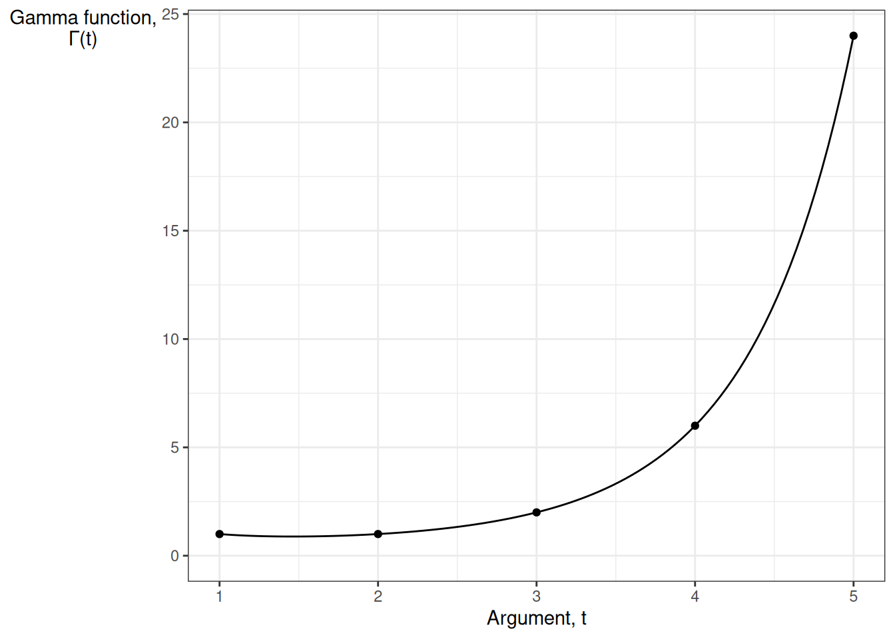
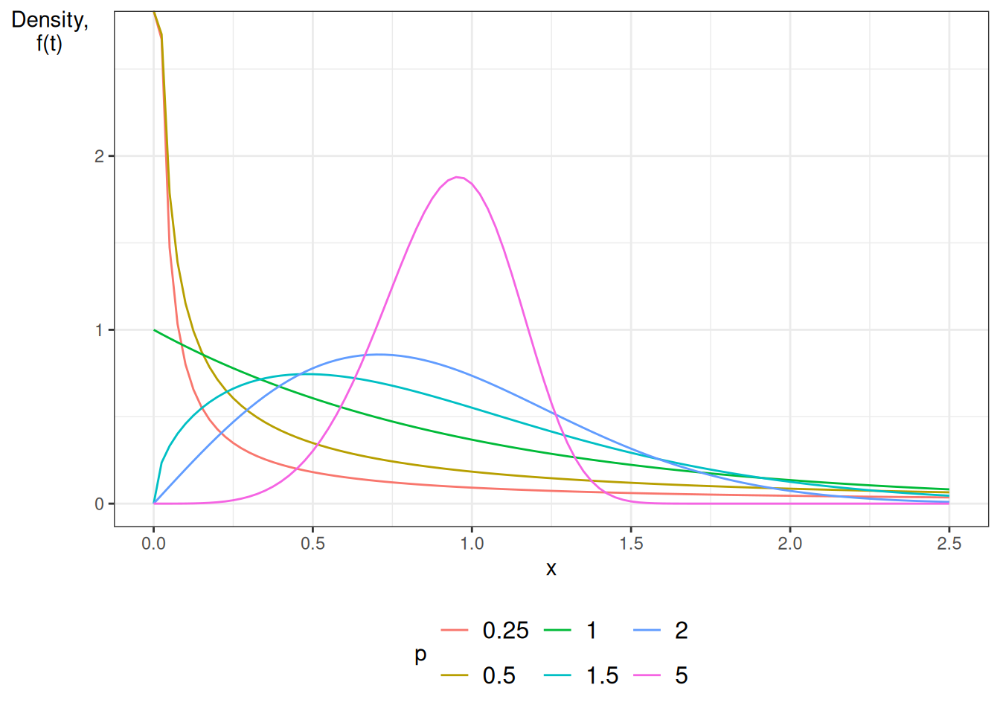
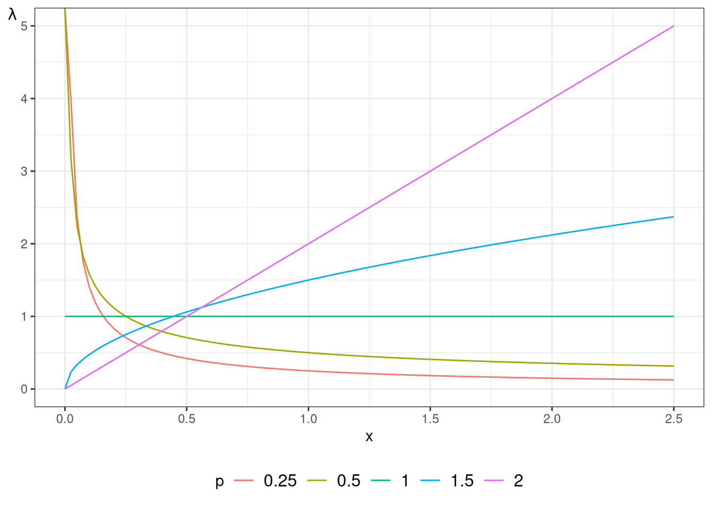
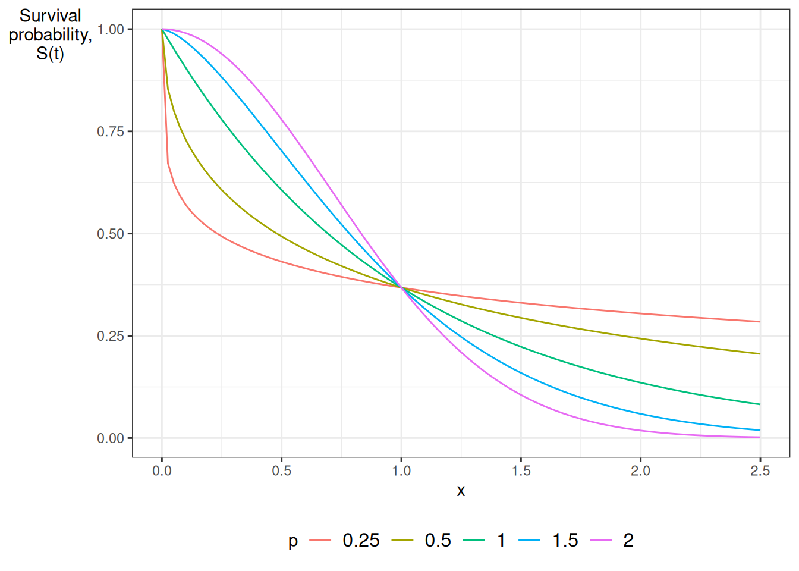
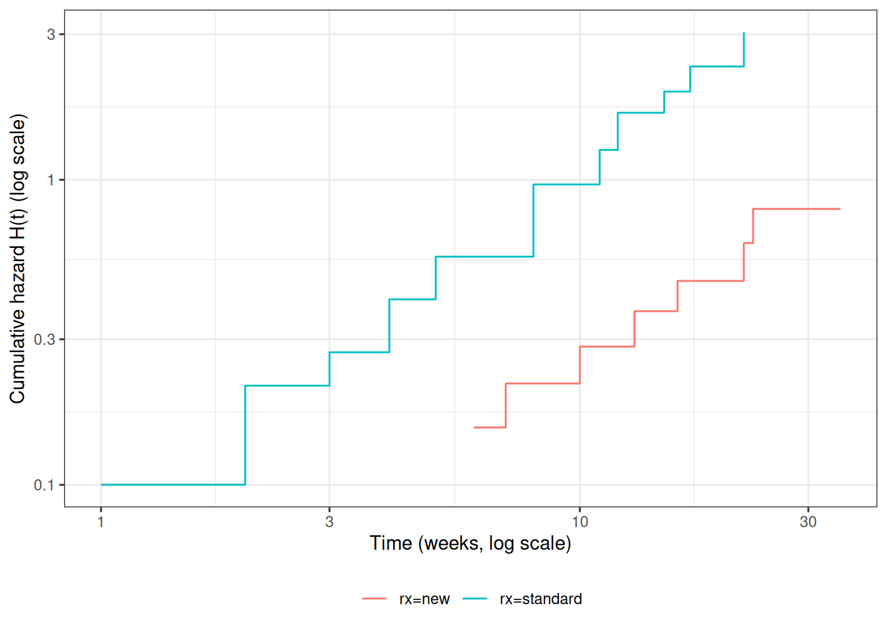

# Parametric Survival Models

Code

- [Show All Code](javascript:void(0))

- [Hide All Code](javascript:void(0))

- 

  ------------------------------------------------------------------------

- [View Source](javascript:void(0))

Published

Last modified: 2026-11-12: 1:26:22 (UTC)

------------------------------------------------------------------------

# Configuring R

Functions from these packages will be used throughout this document:

Show R code

``` downlit
library(conflicted) # check for conflicting function definitions
# printr is not loaded here: it inserts help-file output into markdown output
library(rmarkdown) # Convert R Markdown documents into a variety of formats.
library(pander) # format tables for markdown
library(ggplot2) # graphics
library(ggfortify) # help with graphics
library(dplyr) # manipulate data
library(tibble) # `tibble`s extend `data.frame`s
library(magrittr) # `%>%` and other additional piping tools
library(haven) # import Stata files
library(knitr) # format R output for markdown
library(tidyr) # Tools to help to create tidy data
library(plotly) # interactive graphics
library(dobson) # datasets from Dobson and Barnett 2018
library(parameters) # format model output tables for markdown
library(haven) # import Stata files
library(latex2exp) # use LaTeX in R code (for figures and tables)
library(fs) # filesystem path manipulations
library(survival) # survival analysis
library(survminer) # survival analysis graphics
library(KMsurv) # datasets from Klein and Moeschberger
library(parameters) # format model output tables for
library(webshot2) # convert interactive content to static for pdf
library(forcats) # functions for categorical variables ("factors")
library(stringr) # functions for dealing with strings
library(lubridate) # functions for dealing with dates and times
# Summarizes key information about statistical objects in tidy tibbles
library(broom)
# Provides suite of functions to work with regression model
# `broom::tidy()` tibbles
library(broom.helpers)
```

Here are some R settings I use in this document:

Show R code

``` downlit
rm(list = ls()) # delete any data that's already loaded into R

conflicts_prefer(dplyr::filter)
ggplot2::theme_set(
  ggplot2::theme_bw() +
    # ggplot2::labs(col = "") +
    ggplot2::theme(
      legend.position = "bottom",
      text = ggplot2::element_text(size = 12, family = "serif")
    )
)

knitr::opts_chunk$set(message = FALSE)
options(digits = 6)

panderOptions("big.mark", ",")
pander::panderOptions("table.emphasize.rownames", FALSE)
pander::panderOptions("table.split.table", Inf)
# use the `filter()` function from dplyr() by default
conflicts_prefer(dplyr::filter)
legend_text_size <- 9
run_graphs <- TRUE
```

# 1 Parametric Survival Models

> **TIP:**
>
> David Rocke’s Epi 204 lecture [*Parametric Survival Regression*](https://dmrocke.ucdavis.edu/Class/EPI204-Spring-2021/EPI204-2021-05-20.mp4) ([slides](https://dmrocke.ucdavis.edu/Class/EPI204-Spring-2021/Lecture%20Parametric%20Survival%20Models.pdf)) covers exponential and Weibull models, accelerated failure time models, the [`survreg()`](https://rdrr.io/pkg/survival/man/survreg.html) function, and complementary log-log plots, using the `anderson` data [\[1\]](#ref-rocke2021epi204).

## 1.1 Exponential Distribution

The [exponential distribution](https://morrison-lab.github.io/pds/random-variables.html#def-exponential) is the baseline parametric model in survival analysis. It assumes a constant [hazard rate](../chapters/intro-to-survival-analysis.llms.md#def-hazard) $\lambda > 0$ over time. This constant hazard implies that the event probability in any short interval depends only on the interval duration and not on elapsed time (the memoryless property).

$$\begin{aligned}
\operatorname{f}(t) &\stackrel{\text{def}}{=}\lambda \text{e}^{-\lambda t} && \text{(probability density function definition for $t \ge 0$)} \\
{\operatorname{log}\mathopen{}\left\{\operatorname{f}(t)\right\}\mathclose{}} &= {\operatorname{log}\mathopen{}\left\{\lambda\right\}\mathclose{}} - \lambda t && \text{(taking natural logarithm of density)} \\
\operatorname{F}(t) &\stackrel{\text{def}}{=}\int_{0}^{t} \operatorname{f}(u) du && \text{(cumulative distribution function definition)} \\
&= \int_{0}^{t} \lambda \text{e}^{-\lambda u} du && \text{(substituting probability density function)} \\
&= \mathopen{}\left[ -\text{e}^{-\lambda u} \right]\mathclose{}_{0}^{t} && \text{(evaluating antiderivative)} \\
&= 1 - \text{e}^{-\lambda t} && \text{(evaluating limits of integration)} \\
\operatorname{S}(t) &\stackrel{\text{def}}{=}1 - \operatorname{F}(t) && \text{(survival function definition)} \\
&= 1 - \mathopen{}\left(1 - \text{e}^{-\lambda t}\right)\mathclose{} && \text{(substituting cumulative distribution function)} \\
&= \text{e}^{-\lambda t} && \text{(simplifying terms)} \\
{\Lambda}(t) &\stackrel{\text{def}}{=}-{\operatorname{log}\mathopen{}\left\{\operatorname{S}(t)\right\}\mathclose{}} && \text{(cumulative hazard function definition)} \\
&= -{\operatorname{log}\mathopen{}\left\{\text{e}^{-\lambda t}\right\}\mathclose{}} && \text{(substituting survival function)} \\
&= \lambda t && \text{(simplifying logarithm of exponential)} \\
{\lambda}(t) &\stackrel{\text{def}}{=}\frac{\partial}{\partial t} {\Lambda}(t) && \text{(hazard function definition as derivative of cumulative hazard)} \\
&= \frac{\partial}{\partial t} (\lambda t) && \text{(substituting cumulative hazard)} \\
&= \lambda && \text{(differentiating linear term)} \\
{\mathbb{E}\mathopen{}\left[T\right]\mathclose{}} &\stackrel{\text{def}}{=}\int_{0}^{\infty} \operatorname{S}(t) dt && \text{(expectation formula for non-negative continuous random variable)} \\
&= \int_{0}^{\infty} \text{e}^{-\lambda t} dt && \text{(substituting survival function)} \\
&= \mathopen{}\left[ -\frac{1}{\lambda} \text{e}^{-\lambda t} \right]\mathclose{}_{0}^{\infty} && \text{(evaluating antiderivative)} \\
&= \lambda^{-1} && \text{(evaluating limits of integration)}
\end{aligned}$$

> **NOTE:**
>
> **Theorem 1 (The exponential distribution is memoryless)** If $T$ has an exponential distribution with rate $\lambda > 0$, then for all $s \ge 0$ and $t \ge 0$,
>
> $$\mathbb{P}(T > s + t \mid T > s) = \mathbb{P}(T > t).$$

> **NOTE:**
>
> *Proof*. $$\begin{aligned}
> \mathbb{P}(T > s + t \mid T > s)
> &= \frac{\mathbb{P}(T > s + t,\ T > s)}{\mathbb{P}(T > s)}
> && \text{(definition of conditional probability)} \\
> &= \frac{\mathbb{P}(T > s + t)}{\mathbb{P}(T > s)}
> && \text{(the event } T > s + t \text{ implies } T > s \text{)} \\
> &= \frac{\operatorname{S}(s + t)}{\operatorname{S}(s)}
> && \text{(definition of the survival function)} \\
> &= \frac{\text{e}^{-\lambda (s + t)}}{\text{e}^{-\lambda s}}
> && \text{(exponential survival function)} \\
> &= \text{e}^{-\lambda (s + t) + \lambda s}
> && \text{(quotient rule for exponentials)} \\
> &= \text{e}^{-\lambda t}
> && \text{(cancel } \lambda s \text{)} \\
> &= \mathbb{P}(T > t)
> && \text{(exponential survival function)}
> \end{aligned}$$

> **NOTE:**
>
> **Example 1 (Remaining survival after 10 event-free weeks)** Let $T$ be exponential with rate $\lambda = 0.1$ events per week. For a subject who has been event-free for $s = 10$ weeks, the probability of lasting at least $t = 5$ more weeks is:
>
> $$\begin{aligned}
> \mathbb{P}(T > 15 \mid T > 10)
> &= \frac{\text{e}^{-0.1 \cdot 15}}{\text{e}^{-0.1 \cdot 10}}
> && \text{(ratio of survival functions)} \\
> &= \frac{\text{e}^{-1.5}}{\text{e}^{-1}}
> && \text{(multiply)} \\
> &= \text{e}^{-0.5}
> && \text{(quotient rule for exponentials)} \\
> &\approx 0.6065
> && \text{(evaluate)}
> \end{aligned}$$
>
> This value equals $\mathbb{P}(T > 5) = \text{e}^{-0.1 \cdot 5} = \text{e}^{-0.5}$, the probability that a new subject lasts 5 weeks: the 10 weeks already survived do not change the outlook.

> **NOTE:**
>
> **Example 2 (A Weibull distribution with shape 2 is not memoryless (counterexample))** Now let $T$ be Weibull with $\lambda = 0.1$ and $p = 2$, so $\operatorname{S}(t) = \text{e}^{-(0.1 t)^2}$ and the hazard increases over time. Then:
>
> $$\begin{aligned}
> \mathbb{P}(T > 15 \mid T > 10)
> &= \frac{\text{e}^{-(0.1 \cdot 15)^2}}{\text{e}^{-(0.1 \cdot 10)^2}}
> && \text{(ratio of survival functions)} \\
> &= \frac{\text{e}^{-(1.5)^2}}{\text{e}^{-(1)^2}}
> && \text{(multiply)} \\
> &= \frac{\text{e}^{-2.25}}{\text{e}^{-1}}
> && \text{(square)} \\
> &= \text{e}^{-1.25}
> && \text{(quotient rule for exponentials)} \\
> &\approx 0.2865
> && \text{(evaluate)}
> \end{aligned}$$
>
> whereas $\mathbb{P}(T > 5) = \text{e}^{-(0.5)^2} = \text{e}^{-0.25} \approx 0.7788$. A subject who has already lasted 10 weeks is less likely to last 5 more weeks than a new subject is, because the hazard has risen in the meantime.

## 1.2 Weibull Distribution

The [Weibull distribution](https://morrison-lab.github.io/pds/distributions.html#def-weibull) generalizes the exponential distribution by introducing a shape parameter $p > 0$ alongside the scale parameter $\lambda > 0$ [\[2\]](#ref-kalbfleisch2011statistical). This flexibility allows the hazard rate to change monotonically over time, accommodating situations where risk increases or decreases as time elapses.

Using the parameterization of Kalbfleisch and Prentice [\[2\]](#ref-kalbfleisch2011statistical):

$$\begin{aligned}
\operatorname{f}(t) &\stackrel{\text{def}}{=}\lambda p (\lambda t)^{p-1} \text{e}^{-(\lambda t)^p} && \text{(probability density function for $t \ge 0$)} \\
\operatorname{F}(t) &\stackrel{\text{def}}{=}\int_{0}^{t} \operatorname{f}(u) du && \text{(cumulative distribution function definition)} \\
&= \int_{0}^{t} \lambda p (\lambda u)^{p-1} \text{e}^{-(\lambda u)^p} du && \text{(substituting density function)} \\
&= \mathopen{}\left[ -\text{e}^{-(\lambda u)^p} \right]\mathclose{}_{0}^{t} && \text{(evaluating antiderivative via substitution $w = (\lambda u)^p$)} \\
&= 1 - \text{e}^{-(\lambda t)^p} && \text{(evaluating limits of integration)} \\
\operatorname{S}(t) &\stackrel{\text{def}}{=}1 - \operatorname{F}(t) && \text{(survival function definition)} \\
&= 1 - \mathopen{}\left(1 - \text{e}^{-(\lambda t)^p}\right)\mathclose{} && \text{(substituting cumulative distribution function)} \\
&= \text{e}^{-(\lambda t)^p} && \text{(simplifying terms)} \\
{\Lambda}(t) &\stackrel{\text{def}}{=}-{\operatorname{log}\mathopen{}\left\{\operatorname{S}(t)\right\}\mathclose{}} && \text{(cumulative hazard function definition)} \\
&= -{\operatorname{log}\mathopen{}\left\{\text{e}^{-(\lambda t)^p}\right\}\mathclose{}} && \text{(substituting survival function)} \\
&= (\lambda t)^p && \text{(simplifying logarithm of exponential)} \\
{\operatorname{log}\mathopen{}\left\{{\Lambda}(t)\right\}\mathclose{}} &= {\operatorname{log}\mathopen{}\left\{(\lambda t)^p\right\}\mathclose{}} && \text{(taking natural logarithm of cumulative hazard)} \\
&= p {\operatorname{log}\mathopen{}\left\{\lambda t\right\}\mathclose{}} && \text{(applying exponent rule for logarithms)} \\
&= p {\operatorname{log}\mathopen{}\left\{\lambda\right\}\mathclose{}} + p {\operatorname{log}\mathopen{}\left\{t\right\}\mathclose{}} && \text{(applying product rule for logarithms)} \\
{\lambda}(t) &\stackrel{\text{def}}{=}\frac{\partial}{\partial t} {\Lambda}(t) && \text{(hazard function definition)} \\
&= \frac{\partial}{\partial t} \mathopen{}\left( (\lambda t)^p \right)\mathclose{} && \text{(substituting cumulative hazard)} \\
&= p (\lambda t)^{p-1} \cdot \lambda && \text{(applying power and chain rules of differentiation)} \\
&= \lambda p (\lambda t)^{p-1} && \text{(rearranging factors)} \\
{\mathbb{E}\mathopen{}\left[T\right]\mathclose{}} &\stackrel{\text{def}}{=}\int_{0}^{\infty} \operatorname{S}(t) dt && \text{(expectation formula for non-negative random variable)} \\
&= \int_{0}^{\infty} \text{e}^{-(\lambda t)^p} dt && \text{(substituting survival function)} \\
&= \frac{1}{\lambda p} \int_{0}^{\infty} u^{\frac{1}{p}-1} \text{e}^{-u} du && \text{(substituting $u = (\lambda t)^p \implies t = \lambda^{-1} u^{1/p}$)} \\
&= \lambda^{-1} \cdot \Gamma\mathopen{}\left(1 + \frac{1}{p}\right)\mathclose{} && \text{(applying definition of Gamma function $\Gamma(z)$)}
\end{aligned}$$

> **NOTE:**
>
> Recall from calculus:
>
> - $\Gamma(t) \stackrel{\text{def}}{=}\int_{u=0}^{\infty}u^{t-1}\text{e}^{-u}du$
>
> - $\Gamma(t) = (t-1)!$ for integers $t \in \mathbb Z$
>
> - It is implemented by the [`gamma()`](https://rdrr.io/r/base/Special.html) function in R.
>
> [](parametric-survival-models_files/figure-html/unnamed-chunk-1-1.png)

Here are some Weibull [density functions](https://morrison-lab.github.io/pds/random-variables.html#def-pdf), with $\lambda = 1$ and $p$ varying:

Show R code

``` downlit
library(ggplot2)
lambda <- 1
ggplot() +
  geom_function(
    aes(col = "0.25"),
    fun = \(x) dweibull(x, shape = 0.25, scale = 1 / lambda)
  ) +
  geom_function(
    aes(col = "0.5"),
    fun = \(x) dweibull(x, shape = 0.5, scale = 1 / lambda)
  ) +
  geom_function(
    aes(col = "1"),
    fun = \(x) dweibull(x, shape = 1, scale = 1 / lambda)
  ) +
  geom_function(
    aes(col = "1.5"),
    fun = \(x) dweibull(x, shape = 1.5, scale = 1 / lambda)
  ) +
  geom_function(
    aes(col = "2"),
    fun = \(x) dweibull(x, shape = 2, scale = 1 / lambda)
  ) +
  geom_function(
    aes(col = "5"),
    fun = \(x) dweibull(x, shape = 5, scale = 1 / lambda)
  ) +
  theme_bw() +
  xlim(0, 2.5) +
  ylab("Density,\nf(t)") +
  theme(axis.title.y = element_text(angle = 0)) +
  theme(legend.position = "bottom") +
  guides(
    col =
      guide_legend(
        title = "p",
        label.theme = element_text(size = 12)
      )
  )
```

[](parametric-survival-models_files/figure-html/unnamed-chunk-2-1.png "Density functions for Weibull distribution")

Density functions for Weibull distribution

### 1.2.1 Properties of Weibull hazard functions

> **NOTE:**
>
> **Theorem 2 (Properties of Weibull hazard functions)** If $T$ has a Weibull distribution, then:
>
> - When $p=1$, the Weibull distribution simplifies to the exponential distribution.
> - When $p > 1$, the hazard is strictly increasing: ${\lambda}'(t) > 0$.
> - When $p < 1$, the hazard is strictly decreasing: ${\lambda}'(t) < 0$.
> - $\log{{\Lambda}(t)}$ is a straight line relative to $\log{t}$: $\log{{\Lambda}(t)} = p \log{\lambda} + p \log{t}$.

> **NOTE:**
>
> *Proof*. We prove each property of the Weibull hazard function ${\lambda}(t) = \lambda p (\lambda t)^{p-1}$:
>
> 1.  **Simplification to Exponential distribution when** $p=1$: Setting $p=1$ in the Weibull hazard function yields: $$\begin{aligned}
>     {\lambda}(t) &= \lambda (1) (\lambda t)^{1-1} && \text{(substituting $p=1$ into Weibull hazard formula)} \\
>     &= \lambda \cdot 1 \cdot (\lambda t)^0 && \text{(simplifying exponent $1-1 = 0$)} \\
>     &= \lambda && \text{(since $(\lambda t)^0 = 1$ for $t > 0$)}
>     \end{aligned}$$ This constant value is the [hazard function](../chapters/intro-to-survival-analysis.llms.md#def-hazard) of the exponential distribution with parameter $\lambda$.
>
> 2.  **Increasing hazard when** $p > 1$: Differentiating ${\lambda}(t) = \lambda^p p t^{p-1}$ with respect to $t$ gives: $$\begin{aligned}
>     {\lambda}'(t) &\stackrel{\text{def}}{=}\frac{\partial}{\partial t} \mathopen{}\left( \lambda^p p t^{p-1} \right)\mathclose{} && \text{(definition of hazard derivative)} \\
>     &= \lambda^p p (p-1) t^{p-2} && \text{(applying power rule of differentiation)}
>     \end{aligned}$$ Since $\lambda > 0$, $p > 0$, and $t > 0$, the sign of ${\lambda}'(t)$ depends entirely on the factor $(p-1)$. When $p > 1$, $(p-1) > 0$, so ${\lambda}'(t) > 0$ for all $t > 0$, meaning the hazard function is strictly increasing over time.
>
> 3.  **Decreasing hazard when** $p < 1$: Using the derivative ${\lambda}'(t) = \lambda^p p (p-1) t^{p-2}$: When $p < 1$, $(p-1) < 0$, so ${\lambda}'(t) < 0$ for all $t > 0$, meaning the hazard function is strictly decreasing over time.
>
> 4.  **Linear relationship between** $\log {\Lambda}(t)$ and $\log t$: Taking the [natural logarithm](https://morrison-lab.github.io/mds/algebra-exponentials.html#def-natural-log) of the [cumulative hazard function](../chapters/intro-to-survival-analysis.llms.md#def-cuhaz) ${\Lambda}(t) = (\lambda t)^p$: $$\begin{aligned}
>     {\operatorname{log}\mathopen{}\left\{{\Lambda}(t)\right\}\mathclose{}} &\stackrel{\text{def}}{=}{\operatorname{log}\mathopen{}\left\{(\lambda t)^p\right\}\mathclose{}} && \text{(substituting Weibull cumulative hazard)} \\
>     &= p {\operatorname{log}\mathopen{}\left\{\lambda t\right\}\mathclose{}} && \text{(applying logarithm exponent rule $\log(a^b) = b \log a$)} \\
>     &= p {\operatorname{log}\mathopen{}\left\{\lambda\right\}\mathclose{}} + p {\operatorname{log}\mathopen{}\left\{t\right\}\mathclose{}} && \text{(applying logarithm product rule $\log(ab) = \log a + \log b$)}
>     \end{aligned}$$ Defining $y \stackrel{\text{def}}{=}{\operatorname{log}\mathopen{}\left\{{\Lambda}(t)\right\}\mathclose{}}$ and $x \stackrel{\text{def}}{=}{\operatorname{log}\mathopen{}\left\{t\right\}\mathclose{}}$, this equation takes the linear form $y = a + b x$ with intercept $a = p {\operatorname{log}\mathopen{}\left\{\lambda\right\}\mathclose{}}$ and slope $b = p$.

> **NOTE:**
>
> **Example 3 (Evaluating Weibull hazard shapes under different shape parameters)** Consider a clinical trial evaluating time to relapse in months following cancer treatment, modeled using a Weibull distribution with scale parameter $\lambda = 0.1$. We evaluate the hazard rate ${\lambda}(t)$ at months $t = 1, 6, 12$ under three distinct shape parameters:
>
> 1.  **Decreasing hazard (**$p = 0.5$): The hazard rate formula gives: $${\lambda}(t) = (0.1)(0.5)(0.1 t)^{-0.5} = \frac{0.05}{\sqrt{0.1 t}}$$
>
>     - At $t = 1$ month: ${\lambda}(1) = \frac{0.05}{\sqrt{0.1}} \approx 0.1581$ events per month.
>     - At $t = 6$ months: ${\lambda}(6) = \frac{0.05}{\sqrt{0.6}} \approx 0.0645$ events per month.
>     - At $t = 12$ months: ${\lambda}(12) = \frac{0.05}{\sqrt{1.2}} \approx 0.0456$ events per month. The risk of relapse is highest immediately following treatment and declines over time.
>
> 2.  **Constant hazard (**$p = 1.0$): The hazard rate formula reduces to ${\lambda}(t) = \lambda = 0.1000$ events per month for all $t$. The risk of relapse remains constant regardless of time elapsed.
>
> 3.  **Increasing hazard (**$p = 2.0$): The hazard rate formula gives: $${\lambda}(t) = (0.1)(2.0)(0.1 t)^{1.0} = 0.02 t$$
>
>     - At $t = 1$ month: ${\lambda}(1) = 0.02(1) = 0.0200$ events per month.
>     - At $t = 6$ months: ${\lambda}(6) = 0.02(6) = 0.1200$ events per month.
>     - At $t = 12$ months: ${\lambda}(12) = 0.02(12) = 0.2400$ events per month. The risk of relapse increases linearly over time.

> **NOTE:**
>
> **Exercise 1** Verify the calculations in [Example 3](#exm-weibull-props).

> **NOTE:**
>
> **Exercise 2** In the setting of [Example 3](#exm-weibull-props), explain how the shape parameter $p$ affects [cumulative hazard](../chapters/intro-to-survival-analysis.llms.md#def-cuhaz) curves.

The Weibull distribution provides more flexibility than the exponential. [Figure 1](#fig-exm-weibull-hazards) shows some Weibull hazard functions, with $\lambda = 1$ and $p$ varying:

Show R code

``` downlit
library(ggplot2)
library(eha)
lambda <- 1

ggplot() +
  geom_function(
    aes(col = "0.25"),
    fun = \(x) hweibull(x, shape = 0.25, scale = 1 / lambda)
  ) +
  geom_function(
    aes(col = "0.5"),
    fun = \(x) hweibull(x, shape = 0.5, scale = 1 / lambda)
  ) +
  geom_function(
    aes(col = "1"),
    fun = \(x) hweibull(x, shape = 1, scale = 1 / lambda)
  ) +
  geom_function(
    aes(col = "1.5"),
    fun = \(x) hweibull(x, shape = 1.5, scale = 1 / lambda)
  ) +
  geom_function(
    aes(col = "2"),
    fun = \(x) hweibull(x, shape = 2, scale = 1 / lambda)
  ) +
  theme_bw() +
  xlim(0, 2.5) +
  ylab(expr(lambda)) +
  theme(axis.title.y = element_text(angle = 0)) +
  theme(legend.position = "bottom") +
  guides(
    col =
      guide_legend(
        title = "p",
        label.theme = element_text(size = 12)
      )
  )
```

> **NOTE:**
>
> [](parametric-survival-models_files/figure-html/fig-exm-weibull-hazards-1.png "Figure 1: Hazard functions for Weibull distribution")
>
> Figure 1: Hazard functions for Weibull distribution

------------------------------------------------------------------------

Show R code

``` downlit
library(ggplot2)
lambda <- 1

ggplot() +
  geom_function(
    aes(col = "0.25"),
    fun = pweibull,
    args = list(shape = 0.25, scale = 1 / lambda, lower.tail = FALSE)
  ) +
  geom_function(
    aes(col = "0.5"),
    fun = pweibull,
    args = list(shape = 0.5, scale = 1 / lambda, lower.tail = FALSE)
  ) +
  geom_function(
    aes(col = "1"),
    fun = pweibull,
    args = list(shape = 1, scale = 1 / lambda, lower.tail = FALSE)
  ) +
  geom_function(
    aes(col = "1.5"),
    fun = pweibull,
    args = list(shape = 1.5, scale = 1 / lambda, lower.tail = FALSE)
  ) +
  geom_function(
    aes(col = "2"),
    fun = pweibull,
    args = list(shape = 2, scale = 1 / lambda, lower.tail = FALSE)
  ) +
  theme_bw() +
  xlim(0, 2.5) +
  ylab("Survival\nprobability,\nS(t)") +
  theme(axis.title.y = element_text(angle = 0)) +
  theme(legend.position = "bottom") +
  guides(
    col =
      guide_legend(
        title = "p",
        label.theme = element_text(size = 12)
      )
  )
```

> **NOTE:**
>
> [](parametric-survival-models_files/figure-html/fig-surv-weibull-1.png "Figure 2: Survival functions for Weibull distribution")
>
> Figure 2: Survival functions for Weibull distribution

## 1.3 Exponential Regression

> **NOTE:**
>
> **Definition 1 (Exponential regression model)** An **exponential regression model** for an event time $T$ with [predictor](../chapters/Intro-to-GLMs.llms.md#def-predictors) vector $\mathord{\smash[b]{\underset{\raise.3ex\hbox{$\scriptstyle\sim$}}{x}}\vphantom{x}}$ assumes that, given $\mathord{\smash[b]{\underset{\raise.3ex\hbox{$\scriptstyle\sim$}}{x}}\vphantom{x}}$, $T$ has an [exponential distribution](https://morrison-lab.github.io/pds/random-variables.html#def-exponential) whose [hazard rate](../chapters/intro-to-survival-analysis.llms.md#def-hazard) is the exponentiated [linear predictor](../chapters/Intro-to-GLMs.llms.md#def-linear-predictor):
>
> $${\lambda}(t \mid \mathord{\smash[b]{\underset{\raise.3ex\hbox{$\scriptstyle\sim$}}{x}}\vphantom{x}}) \stackrel{\text{def}}{=}{\operatorname{exp}\mathopen{}\left\{\eta(\mathord{\smash[b]{\underset{\raise.3ex\hbox{$\scriptstyle\sim$}}{x}}\vphantom{x}})\right\}\mathclose{}},
> \quad \eta(\mathord{\smash[b]{\underset{\raise.3ex\hbox{$\scriptstyle\sim$}}{x}}\vphantom{x}}) \stackrel{\text{def}}{=}\mathord{\smash[b]{\underset{\raise.3ex\hbox{$\scriptstyle\sim$}}{x}}\vphantom{x}}\cdot \mathord{\smash[b]{\underset{\raise.3ex\hbox{$\scriptstyle\sim$}}{\beta}}\vphantom{\beta}}= \beta_0 + \beta_1 x_1 + \dots + \beta_p x_p
> \tag{1}$$

> **NOTE:**
>
> **Example 4 (Exponential regression with one binary covariate)** Let $x_1 = 1$ for patients on a standard treatment and $x_1 = 0$ for patients on a new treatment, and suppose $\beta_0 = {\operatorname{log}\mathopen{}\left\{0.025\right\}\mathclose{}}$ and $\beta_1 = {\operatorname{log}\mathopen{}\left\{4\right\}\mathclose{}}$, with time measured in weeks. By [Equation 1](#eq-exp-reg-haz):
>
> $$\begin{aligned}
> {\lambda}(t \mid x_1 = 0)
> &= {\operatorname{exp}\mathopen{}\left\{\beta_0\right\}\mathclose{}}
> && \text{(exponential regression hazard with } x_1 = 0 \text{)} \\
> &= 0.025
> && \text{(} {\operatorname{exp}\mathopen{}\left\{{\operatorname{log}\mathopen{}\left\{0.025\right\}\mathclose{}}\right\}\mathclose{}} = 0.025 \text{)} \\
> {\lambda}(t \mid x_1 = 1)
> &= {\operatorname{exp}\mathopen{}\left\{\beta_0 + \beta_1\right\}\mathclose{}}
> && \text{(exponential regression hazard with } x_1 = 1 \text{)} \\
> &= {\operatorname{exp}\mathopen{}\left\{\beta_0\right\}\mathclose{}} \cdot {\operatorname{exp}\mathopen{}\left\{\beta_1\right\}\mathclose{}}
> && \text{(product rule for exponentials)} \\
> &= 0.025 \cdot 4
> && \text{(evaluate each factor)} \\
> &= 0.1
> && \text{(multiply)}
> \end{aligned}$$
>
> Each group’s mean event time is the reciprocal of its hazard rate, as derived in [Section 1.1](#sec-psm-exp-dist): $1/0.025 = 40$ weeks on the new treatment and $1/0.1 = 10$ weeks on the standard treatment.

Exponential regression models the hazard rate using a log [link function](../chapters/Intro-to-GLMs.llms.md#def-link-function). At $\mathord{\smash[b]{\underset{\raise.3ex\hbox{$\scriptstyle\sim$}}{x}}\vphantom{x}}= \mathord{\smash[b]{\underset{\raise.3ex\hbox{$\scriptstyle\sim$}}{0}}\vphantom{0}}$, [Equation 1](#eq-exp-reg-haz) gives the baseline hazard rate:

$$\begin{aligned}
{\lambda}_0(t) &\stackrel{\text{def}}{=}{\lambda}(t \mid \mathord{\smash[b]{\underset{\raise.3ex\hbox{$\scriptstyle\sim$}}{0}}\vphantom{0}}) && \text{(baseline hazard rate definition at $\mathord{\smash[b]{\underset{\raise.3ex\hbox{$\scriptstyle\sim$}}{x}}\vphantom{x}}= \mathord{\smash[b]{\underset{\raise.3ex\hbox{$\scriptstyle\sim$}}{0}}\vphantom{0}}$)} \\
&= {\operatorname{exp}\mathopen{}\left\{\eta(\mathord{\smash[b]{\underset{\raise.3ex\hbox{$\scriptstyle\sim$}}{0}}\vphantom{0}})\right\}\mathclose{}} && \text{(substituting $\mathord{\smash[b]{\underset{\raise.3ex\hbox{$\scriptstyle\sim$}}{x}}\vphantom{x}}= \mathord{\smash[b]{\underset{\raise.3ex\hbox{$\scriptstyle\sim$}}{0}}\vphantom{0}}$ into hazard function)} \\
&= {\operatorname{exp}\mathopen{}\left\{\beta_0 + (\beta_1 \cdot 0 + \dots + \beta_p \cdot 0)\right\}\mathclose{}} && \text{(evaluating linear predictor at zero vector)} \\
&= {\operatorname{exp}\mathopen{}\left\{\beta_0\right\}\mathclose{}} && \text{(simplifying exponent)}
\end{aligned}$$

When there are no additional [predictors](../chapters/Intro-to-GLMs.llms.md#def-predictors) ($\mathord{\smash[b]{\underset{\raise.3ex\hbox{$\scriptstyle\sim$}}{x}}\vphantom{x}}= \mathord{\smash[b]{\underset{\raise.3ex\hbox{$\scriptstyle\sim$}}{0}}\vphantom{0}}$), the [baseline hazard](../chapters/proportional-hazards-models.llms.md#def-base-hazard) is constant: $\lambda = {\operatorname{exp}\mathopen{}\left\{\beta_0\right\}\mathclose{}}$. This model uses a log link as in a [generalized linear model](../chapters/Intro-to-GLMs.llms.md#def-glm) for [Poisson](https://morrison-lab.github.io/pds/distributions.html#def-poisson) or rate outcomes. Because the hazard rate does not depend on time $t$, the [hazard ratio](../chapters/intro-to-survival-analysis.llms.md#def-hazard-ratio) comparing two covariate vectors $\mathord{\smash[b]{\underset{\raise.3ex\hbox{$\scriptstyle\sim$}}{x}}\vphantom{x}}$ and $\mathord{{\mathord{\smash[b]{\underset{\raise.3ex\hbox{$\scriptstyle\sim$}}{x}}\vphantom{x}}^*}}$ is constant over time:

$$\begin{aligned}
\text{ϙ}_{{\lambda}}(t \mid \mathord{\smash[b]{\underset{\raise.3ex\hbox{$\scriptstyle\sim$}}{x}}\vphantom{x}}: \mathord{{\mathord{\smash[b]{\underset{\raise.3ex\hbox{$\scriptstyle\sim$}}{x}}\vphantom{x}}^*}}) &\stackrel{\text{def}}{=}\frac{{\lambda}(t \mid \mathord{\smash[b]{\underset{\raise.3ex\hbox{$\scriptstyle\sim$}}{x}}\vphantom{x}})}{{\lambda}(t \mid \mathord{{\mathord{\smash[b]{\underset{\raise.3ex\hbox{$\scriptstyle\sim$}}{x}}\vphantom{x}}^*}})} && \text{(hazard ratio definition)} \\
&= \frac{{\operatorname{exp}\mathopen{}\left\{\eta(\mathord{\smash[b]{\underset{\raise.3ex\hbox{$\scriptstyle\sim$}}{x}}\vphantom{x}})\right\}\mathclose{}}}{{\operatorname{exp}\mathopen{}\left\{\eta(\mathord{{\mathord{\smash[b]{\underset{\raise.3ex\hbox{$\scriptstyle\sim$}}{x}}\vphantom{x}}^*}})\right\}\mathclose{}}} && \text{(substituting exponential regression hazard rates)} \\
&= {\operatorname{exp}\mathopen{}\left\{\eta(\mathord{\smash[b]{\underset{\raise.3ex\hbox{$\scriptstyle\sim$}}{x}}\vphantom{x}}) - \eta(\mathord{{\mathord{\smash[b]{\underset{\raise.3ex\hbox{$\scriptstyle\sim$}}{x}}\vphantom{x}}^*}})\right\}\mathclose{}} && \text{(applying quotient rule for exponentials)} \\
&= {\operatorname{exp}\mathopen{}\left\{(\mathord{\smash[b]{\underset{\raise.3ex\hbox{$\scriptstyle\sim$}}{x}}\vphantom{x}}- \mathord{{\mathord{\smash[b]{\underset{\raise.3ex\hbox{$\scriptstyle\sim$}}{x}}\vphantom{x}}^*}}) \cdot \mathord{\smash[b]{\underset{\raise.3ex\hbox{$\scriptstyle\sim$}}{\beta}}\vphantom{\beta}}\right\}\mathclose{}} && \text{(expressing difference in linear predictors)}
\end{aligned}$$

Thus, exponential regression models possess [proportional hazards](../chapters/proportional-hazards-models.llms.md#def-pha) trivially.

## 1.4 Accelerated Failure Time

In a [proportional hazards (PH) model](../chapters/proportional-hazards-models.llms.md#def-ph-model), covariates act multiplicatively on the [baseline hazard function](../chapters/proportional-hazards-models.llms.md#def-base-hazard):

$$\begin{aligned}
{\lambda}(t \mid \mathord{\smash[b]{\underset{\raise.3ex\hbox{$\scriptstyle\sim$}}{x}}\vphantom{x}}) &\stackrel{\text{def}}{=}{\lambda}_0(t) \cdot \theta_{{\lambda}}(\mathord{\smash[b]{\underset{\raise.3ex\hbox{$\scriptstyle\sim$}}{x}}\vphantom{x}}) && \text{(proportional hazards hazard rate definition)} \\
{\Lambda}(t \mid \mathord{\smash[b]{\underset{\raise.3ex\hbox{$\scriptstyle\sim$}}{x}}\vphantom{x}}) &\stackrel{\text{def}}{=}\int_{0}^{t} {\lambda}(u \mid \mathord{\smash[b]{\underset{\raise.3ex\hbox{$\scriptstyle\sim$}}{x}}\vphantom{x}}) du && \text{(cumulative hazard function definition)} \\
&= \int_{0}^{t} {\lambda}_0(u) \cdot \theta_{{\lambda}}(\mathord{\smash[b]{\underset{\raise.3ex\hbox{$\scriptstyle\sim$}}{x}}\vphantom{x}}) du && \text{(substituting proportional hazard rate)} \\
&= \theta_{{\lambda}}(\mathord{\smash[b]{\underset{\raise.3ex\hbox{$\scriptstyle\sim$}}{x}}\vphantom{x}}) \cdot {\Lambda}_0(t) && \text{(factoring constant hazard multiplier out of integral)} \\
\operatorname{S}(t \mid \mathord{\smash[b]{\underset{\raise.3ex\hbox{$\scriptstyle\sim$}}{x}}\vphantom{x}}) &\stackrel{\text{def}}{=}{\operatorname{exp}\mathopen{}\left\{-{\Lambda}(t \mid \mathord{\smash[b]{\underset{\raise.3ex\hbox{$\scriptstyle\sim$}}{x}}\vphantom{x}})\right\}\mathclose{}} && \text{(survival function in terms of cumulative hazard)} \\
&= {\operatorname{exp}\mathopen{}\left\{-\theta_{{\lambda}}(\mathord{\smash[b]{\underset{\raise.3ex\hbox{$\scriptstyle\sim$}}{x}}\vphantom{x}}) \cdot {\Lambda}_0(t)\right\}\mathclose{}} && \text{(substituting cumulative hazard)} \\
&= \mathopen{}\left[ {\operatorname{exp}\mathopen{}\left\{-{\Lambda}_0(t)\right\}\mathclose{}} \right]\mathclose{}^{\theta_{{\lambda}}(\mathord{\smash[b]{\underset{\raise.3ex\hbox{$\scriptstyle\sim$}}{x}}\vphantom{x}})} && \text{(applying exponent laws)} \\
&= \mathopen{}\left[ \operatorname{S}_0(t) \right]\mathclose{}^{\theta_{{\lambda}}(\mathord{\smash[b]{\underset{\raise.3ex\hbox{$\scriptstyle\sim$}}{x}}\vphantom{x}})} && \text{(substituting baseline survival function $\operatorname{S}_0(t)$)}
\end{aligned}$$

An alternative modeling framework is the **Accelerated Failure Time (AFT)** model. Rather than multiplying the hazard rate, covariates accelerate or decelerate the progression of time itself.

> **NOTE:**
>
> **Definition 2 (Acceleration factor)** For a covariate vector $\mathord{\smash[b]{\underset{\raise.3ex\hbox{$\scriptstyle\sim$}}{x}}\vphantom{x}}$ and coefficients $\beta_1, \dots, \beta_p$, let $\eta(\mathord{\smash[b]{\underset{\raise.3ex\hbox{$\scriptstyle\sim$}}{x}}\vphantom{x}}) \stackrel{\text{def}}{=}\beta_1 x_1 + \dots + \beta_p x_p$, with no intercept. The **acceleration factor** is
>
> $$\theta_{{\lambda}}(\mathord{\smash[b]{\underset{\raise.3ex\hbox{$\scriptstyle\sim$}}{x}}\vphantom{x}}) \stackrel{\text{def}}{=}{\operatorname{exp}\mathopen{}\left\{\eta(\mathord{\smash[b]{\underset{\raise.3ex\hbox{$\scriptstyle\sim$}}{x}}\vphantom{x}})\right\}\mathclose{}}.$$

> **NOTE:**
>
> **Example 5 (Computing an acceleration factor)** Suppose there is one covariate, with coefficient $\beta_1 = {\operatorname{log}\mathopen{}\left\{2\right\}\mathclose{}}$, and a subject has $x_1 = 2$. Then:
>
> $$\begin{aligned}
> \theta_{{\lambda}}(\mathord{\smash[b]{\underset{\raise.3ex\hbox{$\scriptstyle\sim$}}{x}}\vphantom{x}})
> &= {\operatorname{exp}\mathopen{}\left\{\eta(\mathord{\smash[b]{\underset{\raise.3ex\hbox{$\scriptstyle\sim$}}{x}}\vphantom{x}})\right\}\mathclose{}}
> && \text{(definition of the acceleration factor)} \\
> &= {\operatorname{exp}\mathopen{}\left\{\beta_1 x_1\right\}\mathclose{}}
> && \text{(one covariate, no intercept)} \\
> &= {\operatorname{exp}\mathopen{}\left\{2 {\operatorname{log}\mathopen{}\left\{2\right\}\mathclose{}}\right\}\mathclose{}}
> && \text{(substitute } \beta_1 = {\operatorname{log}\mathopen{}\left\{2\right\}\mathclose{}} \text{ and } x_1 = 2 \text{)} \\
> &= 4
> && \text{(} {\operatorname{exp}\mathopen{}\left\{{\operatorname{log}\mathopen{}\left\{a\right\}\mathclose{}}\right\}\mathclose{}} = a \text{, and } 2 {\operatorname{log}\mathopen{}\left\{2\right\}\mathclose{}} = {\operatorname{log}\mathopen{}\left\{4\right\}\mathclose{}} \text{)}
> \end{aligned}$$

> **NOTE:**
>
> **Definition 3 (Accelerated failure time model)** An **accelerated failure time (AFT) model** for an event time $T$ with covariate vector $\mathord{\smash[b]{\underset{\raise.3ex\hbox{$\scriptstyle\sim$}}{x}}\vphantom{x}}$ assumes that
>
> $$\operatorname{S}(t \mid \mathord{\smash[b]{\underset{\raise.3ex\hbox{$\scriptstyle\sim$}}{x}}\vphantom{x}}) \stackrel{\text{def}}{=}\operatorname{S}_0\mathopen{}\left( t \cdot \theta_{{\lambda}}(\mathord{\smash[b]{\underset{\raise.3ex\hbox{$\scriptstyle\sim$}}{x}}\vphantom{x}}) \right)\mathclose{}
> \tag{2}$$
>
> where:
>
> - $\operatorname{S}_0(t) \stackrel{\text{def}}{=}\mathbb{P}(T > t \mid \mathord{\smash[b]{\underset{\raise.3ex\hbox{$\scriptstyle\sim$}}{x}}\vphantom{x}}= \mathord{\smash[b]{\underset{\raise.3ex\hbox{$\scriptstyle\sim$}}{0}}\vphantom{0}})$ is the [baseline survival function](../chapters/proportional-hazards-models.llms.md#def-baseline-surv), and
> - $\theta_{{\lambda}}(\mathord{\smash[b]{\underset{\raise.3ex\hbox{$\scriptstyle\sim$}}{x}}\vphantom{x}})$ is the acceleration factor ([Definition 2](#def-acceleration-factor)).

An acceleration factor $\theta_{{\lambda}}(\mathord{\smash[b]{\underset{\raise.3ex\hbox{$\scriptstyle\sim$}}{x}}\vphantom{x}}) > 1$ makes time pass faster for a subject with covariates $\mathord{\smash[b]{\underset{\raise.3ex\hbox{$\scriptstyle\sim$}}{x}}\vphantom{x}}$ than at baseline, so events happen sooner; $\theta_{{\lambda}}(\mathord{\smash[b]{\underset{\raise.3ex\hbox{$\scriptstyle\sim$}}{x}}\vphantom{x}}) < 1$ slows time down, so events happen later.

> **NOTE:**
>
> **Example 6 (An acceleration factor of 4)** Suppose the baseline survival function is exponential with mean 40 weeks, $\operatorname{S}_0(t) = {\operatorname{exp}\mathopen{}\left\{-t/40\right\}\mathclose{}}$, and a covariate pattern $\mathord{\smash[b]{\underset{\raise.3ex\hbox{$\scriptstyle\sim$}}{x}}\vphantom{x}}$ has acceleration factor $\theta_{{\lambda}}(\mathord{\smash[b]{\underset{\raise.3ex\hbox{$\scriptstyle\sim$}}{x}}\vphantom{x}}) = 4$. By [Equation 2](#eq-aft-surv), the probability that a subject with covariates $\mathord{\smash[b]{\underset{\raise.3ex\hbox{$\scriptstyle\sim$}}{x}}\vphantom{x}}$ is still event-free at 10 weeks is:
>
> $$\begin{aligned}
> \operatorname{S}(10 \mid \mathord{\smash[b]{\underset{\raise.3ex\hbox{$\scriptstyle\sim$}}{x}}\vphantom{x}})
> &= \operatorname{S}_0(10 \cdot 4)
> && \text{(AFT survival function with } t = 10 \text{ and } \theta_{{\lambda}}(\mathord{\smash[b]{\underset{\raise.3ex\hbox{$\scriptstyle\sim$}}{x}}\vphantom{x}}) = 4 \text{)} \\
> &= \operatorname{S}_0(40)
> && \text{(multiply)} \\
> &= {\operatorname{exp}\mathopen{}\left\{-40/40\right\}\mathclose{}}
> && \text{(substitute the baseline survival function)} \\
> &= {\operatorname{exp}\mathopen{}\left\{-1\right\}\mathclose{}}
> && \text{(divide)} \\
> &\approx 0.368
> && \text{(evaluate)}
> \end{aligned}$$
>
> A subject with covariates $\mathord{\smash[b]{\underset{\raise.3ex\hbox{$\scriptstyle\sim$}}{x}}\vphantom{x}}$ has the same chance of lasting 10 weeks that a baseline subject has of lasting 40 weeks.

> **NOTE:**
>
> **Theorem 3 (AFT models rescale every quantile)** In an AFT model ([Definition 3](#def-aft)), suppose the baseline survival function $\operatorname{S}_0$ is continuous and strictly decreasing, and let $t_q^0$ be the baseline time by which a fraction $q$ of subjects have had the event, so that $\operatorname{S}_0(t_q^0) = 1 - q$. Then the corresponding time for covariate pattern $\mathord{\smash[b]{\underset{\raise.3ex\hbox{$\scriptstyle\sim$}}{x}}\vphantom{x}}$ is
>
> $$t_q(\mathord{\smash[b]{\underset{\raise.3ex\hbox{$\scriptstyle\sim$}}{x}}\vphantom{x}}) = \frac{t_q^0}{\theta_{{\lambda}}(\mathord{\smash[b]{\underset{\raise.3ex\hbox{$\scriptstyle\sim$}}{x}}\vphantom{x}})}.$$

> **NOTE:**
>
> *Proof*. The time $t_q(\mathord{\smash[b]{\underset{\raise.3ex\hbox{$\scriptstyle\sim$}}{x}}\vphantom{x}})$ solves $\operatorname{S}(t_q(\mathord{\smash[b]{\underset{\raise.3ex\hbox{$\scriptstyle\sim$}}{x}}\vphantom{x}}) \mid \mathord{\smash[b]{\underset{\raise.3ex\hbox{$\scriptstyle\sim$}}{x}}\vphantom{x}}) = 1 - q$:
>
> $$\begin{aligned}
> 1 - q &= \operatorname{S}(t_q(\mathord{\smash[b]{\underset{\raise.3ex\hbox{$\scriptstyle\sim$}}{x}}\vphantom{x}}) \mid \mathord{\smash[b]{\underset{\raise.3ex\hbox{$\scriptstyle\sim$}}{x}}\vphantom{x}})
> && \text{(definition of } t_q(\mathord{\smash[b]{\underset{\raise.3ex\hbox{$\scriptstyle\sim$}}{x}}\vphantom{x}}) \text{)} \\
> &= \operatorname{S}_0\mathopen{}\left(t_q(\mathord{\smash[b]{\underset{\raise.3ex\hbox{$\scriptstyle\sim$}}{x}}\vphantom{x}}) \cdot \theta_{{\lambda}}(\mathord{\smash[b]{\underset{\raise.3ex\hbox{$\scriptstyle\sim$}}{x}}\vphantom{x}})\right)\mathclose{}
> && \text{(AFT survival function)}
> \end{aligned}$$
>
> Because $\operatorname{S}_0$ is strictly decreasing, $t_q^0$ is the only time at which $\operatorname{S}_0$ equals $1 - q$, so:
>
> $$\begin{aligned}
> t_q(\mathord{\smash[b]{\underset{\raise.3ex\hbox{$\scriptstyle\sim$}}{x}}\vphantom{x}}) \cdot \theta_{{\lambda}}(\mathord{\smash[b]{\underset{\raise.3ex\hbox{$\scriptstyle\sim$}}{x}}\vphantom{x}}) &= t_q^0
> && \text{(} \operatorname{S}_0 \text{ is one-to-one)} \\
> t_q(\mathord{\smash[b]{\underset{\raise.3ex\hbox{$\scriptstyle\sim$}}{x}}\vphantom{x}}) &= \frac{t_q^0}{\theta_{{\lambda}}(\mathord{\smash[b]{\underset{\raise.3ex\hbox{$\scriptstyle\sim$}}{x}}\vphantom{x}})}
> && \text{(divide by } \theta_{{\lambda}}(\mathord{\smash[b]{\underset{\raise.3ex\hbox{$\scriptstyle\sim$}}{x}}\vphantom{x}}) > 0 \text{)}
> \end{aligned}$$

> **NOTE:**
>
> **Example 7 (Median event times with an acceleration factor of 4)** In [Example 6](#exm-aft), the baseline survival function is $\operatorname{S}_0(t) = {\operatorname{exp}\mathopen{}\left\{-t/40\right\}\mathclose{}}$. Its median ($q = 0.5$) solves $\operatorname{S}_0(t_{0.5}^0) = 0.5$:
>
> $$\begin{aligned}
> {\operatorname{exp}\mathopen{}\left\{-t_{0.5}^0 / 40\right\}\mathclose{}} &= 0.5
> && \text{(definition of the median)} \\
> -t_{0.5}^0 / 40 &= {\operatorname{log}\mathopen{}\left\{0.5\right\}\mathclose{}}
> && \text{(take logs)} \\
> t_{0.5}^0 &= -40 {\operatorname{log}\mathopen{}\left\{0.5\right\}\mathclose{}}
> && \text{(multiply by } -40 \text{)} \\
> &= 40 {\operatorname{log}\mathopen{}\left\{2\right\}\mathclose{}}
> && \text{(} -{\operatorname{log}\mathopen{}\left\{0.5\right\}\mathclose{}} = {\operatorname{log}\mathopen{}\left\{1/0.5\right\}\mathclose{}} = {\operatorname{log}\mathopen{}\left\{2\right\}\mathclose{}} \text{)} \\
> &\approx 27.73
> && \text{(evaluate)}
> \end{aligned}$$
>
> By [Theorem 3](#thm-aft-quantiles), with $\theta_{{\lambda}}(\mathord{\smash[b]{\underset{\raise.3ex\hbox{$\scriptstyle\sim$}}{x}}\vphantom{x}}) = 4$, the median for covariate pattern $\mathord{\smash[b]{\underset{\raise.3ex\hbox{$\scriptstyle\sim$}}{x}}\vphantom{x}}$ is $27.73 / 4 \approx 6.93$ weeks. To check: $\operatorname{S}(6.93 \mid \mathord{\smash[b]{\underset{\raise.3ex\hbox{$\scriptstyle\sim$}}{x}}\vphantom{x}}) = \operatorname{S}_0(6.93 \cdot 4) = \operatorname{S}_0(27.73) = 0.5$.

We derive the expected survival time under the AFT model using change-of-variables integration:

$$\begin{aligned}
{\mathbb{E}\mathopen{}\left[T \mid \mathord{\smash[b]{\underset{\raise.3ex\hbox{$\scriptstyle\sim$}}{x}}\vphantom{x}}\right]\mathclose{}} &\stackrel{\text{def}}{=}\int_{0}^{\infty} \operatorname{S}(t \mid \mathord{\smash[b]{\underset{\raise.3ex\hbox{$\scriptstyle\sim$}}{x}}\vphantom{x}}) dt && \text{(expectation formula for non-negative random variable)} \\
&= \int_{0}^{\infty} \operatorname{S}_0\mathopen{}\left( t \cdot \theta_{{\lambda}}(\mathord{\smash[b]{\underset{\raise.3ex\hbox{$\scriptstyle\sim$}}{x}}\vphantom{x}}) \right)\mathclose{} dt && \text{(substituting AFT survival function)} \\
&= \int_{0}^{\infty} \operatorname{S}_0(u) \cdot \frac{du}{\theta_{{\lambda}}(\mathord{\smash[b]{\underset{\raise.3ex\hbox{$\scriptstyle\sim$}}{x}}\vphantom{x}})} && \text{(substituting $u = t \cdot \theta_{{\lambda}}(\mathord{\smash[b]{\underset{\raise.3ex\hbox{$\scriptstyle\sim$}}{x}}\vphantom{x}}) \implies dt = \frac{du}{\theta_{{\lambda}}(\mathord{\smash[b]{\underset{\raise.3ex\hbox{$\scriptstyle\sim$}}{x}}\vphantom{x}})}$)} \\
&= \theta_{{\lambda}}(\mathord{\smash[b]{\underset{\raise.3ex\hbox{$\scriptstyle\sim$}}{x}}\vphantom{x}})^{-1} \cdot \int_{0}^{\infty} \operatorname{S}_0(u) du && \text{(factoring constant $\theta_{{\lambda}}(\mathord{\smash[b]{\underset{\raise.3ex\hbox{$\scriptstyle\sim$}}{x}}\vphantom{x}})^{-1}$ out of integral)} \\
&= \theta_{{\lambda}}(\mathord{\smash[b]{\underset{\raise.3ex\hbox{$\scriptstyle\sim$}}{x}}\vphantom{x}})^{-1} \cdot {\mathbb{E}\mathopen{}\left[T \mid \mathord{\smash[b]{\underset{\raise.3ex\hbox{$\scriptstyle\sim$}}{x}}\vphantom{x}}= \mathord{\smash[b]{\underset{\raise.3ex\hbox{$\scriptstyle\sim$}}{0}}\vphantom{0}}\right]\mathclose{}} && \text{(substituting baseline expectation formula)}
\end{aligned}$$

Thus, the mean survival time for a subject with covariates $\mathord{\smash[b]{\underset{\raise.3ex\hbox{$\scriptstyle\sim$}}{x}}\vphantom{x}}$ equals the baseline mean survival time divided by the acceleration factor $\theta_{{\lambda}}(\mathord{\smash[b]{\underset{\raise.3ex\hbox{$\scriptstyle\sim$}}{x}}\vphantom{x}}) = {\operatorname{exp}\mathopen{}\left\{\eta(\mathord{\smash[b]{\underset{\raise.3ex\hbox{$\scriptstyle\sim$}}{x}}\vphantom{x}})\right\}\mathclose{}}$.

We also derive the cumulative hazard and hazard rate functions under the AFT formulation:

$$\begin{aligned}
{\Lambda}(t \mid \mathord{\smash[b]{\underset{\raise.3ex\hbox{$\scriptstyle\sim$}}{x}}\vphantom{x}}) &\stackrel{\text{def}}{=}-{\operatorname{log}\mathopen{}\left\{\operatorname{S}(t \mid \mathord{\smash[b]{\underset{\raise.3ex\hbox{$\scriptstyle\sim$}}{x}}\vphantom{x}})\right\}\mathclose{}} && \text{(cumulative hazard function definition)} \\
&= -{\operatorname{log}\mathopen{}\left\{\operatorname{S}_0\mathopen{}\left( t \cdot \theta_{{\lambda}}(\mathord{\smash[b]{\underset{\raise.3ex\hbox{$\scriptstyle\sim$}}{x}}\vphantom{x}}) \right)\mathclose{}\right\}\mathclose{}} && \text{(substituting AFT survival function)} \\
&= {\Lambda}_0\mathopen{}\left( t \cdot \theta_{{\lambda}}(\mathord{\smash[b]{\underset{\raise.3ex\hbox{$\scriptstyle\sim$}}{x}}\vphantom{x}}) \right)\mathclose{} && \text{(substituting baseline cumulative hazard)} \\
{\lambda}(t \mid \mathord{\smash[b]{\underset{\raise.3ex\hbox{$\scriptstyle\sim$}}{x}}\vphantom{x}}) &\stackrel{\text{def}}{=}\frac{\partial}{\partial t} {\Lambda}(t \mid \mathord{\smash[b]{\underset{\raise.3ex\hbox{$\scriptstyle\sim$}}{x}}\vphantom{x}}) && \text{(hazard function definition)} \\
&= \frac{\partial}{\partial t} \mathopen{}\left( {\Lambda}_0\mathopen{}\left( t \cdot \theta_{{\lambda}}(\mathord{\smash[b]{\underset{\raise.3ex\hbox{$\scriptstyle\sim$}}{x}}\vphantom{x}}) \right)\mathclose{} \right)\mathclose{} && \text{(substituting AFT cumulative hazard)} \\
&= {\Lambda}_0'\mathopen{}\left( t \cdot \theta_{{\lambda}}(\mathord{\smash[b]{\underset{\raise.3ex\hbox{$\scriptstyle\sim$}}{x}}\vphantom{x}}) \right)\mathclose{} \cdot \frac{\partial}{\partial t} \mathopen{}\left( t \cdot \theta_{{\lambda}}(\mathord{\smash[b]{\underset{\raise.3ex\hbox{$\scriptstyle\sim$}}{x}}\vphantom{x}}) \right)\mathclose{} && \text{(applying chain rule of differentiation)} \\
&= {\lambda}_0\mathopen{}\left( t \cdot \theta_{{\lambda}}(\mathord{\smash[b]{\underset{\raise.3ex\hbox{$\scriptstyle\sim$}}{x}}\vphantom{x}}) \right)\mathclose{} \cdot \theta_{{\lambda}}(\mathord{\smash[b]{\underset{\raise.3ex\hbox{$\scriptstyle\sim$}}{x}}\vphantom{x}}) && \text{(since ${\Lambda}_0'(u) = {\lambda}_0(u)$)} \\
&= \theta_{{\lambda}}(\mathord{\smash[b]{\underset{\raise.3ex\hbox{$\scriptstyle\sim$}}{x}}\vphantom{x}}) \cdot {\lambda}_0\mathopen{}\left( t \cdot \theta_{{\lambda}}(\mathord{\smash[b]{\underset{\raise.3ex\hbox{$\scriptstyle\sim$}}{x}}\vphantom{x}}) \right)\mathclose{} && \text{(rearranging factors)}
\end{aligned}$$

### 1.4.1 Relationship between PH and AFT models

If the baseline distribution is exponential with parameter $\lambda$, substituting $\operatorname{S}_0(t) = {\operatorname{exp}\mathopen{}\left\{-\lambda t\right\}\mathclose{}}$ into the AFT model yields:

$$\begin{aligned}
\operatorname{S}(t \mid \mathord{\smash[b]{\underset{\raise.3ex\hbox{$\scriptstyle\sim$}}{x}}\vphantom{x}}) &= {\operatorname{exp}\mathopen{}\left\{-\lambda \cdot t \cdot \theta_{{\lambda}}(\mathord{\smash[b]{\underset{\raise.3ex\hbox{$\scriptstyle\sim$}}{x}}\vphantom{x}})\right\}\mathclose{}} && \text{(substituting exponential baseline into AFT formula)} \\
&= \mathopen{}\left[ {\operatorname{exp}\mathopen{}\left\{-\lambda t\right\}\mathclose{}} \right]\mathclose{}^{\theta_{{\lambda}}(\mathord{\smash[b]{\underset{\raise.3ex\hbox{$\scriptstyle\sim$}}{x}}\vphantom{x}})} && \text{(applying exponent laws)} \\
&= \mathopen{}\left[ \operatorname{S}_0(t) \right]\mathclose{}^{\theta_{{\lambda}}(\mathord{\smash[b]{\underset{\raise.3ex\hbox{$\scriptstyle\sim$}}{x}}\vphantom{x}})} && \text{(substituting exponential baseline survival function)}
\end{aligned}$$

This derivation demonstrates that the exponential AFT model is mathematically identical to the exponential PH model.

The Weibull distribution has the same property.

> **NOTE:**
>
> **Theorem 4 (A Weibull proportional hazards model is an AFT model)** Let $\operatorname{S}_0(t) = {\operatorname{exp}\mathopen{}\left\{-(\lambda t)^p\right\}\mathclose{}}$ be a Weibull baseline survival function with scale $\lambda > 0$ and shape $p > 0$. If subject $i$ has hazard ${\lambda}_0(t) \cdot \theta_i$ for a constant $\theta_i > 0$, then subject $i$’s survival function is
>
> $$\operatorname{S}_i(t) = \operatorname{S}_0\mathopen{}\left( t \cdot \theta_i^{1/p} \right)\mathclose{},$$
>
> so the model is also an accelerated failure time model, with acceleration factor $\theta_i^{1/p}$.

> **NOTE:**
>
> *Proof*. $$\begin{aligned}
> \operatorname{S}_i(t)
> &\stackrel{\text{def}}{=}{\operatorname{exp}\mathopen{}\left\{-\int_0^t {\lambda}_0(u) \cdot \theta_i \, du\right\}\mathclose{}}
> && \text{(survival function in terms of the hazard)} \\
> &= {\operatorname{exp}\mathopen{}\left\{-\theta_i \cdot {\Lambda}_0(t)\right\}\mathclose{}}
> && \text{(factor the constant $\theta_i$ out of the integral)} \\
> &= {\operatorname{exp}\mathopen{}\left\{-\theta_i (\lambda t)^p\right\}\mathclose{}}
> && \text{(Weibull cumulative hazard ${\Lambda}_0(t) = (\lambda t)^p$)} \\
> &= {\operatorname{exp}\mathopen{}\left\{-\mathopen{}\left(\theta_i^{1/p}\right)\mathclose{}^p (\lambda t)^p\right\}\mathclose{}}
> && \text{(write $\theta_i = \mathopen{}\left(\theta_i^{1/p}\right)\mathclose{}^p$)} \\
> &= {\operatorname{exp}\mathopen{}\left\{-\mathopen{}\left(\lambda \cdot t \cdot \theta_i^{1/p}\right)\mathclose{}^p\right\}\mathclose{}}
> && \text{(combine the $p$-th powers)} \\
> &= \operatorname{S}_0\mathopen{}\left( t \cdot \theta_i^{1/p} \right)\mathclose{}
> && \text{(Weibull baseline survival function at $t \cdot \theta_i^{1/p}$)}
> \end{aligned}$$

> **NOTE:**
>
> **Example 8 (A hazard ratio of 4 with Weibull shape 2)** Take $\lambda = 0.05$, $p = 2$, and $\theta_i = 4$, with time in weeks. By [Theorem 4](#thm-weibull-ph-aft), the acceleration factor is
>
> $$\begin{aligned}
> \theta_i^{1/p}
> &= 4^{1/2}
> && \text{(substitute } \theta_i = 4,\ p = 2 \text{)} \\
> &= 2
> && \text{(square root)}
> \end{aligned}$$
>
> To check, compute subject $i$’s survival at 10 weeks both ways:
>
> $$\begin{aligned}
> \mathopen{}\left[\operatorname{S}_0(10)\right]\mathclose{}^{\theta_i}
> &= \mathopen{}\left[{\operatorname{exp}\mathopen{}\left\{-(0.05 \cdot 10)^2\right\}\mathclose{}}\right]\mathclose{}^{4}
> && \text{(proportional hazards form)} \\
> &= {\operatorname{exp}\mathopen{}\left\{-4 \cdot 0.25\right\}\mathclose{}}
> && \text{(} (0.5)^2 = 0.25 \text{; exponent laws)} \\
> &= {\operatorname{exp}\mathopen{}\left\{-1\right\}\mathclose{}}
> && \text{(multiply)} \\
> \operatorname{S}_0(10 \cdot 2)
> &= {\operatorname{exp}\mathopen{}\left\{-(0.05 \cdot 20)^2\right\}\mathclose{}}
> && \text{(AFT form with acceleration factor 2)} \\
> &= {\operatorname{exp}\mathopen{}\left\{-1\right\}\mathclose{}}
> && \text{(} (1)^2 = 1 \text{)}
> \end{aligned}$$
>
> Both forms give ${\operatorname{exp}\mathopen{}\left\{-1\right\}\mathclose{}} \approx 0.368$: a four-fold hazard means that subject $i$ ages twice as fast as baseline.

> **NOTE:**
>
> **Theorem 5 (The Weibull model is a log-linear model for event times)** Suppose subject $i$ has the Weibull proportional hazards survival function $\operatorname{S}_i(t) = {\operatorname{exp}\mathopen{}\left\{-\theta_i (\lambda t)^p\right\}\mathclose{}}$ of [Theorem 4](#thm-weibull-ph-aft), with $\theta_i \stackrel{\text{def}}{=}{\operatorname{exp}\mathopen{}\left\{\eta_i\right\}\mathclose{}}$ for a linear predictor $\eta_i$. Define $\alpha \stackrel{\text{def}}{=}-{\operatorname{log}\mathopen{}\left\{\lambda\right\}\mathclose{}}$ and $\sigma \stackrel{\text{def}}{=}1/p$, and let $W$ have the standard (minimum) Gumbel distribution, $\mathbb{P}(W > w) = {\operatorname{exp}\mathopen{}\left\{-\text{e}^{w}\right\}\mathclose{}}$. Then the log event time $Y_i \stackrel{\text{def}}{=}{\operatorname{log}\mathopen{}\left\{T_i\right\}\mathclose{}}$ has the same distribution as
>
> $$\alpha - \sigma \eta_i + \sigma W.
> \tag{3}$$

> **NOTE:**
>
> *Proof*. For any real $y$:
>
> $$\begin{aligned}
> \mathbb{P}(Y_i > y)
> &= \mathbb{P}(T_i > \text{e}^{y})
> && \text{(} \log \text{ is increasing)} \\
> &= {\operatorname{exp}\mathopen{}\left\{-\theta_i (\lambda \text{e}^{y})^p\right\}\mathclose{}}
> && \text{(Weibull PH survival function at } \text{e}^{y} \text{)} \\
> &= {\operatorname{exp}\mathopen{}\left\{-\text{e}^{\eta_i} (\lambda \text{e}^{y})^p\right\}\mathclose{}}
> && \text{(} \theta_i = \text{e}^{\eta_i} \text{)} \\
> &= {\operatorname{exp}\mathopen{}\left\{-\text{e}^{\eta_i} \lambda^p \text{e}^{p y}\right\}\mathclose{}}
> && \text{(power of a product)} \\
> &= {\operatorname{exp}\mathopen{}\left\{-\text{e}^{\eta_i} \text{e}^{p {\operatorname{log}\mathopen{}\left\{\lambda\right\}\mathclose{}}} \text{e}^{p y}\right\}\mathclose{}}
> && \text{(} \lambda^p = \text{e}^{p {\operatorname{log}\mathopen{}\left\{\lambda\right\}\mathclose{}}} \text{)} \\
> &= {\operatorname{exp}\mathopen{}\left\{-\text{e}^{\eta_i + p {\operatorname{log}\mathopen{}\left\{\lambda\right\}\mathclose{}} + p y}\right\}\mathclose{}}
> && \text{(product rule for exponentials)} \\
> &= {\operatorname{exp}\mathopen{}\left\{-\text{e}^{\eta_i + (y - \alpha)/\sigma}\right\}\mathclose{}}
> && \text{(substitute } p = 1/\sigma,\ {\operatorname{log}\mathopen{}\left\{\lambda\right\}\mathclose{}} = -\alpha \text{)} \\
> &= {\operatorname{exp}\mathopen{}\left\{-\text{e}^{(y - \alpha + \sigma \eta_i)/\sigma}\right\}\mathclose{}}
> && \text{(common denominator } \sigma \text{)} \\
> &= {\mathbb{P}\mathopen{}\left(W > \frac{y - \alpha + \sigma \eta_i}{\sigma}\right)\mathclose{}}
> && \text{(Gumbel survival function)} \\
> &= {\mathbb{P}\mathopen{}\left(\sigma W > y - \alpha + \sigma \eta_i\right)\mathclose{}}
> && \text{(multiply both sides by } \sigma > 0 \text{)} \\
> &= {\mathbb{P}\mathopen{}\left(\alpha - \sigma \eta_i + \sigma W > y\right)\mathclose{}}
> && \text{(add } \alpha - \sigma \eta_i \text{ to both sides)}
> \end{aligned}$$
>
> The two random variables have the same survival function, so they have the same distribution.

> **NOTE:**
>
> **Example 9 (Median event times from the log-linear form)** Take $\lambda = 0.1$ and $p = 2$, so $\alpha = -{\operatorname{log}\mathopen{}\left\{0.1\right\}\mathclose{}} = {\operatorname{log}\mathopen{}\left\{10\right\}\mathclose{}} \approx 2.3026$ and $\sigma = 0.5$. The median of $W$ solves ${\operatorname{exp}\mathopen{}\left\{-\text{e}^{w}\right\}\mathclose{}} = 0.5$, so $\text{e}^{w} = {\operatorname{log}\mathopen{}\left\{2\right\}\mathclose{}}$ and $w = {\operatorname{log}\mathopen{}\left\{{\operatorname{log}\mathopen{}\left\{2\right\}\mathclose{}}\right\}\mathclose{}} \approx -0.3665$. Because $\alpha - \sigma \eta + \sigma W$ is an increasing function of $W$, the median of $Y$ is that function evaluated at the median of $W$.
>
> For a baseline subject ($\eta = 0$):
>
> $$\begin{aligned}
> \text{median}(Y)
> &= \alpha + \sigma \cdot (-0.3665)
> && \text{(log-linear form at the median of } W \text{)} \\
> &= 2.3026 - 0.1833
> && \text{(multiply)} \\
> &= 2.1193
> && \text{(subtract)}
> \end{aligned}$$
>
> so the median event time is $\text{e}^{2.1193} \approx 8.33$. Directly, $\operatorname{S}_0(8.33) = {\operatorname{exp}\mathopen{}\left\{-(0.833)^2\right\}\mathclose{}} = {\operatorname{exp}\mathopen{}\left\{-0.694\right\}\mathclose{}} \approx 0.5$.
>
> For a subject with hazard ratio $\theta = 4$, so $\eta = {\operatorname{log}\mathopen{}\left\{4\right\}\mathclose{}} \approx 1.3863$, the median of $Y$ shifts by $-\sigma \eta = -0.5 \cdot 1.3863 \approx -0.6931$, so the median event time is multiplied by $\text{e}^{-0.6931} = 0.5$, giving $8.33 \cdot 0.5 \approx 4.16$.

By [Equation 3](#eq-weibull-log-linear), the estimated AFT regression coefficients $\hat{\beta}_{\text{AFT}}$ produced by R’s [`survreg()`](https://rdrr.io/pkg/survival/man/survreg.html) function relate directly to the PH regression coefficients $\hat{\beta}_{\text{PH}}$ produced by [`coxph()`](https://rdrr.io/pkg/survival/man/coxph.html) via the identity $\hat{\beta}_{\text{AFT}} = -\sigma \hat{\beta}_{\text{PH}}$.

The exponential and Weibull distributions are the only continuous distributions that are simultaneously proportional hazards models and accelerated failure time models. Other parametric families commonly used for survival data (log-logistic, log-normal, and generalized gamma) are AFT families rather than PH families; the log-logistic distribution is additionally a proportional-odds model.

## 1.5 Dataset: Leukemia treatments

To illustrate semi-parametric and parametric survival models, we analyze remission survival times from a clinical trial of 42 pediatric leukemia patients [\[2\]](#ref-kalbfleisch2011statistical). Half of the patients received a new therapy (6-mercaptopurine, 6-MP) and half received a standard control treatment.

The variables in this dataset include:

- `survt`: Remission duration in weeks ($T$).
- `status`: Relapse status (`relapse` = 1 or `censored` = 0).
- `rx`: Treatment assignment (`new` vs `standard`).
- `sex`: Patient sex (`female` vs `male`).
- `surv`: Survival outcome object created with `Surv(time = survt, event = (status == "relapse"))`.

Show R code

``` downlit
library(haven)
library(survival)
anderson <-
  paste0(
    "http://web1.sph.emory.edu/dkleinb/allDatasets",
    "/surv2datasets/anderson.dta"
  ) |>
  read_dta() |>
  mutate(
    status = status |>
      case_match(
        1 ~ "relapse",
        0 ~ "censored"
      ),
    sex = sex |>
      case_match(
        0 ~ "female",
        1 ~ "male"
      ),

    rx = rx |>
      case_match(
        0 ~ "new",
        1 ~ "standard"
      ),

    surv = Surv(time = survt, event = (status == "relapse"))
  )

print(anderson)
```

### 1.5.1 Cox semi-parametric model

We fit a [Cox proportional hazards model](../chapters/proportional-hazards-models.llms.md#def-ph-model) comparing standard therapy to new therapy:

Show R code

``` downlit
anderson_cox0 <- coxph(
  formula = surv ~ rx,
  data = anderson
)
summary(anderson_cox0)
#> Call:
#> coxph(formula = surv ~ rx, data = anderson)
#> 
#>   n= 42, number of events= 30 
#> 
#>             coef exp(coef) se(coef)    z Pr(>|z|)    
#> rxstandard 1.572     4.817    0.412 3.81  0.00014 ***
#> ---
#> Signif. codes:  0 '***' 0.001 '**' 0.01 '*' 0.05 '.' 0.1 ' ' 1
#> 
#>            exp(coef) exp(-coef) lower .95 upper .95
#> rxstandard      4.82      0.208      2.15      10.8
#> 
#> Concordance= 0.69  (se = 0.041 )
#> Likelihood ratio test= 16.4  on 1 df,   p=5e-05
#> Wald test            = 14.5  on 1 df,   p=1e-04
#> Score (logrank) test = 17.2  on 1 df,   p=3e-05
```

The estimated log [hazard ratio](../chapters/intro-to-survival-analysis.llms.md#def-hazard-ratio) $\hat{\beta}_{\text{PH}}$ for standard treatment relative to new treatment is positive, indicating that standard therapy is associated with a higher hazard of relapse (shorter remission duration).

### 1.5.2 Weibull parametric model

We next fit a parametric Weibull accelerated failure time model using [`survreg()`](https://rdrr.io/pkg/survival/man/survreg.html):

Show R code

``` downlit
anderson_weib <- survreg(
  formula = surv ~ rx,
  data = anderson,
  dist = "weibull"
)
summary(anderson_weib)
#> 
#> Call:
#> survreg(formula = surv ~ rx, data = anderson, dist = "weibull")
#>              Value Std. Error     z       p
#> (Intercept)  3.516      0.252 13.96 < 2e-16
#> rxstandard  -1.267      0.311 -4.08 4.5e-05
#> Log(scale)  -0.312      0.147 -2.12   0.034
#> 
#> Scale= 0.732 
#> 
#> Weibull distribution
#> Loglik(model)= -106.6   Loglik(intercept only)= -116.4
#>  Chisq= 19.65 on 1 degrees of freedom, p= 9.3e-06 
#> Number of Newton-Raphson Iterations: 5 
#> n= 42
```

In [`survreg()`](https://rdrr.io/pkg/survival/man/survreg.html), regression parameters are reported on the log-time scale ($Y = \log T = \alpha + \mathord{\smash[b]{\underset{\raise.3ex\hbox{$\scriptstyle\sim$}}{\beta}}\vphantom{\beta}}_{\text{AFT}} \mathord{\smash[b]{\underset{\raise.3ex\hbox{$\scriptstyle\sim$}}{x}}\vphantom{x}}+ \sigma W$). The estimated coefficient $\hat{\beta}_{\text{AFT}}$ for standard treatment is negative, indicating a reduction in log survival time (faster progression to relapse). The scale estimate $\hat{\sigma}$ corresponds to $1 / p$, and satisfies $\hat{\beta}_{\text{AFT}} = -\hat{\sigma}\hat{\beta}_{\text{PH}}$.

### 1.5.3 Exponential parametric model

Setting the scale parameter to $\sigma = 1$ ($p = 1$) yields the exponential parametric model:

Show R code

``` downlit
anderson_exp <- survreg(
  formula = surv ~ rx,
  data = anderson,
  dist = "exp"
)
summary(anderson_exp)
#> 
#> Call:
#> survreg(formula = surv ~ rx, data = anderson, dist = "exp")
#>              Value Std. Error     z       p
#> (Intercept)  3.686      0.333 11.06 < 2e-16
#> rxstandard  -1.527      0.398 -3.83 0.00013
#> 
#> Scale fixed at 1 
#> 
#> Exponential distribution
#> Loglik(model)= -108.5   Loglik(intercept only)= -116.8
#>  Chisq= 16.49 on 1 degrees of freedom, p= 4.9e-05 
#> Number of Newton-Raphson Iterations: 4 
#> n= 42
```

In the exponential model, $\hat{\beta}_{\text{AFT}} = -\hat{\beta}_{\text{PH}}$, so the AFT coefficient is equal in magnitude and opposite in sign to the Cox proportional hazards coefficient.

> **NOTE:**
>
> **Example 10 (Exponential rate estimates for the leukemia trial)** By the [MLE of the exponential rate parameter](../chapters/intro-to-survival-analysis.llms.md#thm-mle-exp), each group’s estimated hazard rate is its number of relapses divided by its total follow-up time:
>
> Show R code
>
> ``` downlit
> anderson |>
>   summarize(
>     .by = rx,
>     relapses = sum(status == "relapse"),
>     follow_up = sum(survt),
>     rate = relapses / follow_up
>   )
> ```
>
> For the new treatment, 9 relapses over 359 weeks of follow-up give $\hat{{\lambda}}_{\text{new}} = 9/359 \approx 0.0251$ relapses per week; for the standard treatment, 21 relapses over 182 weeks give $\hat{{\lambda}}_{\text{standard}} = 21/182 \approx 0.1154$. The estimated log hazard ratio is then:
>
> $$\begin{aligned}
> {\operatorname{log}\mathopen{}\left\{\frac{\hat{{\lambda}}_{\text{standard}}}{\hat{{\lambda}}_{\text{new}}}\right\}\mathclose{}}
> &= {\operatorname{log}\mathopen{}\left\{\frac{21/182}{9/359}\right\}\mathclose{}}
> && \text{(substitute the rate estimates)} \\
> &= {\operatorname{log}\mathopen{}\left\{\frac{21 \cdot 359}{182 \cdot 9}\right\}\mathclose{}}
> && \text{(divide fractions)} \\
> &= {\operatorname{log}\mathopen{}\left\{\frac{7539}{1638}\right\}\mathclose{}}
> && \text{(multiply)} \\
> &\approx 1.527
> && \text{(evaluate)}
> \end{aligned}$$
>
> The [`survreg()`](https://rdrr.io/pkg/survival/man/survreg.html) fit’s `rxstandard` coefficient, $-1.527$, is the negative of this log hazard ratio, as the exponential AFT model predicts, and its intercept, $3.686$, is ${\operatorname{log}\mathopen{}\left\{359/9\right\}\mathclose{}}$, the log of the estimated mean remission time on the new treatment.

### 1.5.4 Diagnostic: complementary log-log survival plot

To check whether a Weibull [proportional hazards assumption](../chapters/proportional-hazards-models.llms.md#def-pha) is reasonable, we inspect the complementary log-log transformation of the [Kaplan-Meier survival curves](../chapters/intro-to-survival-analysis.llms.md#def-KM-estimator), $\log(-\log \mathop{\hat{\operatorname{S}}}\nolimits(t)) = p \log \lambda + p \log t$:

Show R code

``` downlit
# plot the cumulative hazard H(t) = -log(S(t)) against time on log-spaced axes,
# so that the ticks are in weeks and in units of cumulative hazard,
# rather than in the logs of those quantities;
# log10 is not finite at 0, so leave out the points where H(t) = 0
# (before the first event) and where S(t) = 0 (so that H(t) is infinite):
survfit(
  formula = surv ~ rx,
  data = anderson
) |>
  broom::tidy() |>
  dplyr::mutate(cumhaz = -log(estimate)) |>
  dplyr::filter(time > 0, cumhaz > 0, is.finite(cumhaz)) |>
  ggplot() +
  aes(x = time, y = cumhaz, col = strata) +
  geom_step() +
  theme_bw() +
  scale_x_continuous(
    trans = "log10",
    labels = scales::label_number(drop0trailing = TRUE, big.mark = ","),
    name = "Time (weeks, log scale)"
  ) +
  scale_y_continuous(
    trans = "log10",
    labels = scales::label_number(drop0trailing = TRUE, big.mark = ","),
    name = "Cumulative hazard H(t) (log scale)"
  ) +
  theme(legend.position = "bottom", legend.title = element_blank())
```

[](parametric-survival-models_files/figure-html/unnamed-chunk-7-1.png "Cumulative hazard curves by treatment group, on log-spaced axes (complementary log-log survival curves)")

Cumulative hazard curves by treatment group, on log-spaced axes (complementary log-log survival curves)

If the complementary log-log curves are approximately linear and parallel across treatment groups, then a Weibull proportional hazards model is appropriate.

# 2 Combining left-truncation and interval-censoring

In observational studies and clinical trials, complex observation schemes can introduce both **[left-truncation](../chapters/intro-to-survival-analysis.llms.md#def-left-truncation)** (delayed entry) and **[interval-censoring](../chapters/intro-to-survival-analysis.llms.md#def-interval-censoring)**. Left-truncation occurs when subjects enter the [risk set](../chapters/intro-to-survival-analysis.llms.md#def-risk-set) only after surviving past an entry time $L_{\text{entry}} > 0$. Interval-censoring occurs when the exact event time $T_i$ is unknown, but is known to fall within an interval $(L_i, R_i]$.

Standard software tools in R make distinct trade-offs between these two observation mechanisms:

> `coxph` does left truncation but not left (or interval) censoring; `survreg` does interval censoring but not left truncation (or time dependent covariates).
>
> — Terry Therneau, [R-help, August 31, 2015](https://stat.ethz.ch/pipermail/r-help/2015-August/431733.html)

In particular, [`coxph()`](https://rdrr.io/pkg/survival/man/coxph.html) constructs risk sets dynamically at each observed failure time $t_j$ using counting process format (`time1 = entry`, `time2 = exit`), enabling seamless handling of left-truncation. However, because [partial likelihood](../chapters/proportional-hazards-models.llms.md#def-ph-partial-lik) relies on ordered exact failure times, standard Cox models cannot easily accommodate interval-censored data.

Conversely, [`survreg()`](https://rdrr.io/pkg/survival/man/survreg.html) accommodates interval-censored outcomes via `Surv(time1 = L, time2 = R, type = "interval")` by maximizing the interval parametric [likelihood](https://morrison-lab.github.io/sds/intro-MLEs.html#def-lik) $\mathbb{P}(L_i < T_i \le R_i) = \operatorname{F}_0(R_i) - \operatorname{F}_0(L_i)$. However, standard [`survreg()`](https://rdrr.io/pkg/survival/man/survreg.html) assumes all subjects enter observation at time 0, and does not condition likelihood terms on surviving past a delayed entry time $L_{\text{entry}}$.

When a study contains both delayed entry and interval-censored event times, specialized tooling is needed. Among the following R packages, only `flexsurv` handles both features together; the other two are listed because they cover interval censoring well and are the usual starting points, not because they solve the truncation half:

- `flexsurv`: Fits flexible parametric survival models and allows custom likelihood specifications that incorporate both left-truncation conditioning and interval-censored bounds.
- `icenReg`: Fits regression models for interval-censored data: Cox proportional-hazards, proportional-odds, and accelerated failure time. Semi-parametric and fully parametric forms are both available, but the fully parametric option covers the AFT models only. It does not itself provide left-truncation conditioning.
- `interval`: Fits nonparametric survival curves (NPMLE) for interval-censored data and provides weighted logrank and Wilcoxon-type tests [\[3\]](#ref-fay2010exact). It is nonparametric throughout, so it supports neither regression nor truncation.

Back to top

## References

\[1\]

D. M. Rocke, “Epi 204 lecture notes, Spring 2021.” University of California, Davis, 2021. Available: <https://dmrocke.ucdavis.edu/Class/EPI204-Spring-2021/EPI204-Spring-2021.html>

\[2\]

J. D. Kalbfleisch and R. L. Prentice, *The statistical analysis of failure time data*. John Wiley & Sons, 2011.

\[3\]

M. P. Fay and P. A. Shaw, “Exact and asymptotic weighted logrank tests for interval censored data: The interval R package,” *Journal of Statistical Software*, vol. 36, no. 2, pp. 1–34, 2010, doi: [10.18637/jss.v036.i02](https://doi.org/10.18637/jss.v036.i02).
