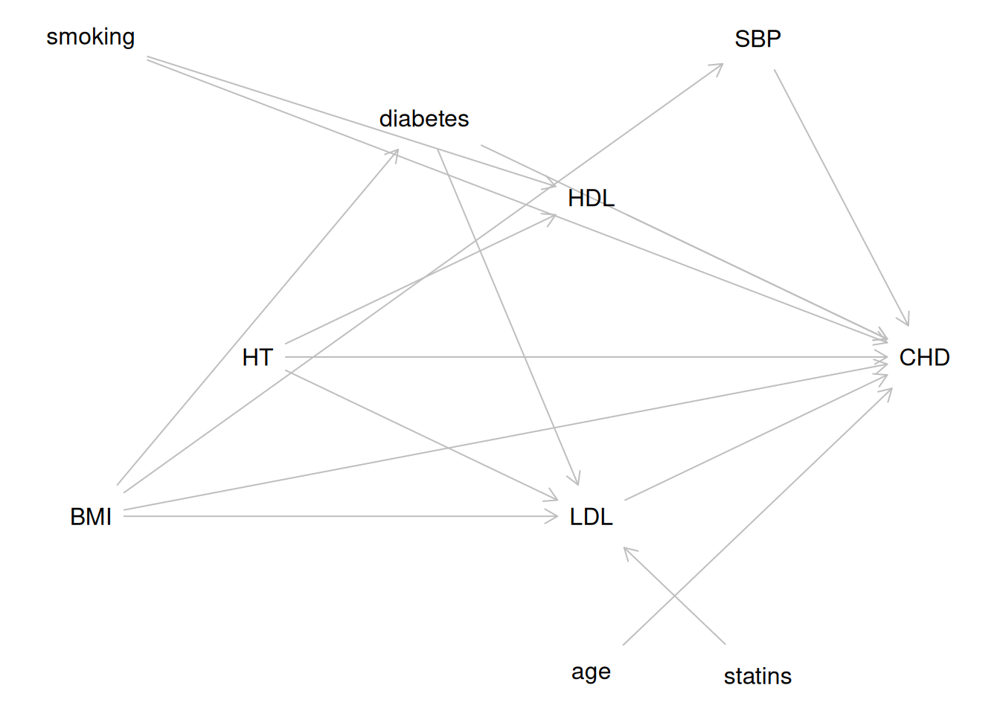
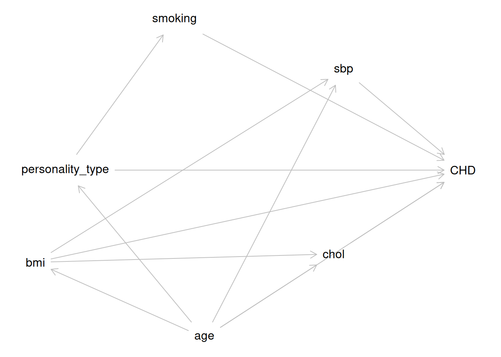
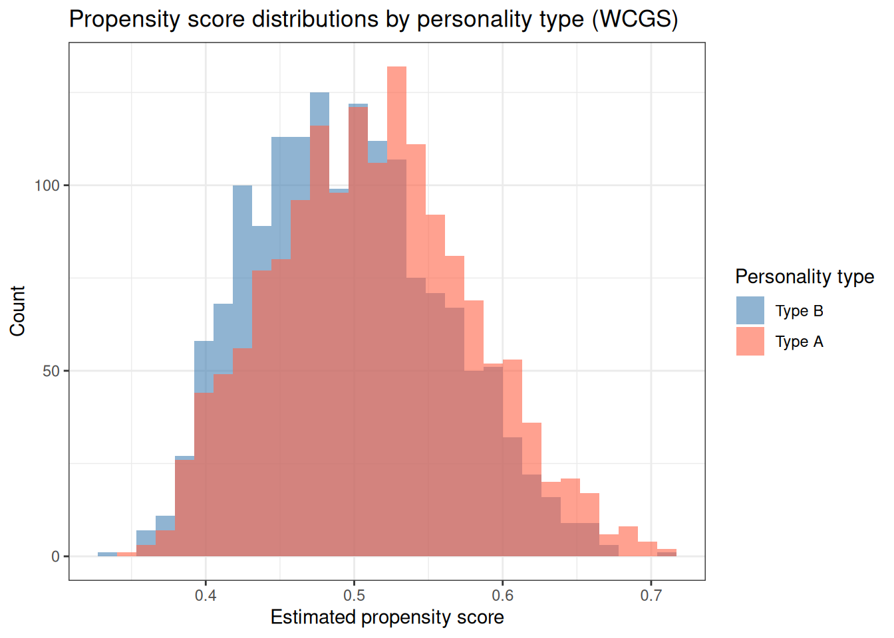

# Causal Inference

Code

- [Show All Code](javascript:void(0))

- [Hide All Code](javascript:void(0))

- 

  ------------------------------------------------------------------------

- [View Source](javascript:void(0))

Estimating causal effects from regression models

Published

Last modified: 2026-11-12: 2:54:00 (UTC)

------------------------------------------------------------------------

# Configuring R

Functions from these packages will be used throughout this document:

Show R code

``` downlit
library(conflicted) # check for conflicting function definitions
# printr is not loaded here: it inserts help-file output into markdown output
library(rmarkdown) # Convert R Markdown documents into a variety of formats.
library(pander) # format tables for markdown
library(ggplot2) # graphics
library(ggfortify) # help with graphics
library(dplyr) # manipulate data
library(tibble) # `tibble`s extend `data.frame`s
library(magrittr) # `%>%` and other additional piping tools
library(haven) # import Stata files
library(knitr) # format R output for markdown
library(tidyr) # Tools to help to create tidy data
library(plotly) # interactive graphics
library(dobson) # datasets from Dobson and Barnett 2018
library(parameters) # format model output tables for markdown
library(haven) # import Stata files
library(latex2exp) # use LaTeX in R code (for figures and tables)
library(fs) # filesystem path manipulations
library(survival) # survival analysis
library(survminer) # survival analysis graphics
library(KMsurv) # datasets from Klein and Moeschberger
library(parameters) # format model output tables for
library(webshot2) # convert interactive content to static for pdf
library(forcats) # functions for categorical variables ("factors")
library(stringr) # functions for dealing with strings
library(lubridate) # functions for dealing with dates and times
# Summarizes key information about statistical objects in tidy tibbles
library(broom)
# Provides suite of functions to work with regression model
# `broom::tidy()` tibbles
library(broom.helpers)
```

Here are some R settings I use in this document:

Show R code

``` downlit
rm(list = ls()) # delete any data that's already loaded into R

conflicts_prefer(dplyr::filter)
ggplot2::theme_set(
  ggplot2::theme_bw() +
    # ggplot2::labs(col = "") +
    ggplot2::theme(
      legend.position = "bottom",
      text = ggplot2::element_text(size = 12, family = "serif")
    )
)

knitr::opts_chunk$set(message = FALSE)
options(digits = 6)

panderOptions("big.mark", ",")
pander::panderOptions("table.emphasize.rownames", FALSE)
pander::panderOptions("table.split.table", Inf)
# use the `filter()` function from dplyr() by default
conflicts_prefer(dplyr::filter)
legend_text_size <- 9
run_graphs <- TRUE
```

# Acknowledgements

This chapter is adapted from [\[1, Ch. 9\]](#ref-vittinghoff2e) and draws on the companion causal inference notes available at <https://d-morrison.github.io/cie/>.

See also Hernán and Robins [\[2\]](#ref-hernan2020causal) for a comprehensive treatment of causal inference from observational data.

# 1 Introduction

[Regression models](../chapters/Intro-to-GLMs.llms.md#def-regression-model) describe statistical associations between variables. But in many research settings, the goal is not merely to describe associations but to estimate **causal effects**: what would happen if we intervened to change a variable?

“No causes in, no causes out.” [\[3\]](#ref-holland1986statistics)

A statistical model alone cannot tell us whether an observed association is causal or spurious. Causal inference requires additional assumptions — about the data-generating process — that must be justified using subject-matter knowledge.

The causal inference framework covered in this chapter is based on the **[potential outcomes](#def-potential-outcomes)** model [\[3\]](#ref-holland1986statistics), [\[4\]](#ref-rubin1974estimating). This framework provides:

- A precise language for defining causal effects
- Explicit assumptions required to identify causal effects from data
- Estimation methods that target specific [causal estimands](#sec-causal-estimands)

For more resources on causal inference, including additional courses and books, see <https://d-morrison.github.io/cie/>.

## 1.1 Descriptive versus causal questions

Before turning to causal questions, it helps to separate them from descriptive ones.

Suppose we want to know how heavy a cow will be if it eats grass all summer. This question is a descriptive question about the conditional distribution of weight given diet, $\operatorname{p}(Y = y \mid X = \text{grass})$, where $Y$ is weight and $X$ is diet. We have not asked how heavy a cow would be if we *intervened* to make it eat grass all summer.

Suppose we find some cows eating grass and others eating hay. We can observe the weights of the grass-fed cows and the weights of the hay-fed cows, but we cannot observe what would have happened if we had made the grass-fed cows eat hay instead. Would they have weighed the same as the cows we found eating hay? Several things could make the answer no:

- the two groups might differ in breed;
- the way the cows ended up with their diets might matter: perhaps the bigger cows chased the smaller ones off the grass.

We can answer causal questions of this kind, but we generally need to answer the descriptive questions first. Descriptive questions do not require [covariates](../chapters/Intro-to-GLMs.llms.md#def-predictors) that we *could* intervene on; they only require covariates that we can observe. This hypothetical example illustrates the distinction that the [potential outcomes](#def-potential-outcomes) framework of this chapter makes precise.

The same distinction arises with binary outcomes, where the descriptive summary is often a **risk difference**: the difference between the proportions of two groups who experience the outcome.

> **NOTE:**
>
> **Example 1 (A crude risk difference that reverses within age groups)** Consider a hypothetical population of 1000 adults, with a binary treatment $A$ ($A = 1$ for treated), a binary outcome $Y$ ($Y = 1$ for death within a year), and a binary covariate $L$ ($L = 1$ for age 65 or older). Older adults are more likely to be treated, and older adults are also more likely to die, whether or not they are treated:
>
> | $L$ | treated | untreated | ${\mathbb{P}\mathopen{}\left(Y = 1 \mid A = 1, L\right)\mathclose{}}$ | ${\mathbb{P}\mathopen{}\left(Y = 1 \mid A = 0, L\right)\mathclose{}}$ |
> |:--:|:--:|:--:|:--:|:--:|
> | 0 (younger) | 100 | 500 | 0.05 | 0.10 |
> | 1 (older) | 300 | 100 | 0.30 | 0.40 |
>
> Within each age group, the treated have lower risk than the untreated:
>
> $$\begin{aligned}
> \text{RD}_{L = 0}
> &\stackrel{\text{def}}{=}{\mathbb{P}\mathopen{}\left(Y = 1 \mid A = 1, L = 0\right)\mathclose{}} - {\mathbb{P}\mathopen{}\left(Y = 1 \mid A = 0, L = 0\right)\mathclose{}}
> && \text{(define the age-specific risk difference)} \\
> &= 0.05 - 0.10
> && \text{(substitute from the table)} \\
> &= -0.05
> && \text{(subtract)} \\
> \text{RD}_{L = 1}
> &\stackrel{\text{def}}{=}{\mathbb{P}\mathopen{}\left(Y = 1 \mid A = 1, L = 1\right)\mathclose{}} - {\mathbb{P}\mathopen{}\left(Y = 1 \mid A = 0, L = 1\right)\mathclose{}}
> && \text{(define the age-specific risk difference)} \\
> &= 0.30 - 0.40
> && \text{(substitute from the table)} \\
> &= -0.10
> && \text{(subtract)}
> \end{aligned}$$
>
> Ignoring age, the risk in each treatment group averages the age-specific risks in proportion to that group’s own age distribution:
>
> $$\begin{aligned}
> {\mathbb{P}\mathopen{}\left(Y = 1 \mid A = 1\right)\mathclose{}}
> &= \frac{100 \cdot 0.05 + 300 \cdot 0.30}{400}
> && \text{(average over the 400 treated)} \\
> &= \frac{5 + 90}{400}
> && \text{(multiply)} \\
> &= \frac{95}{400}
> && \text{(add)} \\
> &= 0.2375
> && \text{(divide)} \\
> {\mathbb{P}\mathopen{}\left(Y = 1 \mid A = 0\right)\mathclose{}}
> &= \frac{500 \cdot 0.10 + 100 \cdot 0.40}{600}
> && \text{(average over the 600 untreated)} \\
> &= \frac{50 + 40}{600}
> && \text{(multiply)} \\
> &= \frac{90}{600}
> && \text{(add)} \\
> &= 0.15
> && \text{(divide)} \\
> \text{RD}_{\text{crude}}
> &\stackrel{\text{def}}{=}{\mathbb{P}\mathopen{}\left(Y = 1 \mid A = 1\right)\mathclose{}} - {\mathbb{P}\mathopen{}\left(Y = 1 \mid A = 0\right)\mathclose{}}
> && \text{(define the crude risk difference)} \\
> &= 0.2375 - 0.15
> && \text{(substitute)} \\
> &= 0.0875
> && \text{(subtract)}
> \end{aligned}$$
>
> The crude risk difference of $+0.0875$ is a correct *descriptive* answer: in this population, treated adults really did die more often than untreated adults. It is a misleading answer to the *causal* question “would treating someone raise or lower their risk?”, because 75% of the treated group is older, compared with about 17% of the untreated group. If age were the only factor that influenced both who was treated and who died, the age-specific risk differences ($-0.05$ and $-0.10$) would compare like with like, and they say that treatment lowers risk. The rest of this chapter makes precise when a comparison of this kind has a causal interpretation.

# 2 Potential Outcomes

Causal inference is about estimating the effect of interventions — what would happen if we changed something? Statistical associations alone do not answer causal questions.

The fundamental challenge in causal inference is that we can only observe one [potential outcome](#def-potential-outcomes) for each unit: the outcome under the treatment that actually occurred. This unobservability of counterfactual outcomes is called the **fundamental problem of causal inference** [\[3\]](#ref-holland1986statistics).

> **NOTE:**
>
> **Definition 1 (Potential outcomes (counterfactual outcomes))** For a binary treatment $A \in \{0, 1\}$, the **potential outcomes** for unit $i$ are:
>
> - $Y_i(1)$: the outcome that would be observed if unit $i$ received treatment ($A_i = 1$)
> - $Y_i(0)$: the outcome that would be observed if unit $i$ received control ($A_i = 0$)
>
> These potential outcomes are also called **counterfactual outcomes**, because for each unit, one of them is necessarily counterfactual (it corresponds to a treatment that did not occur).

> **NOTE:**
>
> **Definition 2 (Observed outcome)** The **observed outcome** for unit $i$ is the potential outcome corresponding to the treatment actually received: $$Y_i \stackrel{\text{def}}{=}Y_i(A_i) = A_i \cdot Y_i(1) + (1 - A_i) \cdot Y_i(0)$$

> **NOTE:**
>
> *Remark 1* (Observed and potential outcomes: the consistency assumption). This relationship between observed and potential outcomes is sometimes called the **[consistency](#def-consistency)** assumption: the observed outcome under the observed treatment equals the potential outcome under that treatment.

> **NOTE:**
>
> **Definition 3 (Individual causal effect)** The **individual causal effect** for unit $i$ is the difference between that unit’s two potential outcomes: $$\tau_i \stackrel{\text{def}}{=}Y_i(1) - Y_i(0)$$

> **NOTE:**
>
> **Example 2 (Potential outcomes and observed outcomes in a toy sample)** Consider a [sample](https://morrison-lab.github.io/sds/exploratory-descriptive.html#def-sample) of three individuals being evaluated for a medication ($A \in \{0, 1\}$) where the [outcome](../chapters/Intro-to-GLMs.llms.md#def-outcome) $Y$ is blood pressure reduction (mmHg):
>
> | Unit $i$ | $Y_i(0)$ | $Y_i(1)$ | $\tau_i = Y_i(1) - Y_i(0)$ | Observed $A_i$ | Observed $Y_i$ |
> |:--:|:--:|:--:|:--:|:--:|:--:|
> | 1 | 5 | 15 | +10 | 1 | 15 |
> | 2 | 2 | 8 | +6 | 0 | 2 |
> | 3 | 10 | 12 | +2 | 1 | 12 |
>
> For unit 1 ($A_1 = 1$), we observe $Y_1 = Y_1(1) = 15$, while $Y_1(0) = 5$ is unobserved (counterfactual). For unit 2 ($A_2 = 0$), we observe $Y_2 = Y_2(0) = 2$, while $Y_2(1) = 8$ is counterfactual. Because only one potential outcome is observed per unit, we cannot directly calculate $\tau_i$ for any individual in real data.

> **NOTE:**
>
> *Remark 2* (Individual causal effects are not identified). Because of the fundamental problem of causal inference, we can never observe both $Y_i(1)$ and $Y_i(0)$ for the same unit, so individual causal effects are generally not identified.

# 3 Causal Estimands

Since [individual causal effects](#def-individual-causal-effect) are not identified, causal inference focuses on **population-level causal [estimands](https://morrison-lab.github.io/sds/estimation.html#def-estimand)**: averages of [potential outcomes](#def-potential-outcomes) over a [population](https://morrison-lab.github.io/sds/exploratory-descriptive.html#def-population).

> **NOTE:**
>
> **Definition 4 (Average Treatment Effect (ATE))** The **Average Treatment Effect** is the [expected](https://morrison-lab.github.io/pds/expectation.html#def-expectation) difference in potential outcomes in the study population: $$\text{ATE} \stackrel{\text{def}}{=}{\mathbb{E}\mathopen{}\left[Y(1) - Y(0)\right]\mathclose{}} = {\mathbb{E}\mathopen{}\left[Y(1)\right]\mathclose{}} - {\mathbb{E}\mathopen{}\left[Y(0)\right]\mathclose{}}$$

> **NOTE:**
>
> *Remark 3* (Interpretation of the ATE). The ATE represents the average causal effect of treatment compared with control, averaged over all units in the population (both those who would and would not actually receive treatment).

> **NOTE:**
>
> **Definition 5 (Average Treatment Effect on the Treated (ATT))** The **Average Treatment Effect on the Treated** is the expected difference in potential outcomes among units who actually received treatment: $$\text{ATT} \stackrel{\text{def}}{=}{\mathbb{E}\mathopen{}\left[Y(1) - Y(0) \mid A = 1\right]\mathclose{}} = {\mathbb{E}\mathopen{}\left[Y(1) \mid A = 1\right]\mathclose{}} - {\mathbb{E}\mathopen{}\left[Y(0) \mid A = 1\right]\mathclose{}}$$

> **NOTE:**
>
> *Remark 4* (Interpretation of the ATT). The ATT answers the question: “On average, how much did treatment help the people who received it?”

> **NOTE:**
>
> **Definition 6 (Average Treatment Effect on the Untreated (ATU))** The **Average Treatment Effect on the Untreated** is the expected difference in potential outcomes among units who did not receive treatment: $$\text{ATU} \stackrel{\text{def}}{=}{\mathbb{E}\mathopen{}\left[Y(1) - Y(0) \mid A = 0\right]\mathclose{}} = {\mathbb{E}\mathopen{}\left[Y(1) \mid A = 0\right]\mathclose{}} - {\mathbb{E}\mathopen{}\left[Y(0) \mid A = 0\right]\mathclose{}}$$

> **NOTE:**
>
> **Example 3 (Calculating population-level causal estimands in a toy population)** Revisiting the three-unit population from [Example 2](#exm-potential-outcomes-toy):
>
> - Individual 1 ($A_1 = 1$): $Y_1(0) = 5$, $Y_1(1) = 15$, $\tau_1 = +10$.
> - Individual 2 ($A_2 = 0$): $Y_2(0) = 2$, $Y_2(1) = 8$, $\tau_2 = +6$.
> - Individual 3 ($A_3 = 1$): $Y_3(0) = 10$, $Y_3(1) = 12$, $\tau_3 = +2$.
>
> We calculate the population-level estimands across all three units:
>
> 1.  **ATE**: $\frac{\tau_1 + \tau_2 + \tau_3}{3} = \frac{10 + 6 + 2}{3} = +6.0$.
> 2.  **ATT**: Average over treated units ($i = 1, 3$): $\frac{\tau_1 + \tau_3}{2} = \frac{10 + 2}{2} = +6.0$.
> 3.  **ATU**: Average over untreated units ($i = 2$): $\frac{\tau_2}{1} = +6.0$.
>
> In this toy population, treatment effect heterogeneity exists ($\tau_i$ varies across units), but because average gains happen to balance across treatment groups, ATE = ATT = ATU. In general observational datasets with selection bias, ATT and ATU often differ markedly from ATE.

> **NOTE:**
>
> *Remark 5* (Interpretation of the ATU). The ATU answers the question: “On average, how much would treatment have helped the people who did not receive it?”

The ATE, ATT, and ATU are equal when treatment assignment is [independent](https://morrison-lab.github.io/pds/independence.html#def-indpt) of potential outcomes (e.g., in a perfectly conducted [randomized trial](#sec-causal-rct)): $$\text{ATE} = \text{ATT} = \text{ATU}
\quad \text{when } A \perp\!\!\!\perp (Y(0), Y(1))$$

In observational studies, these three estimands can differ substantially. The choice of estimand depends on the research question.

# 4 Causal Assumptions

Three key assumptions are required to identify causal effects from observed data [\[2\]](#ref-hernan2020causal):

## 4.1 Consistency

> **NOTE:**
>
> **Definition 7 (Consistency)** The **consistency** assumption states that the [observed outcome](#def-observed-outcome) for a treated unit equals that unit’s [potential outcome](#def-potential-outcomes) under treatment, and similarly for control: $$Y_i \stackrel{\text{def}}{=}Y_i(A_i)$$

> **NOTE:**
>
> *Remark 6* (Well-defined treatment and violations of consistency). Consistency requires that the treatment is well-defined: there is only one version of treatment, or different versions have the same effect on the outcome. Violations of consistency (e.g., different doses of a drug being lumped together as “treated”) can introduce [bias](https://morrison-lab.github.io/sds/estimation.html#def-bias).

## 4.2 Exchangeability (No Unmeasured Confounding)

> **NOTE:**
>
> **Definition 8 (Exchangeability (no unmeasured confounding, ignorability))** **Exchangeability** (also called **no unmeasured [confounding](#def-confounding-obs)** or **ignorability**) states that, conditional on observed covariates $\mathord{\smash[b]{\underset{\raise.3ex\hbox{$\scriptstyle\sim$}}{L}}\vphantom{L}}$, treatment assignment is [independent](https://morrison-lab.github.io/pds/independence.html#def-cind) of [potential outcomes](#def-potential-outcomes): $$A \perp\!\!\!\perp (Y(0), Y(1)) \mid \mathord{\smash[b]{\underset{\raise.3ex\hbox{$\scriptstyle\sim$}}{L}}\vphantom{L}}$$

> **NOTE:**
>
> *Remark 7* (Interpretation of exchangeability). Intuitively, exchangeability means that among individuals with the same covariate values, treatment was assigned as if at random — there are no unmeasured common causes of treatment and outcome.

> **NOTE:**
>
> **Definition 9 (Unconditional exchangeability)** **Unconditional exchangeability** ($A \perp\!\!\!\perp (Y(0), Y(1))$) holds in perfectly [randomized trials](#sec-causal-rct). Exchangeability conditional on $\mathord{\smash[b]{\underset{\raise.3ex\hbox{$\scriptstyle\sim$}}{L}}\vphantom{L}}$ ([Definition 8](#def-exchangeability)) requires adjusting for $\mathord{\smash[b]{\underset{\raise.3ex\hbox{$\scriptstyle\sim$}}{L}}\vphantom{L}}$.

> **NOTE:**
>
> **Example 4 (A population where exchangeability holds only within strata)** Consider a large population of 1000 patients, with a binary covariate $L$ (disease severity: $L = 1$ for severe) and treatment $A$. Severe patients are more likely to be treated, and both potential outcomes are higher for severe patients (treating proportions as probabilities):
>
> | $L$ | patients | ${\mathbb{P}\mathopen{}\left(A = 1 \mid L\right)\mathclose{}}$ | treated | untreated | ${\mathbb{E}\mathopen{}\left[Y(1) \mid L\right]\mathclose{}}$ | ${\mathbb{E}\mathopen{}\left[Y(0) \mid L\right]\mathclose{}}$ |
> |:--:|:--:|:--:|:--:|:--:|:--:|:--:|
> | 0 | 600 | 0.2 | 120 | 480 | 10 | 8 |
> | 1 | 400 | 0.7 | 280 | 120 | 20 | 18 |
>
> Within each severity stratum, suppose treatment was assigned as if at random, so that $A \perp\!\!\!\perp(Y(0), Y(1)) \mid L$: conditional exchangeability ([Definition 8](#def-exchangeability)) holds with $\mathord{\smash[b]{\underset{\raise.3ex\hbox{$\scriptstyle\sim$}}{L}}\vphantom{L}} = L$.
>
> Unconditional exchangeability ([Definition 9](#def-unconditional-exchangeability)) fails, though. Averaging $Y(0)$ over the strata in proportion to each treatment group’s members:
>
> $$\begin{aligned}
> {\mathbb{E}\mathopen{}\left[Y(0) \mid A = 1\right]\mathclose{}}
> &= \frac{120 \cdot 8 + 280 \cdot 18}{400}
> && \text{(average over the 400 treated)} \\
> &= \frac{960 + 5040}{400}
> && \text{(multiply)} \\
> &= 15
> && \text{(add and divide)} \\
> {\mathbb{E}\mathopen{}\left[Y(0) \mid A = 0\right]\mathclose{}}
> &= \frac{480 \cdot 8 + 120 \cdot 18}{600}
> && \text{(average over the 600 untreated)} \\
> &= \frac{3840 + 2160}{600}
> && \text{(multiply)} \\
> &= 10
> && \text{(add and divide)}
> \end{aligned}$$
>
> The treated group would have had a higher mean outcome even without treatment, because it contains more severe patients, so $A$ is not independent of $Y(0)$.

## 4.3 Positivity

> **NOTE:**
>
> **Definition 10 (Positivity)** The **positivity** assumption states that every individual has a positive probability of receiving each treatment level, at every covariate value $\mathord{\smash[b]{\underset{\raise.3ex\hbox{$\scriptstyle\sim$}}{l}}\vphantom{l}}$ in the [support](https://morrison-lab.github.io/mds/indicator-functions.html#def-support) of $\mathord{\smash[b]{\underset{\raise.3ex\hbox{$\scriptstyle\sim$}}{L}}\vphantom{L}}$: $$0 < {\mathbb{P}\mathopen{}\left(A = 1 \mid \mathord{\smash[b]{\underset{\raise.3ex\hbox{$\scriptstyle\sim$}}{L}}\vphantom{L}} = \mathord{\smash[b]{\underset{\raise.3ex\hbox{$\scriptstyle\sim$}}{l}}\vphantom{l}}\right)\mathclose{}} < 1
> \quad \text{for all } \mathord{\smash[b]{\underset{\raise.3ex\hbox{$\scriptstyle\sim$}}{l}}\vphantom{l}} \text{ in the support of } \mathord{\smash[b]{\underset{\raise.3ex\hbox{$\scriptstyle\sim$}}{L}}\vphantom{L}}$$

> **NOTE:**
>
> *Remark 8* (Why positivity is needed). Without positivity, some subgroups have no treated (or untreated) members, making it impossible to estimate the [counterfactual outcome](#def-potential-outcomes) for those subgroups.

> **NOTE:**
>
> **Definition 11 (Positivity violation)** A failure of positivity is sometimes called a **positivity violation**. When near-zero probabilities occur in small strata, the failure is called a practical positivity violation.

> **NOTE:**
>
> **Example 5 (Checking positivity)** In the population of [Example 4](#exm-exchangeability-strata), ${\mathbb{P}\mathopen{}\left(A = 1 \mid L = 0\right)\mathclose{}} = 0.2$ and ${\mathbb{P}\mathopen{}\left(A = 1 \mid L = 1\right)\mathclose{}} = 0.7$. Both probabilities lie strictly between 0 and 1, so positivity ([Definition 10](#def-positivity)) holds: each severity stratum contains both treated and untreated patients.
>
> If instead every severe patient were treated, then ${\mathbb{P}\mathopen{}\left(A = 1 \mid L = 1\right)\mathclose{}} = 1$, the population would contain no untreated severe patients, and the data could not tell us what ${\mathbb{E}\mathopen{}\left[Y(0) \mid L = 1\right]\mathclose{}}$ is: a positivity violation ([Definition 11](#def-positivity-violation)).

These three assumptions — consistency, exchangeability, and positivity — are collectively sufficient to identify causal effects from observed data. They are sometimes summarized as “no interference, no unmeasured confounders, no positivity violations.”

These assumptions are **untestable** from the data alone; they must be justified using subject-matter knowledge.

# 5 Randomized Experiments

In a **randomized controlled trial** (RCT), treatment is assigned by the investigator using a random mechanism, [independent](https://morrison-lab.github.io/pds/independence.html#def-indpt) of any characteristics of the participants. Randomization makes the treatment groups **[exchangeable](#def-exchangeability)**: the distribution of [potential outcomes](#def-potential-outcomes) is the same in treated and untreated groups.

As a result, in a perfectly randomized trial, the observed group means identify the mean potential outcomes:

> **NOTE:**
>
> **Theorem 1 (Identification of the ATE under randomization)** If [consistency](#def-consistency) and [unconditional exchangeability](#def-unconditional-exchangeability) hold, and $0 < {\mathbb{P}\mathopen{}\left(A = 1\right)\mathclose{}} < 1$, then for each treatment level $a \in \mathopen{}\left\{0, 1\right\}\mathclose{}$,
>
> $${\mathbb{E}\mathopen{}\left[Y(a)\right]\mathclose{}} = {\mathbb{E}\mathopen{}\left[Y \mid A = a\right]\mathclose{}}$$
>
> and therefore
>
> $$\text{ATE} = {\mathbb{E}\mathopen{}\left[Y \mid A = 1\right]\mathclose{}} - {\mathbb{E}\mathopen{}\left[Y \mid A = 0\right]\mathclose{}} \tag{1}$$

> **NOTE:**
>
> *Proof*. For treatment level $a$:
>
> $$\begin{aligned}
> {\mathbb{E}\mathopen{}\left[Y(a)\right]\mathclose{}}
> &= {\mathbb{E}\mathopen{}\left[Y(a) \mid A = a\right]\mathclose{}}
> && \text{(unconditional exchangeability: } Y(a) \perp\!\!\!\perp A \text{)} \\
> &= {\mathbb{E}\mathopen{}\left[Y \mid A = a\right]\mathclose{}}
> && \text{(consistency: } Y = Y(a) \text{ when } A = a \text{)}
> \end{aligned}$$
>
> where the condition $0 < {\mathbb{P}\mathopen{}\left(A = 1\right)\mathclose{}} < 1$ makes both conditioning events $\mathopen{}\left\{A = 1\right\}\mathclose{}$ and $\mathopen{}\left\{A = 0\right\}\mathclose{}$ have positive probability. Substituting into the [ATE](#def-ate):
>
> $$\begin{aligned}
> \text{ATE}
> &= {\mathbb{E}\mathopen{}\left[Y(1)\right]\mathclose{}} - {\mathbb{E}\mathopen{}\left[Y(0)\right]\mathclose{}}
> && \text{(definition of ATE)} \\
> &= {\mathbb{E}\mathopen{}\left[Y \mid A = 1\right]\mathclose{}} - {\mathbb{E}\mathopen{}\left[Y \mid A = 0\right]\mathclose{}}
> && \text{(apply the first result with } a = 1 \text{ and } a = 0 \text{)}
> \end{aligned}$$

> **NOTE:**
>
> **Example 6 (Randomizing the severity example)** Suppose the 1000 patients of [Example 4](#exm-exchangeability-strata) had instead been randomized, each treated with probability 0.5 regardless of severity. Then each treatment group has the population’s severity mix, 60% non-severe and 40% severe (treating proportions as probabilities), so by consistency
>
> $$\begin{aligned}
> {\mathbb{E}\mathopen{}\left[Y \mid A = 1\right]\mathclose{}}
> &= 0.6 \cdot 10 + 0.4 \cdot 20
> && \text{(severity mix of the treated; } {\mathbb{E}\mathopen{}\left[Y(1) \mid L\right]\mathclose{}} \text{)} \\
> &= 14
> && \text{(multiply and add)} \\
> {\mathbb{E}\mathopen{}\left[Y \mid A = 0\right]\mathclose{}}
> &= 0.6 \cdot 8 + 0.4 \cdot 18
> && \text{(severity mix of the untreated; } {\mathbb{E}\mathopen{}\left[Y(0) \mid L\right]\mathclose{}} \text{)} \\
> &= 12
> && \text{(multiply and add)}
> \end{aligned}$$
>
> and [Equation 1](#eq-rct-ate) gives $\text{ATE} = 14 - 12 = 2$, the treatment’s effect in every stratum.

> **NOTE:**
>
> **Example 7 (Without exchangeability, the naive contrast is biased)** In the population of [Example 4](#exm-exchangeability-strata), treatment was not randomized, so [Theorem 1](#thm-rct-identification) does not apply. The observed group means are
>
> $$\begin{aligned}
> {\mathbb{E}\mathopen{}\left[Y \mid A = 1\right]\mathclose{}}
> &= \frac{120 \cdot 10 + 280 \cdot 20}{400}
> && \text{(consistency; average over the treated)} \\
> &= \frac{1200 + 5600}{400}
> && \text{(multiply)} \\
> &= 17
> && \text{(add and divide)} \\
> {\mathbb{E}\mathopen{}\left[Y \mid A = 0\right]\mathclose{}}
> &= 10
> && \text{(consistency; } {\mathbb{E}\mathopen{}\left[Y(0) \mid A = 0\right]\mathclose{}} = 10 \text{ in that population)}
> \end{aligned}$$
>
> so the naive contrast [Equation 1](#eq-rct-ate) would give $17 - 10 = 7$. But the treatment raises each patient’s mean outcome by exactly 2 in both strata ($10 - 8 = 20 - 18 = 2$), so the true ATE is 2. The extra 5 units come from the severe patients’ over-representation among the treated: [confounding](#def-confounding-obs) by $L$.

In a randomized trial, therefore, the observed mean difference between treatment groups is an [unbiased](https://morrison-lab.github.io/sds/estimation.html#def-unbiased) estimate of the [ATE](#def-ate):

$$\widehat{\text{ATE}} = \bar{Y}_{A=1} - \bar{Y}_{A=0}$$

Randomization achieves unconditional exchangeability: $A \perp\!\!\!\perp (Y(0), Y(1))$. Because there are no common causes of treatment assignment and the outcome, there is no [confounding](#def-confounding-obs). The observed association between $A$ and $Y$ in the data is a direct measure of the causal effect.

## 5.1 The HERS study: a randomized trial example

The “heart and estrogen/progestin study” (HERS) was a clinical trial of hormone therapy for prevention of recurrent heart attacks and death among 2,763 post-menopausal women with existing coronary heart disease (CHD) [\[5\]](#ref-HulleyStephen1998RToE).

The trial was conducted at 20 US clinical centers. Participants were randomized to receive either conjugated equine estrogens (0.625 mg/day) plus medroxyprogesterone acetate (2.5 mg/day) or a matching placebo [\[5\]](#ref-HulleyStephen1998RToE). Women were followed for a sample mean of 4.1 years [\[5\]](#ref-HulleyStephen1998RToE).

The primary outcome was nonfatal myocardial infarction or CHD death [\[5\]](#ref-HulleyStephen1998RToE).

In HERS, hormone therapy (HT) was randomized, so the treatment groups were [exchangeable](#def-exchangeability) at baseline. The observed difference in CHD event rates between the HT and placebo groups estimates the causal effect of HT.

Despite [observational studies](#sec-causal-observational) suggesting up to 35–80% fewer recurrent CHD events among hormone users than non-users, [\[5\]](#ref-HulleyStephen1998RToE), HERS found **no [significant](https://morrison-lab.github.io/sds/inference.html#def-statistically-significant) difference** in CHD event rates between the hormone therapy (HT) and placebo groups ([relative hazard](../chapters/intro-to-survival-analysis.llms.md#def-hazard-ratio) 0.99; 95% [CI](https://morrison-lab.github.io/sds/inference.html#def-confidence-interval): 0.80–1.22) [\[5\]](#ref-HulleyStephen1998RToE).

The HERS investigators noted a statistically significant time trend: more CHD events occurred in the HT group in year 1, while fewer occurred in years 4 and 5, suggesting that HT may have early harmful effects that are later reversed.

A key finding was that HT significantly altered lipid profiles:

- LDL cholesterol: 11% lower in the HT group [\[5\]](#ref-HulleyStephen1998RToE).
- HDL cholesterol: 10% higher in the HT group [\[5\]](#ref-HulleyStephen1998RToE).

Yet these favorable lipid changes did not translate into fewer CHD events overall. One explanation consistent with the DAG in [Figure 1](#fig-hers-dag) is that the effects of HT on lipids (a [mediator](#def-mediator) pathway) were offset by other, harmful pathways — possibly thrombotic — that are not captured in the lipid mediators.

Hulley et al. [\[5\]](#ref-HulleyStephen1998RToE) also noted that HT increased the rate of venous thromboembolic events (relative hazard 2.89; 95% CI: 1.50–5.58) and gallbladder disease (relative hazard 1.38; 95% CI: 1.00–1.92).

The HERS result illustrates the gap between observational evidence and causal evidence: prior observational studies had suggested large benefits of HT, but these reflected confounding by the “healthy user” effect — women who voluntarily used HT tended to be healthier overall. Randomization in HERS removed this confounding.

## 5.2 Covariate adjustment in RCTs

Although randomization ensures no [confounding](#def-confounding-obs), adjusting for baseline [covariates](../chapters/Intro-to-GLMs.llms.md#def-predictors) in an RCT can still be useful:

- **Improved [precision](https://morrison-lab.github.io/pds/variance-covariance.html#def-precision)**: Adjusting for strong predictors of the outcome reduces residual variance and narrows [confidence intervals](https://morrison-lab.github.io/sds/inference.html#def-confidence-interval).
- **Covariate imbalance**: When randomization produces chance imbalances in small trials, adjustment can correct for these baseline differences.

However, in an RCT, covariates that are **[mediators](#def-mediator)** of the treatment effect (i.e., variables affected by treatment) should generally **not** be adjusted for when estimating the **total** causal effect of treatment. Adjusting for mediators blocks part of the causal pathway and gives only the **direct** effect of treatment.

# 6 Observational Studies

> **TIP:**
>
> Richard McElreath’s [*Elemental Confounds I*](https://www.youtube.com/watch?v=lGR7D45Ww38) (Statistical Rethinking 2026, Lecture A06) accompanies Chapter 6 of McElreath [\[6\]](#ref-statrethink2e), which uses [directed acyclic graphs (DAGs)](#sec-pred-sel-dag) to describe [confounding](#def-confounding-obs) [\[7\]](#ref-mcelreath2026rethinking).

In an **observational study**, treatment is not assigned by the investigator. Instead, individuals self-select into treatment, or treatment is assigned based on clinical or administrative criteria. As a result, treatment groups may differ systematically in ways that also affect the [outcome](../chapters/Intro-to-GLMs.llms.md#def-outcome) — this systematic difference is called **[confounding](#def-confounding-obs)**.

## 6.1 Confounding

> **NOTE:**
>
> **Definition 12 (Confounding)** **Confounding** occurs when there is a common cause of both the treatment $A$ and the outcome $Y$. This common cause is called a **[confounder](#def-confounder)**.

> **NOTE:**
>
> *Remark 9* (Confounding in the potential outcomes framework). In the [potential outcomes](#def-potential-outcomes) framework, confounding means that treatment assignment is not [independent](https://morrison-lab.github.io/pds/independence.html#def-indpt) of potential outcomes: $$A \not\perp\!\!\!\perp (Y(0), Y(1))$$
>
> As a result, the observed association between $A$ and $Y$ does not equal the causal effect of $A$ on $Y$.

> **NOTE:**
>
> **Example 8 (Confounding of coffee and lung cancer by smoking)** Consider a hypothetical cohort of 1000 adults, with coffee drinking $A$ ($A = 1$ for daily coffee), lung cancer $Y$ ($Y = 1$ for diagnosis during follow-up), and smoking $L$ ($L = 1$ for smokers). Suppose coffee has **no** effect on lung cancer, so that $Y_i(1) = Y_i(0)$ for every individual, but smokers are both more likely to drink coffee and more likely to develop lung cancer:
>
> | $L$ | coffee | no coffee | ${\mathbb{P}\mathopen{}\left(Y = 1 \mid A = 1, L\right)\mathclose{}}$ | ${\mathbb{P}\mathopen{}\left(Y = 1 \mid A = 0, L\right)\mathclose{}}$ |
> |:--:|:--:|:--:|:--:|:--:|
> | 0 (nonsmokers) | 200 | 500 | 0.01 | 0.01 |
> | 1 (smokers) | 200 | 100 | 0.10 | 0.10 |
>
> Within each smoking stratum, the risk difference is $0$, matching the true (null) causal effect. Ignoring smoking:
>
> $$\begin{aligned}
> {\mathbb{P}\mathopen{}\left(Y = 1 \mid A = 1\right)\mathclose{}}
> &= \frac{200 \cdot 0.01 + 200 \cdot 0.10}{400}
> && \text{(average over the 400 coffee drinkers)} \\
> &= \frac{2 + 20}{400}
> && \text{(multiply)} \\
> &= \frac{22}{400}
> && \text{(add)} \\
> &= 0.055
> && \text{(divide)} \\
> {\mathbb{P}\mathopen{}\left(Y = 1 \mid A = 0\right)\mathclose{}}
> &= \frac{500 \cdot 0.01 + 100 \cdot 0.10}{600}
> && \text{(average over the 600 non-drinkers)} \\
> &= \frac{5 + 10}{600}
> && \text{(multiply)} \\
> &= \frac{15}{600}
> && \text{(add)} \\
> &= 0.025
> && \text{(divide)} \\
> {\mathbb{P}\mathopen{}\left(Y = 1 \mid A = 1\right)\mathclose{}} - {\mathbb{P}\mathopen{}\left(Y = 1 \mid A = 0\right)\mathclose{}}
> &= 0.055 - 0.025
> && \text{(substitute)} \\
> &= 0.03
> && \text{(subtract)}
> \end{aligned}$$
>
> The crude risk difference of $0.03$ suggests that coffee is harmful, even though coffee has no effect in this cohort. Because $Y_i(0) = Y_i(1) = Y_i$ for everyone here, the crude risks are also the mean [potential outcomes](#def-potential-outcomes) under no coffee in each group: ${\mathbb{E}\mathopen{}\left[Y(0) \mid A = 1\right]\mathclose{}} = 0.055 \neq 0.025 = {\mathbb{E}\mathopen{}\left[Y(0) \mid A = 0\right]\mathclose{}}$. So $A \not\perp\!\!\!\perp Y(0)$, which is the failure of unconditional exchangeability described in [Remark 9](#rem-confounding-potential-outcomes). Smoking $L$ is a [confounder](#def-confounder): it is a common cause of $A$ and $Y$.

## 6.2 Why observational studies are harder than randomized trials

In a [randomized experiment](#sec-causal-rct), the investigator controls treatment assignment, so the identification assumptions hold by design [\[2, Ch. 3\]](#ref-hernan2020causal):

- randomization makes the groups [exchangeable](#def-exchangeability) without conditioning on any covariates ([Definition 9](#def-unconditional-exchangeability));
- the randomization probabilities are strictly between 0 and 1, so [positivity](#def-positivity) holds;
- the protocol specifies the treatment, which supports [consistency](#def-consistency).

In an observational study, none of these assumptions is guaranteed by design [\[2, Ch. 3\]](#ref-hernan2020causal):

- exchangeability ([Definition 8](#def-exchangeability)) can hold at best conditionally on measured covariates $\mathord{\smash[b]{\underset{\raise.3ex\hbox{$\scriptstyle\sim$}}{L}}\vphantom{L}}$, so we must measure and adjust for a sufficient set of confounders, and we cannot check from the data that no confounder is missing;
- positivity ([Definition 10](#def-positivity)) can fail when some covariate patterns, such as the most severe patients, are always (or never) treated;
- consistency ([Definition 7](#def-consistency)) requires a well-defined treatment, which is harder to ensure when “treatment” is a self-chosen exposure, such as “drinks coffee” in [Example 8](#exm-confounding-coffee), that people can take up in many different ways.

[Directed Acyclic Graphs (DAGs)](#sec-pred-sel-dag) help with the first of these difficulties, by showing which covariates must be in $\mathord{\smash[b]{\underset{\raise.3ex\hbox{$\scriptstyle\sim$}}{L}}\vphantom{L}}$. More generally, DAGs provide a formal graphical tool for representing causal assumptions and identifying [confounders](#def-confounder), [mediators](#def-mediator), [colliders](#def-collider), and sufficient adjustment sets.

## 6.3 Directed Acyclic Graphs (DAGs)

A **Directed Acyclic Graph (DAG)** is a graphical model that encodes assumed causal relationships among variables.

In a DAG:

- **Nodes** represent variables.
- **Directed edges** (arrows) represent direct causal effects.
- The graph is **acyclic**: there are no directed cycles (a variable cannot cause itself, even indirectly).

DAGs are used in causal inference to:

- Identify **[confounders](#def-confounder)** that must be adjusted for.
- Identify **[mediators](#def-mediator)** that should generally *not* be adjusted for when estimating the total causal effect.
- Identify **[colliders](#def-collider)** that should *not* be adjusted for (adjusting for a collider opens a non-causal path).

## 6.4 Key concepts from DAG theory

> **NOTE:**
>
> **Definition 13 (Confounder)** A **confounder** of the relationship between an exposure $X$ and [outcome](../chapters/Intro-to-GLMs.llms.md#def-outcome) $Y$ is a variable $C$ that is a common cause of both $X$ and $Y$.

> **NOTE:**
>
> *Remark 10* (Confounders compared with mediators). Unlike a confounder ([Definition 13](#def-confounder)), a [mediator](#def-mediator) lies on the causal path from $X$ to $Y$ and is not a common cause of $X$ and $Y$.
>
> Adjusting for confounders removes [confounding](#def-confounding-obs) bias.

> **NOTE:**
>
> **Definition 14 (Mediator)** A **mediator** $M$ is a variable that lies on the causal pathway from the exposure $X$ to the outcome $Y$: $$X \to M \to Y$$

> **NOTE:**
>
> *Remark 11* (Adjusting for a mediator). Adjusting for a mediator blocks the indirect causal pathway through $M$, so the estimated coefficient for $X$ reflects only the *direct* effect of $X$ on $Y$ not through $M$.
>
> Whether to adjust for mediators depends on the research question:
>
> - If you want the **total causal effect** of $X$ on $Y$, do **not** adjust for $M$.
> - If you want the **direct effect** of $X$ on $Y$ not through $M$, adjust for $M$.

> **NOTE:**
>
> **Definition 15 (Collider)** A **collider** is a variable $L$ that is caused by two or more variables on a path: $$X \to L \leftarrow Y$$

> **NOTE:**
>
> *Remark 12* (Adjusting for a collider). Adjusting for a collider opens a non-causal ([backdoor](#def-backdoor-criterion)) path between $X$ and $Y$.

> **NOTE:**
>
> **Definition 16 (Collider bias)** Adjusting for a collider ([Definition 15](#def-collider)) introduces **collider bias**: the bias from the non-causal path that the adjustment opens between $X$ and $Y$.

> **NOTE:**
>
> **Definition 17 (Backdoor criterion)** A set of variables $\mathord{\smash[b]{\underset{\raise.3ex\hbox{$\scriptstyle\sim$}}{L}}\vphantom{L}}$ satisfies the **backdoor criterion** with respect to the ordered pair $(A, Y)$ in a DAG if:
>
> 1.  No variable in $\mathord{\smash[b]{\underset{\raise.3ex\hbox{$\scriptstyle\sim$}}{L}}\vphantom{L}}$ is a descendant of $A$.
> 2.  $\mathord{\smash[b]{\underset{\raise.3ex\hbox{$\scriptstyle\sim$}}{L}}\vphantom{L}}$ blocks every path between $A$ and $Y$ that has an arrow into $A$ (a “backdoor” path).

> **NOTE:**
>
> *Remark 13* (Identification by backdoor adjustment). If $\mathord{\smash[b]{\underset{\raise.3ex\hbox{$\scriptstyle\sim$}}{L}}\vphantom{L}}$ satisfies the backdoor criterion, then adjusting for $\mathord{\smash[b]{\underset{\raise.3ex\hbox{$\scriptstyle\sim$}}{L}}\vphantom{L}}$ identifies the causal effect of $A$ on $Y$: $${\mathbb{E}\mathopen{}\left[Y(a)\right]\mathclose{}} = \sum_{\mathord{\smash[b]{\underset{\raise.3ex\hbox{$\scriptstyle\sim$}}{l}}\vphantom{l}}} {\mathbb{E}\mathopen{}\left[Y \mid A = a, \mathord{\smash[b]{\underset{\raise.3ex\hbox{$\scriptstyle\sim$}}{L}}\vphantom{L}} = \mathord{\smash[b]{\underset{\raise.3ex\hbox{$\scriptstyle\sim$}}{l}}\vphantom{l}}\right]\mathclose{}} {\mathbb{P}\mathopen{}\left(\mathord{\smash[b]{\underset{\raise.3ex\hbox{$\scriptstyle\sim$}}{L}}\vphantom{L}} = \mathord{\smash[b]{\underset{\raise.3ex\hbox{$\scriptstyle\sim$}}{l}}\vphantom{l}}\right)\mathclose{}}$$

## 6.5 HERS study DAG

The “heart and estrogen/progestin study” (HERS) was a clinical trial of hormone therapy for prevention of recurrent heart attacks and death among 2,763 post-menopausal women with existing coronary heart disease (CHD) [\[5\]](#ref-HulleyStephen1998RToE).

The trial was conducted at 20 US clinical centers. Participants were randomized to receive either conjugated equine estrogens (0.625 mg/day) plus medroxyprogesterone acetate (2.5 mg/day) or a matching placebo [\[5\]](#ref-HulleyStephen1998RToE). Women were followed for a sample mean of 4.1 years [\[5\]](#ref-HulleyStephen1998RToE).

The primary outcome was nonfatal myocardial infarction or CHD death [\[5\]](#ref-HulleyStephen1998RToE).

We now examine the assumed causal structure among key baseline variables, treatment, and recurrent CHD events.

[Figure 1](#fig-hers-dag) shows a DAG for the HERS study, representing the assumed causal structure among key variables.

The main goal of the HERS study was to estimate the causal effect of hormone therapy (HT) on recurrent CHD event [risk](../chapters/binary-outcome-associations.llms.md#def-risk-epi).

> **NOTE:**
>
> Data dictionary for key HERS variables used in the DAG and examples.
>
> | Variable | Meaning | Type |
> |----|----|----|
> | `HT` | Hormone-therapy assignment (placebo vs estrogen+progestin) | [Binary](https://morrison-lab.github.io/sds/data.html#def-binary-var) [categorical](https://morrison-lab.github.io/sds/data.html#def-categorical-var) |
> | `CHD` | Recurrent coronary heart disease event outcome | Binary categorical |
> | `age` | Baseline age (years) | [Continuous](https://morrison-lab.github.io/sds/data.html#def-continuous-var) |
> | `smoking` | Baseline smoking status | Binary categorical |
> | `diabetes` | Baseline diabetes status | Binary categorical |
> | `BMI` | Body mass index | Continuous |
> | `LDL` | Low-density lipoprotein cholesterol | Continuous |
> | `HDL` | High-density lipoprotein cholesterol | Continuous |
> | `statins` | Baseline statin use | Binary categorical |
> | `SBP` | Systolic blood pressure | Continuous |
>
> Table 1

> **NOTE:**
>
> Show R code
>
> ``` downlit
> library(dagitty)
>
> hers_dag <- dagitty(
>   'dag {
>     HT [exposure, pos="0,0"]
>     CHD [outcome, pos="4,0"]
>     age [pos="2,2"]
>     smoking [pos="-1,-2"]
>     diabetes [pos="1,-1.5"]
>     BMI [pos="-1,1"]
>     LDL [pos="2,1"]
>     HDL [pos="2,-1"]
>     statins [pos="3,2"]
>     SBP [pos="3,-2"]
>
>     HT -> CHD
>     HT -> HDL
>     HT -> LDL
>     age -> CHD
>     smoking -> CHD
>     smoking -> HDL
>     BMI -> CHD
>     BMI -> diabetes
>     BMI -> SBP
>     BMI -> LDL
>     diabetes -> CHD
>     diabetes -> LDL
>     LDL -> CHD
>     HDL -> CHD
>     statins -> LDL
>     SBP -> CHD
>   }'
> )
>
> plot(hers_dag)
> ```
>
> [](causal-inference_files/figure-html/unnamed-chunk-1-1.png "Figure 1: Directed Acyclic Graph (DAG) for the HERS study. HT = hormone therapy (exposure); CHD = recurrent coronary heart disease events (outcome); HDL = high-density lipoprotein; LDL = low-density lipoprotein; SBP = systolic blood pressure.")
>
> Figure 1: Directed Acyclic Graph (DAG) for the HERS study. `HT` = hormone therapy (exposure); `CHD` = recurrent coronary heart disease events (outcome); `HDL` = high-density lipoprotein; `LDL` = low-density lipoprotein; `SBP` = systolic blood pressure.

In [Figure 1](#fig-hers-dag):

- **`age`** is prognostic for CHD: older women are at higher risk of CHD events. Since HT was randomized in HERS, age is not a confounder of the HT → CHD relationship, but adjusting for age can improve precision.
- **`LDL`** and **`HDL`** are *mediators*: hormone therapy affects lipid levels, which in turn affect CHD risk.
- **`BMI`** is a common cause of diabetes, SBP, and LDL.
- **`statins`** (statin use) affects LDL independently of HT (statins are medications prescribed to lower LDL).
- This DAG is simplified; a more complete model might include additional variables such as anti-hypertensive medication use.

## 6.6 What variables should we adjust for?

Using DAG theory, we can identify the minimum adjustment set needed to estimate the total causal effect of HT on CHD.

> **NOTE:**
>
> Show R code
>
> ``` downlit
> adjustmentSets(
>   hers_dag,
>   exposure = "HT",
>   outcome = "CHD",
>   type = "minimal"
> )
> #>  {}
> ```
>
> Table 2

Since HT was randomized in HERS, there are no [backdoor paths](#def-backdoor-criterion) from HT to CHD. The [`adjustmentSets()`](https://rdrr.io/pkg/dagitty/man/adjustmentSets.html) function confirms that no adjustment is needed to estimate the total causal effect of HT on CHD.

The variables `LDL` and `HDL` are [mediators](#def-mediator) on the path HT → LDL/HDL → CHD, so they should **not** be included when estimating the *total* causal effect of HT on CHD.

Including `LDL` and `HDL` in the model would block a part of the causal effect of HT, giving us only the *direct* effect of HT on CHD (not through lipids).

## 6.7 Analyzing LDL in the HERS study

The HERS baseline dataset includes LDL and HDL cholesterol, allowing us to examine the effect of hormone therapy on lipid levels.

Here we build models to predict LDL cholesterol, illustrating how DAG thinking guides [predictor selection](../chapters/predictor-selection.llms.md#sec-pred-sel-strategies).

Show R code

``` downlit
library(dplyr)

hers <- rmb::hers |> haven::zap_labels()

hers_ldl <-
  hers |>
  filter(!is.na(LDL)) |>
  mutate(
    HT = factor(HT, levels = c(0, 1), labels = c("Placebo", "HT")),
    statins = factor(statins, levels = c(0, 1), labels = c("No", "Yes")),
    diabetes = factor(diabetes, levels = c(0, 1), labels = c("No", "Yes")),
    smoking = factor(smoking, levels = c(0, 1), labels = c("No", "Yes"))
  )
```

> **NOTE:**
>
> Show R code
>
> ``` downlit
>
> library(gtsummary)
>
> hers_ldl |>
>   dplyr::select(LDL, HT, age, BMI, diabetes, smoking, statins) |>
>   tbl_summary(by = HT) |>
>   add_overall() |>
>   bold_labels()
> ```
>
> [TABLE]
>
> Table 3: Summary table for LDL analysis variables in HERS

### 6.7.1 Unadjusted model

> **NOTE:**
>
> Show R code
>
> ``` downlit
>
> model_ldl_unadj <-
>   lm(LDL ~ HT, data = hers_ldl)
>
> model_ldl_unadj |>
>   tbl_regression() |>
>   bold_labels()
> ```
>
> [TABLE]
>
> Table 4: Unadjusted linear regression for LDL in HERS

### 6.7.2 Adjusted model

Based on the DAG in [Figure 1](#fig-hers-dag), BMI is a common cause of LDL and other outcomes (but age does not confound the HT → LDL relationship, since HT was randomized).

In a [randomized trial](#sec-causal-rct), treatment assignment is [independent](https://morrison-lab.github.io/pds/independence.html#def-indpt) of pre-treatment [covariates](../chapters/Intro-to-GLMs.llms.md#def-predictors), so [confounding](#def-confounding-obs) adjustment is not required to estimate the causal effect. However, adjusting for strong [predictors](../chapters/Intro-to-GLMs.llms.md#def-predictors) of the [outcome](../chapters/Intro-to-GLMs.llms.md#def-outcome) can improve [precision](https://morrison-lab.github.io/pds/variance-covariance.html#def-precision).

> **NOTE:**
>
> Show R code
>
> ``` downlit
>
> model_ldl_adj <-
>   lm(LDL ~ HT + age + BMI + diabetes + statins, data = hers_ldl)
>
> model_ldl_adj |>
>   tbl_regression() |>
>   bold_labels()
> ```
>
> [TABLE]
>
> Table 5: Adjusted linear regression for LDL in HERS

Note that `statins` is a strong predictor of LDL (statin medications are prescribed specifically to lower LDL). Including `statins` substantially reduces residual variability, improving precision of the HT coefficient.

## 6.8 An observational study example: WCGS

The HERS study is a randomized trial, so [confounding](#def-confounding-obs) of the treatment-outcome relationship is not a concern. To illustrate DAG-guided [confounder](#def-confounder) selection in an **observational study**, we use the Western Collaborative Group Study (WCGS).

The WCGS was a prospective cohort study of 3,154 men employed by California companies, followed from 1960 to 1969 [\[8\]](#ref-rosenman1975coronary). The exposure of primary interest is **Type A behavior pattern** (a personality trait characterized by competitive drive, time urgency, and hostility), hypothesized to increase CHD [risk](../chapters/binary-outcome-associations.llms.md#def-risk-epi) independently of classic cardiovascular [risk factors](../chapters/Intro-to-GLMs.llms.md#def-predictors).

> **NOTE:**
>
> Data dictionary for key WCGS variables used in the DAG and examples.
>
> | Variable | Meaning | Type |
> |----|----|----|
> | `personality_type` | Personality type (Type A vs Type B behavior pattern) | Binary categorical |
> | `CHD` | Coronary heart disease event outcome | Binary categorical |
> | `age` | Baseline age (years) | Continuous |
> | `smoking` | Baseline smoking status | Binary categorical |
> | `chol` | Serum cholesterol | Continuous |
> | `sbp` | Systolic blood pressure | Continuous |
> | `bmi` | Body mass index | Continuous |
>
> Table 6

> **NOTE:**
>
> Show R code
>
> ``` downlit
> wcgs_dag <- dagitty(
>   'dag {
>     personality_type [exposure, pos="0,0"]
>     CHD [outcome, pos="4,0"]
>     age [pos="1.4,2"]
>     bmi [pos="-0.3,1.1"]
>     smoking [pos="1.1,-1.8"]
>     chol [pos="2.7,1"]
>     sbp [pos="2.8,-1.2"]
>
>     personality_type -> CHD
>     age -> CHD
>     age -> chol
>     age -> sbp
>     age -> bmi
>     age -> personality_type
>     personality_type -> smoking
>     smoking -> CHD
>     chol -> CHD
>     sbp -> CHD
>     bmi -> CHD
>     bmi -> chol
>     bmi -> sbp
>   }'
> )
>
> plot(wcgs_dag)
> ```
>
> [](causal-inference_files/figure-html/unnamed-chunk-5-1.png "Figure 2: Directed Acyclic Graph (DAG) for the WCGS study. personality_type = personality type (exposure; Type A vs Type B); CHD = coronary heart disease events (outcome); chol = serum cholesterol; sbp = systolic blood pressure.")
>
> Figure 2: Directed Acyclic Graph (DAG) for the WCGS study. `personality_type` = personality type (exposure; Type A vs Type B); `CHD` = coronary heart disease events (outcome); `chol` = serum cholesterol; `sbp` = systolic blood pressure.

In [Figure 2](#fig-wcgs-dag), `age` is a **confounder**: it has direct causal arrows to both the exposure (`personality_type`) and the outcome (`CHD`). We assume `personality_type -> smoking` rather than `smoking -> personality_type` as an explicit modeling assumption for this teaching example: we treat Type A behavior pattern as a relatively stable trait that can influence smoking behavior. Under that assumption, `smoking` is a [mediator](#def-mediator) on the path `personality_type -> smoking -> CHD`, not a confounder. BMI is causally affected by age. Cholesterol and SBP are causally affected by both age and BMI. All three have direct effects on CHD. Unlike in HERS, where HT was randomized to estimate its causal effect on CHD event risk, we cannot assume the exposure is unconfounded here.

Show R code

``` downlit
wcgs_adj <- adjustmentSets(
  wcgs_dag,
  exposure = "personality_type",
  outcome = "CHD",
  type = "minimal"
)
wcgs_adj
#> { age }
```

The [`adjustmentSets()`](https://rdrr.io/pkg/dagitty/man/adjustmentSets.html) function returns the minimal set(s) of variables that block all [backdoor paths](#def-backdoor-criterion) from `personality_type` to `CHD`. Adjusting for any of these minimal sets is sufficient to estimate the total causal effect of Type A behavior on CHD (under the assumptions encoded in the DAG).

# 7 Regression Adjustment

> **TIP:**
>
> Richard McElreath’s [*Good and Bad Controls*](https://www.youtube.com/watch?v=sTieMzOcreQ) (Statistical Rethinking 2026, Lecture A07) also accompanies Chapter 6 of McElreath [\[6\]](#ref-statrethink2e), and discusses which [covariates](../chapters/Intro-to-GLMs.llms.md#def-predictors) a [regression model](../chapters/Intro-to-GLMs.llms.md#def-regression-model) should and should not adjust for [\[7\]](#ref-mcelreath2026rethinking).

Under the causal assumptions ([consistency](#def-consistency), conditional [exchangeability](#def-exchangeability), and [positivity](#def-positivity)), the causal effect can be estimated by adjusting for the [confounders](#def-confounder) $\mathord{\smash[b]{\underset{\raise.3ex\hbox{$\scriptstyle\sim$}}{L}}\vphantom{L}}$ in a [regression model](../chapters/Intro-to-GLMs.llms.md#def-regression-model). The identification result behind that adjustment is standardization:

> **NOTE:**
>
> **Theorem 2 (Identification by standardization)** Suppose $\mathord{\smash[b]{\underset{\raise.3ex\hbox{$\scriptstyle\sim$}}{L}}\vphantom{L}}$ is discrete, and that [consistency](#def-consistency), conditional [exchangeability](#def-exchangeability) given $\mathord{\smash[b]{\underset{\raise.3ex\hbox{$\scriptstyle\sim$}}{L}}\vphantom{L}}$, and [positivity](#def-positivity) hold. Then for each treatment level $a \in \mathopen{}\left\{0, 1\right\}\mathclose{}$,
>
> $${\mathbb{E}\mathopen{}\left[Y(a)\right]\mathclose{}} = \sum_{\mathord{\smash[b]{\underset{\raise.3ex\hbox{$\scriptstyle\sim$}}{l}}\vphantom{l}}} {\mathbb{E}\mathopen{}\left[Y \mid A = a, \mathord{\smash[b]{\underset{\raise.3ex\hbox{$\scriptstyle\sim$}}{L}}\vphantom{L}} = \mathord{\smash[b]{\underset{\raise.3ex\hbox{$\scriptstyle\sim$}}{l}}\vphantom{l}}\right]\mathclose{}} {\mathbb{P}\mathopen{}\left(\mathord{\smash[b]{\underset{\raise.3ex\hbox{$\scriptstyle\sim$}}{L}}\vphantom{L}} = \mathord{\smash[b]{\underset{\raise.3ex\hbox{$\scriptstyle\sim$}}{l}}\vphantom{l}}\right)\mathclose{}}
> \tag{2}$$
>
> where the sum runs over the support of $\mathord{\smash[b]{\underset{\raise.3ex\hbox{$\scriptstyle\sim$}}{L}}\vphantom{L}}$.

> **NOTE:**
>
> *Proof*. For treatment level $a$:
>
> $$\begin{aligned}
> {\mathbb{E}\mathopen{}\left[Y(a)\right]\mathclose{}}
> &= \sum_{\mathord{\smash[b]{\underset{\raise.3ex\hbox{$\scriptstyle\sim$}}{l}}\vphantom{l}}} {\mathbb{E}\mathopen{}\left[Y(a) \mid \mathord{\smash[b]{\underset{\raise.3ex\hbox{$\scriptstyle\sim$}}{L}}\vphantom{L}} = \mathord{\smash[b]{\underset{\raise.3ex\hbox{$\scriptstyle\sim$}}{l}}\vphantom{l}}\right]\mathclose{}} {\mathbb{P}\mathopen{}\left(\mathord{\smash[b]{\underset{\raise.3ex\hbox{$\scriptstyle\sim$}}{L}}\vphantom{L}} = \mathord{\smash[b]{\underset{\raise.3ex\hbox{$\scriptstyle\sim$}}{l}}\vphantom{l}}\right)\mathclose{}}
> && \text{(law of total expectation over } \mathord{\smash[b]{\underset{\raise.3ex\hbox{$\scriptstyle\sim$}}{L}}\vphantom{L}} \text{)} \\
> &= \sum_{\mathord{\smash[b]{\underset{\raise.3ex\hbox{$\scriptstyle\sim$}}{l}}\vphantom{l}}} {\mathbb{E}\mathopen{}\left[Y(a) \mid A = a, \mathord{\smash[b]{\underset{\raise.3ex\hbox{$\scriptstyle\sim$}}{L}}\vphantom{L}} = \mathord{\smash[b]{\underset{\raise.3ex\hbox{$\scriptstyle\sim$}}{l}}\vphantom{l}}\right]\mathclose{}} {\mathbb{P}\mathopen{}\left(\mathord{\smash[b]{\underset{\raise.3ex\hbox{$\scriptstyle\sim$}}{L}}\vphantom{L}} = \mathord{\smash[b]{\underset{\raise.3ex\hbox{$\scriptstyle\sim$}}{l}}\vphantom{l}}\right)\mathclose{}}
> && \text{(conditional exchangeability: } Y(a) \perp\!\!\!\perp A \mid \mathord{\smash[b]{\underset{\raise.3ex\hbox{$\scriptstyle\sim$}}{L}}\vphantom{L}} \text{)} \\
> &= \sum_{\mathord{\smash[b]{\underset{\raise.3ex\hbox{$\scriptstyle\sim$}}{l}}\vphantom{l}}} {\mathbb{E}\mathopen{}\left[Y \mid A = a, \mathord{\smash[b]{\underset{\raise.3ex\hbox{$\scriptstyle\sim$}}{L}}\vphantom{L}} = \mathord{\smash[b]{\underset{\raise.3ex\hbox{$\scriptstyle\sim$}}{l}}\vphantom{l}}\right]\mathclose{}} {\mathbb{P}\mathopen{}\left(\mathord{\smash[b]{\underset{\raise.3ex\hbox{$\scriptstyle\sim$}}{L}}\vphantom{L}} = \mathord{\smash[b]{\underset{\raise.3ex\hbox{$\scriptstyle\sim$}}{l}}\vphantom{l}}\right)\mathclose{}}
> && \text{(consistency: } Y = Y(a) \text{ when } A = a \text{)}
> \end{aligned}$$
>
> Positivity guarantees ${\mathbb{P}\mathopen{}\left(A = a \mid \mathord{\smash[b]{\underset{\raise.3ex\hbox{$\scriptstyle\sim$}}{L}}\vphantom{L}} = \mathord{\smash[b]{\underset{\raise.3ex\hbox{$\scriptstyle\sim$}}{l}}\vphantom{l}}\right)\mathclose{}} > 0$ for every $\mathord{\smash[b]{\underset{\raise.3ex\hbox{$\scriptstyle\sim$}}{l}}\vphantom{l}}$ in the support, so each conditioning event $\mathopen{}\left\{A = a, \mathord{\smash[b]{\underset{\raise.3ex\hbox{$\scriptstyle\sim$}}{L}}\vphantom{L}} = \mathord{\smash[b]{\underset{\raise.3ex\hbox{$\scriptstyle\sim$}}{l}}\vphantom{l}}\right\}\mathclose{}$ has positive probability and every term in the second and third lines is defined.

> **NOTE:**
>
> **Example 9 (Standardizing over disease severity)** In the population of [Example 4](#exm-exchangeability-strata), ${\mathbb{P}\mathopen{}\left(L = 0\right)\mathclose{}} = 600/1000 = 0.6$ and ${\mathbb{P}\mathopen{}\left(L = 1\right)\mathclose{}} = 0.4$, and by consistency the observed stratum means are ${\mathbb{E}\mathopen{}\left[Y \mid A = 1, L = l\right]\mathclose{}} = {\mathbb{E}\mathopen{}\left[Y(1) \mid L = l\right]\mathclose{}}$ and ${\mathbb{E}\mathopen{}\left[Y \mid A = 0, L = l\right]\mathclose{}} = {\mathbb{E}\mathopen{}\left[Y(0) \mid L = l\right]\mathclose{}}$. By [Theorem 2](#thm-standardization):
>
> $$\begin{aligned}
> {\mathbb{E}\mathopen{}\left[Y(1)\right]\mathclose{}}
> &= 10 \cdot 0.6 + 20 \cdot 0.4
> && \text{(standardization formula with } a = 1 \text{)} \\
> &= 6 + 8
> && \text{(multiply)} \\
> &= 14
> && \text{(add)} \\
> {\mathbb{E}\mathopen{}\left[Y(0)\right]\mathclose{}}
> &= 8 \cdot 0.6 + 18 \cdot 0.4
> && \text{(standardization formula with } a = 0 \text{)} \\
> &= 4.8 + 7.2
> && \text{(multiply)} \\
> &= 12
> && \text{(add)} \\
> \text{ATE}
> &= 14 - 12
> && \text{(definition of ATE)} \\
> &= 2
> && \text{(subtract)}
> \end{aligned}$$
>
> Standardization recovers the true ATE of 2, whereas the naive contrast in [Example 7](#exm-rct-identification-fails) gave 7. Standardization weights both treatment groups’ stratum means by the same distribution of $L$, the whole population’s, instead of each group’s own distribution of $L$.

## 7.1 Direct standardization (G-computation)

The **G-computation** estimator (also called **direct standardization** or **standardization**) estimates the [ATE](#def-ate) by:

1.  Fitting a [regression model](../chapters/Intro-to-GLMs.llms.md#def-regression-model): $\hat{\mu}(a, \mathord{\smash[b]{\underset{\raise.3ex\hbox{$\scriptstyle\sim$}}{l}}\vphantom{l}}) \stackrel{\text{def}}{=}\widehat{{\mathbb{E}\mathopen{}\left[Y \mid A = a, \mathord{\smash[b]{\underset{\raise.3ex\hbox{$\scriptstyle\sim$}}{L}}\vphantom{L}} = \mathord{\smash[b]{\underset{\raise.3ex\hbox{$\scriptstyle\sim$}}{l}}\vphantom{l}}\right]\mathclose{}}}$

2.  Predicting the [potential outcome](#def-potential-outcomes) mean for each individual under both treatment levels $a = 1$ and $a = 0$: $$\hat{Y}_i(a) \stackrel{\text{def}}{=}\hat{\mu}(a, \mathord{\smash[b]{\underset{\raise.3ex\hbox{$\scriptstyle\sim$}}{L}}\vphantom{L}}_i)$$

3.  Averaging over the study [population](https://morrison-lab.github.io/sds/exploratory-descriptive.html#def-population): $$\widehat{{\mathbb{E}\mathopen{}\left[Y(a)\right]\mathclose{}}} \stackrel{\text{def}}{=}\frac{1}{n} \sum_{i=1}^n \hat{Y}_i(a)$$

4.  Estimating the ATE as the contrast: $$\widehat{\text{ATE}} \stackrel{\text{def}}{=}\widehat{{\mathbb{E}\mathopen{}\left[Y(1)\right]\mathclose{}}} - \widehat{{\mathbb{E}\mathopen{}\left[Y(0)\right]\mathclose{}}}$$

G-computation is model-based: it relies on the regression model being correctly specified. A misspecified model will produce [biased](https://morrison-lab.github.io/sds/estimation.html#def-bias) causal estimates even if [confounders](#def-confounder) are included.

G-computation is easily generalized to:

- Binary outcomes (using [logistic regression](../chapters/logistic-regression.llms.md#def-logistic-regression))
- Survival outcomes (using [Cox](../chapters/proportional-hazards-models.llms.md#def-ph-model) or [Weibull](https://morrison-lab.github.io/pds/distributions.html#def-weibull) models)
- Multiple treatments or treatment levels

## 7.2 Regression adjustment in linear models

When the [outcome](../chapters/Intro-to-GLMs.llms.md#def-outcome) is [continuous](https://morrison-lab.github.io/sds/data.html#def-continuous-var) and the regression model is linear, G-computation simplifies to the **adjusted treatment coefficient** from a [linear regression](../chapters/Linear-models-overview.llms.md#def-lm-general-form):

$$Y = \beta_0 + \beta_A A + {\mathord{\smash[b]{\underset{\raise.3ex\hbox{$\scriptstyle\sim$}}{\beta}}\vphantom{\beta}}_L}^{\top} \mathord{\smash[b]{\underset{\raise.3ex\hbox{$\scriptstyle\sim$}}{L}}\vphantom{L}} + \varepsilon$$

Under [consistency](#def-consistency), conditional [exchangeability](#def-exchangeability), and [positivity](#def-positivity), the coefficient $\beta_A$ equals the average causal effect of $A$ on $Y$:

$$\begin{aligned}
\text{ATE}
&\stackrel{\text{def}}{=}{\mathbb{E}\mathopen{}\left[Y(1) - Y(0)\right]\mathclose{}} && \text{(definition of ATE)}
\\&= {\mathbb{E}\mathopen{}\left[Y(1)\right]\mathclose{}} - {\mathbb{E}\mathopen{}\left[Y(0)\right]\mathclose{}} && \text{(linearity of expectation)}
\\&= {\mathbb{E}\mathopen{}\left[{\mathbb{E}\mathopen{}\left[Y(1) \mid \mathord{\smash[b]{\underset{\raise.3ex\hbox{$\scriptstyle\sim$}}{L}}\vphantom{L}}\right]\mathclose{}}\right]\mathclose{}} - {\mathbb{E}\mathopen{}\left[{\mathbb{E}\mathopen{}\left[Y(0) \mid \mathord{\smash[b]{\underset{\raise.3ex\hbox{$\scriptstyle\sim$}}{L}}\vphantom{L}}\right]\mathclose{}}\right]\mathclose{}} && \text{(law of iterated expectations)}
\\&= {\mathbb{E}\mathopen{}\left[{\mathbb{E}\mathopen{}\left[Y \mid A = 1, \mathord{\smash[b]{\underset{\raise.3ex\hbox{$\scriptstyle\sim$}}{L}}\vphantom{L}}\right]\mathclose{}}\right]\mathclose{}} - {\mathbb{E}\mathopen{}\left[{\mathbb{E}\mathopen{}\left[Y \mid A = 0, \mathord{\smash[b]{\underset{\raise.3ex\hbox{$\scriptstyle\sim$}}{L}}\vphantom{L}}\right]\mathclose{}}\right]\mathclose{}} && \text{(consistency and conditional exchangeability)}
\\&= {\mathbb{E}\mathopen{}\left[\beta_0 + \beta_A (1) + {\mathord{\smash[b]{\underset{\raise.3ex\hbox{$\scriptstyle\sim$}}{\beta}}\vphantom{\beta}}_L}^{\top} \mathord{\smash[b]{\underset{\raise.3ex\hbox{$\scriptstyle\sim$}}{L}}\vphantom{L}}\right]\mathclose{}} - {\mathbb{E}\mathopen{}\left[\beta_0 + \beta_A (0) + {\mathord{\smash[b]{\underset{\raise.3ex\hbox{$\scriptstyle\sim$}}{\beta}}\vphantom{\beta}}_L}^{\top} \mathord{\smash[b]{\underset{\raise.3ex\hbox{$\scriptstyle\sim$}}{L}}\vphantom{L}}\right]\mathclose{}} && \text{(linear outcome model specification)}
\\&= \mathopen{}\left(\beta_0 + \beta_A + {\mathord{\smash[b]{\underset{\raise.3ex\hbox{$\scriptstyle\sim$}}{\beta}}\vphantom{\beta}}_L}^{\top} {\mathbb{E}\mathopen{}\left[\mathord{\smash[b]{\underset{\raise.3ex\hbox{$\scriptstyle\sim$}}{L}}\vphantom{L}}\right]\mathclose{}}\right)\mathclose{} - \mathopen{}\left(\beta_0 + {\mathord{\smash[b]{\underset{\raise.3ex\hbox{$\scriptstyle\sim$}}{\beta}}\vphantom{\beta}}_L}^{\top} {\mathbb{E}\mathopen{}\left[\mathord{\smash[b]{\underset{\raise.3ex\hbox{$\scriptstyle\sim$}}{L}}\vphantom{L}}\right]\mathclose{}}\right)\mathclose{} && \text{(linearity of expectation)}
\\&= \beta_A && \text{(algebraic simplification)}
\end{aligned}$$

Thus, when the outcome model is correctly specified and contains no treatment-covariate [interactions](../chapters/Intro-to-GLMs.llms.md#def-interaction), $\beta_A$ directly identifies the ATE.

The regression adjustment estimator for the ATE is equivalent to G-computation when the outcome model is linear and has no treatment-covariate interactions. When there are interactions, G-computation and regression adjustment can give different estimates. G-computation is preferred in that case.

## 7.3 Example: regression adjustment for LDL in HERS

The HERS study DAG (see [Section 6.5](#sec-pred-sel-hers-dag)) shows that `LDL` and `HDL` are [mediators](#def-mediator) of the HT → CHD pathway. For estimating the total causal effect of HT on CHD, we should not adjust for `LDL` or `HDL`.

However, to estimate the causal effect of **HT on LDL** itself, we use a separate regression model with `LDL` as the outcome. In this model, `LDL` is no longer a mediator but the outcome of interest.

Since HT was randomized in HERS, no adjustment is needed for causal identification of HT → LDL. However, adjusting for strong [predictors](../chapters/Intro-to-GLMs.llms.md#def-predictors) of LDL improves [precision](https://morrison-lab.github.io/pds/variance-covariance.html#def-precision):

Show R code

``` downlit
library(dplyr)

hers <- rmb::hers |> haven::zap_labels()

hers_ldl <-
  hers |>
  filter(!is.na(LDL)) |>
  mutate(
    HT = factor(HT, levels = c(0, 1), labels = c("Placebo", "HT")),
    statins = factor(statins, levels = c(0, 1), labels = c("No", "Yes")),
    diabetes = factor(diabetes, levels = c(0, 1), labels = c("No", "Yes"))
  )
```

> **NOTE:**
>
> Show R code
>
> ``` downlit
> library(gtsummary)
>
> model_ldl_adj <-
>   lm(LDL ~ HT + age + BMI + diabetes + statins, data = hers_ldl)
>
> model_ldl_adj |>
>   tbl_regression() |>
>   bold_labels()
> ```
>
> [TABLE]
>
> Table 7: Adjusted regression for the causal effect of HT on LDL in HERS. Since HT was randomized, adjustment is for precision only.

The estimated causal effect of HT on LDL is approximately −11 mg/dL (negative = lower LDL on HT), with narrower [confidence intervals](https://morrison-lab.github.io/sds/inference.html#def-confidence-interval) than the unadjusted estimate.

# 8 Propensity Score Methods

**Propensity score methods** are an alternative approach to [confounding](#def-confounding-obs) adjustment in [observational studies](#sec-causal-observational). They replace adjustment for a high-dimensional [confounder](#def-confounder) set $\mathord{\smash[b]{\underset{\raise.3ex\hbox{$\scriptstyle\sim$}}{L}}\vphantom{L}}$ with adjustment for a single scalar summary: the propensity score.

> **NOTE:**
>
> **Definition 18 (Propensity score)** The **propensity score** is the [conditional probability](https://morrison-lab.github.io/pds/probability-basics.html#def-conditional-prob) of treatment given the observed [covariates](../chapters/Intro-to-GLMs.llms.md#def-predictors): $$e(\mathord{\smash[b]{\underset{\raise.3ex\hbox{$\scriptstyle\sim$}}{L}}\vphantom{L}}) \stackrel{\text{def}}{=}{\mathbb{P}\mathopen{}\left(A = 1 \mid \mathord{\smash[b]{\underset{\raise.3ex\hbox{$\scriptstyle\sim$}}{L}}\vphantom{L}}\right)\mathclose{}}$$

> **NOTE:**
>
> **Example 10 (Propensity scores in the severity example)** In the population of [Example 4](#exm-exchangeability-strata), the propensity score ([Definition 18](#def-propensity-score)) takes two values: $e(0) = {\mathbb{P}\mathopen{}\left(A = 1 \mid L = 0\right)\mathclose{}} = 120/600 = 0.2$ and $e(1) = {\mathbb{P}\mathopen{}\left(A = 1 \mid L = 1\right)\mathclose{}} = 280/400 = 0.7$. A severe patient is $0.7 / 0.2 = 3.5$ times as likely to be treated as a non-severe patient.

> **NOTE:**
>
> *Remark 14* (Propensity scores and exchangeability). Rosenbaum and Rubin [\[9\]](#ref-rosenbaum1983central) showed that if $A \perp\!\!\!\perp (Y(0), Y(1)) \mid \mathord{\smash[b]{\underset{\raise.3ex\hbox{$\scriptstyle\sim$}}{L}}\vphantom{L}}$ ([conditional exchangeability](#def-exchangeability) given $\mathord{\smash[b]{\underset{\raise.3ex\hbox{$\scriptstyle\sim$}}{L}}\vphantom{L}}$), then also: $$A \perp\!\!\!\perp (Y(0), Y(1)) \mid e(\mathord{\smash[b]{\underset{\raise.3ex\hbox{$\scriptstyle\sim$}}{L}}\vphantom{L}})$$

> **NOTE:**
>
> **Definition 19 (Balancing score)** In other words, the propensity score ([Definition 18](#def-propensity-score)) is a **balancing score**: conditioning on the propensity score is sufficient to remove confounding.

## 8.1 Propensity score estimation

The propensity score is estimated by fitting a model for the probability of treatment given [covariates](../chapters/Intro-to-GLMs.llms.md#def-predictors), typically using [logistic regression](../chapters/logistic-regression.llms.md#def-logistic-regression):

$$\text{logit}(\hat{e}(\mathord{\smash[b]{\underset{\raise.3ex\hbox{$\scriptstyle\sim$}}{L}}\vphantom{L}}_i)) =
\hat{\beta}_0 + \hat{\beta}_1 L_{i1} + \cdots + \hat{\beta}_p L_{ip}$$

The estimated propensity score $\hat{e}(\mathord{\smash[b]{\underset{\raise.3ex\hbox{$\scriptstyle\sim$}}{L}}\vphantom{L}}_i)$ is the predicted probability of treatment for each individual.

## 8.2 Propensity score methods

There are four main ways to use the propensity score:

1.  **Matching**: Match each treated individual to one or more untreated individuals with similar propensity scores. The matched dataset is then analyzed as a simple comparison.

2.  **Stratification (subclassification)**: Divide individuals into strata based on propensity score [quantiles](https://morrison-lab.github.io/sds/nonparametric-models.html#def-sample-quantile). Estimate the causal effect within each stratum, then combine across strata.

3.  **Inverse probability weighting (IPW)**: Weight each individual by the inverse of their probability of receiving the treatment they actually received. See [Definition 20](#def-ipw).

4.  **Covariate adjustment using the propensity score**: Include the estimated propensity score as a [covariate](../chapters/Intro-to-GLMs.llms.md#def-predictors) in a [regression model](../chapters/Intro-to-GLMs.llms.md#def-regression-model) for the [outcome](../chapters/Intro-to-GLMs.llms.md#def-outcome).

> **NOTE:**
>
> **Definition 20 (Inverse probability weighting (IPW))** The **inverse probability weighted (IPW)** estimator of the [ATE](#def-ate) uses weights: $$w_i \stackrel{\text{def}}{=}\frac{A_i}{\hat{e}(\mathord{\smash[b]{\underset{\raise.3ex\hbox{$\scriptstyle\sim$}}{L}}\vphantom{L}}_i)} +
> \frac{1 - A_i}{1 - \hat{e}(\mathord{\smash[b]{\underset{\raise.3ex\hbox{$\scriptstyle\sim$}}{L}}\vphantom{L}}_i)}$$
>
> The IPW estimator of ${\mathbb{E}\mathopen{}\left[Y(a)\right]\mathclose{}}$ is: $$\widehat{{\mathbb{E}\mathopen{}\left[Y(a)\right]\mathclose{}}}_{\text{IPW}} \stackrel{\text{def}}{=}
> \frac{\sum_{i: A_i = a} w_i Y_i}{\sum_{i: A_i = a} w_i}$$

> **NOTE:**
>
> **Definition 21 (Pseudo-population)** Reweighting by the weights $w_i$ of [Definition 20](#def-ipw) creates a **pseudo-population** in which treatment is [independent](https://morrison-lab.github.io/pds/independence.html#def-indpt) of covariates, effectively removing [confounding](#def-confounding-obs).

> **NOTE:**
>
> **Theorem 3 (Identification by inverse probability weighting)** For $a \in \mathopen{}\left\{0, 1\right\}\mathclose{}$, write $\pi_a(\mathord{\smash[b]{\underset{\raise.3ex\hbox{$\scriptstyle\sim$}}{l}}\vphantom{l}}) \stackrel{\text{def}}{=}{\mathbb{P}\mathopen{}\left(A = a \mid \mathord{\smash[b]{\underset{\raise.3ex\hbox{$\scriptstyle\sim$}}{L}}\vphantom{L}} = \mathord{\smash[b]{\underset{\raise.3ex\hbox{$\scriptstyle\sim$}}{l}}\vphantom{l}}\right)\mathclose{}}$, so that $\pi_1 = e$ and $\pi_0 = 1 - e$. If [consistency](#def-consistency), conditional [exchangeability](#def-exchangeability) given $\mathord{\smash[b]{\underset{\raise.3ex\hbox{$\scriptstyle\sim$}}{L}}\vphantom{L}}$, and [positivity](#def-positivity) hold, then
>
> $${\mathbb{E}\mathopen{}\left[Y(a)\right]\mathclose{}} = {\mathbb{E}\mathopen{}\left[\frac{{\mathbb{1}\mathopen{}\left(A = a\right)\mathclose{}} \, Y}{\pi_a(\mathord{\smash[b]{\underset{\raise.3ex\hbox{$\scriptstyle\sim$}}{L}}\vphantom{L}})}\right]\mathclose{}}
> \tag{3}$$

> **NOTE:**
>
> *Proof*. $$\begin{aligned}
> {\mathbb{E}\mathopen{}\left[\frac{{\mathbb{1}\mathopen{}\left(A = a\right)\mathclose{}} \, Y}{\pi_a(\mathord{\smash[b]{\underset{\raise.3ex\hbox{$\scriptstyle\sim$}}{L}}\vphantom{L}})}\right]\mathclose{}}
> &= {\mathbb{E}\mathopen{}\left[{\mathbb{E}\mathopen{}\left[\frac{{\mathbb{1}\mathopen{}\left(A = a\right)\mathclose{}} \, Y}{\pi_a(\mathord{\smash[b]{\underset{\raise.3ex\hbox{$\scriptstyle\sim$}}{L}}\vphantom{L}})} \mid \mathord{\smash[b]{\underset{\raise.3ex\hbox{$\scriptstyle\sim$}}{L}}\vphantom{L}}\right]\mathclose{}}\right]\mathclose{}}
> && \text{(law of total expectation)} \\
> &= {\mathbb{E}\mathopen{}\left[\frac{1}{\pi_a(\mathord{\smash[b]{\underset{\raise.3ex\hbox{$\scriptstyle\sim$}}{L}}\vphantom{L}})} {\mathbb{E}\mathopen{}\left[{\mathbb{1}\mathopen{}\left(A = a\right)\mathclose{}} \, Y \mid \mathord{\smash[b]{\underset{\raise.3ex\hbox{$\scriptstyle\sim$}}{L}}\vphantom{L}}\right]\mathclose{}}\right]\mathclose{}}
> && \text{(pull out } 1 / \pi_a(\mathord{\smash[b]{\underset{\raise.3ex\hbox{$\scriptstyle\sim$}}{L}}\vphantom{L}}) \text{, which positivity keeps finite)} \\
> &= {\mathbb{E}\mathopen{}\left[\frac{1}{\pi_a(\mathord{\smash[b]{\underset{\raise.3ex\hbox{$\scriptstyle\sim$}}{L}}\vphantom{L}})} {\mathbb{E}\mathopen{}\left[{\mathbb{1}\mathopen{}\left(A = a\right)\mathclose{}} \, Y(a) \mid \mathord{\smash[b]{\underset{\raise.3ex\hbox{$\scriptstyle\sim$}}{L}}\vphantom{L}}\right]\mathclose{}}\right]\mathclose{}}
> && \text{(consistency: } Y = Y(a) \text{ when } A = a \text{)} \\
> &= {\mathbb{E}\mathopen{}\left[\frac{1}{\pi_a(\mathord{\smash[b]{\underset{\raise.3ex\hbox{$\scriptstyle\sim$}}{L}}\vphantom{L}})} {\mathbb{E}\mathopen{}\left[{\mathbb{1}\mathopen{}\left(A = a\right)\mathclose{}} \mid \mathord{\smash[b]{\underset{\raise.3ex\hbox{$\scriptstyle\sim$}}{L}}\vphantom{L}}\right]\mathclose{}} {\mathbb{E}\mathopen{}\left[Y(a) \mid \mathord{\smash[b]{\underset{\raise.3ex\hbox{$\scriptstyle\sim$}}{L}}\vphantom{L}}\right]\mathclose{}}\right]\mathclose{}}
> && \text{(conditional exchangeability: } A \perp\!\!\!\perp Y(a) \mid \mathord{\smash[b]{\underset{\raise.3ex\hbox{$\scriptstyle\sim$}}{L}}\vphantom{L}} \text{)} \\
> &= {\mathbb{E}\mathopen{}\left[\frac{1}{\pi_a(\mathord{\smash[b]{\underset{\raise.3ex\hbox{$\scriptstyle\sim$}}{L}}\vphantom{L}})} \pi_a(\mathord{\smash[b]{\underset{\raise.3ex\hbox{$\scriptstyle\sim$}}{L}}\vphantom{L}}) {\mathbb{E}\mathopen{}\left[Y(a) \mid \mathord{\smash[b]{\underset{\raise.3ex\hbox{$\scriptstyle\sim$}}{L}}\vphantom{L}}\right]\mathclose{}}\right]\mathclose{}}
> && \text{(} {\mathbb{E}\mathopen{}\left[{\mathbb{1}\mathopen{}\left(A = a\right)\mathclose{}} \mid \mathord{\smash[b]{\underset{\raise.3ex\hbox{$\scriptstyle\sim$}}{L}}\vphantom{L}}\right]\mathclose{}} = {\mathbb{P}\mathopen{}\left(A = a \mid \mathord{\smash[b]{\underset{\raise.3ex\hbox{$\scriptstyle\sim$}}{L}}\vphantom{L}}\right)\mathclose{}} \text{)} \\
> &= {\mathbb{E}\mathopen{}\left[{\mathbb{E}\mathopen{}\left[Y(a) \mid \mathord{\smash[b]{\underset{\raise.3ex\hbox{$\scriptstyle\sim$}}{L}}\vphantom{L}}\right]\mathclose{}}\right]\mathclose{}}
> && \text{(cancel } \pi_a(\mathord{\smash[b]{\underset{\raise.3ex\hbox{$\scriptstyle\sim$}}{L}}\vphantom{L}}) \text{)} \\
> &= {\mathbb{E}\mathopen{}\left[Y(a)\right]\mathclose{}}
> && \text{(law of total expectation)}
> \end{aligned}$$

> **NOTE:**
>
> **Example 11 (The pseudo-population in the severity example)** In the population of [Example 4](#exm-exchangeability-strata), with the propensity scores of [Example 10](#exm-propensity-score), the weights of [Definition 20](#def-ipw) are:
>
> | Group              | patients |     weight $w_i$     | weighted count |
> |:-------------------|:--------:|:--------------------:|:--------------:|
> | treated, $L = 0$   |   120    |     $1/0.2 = 5$      |      600       |
> | treated, $L = 1$   |   280    | $1/0.7 \approx 1.43$ |      400       |
> | untreated, $L = 0$ |   480    |    $1/0.8 = 1.25$    |      600       |
> | untreated, $L = 1$ |   120    | $1/0.3 \approx 3.33$ |      400       |
>
> In the [pseudo-population](#def-pseudo-population), each treatment group has 1000 members, 600 non-severe and 400 severe: the same severity mix as the whole population, so $L$ no longer predicts treatment. The weighted means are:
>
> $$\begin{aligned}
> \widehat{{\mathbb{E}\mathopen{}\left[Y(1)\right]\mathclose{}}}_{\text{IPW}}
> &= \frac{600 \cdot 10 + 400 \cdot 20}{600 + 400}
> && \text{(IPW estimator, treated)} \\
> &= \frac{6000 + 8000}{1000}
> && \text{(multiply)} \\
> &= 14
> && \text{(add and divide)} \\
> \widehat{{\mathbb{E}\mathopen{}\left[Y(0)\right]\mathclose{}}}_{\text{IPW}}
> &= \frac{600 \cdot 8 + 400 \cdot 18}{600 + 400}
> && \text{(IPW estimator, untreated)} \\
> &= \frac{4800 + 7200}{1000}
> && \text{(multiply)} \\
> &= 12
> && \text{(add and divide)}
> \end{aligned}$$
>
> These weighted means match [Example 9](#exm-standardization), as [Theorem 3](#thm-ipw-identification) says they should, and their difference recovers the ATE of 2.

## 8.3 Propensity score example: WCGS

In the WCGS study, we can use propensity score methods to estimate the causal effect of Type A behavior on CHD. We first fit a [logistic regression](../chapters/logistic-regression.llms.md#def-logistic-regression) model predicting Type A behavior from the [confounders](#def-confounder) identified by the DAG ([Section 6.8](#sec-pred-sel-wcgs-dag)):

Show R code

``` downlit
library(dplyr)

here::here() |>
  fs::path("Data/wcgs.rda") |>
  load()

wcgs_ps <-
  wcgs |>
  mutate(
    dibpat_A = as.integer(dibpat == "Type A"),
    chd69_yn = as.integer(chd69 == "Yes")
  ) |>
  filter(
    !is.na(age), !is.na(dibpat), !is.na(chd69),
    !is.na(bmi), !is.na(sbp), !is.na(chol), !is.na(smoke)
  )
```

Show R code

``` downlit
ps_model <- glm(
  dibpat_A ~ age + bmi + sbp + chol + smoke,
  data = wcgs_ps,
  family = binomial()
)

wcgs_ps <- wcgs_ps |>
  mutate(
    ps = predict(ps_model, type = "response"),
    ipw = dibpat_A / ps + (1 - dibpat_A) / (1 - ps)
  )
```

> **NOTE:**
>
> Show R code
>
> ``` downlit
> library(ggplot2)
>
> ggplot(wcgs_ps, aes(x = ps, fill = factor(dibpat_A))) +
>   geom_histogram(alpha = 0.6, bins = 30, position = "identity") +
>   scale_fill_manual(
>     values = c("steelblue", "tomato"),
>     labels = c("Type B", "Type A"),
>     name = "Personality type"
>   ) +
>   labs(
>     x = "Estimated propensity score",
>     y = "Count",
>     title = "Propensity score distributions by personality type (WCGS)"
>   ) +
>   theme_bw()
> ```
>
> [](causal-inference_files/figure-html/unnamed-chunk-7-1.png "Figure 3: Distribution of estimated propensity scores by personality type in the WCGS study. Good overlap between the two groups (the overlap or common support assumption) supports positivity.")
>
> Figure 3: Distribution of estimated propensity scores by personality type in the WCGS study. Good overlap between the two groups (the **overlap** or **common support** assumption) supports [positivity](#def-positivity).

> **NOTE:**
>
> Show R code
>
> ``` downlit
> library(gtsummary)
>
> outcome_ipw <- glm(
>   chd69_yn ~ dibpat_A,
>   data = wcgs_ps,
>   weights = ipw,
>   family = quasibinomial()
> )
>
> outcome_ipw |>
>   tbl_regression(exponentiate = TRUE) |>
>   bold_labels()
> ```
>
> | **Characteristic** | **OR** | **95% CI** | **p-value** |
> |----|----|----|----|
> | dibpat_A | 1.93 | 1.48, 2.53 | \<0.001 |
> | Abbreviations: CI = Confidence Interval, OR = Odds Ratio |  |  |  |
>
> Table 8: Inverse probability weighted (IPW) logistic regression model for the effect of Type A personality on CHD in WCGS.

The IPW-weighted odds ratio for Type A vs. Type B behavior estimates the causal odds ratio for CHD, adjusting for [confounding](#def-confounding-obs) by age, BMI, SBP, cholesterol, and smoking.

Compare this to the unadjusted estimate: the difference reflects the degree of confounding in the WCGS data.

# 9 Summary

Causal inference requires moving beyond statistical association to make statements about what would happen under intervention. The key ideas from this chapter are:

**[Potential outcomes](#def-potential-outcomes)** define what we mean by a causal effect. For each unit, there is a potential outcome under treatment and a potential outcome under control; the [individual causal effect](#def-individual-causal-effect) is their difference.

**Causal estimands** — [ATE](#def-ate), [ATT](#def-att), [ATU](#def-atu) — summarize the causal effect at the population level.

**Three key assumptions** are needed to identify causal effects from observed data:

1.  **[Consistency](#def-consistency)**: The [observed outcome](#def-observed-outcome) equals the potential outcome under the received treatment.
2.  **[Exchangeability](#def-exchangeability)**: Treatment assignment is [independent](https://morrison-lab.github.io/pds/independence.html#def-cind) of potential outcomes, given measured [confounders](#def-confounder).
3.  **[Positivity](#def-positivity)**: Every individual has a positive probability of receiving each treatment level.

**[Randomized experiments](#sec-causal-rct)** achieve unconditional exchangeability and allow unbiased causal inference from simple treatment comparisons.

**In observational studies**, [confounding](#def-confounding-obs) violates exchangeability. [DAGs](#sec-pred-sel-dag) help identify which variables are confounders, [mediators](#def-mediator), and [colliders](#def-collider), and the [backdoor criterion](#def-backdoor-criterion) identifies sufficient adjustment sets.

**Estimation methods** — [regression adjustment](#sec-causal-regression) ([G-computation](#sec-causal-g-computation)) and [propensity score](#def-propensity-score) methods (matching, stratification, [IPW](#def-ipw)) — can recover causal estimates under these three core identification assumptions.

# Learning Objectives

After completing this chapter, students should be able to:

1.  **Define [potential outcomes](#def-potential-outcomes)** and the fundamental problem of causal inference.

2.  **Distinguish** the [ATE](#def-ate), [ATT](#def-att), and [ATU](#def-atu), and explain when they agree and when they differ.

3.  **State and interpret** the three core causal assumptions: [consistency](#def-consistency), [exchangeability](#def-exchangeability), and [positivity](#def-positivity).

4.  **Explain why randomization** achieves unconditional exchangeability and allows unbiased causal effect estimation.

5.  **Use a DAG** to identify [confounders](#def-confounder), [mediators](#def-mediator), and [colliders](#def-collider), and apply the [backdoor criterion](#def-backdoor-criterion) to select sufficient adjustment sets.

6.  **Describe the [G-computation estimator](#sec-causal-g-computation)** and explain how it relates to regression adjustment.

7.  **Describe propensity score methods** (matching, stratification, IPW) and explain how they use the [propensity score](#def-propensity-score) to remove confounding.

8.  **Contrast causal inference from randomized trials with causal inference from observational studies**, and articulate the additional assumptions required in each setting.

# References

\[1\]

E. Vittinghoff, D. V. Glidden, S. C. Shiboski, and C. E. McCulloch, *Regression methods in biostatistics: Linear, logistic, survival, and repeated measures models*, 2nd ed. Springer, 2012. Available: <https://doi.org/10.1007/978-1-4614-1353-0>

\[2\]

M. A. Hernán and J. M. Robins, *Causal inference: What if*. Chapman & Hall/CRC, 2020. Available: <https://www.hsph.harvard.edu/miguel-hernan/causal-inference-book/>

\[3\]

P. W. Holland, “Statistics and causal inference,” *Journal of the American Statistical Association*, vol. 81, no. 396, pp. 945–960, 1986, doi: [10.2307/2289064](https://doi.org/10.2307/2289064).

\[4\]

D. B. Rubin, “Estimating causal effects of treatments in randomized and nonrandomized studies,” *Journal of Educational Psychology*, vol. 66, no. 5, pp. 688–701, 1974, doi: [10.1037/h0037350](https://doi.org/10.1037/h0037350).

\[5\]

S. Hulley *et al.*, “Randomized trial of estrogen plus progestin for secondary prevention of coronary heart disease in postmenopausal women,” *JAMA : the journal of the American Medical Association*, vol. 280, no. 7, pp. 605–613, 1998.

\[6\]

R. McElreath, *Statistical rethinking : A Bayesian course with examples in R and Stan*, Second edition. in Chapman & hall/CRC texts in statistical science series. Boca Raton, FL: CRC Press, 2020.

\[7\]

R. McElreath, “Statistical rethinking 2026.” Lecture videos, YouTube, 2026. Available: <https://github.com/rmcelreath/stat_rethinking_2026>

\[8\]

R. H. Rosenman, R. J. Brand, C. D. Jenkins, M. Friedman, R. Straus, and M. Wurm, “Coronary heart disease in the Western Collaborative Group Study: Final follow-up experience of 8 1/2 years,” *JAMA*, vol. 233, no. 8, pp. 872–877, 1975, doi: [10.1001/jama.1975.03260080034016](https://doi.org/10.1001/jama.1975.03260080034016).

\[9\]

P. R. Rosenbaum and D. B. Rubin, “The central role of the propensity score in observational studies for causal effects,” *Biometrika*, vol. 70, no. 1, pp. 41–55, 1983, doi: [10.1093/biomet/70.1.41](https://doi.org/10.1093/biomet/70.1.41).

Back to top
