# Proportional Hazards Models

Code

- [Show All Code](javascript:void(0))

- [Hide All Code](javascript:void(0))

- 

  ------------------------------------------------------------------------

- [View Source](javascript:void(0))

Published

Last modified: 2026-11-12: 2:54:00 (UTC)

------------------------------------------------------------------------

# Configuring R

Functions from these packages will be used throughout this document:

Show R code

``` downlit
library(conflicted) # check for conflicting function definitions
# printr is not loaded here: it inserts help-file output into markdown output
library(rmarkdown) # Convert R Markdown documents into a variety of formats.
library(pander) # format tables for markdown
library(ggplot2) # graphics
library(ggfortify) # help with graphics
library(dplyr) # manipulate data
library(tibble) # `tibble`s extend `data.frame`s
library(magrittr) # `%>%` and other additional piping tools
library(haven) # import Stata files
library(knitr) # format R output for markdown
library(tidyr) # Tools to help to create tidy data
library(plotly) # interactive graphics
library(dobson) # datasets from Dobson and Barnett 2018
library(parameters) # format model output tables for markdown
library(haven) # import Stata files
library(latex2exp) # use LaTeX in R code (for figures and tables)
library(fs) # filesystem path manipulations
library(survival) # survival analysis
library(survminer) # survival analysis graphics
library(KMsurv) # datasets from Klein and Moeschberger
library(parameters) # format model output tables for
library(webshot2) # convert interactive content to static for pdf
library(forcats) # functions for categorical variables ("factors")
library(stringr) # functions for dealing with strings
library(lubridate) # functions for dealing with dates and times
# Summarizes key information about statistical objects in tidy tibbles
library(broom)
# Provides suite of functions to work with regression model
# `broom::tidy()` tibbles
library(broom.helpers)
```

Here are some R settings I use in this document:

Show R code

``` downlit
rm(list = ls()) # delete any data that's already loaded into R

conflicts_prefer(dplyr::filter)
ggplot2::theme_set(
  ggplot2::theme_bw() +
    # ggplot2::labs(col = "") +
    ggplot2::theme(
      legend.position = "bottom",
      text = ggplot2::element_text(size = 12, family = "serif")
    )
)

knitr::opts_chunk$set(message = FALSE)
options(digits = 6)

panderOptions("big.mark", ",")
pander::panderOptions("table.emphasize.rownames", FALSE)
pander::panderOptions("table.split.table", Inf)
# use the `filter()` function from dplyr() by default
conflicts_prefer(dplyr::filter)
legend_text_size <- 9
run_graphs <- TRUE
```

# 1 Introduction

> **NOTE:**
>
> **Exercise 1** Recall the key characteristics of the [exponential distribution](https://morrison-lab.github.io/pds/random-variables.html#def-exponential):
>
> - [density function](https://morrison-lab.github.io/pds/random-variables.html#def-pdf) $\operatorname{f}(t)$
> - [survival function](../chapters/intro-to-survival-analysis.llms.md#def-surv-fn) $\operatorname{S}(t)$
> - [hazard function](../chapters/intro-to-survival-analysis.llms.md#def-hazard) ${\lambda}(t)$

> **NOTE:**
>
> *Solution 1*. $$\begin{aligned}
> \operatorname{p}(t) &= \lambda e^{-\lambda t}\\
> \operatorname{S}(t) &= e^{-\lambda t}\\
> {\lambda}(t) &= \lambda
> \end{aligned}$$
>
> Note that the exponential distribution has **constant hazard**.

> **NOTE:**
>
> **Theorem 1 (Survival function of the exponential distribution)** If $T$ has an [exponential distribution](https://morrison-lab.github.io/pds/random-variables.html#def-exponential) with rate $\lambda > 0$, then for $t \ge 0$:
>
> $$\operatorname{S}(t) = e^{-\lambda t}$$

> **NOTE:**
>
> *Proof*. This proof is the solution to [Exercise 1](#exr-review-exp-dist), worked in [Solution 1](#sol-review-exp-dist).

> **NOTE:**
>
> **Example 1 (Survival probability of an exponential time)** Suppose an event time $T$ is exponential with rate $\lambda = 0.1$ events per year. By [Theorem 1](#thm-exp-surv), the probability of surviving past 5 years is $\operatorname{S}(5) = e^{-\lambda \cdot 5}$. The code below computes this value from the formula and from R’s exponential distribution function:
>
> Show R code
>
> ``` downlit
> exp_lambda <- 0.1
> exp_t <- 5
> surv_formula <- exp(-exp_lambda * exp_t)
> surv_pexp <- pexp(exp_t, rate = exp_lambda, lower.tail = FALSE)
> ```
>
> The formula gives $\operatorname{S}(5) =$ 0.6065, and [`pexp()`](https://rdrr.io/r/stats/Exponential.html) gives 0.6065, so the two agree.

> **NOTE:**
>
> **Theorem 2 (Constant hazard of the exponential distribution)** If $T$ has an [exponential distribution](https://morrison-lab.github.io/pds/random-variables.html#def-exponential) with rate $\lambda > 0$, then for $t \ge 0$:
>
> $${\lambda}(t) = \lambda$$
>
> In other words, the exponential distribution has **constant hazard**.

> **NOTE:**
>
> *Proof*. This proof is the solution to [Exercise 1](#exr-review-exp-dist), worked in [Solution 1](#sol-review-exp-dist).

> **NOTE:**
>
> **Example 2 (Hazard of an exponential time at several times)** Suppose an event time $T$ is exponential with rate $\lambda = 0.1$ events per year. The hazard is the density divided by the survival function. The code below computes it at three times:
>
> Show R code
>
> ``` downlit
> exp_lambda <- 0.1
> exp_times <- c(1, 5, 20)
> hazards <- dexp(exp_times, rate = exp_lambda) /
>   pexp(exp_times, rate = exp_lambda, lower.tail = FALSE)
> ```
>
> The hazards at 1, 5 and 20 years are 0.1, 0.1, 0.1, all equal to $\lambda =$ 0.1, as [Theorem 2](#thm-exp-hazard) states.

# 2 Understanding proportional hazards models

> **TIP:**
>
> David Rocke’s Epi 204 lecture [*Survival Regression with the Cox Model I*](https://dmrocke.ucdavis.edu/Class/EPI204-Spring-2021/EPI204-2021-05-04.mp4) ([slides](https://dmrocke.ucdavis.edu/Class/EPI204-Spring-2021/Lecture10ProportionalHazardsModel.pdf)) builds from Kaplan-Meier and Nelson-Aalen estimates for the `bmt` data to the Cox proportional hazards model and its partial likelihood [\[1\]](#ref-rocke2021epi204).

Let’s make two generalizations. First, we let the [hazard](../chapters/intro-to-survival-analysis.llms.md#def-hazard) depend on some [covariates](../chapters/Intro-to-GLMs.llms.md#def-predictors) $x_1,x_2, \dots, x_p$; we will indicate this dependence by extending our notation for hazard:

> **NOTE:**
>
> **Definition 1 (conditional hazard)** The **conditional hazard** of [outcome](../chapters/Intro-to-GLMs.llms.md#def-outcome) $T$ at value $t$, given [covariate vector](https://morrison-lab.github.io/sds/correlation-regression.html#def-slr-covariate-vector) $\mathord{\smash[b]{\underset{\raise.3ex\hbox{$\scriptstyle\sim$}}{x}}\vphantom{x}}$, is the [conditional density](https://morrison-lab.github.io/pds/expectation.html#def-cond-pdf) of the [event](https://morrison-lab.github.io/pds/probability-basics.html#def-event) $T=t$, given $T \ge t$ and $\mathord{\smash[b]{\underset{\raise.3ex\hbox{$\scriptstyle\sim$}}{X}}\vphantom{X}}= \mathord{\smash[b]{\underset{\raise.3ex\hbox{$\scriptstyle\sim$}}{x}}\vphantom{x}}$:
>
> $${\lambda}(t|\mathord{\smash[b]{\underset{\raise.3ex\hbox{$\scriptstyle\sim$}}{x}}\vphantom{x}}) \stackrel{\text{def}}{=}\operatorname{p}(T=t|T\ge t, \mathord{\smash[b]{\underset{\raise.3ex\hbox{$\scriptstyle\sim$}}{X}}\vphantom{X}}= \mathord{\smash[b]{\underset{\raise.3ex\hbox{$\scriptstyle\sim$}}{x}}\vphantom{x}}) \tag{1}$$

> **NOTE:**
>
> **Definition 2 (baseline hazard (base hazard, reference hazard))**  
>
> The **baseline hazard**, **base hazard**, or **reference hazard**, denoted ${\lambda}_0(t)$ or $\lambda_0(t)$, is the [hazard function](../chapters/intro-to-survival-analysis.llms.md#def-hazard) for the subpopulation of individuals whose covariates are all equal to their [reference levels](https://morrison-lab.github.io/sds/data.html#def-reference-level):
>
> $${\lambda}_0(t) \stackrel{\text{def}}{=}{\lambda}(t | \mathord{\smash[b]{\underset{\raise.3ex\hbox{$\scriptstyle\sim$}}{X}}\vphantom{X}}= \mathord{\smash[b]{\underset{\raise.3ex\hbox{$\scriptstyle\sim$}}{0}}\vphantom{0}}) \tag{2}$$

The baseline hazard is *somewhat* analogous to the intercept term in [linear regression](../chapters/Linear-models-overview.llms.md#def-lm-general-form), but it is **not** a [mean](https://morrison-lab.github.io/pds/expectation.html#def-expectation).

Similarly:

> **NOTE:**
>
> **Definition 3 (baseline cumulative hazard (base cumulative hazard, reference cumulative hazard))**  
>
> The **baseline cumulative hazard**, **base cumulative hazard**, or **reference cumulative hazard**, denoted $H_0(t)$ or $\Lambda_0(t)$, is the [cumulative hazard function](../chapters/intro-to-survival-analysis.llms.md#def-cuhaz) for the subpopulation of individuals whose covariates are all equal to their reference levels:
>
> $${\Lambda}_0(t) \stackrel{\text{def}}{=}{\Lambda}(t | \mathord{\smash[b]{\underset{\raise.3ex\hbox{$\scriptstyle\sim$}}{X}}\vphantom{X}}= \mathord{\smash[b]{\underset{\raise.3ex\hbox{$\scriptstyle\sim$}}{0}}\vphantom{0}}) \tag{3}$$

Also:

> **NOTE:**
>
> **Definition 4 (Baseline survival function)** The **baseline survival function** is the [survival function](../chapters/intro-to-survival-analysis.llms.md#def-surv-fn) for an individual whose covariates are all equal to their default values.
>
> $$\operatorname{S}_0(t) \stackrel{\text{def}}{=}\operatorname{S}(t | \mathord{\smash[b]{\underset{\raise.3ex\hbox{$\scriptstyle\sim$}}{X}}\vphantom{X}}= \mathord{\smash[b]{\underset{\raise.3ex\hbox{$\scriptstyle\sim$}}{0}}\vphantom{0}})$$

Now, let’s define ***how*** the hazard function depends on covariates. We typically use a log link to model the relationship between the hazard function, ${\lambda}(t|\mathord{\smash[b]{\underset{\raise.3ex\hbox{$\scriptstyle\sim$}}{x}}\vphantom{x}})$, and the linear component, $\eta(t|\mathord{\smash[b]{\underset{\raise.3ex\hbox{$\scriptstyle\sim$}}{x}}\vphantom{x}})$, as in Poisson models ([models for count outcomes](../chapters/count-regression.llms.md)); specifically:

> **NOTE:**
>
> **Definition 5 (log-hazard)**  
>
> The **log-hazard** function, denoted $\eta(t)$, is the [natural logarithm](https://morrison-lab.github.io/mds/algebra-exponentials.html#def-natural-log) of the hazard function:
>
> $$\eta(t) \stackrel{\text{def}}{=}{\operatorname{log}\mathopen{}\left\{{\lambda}(t)\right\}\mathclose{}}$$

> **NOTE:**
>
> **Definition 6 (conditional log-hazard)**  
>
> The **conditional log-hazard** function, denoted $\eta(t|\mathord{\smash[b]{\underset{\raise.3ex\hbox{$\scriptstyle\sim$}}{x}}\vphantom{x}})$, is the natural logarithm of the [conditional hazard function](#def-cond-hazard):
>
> $$\eta(t | \mathord{\smash[b]{\underset{\raise.3ex\hbox{$\scriptstyle\sim$}}{x}}\vphantom{x}}) \stackrel{\text{def}}{=}{\operatorname{log}\mathopen{}\left\{{\lambda}(t | \mathord{\smash[b]{\underset{\raise.3ex\hbox{$\scriptstyle\sim$}}{x}}\vphantom{x}})\right\}\mathclose{}}$$

In contrast with Poisson regression, here $\eta(t|\mathord{\smash[b]{\underset{\raise.3ex\hbox{$\scriptstyle\sim$}}{x}}\vphantom{x}})$ depends on **both** $t$ **and** $\mathord{\smash[b]{\underset{\raise.3ex\hbox{$\scriptstyle\sim$}}{x}}\vphantom{x}}$.

> **NOTE:**
>
> **Definition 7 (baseline log-hazard)**  
>
> The **baseline log-hazard**, denoted $\eta_0(t)$, [log-hazard function](#def-loghaz) for the subpopulation of individuals whose covariates are all equal to their reference levels:
>
> $$\eta_0(t) \stackrel{\text{def}}{=}\eta(t | \mathord{\smash[b]{\underset{\raise.3ex\hbox{$\scriptstyle\sim$}}{X}}\vphantom{X}}= \mathord{\smash[b]{\underset{\raise.3ex\hbox{$\scriptstyle\sim$}}{0}}\vphantom{0}})$$

> **NOTE:**
>
> **Theorem 3 (Hazard from log-hazard)** $$\begin{aligned}
> {\lambda}(t|\mathord{\smash[b]{\underset{\raise.3ex\hbox{$\scriptstyle\sim$}}{x}}\vphantom{x}}) &= {\operatorname{exp}\mathopen{}\left\{\eta(t|\mathord{\smash[b]{\underset{\raise.3ex\hbox{$\scriptstyle\sim$}}{x}}\vphantom{x}})\right\}\mathclose{}}
> \end{aligned}$$

> **NOTE:**
>
> *Proof*. $$\begin{aligned}
> {\operatorname{exp}\mathopen{}\left\{\eta(t|\mathord{\smash[b]{\underset{\raise.3ex\hbox{$\scriptstyle\sim$}}{x}}\vphantom{x}})\right\}\mathclose{}}
> &\stackrel{\text{def}}{=}{\operatorname{exp}\mathopen{}\left\{{\operatorname{log}\mathopen{}\left\{{\lambda}(t|\mathord{\smash[b]{\underset{\raise.3ex\hbox{$\scriptstyle\sim$}}{x}}\vphantom{x}})\right\}\mathclose{}}\right\}\mathclose{}} && \text{(definition of log-hazard)} \\
> &= {\lambda}(t|\mathord{\smash[b]{\underset{\raise.3ex\hbox{$\scriptstyle\sim$}}{x}}\vphantom{x}}) && \text{(the exponential function inverts the logarithm)}
> \end{aligned}
> \tag{4}$$

> **NOTE:**
>
> **Definition 8 (difference in log-hazards)** The **difference in log-hazards** between covariate patterns $\mathord{\smash[b]{\underset{\raise.3ex\hbox{$\scriptstyle\sim$}}{x}}\vphantom{x}}$ and $\mathord{{\mathord{\smash[b]{\underset{\raise.3ex\hbox{$\scriptstyle\sim$}}{x}}\vphantom{x}}^*}}$ at time $t$ is:
>
> $$\Delta\eta(t|\mathord{\smash[b]{\underset{\raise.3ex\hbox{$\scriptstyle\sim$}}{x}}\vphantom{x}}: \mathord{{\mathord{\smash[b]{\underset{\raise.3ex\hbox{$\scriptstyle\sim$}}{x}}\vphantom{x}}^*}}) \stackrel{\text{def}}{=}\eta(t|\mathord{\smash[b]{\underset{\raise.3ex\hbox{$\scriptstyle\sim$}}{x}}\vphantom{x}}) - \eta(t|\mathord{{\mathord{\smash[b]{\underset{\raise.3ex\hbox{$\scriptstyle\sim$}}{x}}\vphantom{x}}^*}})$$

> **NOTE:**
>
> **Theorem 4 (Difference of log-hazards vs hazard ratio)** If $\Delta\eta(t|\mathord{\smash[b]{\underset{\raise.3ex\hbox{$\scriptstyle\sim$}}{x}}\vphantom{x}}: \mathord{{\mathord{\smash[b]{\underset{\raise.3ex\hbox{$\scriptstyle\sim$}}{x}}\vphantom{x}}^*}})$ is the [difference in log-hazard](#def-diffloghaz) between covariate patterns $\mathord{\smash[b]{\underset{\raise.3ex\hbox{$\scriptstyle\sim$}}{x}}\vphantom{x}}$ and $\mathord{{\mathord{\smash[b]{\underset{\raise.3ex\hbox{$\scriptstyle\sim$}}{x}}\vphantom{x}}^*}}$ at time $t$, and $\text{ϙ}_{{\lambda}}(t| \mathord{\smash[b]{\underset{\raise.3ex\hbox{$\scriptstyle\sim$}}{x}}\vphantom{x}}: \mathord{{\mathord{\smash[b]{\underset{\raise.3ex\hbox{$\scriptstyle\sim$}}{x}}\vphantom{x}}^*}})$ is corresponding hazard ratio, then:
>
> $$\Delta\eta(t|\mathord{\smash[b]{\underset{\raise.3ex\hbox{$\scriptstyle\sim$}}{x}}\vphantom{x}}: \mathord{{\mathord{\smash[b]{\underset{\raise.3ex\hbox{$\scriptstyle\sim$}}{x}}\vphantom{x}}^*}})= {\operatorname{log}\mathopen{}\left\{\text{ϙ}_{{\lambda}}(t| \mathord{\smash[b]{\underset{\raise.3ex\hbox{$\scriptstyle\sim$}}{x}}\vphantom{x}}: \mathord{{\mathord{\smash[b]{\underset{\raise.3ex\hbox{$\scriptstyle\sim$}}{x}}\vphantom{x}}^*}})\right\}\mathclose{}}$$

> **NOTE:**
>
> *Proof*. Using the [hazard ratio definition](../chapters/intro-to-survival-analysis.llms.md#def-hazard-ratio):
>
> $$\begin{aligned}
> \Delta\eta(t|\mathord{\smash[b]{\underset{\raise.3ex\hbox{$\scriptstyle\sim$}}{x}}\vphantom{x}}: \mathord{{\mathord{\smash[b]{\underset{\raise.3ex\hbox{$\scriptstyle\sim$}}{x}}\vphantom{x}}^*}})
> &\stackrel{\text{def}}{=}\eta(t|\mathord{\smash[b]{\underset{\raise.3ex\hbox{$\scriptstyle\sim$}}{x}}\vphantom{x}}) - \eta(t|\mathord{{\mathord{\smash[b]{\underset{\raise.3ex\hbox{$\scriptstyle\sim$}}{x}}\vphantom{x}}^*}}) && \text{(definition of log-hazard difference)}
> \\
> &\stackrel{\text{def}}{=}{\operatorname{log}\mathopen{}\left\{{\lambda}(t|\mathord{\smash[b]{\underset{\raise.3ex\hbox{$\scriptstyle\sim$}}{x}}\vphantom{x}})\right\}\mathclose{}} - {\operatorname{log}\mathopen{}\left\{{\lambda}(t|\mathord{{\mathord{\smash[b]{\underset{\raise.3ex\hbox{$\scriptstyle\sim$}}{x}}\vphantom{x}}^*}})\right\}\mathclose{}} && \text{(definition of log-hazard)}
> \\
> &= {\operatorname{log}\mathopen{}\left\{\frac{{\lambda}(t|\mathord{\smash[b]{\underset{\raise.3ex\hbox{$\scriptstyle\sim$}}{x}}\vphantom{x}})}{{\lambda}(t|\mathord{{\mathord{\smash[b]{\underset{\raise.3ex\hbox{$\scriptstyle\sim$}}{x}}\vphantom{x}}^*}})}\right\}\mathclose{}} && \text{(difference of logarithms rule)}
> \\
> &\stackrel{\text{def}}{=}{\operatorname{log}\mathopen{}\left\{\text{ϙ}_{{\lambda}}(t| \mathord{\smash[b]{\underset{\raise.3ex\hbox{$\scriptstyle\sim$}}{x}}\vphantom{x}}: \mathord{{\mathord{\smash[b]{\underset{\raise.3ex\hbox{$\scriptstyle\sim$}}{x}}\vphantom{x}}^*}})\right\}\mathclose{}} && \text{(definition of hazard ratio)}
> \end{aligned}
> \tag{5}$$

> **NOTE:**
>
> **Corollary 1 (Hazard ratio vs difference of log-hazards)** $$\text{ϙ}_{{\lambda}}(t| \mathord{\smash[b]{\underset{\raise.3ex\hbox{$\scriptstyle\sim$}}{x}}\vphantom{x}}: \mathord{{\mathord{\smash[b]{\underset{\raise.3ex\hbox{$\scriptstyle\sim$}}{x}}\vphantom{x}}^*}}) = {\operatorname{exp}\mathopen{}\left\{\Delta\eta(t|\mathord{\smash[b]{\underset{\raise.3ex\hbox{$\scriptstyle\sim$}}{x}}\vphantom{x}}: \mathord{{\mathord{\smash[b]{\underset{\raise.3ex\hbox{$\scriptstyle\sim$}}{x}}\vphantom{x}}^*}})\right\}\mathclose{}}$$

> **NOTE:**
>
> *Proof*. This derivation uses [Theorem 4](#thm-diff-loghaz).
>
> $$\begin{aligned}
> \text{ϙ}_{{\lambda}}(t| \mathord{\smash[b]{\underset{\raise.3ex\hbox{$\scriptstyle\sim$}}{x}}\vphantom{x}}: \mathord{{\mathord{\smash[b]{\underset{\raise.3ex\hbox{$\scriptstyle\sim$}}{x}}\vphantom{x}}^*}})
> &= {\operatorname{exp}\mathopen{}\left\{{\operatorname{log}\mathopen{}\left\{\text{ϙ}_{{\lambda}}(t| \mathord{\smash[b]{\underset{\raise.3ex\hbox{$\scriptstyle\sim$}}{x}}\vphantom{x}}: \mathord{{\mathord{\smash[b]{\underset{\raise.3ex\hbox{$\scriptstyle\sim$}}{x}}\vphantom{x}}^*}})\right\}\mathclose{}}\right\}\mathclose{}} && \text{(inverse relationship between exponential and logarithm)} \\
> &= {\operatorname{exp}\mathopen{}\left\{\Delta\eta(t|\mathord{\smash[b]{\underset{\raise.3ex\hbox{$\scriptstyle\sim$}}{x}}\vphantom{x}}: \mathord{{\mathord{\smash[b]{\underset{\raise.3ex\hbox{$\scriptstyle\sim$}}{x}}\vphantom{x}}^*}})\right\}\mathclose{}} && \text{(applying the log-hazard-difference theorem)}
> \end{aligned}
> \tag{6}$$

> **NOTE:**
>
> **Definition 9 (difference in log-hazard from baseline)**  
>
> The difference in log-hazard for covariate pattern $\mathord{\smash[b]{\underset{\raise.3ex\hbox{$\scriptstyle\sim$}}{x}}\vphantom{x}}$ compared to the baseline covariate pattern $\mathord{\smash[b]{\underset{\raise.3ex\hbox{$\scriptstyle\sim$}}{0}}\vphantom{0}}$ is:
>
> $$\begin{aligned}
> \Delta\eta(t|\mathord{\smash[b]{\underset{\raise.3ex\hbox{$\scriptstyle\sim$}}{x}}\vphantom{x}})
> &\stackrel{\text{def}}{=}\Delta\eta(t | \mathord{\smash[b]{\underset{\raise.3ex\hbox{$\scriptstyle\sim$}}{x}}\vphantom{x}}: \mathord{\smash[b]{\underset{\raise.3ex\hbox{$\scriptstyle\sim$}}{0}}\vphantom{0}})
> \end{aligned}$$

> **NOTE:**
>
> **Theorem 5 (Decomposition of log-hazard)** $$\begin{aligned}
> \eta(t|\mathord{\smash[b]{\underset{\raise.3ex\hbox{$\scriptstyle\sim$}}{x}}\vphantom{x}}) = \eta_0(t) + \Delta\eta(t|\mathord{\smash[b]{\underset{\raise.3ex\hbox{$\scriptstyle\sim$}}{x}}\vphantom{x}})
> \end{aligned}$$

> **NOTE:**
>
> *Proof*. $$\begin{aligned}
> \eta(t|\mathord{\smash[b]{\underset{\raise.3ex\hbox{$\scriptstyle\sim$}}{x}}\vphantom{x}})
> &= \eta(t|\mathord{\smash[b]{\underset{\raise.3ex\hbox{$\scriptstyle\sim$}}{0}}\vphantom{0}}) + \eta(t|\mathord{\smash[b]{\underset{\raise.3ex\hbox{$\scriptstyle\sim$}}{x}}\vphantom{x}}) - \eta(t|\mathord{\smash[b]{\underset{\raise.3ex\hbox{$\scriptstyle\sim$}}{0}}\vphantom{0}}) && \text{(adding and subtracting } \eta(t|\mathord{\smash[b]{\underset{\raise.3ex\hbox{$\scriptstyle\sim$}}{0}}\vphantom{0}})\text{)} \\
> &\stackrel{\text{def}}{=}\eta_0(t) + \eta(t|\mathord{\smash[b]{\underset{\raise.3ex\hbox{$\scriptstyle\sim$}}{x}}\vphantom{x}}) - \eta(t|\mathord{\smash[b]{\underset{\raise.3ex\hbox{$\scriptstyle\sim$}}{0}}\vphantom{0}}) && \text{(definition of baseline log-hazard)} \\
> &\stackrel{\text{def}}{=}\eta_0(t) + \Delta\eta(t|\mathord{\smash[b]{\underset{\raise.3ex\hbox{$\scriptstyle\sim$}}{x}}\vphantom{x}}: \mathord{\smash[b]{\underset{\raise.3ex\hbox{$\scriptstyle\sim$}}{0}}\vphantom{0}}) && \text{(definition of difference in log-hazards)} \\
> &\stackrel{\text{def}}{=}\eta_0(t) + \Delta\eta(t|\mathord{\smash[b]{\underset{\raise.3ex\hbox{$\scriptstyle\sim$}}{x}}\vphantom{x}}) && \text{(definition of difference in log-hazard from baseline)}
> \end{aligned}
> \tag{7}$$

> **NOTE:**
>
> **Definition 10 (Hazard ratio versus baseline)** $$\theta_{{\lambda}}(t|\mathord{\smash[b]{\underset{\raise.3ex\hbox{$\scriptstyle\sim$}}{x}}\vphantom{x}}) \stackrel{\text{def}}{=}\text{ϙ}_{{\lambda}}(t| \mathord{\smash[b]{\underset{\raise.3ex\hbox{$\scriptstyle\sim$}}{x}}\vphantom{x}}: \mathord{\smash[b]{\underset{\raise.3ex\hbox{$\scriptstyle\sim$}}{0}}\vphantom{0}}) \tag{8}$$

> **NOTE:**
>
> **Corollary 2 (Hazard factor from difference of log-hazard from baseline)** $$\theta_{{\lambda}}(t|\mathord{\smash[b]{\underset{\raise.3ex\hbox{$\scriptstyle\sim$}}{x}}\vphantom{x}})= {\operatorname{exp}\mathopen{}\left\{\Delta\eta(t|\mathord{\smash[b]{\underset{\raise.3ex\hbox{$\scriptstyle\sim$}}{x}}\vphantom{x}})\right\}\mathclose{}}$$

> **NOTE:**
>
> *Proof*. This derivation uses [Corollary 1](#cor-hazard-ratio-diffloghaz).
>
> $$\begin{aligned}
> \theta_{{\lambda}}(t|\mathord{\smash[b]{\underset{\raise.3ex\hbox{$\scriptstyle\sim$}}{x}}\vphantom{x}})
> &\stackrel{\text{def}}{=}\text{ϙ}_{{\lambda}}(t| \mathord{\smash[b]{\underset{\raise.3ex\hbox{$\scriptstyle\sim$}}{x}}\vphantom{x}}: \mathord{\smash[b]{\underset{\raise.3ex\hbox{$\scriptstyle\sim$}}{0}}\vphantom{0}}) && \text{(definition of hazard factor)}
> \\
> &= {\operatorname{exp}\mathopen{}\left\{\Delta\eta(t|\mathord{\smash[b]{\underset{\raise.3ex\hbox{$\scriptstyle\sim$}}{x}}\vphantom{x}}: \mathord{\smash[b]{\underset{\raise.3ex\hbox{$\scriptstyle\sim$}}{0}}\vphantom{0}})\right\}\mathclose{}} && \text{(applying the hazard-ratio corollary with } \mathord{{\mathord{\smash[b]{\underset{\raise.3ex\hbox{$\scriptstyle\sim$}}{x}}\vphantom{x}}^*}}= \mathord{\smash[b]{\underset{\raise.3ex\hbox{$\scriptstyle\sim$}}{0}}\vphantom{0}}\text{)}
> \\
> &\stackrel{\text{def}}{=}{\operatorname{exp}\mathopen{}\left\{\Delta\eta(t|\mathord{\smash[b]{\underset{\raise.3ex\hbox{$\scriptstyle\sim$}}{x}}\vphantom{x}})\right\}\mathclose{}} && \text{(shorthand notation for log-hazard difference from baseline)}
> \end{aligned}
> \tag{9}$$

> **NOTE:**
>
> **Corollary 3 (Difference of log-hazard from baseline equals log of the hazard factor)** $$\Delta\eta(t|\mathord{\smash[b]{\underset{\raise.3ex\hbox{$\scriptstyle\sim$}}{x}}\vphantom{x}}) = {\operatorname{log}\mathopen{}\left\{\theta_{{\lambda}}(t| \mathord{\smash[b]{\underset{\raise.3ex\hbox{$\scriptstyle\sim$}}{x}}\vphantom{x}})\right\}\mathclose{}}$$

> **NOTE:**
>
> *Proof*. This derivation uses [Theorem 4](#thm-diff-loghaz).
>
> $$\begin{aligned}
> \Delta\eta(t|\mathord{\smash[b]{\underset{\raise.3ex\hbox{$\scriptstyle\sim$}}{x}}\vphantom{x}})
> &\stackrel{\text{def}}{=}\Delta\eta(t|\mathord{\smash[b]{\underset{\raise.3ex\hbox{$\scriptstyle\sim$}}{x}}\vphantom{x}}: \mathord{\smash[b]{\underset{\raise.3ex\hbox{$\scriptstyle\sim$}}{0}}\vphantom{0}}) && \text{(definition of log-hazard difference from baseline)} \\
> &= {\operatorname{log}\mathopen{}\left\{\text{ϙ}_{{\lambda}}(t|\mathord{\smash[b]{\underset{\raise.3ex\hbox{$\scriptstyle\sim$}}{x}}\vphantom{x}}: \mathord{\smash[b]{\underset{\raise.3ex\hbox{$\scriptstyle\sim$}}{0}}\vphantom{0}})\right\}\mathclose{}} && \text{(applying the log-hazard-difference theorem with } \mathord{{\mathord{\smash[b]{\underset{\raise.3ex\hbox{$\scriptstyle\sim$}}{x}}\vphantom{x}}^*}}= \mathord{\smash[b]{\underset{\raise.3ex\hbox{$\scriptstyle\sim$}}{0}}\vphantom{0}}\text{)} \\
> &\stackrel{\text{def}}{=}{\operatorname{log}\mathopen{}\left\{\theta_{{\lambda}}(t|\mathord{\smash[b]{\underset{\raise.3ex\hbox{$\scriptstyle\sim$}}{x}}\vphantom{x}})\right\}\mathclose{}} && \text{(definition of hazard factor } \theta_{{\lambda}}(t|\mathord{\smash[b]{\underset{\raise.3ex\hbox{$\scriptstyle\sim$}}{x}}\vphantom{x}}) \stackrel{\text{def}}{=}\text{ϙ}_{{\lambda}}(t|\mathord{\smash[b]{\underset{\raise.3ex\hbox{$\scriptstyle\sim$}}{x}}\vphantom{x}}: \mathord{\smash[b]{\underset{\raise.3ex\hbox{$\scriptstyle\sim$}}{0}}\vphantom{0}})\text{)}
> \end{aligned}
> \tag{10}$$

As the second generalization, we let the base hazard, cumulative hazard, and survival functions depend on $t$, but not on any covariates (for now). We can do this using either parametric or semi-parametric approaches.

> **NOTE:**
>
> **Definition 11 (Cox proportional hazards model)** The **Cox proportional hazards** model [\[2\]](#ref-cox1972regression) for a time-to-event outcome $T$ is a model where the [difference in log-hazard from the baseline](#def-difflog-hazard-from-baseline) log-hazard is equal to a [linear combination](https://morrison-lab.github.io/mds/linear-algebra-vectors.html#def-linear-combination) of the [predictors](../chapters/Intro-to-GLMs.llms.md#def-predictors):
>
> $$\Delta\eta(t|\mathord{\smash[b]{\underset{\raise.3ex\hbox{$\scriptstyle\sim$}}{x}}\vphantom{x}}) \stackrel{\text{def}}{=}\mathord{\smash[b]{\underset{\raise.3ex\hbox{$\scriptstyle\sim$}}{x}}\vphantom{x}}\cdot \mathord{\smash[b]{\underset{\raise.3ex\hbox{$\scriptstyle\sim$}}{\beta}}\vphantom{\beta}} \tag{11}$$

Equivalently:

> **NOTE:**
>
> **Lemma 1 (Log-hazard as baseline plus a linear combination)** In a proportional hazards model (that is, if [Equation 11](#eq-ph-diffloghaz) holds):
>
> $$\eta(t|\mathord{\smash[b]{\underset{\raise.3ex\hbox{$\scriptstyle\sim$}}{x}}\vphantom{x}}) = \eta_0(t) + \mathord{\smash[b]{\underset{\raise.3ex\hbox{$\scriptstyle\sim$}}{x}}\vphantom{x}}\cdot \mathord{\smash[b]{\underset{\raise.3ex\hbox{$\scriptstyle\sim$}}{\beta}}\vphantom{\beta}} \tag{12}$$

> **NOTE:**
>
> *Proof*. This derivation uses [Theorem 5](#thm-loghaz-decomp) and [Equation 11](#eq-ph-diffloghaz).
>
> $$\begin{aligned}
> \eta(t|\mathord{\smash[b]{\underset{\raise.3ex\hbox{$\scriptstyle\sim$}}{x}}\vphantom{x}})
> &= \eta_0(t) + \Delta\eta(t|\mathord{\smash[b]{\underset{\raise.3ex\hbox{$\scriptstyle\sim$}}{x}}\vphantom{x}}) && \text{(log-hazard decomposition theorem)} \\
> &= \eta_0(t) + \mathord{\smash[b]{\underset{\raise.3ex\hbox{$\scriptstyle\sim$}}{x}}\vphantom{x}}\cdot \mathord{\smash[b]{\underset{\raise.3ex\hbox{$\scriptstyle\sim$}}{\beta}}\vphantom{\beta}}&& \text{(substituting the PH model's log-hazard difference)} \\
> &= \eta_0(t) + \beta_1 x_1+ \dots + \beta_p x_p&& \text{(expanding dot product into summation)}
> \end{aligned}
> \tag{13}$$

In a proportional hazards model, the [baseline log-hazard](#def-base-loghaz) is analogous to the intercept term in a [generalized linear model](../chapters/Intro-to-GLMs.llms.md#def-glm), except that the baseline log-hazard depends on time, $t$.

> **NOTE:**
>
> **Lemma 2 (Difference of log-hazards between two covariate patterns)** If $\eta(t|\mathord{\smash[b]{\underset{\raise.3ex\hbox{$\scriptstyle\sim$}}{x}}\vphantom{x}}) = \eta_0(t) + \mathord{\smash[b]{\underset{\raise.3ex\hbox{$\scriptstyle\sim$}}{x}}\vphantom{x}}\cdot \mathord{\smash[b]{\underset{\raise.3ex\hbox{$\scriptstyle\sim$}}{\beta}}\vphantom{\beta}}$, then:
>
> $$\begin{aligned}
> \Delta\eta(t|\mathord{\smash[b]{\underset{\raise.3ex\hbox{$\scriptstyle\sim$}}{x}}\vphantom{x}}: \mathord{{\mathord{\smash[b]{\underset{\raise.3ex\hbox{$\scriptstyle\sim$}}{x}}\vphantom{x}}^*}})
> &= (\mathord{\smash[b]{\underset{\raise.3ex\hbox{$\scriptstyle\sim$}}{x}}\vphantom{x}}- \mathord{{\mathord{\smash[b]{\underset{\raise.3ex\hbox{$\scriptstyle\sim$}}{x}}\vphantom{x}}^*}}) \cdot \mathord{\smash[b]{\underset{\raise.3ex\hbox{$\scriptstyle\sim$}}{\beta}}\vphantom{\beta}}
> \end{aligned}
> \tag{14}$$

> **NOTE:**
>
> *Proof*. $$\begin{aligned}
> \Delta\eta(t|\mathord{\smash[b]{\underset{\raise.3ex\hbox{$\scriptstyle\sim$}}{x}}\vphantom{x}}: \mathord{{\mathord{\smash[b]{\underset{\raise.3ex\hbox{$\scriptstyle\sim$}}{x}}\vphantom{x}}^*}})
> &\stackrel{\text{def}}{=}\eta(t|\mathord{\smash[b]{\underset{\raise.3ex\hbox{$\scriptstyle\sim$}}{x}}\vphantom{x}}) - \eta(t|\mathord{{\mathord{\smash[b]{\underset{\raise.3ex\hbox{$\scriptstyle\sim$}}{x}}\vphantom{x}}^*}}) && \text{(definition of log-hazard difference)} \\
> &= \mathopen{}\left[\eta_0(t) + \mathord{\smash[b]{\underset{\raise.3ex\hbox{$\scriptstyle\sim$}}{x}}\vphantom{x}} \cdot \mathord{\smash[b]{\underset{\raise.3ex\hbox{$\scriptstyle\sim$}}{\beta}}\vphantom{\beta}}\right]\mathclose{} - \mathopen{}\left[\eta_0(t) + \mathord{{\mathord{\smash[b]{\underset{\raise.3ex\hbox{$\scriptstyle\sim$}}{x}}\vphantom{x}}^*}} \cdot \mathord{\smash[b]{\underset{\raise.3ex\hbox{$\scriptstyle\sim$}}{\beta}}\vphantom{\beta}}\right]\mathclose{} && \text{(substituting model definition)} \\
> &= \eta_0(t) + \mathord{\smash[b]{\underset{\raise.3ex\hbox{$\scriptstyle\sim$}}{x}}\vphantom{x}} \cdot \mathord{\smash[b]{\underset{\raise.3ex\hbox{$\scriptstyle\sim$}}{\beta}}\vphantom{\beta}} - \eta_0(t) - \mathord{{\mathord{\smash[b]{\underset{\raise.3ex\hbox{$\scriptstyle\sim$}}{x}}\vphantom{x}}^*}} \cdot \mathord{\smash[b]{\underset{\raise.3ex\hbox{$\scriptstyle\sim$}}{\beta}}\vphantom{\beta}} && \text{(distributing the subtraction)} \\
> &= \mathord{\smash[b]{\underset{\raise.3ex\hbox{$\scriptstyle\sim$}}{x}}\vphantom{x}} \cdot \mathord{\smash[b]{\underset{\raise.3ex\hbox{$\scriptstyle\sim$}}{\beta}}\vphantom{\beta}} - \mathord{{\mathord{\smash[b]{\underset{\raise.3ex\hbox{$\scriptstyle\sim$}}{x}}\vphantom{x}}^*}} \cdot \mathord{\smash[b]{\underset{\raise.3ex\hbox{$\scriptstyle\sim$}}{\beta}}\vphantom{\beta}} && \text{(canceling shared baseline log-hazard } \eta_0(t)\text{)} \\
> &= (\mathord{\smash[b]{\underset{\raise.3ex\hbox{$\scriptstyle\sim$}}{x}}\vphantom{x}}- \mathord{{\mathord{\smash[b]{\underset{\raise.3ex\hbox{$\scriptstyle\sim$}}{x}}\vphantom{x}}^*}}) \cdot \mathord{\smash[b]{\underset{\raise.3ex\hbox{$\scriptstyle\sim$}}{\beta}}\vphantom{\beta}}&& \text{(factoring out } \mathord{\smash[b]{\underset{\raise.3ex\hbox{$\scriptstyle\sim$}}{\beta}}\vphantom{\beta}}\text{)}
> \end{aligned}
> \tag{15}$$

> **NOTE:**
>
> **Theorem 6 (Hazard ratio under proportional hazards)** If $\eta(t|\mathord{\smash[b]{\underset{\raise.3ex\hbox{$\scriptstyle\sim$}}{x}}\vphantom{x}}) = \eta_0(t) + \mathord{\smash[b]{\underset{\raise.3ex\hbox{$\scriptstyle\sim$}}{x}}\vphantom{x}}\cdot \mathord{\smash[b]{\underset{\raise.3ex\hbox{$\scriptstyle\sim$}}{\beta}}\vphantom{\beta}}$, then:
>
> $$\begin{aligned}
> \text{ϙ}_{{\lambda}}(t|\mathord{\smash[b]{\underset{\raise.3ex\hbox{$\scriptstyle\sim$}}{x}}\vphantom{x}}: \mathord{{\mathord{\smash[b]{\underset{\raise.3ex\hbox{$\scriptstyle\sim$}}{x}}\vphantom{x}}^*}})
> &= {\operatorname{exp}\mathopen{}\left\{\Delta\eta(t|\mathord{\smash[b]{\underset{\raise.3ex\hbox{$\scriptstyle\sim$}}{x}}\vphantom{x}}: \mathord{{\mathord{\smash[b]{\underset{\raise.3ex\hbox{$\scriptstyle\sim$}}{x}}\vphantom{x}}^*}})\right\}\mathclose{}}
> \\
> &= {\operatorname{exp}\mathopen{}\left\{(\mathord{\smash[b]{\underset{\raise.3ex\hbox{$\scriptstyle\sim$}}{x}}\vphantom{x}}- \mathord{{\mathord{\smash[b]{\underset{\raise.3ex\hbox{$\scriptstyle\sim$}}{x}}\vphantom{x}}^*}}) \cdot \mathord{\smash[b]{\underset{\raise.3ex\hbox{$\scriptstyle\sim$}}{\beta}}\vphantom{\beta}}\right\}\mathclose{}}
> \\
> &= {\operatorname{exp}\mathopen{}\left\{\Delta\mathord{\smash[b]{\underset{\raise.3ex\hbox{$\scriptstyle\sim$}}{x}}\vphantom{x}}\cdot \mathord{\smash[b]{\underset{\raise.3ex\hbox{$\scriptstyle\sim$}}{\beta}}\vphantom{\beta}}\right\}\mathclose{}}
> \end{aligned}
> \tag{16}$$
>
> where $\Delta\mathord{\smash[b]{\underset{\raise.3ex\hbox{$\scriptstyle\sim$}}{x}}\vphantom{x}}\stackrel{\text{def}}{=}\mathord{\smash[b]{\underset{\raise.3ex\hbox{$\scriptstyle\sim$}}{x}}\vphantom{x}}- \mathord{{\mathord{\smash[b]{\underset{\raise.3ex\hbox{$\scriptstyle\sim$}}{x}}\vphantom{x}}^*}}$ is the difference in covariate vectors.

> **NOTE:**
>
> *Proof*. $$\begin{aligned}
> \text{ϙ}_{{\lambda}}(t|\mathord{\smash[b]{\underset{\raise.3ex\hbox{$\scriptstyle\sim$}}{x}}\vphantom{x}}: \mathord{{\mathord{\smash[b]{\underset{\raise.3ex\hbox{$\scriptstyle\sim$}}{x}}\vphantom{x}}^*}})
> &\stackrel{\text{def}}{=}\frac{{\lambda}(t|\mathord{\smash[b]{\underset{\raise.3ex\hbox{$\scriptstyle\sim$}}{x}}\vphantom{x}})}{{\lambda}(t|\mathord{{\mathord{\smash[b]{\underset{\raise.3ex\hbox{$\scriptstyle\sim$}}{x}}\vphantom{x}}^*}})}
> \\
> &= {\operatorname{exp}\mathopen{}\left\{\eta(t|\mathord{\smash[b]{\underset{\raise.3ex\hbox{$\scriptstyle\sim$}}{x}}\vphantom{x}}) - \eta(t|\mathord{{\mathord{\smash[b]{\underset{\raise.3ex\hbox{$\scriptstyle\sim$}}{x}}\vphantom{x}}^*}})\right\}\mathclose{}}
> \\
> &= {\operatorname{exp}\mathopen{}\left\{\Delta\eta(t|\mathord{\smash[b]{\underset{\raise.3ex\hbox{$\scriptstyle\sim$}}{x}}\vphantom{x}}: \mathord{{\mathord{\smash[b]{\underset{\raise.3ex\hbox{$\scriptstyle\sim$}}{x}}\vphantom{x}}^*}})\right\}\mathclose{}}
> \\
> &= {\operatorname{exp}\mathopen{}\left\{(\mathord{\smash[b]{\underset{\raise.3ex\hbox{$\scriptstyle\sim$}}{x}}\vphantom{x}}- \mathord{{\mathord{\smash[b]{\underset{\raise.3ex\hbox{$\scriptstyle\sim$}}{x}}\vphantom{x}}^*}}) \cdot \mathord{\smash[b]{\underset{\raise.3ex\hbox{$\scriptstyle\sim$}}{\beta}}\vphantom{\beta}}\right\}\mathclose{}}
> \\
> &= {\operatorname{exp}\mathopen{}\left\{\Delta\mathord{\smash[b]{\underset{\raise.3ex\hbox{$\scriptstyle\sim$}}{x}}\vphantom{x}}\cdot \mathord{\smash[b]{\underset{\raise.3ex\hbox{$\scriptstyle\sim$}}{\beta}}\vphantom{\beta}}\right\}\mathclose{}}
> \end{aligned}
> \tag{17}$$
>
> Expanding the definition of $\text{ϙ}_{{\lambda}}$, the first equality writes the ratio as the exponential of a difference of logarithms; the second applies the [definition](#def-diffloghaz) of $\Delta\eta$ as that difference; the third is [Lemma 2](#lem-diffloghaz-ph); and the last substitutes $\Delta\mathord{\smash[b]{\underset{\raise.3ex\hbox{$\scriptstyle\sim$}}{x}}\vphantom{x}}$ for $\mathord{\smash[b]{\underset{\raise.3ex\hbox{$\scriptstyle\sim$}}{x}}\vphantom{x}}- \mathord{{\mathord{\smash[b]{\underset{\raise.3ex\hbox{$\scriptstyle\sim$}}{x}}\vphantom{x}}^*}}$.

So for [proportional hazards models](#def-ph-model), we can write the hazard ratio using a shorthand notation:

$$\text{ϙ}_{{\lambda}}(t| \mathord{\smash[b]{\underset{\raise.3ex\hbox{$\scriptstyle\sim$}}{x}}\vphantom{x}}: \mathord{{\mathord{\smash[b]{\underset{\raise.3ex\hbox{$\scriptstyle\sim$}}{x}}\vphantom{x}}^*}})  = \text{ϙ}_{{\lambda}}(\mathord{\smash[b]{\underset{\raise.3ex\hbox{$\scriptstyle\sim$}}{x}}\vphantom{x}}: \mathord{{\mathord{\smash[b]{\underset{\raise.3ex\hbox{$\scriptstyle\sim$}}{x}}\vphantom{x}}^*}})$$

> **NOTE:**
>
> **Lemma 3 (Difference of log-hazard from baseline)** $$\Delta\eta(t|\mathord{\smash[b]{\underset{\raise.3ex\hbox{$\scriptstyle\sim$}}{x}}\vphantom{x}})= \mathord{\smash[b]{\underset{\raise.3ex\hbox{$\scriptstyle\sim$}}{x}}\vphantom{x}}\cdot \mathord{\smash[b]{\underset{\raise.3ex\hbox{$\scriptstyle\sim$}}{\beta}}\vphantom{\beta}} \tag{18}$$

> **NOTE:**
>
> *Proof*. This derivation uses [Lemma 2](#lem-diffloghaz-ph).
>
> $$\begin{aligned}
> \Delta\eta(t|\mathord{\smash[b]{\underset{\raise.3ex\hbox{$\scriptstyle\sim$}}{x}}\vphantom{x}})
> &\stackrel{\text{def}}{=}\Delta\eta(t|\mathord{\smash[b]{\underset{\raise.3ex\hbox{$\scriptstyle\sim$}}{x}}\vphantom{x}}: \mathord{\smash[b]{\underset{\raise.3ex\hbox{$\scriptstyle\sim$}}{0}}\vphantom{0}}) && \text{(definition of difference from baseline)} \\
> &= (\mathord{\smash[b]{\underset{\raise.3ex\hbox{$\scriptstyle\sim$}}{x}}\vphantom{x}}- \mathord{\smash[b]{\underset{\raise.3ex\hbox{$\scriptstyle\sim$}}{0}}\vphantom{0}}) \cdot \mathord{\smash[b]{\underset{\raise.3ex\hbox{$\scriptstyle\sim$}}{\beta}}\vphantom{\beta}}&& \text{(applying the PH log-hazard-difference lemma with } \mathord{{\mathord{\smash[b]{\underset{\raise.3ex\hbox{$\scriptstyle\sim$}}{x}}\vphantom{x}}^*}}= \mathord{\smash[b]{\underset{\raise.3ex\hbox{$\scriptstyle\sim$}}{0}}\vphantom{0}}\text{)} \\
> &= \mathord{\smash[b]{\underset{\raise.3ex\hbox{$\scriptstyle\sim$}}{x}}\vphantom{x}}\cdot \mathord{\smash[b]{\underset{\raise.3ex\hbox{$\scriptstyle\sim$}}{\beta}}\vphantom{\beta}}&& \text{(evaluating vector difference)}
> \end{aligned}
> \tag{19}$$

> **NOTE:**
>
> **Theorem 7 (Hazard ratio versus baseline under proportional hazards)** If $\eta(t|\mathord{\smash[b]{\underset{\raise.3ex\hbox{$\scriptstyle\sim$}}{x}}\vphantom{x}}) = \eta_0(t) + \mathord{\smash[b]{\underset{\raise.3ex\hbox{$\scriptstyle\sim$}}{x}}\vphantom{x}}\cdot \mathord{\smash[b]{\underset{\raise.3ex\hbox{$\scriptstyle\sim$}}{\beta}}\vphantom{\beta}}$, then:
>
> $$\theta_{{\lambda}}(t|\mathord{\smash[b]{\underset{\raise.3ex\hbox{$\scriptstyle\sim$}}{x}}\vphantom{x}}) = {\operatorname{exp}\mathopen{}\left\{\mathord{\smash[b]{\underset{\raise.3ex\hbox{$\scriptstyle\sim$}}{x}}\vphantom{x}}\cdot \mathord{\smash[b]{\underset{\raise.3ex\hbox{$\scriptstyle\sim$}}{\beta}}\vphantom{\beta}}\right\}\mathclose{}}$$

> **NOTE:**
>
> *Proof*. This derivation uses [Corollary 2](#cor-hazard-ratio-vs-baseline) and [Lemma 3](#lem-ph-diffloghaz-0).
>
> $$\begin{aligned}
> \theta_{{\lambda}}(t|\mathord{\smash[b]{\underset{\raise.3ex\hbox{$\scriptstyle\sim$}}{x}}\vphantom{x}})
> &\stackrel{\text{def}}{=}\text{ϙ}_{{\lambda}}(t| \mathord{\smash[b]{\underset{\raise.3ex\hbox{$\scriptstyle\sim$}}{x}}\vphantom{x}}: \mathord{\smash[b]{\underset{\raise.3ex\hbox{$\scriptstyle\sim$}}{0}}\vphantom{0}}) && \text{(definition of hazard factor)}
> \\
> &= {\operatorname{exp}\mathopen{}\left\{\Delta\eta(t|\mathord{\smash[b]{\underset{\raise.3ex\hbox{$\scriptstyle\sim$}}{x}}\vphantom{x}})\right\}\mathclose{}} && \text{(applying the hazard-factor corollary)}
> \\
> &= {\operatorname{exp}\mathopen{}\left\{\mathord{\smash[b]{\underset{\raise.3ex\hbox{$\scriptstyle\sim$}}{x}}\vphantom{x}}\cdot \mathord{\smash[b]{\underset{\raise.3ex\hbox{$\scriptstyle\sim$}}{\beta}}\vphantom{\beta}}\right\}\mathclose{}} && \text{(substituting the log-hazard difference from baseline)}
> \end{aligned}
> \tag{20}$$

> **NOTE:**
>
> **Theorem 8 (Proportional-hazards decomposition of the hazard)** $${\lambda}(t|\mathord{\smash[b]{\underset{\raise.3ex\hbox{$\scriptstyle\sim$}}{x}}\vphantom{x}}) = {\lambda}_0(t)\theta_{{\lambda}}(\mathord{\smash[b]{\underset{\raise.3ex\hbox{$\scriptstyle\sim$}}{x}}\vphantom{x}})$$

> **NOTE:**
>
> *Proof*. This proof uses [Theorem 7](#thm-hazard-ratio-vs-baseline-ph).
>
> $$\begin{aligned}
> {\lambda}(t|\mathord{\smash[b]{\underset{\raise.3ex\hbox{$\scriptstyle\sim$}}{x}}\vphantom{x}})
> &= {\operatorname{exp}\mathopen{}\left\{\eta(t|\mathord{\smash[b]{\underset{\raise.3ex\hbox{$\scriptstyle\sim$}}{x}}\vphantom{x}})\right\}\mathclose{}} && \text{(relationship between hazard and log-hazard)} \\
> &= {\operatorname{exp}\mathopen{}\left\{\eta_0(t) + \mathord{\smash[b]{\underset{\raise.3ex\hbox{$\scriptstyle\sim$}}{x}}\vphantom{x}}\cdot \mathord{\smash[b]{\underset{\raise.3ex\hbox{$\scriptstyle\sim$}}{\beta}}\vphantom{\beta}}\right\}\mathclose{}} && \text{(substituting proportional hazards model)} \\
> &= {\operatorname{exp}\mathopen{}\left\{\eta_0(t)\right\}\mathclose{}} \cdot {\operatorname{exp}\mathopen{}\left\{\mathord{\smash[b]{\underset{\raise.3ex\hbox{$\scriptstyle\sim$}}{x}}\vphantom{x}}\cdot \mathord{\smash[b]{\underset{\raise.3ex\hbox{$\scriptstyle\sim$}}{\beta}}\vphantom{\beta}}\right\}\mathclose{}} && \text{(exponent rule for sums)} \\
> &= {\lambda}_0(t) \cdot {\operatorname{exp}\mathopen{}\left\{\mathord{\smash[b]{\underset{\raise.3ex\hbox{$\scriptstyle\sim$}}{x}}\vphantom{x}}\cdot \mathord{\smash[b]{\underset{\raise.3ex\hbox{$\scriptstyle\sim$}}{\beta}}\vphantom{\beta}}\right\}\mathclose{}} && \text{(exponentiating the baseline log-hazard gives the baseline hazard)} \\
> &= {\lambda}_0(t) \theta_{{\lambda}}(\mathord{\smash[b]{\underset{\raise.3ex\hbox{$\scriptstyle\sim$}}{x}}\vphantom{x}}) && \text{(hazard factor under proportional hazards)}
> \end{aligned}
> \tag{21}$$

> **NOTE:**
>
> **Definition 12 (Risk Score (hazard multiplier, partial hazard))** In a Cox proportional hazards model (see [Definition 11](#def-ph-model)) with coefficient vector $\mathord{\smash[b]{\underset{\raise.3ex\hbox{$\scriptstyle\sim$}}{\beta}}\vphantom{\beta}}$, the **risk score** (also called the **hazard multiplier** or **partial hazard**) for a subject with covariate vector $\mathord{\smash[b]{\underset{\raise.3ex\hbox{$\scriptstyle\sim$}}{x}}\vphantom{x}}$ is:
>
> $${\theta_{{\lambda}}\mathopen{}\left(\mathord{\smash[b]{\underset{\raise.3ex\hbox{$\scriptstyle\sim$}}{x}}\vphantom{x}}\right)\mathclose{}} \stackrel{\text{def}}{=}{\operatorname{exp}\mathopen{}\left\{\mathord{\smash[b]{\underset{\raise.3ex\hbox{$\scriptstyle\sim$}}{x}}\vphantom{x}}\cdot \mathord{\smash[b]{\underset{\raise.3ex\hbox{$\scriptstyle\sim$}}{\beta}}\vphantom{\beta}}\right\}\mathclose{}}$$

The risk score ${\theta_{{\lambda}}\mathopen{}\left(\mathord{\smash[b]{\underset{\raise.3ex\hbox{$\scriptstyle\sim$}}{x}}\vphantom{x}}\right)\mathclose{}}$ is a theoretical quantity depending on the true (unknown) parameter $\mathord{\smash[b]{\underset{\raise.3ex\hbox{$\scriptstyle\sim$}}{\beta}}\vphantom{\beta}}$.

Also:

> **NOTE:**
>
> **Theorem 9 (Equivalent forms of the proportional-hazards model)** $$\begin{aligned}
> \theta_{{\lambda}}(\mathord{\smash[b]{\underset{\raise.3ex\hbox{$\scriptstyle\sim$}}{x}}\vphantom{x}}) &= {\operatorname{exp}\mathopen{}\left\{\Delta\eta(\mathord{\smash[b]{\underset{\raise.3ex\hbox{$\scriptstyle\sim$}}{x}}\vphantom{x}})\right\}\mathclose{}}
> \\
> {\operatorname{log}\mathopen{}\left\{{\lambda}(t|\mathord{\smash[b]{\underset{\raise.3ex\hbox{$\scriptstyle\sim$}}{x}}\vphantom{x}})\right\}\mathclose{}}
> &= {\operatorname{log}\mathopen{}\left\{{\lambda}_0(t)\right\}\mathclose{}} + \Delta\eta(\mathord{\smash[b]{\underset{\raise.3ex\hbox{$\scriptstyle\sim$}}{x}}\vphantom{x}})
> \\
> &= \eta_0(t) + \Delta\eta(\mathord{\smash[b]{\underset{\raise.3ex\hbox{$\scriptstyle\sim$}}{x}}\vphantom{x}})
> \\
> \Delta\eta(\mathord{\smash[b]{\underset{\raise.3ex\hbox{$\scriptstyle\sim$}}{x}}\vphantom{x}}) &= \mathord{\smash[b]{\underset{\raise.3ex\hbox{$\scriptstyle\sim$}}{x}}\vphantom{x}}\cdot \mathord{\smash[b]{\underset{\raise.3ex\hbox{$\scriptstyle\sim$}}{\beta}}\vphantom{\beta}}\\
> &\stackrel{\text{def}}{=}\beta_1x_1+\cdots+\beta_px_p
> \end{aligned}$$

This model is **semi-parametric**, because the [linear predictor](../chapters/Intro-to-GLMs.llms.md#def-linear-predictor) depends on estimated parameters but the [base hazard function](#def-base-hazard) is unspecified. There is no constant term in $\Delta\eta(\mathord{\smash[b]{\underset{\raise.3ex\hbox{$\scriptstyle\sim$}}{x}}\vphantom{x}})$, because it is absorbed in the base hazard.

Alternatively, we could define $\beta_0(t) = {\operatorname{log}\mathopen{}\left\{{\lambda}_0(t)\right\}\mathclose{}}$, and then:

$$\eta(t|\mathord{\smash[b]{\underset{\raise.3ex\hbox{$\scriptstyle\sim$}}{x}}\vphantom{x}}) = \beta_0(t) + \beta_1x_1+\cdots+\beta_px_p$$

For two different individuals with covariate patterns $\mathord{\smash[b]{\underset{\raise.3ex\hbox{$\scriptstyle\sim$}}{x}}\vphantom{x}}_1$ and $\mathord{\smash[b]{\underset{\raise.3ex\hbox{$\scriptstyle\sim$}}{x}}\vphantom{x}}_2$, the ratio of the hazard functions (a.k.a. **hazard ratio**, a.k.a. **relative hazard**) is:

$$\begin{aligned}
\frac{{\lambda}(t|\mathord{\smash[b]{\underset{\raise.3ex\hbox{$\scriptstyle\sim$}}{x}}\vphantom{x}}_1)}{{\lambda}(t|\mathord{\smash[b]{\underset{\raise.3ex\hbox{$\scriptstyle\sim$}}{x}}\vphantom{x}}_2)}
&=\frac{{\lambda}_0(t)\theta_{{\lambda}}(\mathord{\smash[b]{\underset{\raise.3ex\hbox{$\scriptstyle\sim$}}{x}}\vphantom{x}}_1)}{{\lambda}_0(t)\theta_{{\lambda}}(\mathord{\smash[b]{\underset{\raise.3ex\hbox{$\scriptstyle\sim$}}{x}}\vphantom{x}}_2)}\\
&=\frac{\theta_{{\lambda}}(\mathord{\smash[b]{\underset{\raise.3ex\hbox{$\scriptstyle\sim$}}{x}}\vphantom{x}}_1)}{\theta_{{\lambda}}(\mathord{\smash[b]{\underset{\raise.3ex\hbox{$\scriptstyle\sim$}}{x}}\vphantom{x}}_2)}\\
\end{aligned}$$

Under the proportional hazards model, this ratio (a.k.a. proportion) does not depend on $t$. This property is a structural limitation of the model; it is called the [**proportional hazards assumption**](#def-pha).

> **NOTE:**
>
> **Definition 13 (Proportional hazards)** A conditional probability distribution $p(T|X)$ has **proportional hazards** if the hazard ratio ${\lambda}(t|\mathord{\smash[b]{\underset{\raise.3ex\hbox{$\scriptstyle\sim$}}{x}}\vphantom{x}}_1)/{\lambda}(t|\mathord{\smash[b]{\underset{\raise.3ex\hbox{$\scriptstyle\sim$}}{x}}\vphantom{x}}_2)$ does not depend on $t$. Mathematically, it is defined as:
>
> $$\frac{{\lambda}(t|\mathord{\smash[b]{\underset{\raise.3ex\hbox{$\scriptstyle\sim$}}{x}}\vphantom{x}}_1)}{{\lambda}(t|\mathord{\smash[b]{\underset{\raise.3ex\hbox{$\scriptstyle\sim$}}{x}}\vphantom{x}}_2)}
> \stackrel{\text{def}}{=}\text{ϙ}_{{\lambda}}(\mathord{\smash[b]{\underset{\raise.3ex\hbox{$\scriptstyle\sim$}}{x}}\vphantom{x}}_1,\mathord{\smash[b]{\underset{\raise.3ex\hbox{$\scriptstyle\sim$}}{x}}\vphantom{x}}_2)
> \tag{22}$$

Cox’s proportional hazards model has this property, with $\text{ϙ}_{{\lambda}}(\mathord{\smash[b]{\underset{\raise.3ex\hbox{$\scriptstyle\sim$}}{x}}\vphantom{x}}_1,\mathord{\smash[b]{\underset{\raise.3ex\hbox{$\scriptstyle\sim$}}{x}}\vphantom{x}}_2) = \frac{\theta_{{\lambda}}(\mathord{\smash[b]{\underset{\raise.3ex\hbox{$\scriptstyle\sim$}}{x}}\vphantom{x}}_1)}{\theta_{{\lambda}}(\mathord{\smash[b]{\underset{\raise.3ex\hbox{$\scriptstyle\sim$}}{x}}\vphantom{x}}_2)}$.

> **NOTE:**
>
> **Theorem 10 (Relating the hazard-ratio and hazard-factor notations)**  
>
> We are using two similar notations, $\text{ϙ}_{{\lambda}}(\mathord{\smash[b]{\underset{\raise.3ex\hbox{$\scriptstyle\sim$}}{x}}\vphantom{x}},\mathord{{\mathord{\smash[b]{\underset{\raise.3ex\hbox{$\scriptstyle\sim$}}{x}}\vphantom{x}}^*}})$ and $\theta_{{\lambda}}(\mathord{\smash[b]{\underset{\raise.3ex\hbox{$\scriptstyle\sim$}}{x}}\vphantom{x}})$. We can link these notations: $$\theta_{{\lambda}}(\mathord{\smash[b]{\underset{\raise.3ex\hbox{$\scriptstyle\sim$}}{x}}\vphantom{x}}) \stackrel{\text{def}}{=}\text{ϙ}_{{\lambda}}(\mathord{\smash[b]{\underset{\raise.3ex\hbox{$\scriptstyle\sim$}}{x}}\vphantom{x}}, \mathord{\smash[b]{\underset{\raise.3ex\hbox{$\scriptstyle\sim$}}{0}}\vphantom{0}})$$
>
> Then:
>
> $$\text{ϙ}_{{\lambda}}(\mathord{\smash[b]{\underset{\raise.3ex\hbox{$\scriptstyle\sim$}}{x}}\vphantom{x}}, \mathord{{\mathord{\smash[b]{\underset{\raise.3ex\hbox{$\scriptstyle\sim$}}{x}}\vphantom{x}}^*}}) = \frac{\theta_{{\lambda}}(\mathord{\smash[b]{\underset{\raise.3ex\hbox{$\scriptstyle\sim$}}{x}}\vphantom{x}})}{\theta_{{\lambda}}(\mathord{{\mathord{\smash[b]{\underset{\raise.3ex\hbox{$\scriptstyle\sim$}}{x}}\vphantom{x}}^*}})}$$ $$\theta_{{\lambda}}(\mathord{\smash[b]{\underset{\raise.3ex\hbox{$\scriptstyle\sim$}}{0}}\vphantom{0}}) = \text{ϙ}_{{\lambda}}(\mathord{\smash[b]{\underset{\raise.3ex\hbox{$\scriptstyle\sim$}}{0}}\vphantom{0}}, \mathord{\smash[b]{\underset{\raise.3ex\hbox{$\scriptstyle\sim$}}{0}}\vphantom{0}}) = 1$$

> **NOTE:**
>
> *Proof*. This derivation uses [Theorem 8](#thm-ph-haz-decomp).
>
> $$\begin{aligned}
> \text{ϙ}_{{\lambda}}(\mathord{\smash[b]{\underset{\raise.3ex\hbox{$\scriptstyle\sim$}}{x}}\vphantom{x}}, \mathord{{\mathord{\smash[b]{\underset{\raise.3ex\hbox{$\scriptstyle\sim$}}{x}}\vphantom{x}}^*}})
> &\stackrel{\text{def}}{=}\frac{{\lambda}(t|\mathord{\smash[b]{\underset{\raise.3ex\hbox{$\scriptstyle\sim$}}{x}}\vphantom{x}})}{{\lambda}(t|\mathord{{\mathord{\smash[b]{\underset{\raise.3ex\hbox{$\scriptstyle\sim$}}{x}}\vphantom{x}}^*}})} && \text{(definition of hazard ratio)} \\
> &= \frac{{\lambda}_0(t)\theta_{{\lambda}}(\mathord{\smash[b]{\underset{\raise.3ex\hbox{$\scriptstyle\sim$}}{x}}\vphantom{x}})}{{\lambda}_0(t)\theta_{{\lambda}}(\mathord{{\mathord{\smash[b]{\underset{\raise.3ex\hbox{$\scriptstyle\sim$}}{x}}\vphantom{x}}^*}})} && \text{(applying the PH hazard decomposition)} \\
> &= \frac{\theta_{{\lambda}}(\mathord{\smash[b]{\underset{\raise.3ex\hbox{$\scriptstyle\sim$}}{x}}\vphantom{x}})}{\theta_{{\lambda}}(\mathord{{\mathord{\smash[b]{\underset{\raise.3ex\hbox{$\scriptstyle\sim$}}{x}}\vphantom{x}}^*}})} && \text{(canceling baseline hazard } {\lambda}_0(t)\text{)}
> \end{aligned}
> \tag{23}$$
>
> Setting $\mathord{\smash[b]{\underset{\raise.3ex\hbox{$\scriptstyle\sim$}}{x}}\vphantom{x}}= \mathord{\smash[b]{\underset{\raise.3ex\hbox{$\scriptstyle\sim$}}{0}}\vphantom{0}}$ in [Theorem 7](#thm-hazard-ratio-vs-baseline-ph) yields:
>
> $$\begin{aligned}
> \theta_{{\lambda}}(\mathord{\smash[b]{\underset{\raise.3ex\hbox{$\scriptstyle\sim$}}{0}}\vphantom{0}})
> &= {\operatorname{exp}\mathopen{}\left\{\mathord{\smash[b]{\underset{\raise.3ex\hbox{$\scriptstyle\sim$}}{0}}\vphantom{0}}\cdot \mathord{\smash[b]{\underset{\raise.3ex\hbox{$\scriptstyle\sim$}}{\beta}}\vphantom{\beta}}\right\}\mathclose{}} && \text{(hazard factor under proportional hazards, with } \mathord{\smash[b]{\underset{\raise.3ex\hbox{$\scriptstyle\sim$}}{x}}\vphantom{x}}= \mathord{\smash[b]{\underset{\raise.3ex\hbox{$\scriptstyle\sim$}}{0}}\vphantom{0}}\text{)} \\
> &= {\operatorname{exp}\mathopen{}\left\{0\right\}\mathclose{}} && \text{(dot product with the zero vector)} \\
> &= 1 && \text{(exponential of zero)}
> \end{aligned}
> \tag{24}$$

The proportional hazards model also has additional notable properties, which follow from [Theorem 8](#thm-ph-haz-decomp) and [Theorem 7](#thm-hazard-ratio-vs-baseline-ph):

$$\begin{aligned}
\frac{{\lambda}(t|\mathord{\smash[b]{\underset{\raise.3ex\hbox{$\scriptstyle\sim$}}{x}}\vphantom{x}}_1)}{{\lambda}(t|\mathord{\smash[b]{\underset{\raise.3ex\hbox{$\scriptstyle\sim$}}{x}}\vphantom{x}}_2)}
&=\frac{{\lambda}_0(t)\theta_{{\lambda}}(\mathord{\smash[b]{\underset{\raise.3ex\hbox{$\scriptstyle\sim$}}{x}}\vphantom{x}}_1)}{{\lambda}_0(t)\theta_{{\lambda}}(\mathord{\smash[b]{\underset{\raise.3ex\hbox{$\scriptstyle\sim$}}{x}}\vphantom{x}}_2)} && \text{(applying the PH hazard decomposition)} \\
&=\frac{\theta_{{\lambda}}(\mathord{\smash[b]{\underset{\raise.3ex\hbox{$\scriptstyle\sim$}}{x}}\vphantom{x}}_1)}{\theta_{{\lambda}}(\mathord{\smash[b]{\underset{\raise.3ex\hbox{$\scriptstyle\sim$}}{x}}\vphantom{x}}_2)} && \text{(canceling baseline hazard } {\lambda}_0(t)\text{)} \\
&=\frac{{\operatorname{exp}\mathopen{}\left\{\Delta\eta(\mathord{\smash[b]{\underset{\raise.3ex\hbox{$\scriptstyle\sim$}}{x}}\vphantom{x}}_1)\right\}\mathclose{}}}{{\operatorname{exp}\mathopen{}\left\{\Delta\eta(\mathord{\smash[b]{\underset{\raise.3ex\hbox{$\scriptstyle\sim$}}{x}}\vphantom{x}}_2)\right\}\mathclose{}}} && \text{(hazard factor under proportional hazards)} \\
&={\operatorname{exp}\mathopen{}\left\{\Delta\eta(\mathord{\smash[b]{\underset{\raise.3ex\hbox{$\scriptstyle\sim$}}{x}}\vphantom{x}}_1)-\Delta\eta(\mathord{\smash[b]{\underset{\raise.3ex\hbox{$\scriptstyle\sim$}}{x}}\vphantom{x}}_2)\right\}\mathclose{}} && \text{(quotient rule for exponentials)} \\
&={\operatorname{exp}\mathopen{}\left\{{\mathord{\smash[b]{\underset{\raise.3ex\hbox{$\scriptstyle\sim$}}{x}}\vphantom{x}}_1}^{\top}\mathord{\smash[b]{\underset{\raise.3ex\hbox{$\scriptstyle\sim$}}{\beta}}\vphantom{\beta}}-{\mathord{\smash[b]{\underset{\raise.3ex\hbox{$\scriptstyle\sim$}}{x}}\vphantom{x}}_2}^{\top}\mathord{\smash[b]{\underset{\raise.3ex\hbox{$\scriptstyle\sim$}}{\beta}}\vphantom{\beta}}\right\}\mathclose{}} && \text{(substituting linear predictors)} \\
&={\operatorname{exp}\mathopen{}\left\{{(\mathord{\smash[b]{\underset{\raise.3ex\hbox{$\scriptstyle\sim$}}{x}}\vphantom{x}}_1 - \mathord{\smash[b]{\underset{\raise.3ex\hbox{$\scriptstyle\sim$}}{x}}\vphantom{x}}_2)}^{\top}\mathord{\smash[b]{\underset{\raise.3ex\hbox{$\scriptstyle\sim$}}{\beta}}\vphantom{\beta}}\right\}\mathclose{}} && \text{(factoring out } \mathord{\smash[b]{\underset{\raise.3ex\hbox{$\scriptstyle\sim$}}{\beta}}\vphantom{\beta}}\text{)}
\end{aligned}
\tag{25}$$

Hence on the log scale, we have:

> **NOTE:**
>
> **Theorem 11 (Difference of log-hazards is a linear combination)** $$\begin{aligned}
> {\operatorname{log}\mathopen{}\left\{\frac{{\lambda}(t|\mathord{\smash[b]{\underset{\raise.3ex\hbox{$\scriptstyle\sim$}}{x}}\vphantom{x}})}{{\lambda}(t|\mathord{{\mathord{\smash[b]{\underset{\raise.3ex\hbox{$\scriptstyle\sim$}}{x}}\vphantom{x}}^*}})}\right\}\mathclose{}}
> &= {\operatorname{log}\mathopen{}\left\{{\lambda}(t|\mathord{\smash[b]{\underset{\raise.3ex\hbox{$\scriptstyle\sim$}}{x}}\vphantom{x}})\right\}\mathclose{}} - {\operatorname{log}\mathopen{}\left\{{\lambda}(t|\mathord{{\mathord{\smash[b]{\underset{\raise.3ex\hbox{$\scriptstyle\sim$}}{x}}\vphantom{x}}^*}})\right\}\mathclose{}} && \text{(logarithm of quotient rule)}
> \\
> &\stackrel{\text{def}}{=}\eta(t|\mathord{\smash[b]{\underset{\raise.3ex\hbox{$\scriptstyle\sim$}}{x}}\vphantom{x}}) - \eta(t|\mathord{{\mathord{\smash[b]{\underset{\raise.3ex\hbox{$\scriptstyle\sim$}}{x}}\vphantom{x}}^*}}) && \text{(definition of log-hazards)}
> \\
> &\stackrel{\text{def}}{=}\Delta\eta(t|\mathord{\smash[b]{\underset{\raise.3ex\hbox{$\scriptstyle\sim$}}{x}}\vphantom{x}}: \mathord{{\mathord{\smash[b]{\underset{\raise.3ex\hbox{$\scriptstyle\sim$}}{x}}\vphantom{x}}^*}}) && \text{(definition of log-hazard difference)}
> \\
> &= \Delta\eta(\mathord{\smash[b]{\underset{\raise.3ex\hbox{$\scriptstyle\sim$}}{x}}\vphantom{x}}) - \Delta\eta(\mathord{{\mathord{\smash[b]{\underset{\raise.3ex\hbox{$\scriptstyle\sim$}}{x}}\vphantom{x}}^*}}) && \text{(linear predictor form)}
> \\
> &= \mathord{\smash[b]{\underset{\raise.3ex\hbox{$\scriptstyle\sim$}}{x}}\vphantom{x}} \cdot \mathord{\smash[b]{\underset{\raise.3ex\hbox{$\scriptstyle\sim$}}{\beta}}\vphantom{\beta}} - \mathord{{\mathord{\smash[b]{\underset{\raise.3ex\hbox{$\scriptstyle\sim$}}{x}}\vphantom{x}}^*}} \cdot \mathord{\smash[b]{\underset{\raise.3ex\hbox{$\scriptstyle\sim$}}{\beta}}\vphantom{\beta}} && \text{(substituting linear predictors)}
> \\
> &= (\mathord{\smash[b]{\underset{\raise.3ex\hbox{$\scriptstyle\sim$}}{x}}\vphantom{x}}- \mathord{{\mathord{\smash[b]{\underset{\raise.3ex\hbox{$\scriptstyle\sim$}}{x}}\vphantom{x}}^*}}) \cdot \mathord{\smash[b]{\underset{\raise.3ex\hbox{$\scriptstyle\sim$}}{\beta}}\vphantom{\beta}} && \text{(factoring out } \mathord{\smash[b]{\underset{\raise.3ex\hbox{$\scriptstyle\sim$}}{\beta}}\vphantom{\beta}}\text{)}
> \end{aligned}
> \tag{26}$$

Applying the [general procedure for interpreting a regression coefficient](../chapters/Linear-models-overview.llms.md#def-coef-interp-procedure) to the log-hazard linear predictor $\Delta\eta(\mathord{\smash[b]{\underset{\raise.3ex\hbox{$\scriptstyle\sim$}}{x}}\vphantom{x}}) = \mathord{\smash[b]{\underset{\raise.3ex\hbox{$\scriptstyle\sim$}}{x}}\vphantom{x}}\cdot \mathord{\smash[b]{\underset{\raise.3ex\hbox{$\scriptstyle\sim$}}{\beta}}\vphantom{\beta}}$ (differentiating or differencing with respect to $x_j$, depending on whether $x_j$ is continuous or discrete, with all other covariates held fixed) yields the following interpretation of $\beta_j$:

If only one covariate $x_j$ is changing, then:

$$\begin{aligned}
{\operatorname{log}\mathopen{}\left\{\frac{{\lambda}(t|\mathord{\smash[b]{\underset{\raise.3ex\hbox{$\scriptstyle\sim$}}{x}}\vphantom{x}}_1)}{{\lambda}(t|\mathord{\smash[b]{\underset{\raise.3ex\hbox{$\scriptstyle\sim$}}{x}}\vphantom{x}}_2)}\right\}\mathclose{}}
&=  (x_{1j} - x_{2j}) \cdot \beta_j\\
&\propto (x_{1j} - x_{2j})
\end{aligned}$$

Specifically, under Cox’s model ${\lambda}(t|\mathord{\smash[b]{\underset{\raise.3ex\hbox{$\scriptstyle\sim$}}{x}}\vphantom{x}}) = {\lambda}_0(t){\operatorname{exp}\mathopen{}\left\{{\mathord{\smash[b]{\underset{\raise.3ex\hbox{$\scriptstyle\sim$}}{x}}\vphantom{x}}}^{\top}\mathord{\smash[b]{\underset{\raise.3ex\hbox{$\scriptstyle\sim$}}{\beta}}\vphantom{\beta}}\right\}\mathclose{}}$, the log of the hazard ratio is proportional to the difference in $x_j$, with the proportionality coefficient equal to $\beta_j$.

Further,

$$\begin{aligned}
{\operatorname{log}\mathopen{}\left\{{\lambda}(t|\mathord{\smash[b]{\underset{\raise.3ex\hbox{$\scriptstyle\sim$}}{x}}\vphantom{x}})\right\}\mathclose{}}
&={\operatorname{log}\mathopen{}\left\{{\lambda}_0(t)\right\}\mathclose{}}  + \mathord{\smash[b]{\underset{\raise.3ex\hbox{$\scriptstyle\sim$}}{x}}\vphantom{x}}\cdot \mathord{\smash[b]{\underset{\raise.3ex\hbox{$\scriptstyle\sim$}}{\beta}}\vphantom{\beta}}
\end{aligned}$$

Under this structure, covariate effects combine by addition on the [log-hazard](#def-loghaz) scale; log-hazard functions for different covariate patterns should be vertical shifts of each other.

See also:

<https://en.wikipedia.org/wiki/Proportional_hazards_model#Why_it_is_called_%22proportional%22>

### 2.0.1 Additional properties of the proportional hazards model

If ${\lambda}(t|\mathord{\smash[b]{\underset{\raise.3ex\hbox{$\scriptstyle\sim$}}{x}}\vphantom{x}})= {\lambda}_0(t)\theta_{{\lambda}}(\mathord{\smash[b]{\underset{\raise.3ex\hbox{$\scriptstyle\sim$}}{x}}\vphantom{x}})$, then:

> **NOTE:**
>
> **Theorem 12 (Cumulative hazards are also proportional to** ${\Lambda}_0(t)$) $$\begin{aligned}
> {\Lambda}(t|\mathord{\smash[b]{\underset{\raise.3ex\hbox{$\scriptstyle\sim$}}{x}}\vphantom{x}})
> &\stackrel{\text{def}}{=}\int_{u=0}^t {\lambda}(u)du\\
> &= \int_{u=0}^t {\lambda}_0(u)\theta_{{\lambda}}(\mathord{\smash[b]{\underset{\raise.3ex\hbox{$\scriptstyle\sim$}}{x}}\vphantom{x}})du\\
> &= \theta_{{\lambda}}(\mathord{\smash[b]{\underset{\raise.3ex\hbox{$\scriptstyle\sim$}}{x}}\vphantom{x}})\int_{u=0}^t {\lambda}_0(u)du\\
> &= \theta_{{\lambda}}(\mathord{\smash[b]{\underset{\raise.3ex\hbox{$\scriptstyle\sim$}}{x}}\vphantom{x}}){\Lambda}_0(t)
> \end{aligned}$$
>
> where ${\Lambda}_0(t) \stackrel{\text{def}}{=}{\Lambda}(t|\mathord{\smash[b]{\underset{\raise.3ex\hbox{$\scriptstyle\sim$}}{0}}\vphantom{0}}) = \int_{u=0}^t {\lambda}_0(u)du$.

> **NOTE:**
>
> **Theorem 13 (The logarithms of cumulative hazard should be parallel)** $${\operatorname{log}\mathopen{}\left\{{\Lambda}(t|\mathord{\smash[b]{\underset{\raise.3ex\hbox{$\scriptstyle\sim$}}{x}}\vphantom{x}})\right\}\mathclose{}} ={\operatorname{log}\mathopen{}\left\{{\Lambda}_0(t)\right\}\mathclose{}}  + \mathord{\smash[b]{\underset{\raise.3ex\hbox{$\scriptstyle\sim$}}{x}}\vphantom{x}}\cdot \mathord{\smash[b]{\underset{\raise.3ex\hbox{$\scriptstyle\sim$}}{\beta}}\vphantom{\beta}}$$

> **NOTE:**
>
> *Proof*. This derivation uses [Theorem 12](#thm-ph-cuhaz) and [Theorem 7](#thm-hazard-ratio-vs-baseline-ph).
>
> $$\begin{aligned}
> {\operatorname{log}\mathopen{}\left\{{\Lambda}(t|\mathord{\smash[b]{\underset{\raise.3ex\hbox{$\scriptstyle\sim$}}{x}}\vphantom{x}})\right\}\mathclose{}}
> &= {\operatorname{log}\mathopen{}\left\{\theta_{{\lambda}}(\mathord{\smash[b]{\underset{\raise.3ex\hbox{$\scriptstyle\sim$}}{x}}\vphantom{x}}){\Lambda}_0(t)\right\}\mathclose{}} && \text{(applying the PH cumulative-hazard theorem)} \\
> &= {\operatorname{log}\mathopen{}\left\{{\Lambda}_0(t)\right\}\mathclose{}} + {\operatorname{log}\mathopen{}\left\{\theta_{{\lambda}}(\mathord{\smash[b]{\underset{\raise.3ex\hbox{$\scriptstyle\sim$}}{x}}\vphantom{x}})\right\}\mathclose{}} && \text{(logarithm of product rule)} \\
> &= {\operatorname{log}\mathopen{}\left\{{\Lambda}_0(t)\right\}\mathclose{}} + {\operatorname{log}\mathopen{}\left\{{\operatorname{exp}\mathopen{}\left\{\mathord{\smash[b]{\underset{\raise.3ex\hbox{$\scriptstyle\sim$}}{x}}\vphantom{x}}\cdot \mathord{\smash[b]{\underset{\raise.3ex\hbox{$\scriptstyle\sim$}}{\beta}}\vphantom{\beta}}\right\}\mathclose{}}\right\}\mathclose{}} && \text{(hazard factor under proportional hazards)} \\
> &= {\operatorname{log}\mathopen{}\left\{{\Lambda}_0(t)\right\}\mathclose{}} + \mathord{\smash[b]{\underset{\raise.3ex\hbox{$\scriptstyle\sim$}}{x}}\vphantom{x}}\cdot \mathord{\smash[b]{\underset{\raise.3ex\hbox{$\scriptstyle\sim$}}{\beta}}\vphantom{\beta}}&& \text{(simplifying } \log({\operatorname{exp}\mathopen{}\left\{(\right\}\mathclose{}}\cdot))\text{)}
> \end{aligned}
> \tag{27}$$

> **NOTE:**
>
> **Corollary 4 (Linear model for log-negative-log survival)** $${\operatorname{log}\mathopen{}\left\{-{\operatorname{log}\mathopen{}\left\{\operatorname{S}(t|\mathord{\smash[b]{\underset{\raise.3ex\hbox{$\scriptstyle\sim$}}{x}}\vphantom{x}})\right\}\mathclose{}}\right\}\mathclose{}} =
> {\operatorname{log}\mathopen{}\left\{-{\operatorname{log}\mathopen{}\left\{\operatorname{S}_0(t)\right\}\mathclose{}}\right\}\mathclose{}}  + \mathord{\smash[b]{\underset{\raise.3ex\hbox{$\scriptstyle\sim$}}{x}}\vphantom{x}}\cdot \mathord{\smash[b]{\underset{\raise.3ex\hbox{$\scriptstyle\sim$}}{\beta}}\vphantom{\beta}}$$

> **NOTE:**
>
> *Proof*. This derivation uses [Theorem 13](#thm-log-cuhaz-parallel).
>
> $$\begin{aligned}
> {\operatorname{log}\mathopen{}\left\{-{\operatorname{log}\mathopen{}\left\{\operatorname{S}(t|\mathord{\smash[b]{\underset{\raise.3ex\hbox{$\scriptstyle\sim$}}{x}}\vphantom{x}})\right\}\mathclose{}}\right\}\mathclose{}}
> &= {\operatorname{log}\mathopen{}\left\{-{\operatorname{log}\mathopen{}\left\{{\operatorname{exp}\mathopen{}\left\{-{\Lambda}(t|\mathord{\smash[b]{\underset{\raise.3ex\hbox{$\scriptstyle\sim$}}{x}}\vphantom{x}})\right\}\mathclose{}}\right\}\mathclose{}}\right\}\mathclose{}} && \text{(substituting } \operatorname{S}(t|\mathord{\smash[b]{\underset{\raise.3ex\hbox{$\scriptstyle\sim$}}{x}}\vphantom{x}}) = {\operatorname{exp}\mathopen{}\left\{-{\Lambda}(t|\mathord{\smash[b]{\underset{\raise.3ex\hbox{$\scriptstyle\sim$}}{x}}\vphantom{x}})\right\}\mathclose{}}\text{)} \\
> &= {\operatorname{log}\mathopen{}\left\{-(-{\Lambda}(t|\mathord{\smash[b]{\underset{\raise.3ex\hbox{$\scriptstyle\sim$}}{x}}\vphantom{x}}))\right\}\mathclose{}} && \text{(logarithm inverts the exponential)} \\
> &= {\operatorname{log}\mathopen{}\left\{{\Lambda}(t|\mathord{\smash[b]{\underset{\raise.3ex\hbox{$\scriptstyle\sim$}}{x}}\vphantom{x}})\right\}\mathclose{}} && \text{(double negation)} \\
> &= {\operatorname{log}\mathopen{}\left\{{\Lambda}_0(t)\right\}\mathclose{}} + \mathord{\smash[b]{\underset{\raise.3ex\hbox{$\scriptstyle\sim$}}{x}}\vphantom{x}}\cdot \mathord{\smash[b]{\underset{\raise.3ex\hbox{$\scriptstyle\sim$}}{\beta}}\vphantom{\beta}}&& \text{(applying the parallel log-cumulative-hazard theorem)} \\
> &= {\operatorname{log}\mathopen{}\left\{-{\operatorname{log}\mathopen{}\left\{\operatorname{S}_0(t)\right\}\mathclose{}}\right\}\mathclose{}} + \mathord{\smash[b]{\underset{\raise.3ex\hbox{$\scriptstyle\sim$}}{x}}\vphantom{x}}\cdot \mathord{\smash[b]{\underset{\raise.3ex\hbox{$\scriptstyle\sim$}}{\beta}}\vphantom{\beta}}&& \text{(substituting baseline cumulative hazard } {\Lambda}_0(t) = -\log \operatorname{S}_0(t)\text{)}
> \end{aligned}
> \tag{28}$$

> **NOTE:**
>
> **Theorem 14 (Survival functions are exponential multiples of** $\operatorname{S}_0(t)$) $$\operatorname{S}(t|\mathord{\smash[b]{\underset{\raise.3ex\hbox{$\scriptstyle\sim$}}{x}}\vphantom{x}}) = \mathopen{}\left[\operatorname{S}_0(t)\right]\mathclose{}^{\theta_{{\lambda}}(\mathord{\smash[b]{\underset{\raise.3ex\hbox{$\scriptstyle\sim$}}{x}}\vphantom{x}})}$$

> **NOTE:**
>
> *Proof*. This derivation uses [Theorem 12](#thm-ph-cuhaz).
>
> $$\begin{aligned}
> \operatorname{S}(t|\mathord{\smash[b]{\underset{\raise.3ex\hbox{$\scriptstyle\sim$}}{x}}\vphantom{x}})
> &= {\operatorname{exp}\mathopen{}\left\{-{\Lambda}(t|\mathord{\smash[b]{\underset{\raise.3ex\hbox{$\scriptstyle\sim$}}{x}}\vphantom{x}})\right\}\mathclose{}} && \text{(survival function in terms of cumulative hazard)} \\
> &= {\operatorname{exp}\mathopen{}\left\{-\theta_{{\lambda}}(\mathord{\smash[b]{\underset{\raise.3ex\hbox{$\scriptstyle\sim$}}{x}}\vphantom{x}})\cdot {\Lambda}_0(t)\right\}\mathclose{}} && \text{(applying the PH cumulative-hazard theorem)} \\
> &= \mathopen{}\left({\operatorname{exp}\mathopen{}\left\{- {\Lambda}_0(t)\right\}\mathclose{}}\right)\mathclose{}^{\theta_{{\lambda}}(\mathord{\smash[b]{\underset{\raise.3ex\hbox{$\scriptstyle\sim$}}{x}}\vphantom{x}})} && \text{(power rule for exponents } e^{ab} = (e^a)^b\text{)} \\
> &= \mathopen{}\left[\operatorname{S}_0(t)\right]\mathclose{}^{\theta_{{\lambda}}(\mathord{\smash[b]{\underset{\raise.3ex\hbox{$\scriptstyle\sim$}}{x}}\vphantom{x}})} && \text{(survival in terms of cumulative hazard at } \mathord{\smash[b]{\underset{\raise.3ex\hbox{$\scriptstyle\sim$}}{x}}\vphantom{x}}= \mathord{\smash[b]{\underset{\raise.3ex\hbox{$\scriptstyle\sim$}}{0}}\vphantom{0}}\text{: } \operatorname{S}_0(t) = {\operatorname{exp}\mathopen{}\left\{-{\Lambda}_0(t)\right\}\mathclose{}}\text{)}
> \end{aligned}
> \tag{29}$$

### 2.0.2 Summary of proportional hazards model structure and assumptions

**Joint [likelihood](https://morrison-lab.github.io/sds/intro-MLEs.html#def-lik) of data set**: $\mathcal{L}\stackrel{\text{def}}{=}\operatorname{p}(\mathord{\smash[b]{\underset{\raise.3ex\hbox{$\scriptstyle\sim$}}{Y}}\vphantom{Y}}= \mathord{\smash[b]{\underset{\raise.3ex\hbox{$\scriptstyle\sim$}}{y}}\vphantom{y}}, \mathord{\smash[b]{\underset{\raise.3ex\hbox{$\scriptstyle\sim$}}{D}}\vphantom{D}}= \mathord{\smash[b]{\underset{\raise.3ex\hbox{$\scriptstyle\sim$}}{d}}\vphantom{d}}| \mathbf{X}= \mathbf{x})$

**Marginal likelihood contribution of obs. *i*** : $\mathcal{L}_i \stackrel{\text{def}}{=}\operatorname{p}(Y_i= y_i, D_i = d_i | \mathord{\smash[b]{\underset{\raise.3ex\hbox{$\scriptstyle\sim$}}{X}}\vphantom{X}}_i = \mathord{\smash[b]{\underset{\raise.3ex\hbox{$\scriptstyle\sim$}}{x}}\vphantom{x}}_i)$

*[Independent](https://morrison-lab.github.io/pds/independence.html#def-indpt) Observations Assumption:* $\mathcal{L}= \prod_{i=1}^n \mathcal{L}_i$

*[Non-Informative Censoring](../chapters/intro-to-survival-analysis.llms.md#def-noninformative-censoring) Assumption:* $T_i\perp\!\!\!\perp C_i | \mathord{\smash[b]{\underset{\raise.3ex\hbox{$\scriptstyle\sim$}}{X}}\vphantom{X}}_i$

$$\mathcal{L}_i \propto [\operatorname{f}_T(y_i|\mathord{\smash[b]{\underset{\raise.3ex\hbox{$\scriptstyle\sim$}}{x}}\vphantom{x}}_i)]^{d_i} [\operatorname{S}_T(y_i | \mathord{\smash[b]{\underset{\raise.3ex\hbox{$\scriptstyle\sim$}}{x}}\vphantom{x}}_i)]^{1-d_i}
= \operatorname{S}_T(y_i|\mathord{\smash[b]{\underset{\raise.3ex\hbox{$\scriptstyle\sim$}}{x}}\vphantom{x}}_i) \cdot [{\lambda}_T(y_i|\mathord{\smash[b]{\underset{\raise.3ex\hbox{$\scriptstyle\sim$}}{x}}\vphantom{x}}_i)]^{d_i}$$

**[Survival function](../chapters/intro-to-survival-analysis.llms.md#def-surv-fn)**: $\operatorname{S}(t | \mathord{\smash[b]{\underset{\raise.3ex\hbox{$\scriptstyle\sim$}}{x}}\vphantom{x}}) \stackrel{\text{def}}{=}\mathbb{P}(T > t|\mathord{\smash[b]{\underset{\raise.3ex\hbox{$\scriptstyle\sim$}}{X}}\vphantom{X}}= \mathord{\smash[b]{\underset{\raise.3ex\hbox{$\scriptstyle\sim$}}{x}}\vphantom{x}}) = \int_{u=t}^{\infty} \operatorname{f}(u|\mathord{\smash[b]{\underset{\raise.3ex\hbox{$\scriptstyle\sim$}}{x}}\vphantom{x}})du = {\operatorname{exp}\mathopen{}\left\{-{\Lambda}(t|\mathord{\smash[b]{\underset{\raise.3ex\hbox{$\scriptstyle\sim$}}{x}}\vphantom{x}})\right\}\mathclose{}}$

**[Probability density function](https://morrison-lab.github.io/pds/random-variables.html#def-pdf)**: $\operatorname{f}(t| \mathord{\smash[b]{\underset{\raise.3ex\hbox{$\scriptstyle\sim$}}{x}}\vphantom{x}}) \stackrel{\text{def}}{=}\operatorname{p}(T=t|\mathord{\smash[b]{\underset{\raise.3ex\hbox{$\scriptstyle\sim$}}{X}}\vphantom{X}}= \mathord{\smash[b]{\underset{\raise.3ex\hbox{$\scriptstyle\sim$}}{x}}\vphantom{x}}) = -\operatorname{S}'(t|\mathord{\smash[b]{\underset{\raise.3ex\hbox{$\scriptstyle\sim$}}{x}}\vphantom{x}}) = {\lambda}(t| \mathord{\smash[b]{\underset{\raise.3ex\hbox{$\scriptstyle\sim$}}{x}}\vphantom{x}}) \operatorname{S}(t | \mathord{\smash[b]{\underset{\raise.3ex\hbox{$\scriptstyle\sim$}}{x}}\vphantom{x}})$

**[Cumulative hazard function](../chapters/intro-to-survival-analysis.llms.md#def-cuhaz)**: ${\Lambda}(t | \mathord{\smash[b]{\underset{\raise.3ex\hbox{$\scriptstyle\sim$}}{x}}\vphantom{x}}) \stackrel{\text{def}}{=}\int_{u=0}^t {\lambda}(u|\mathord{\smash[b]{\underset{\raise.3ex\hbox{$\scriptstyle\sim$}}{x}}\vphantom{x}})du = -{\operatorname{log}\mathopen{}\left\{\operatorname{S}(t|\mathord{\smash[b]{\underset{\raise.3ex\hbox{$\scriptstyle\sim$}}{x}}\vphantom{x}})\right\}\mathclose{}}$

**[Hazard function](../chapters/intro-to-survival-analysis.llms.md#def-hazard)**: ${\lambda}(t |\mathord{\smash[b]{\underset{\raise.3ex\hbox{$\scriptstyle\sim$}}{x}}\vphantom{x}}) \stackrel{\text{def}}{=}\operatorname{p}(T=t|T\ge t,\mathord{\smash[b]{\underset{\raise.3ex\hbox{$\scriptstyle\sim$}}{X}}\vphantom{X}}= \mathord{\smash[b]{\underset{\raise.3ex\hbox{$\scriptstyle\sim$}}{x}}\vphantom{x}}) = {\Lambda}'(t|\mathord{\smash[b]{\underset{\raise.3ex\hbox{$\scriptstyle\sim$}}{x}}\vphantom{x}}) = \frac{\operatorname{f}(t|\mathord{\smash[b]{\underset{\raise.3ex\hbox{$\scriptstyle\sim$}}{x}}\vphantom{x}})}{\operatorname{S}(t|\mathord{\smash[b]{\underset{\raise.3ex\hbox{$\scriptstyle\sim$}}{x}}\vphantom{x}})}$

**[Hazard ratio](../chapters/intro-to-survival-analysis.llms.md#def-hazard-ratio)**: $\text{ϙ}_{{\lambda}}(t| \mathord{\smash[b]{\underset{\raise.3ex\hbox{$\scriptstyle\sim$}}{x}}\vphantom{x}}: \mathord{{\mathord{\smash[b]{\underset{\raise.3ex\hbox{$\scriptstyle\sim$}}{x}}\vphantom{x}}^*}}) \stackrel{\text{def}}{=}\frac{{\lambda}(t|\mathord{\smash[b]{\underset{\raise.3ex\hbox{$\scriptstyle\sim$}}{x}}\vphantom{x}})}{{\lambda}(t|\mathord{{\mathord{\smash[b]{\underset{\raise.3ex\hbox{$\scriptstyle\sim$}}{x}}\vphantom{x}}^*}})}$

**[Log-Hazard function](#def-loghaz)**: $\eta(t|\mathord{\smash[b]{\underset{\raise.3ex\hbox{$\scriptstyle\sim$}}{x}}\vphantom{x}}) \stackrel{\text{def}}{=}{\operatorname{log}\mathopen{}\left\{\lambda(t|\mathord{\smash[b]{\underset{\raise.3ex\hbox{$\scriptstyle\sim$}}{x}}\vphantom{x}})\right\}\mathclose{}} = \eta_0(t) + \Delta\eta(t|\mathord{\smash[b]{\underset{\raise.3ex\hbox{$\scriptstyle\sim$}}{x}}\vphantom{x}})$

*[Proportional Hazards Assumption](#def-pha):*

$$\begin{aligned}
{\lambda}(t |\mathord{\smash[b]{\underset{\raise.3ex\hbox{$\scriptstyle\sim$}}{x}}\vphantom{x}}) &= {\color{blue}{{\lambda}_0(t)}} \cdot {\color{red}{\theta_{{\lambda}}(\mathord{\smash[b]{\underset{\raise.3ex\hbox{$\scriptstyle\sim$}}{x}}\vphantom{x}})}}
\\
{\Lambda}(t |\mathord{\smash[b]{\underset{\raise.3ex\hbox{$\scriptstyle\sim$}}{x}}\vphantom{x}}) &= {\color{blue}{{\Lambda}_0(t)}} \cdot {\color{red}{\theta_{{\lambda}}(\mathord{\smash[b]{\underset{\raise.3ex\hbox{$\scriptstyle\sim$}}{x}}\vphantom{x}})}}
\\
\eta(t|\mathord{\smash[b]{\underset{\raise.3ex\hbox{$\scriptstyle\sim$}}{x}}\vphantom{x}}) &= {\color{blue}{\eta_0(t)}} + {\color{red}{\Delta\eta(\mathord{\smash[b]{\underset{\raise.3ex\hbox{$\scriptstyle\sim$}}{x}}\vphantom{x}})}}
\end{aligned}$$

Here and throughout this chapter, we color the ${\color{blue}{\text{baseline hazard}}}$ — the part shared by every covariate pattern — and the ${\color{red}{\text{covariate hazard ratio}}}$ — the part specific to $\mathord{\smash[b]{\underset{\raise.3ex\hbox{$\scriptstyle\sim$}}{x}}\vphantom{x}}$ — so the eye can follow each piece through the algebra.

*Logarithmic Link Function Assumption:*

- **Link function**: $${\operatorname{log}\mathopen{}\left\{{\lambda}(t|\mathord{\smash[b]{\underset{\raise.3ex\hbox{$\scriptstyle\sim$}}{x}}\vphantom{x}})\right\}\mathclose{}} = \eta(t|\mathord{\smash[b]{\underset{\raise.3ex\hbox{$\scriptstyle\sim$}}{x}}\vphantom{x}})$$ $${\operatorname{log}\mathopen{}\left\{\theta_{{\lambda}}(\mathord{\smash[b]{\underset{\raise.3ex\hbox{$\scriptstyle\sim$}}{x}}\vphantom{x}})\right\}\mathclose{}} = \Delta\eta(\mathord{\smash[b]{\underset{\raise.3ex\hbox{$\scriptstyle\sim$}}{x}}\vphantom{x}})$$

- **Inverse link function**: $${\lambda}(t|\mathord{\smash[b]{\underset{\raise.3ex\hbox{$\scriptstyle\sim$}}{x}}\vphantom{x}}) = {\operatorname{exp}\mathopen{}\left\{\eta(t|\mathord{\smash[b]{\underset{\raise.3ex\hbox{$\scriptstyle\sim$}}{x}}\vphantom{x}})\right\}\mathclose{}}$$ $$\theta_{{\lambda}}(\mathord{\smash[b]{\underset{\raise.3ex\hbox{$\scriptstyle\sim$}}{x}}\vphantom{x}}) = {\operatorname{exp}\mathopen{}\left\{\Delta\eta(\mathord{\smash[b]{\underset{\raise.3ex\hbox{$\scriptstyle\sim$}}{x}}\vphantom{x}})\right\}\mathclose{}}$$

**Linear Predictor Component**:

$$\eta(t|\mathord{\smash[b]{\underset{\raise.3ex\hbox{$\scriptstyle\sim$}}{x}}\vphantom{x}}) = \eta_0(t) + \Delta\eta(t|\mathord{\smash[b]{\underset{\raise.3ex\hbox{$\scriptstyle\sim$}}{x}}\vphantom{x}})$$ $$\Delta\eta(t|\mathord{\smash[b]{\underset{\raise.3ex\hbox{$\scriptstyle\sim$}}{x}}\vphantom{x}}) = \mathord{\smash[b]{\underset{\raise.3ex\hbox{$\scriptstyle\sim$}}{x}}\vphantom{x}}\cdot \mathord{\smash[b]{\underset{\raise.3ex\hbox{$\scriptstyle\sim$}}{\beta}}\vphantom{\beta}}$$

*Linear Predictor Component Functional Form Assumption:*

$$\Delta\eta(t|\mathord{\smash[b]{\underset{\raise.3ex\hbox{$\scriptstyle\sim$}}{x}}\vphantom{x}}) = \mathord{\smash[b]{\underset{\raise.3ex\hbox{$\scriptstyle\sim$}}{x}}\vphantom{x}}\cdot \mathord{\smash[b]{\underset{\raise.3ex\hbox{$\scriptstyle\sim$}}{\beta}}\vphantom{\beta}}\stackrel{\text{def}}{=}\beta_1 x_1 + \cdots + \beta_p x_p$$

# 3 Testing the proportional hazards assumption

The [Nelson-Aalen estimate](../chapters/intro-to-survival-analysis.llms.md#def-na-cuhaz-est) of the [cumulative hazard](../chapters/intro-to-survival-analysis.llms.md#def-cuhaz) is usually used for estimates of the [hazard](../chapters/intro-to-survival-analysis.llms.md#def-hazard) and often the cumulative hazard.

If the hazards of the three groups are [proportional](#def-pha), the [hazard ratio](../chapters/intro-to-survival-analysis.llms.md#def-hazard-ratio) remains constant over $t$. We can test this using the ratios of the estimated cumulative hazards, which also would be proportional.

Show R code

``` downlit
library(KMsurv)
library(survival)
library(dplyr)
data(bmt)

bmt =
  bmt |>
  as_tibble() |>
  mutate(
    group =
      group |>
      factor(
        labels = c("ALL","Low Risk AML","High Risk AML")))

nafit = survfit(
  formula = Surv(t2,d3) ~ group,
  type = "fleming-harrington",
  data = bmt)

bmt_curves = tibble(timevec = 1:1000)
sf1 <- with(nafit[1], stepfun(time,c(1,surv)))
sf2 <- with(nafit[2], stepfun(time,c(1,surv)))
sf3 <- with(nafit[3], stepfun(time,c(1,surv)))

bmt_curves =
  bmt_curves |>
  mutate(
    cumhaz1 = -log(sf1(timevec)),
    cumhaz2 = -log(sf2(timevec)),
    cumhaz3 = -log(sf3(timevec)))
```

> **NOTE:**
>
> Show R code
>
> ``` downlit
> library(ggplot2)
> bmt_rel_hazard_plot =
>   bmt_curves |>
>   ggplot(
>     aes(
>       x = timevec,
>       y = cumhaz1/cumhaz2)
>   ) +
>   geom_line(aes(col = "ALL/Low Risk AML")) +
>   ylab("Hazard Ratio") +
>   xlab("Time") +
>   ylim(0,6) +
>   geom_line(aes(y = cumhaz3/cumhaz1, col = "High Risk AML/ALL")) +
>   geom_line(aes(y = cumhaz3/cumhaz2, col = "High Risk AML/Low Risk AML")) +
>   theme_bw() +
>   labs(colour = "Comparison") +
>   theme(legend.position="bottom")
>
> print(bmt_rel_hazard_plot)
> ```
>
> [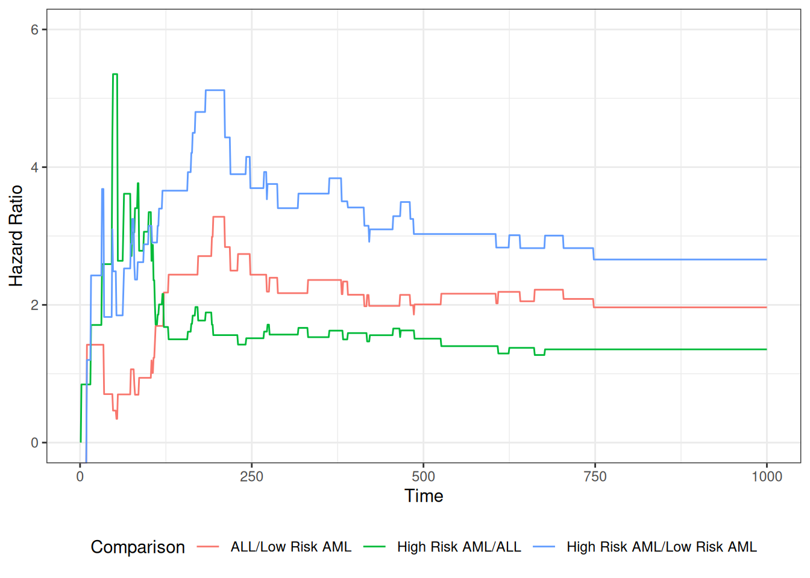](proportional-hazards-models_files/figure-html/unnamed-chunk-1-1.png "Figure 1: Hazard Ratios by Disease Group for bmt data")
>
> Figure 1: Hazard Ratios by Disease Group for `bmt` data

We can zoom in on the first 300 days to take a closer look:

> **NOTE:**
>
> Show R code
>
> ``` downlit
> bmt_rel_hazard_plot + xlim(c(0,300))
> ```
>
> [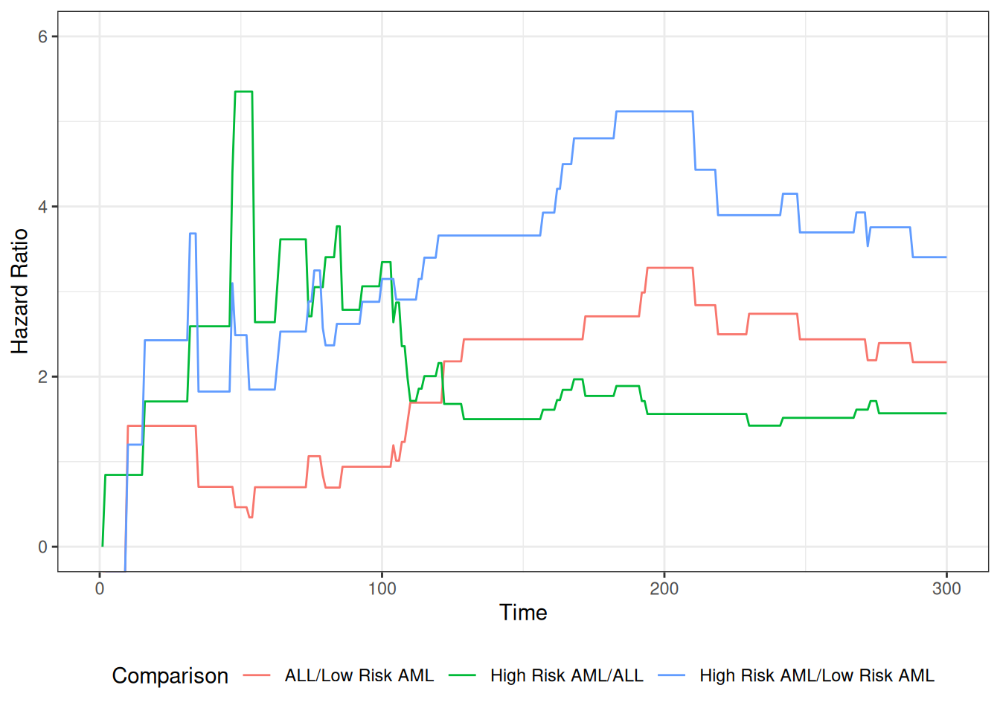](proportional-hazards-models_files/figure-html/unnamed-chunk-2-1.png "Figure 2: Hazard Ratios by Disease Group (0-300 Days)")
>
> Figure 2: Hazard Ratios by Disease Group (0-300 Days)

The cumulative hazard curves should also be proportional.

> **NOTE:**
>
> Show R code
>
> ``` downlit
> library(ggfortify)
> plot_cuhaz_bmt =
>   bmt |>
>   survfit(formula = Surv(t2, d3) ~ group) |>
>   autoplot(fun = "cumhaz",
>            mark.time = TRUE) +
>   ylab("Cumulative hazard")
>
> plot_cuhaz_bmt |> print()
> ```
>
> [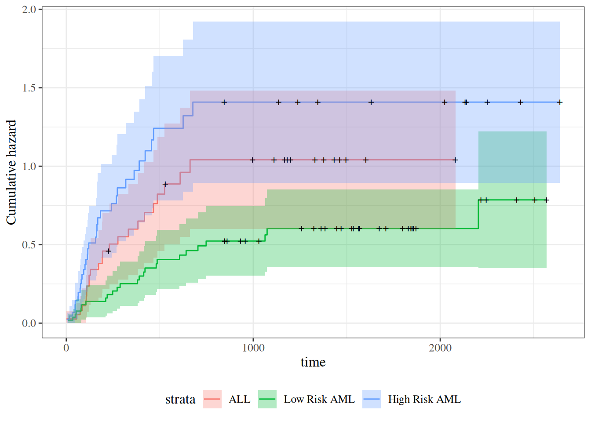](proportional-hazards-models_files/figure-html/unnamed-chunk-3-1.png "Figure 3: Disease-Free Cumulative Hazard by Disease Group")
>
> Figure 3: Disease-Free Cumulative Hazard by Disease Group

> **NOTE:**
>
> Show R code
>
> ``` downlit
> plot_cuhaz_bmt +
>   scale_y_log10() +
>   scale_x_log10()
> ```
>
> [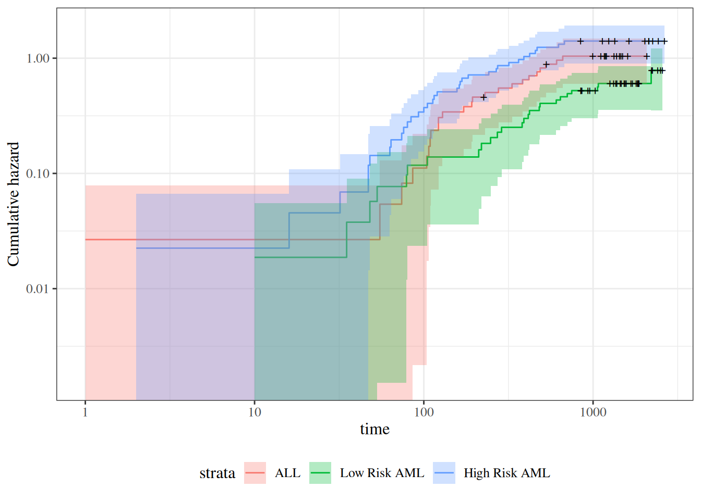](proportional-hazards-models_files/figure-html/unnamed-chunk-4-1.png "Figure 4: Disease-Free Cumulative Hazard by Disease Group (log-scale)")
>
> Figure 4: Disease-Free Cumulative Hazard by Disease Group (log-scale)

### 3.0.1 Smoothed hazard functions

The Nelson-Aalen estimate of the cumulative hazard is usually used for estimates of the hazard. Since the hazard is the [derivative](https://morrison-lab.github.io/mds/calculus-derivatives.html#def-derivative) of the cumulative hazard, we need a smooth estimate of the cumulative hazard, which is provided by smoothing the step-function cumulative hazard.

The R package `muhaz` handles this task. What we are looking for is whether the hazard function is more or less the same shape, increasing, decreasing, constant, etc. Are the hazards “proportional”?

> **NOTE:**
>
> Show R code
>
> ``` downlit
> library(muhaz)
>
> muhaz(bmt$t2,bmt$d3,bmt$group=="High Risk AML") |> plot(lwd=2,col=3)
> muhaz(bmt$t2,bmt$d3,bmt$group=="ALL") |> lines(lwd=2,col=1)
> muhaz(bmt$t2,bmt$d3,bmt$group=="Low Risk AML") |> lines(lwd=2,col=2)
> legend("topright",c("ALL","Low Risk AML","High Risk AML"),col=1:3,lwd=2)
> ```
>
> [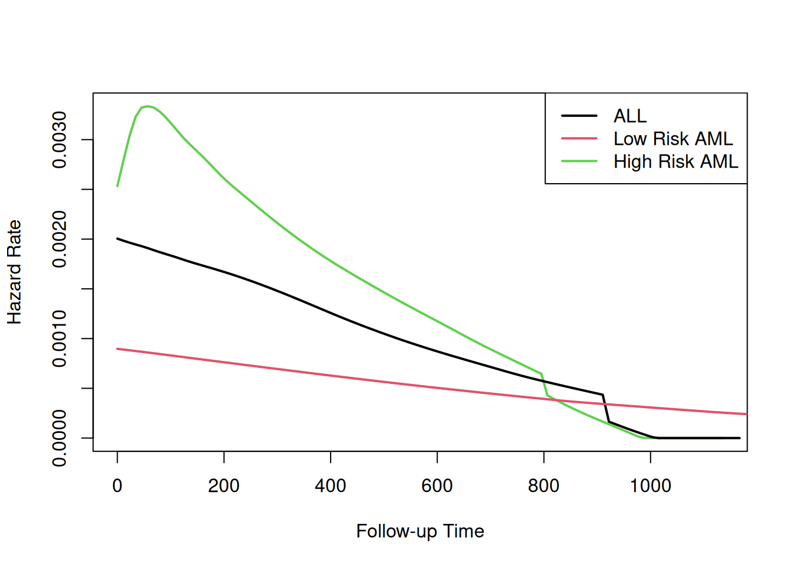](proportional-hazards-models_files/figure-html/unnamed-chunk-5-1.png "Figure 5: Smoothed Hazard Rate Estimates by Disease Group")
>
> Figure 5: Smoothed Hazard Rate Estimates by Disease Group

Group 3 was plotted first because it has the highest hazard.

Except for an initial blip in the high risk AML group, the hazards look roughly proportional. They are all strongly decreasing.

# 4 Fitting proportional hazards models to data

> **TIP:**
>
> David Rocke’s Epi 204 lecture [*Survival Regression with the Cox Model II*](https://dmrocke.ucdavis.edu/Class/EPI204-Spring-2021/EPI204-2021-05-06.mp4) ([slides](https://dmrocke.ucdavis.edu/Class/EPI204-Spring-2021/Lecture11SurvivalRegression.pdf)) covers partial likelihood estimation, adjustment for ties, the [`coxph()`](https://rdrr.io/pkg/survival/man/coxph.html) function, inference for hazard ratios, and predicted survival curves, using the `bmt` data [\[1\]](#ref-rocke2021epi204).

Fitting a [proportional hazards model](#def-ph-model) means estimating two pieces: the coefficients $\mathord{\smash[b]{\underset{\raise.3ex\hbox{$\scriptstyle\sim$}}{\beta}}\vphantom{\beta}}= (\beta_1, \ldots, \beta_p)$ that govern the covariate effects, and the [baseline hazard](#def-base-hazard) ${\lambda}_0(t)$. We estimate them in two stages:

1.  estimate $\mathord{\smash[b]{\underset{\raise.3ex\hbox{$\scriptstyle\sim$}}{\beta}}\vphantom{\beta}}$ by maximizing a [*partial likelihood*](#def-ph-partial-lik) in which the unknown baseline ${\lambda}_0(t)$ cancels out, so the covariate effects can be fit without committing to a shape for the baseline;
2.  then, with $\hat{\mathord{\smash[b]{\underset{\raise.3ex\hbox{$\scriptstyle\sim$}}{\beta}}\vphantom{\beta}}}$ in hand, estimate the [baseline cumulative hazard](#def-base-cuhaz) ${\Lambda}_0(t)$ by the [Breslow estimator](#def-breslow-baseline-cuhaz-est).

Throughout, assume for simplicity that there are no tied event times; let $t_1 < t_2 < \cdots < t_K$ be the distinct event times for the whole data set, let $R(t_i)$ be the [risk set](../chapters/intro-to-survival-analysis.llms.md#def-risk-set) at time $t_i$, and let $(i)$ denote the subject who fails at $t_i$ (unique under the no-ties assumption). Recall the model:

$$\begin{aligned}
\Delta\eta(\mathord{\smash[b]{\underset{\raise.3ex\hbox{$\scriptstyle\sim$}}{x}}\vphantom{x}}) &\stackrel{\text{def}}{=}\beta_1x_{1}+\cdots+\beta_p x_{p}
\\
\theta_{{\lambda}}(\mathord{\smash[b]{\underset{\raise.3ex\hbox{$\scriptstyle\sim$}}{x}}\vphantom{x}}) &= {\operatorname{exp}\mathopen{}\left\{\Delta\eta(\mathord{\smash[b]{\underset{\raise.3ex\hbox{$\scriptstyle\sim$}}{x}}\vphantom{x}})\right\}\mathclose{}}
\\
{\lambda}(t|\mathord{\smash[b]{\underset{\raise.3ex\hbox{$\scriptstyle\sim$}}{x}}\vphantom{x}}) &= {\color{blue}{{\lambda}_0(t)}}\,{\color{red}{{\operatorname{exp}\mathopen{}\left\{\Delta\eta(\mathord{\smash[b]{\underset{\raise.3ex\hbox{$\scriptstyle\sim$}}{x}}\vphantom{x}})\right\}\mathclose{}}}}
\\
&= {\color{red}{\theta_{{\lambda}}(\mathord{\smash[b]{\underset{\raise.3ex\hbox{$\scriptstyle\sim$}}{x}}\vphantom{x}})}}\,{\color{blue}{{\lambda}_0(t)}}
\end{aligned}$$

**Stage 1: estimating the coefficients** $\mathord{\smash[b]{\underset{\raise.3ex\hbox{$\scriptstyle\sim$}}{\beta}}\vphantom{\beta}}$. The key idea is to condition on *when* the failures happen and ask only *which* at-risk subject failed at each event time. Over a short interval of width $\Delta t$, the probability that an at-risk subject $j$ fails at $t_i$ is approximately its hazard times the interval width, ${\lambda}(t_i \mid \mathord{\smash[b]{\underset{\raise.3ex\hbox{$\scriptstyle\sim$}}{x}}\vphantom{x}}_j)\,\Delta t = {\color{blue}{{\lambda}_0(t_i)\,\Delta t}}\,{\color{red}{\theta_{{\lambda}}(\mathord{\smash[b]{\underset{\raise.3ex\hbox{$\scriptstyle\sim$}}{x}}\vphantom{x}}_j)}}$. So, conditional on exactly one failure at $t_i$ among the risk set $R(t_i)$, the probability that the subject who failed is subject $(i)$ is that subject’s share of the total — and the shared baseline factor ${\color{blue}{{\lambda}_0(t_i)\,\Delta t}}$ cancels:

$$\begin{aligned}
\Pr(\text{subject } (i) \text{ fails} \mid \text{1 failure at } t_i,\ R(t_i))
&= \frac{{\color{blue}{{\lambda}_0(t_i)\,\Delta t}}\,{\color{red}{\theta_{{\lambda}}(\mathord{\smash[b]{\underset{\raise.3ex\hbox{$\scriptstyle\sim$}}{x}}\vphantom{x}}_{(i)})}}}{\sum_{k \in R(t_i)}{\color{blue}{{\lambda}_0(t_i)\,\Delta t}}\,{\color{red}{\theta_{{\lambda}}(\mathord{\smash[b]{\underset{\raise.3ex\hbox{$\scriptstyle\sim$}}{x}}\vphantom{x}}_k)}}}
\\
&= \frac{{\color{red}{\theta_{{\lambda}}(\mathord{\smash[b]{\underset{\raise.3ex\hbox{$\scriptstyle\sim$}}{x}}\vphantom{x}}_{(i)})}}}{\sum_{k \in R(t_i)} {\color{red}{\theta_{{\lambda}}(\mathord{\smash[b]{\underset{\raise.3ex\hbox{$\scriptstyle\sim$}}{x}}\vphantom{x}}_k)}}}
\end{aligned}$$

Because the baseline factor cancels, this conditional probability depends only on $\mathord{\smash[b]{\underset{\raise.3ex\hbox{$\scriptstyle\sim$}}{\beta}}\vphantom{\beta}}$. Multiplying these probabilities across the $K$ event times gives the **partial likelihood**:

> **NOTE:**
>
> **Definition 14 (Cox PH partial likelihood)** $$\begin{aligned}
> \mathcal{L}^*_i(\mathord{\smash[b]{\underset{\raise.3ex\hbox{$\scriptstyle\sim$}}{\beta}}\vphantom{\beta}}) &\stackrel{\text{def}}{=}\frac{{\color{red}{\theta_{{\lambda}}(\mathord{\smash[b]{\underset{\raise.3ex\hbox{$\scriptstyle\sim$}}{x}}\vphantom{x}}_{(i)})}}}{\sum_{k \in R(t_i)} {\color{red}{\theta_{{\lambda}}(\mathord{\smash[b]{\underset{\raise.3ex\hbox{$\scriptstyle\sim$}}{x}}\vphantom{x}}_k)}}}
> \\
> \mathcal{L}^*(\mathord{\smash[b]{\underset{\raise.3ex\hbox{$\scriptstyle\sim$}}{\beta}}\vphantom{\beta}}) &\stackrel{\text{def}}{=}
> \prod_{{\mathopen{}\left\{i:\ d_i = 1\right\}\mathclose{}}} \mathcal{L}^*_i(\mathord{\smash[b]{\underset{\raise.3ex\hbox{$\scriptstyle\sim$}}{\beta}}\vphantom{\beta}})
> \end{aligned}$$
>
> where, for the distinct event times $t_1 < \cdots < t_K$ of the data set:
>
> - $(i)$ is the subject who fails at $t_i$ (unique under the no-ties assumption);
> - $R(t_i) \stackrel{\text{def}}{=}{\mathopen{}\left\{j : Y_j \ge t_i\right\}\mathclose{}}$ is the [risk set](../chapters/intro-to-survival-analysis.llms.md#def-risk-set) at $t_i$ (where $Y_j = \min(T_j, C_j)$ is subject $j$’s observed follow-up time) — the subjects still under observation just before $t_i$;
> - $d_i$ is the number of events at $t_i$ (so $d_i = 1$ when there are no ties);
> - $\theta_{{\lambda}}(\mathord{\smash[b]{\underset{\raise.3ex\hbox{$\scriptstyle\sim$}}{x}}\vphantom{x}}) \stackrel{\text{def}}{=}{\operatorname{exp}\mathopen{}\left\{{\mathord{\smash[b]{\underset{\raise.3ex\hbox{$\scriptstyle\sim$}}{x}}\vphantom{x}}}^{\top}\mathord{\smash[b]{\underset{\raise.3ex\hbox{$\scriptstyle\sim$}}{\beta}}\vphantom{\beta}}\right\}\mathclose{}}$ is the hazard ratio ([risk score](../chapters/proportional-hazards-models.llms.md#def-risk-score)) for covariate pattern $\mathord{\smash[b]{\underset{\raise.3ex\hbox{$\scriptstyle\sim$}}{x}}\vphantom{x}}$.

To prove that this partial likelihood is free of the baseline hazard, we first assemble a chain of general discretized-likelihood building blocks — used only by this proof, so we develop them here rather than in the [Intro to Survival Analysis](../chapters/intro-to-survival-analysis.llms.md) chapter. One piece carries over from that chapter: the [interval failure probability](../chapters/intro-to-survival-analysis.llms.md#def-interval-fail-prob) $q_j(\tau)$ (introduced ahead of that chapter’s Kaplan-Meier section, since the Kaplan-Meier derivation also relies on it). From it we build its [first-order approximation](#def-first-order-interval-fail-prob), the [censored-data likelihood](#lem-censored-lik), the [exact discretized survival factor](#lem-surv-discretized), the [per-interval likelihood factor](#def-interval-lik-factor), and the [likelihood regrouped by interval](#lem-lik-by-interval):

> **NOTE:**
>
> **Definition 15 (First-order interval failure probability)** To first order in $\Delta t$, the [interval failure probability](../chapters/intro-to-survival-analysis.llms.md#def-interval-fail-prob) $q_j(\tau)$ is the [hazard](../chapters/intro-to-survival-analysis.llms.md#def-hazard) times the interval width. We give that approximation its own symbol, the **first-order interval failure probability**:
>
> $$q^*_j(\tau) \stackrel{\text{def}}{=}{\lambda}(\tau)\,\Delta t,$$
>
> so that
>
> $$q_j(\tau) \approx q^*_j(\tau).$$

> **NOTE:**
>
> **Example 3 (First-order approximation versus the exact value)** Continue the setup of the [interval failure probability example](../chapters/intro-to-survival-analysis.llms.md#exm-interval-fail-prob): subject $j$ has constant hazard ${\lambda}(t) = 0.1$ per year, on the half-year interval $[4.0,\, 4.5)$ with $\Delta t = 0.5$ years. The first-order approximation replaces the exact value with the hazard times the interval width:
>
> $$\begin{aligned}
> q^*_j(4.0)
> &= {\lambda}(4.0)\,\Delta t
> && \text{(definition of } q^*_j \text{)}
> \\
> &= 0.1 \times 0.5
> && \text{(substitute } {\lambda}= 0.1,\ \Delta t = 0.5\text{)}
> \\
> &= 0.05 .
> && \text{(arithmetic)}
> \end{aligned}$$
>
> The first-order approximation $q^*_j(4.0) = 0.05$ overstates the exact value $q_j(4.0) \approx 0.0488$ by about $0.0012$, a relative error of roughly $2.5\%$. The discrepancy is exactly the leading term dropped by the [linearization](https://morrison-lab.github.io/mds/calculus-derivatives.html#def-linear-approximation) $1 - {\operatorname{exp}\mathopen{}\left\{-x\right\}\mathclose{}} = x - \frac{x^2}{2} + \cdots$: here $x = {\lambda}(4.0)\,\Delta t = 0.05$, so the dropped term is $\frac{x^2}{2} = \frac{0.05^2}{2} \approx 0.00125$, which shrinks to zero as $\Delta t \to 0$. This vanishing discrepancy is why proofs based on this discretization become exact in the continuous-time limit.

> **NOTE:**
>
> **Lemma 4 (Exact discretization of the survival factor)** Partition $[0, \max_j Y_j]$ into intervals of width $\Delta t$ with left endpoints $\tau$, and assume each observed time $Y_j$ falls on an interval boundary (for an interior $Y_j$ the identity instead holds in the $\Delta t \to 0$ limit). Then each subject’s survival factor is the *exact* product of its per-interval conditional survival probabilities:
>
> $$\operatorname{S}(Y_j \mid \mathord{\smash[b]{\underset{\raise.3ex\hbox{$\scriptstyle\sim$}}{x}}\vphantom{x}}_j) = \prod_{\tau < Y_j} \mathopen{}\left(1 - q_j(\tau)\right)\mathclose{},
> \tag{30}$$
>
> where $q_j(\tau)$ is the [interval failure probability](../chapters/intro-to-survival-analysis.llms.md#def-interval-fail-prob).

> **NOTE:**
>
> *Proof*. Surviving to $Y_j$ is the intersection of the [events](https://morrison-lab.github.io/pds/probability-basics.html#def-event) “survive interval $\tau$”, over all grid intervals $\tau < Y_j$, which tile $[0, Y_j)$ exactly because $Y_j$ is a grid boundary. By the chain rule for survival over a partition, the probability of this intersection factors into the product, over those intervals, of the [conditional probability](https://morrison-lab.github.io/pds/probability-basics.html#def-conditional-prob) of surviving each interval given survival to its left endpoint. That conditional survival probability is, by definition, $1 - q_j(\tau)$. The factorization is *exact*: each factor is the exact conditional survival probability $1 - q_j(\tau)$, not its first-order hazard approximation, so no error is incurred at this step.

> **NOTE:**
>
> **Example 4 (Discretizing a constant hazard)** Suppose subject $j$ has constant hazard ${\lambda}(t \mid \mathord{\smash[b]{\underset{\raise.3ex\hbox{$\scriptstyle\sim$}}{x}}\vphantom{x}}_j) = 0.1$/yr and is observed to $Y_j = 1.5$ yr, discretized with $\Delta t = 0.5$ yr (three intervals, $\tau = 0,\, 0.5,\, 1.0$). Each exact per-interval survival factor is
>
> $$\begin{aligned}
> 1 - q_j(\tau)
> &= {\operatorname{exp}\mathopen{}\left\{-\textstyle\int_{\tau}^{\tau + 0.5} 0.1 \, du\right\}\mathclose{}}
> && \text{(exact conditional survival over the interval)}
> \\
> &= {\operatorname{exp}\mathopen{}\left\{-0.05\right\}\mathclose{}}
> && \text{(evaluate the integral: } 0.1 \times 0.5\text{)}
> \\
> &\approx 0.9512 ,
> && \text{(arithmetic)}
> \end{aligned}$$
>
> so [Equation 30](#eq-surv-discretized) gives
>
> $$\begin{aligned}
> \operatorname{S}(1.5 \mid \mathord{\smash[b]{\underset{\raise.3ex\hbox{$\scriptstyle\sim$}}{x}}\vphantom{x}}_j)
> &= \prod_{\tau \in {\mathopen{}\left\{0,\, 0.5,\, 1.0\right\}\mathclose{}}} \mathopen{}\left(1 - q_j(\tau)\right)\mathclose{}
> && \text{(three intervals)}
> \\
> &\approx 0.9512^3
> && \text{(substitute the common per-interval factor)}
> \\
> &\approx 0.8607 ,
> && \text{(arithmetic)}
> \end{aligned}$$
>
> which matches the closed form $\operatorname{S}(1.5 \mid \mathord{\smash[b]{\underset{\raise.3ex\hbox{$\scriptstyle\sim$}}{x}}\vphantom{x}}_j) = {\operatorname{exp}\mathopen{}\left\{-0.1 \times 1.5\right\}\mathclose{}} = {\operatorname{exp}\mathopen{}\left\{-0.15\right\}\mathclose{}} \approx 0.8607$ exactly, confirming that the discretization introduces no error.

> **NOTE:**
>
> **Lemma 5 (Censored-data likelihood)** Under [noninformative censoring](../chapters/intro-to-survival-analysis.llms.md#def-noninformative-censoring) (conditional on $\mathord{\smash[b]{\underset{\raise.3ex\hbox{$\scriptstyle\sim$}}{x}}\vphantom{x}}$, censoring times are [independent](https://morrison-lab.github.io/pds/independence.html#def-cind) of event times), the [likelihood](https://morrison-lab.github.io/sds/intro-MLEs.html#def-lik) of the observed data ${\mathopen{}\left\{(Y_j, D_j, \mathord{\smash[b]{\underset{\raise.3ex\hbox{$\scriptstyle\sim$}}{x}}\vphantom{x}}_j)\right\}\mathclose{}}_{j=1}^n$ is
>
> $$\mathcal{L}
> = \prod_{j=1}^{n}
> \operatorname{S}(Y_j \mid \mathord{\smash[b]{\underset{\raise.3ex\hbox{$\scriptstyle\sim$}}{x}}\vphantom{x}}_j)\,
> {\lambda}(Y_j \mid \mathord{\smash[b]{\underset{\raise.3ex\hbox{$\scriptstyle\sim$}}{x}}\vphantom{x}}_j)^{D_j},
> \tag{31}$$
>
> where $Y_j = \min(T_j, C_j)$ is the observed follow-up time and $D_j = \text{1}_{T_j \le C_j}$ the event indicator.

> **NOTE:**
>
> *Proof*. A subject observed to fail ($D_j = 1$) contributes the event-time [density](https://morrison-lab.github.io/pds/random-variables.html#def-pdf) ${\lambda}(Y_j \mid \mathord{\smash[b]{\underset{\raise.3ex\hbox{$\scriptstyle\sim$}}{x}}\vphantom{x}}_j)\,\operatorname{S}(Y_j \mid \mathord{\smash[b]{\underset{\raise.3ex\hbox{$\scriptstyle\sim$}}{x}}\vphantom{x}}_j)$, while a subject still [censored](../chapters/intro-to-survival-analysis.llms.md#def-right-censor) ($D_j = 0$) contributes the survival probability $\operatorname{S}(Y_j \mid \mathord{\smash[b]{\underset{\raise.3ex\hbox{$\scriptstyle\sim$}}{x}}\vphantom{x}}_j)$. Under noninformative censoring the two cases combine into the single contribution $\operatorname{S}(Y_j \mid \mathord{\smash[b]{\underset{\raise.3ex\hbox{$\scriptstyle\sim$}}{x}}\vphantom{x}}_j)\,{\lambda}(Y_j \mid \mathord{\smash[b]{\underset{\raise.3ex\hbox{$\scriptstyle\sim$}}{x}}\vphantom{x}}_j)^{D_j}$ (the [likelihood with censoring](../chapters/intro-to-survival-analysis.llms.md#sec-likelihood-with-censoring) section). Subjects are independent, so the full likelihood is the product of these contributions over $j$.

> **NOTE:**
>
> **Example 5 (A two-subject likelihood)** Suppose subject $1$ fails at $Y_1 = 3$ ($D_1 = 1$) and subject $2$ is still censored at $Y_2 = 5$ ($D_2 = 0$). Then [Equation 31](#eq-obs-lik) gives
>
> $$\mathcal{L}
> = \underbrace{\operatorname{S}(3 \mid \mathord{\smash[b]{\underset{\raise.3ex\hbox{$\scriptstyle\sim$}}{x}}\vphantom{x}}_1)\,{\lambda}(3 \mid \mathord{\smash[b]{\underset{\raise.3ex\hbox{$\scriptstyle\sim$}}{x}}\vphantom{x}}_1)}_{\text{subject 1 fails}}
> \;\times\;
> \underbrace{\operatorname{S}(5 \mid \mathord{\smash[b]{\underset{\raise.3ex\hbox{$\scriptstyle\sim$}}{x}}\vphantom{x}}_2)}_{\text{subject 2 censored}} .$$
>
> The failing subject contributes both a survival factor and a hazard factor; the censored subject contributes only a survival factor.

> **NOTE:**
>
> **Definition 16 (Per-interval likelihood factor)** For a grid interval with left endpoint $\tau$ and risk set $R(\tau)$, the **per-interval likelihood factor** collects one factor from every member of $R(\tau)$ — a failure factor for the subject who fails in the interval (if any) and a survival factor for each subject who does not:
>
> $$\mathcal{L}_\tau
> \stackrel{\text{def}}{=}\prod_{m \in R(\tau)}
> \begin{cases}
> q_m(\tau), & m \text{ fails in interval } \tau,\\[2pt]
> 1 - q_m(\tau), & \text{otherwise,}
> \end{cases}
> \tag{32}$$
>
> where $q_m(\tau)$ is the [interval failure probability](../chapters/intro-to-survival-analysis.llms.md#def-interval-fail-prob).

> **NOTE:**
>
> **Example 6 (Per-interval factor for a three-subject risk set)** Suppose interval $\tau$ has risk set $R(\tau) = {\mathopen{}\left\{1, 2, 3\right\}\mathclose{}}$, with subject $2$ failing in the interval and subjects $1$ and $3$ surviving it. Then the per-interval likelihood factor is
>
> $$\mathcal{L}_\tau
> = \mathopen{}\left(1 - q_1(\tau)\right)\mathclose{}\,q_2(\tau)\,\mathopen{}\left(1 - q_3(\tau)\right)\mathclose{} ,$$
>
> a survival factor for each of subjects $1$ and $3$ and a failure factor for subject $2$.

> **NOTE:**
>
> **Lemma 6 (Likelihood regrouped by interval)** Substituting [Equation 30](#eq-surv-discretized) into [Equation 31](#eq-obs-lik) and regrouping the factors by interval, the likelihood is the product of the per-interval likelihood factors ([Definition 16](#def-interval-lik-factor)):
>
> $$\mathcal{L}
> \approx
> \prod_{\tau} \mathcal{L}_\tau ,
> \tag{33}$$
>
> so each interval $\tau$ contributes one factor per member of its risk set $R(\tau)$. Under the no-ties assumption each interval holds at most one failure.

> **NOTE:**
>
> *Proof*. By [Lemma 5](#lem-censored-lik) and [Lemma 4](#lem-surv-discretized), substituting the discretized survival factor into the likelihood and replacing the failure subject’s hazard-density factor ${\lambda}(Y_j \mid \mathord{\smash[b]{\underset{\raise.3ex\hbox{$\scriptstyle\sim$}}{x}}\vphantom{x}}_j)^{D_j}$ by $\mathopen{}\left(q_j(Y_j) / \Delta t\right)\mathclose{}^{D_j}$, via the first-order approximation $q_j(Y_j) \approx {\lambda}(Y_j \mid \mathord{\smash[b]{\underset{\raise.3ex\hbox{$\scriptstyle\sim$}}{x}}\vphantom{x}}_j)\,\Delta t$ ([Definition 15](#def-first-order-interval-fail-prob)) rearranged to ${\lambda}(Y_j \mid \mathord{\smash[b]{\underset{\raise.3ex\hbox{$\scriptstyle\sim$}}{x}}\vphantom{x}}_j) \approx q_j(Y_j) / \Delta t$, then absorbing the constant $\Delta t^{-D_j}$ (which is independent of all model parameters),
>
> $$\mathcal{L}
> \approx
> \prod_{j=1}^{n}
> \mathopen{}\left[
> q_j(Y_j)^{D_j}
> \prod_{\tau < Y_j}\mathopen{}\left(1 - q_j(\tau)\right)\mathclose{}
> \right]\mathclose{}.
> \tag{34}$$
>
> Each factor in [Equation 34](#eq-lik-by-subject) is indexed by a (subject, interval) pair: subject $j$ contributes one factor to every interval $\tau$ with $j \in R(\tau)$ — a failure factor $q_j(\tau)$ if $j$ fails in $\tau$, and a survival factor $1 - q_j(\tau)$ otherwise. Reindexing the double product by interval instead of by subject collects, for each $\tau$, exactly one factor from every member $m \in R(\tau)$ — the per-interval likelihood factor $\mathcal{L}_\tau$ of [Definition 16](#def-interval-lik-factor) — giving [Equation 33](#eq-lik-by-interval). The $\approx$ is inherited from the density approximation in [Equation 34](#eq-lik-by-subject); the regrouping itself is an exact reindexing of the same factors.

> **NOTE:**
>
> **Example 7 (Regrouping a two-subject likelihood)** Take two subjects at risk over two intervals with left endpoints $\tau = 0$ and $\tau = 1$. Subject $1$ survives interval $0$ and fails in interval $1$; subject $2$ survives both intervals. Grouping the factors **by subject** ([Equation 34](#eq-lik-by-subject)) gives
>
> $$\underbrace{\mathopen{}\left(1 - q_1(0)\right)\mathclose{}\,q_1(1)}_{\text{subject 1}}
> \;\times\;
> \underbrace{\mathopen{}\left(1 - q_2(0)\right)\mathclose{}\mathopen{}\left(1 - q_2(1)\right)\mathclose{}}_{\text{subject 2}} ,$$
>
> while grouping the *same* factors **by interval** ([Equation 33](#eq-lik-by-interval)) gives
>
> $$\underbrace{\mathopen{}\left(1 - q_1(0)\right)\mathclose{}\mathopen{}\left(1 - q_2(0)\right)\mathclose{}}_{\tau = 0,\ \text{no failure}}
> \;\times\;
> \underbrace{q_1(1)\mathopen{}\left(1 - q_2(1)\right)\mathclose{}}_{\tau = 1,\ \text{subject 1 fails}} .$$
>
> The two products contain identical factors; regrouping only changes the order of multiplication, which is why it is exact.

Under the proportional-hazards model, the first-order interval failure probability splits into a shared baseline factor and a subject-specific [hazard ratio](#def-hr-vs-baseline):

> **NOTE:**
>
> **Definition 17 (Proportional-hazards first-order interval failure probability)** Under the proportional-hazards model ([Theorem 8](#thm-ph-haz-decomp)), the first-order interval failure probability ([Definition 15](#def-first-order-interval-fail-prob)) factors into a shared baseline term and a subject-specific hazard ratio:
>
> $$q^*_j(\tau) \stackrel{\text{def}}{=}{\color{blue}{{\lambda}_0(\tau)\,\Delta t}}\;{\color{red}{\theta_{{\lambda}}(\mathord{\smash[b]{\underset{\raise.3ex\hbox{$\scriptstyle\sim$}}{x}}\vphantom{x}}_j)}}.$$

> **NOTE:**
>
> **Example 8 (First-order approximation under the PH model)** Take a half-year interval $[4.0,\, 4.5)$ with $\Delta t = 0.5$ yr, baseline hazard ${\color{blue}{{\lambda}_0(4.0) = 0.1}}$/yr, and a subject with hazard ratio ${\color{red}{\theta_{{\lambda}}(\mathord{\smash[b]{\underset{\raise.3ex\hbox{$\scriptstyle\sim$}}{x}}\vphantom{x}}_j)}} = 2$. The proportional-hazards factorization splits the first-order probability into the shared baseline factor and the subject’s hazard ratio:
>
> $$\begin{aligned}
> q^*_j(4.0)
> &= {\color{blue}{{\lambda}_0(4.0)\,\Delta t}}\;{\color{red}{\theta_{{\lambda}}(\mathord{\smash[b]{\underset{\raise.3ex\hbox{$\scriptstyle\sim$}}{x}}\vphantom{x}}_j)}}
> && \text{(definition of } q^*_j \text{)}
> \\
> &= {\color{blue}{(0.1 \times 0.5)}}\;{\color{red}{2}}
> && \text{(substitute } {\lambda}_0 = 0.1,\ \Delta t = 0.5,\ \theta_{{\lambda}}= 2\text{)}
> \\
> &= {\color{blue}{0.05}}\;{\color{red}{2}}
> && \text{(arithmetic)}
> \\
> &= 0.10 .
> && \text{(arithmetic)}
> \end{aligned}$$
>
> Equivalently, the subject’s total hazard is ${\lambda}(4.0 \mid \mathord{\smash[b]{\underset{\raise.3ex\hbox{$\scriptstyle\sim$}}{x}}\vphantom{x}}_j) = {\color{blue}{{\lambda}_0(4.0)}}\,{\color{red}{\theta_{{\lambda}}(\mathord{\smash[b]{\underset{\raise.3ex\hbox{$\scriptstyle\sim$}}{x}}\vphantom{x}}_j)}} = 0.2$/yr, so $q^*_j(4.0) = {\lambda}(4.0 \mid \mathord{\smash[b]{\underset{\raise.3ex\hbox{$\scriptstyle\sim$}}{x}}\vphantom{x}}_j)\,\Delta t = 0.2 \times 0.5 = 0.10$.

We then build up to the partial likelihood through a chain of proportional-hazards lemmas: the [single-subject failure probability](#lem-ph-single-subj-fail) and the two factors of each event ([*whether*](#lem-ph-whether-failure) a failure occurs and [*which*](#lem-ph-which-subject) subject it is), and finally the assembly that cancels the baseline hazard.

> **NOTE:**
>
> **Lemma 7 (Single-subject failure probability in a risk set)** For any subject $j \in R(t_i)$, under [noninformative censoring](../chapters/intro-to-survival-analysis.llms.md#def-noninformative-censoring), the probability that $j$ fails in the interval at $t_i$ given that $j$ is at risk is the interval failure probability, and to first order in $\Delta t$,
>
> $$\begin{aligned}
> \Pr\mathopen{}\left[j \text{ fails at } t_i \mid j \in R(t_i)\right]\mathclose{}
> &= q_j(t_i)
> && \text{(definition of } q_j(t_i) \text{)}
> \\
> &\approx q^*_j(t_i)
> && \text{(first-order hazard approximation)}
> \\
> &= {\color{blue}{{\lambda}_0(t_i)\,\Delta t}}\;{\color{red}{\theta_{{\lambda}}(\mathord{\smash[b]{\underset{\raise.3ex\hbox{$\scriptstyle\sim$}}{x}}\vphantom{x}}_j)}} .
> && \text{(definition of } q^*_j(t_i)\text{)}
> \end{aligned}
> \tag{35}$$

> **NOTE:**
>
> *Proof*. Since $j \in R(t_i)$ means $Y_j = \min(T_j, C_j) \ge t_i$, we have both $T_j \ge t_i$ and $C_j \ge t_i$. Under noninformative censoring, the event $C_j \ge t_i$ carries no information about $T_j$ given $\mathord{\smash[b]{\underset{\raise.3ex\hbox{$\scriptstyle\sim$}}{x}}\vphantom{x}}_j$, so conditioning on $j \in R(t_i)$ is equivalent to conditioning on $T_j \ge t_i$ alone. This conditional failure probability is exactly the [interval failure probability](../chapters/intro-to-survival-analysis.llms.md#def-interval-fail-prob) $q_j(t_i)$. The first-order interval failure probability ([Definition 15](#def-first-order-interval-fail-prob)) then gives $q_j(t_i) \approx q^*_j(t_i)$, and the proportional-hazards decomposition ([Definition 17](#def-ph-first-order-interval-fail-prob)) splits $q^*_j(t_i)$ into the shared baseline factor ${\color{blue}{{\lambda}_0(t_i)\,\Delta t}}$ and the subject-specific hazard ratio ${\color{red}{\theta_{{\lambda}}(\mathord{\smash[b]{\underset{\raise.3ex\hbox{$\scriptstyle\sim$}}{x}}\vphantom{x}}_j)}}$.

> **NOTE:**
>
> **Example 9 (Failure probabilities in a three-subject risk set)** This example introduces a running scenario reused later in this section: the risk set $R(t_i) = {\mathopen{}\left\{1, 2, 3\right\}\mathclose{}}$ at $t_i = 4$ yr, with hazard ratios ${\color{red}{\theta_{{\lambda}}(\mathord{\smash[b]{\underset{\raise.3ex\hbox{$\scriptstyle\sim$}}{x}}\vphantom{x}}_1)}} = 1$, ${\color{red}{\theta_{{\lambda}}(\mathord{\smash[b]{\underset{\raise.3ex\hbox{$\scriptstyle\sim$}}{x}}\vphantom{x}}_2)}} = 2$, ${\color{red}{\theta_{{\lambda}}(\mathord{\smash[b]{\underset{\raise.3ex\hbox{$\scriptstyle\sim$}}{x}}\vphantom{x}}_3)}} = 3$, baseline ${\color{blue}{{\lambda}_0(4)}} = 0.1$/yr, and grid width $\Delta t = 0.5$ yr, so the shared factor is ${\color{blue}{{\lambda}_0(4)\,\Delta t}} = 0.05$. Subject $2$ is the one who fails at $t_i$. By [Equation 35](#eq-ph-single-subj),
>
> $$q^*_1(4) = 0.05,
> \qquad
> q^*_2(4) = 0.10,
> \qquad
> q^*_3(4) = 0.15 ,$$
>
> each the shared $0.05$ scaled by that subject’s hazard ratio ${\color{red}{\theta_{{\lambda}}(\mathord{\smash[b]{\underset{\raise.3ex\hbox{$\scriptstyle\sim$}}{x}}\vphantom{x}}_j)}}$.

> **NOTE:**
>
> **Definition 18 (Risk-set score total)** The **risk-set score total** at event time $t_i$ is the sum of the subject-specific hazard ratios over everyone at risk at $t_i$:
>
> $$S_i \stackrel{\text{def}}{=}\sum_{k \in R(t_i)} {\color{red}{\theta_{{\lambda}}(\mathord{\smash[b]{\underset{\raise.3ex\hbox{$\scriptstyle\sim$}}{x}}\vphantom{x}}_k)}},
> \tag{36}$$
>
> where $R(t_i)$ is the risk set at $t_i$ and ${\color{red}{\theta_{{\lambda}}(\mathord{\smash[b]{\underset{\raise.3ex\hbox{$\scriptstyle\sim$}}{x}}\vphantom{x}})}} \stackrel{\text{def}}{=}{\operatorname{exp}\mathopen{}\left\{{\mathord{\smash[b]{\underset{\raise.3ex\hbox{$\scriptstyle\sim$}}{x}}\vphantom{x}}}^{\top}\mathord{\smash[b]{\underset{\raise.3ex\hbox{$\scriptstyle\sim$}}{\beta}}\vphantom{\beta}}\right\}\mathclose{}}$ is the hazard ratio ([risk score](#def-risk-score)) for covariate pattern $\mathord{\smash[b]{\underset{\raise.3ex\hbox{$\scriptstyle\sim$}}{x}}\vphantom{x}}$.

> **NOTE:**
>
> **Example 10 (Risk-set score total in the three-subject risk set)** For the running scenario of [Example 9](#exm-ph-single-subj-fail) — $R(4) = {\mathopen{}\left\{1, 2, 3\right\}\mathclose{}}$ with hazard ratios ${\color{red}{\theta_{{\lambda}}(\mathord{\smash[b]{\underset{\raise.3ex\hbox{$\scriptstyle\sim$}}{x}}\vphantom{x}}_1)}} = 1$, ${\color{red}{\theta_{{\lambda}}(\mathord{\smash[b]{\underset{\raise.3ex\hbox{$\scriptstyle\sim$}}{x}}\vphantom{x}}_2)}} = 2$, ${\color{red}{\theta_{{\lambda}}(\mathord{\smash[b]{\underset{\raise.3ex\hbox{$\scriptstyle\sim$}}{x}}\vphantom{x}}_3)}} = 3$ — the risk-set score total ([Equation 36](#eq-ph-risk-set-score)) is
>
> $$\begin{aligned}
> {\color{red}{S_i}}
> &= {\color{red}{\theta_{{\lambda}}(\mathord{\smash[b]{\underset{\raise.3ex\hbox{$\scriptstyle\sim$}}{x}}\vphantom{x}}_1)}} + {\color{red}{\theta_{{\lambda}}(\mathord{\smash[b]{\underset{\raise.3ex\hbox{$\scriptstyle\sim$}}{x}}\vphantom{x}}_2)}} + {\color{red}{\theta_{{\lambda}}(\mathord{\smash[b]{\underset{\raise.3ex\hbox{$\scriptstyle\sim$}}{x}}\vphantom{x}}_3)}}
> && \text{(definition of } S_i \text{)}
> \\
> &= 1 + 2 + 3
> && \text{(substitute the hazard ratios)}
> \\
> &= 6 .
> && \text{(arithmetic)}
> \end{aligned}$$

> **NOTE:**
>
> **Lemma 8 (The whether-a-failure-occurs factor)** To first order in $\Delta t$, the probability of exactly one failure in the interval at $t_i$ is the shared baseline factor times the risk-set score total ${\color{red}{S_i}}$ ([Definition 18](#def-ph-risk-set-score)):
>
> $$\Pr\mathopen{}\left[1 \text{ failure at } t_i \mid R(t_i)\right]\mathclose{}
> \approx
> {\color{blue}{{\lambda}_0(t_i)\,\Delta t}}\;{\color{red}{S_i}}.
> \tag{37}$$

> **NOTE:**
>
> *Proof*. Treating subjects’ failure events as [conditionally independent](https://morrison-lab.github.io/pds/independence.html#def-cind) given $R(t_i)$ (the Cox-model assumption used throughout; see [\[3, Sec. 8.3\]](#ref-klein2003survival)), the probability of exactly one failure is, by inclusion-exclusion,
>
> $$\Pr\mathopen{}\left[1 \text{ failure at } t_i \mid R(t_i)\right]\mathclose{}
> = \sum_{k \in R(t_i)}
>     \Pr\mathopen{}\left[k \text{ fails} \mid R(t_i)\right]\mathclose{}
>     \prod_{m \in R(t_i),\, m \ne k} \Pr\mathopen{}\left[m \text{ survives} \mid R(t_i)\right]\mathclose{}.$$
>
> By [Lemma 7](#lem-ph-single-subj-fail), $\Pr\mathopen{}\left[m \text{ fails} \mid R(t_i)\right]\mathclose{} = q_m(t_i) = O(\Delta t)$, so each surviving product is $\prod_{m \ne k}(1 - O(\Delta t)) = 1 - O(\Delta t)$, and dropping the $O(\Delta t^2)$ cross-terms (each pair of co-failures has probability $O(\Delta t^2)$) leaves the sum of the single-subject pieces. Factoring out the shared baseline,
>
> $$\begin{aligned}
> \Pr\mathopen{}\left[1 \text{ failure at } t_i \mid R(t_i)\right]\mathclose{}
> &\approx
> \sum_{k \in R(t_i)} q_k(t_i)
> && \text{(drop } O(\Delta t^2) \text{ cross-terms)}
> \\
> &\approx
> \sum_{k \in R(t_i)} q^*_k(t_i)
> && \text{(first-order hazard approximation)}
> \\
> &=
> \sum_{k \in R(t_i)} {\color{blue}{{\lambda}_0(t_i)\,\Delta t}}\;{\color{red}{\theta_{{\lambda}}(\mathord{\smash[b]{\underset{\raise.3ex\hbox{$\scriptstyle\sim$}}{x}}\vphantom{x}}_k)}}
> && \text{(definition of } q^*_k(t_i) \text{)}
> \\
> &=
> {\color{blue}{{\lambda}_0(t_i)\,\Delta t}}\sum_{k \in R(t_i)} {\color{red}{\theta_{{\lambda}}(\mathord{\smash[b]{\underset{\raise.3ex\hbox{$\scriptstyle\sim$}}{x}}\vphantom{x}}_k)}}
> && \text{(factor out the shared baseline)}
> \\
> &=
> {\color{blue}{{\lambda}_0(t_i)\,\Delta t}}\;{\color{red}{S_i}}.
> && \text{(definition of } {\color{red}{S_i}}\text{)}
> \end{aligned}$$

> **NOTE:**
>
> **Example 11 (One-failure probability in the three-subject risk set)** Continue the running scenario of [Example 9](#exm-ph-single-subj-fail), with ${\color{blue}{{\lambda}_0(4)\,\Delta t}} = 0.05$ and risk-set score total ${\color{red}{S_i}} = 6$ ([Example 10](#exm-ph-risk-set-score)). By [Equation 37](#eq-ph-one-failure), the probability that *some* one subject fails at $t_i = 4$ is
>
> $$\Pr\mathopen{}\left[1 \text{ failure at } 4 \mid R(4)\right]\mathclose{}
> \approx {\color{blue}{0.05}} \times {\color{red}{6}} = 0.30 .$$

> **NOTE:**
>
> **Lemma 9 (Chain-rule split of an event factor)** Under the no-ties assumption, the probability that subject $(i)$ fails at $t_i$, given the risk set $R(t_i)$, factors into a *which-subject-fails* factor and a *whether-a-failure-occurs* factor:
>
> $$\Pr\mathopen{}\left[(i) \text{ fails at } t_i \mid R(t_i)\right]\mathclose{}
> = \underbrace{\Pr\mathopen{}\left[(i) \text{ fails} \mid 1 \text{ failure at } t_i,\ R(t_i)\right]\mathclose{}}_{\text{which subject fails}}
> \;\times\;
> \underbrace{\Pr\mathopen{}\left[1 \text{ failure at } t_i \mid R(t_i)\right]\mathclose{}}_{\text{whether a failure occurs}} .
> \tag{38}$$

> **NOTE:**
>
> *Proof*. Let
>
> - $A \stackrel{\text{def}}{=}$ “subject $(i)$ fails at $t_i$”,
> - $B \stackrel{\text{def}}{=}$ “exactly one failure occurs at $t_i$”,
> - $C \stackrel{\text{def}}{=}$ “the risk set at $t_i$ is $R(t_i)$”.
>
> By the [chain rule of probability](https://morrison-lab.github.io/pds/probability-basics.html#thm-law-conditional-prob), $\Pr(A \cap B \mid C) = \Pr(A \mid B \cap C)\,\Pr(B \mid C)$. Under the no-ties assumption $A \subset B$ (subject $(i)$ failing at $t_i$ is automatically a one-failure event), so $A \cap B = A$ and therefore $\Pr(A \mid C) = \Pr(A \mid B \cap C)\,\Pr(B \mid C)$, which is [Equation 38](#eq-ph-chain-rule).

> **NOTE:**
>
> **Example 12 (Splitting the event probability numerically)** Continue the running scenario of [Example 9](#exm-ph-single-subj-fail), in which subject $2$ is the one who fails at $t_i = 4$. The left side of [Equation 38](#eq-ph-chain-rule) is subject $2$’s single-subject failure probability, $q^*_2(4) = 0.10$ ([Example 9](#exm-ph-single-subj-fail)), and the whether-a-failure factor is $0.30$ ([Example 11](#exm-ph-whether-failure)). The chain rule therefore pins the which-subject factor at
>
> $$\Pr\mathopen{}\left[2 \text{ fails} \mid 1 \text{ failure at } 4,\ R(4)\right]\mathclose{}
> = \frac{\Pr\mathopen{}\left[2 \text{ fails at } 4 \mid R(4)\right]\mathclose{}}{\Pr\mathopen{}\left[1 \text{ failure at } 4 \mid R(4)\right]\mathclose{}}
> \approx \frac{0.10}{0.30} = \frac{1}{3} ,$$
>
> and indeed $0.10 \approx \tfrac{1}{3} \times 0.30$ reproduces the left side.

> **NOTE:**
>
> **Lemma 10 (The which-subject-fails factor)** The which-subject-fails factor of [Equation 38](#eq-ph-chain-rule) equals the partial-likelihood contribution $\mathcal{L}^*_i(\mathord{\smash[b]{\underset{\raise.3ex\hbox{$\scriptstyle\sim$}}{\beta}}\vphantom{\beta}})$ of [Definition 14](#def-ph-partial-lik): the shared baseline factor cancels, leaving
>
> $$\Pr\mathopen{}\left[(i) \text{ fails} \mid 1 \text{ failure at } t_i,\ R(t_i)\right]\mathclose{}
> \approx
> \frac{{\color{red}{\theta_{{\lambda}}(\mathord{\smash[b]{\underset{\raise.3ex\hbox{$\scriptstyle\sim$}}{x}}\vphantom{x}}_{(i)})}}}{{\color{red}{S_i}}}
> = \mathcal{L}^*_i(\mathord{\smash[b]{\underset{\raise.3ex\hbox{$\scriptstyle\sim$}}{\beta}}\vphantom{\beta}}).
> \tag{39}$$

> **NOTE:**
>
> *Proof*. Solve [Equation 38](#eq-ph-chain-rule) for the which-subject factor and substitute the numerator $q_{(i)}(t_i)$ from [Lemma 7](#lem-ph-single-subj-fail) and the denominator ${\color{blue}{{\lambda}_0(t_i)\,\Delta t}}\,{\color{red}{S_i}}$ from [Lemma 8](#lem-ph-whether-failure); the shared ${\color{blue}{{\lambda}_0(t_i)\,\Delta t}}$ cancels between numerator and denominator:
>
> $$\begin{aligned}
> \Pr\mathopen{}\left[(i) \text{ fails} \mid 1 \text{ failure at } t_i,\ R(t_i)\right]\mathclose{}
> &= \frac{\Pr\mathopen{}\left[(i) \text{ fails at } t_i \mid R(t_i)\right]\mathclose{}}
>          {\Pr\mathopen{}\left[1 \text{ failure at } t_i \mid R(t_i)\right]\mathclose{}}
> && \text{(rearrange)}
> \\
> &\approx \frac{q^*_{(i)}(t_i)}{{\color{blue}{{\lambda}_0(t_i)\,\Delta t}}\;{\color{red}{S_i}}}
> && \text{(numerator and denominator from the previous two lemmas)}
> \\
> &= \frac{{\color{blue}{{\lambda}_0(t_i)\,\Delta t}}\;{\color{red}{\theta_{{\lambda}}(\mathord{\smash[b]{\underset{\raise.3ex\hbox{$\scriptstyle\sim$}}{x}}\vphantom{x}}_{(i)})}}}
>          {{\color{blue}{{\lambda}_0(t_i)\,\Delta t}}\;{\color{red}{S_i}}}
> && \text{(definition of } q^*_{(i)}(t_i) \text{)}
> \\
> &= \frac{{\color{red}{\theta_{{\lambda}}(\mathord{\smash[b]{\underset{\raise.3ex\hbox{$\scriptstyle\sim$}}{x}}\vphantom{x}}_{(i)})}}}{{\color{red}{S_i}}}
> && \text{(cancel the shared } {\color{blue}{{\lambda}_0(t_i)\,\Delta t}} \text{)}
> \\
> &= \mathcal{L}^*_i(\mathord{\smash[b]{\underset{\raise.3ex\hbox{$\scriptstyle\sim$}}{\beta}}\vphantom{\beta}}).
> && \text{(definition of } \mathcal{L}^*_i(\mathord{\smash[b]{\underset{\raise.3ex\hbox{$\scriptstyle\sim$}}{\beta}}\vphantom{\beta}})\text{)}
> \end{aligned}$$
>
> The final $=$ is *exact*: the ${\color{blue}{{\lambda}_0(t_i)\,\Delta t}}$ factors cancel algebraically, leaving a ratio independent of $\Delta t$, so the which-subject factor equals the partial-likelihood contribution $\mathcal{L}^*_i(\mathord{\smash[b]{\underset{\raise.3ex\hbox{$\scriptstyle\sim$}}{\beta}}\vphantom{\beta}})$ free of both the baseline hazard and the grid width.

> **NOTE:**
>
> **Example 13 (The which-subject factor in the three-subject risk set)** Continue the running scenario of [Example 9](#exm-ph-single-subj-fail), with subject $2$ failing at $t_i = 4$ and ${\color{red}{S_i}} = 6$ ([Example 11](#exm-ph-whether-failure)). By [Equation 39](#eq-ph-which-subject),
>
> $$\begin{aligned}
> \mathcal{L}^*_i(\mathord{\smash[b]{\underset{\raise.3ex\hbox{$\scriptstyle\sim$}}{\beta}}\vphantom{\beta}})
> &= \frac{{\color{red}{\theta_{{\lambda}}(\mathord{\smash[b]{\underset{\raise.3ex\hbox{$\scriptstyle\sim$}}{x}}\vphantom{x}}_2)}}}{{\color{red}{S_i}}}
> && \text{(which-subject formula, } (i) = 2\text{)}
> \\
> &= \frac{2}{6}
> && \text{(substitute } \theta_{{\lambda}}(\mathord{\smash[b]{\underset{\raise.3ex\hbox{$\scriptstyle\sim$}}{x}}\vphantom{x}}_2) = 2,\ S_i = 6\text{)}
> \\
> &= \frac{1}{3} ,
> && \text{(arithmetic)}
> \end{aligned}$$
>
> independent of the baseline ${\color{blue}{{\lambda}_0(4)}}$ and the grid width $\Delta t$ — the cancellation that the partial likelihood relies on. This value $\tfrac{1}{3}$ matches the one pinned by the chain rule in [Example 12](#exm-ph-event-chain-rule).

With the lemmas in hand, the proof assembles them and shows the baseline cancels — confirming that the product is free of ${\lambda}_0$:

> **NOTE:**
>
> *Proof*. Adapted from [\[3, Sec. 8.3\]](#ref-klein2003survival), Theoretical Note 1, p. 257. This proof draws on the discretized-likelihood building blocks assembled earlier in this section — [Lemma 5](#lem-censored-lik), [Lemma 4](#lem-surv-discretized), and [Lemma 6](#lem-lik-by-interval) — together with the proportional-hazards lemmas [Lemma 7](#lem-ph-single-subj-fail), [Lemma 8](#lem-ph-whether-failure), [Lemma 9](#lem-ph-event-chain-rule), and [Lemma 10](#lem-ph-which-subject).
>
> Assume [noninformative censoring](../chapters/intro-to-survival-analysis.llms.md#def-noninformative-censoring) (conditional on $\mathord{\smash[b]{\underset{\raise.3ex\hbox{$\scriptstyle\sim$}}{x}}\vphantom{x}}$, censoring times are independent of event times) and no tied event times. Let $t_1 < \cdots < t_K$ be the distinct observed failure times, and let $(i)$ be the subject who fails at $t_i$ (unique under the no-ties assumption).
>
> By [Lemma 6](#lem-lik-by-interval), the [likelihood](https://morrison-lab.github.io/sds/intro-MLEs.html#def-lik) factors over intervals, $\mathcal{L}\approx \prod_\tau \mathcal{L}_\tau$. Separate the $K$ intervals that contain a failure from the rest. A no-failure interval contributes $\mathcal{L}_\tau^{\text{no failure}} = \prod_{m \in R(\tau)}\mathopen{}\left(1 - q_m(\tau)\right)\mathclose{}$; the interval containing $t_i$ contributes the event factor $\Pr\mathopen{}\left[(i) \text{ fails at } t_i \mid R(t_i)\right]\mathclose{}$ times the survival of the other members, which to first order is just the event factor itself, since each other member survives with probability $1 - O(\Delta t)$. Applying [Lemma 9](#lem-ph-event-chain-rule) to each event factor, and then [Lemma 8](#lem-ph-whether-failure) and [Lemma 10](#lem-ph-which-subject) to its two pieces,
>
> $$\begin{aligned}
> \mathcal{L}
> &\approx
> \mathopen{}\left(\prod_{i=1}^{K}
>    \Pr\mathopen{}\left[(i) \text{ fails} \mid 1 \text{ failure at } t_i,\ R(t_i)\right]\mathclose{}\,
>    \Pr\mathopen{}\left[1 \text{ failure at } t_i \mid R(t_i)\right]\mathclose{}\right)\mathclose{}
>    \mathopen{}\left(\prod_{\tau\,:\,\text{no failure}} \mathcal{L}_\tau^{\text{no failure}}\right)\mathclose{}
> && \text{(event chain rule)}
> \\
> &\approx
> \underbrace{\mathopen{}\left(\prod_{i=1}^{K} \frac{{\color{red}{\theta_{{\lambda}}(\mathord{\smash[b]{\underset{\raise.3ex\hbox{$\scriptstyle\sim$}}{x}}\vphantom{x}}_{(i)})}}}{{\color{red}{S_i}}}\right)\mathclose{}}
>           _{\mathcal{L}^*(\mathord{\smash[b]{\underset{\raise.3ex\hbox{$\scriptstyle\sim$}}{\beta}}\vphantom{\beta}})\ \text{(kept)}}
> \;\times\;
> \underbrace{
> \mathopen{}\left[\prod_{i=1}^{K} {\color{blue}{{\lambda}_0(t_i)\,\Delta t}}\;{\color{red}{S_i}}\right]\mathclose{}
> \mathopen{}\left[\prod_{\tau\,:\,\text{no failure}} \prod_{m \in R(\tau)} \mathopen{}\left(1 - q_m(\tau)\right)\mathclose{}\right]\mathclose{}}
>           _{\mathcal{B}(\mathord{\smash[b]{\underset{\raise.3ex\hbox{$\scriptstyle\sim$}}{\beta}}\vphantom{\beta}},\,{\lambda}_0)\ \text{(discarded)}} .
> && \text{(whether-failure and which-subject factors)}
> \end{aligned}
> \tag{40}$$
>
> Under the no-ties assumption each event time has $d_i = 1$ (where $d_i$ is the number of events at $t_i$), so the kept product $\prod_{i=1}^{K}(\cdots) = \prod_{{\mathopen{}\left\{i:\ d_i = 1\right\}\mathclose{}}}(\cdots)$ matches the form of $\mathcal{L}^*(\mathord{\smash[b]{\underset{\raise.3ex\hbox{$\scriptstyle\sim$}}{\beta}}\vphantom{\beta}})$ in [Definition 14](#def-ph-partial-lik).
>
> The partial likelihood keeps the first product, $\mathcal{L}^*(\mathord{\smash[b]{\underset{\raise.3ex\hbox{$\scriptstyle\sim$}}{\beta}}\vphantom{\beta}})$, and drops the second, $\mathcal{B}(\mathord{\smash[b]{\underset{\raise.3ex\hbox{$\scriptstyle\sim$}}{\beta}}\vphantom{\beta}}, {\lambda}_0)$. The discarded factor $\mathcal{B}(\mathord{\smash[b]{\underset{\raise.3ex\hbox{$\scriptstyle\sim$}}{\beta}}\vphantom{\beta}}, {\lambda}_0)$ collects both the whether-a-failure-occurs factors and the entire between-event survival background, and it is the only place the baseline hazard ${\color{blue}{{\lambda}_0(\cdot)}}$ appears — equivalently, the shared ${\color{blue}{{\lambda}_0(t_i)\,\Delta t}}$ cancels from each kept factor in [Equation 39](#eq-ph-which-subject) — which is why maximizing $\mathcal{L}^*(\mathord{\smash[b]{\underset{\raise.3ex\hbox{$\scriptstyle\sim$}}{\beta}}\vphantom{\beta}})$ alone frees the estimator from ${\lambda}_0(\cdot)$. The discarded factor is **not** free of $\mathord{\smash[b]{\underset{\raise.3ex\hbox{$\scriptstyle\sim$}}{\beta}}\vphantom{\beta}}$, however: it still depends on $\mathord{\smash[b]{\underset{\raise.3ex\hbox{$\scriptstyle\sim$}}{\beta}}\vphantom{\beta}}$ through the risk-set score totals ${\color{red}{S_i}}$ and the survival background. Dropping it therefore sacrifices the information about $\mathord{\smash[b]{\underset{\raise.3ex\hbox{$\scriptstyle\sim$}}{\beta}}\vphantom{\beta}}$ carried by *when* (and within how large a risk set) failures occur, retaining only the information in *which* subject fails at each event time.
>
> The factorization in [Equation 40](#eq-ph-factored-lik) is a *construction* rather than an exact decomposition of the joint probability: the factors are not formally independent (the risk set $R(t_{i+1})$ depends on who failed and was censored before $t_{i+1}$, and the discretization is exact only in the $\Delta t \to 0$ limit), but Cox showed that treating $\mathcal{L}^*(\mathord{\smash[b]{\underset{\raise.3ex\hbox{$\scriptstyle\sim$}}{\beta}}\vphantom{\beta}})$ as a likelihood — i.e., maximizing it as a function of $\mathord{\smash[b]{\underset{\raise.3ex\hbox{$\scriptstyle\sim$}}{\beta}}\vphantom{\beta}}$ — yields [estimators](https://morrison-lab.github.io/sds/estimation.html#def-estimator) with the usual large-sample properties (consistency, [asymptotic normality](https://morrison-lab.github.io/sds/intro-MLEs.html#thm-dist-mle), the standard [score](https://morrison-lab.github.io/sds/intro-MLEs.html#def-score) and [information](https://morrison-lab.github.io/sds/intro-MLEs.html#def-einf) identities; see also [\[3, Sec. 8.3\]](#ref-klein2003survival), Theoretical Note 1). Under noninformative censoring, each kept factor depends on the observed history only through $R(t_i)$ and ${\mathopen{}\left\{\mathord{\smash[b]{\underset{\raise.3ex\hbox{$\scriptstyle\sim$}}{x}}\vphantom{x}}_j\right\}\mathclose{}}_{j \in R(t_i)}$, and [Equation 39](#eq-ph-which-subject) gives exactly the partial likelihood $\mathcal{L}^*(\mathord{\smash[b]{\underset{\raise.3ex\hbox{$\scriptstyle\sim$}}{\beta}}\vphantom{\beta}})$ of [Definition 14](#def-ph-partial-lik).

We maximize this partial likelihood numerically with respect to $\mathord{\smash[b]{\underset{\raise.3ex\hbox{$\scriptstyle\sim$}}{\beta}}\vphantom{\beta}}$ (which determines $\Delta\eta(\mathord{\smash[b]{\underset{\raise.3ex\hbox{$\scriptstyle\sim$}}{x}}\vphantom{x}}) = {\mathord{\smash[b]{\underset{\raise.3ex\hbox{$\scriptstyle\sim$}}{x}}\vphantom{x}}}^{\top}\mathord{\smash[b]{\underset{\raise.3ex\hbox{$\scriptstyle\sim$}}{\beta}}\vphantom{\beta}}$ and $\theta_{{\lambda}}(\mathord{\smash[b]{\underset{\raise.3ex\hbox{$\scriptstyle\sim$}}{x}}\vphantom{x}}) = {\operatorname{exp}\mathopen{}\left\{\Delta\eta(\mathord{\smash[b]{\underset{\raise.3ex\hbox{$\scriptstyle\sim$}}{x}}\vphantom{x}})\right\}\mathclose{}}$). When there are tied event times some adjustments are needed, but the likelihood is similar. Crucially, the baseline hazard never enters, so we obtain $\hat{\mathord{\smash[b]{\underset{\raise.3ex\hbox{$\scriptstyle\sim$}}{\beta}}\vphantom{\beta}}}$ without estimating ${\lambda}_0$.

**Stage 2: estimating the baseline hazard.** Once we have the coefficient estimates $\hat{\mathord{\smash[b]{\underset{\raise.3ex\hbox{$\scriptstyle\sim$}}{\beta}}\vphantom{\beta}}}= (\hat\beta_1, \ldots, \hat\beta_p)$ — and hence $\hat\Delta\eta(\mathord{\smash[b]{\underset{\raise.3ex\hbox{$\scriptstyle\sim$}}{x}}\vphantom{x}})$ and $\hat\theta_{{\lambda}}(\mathord{\smash[b]{\underset{\raise.3ex\hbox{$\scriptstyle\sim$}}{x}}\vphantom{x}})$ — the baseline cumulative hazard is estimated by the Breslow estimator:

> **NOTE:**
>
> **Definition 19 (Breslow estimator of the baseline cumulative hazard)** $$\hat {\Lambda}_0(t) \stackrel{\text{def}}{=}
> \sum_{t_i \le t} \frac{d_i}{\sum_{k\in R(t_i)} \theta_{{\lambda}}(\mathord{\smash[b]{\underset{\raise.3ex\hbox{$\scriptstyle\sim$}}{x}}\vphantom{x}}_k)}$$
>
> where, for the distinct event times $t_1 < \cdots < t_K$ of the data set:
>
> - $d_i$ is the number of events at $t_i$;
> - $R(t_i) \stackrel{\text{def}}{=}{\mathopen{}\left\{j : Y_j \ge t_i\right\}\mathclose{}}$ is the [risk set](../chapters/intro-to-survival-analysis.llms.md#def-risk-set) at $t_i$ (where $Y_j = \min(T_j, C_j)$ is subject $j$’s observed follow-up time) — the subjects still under observation just before $t_i$;
> - $\theta_{{\lambda}}(\mathord{\smash[b]{\underset{\raise.3ex\hbox{$\scriptstyle\sim$}}{x}}\vphantom{x}}) \stackrel{\text{def}}{=}{\operatorname{exp}\mathopen{}\left\{{\mathord{\smash[b]{\underset{\raise.3ex\hbox{$\scriptstyle\sim$}}{x}}\vphantom{x}}}^{\top}\mathord{\smash[b]{\underset{\raise.3ex\hbox{$\scriptstyle\sim$}}{\beta}}\vphantom{\beta}}\right\}\mathclose{}}$ is the hazard ratio ([risk score](../chapters/proportional-hazards-models.llms.md#def-risk-score)) for covariate pattern $\mathord{\smash[b]{\underset{\raise.3ex\hbox{$\scriptstyle\sim$}}{x}}\vphantom{x}}$.

> **NOTE:**
>
> **Example 14 (Breslow estimator with two event times)** Suppose there are two distinct event times $t_1 = 2$ and $t_2 = 4$ (no ties, $d_1 = d_2 = 1$), with risk-set-weighted totals $\sum_{k \in R(2)} \theta_{{\lambda}}(\mathord{\smash[b]{\underset{\raise.3ex\hbox{$\scriptstyle\sim$}}{x}}\vphantom{x}}_k) = 10$ and $\sum_{k \in R(4)} \theta_{{\lambda}}(\mathord{\smash[b]{\underset{\raise.3ex\hbox{$\scriptstyle\sim$}}{x}}\vphantom{x}}_k) = 6$. Then
>
> $$\hat{\Lambda}_0(4) = \frac{1}{10} + \frac{1}{6} \approx 0.267 .$$

This estimator reduces to the [Nelson-Aalen estimator](../chapters/intro-to-survival-analysis.llms.md#def-na-cuhaz-est) when there are no covariates; several other estimators have also been proposed. To derive it as a [profile likelihood](https://morrison-lab.github.io/sds/intro-MLEs.html#def-profile-loglik), substitute the proportional-hazards decomposition into the full censored-data likelihood ([Lemma 5](#lem-censored-lik)):

$$\mathcal{L}\mathopen{}\left[\mathord{\smash[b]{\underset{\raise.3ex\hbox{$\scriptstyle\sim$}}{\beta}}\vphantom{\beta}},\,{\lambda}_0(\cdot)\right]\mathclose{}
= \prod_{j = 1}^{n}
    \mathopen{}\left[{\color{blue}{{\lambda}_0(\tilde{T}_j)}}\,{\color{red}{\theta_{{\lambda}}(\mathord{\smash[b]{\underset{\raise.3ex\hbox{$\scriptstyle\sim$}}{x}}\vphantom{x}}_j)}}\right]\mathclose{}^{\delta_j}\,
    {\operatorname{exp}\mathopen{}\left\{-{\color{blue}{{\Lambda}_0(\tilde{T}_j)}}\,{\color{red}{\theta_{{\lambda}}(\mathord{\smash[b]{\underset{\raise.3ex\hbox{$\scriptstyle\sim$}}{x}}\vphantom{x}}_j)}}\right\}\mathclose{}},
\tag{41}$$

where $\delta_j$ is the event [indicator](https://morrison-lab.github.io/sds/data.html#def-indicator-variable) and $\tilde{T}_j$ the observed time for subject $j$ — the same quantities denoted $D_j$ and $Y_j$ in the censored-data likelihood lemma, so $\tilde{T}_j = Y_j = \min(T_j, C_j)$ and $\delta_j = D_j$ — using ${\lambda}(t \mid \mathord{\smash[b]{\underset{\raise.3ex\hbox{$\scriptstyle\sim$}}{x}}\vphantom{x}}) = {\color{blue}{{\lambda}_0(t)}}\,{\color{red}{\theta_{{\lambda}}(\mathord{\smash[b]{\underset{\raise.3ex\hbox{$\scriptstyle\sim$}}{x}}\vphantom{x}})}}$ ([Theorem 8](#thm-ph-haz-decomp)) and $\operatorname{S}(t \mid \mathord{\smash[b]{\underset{\raise.3ex\hbox{$\scriptstyle\sim$}}{x}}\vphantom{x}}) = {\operatorname{exp}\mathopen{}\left\{-{\color{blue}{{\Lambda}_0(t)}}\,{\color{red}{\theta_{{\lambda}}(\mathord{\smash[b]{\underset{\raise.3ex\hbox{$\scriptstyle\sim$}}{x}}\vphantom{x}})}}\right\}\mathclose{}}$ (by [Theorem 12](#thm-ph-cuhaz), using $\operatorname{S}(t) = {\operatorname{exp}\mathopen{}\left\{-{\Lambda}(t)\right\}\mathclose{}}$ from the [survival/cumulative hazard relationship](../chapters/intro-to-survival-analysis.llms.md#cor-surv-int-haz)). Take the coefficient vector $\mathord{\smash[b]{\underset{\raise.3ex\hbox{$\scriptstyle\sim$}}{\beta}}\vphantom{\beta}}$ as given and maximize over the [baseline hazard](#def-base-hazard) ${\lambda}_0(\cdot)$. We build up to the Breslow estimator’s profile-likelihood justification through a chain of lemmas: the [point-mass form](#lem-ph-breslow-point-mass) of the maximizing hazard, the [resulting profile likelihood](#lem-ph-breslow-profile-lik), the [maximizer of each point mass](#lem-ph-breslow-mle), and the [assembly that recovers the partial likelihood](#lem-ph-breslow-closes-loop).

> **NOTE:**
>
> **Lemma 11 (Point-mass optimality of the profile baseline hazard)** Take the coefficient vector $\mathord{\smash[b]{\underset{\raise.3ex\hbox{$\scriptstyle\sim$}}{\beta}}\vphantom{\beta}}$ as given and maximize the [censored-data likelihood](#lem-censored-lik) [Equation 41](#eq-ph-breslow-full-lik) over the [baseline hazard](#def-base-hazard) ${\lambda}_0(\cdot)$. The maximizing ${\lambda}_0(\cdot)$ places mass only at the $K$ distinct event times $t_1 < \cdots < t_K$, as a discrete hazard measure with point masses ${\color{blue}{h_{0i}}} \stackrel{\text{def}}{=}{\color{blue}{{\lambda}_0(t_i)}}$:
>
> $${\color{blue}{{\lambda}_0(t)}} = \begin{cases}
> {\color{blue}{h_{0i}}}, & t = t_i \text{ for some } i \in {\mathopen{}\left\{1, \dots, K\right\}\mathclose{}},\\
> 0,      & \text{otherwise}.
> \end{cases}
> \tag{42}$$

> **NOTE:**
>
> *Proof*. Subjects with $\delta_j = 0$ contribute only the survival term ${\operatorname{exp}\mathopen{}\left\{-{\color{blue}{{\Lambda}_0(\tilde{T}_j)}}\,{\color{red}{\theta_{{\lambda}}(\mathord{\smash[b]{\underset{\raise.3ex\hbox{$\scriptstyle\sim$}}{x}}\vphantom{x}}_j)}}\right\}\mathclose{}}$ to [Equation 41](#eq-ph-breslow-full-lik), since ${\color{blue}{{\lambda}_0(\tilde{T}_j)}}^{\delta_j} = {\color{blue}{{\lambda}_0(\tilde{T}_j)}}^0 = 1$ regardless of ${\lambda}_0$. Adding mass to ${\lambda}_0$ at any non-event time $t$ increases ${\color{blue}{{\Lambda}_0(\tilde{T}_j)}}$ for every subject with $\tilde{T}_j \ge t$, penalizing their survival terms in [Equation 41](#eq-ph-breslow-full-lik) without any compensating gain in a hazard-density factor — so no mass should be placed away from the $K$ event times.
>
> For an event subject $j$ with $\delta_j = 1$ whose failure occurs at $t_i$, consider any allocation of a fixed total mass ${\color{blue}{h_{0i}}}$ to a neighborhood of $t_i$. The cumulative hazard ${\color{blue}{{\Lambda}_0(\tilde{T}_j)}}$ depends only on that total mass, not on how it is distributed within the neighborhood, so the survival penalty ${\operatorname{exp}\mathopen{}\left\{-{\color{blue}{{\Lambda}_0(\tilde T_j)}}{\color{red}{\theta_{{\lambda}}(\mathord{\smash[b]{\underset{\raise.3ex\hbox{$\scriptstyle\sim$}}{x}}\vphantom{x}}_j)}}\right\}\mathclose{}}$ is unchanged by the allocation. But the hazard-density factor ${\color{blue}{{\lambda}_0(t_i)}}^{\delta_j}$ in [Equation 41](#eq-ph-breslow-full-lik) is maximized when all of that mass is concentrated as a single point at $t_i$ (so ${\color{blue}{{\lambda}_0(t_i)}} = {\color{blue}{h_{0i}}}$): spreading the same total mass across a wider neighborhood would leave less of it exactly at $t_i$, lowering ${\color{blue}{{\lambda}_0(t_i)}}$ to less than ${\color{blue}{h_{0i}}}$, while leaving the survival penalty fixed. Since concentrating the mass strictly increases the hazard-density factor without changing the survival penalty, [Equation 41](#eq-ph-breslow-full-lik) is maximized by [Equation 42](#eq-ph-breslow-point-mass).

> **NOTE:**
>
> **Example 15 (Concentrating versus spreading a point mass)** Suppose a total mass of $0.1$ is available to place near an event time $t_1$. Concentrating it exactly at $t_1$ gives ${\color{blue}{{\lambda}_0(t_1)}} = {\color{blue}{h_{01}}} = 0.1$, contributing a hazard-density factor of $0.1$ to [Equation 41](#eq-ph-breslow-full-lik) for the subject failing at $t_1$. Splitting the same total mass into two halves — $0.05$ exactly at $t_1$ and $0.05$ at a nearby non-event point — leaves only ${\color{blue}{{\lambda}_0(t_1)}} = 0.05$ at $t_1$ itself, *half* the hazard-density factor, while the cumulative hazard ${\color{blue}{{\Lambda}_0(\tilde T_j)}}$ (and hence every survival term) is unchanged, since both allocations place the same total mass $0.1$ at or prior to any $\tilde T_j \ge t_1$. Splitting the mass therefore strictly decreases the likelihood, confirming that concentrating all of it at $t_1$ is optimal.

> **NOTE:**
>
> **Lemma 12 (Profile likelihood in terms of point masses)** Substituting the point-mass form of ${\lambda}_0(\cdot)$ ([Lemma 11](#lem-ph-breslow-point-mass)) into the censored-data likelihood [Equation 41](#eq-ph-breslow-full-lik) gives the profile likelihood as a function of $\mathord{\smash[b]{\underset{\raise.3ex\hbox{$\scriptstyle\sim$}}{\beta}}\vphantom{\beta}}$ and the point masses $h_{01},\ldots,h_{0K}$:
>
> $$\mathcal{L}\mathopen{}\left[\mathord{\smash[b]{\underset{\raise.3ex\hbox{$\scriptstyle\sim$}}{\beta}}\vphantom{\beta}},\,h_{01},\dots,h_{0K}\right]\mathclose{}
> = \prod_{i = 1}^{K}
>     {\color{blue}{h_{0i}}}\;{\color{red}{\theta_{{\lambda}}(\mathord{\smash[b]{\underset{\raise.3ex\hbox{$\scriptstyle\sim$}}{x}}\vphantom{x}}_{(i)})}}\;
>     {\operatorname{exp}\mathopen{}\left\{-{\color{blue}{h_{0i}}}\,{\color{red}{S_i}}\right\}\mathclose{}},
> \tag{43}$$
>
> where ${\color{red}{S_i}} = \sum_{j \in R(t_i)} {\color{red}{\theta_{{\lambda}}(\mathord{\smash[b]{\underset{\raise.3ex\hbox{$\scriptstyle\sim$}}{x}}\vphantom{x}}_j)}}$ is the risk-set score total ([Definition 18](#def-ph-risk-set-score)).

> **NOTE:**
>
> *Proof*. By [Equation 42](#eq-ph-breslow-point-mass), ${\color{blue}{{\Lambda}_0(\tilde{T}_j)}} = \sum_{i\,:\,t_i \le \tilde{T}_j} {\color{blue}{h_{0i}}}$. Expanding the survival exponent in [Equation 41](#eq-ph-breslow-full-lik) and swapping the order of summation:
>
> $$\begin{aligned}
> \sum_j {\color{blue}{{\Lambda}_0(\tilde{T}_j)}}\,{\color{red}{\theta_{{\lambda}}(\mathord{\smash[b]{\underset{\raise.3ex\hbox{$\scriptstyle\sim$}}{x}}\vphantom{x}}_j)}}
> &= \sum_j {\color{red}{\theta_{{\lambda}}(\mathord{\smash[b]{\underset{\raise.3ex\hbox{$\scriptstyle\sim$}}{x}}\vphantom{x}}_j)}} \sum_{i:\ t_i \le \tilde{T}_j} {\color{blue}{h_{0i}}}
> && \text{(expand } {\color{blue}{{\Lambda}_0(\tilde{T}_j)}} \text{ as point masses)}
> \\
> &= \sum_i {\color{blue}{h_{0i}}} \sum_{j:\ \tilde{T}_j \ge t_i} {\color{red}{\theta_{{\lambda}}(\mathord{\smash[b]{\underset{\raise.3ex\hbox{$\scriptstyle\sim$}}{x}}\vphantom{x}}_j)}}
> && \text{(swap the order of summation)}
> \\
> &= \sum_i {\color{blue}{h_{0i}}} \sum_{j \in R(t_i)} {\color{red}{\theta_{{\lambda}}(\mathord{\smash[b]{\underset{\raise.3ex\hbox{$\scriptstyle\sim$}}{x}}\vphantom{x}}_j)}}
> && \text{(}R(t_i) = \{j : \tilde{T}_j \ge t_i\}\text{)}
> \\
> &= \sum_i {\color{blue}{h_{0i}}}\,{\color{red}{S_i}} .
> && \text{(definition of } S_i \text{)}
> \end{aligned}$$
>
> Here $R(t_i)$ uses the “at risk *at* $t_i$” convention (the [risk set definition](../chapters/intro-to-survival-analysis.llms.md#def-risk-set)) with the $\ge$ boundary — a subject censored exactly at $t_i$ is in $R(t_i)$ and contributes ${\color{blue}{h_{0i}}}$ to ${\color{blue}{{\Lambda}_0(\tilde{T}_j)}}$. Reindexing the hazard-density product in [Equation 41](#eq-ph-breslow-full-lik): subjects with $\delta_j = 0$ contribute a factor of ${\color{blue}{{\lambda}_0(\tilde{T}_j)}}^0 = 1$ (no contribution), and for each subject with $\delta_j = 1$ their event occurred at some $t_i$, so ${\color{blue}{{\lambda}_0(\tilde{T}_j)}} = {\color{blue}{h_{0i}}}$:
>
> $$\begin{aligned}
> \prod_{j=1}^n \mathopen{}\left[{\color{blue}{{\lambda}_0(\tilde{T}_j)}}\,{\color{red}{\theta_{{\lambda}}(\mathord{\smash[b]{\underset{\raise.3ex\hbox{$\scriptstyle\sim$}}{x}}\vphantom{x}}_j)}}\right]\mathclose{}^{\delta_j}
> &= \prod_{j:\,\delta_j=1} {\color{blue}{{\lambda}_0(\tilde{T}_j)}}\,{\color{red}{\theta_{{\lambda}}(\mathord{\smash[b]{\underset{\raise.3ex\hbox{$\scriptstyle\sim$}}{x}}\vphantom{x}}_j)}}
>    && \text{(terms with } \delta_j = 0 \text{ equal } 1\text{, dropped)}
> \\
> &= \prod_{i=1}^K {\color{blue}{h_{0i}}}\,{\color{red}{\theta_{{\lambda}}(\mathord{\smash[b]{\underset{\raise.3ex\hbox{$\scriptstyle\sim$}}{x}}\vphantom{x}}_{(i)})}} .
>    && \text{(}{\color{blue}{{\lambda}_0(\tilde{T}_j)}} = {\color{blue}{h_{0i}}} \text{ for event } j \text{ at event time } t_i\text{)}
> \end{aligned}$$
>
> Factoring ${\operatorname{exp}\mathopen{}\left\{-\sum_i {\color{blue}{h_{0i}}}\,{\color{red}{S_i}}\right\}\mathclose{}} = \prod_i {\operatorname{exp}\mathopen{}\left\{-{\color{blue}{h_{0i}}}\,{\color{red}{S_i}}\right\}\mathclose{}}$ and combining factor-by-factor with the hazard-density product gives [Equation 43](#eq-ph-breslow-profile-lik).

> **NOTE:**
>
> **Example 16 (Profile likelihood for two event times)** Extend the running scenario of [Example 9](#exm-ph-single-subj-fail) with an earlier event time $t_1 = 2$ at which subject $4$ fails, with risk set $R(2) = {\mathopen{}\left\{1,2,3,4\right\}\mathclose{}}$ and hazard ratios ${\color{red}{\theta_{{\lambda}}(\mathord{\smash[b]{\underset{\raise.3ex\hbox{$\scriptstyle\sim$}}{x}}\vphantom{x}}_1)}} = 1$, ${\color{red}{\theta_{{\lambda}}(\mathord{\smash[b]{\underset{\raise.3ex\hbox{$\scriptstyle\sim$}}{x}}\vphantom{x}}_2)}} = 2$, ${\color{red}{\theta_{{\lambda}}(\mathord{\smash[b]{\underset{\raise.3ex\hbox{$\scriptstyle\sim$}}{x}}\vphantom{x}}_3)}} = 3$, ${\color{red}{\theta_{{\lambda}}(\mathord{\smash[b]{\underset{\raise.3ex\hbox{$\scriptstyle\sim$}}{x}}\vphantom{x}}_4)}} = 4$, so ${\color{red}{S_1}} = 10$ ([Definition 18](#def-ph-risk-set-score)). Subject $4$ then leaves the risk set, so at $t_2 = 4$ the risk set is $R(4) = {\mathopen{}\left\{1,2,3\right\}\mathclose{}}$ as before, with ${\color{red}{S_2}} = 6$ ([Example 10](#exm-ph-risk-set-score)). By [Equation 43](#eq-ph-breslow-profile-lik), with $K = 2$,
>
> $$\mathcal{L}\mathopen{}\left[\mathord{\smash[b]{\underset{\raise.3ex\hbox{$\scriptstyle\sim$}}{\beta}}\vphantom{\beta}},\,h_{01},\,h_{02}\right]\mathclose{}
> = \mathopen{}\left[{\color{blue}{h_{01}}} \times {\color{red}{4}} \times {\operatorname{exp}\mathopen{}\left\{-{\color{blue}{h_{01}}} \times {\color{red}{10}}\right\}\mathclose{}}\right]\mathclose{}
>   \times
>   \mathopen{}\left[{\color{blue}{h_{02}}} \times {\color{red}{2}} \times {\operatorname{exp}\mathopen{}\left\{-{\color{blue}{h_{02}}} \times {\color{red}{6}}\right\}\mathclose{}}\right]\mathclose{} .$$

> **NOTE:**
>
> **Lemma 13 (Profile maximum likelihood estimate of each point mass)** The value of ${\color{blue}{h_{0i}}}$ that maximizes the profile likelihood [Equation 43](#eq-ph-breslow-profile-lik) ([Lemma 12](#lem-ph-breslow-profile-lik)) is
>
> $${\color{blue}{\hat h_{0i}}} \stackrel{\text{def}}{=}\frac{1}{{\color{red}{S_i}}} .
> \tag{44}$$

> **NOTE:**
>
> *Proof*. Taking logs of [Equation 43](#eq-ph-breslow-profile-lik), the [log-likelihood](https://morrison-lab.github.io/sds/intro-MLEs.html#def-loglik) is separable in the ${\color{blue}{h_{0i}}}$ — each summand depends on only one point mass:
>
> $$\ell\mathopen{}\left[\mathord{\smash[b]{\underset{\raise.3ex\hbox{$\scriptstyle\sim$}}{\beta}}\vphantom{\beta}},\,h_{01},\dots,h_{0K}\right]\mathclose{}
> = \sum_{i = 1}^{K} \log{\color{red}{\theta_{{\lambda}}(\mathord{\smash[b]{\underset{\raise.3ex\hbox{$\scriptstyle\sim$}}{x}}\vphantom{x}}_{(i)})}}
>   + \sum_{i = 1}^{K}
>     \mathopen{}\left\{\log {\color{blue}{h_{0i}}} - {\color{blue}{h_{0i}}}\,{\color{red}{S_i}}\right\}\mathclose{} .$$
>
> So each ${\color{blue}{h_{0i}}}$ can be maximized separately. Differentiate the $i$-th summand with respect to ${\color{blue}{h_{0i}}}$ and set the [derivative](https://morrison-lab.github.io/mds/calculus-derivatives.html#def-derivative) to zero:
>
> $$\begin{aligned}
> \frac{1}{{\color{blue}{h_{0i}}}} - {\color{red}{S_i}} &= 0
> && \text{(stationarity condition)}
> \\
> \Longrightarrow\quad {\color{blue}{\hat h_{0i}}} &= \frac{1}{{\color{red}{S_i}}} .
> && \text{(solve for } {\color{blue}{\hat h_{0i}}} \text{)}
> \end{aligned}$$
>
> The [second derivative](https://morrison-lab.github.io/mds/calculus-derivatives.html#def-second-derivative) $-1/{\color{blue}{h_{0i}}}^2 < 0$ confirms this critical point is a maximum, giving [Equation 44](#eq-ph-breslow-mle).

> **NOTE:**
>
> **Example 17 (Maximum likelihood point masses for two event times)** Continue the two-event scenario of [Example 16](#exm-ph-breslow-profile-lik), with ${\color{red}{S_1}} = 10$ at $t_1 = 2$ and ${\color{red}{S_2}} = 6$ at $t_2 = 4$. By [Equation 44](#eq-ph-breslow-mle),
>
> $${\color{blue}{\hat h_{01}}} = \frac{1}{{\color{red}{10}}} = 0.1 ,
> \qquad
> {\color{blue}{\hat h_{02}}} = \frac{1}{{\color{red}{6}}} \approx 0.167 .$$
>
> Summing gives the Breslow estimator at $t = 4$: ${\color{blue}{\hat{\Lambda}_0(4)}} = {\color{blue}{\hat h_{01}}} + {\color{blue}{\hat h_{02}}} = 0.1 + 0.167 = 0.267$ ([Definition 19](#def-breslow-baseline-cuhaz-est)).

> **NOTE:**
>
> **Lemma 14 (The profile likelihood at the MLE recovers the partial likelihood)** Substituting the [maximum likelihood](https://morrison-lab.github.io/sds/intro-MLEs.html#def-mle) point masses ${\color{blue}{\hat h_{0i}}} = 1/{\color{red}{S_i}}$ ([Lemma 13](#lem-ph-breslow-mle)) back into the profile likelihood [Equation 43](#eq-ph-breslow-profile-lik) ([Lemma 12](#lem-ph-breslow-profile-lik)) gives, up to a $\mathord{\smash[b]{\underset{\raise.3ex\hbox{$\scriptstyle\sim$}}{\beta}}\vphantom{\beta}}$-free constant, the partial likelihood of [Definition 14](#def-ph-partial-lik):
>
> $$\mathcal{L}\mathopen{}\left[\mathord{\smash[b]{\underset{\raise.3ex\hbox{$\scriptstyle\sim$}}{\beta}}\vphantom{\beta}},\,\hat h_{01},\dots,\hat h_{0K}\right]\mathclose{} = e^{-K}\,\mathcal{L}^*(\mathord{\smash[b]{\underset{\raise.3ex\hbox{$\scriptstyle\sim$}}{\beta}}\vphantom{\beta}}) .
> \tag{45}$$

> **NOTE:**
>
> *Proof*. Substitute ${\color{blue}{\hat h_{0i}}} = 1/{\color{red}{S_i}}$ into [Equation 43](#eq-ph-breslow-profile-lik) term by term:
>
> $$\begin{aligned}
> \mathcal{L}\mathopen{}\left[\mathord{\smash[b]{\underset{\raise.3ex\hbox{$\scriptstyle\sim$}}{\beta}}\vphantom{\beta}},\,\hat h_{01},\dots,\hat h_{0K}\right]\mathclose{}
> &= \prod_{i = 1}^{K}
>     {\color{blue}{\hat h_{0i}}}\;{\color{red}{\theta_{{\lambda}}(\mathord{\smash[b]{\underset{\raise.3ex\hbox{$\scriptstyle\sim$}}{x}}\vphantom{x}}_{(i)})}}\;
>     {\operatorname{exp}\mathopen{}\left\{-{\color{blue}{\hat h_{0i}}}\,{\color{red}{S_i}}\right\}\mathclose{}}
> && \text{(the profile likelihood)}
> \\
> &= \prod_{i = 1}^{K}
>     \frac{{\color{red}{\theta_{{\lambda}}(\mathord{\smash[b]{\underset{\raise.3ex\hbox{$\scriptstyle\sim$}}{x}}\vphantom{x}}_{(i)})}}}{{\color{red}{S_i}}}\;
>     {\operatorname{exp}\mathopen{}\left\{-{\color{red}{S_i}} / {\color{red}{S_i}}\right\}\mathclose{}}
>     && \text{(substitute } {\color{blue}{\hat h_{0i}}} = 1/{\color{red}{S_i}}\text{)}
> \\
> &= \prod_{i = 1}^{K}
>     \frac{{\color{red}{\theta_{{\lambda}}(\mathord{\smash[b]{\underset{\raise.3ex\hbox{$\scriptstyle\sim$}}{x}}\vphantom{x}}_{(i)})}}}{{\color{red}{S_i}}}\;
>     e^{-1}
>     && \text{(since } {\color{red}{S_i}}/{\color{red}{S_i}} = 1\text{)}
> \\
> &= e^{-K}
>    \cdot \prod_{i = 1}^{K} \frac{{\color{red}{\theta_{{\lambda}}(\mathord{\smash[b]{\underset{\raise.3ex\hbox{$\scriptstyle\sim$}}{x}}\vphantom{x}}_{(i)})}}}{{\color{red}{S_i}}} .
>    && \text{(collect the } K \text{ factors of } e^{-1}\text{)}
> \end{aligned}$$
>
> Under the no-ties assumption each event time $t_i$ has $d_i = 1$, so $\prod_{i=1}^K \frac{{\color{red}{\theta_{{\lambda}}(\mathord{\smash[b]{\underset{\raise.3ex\hbox{$\scriptstyle\sim$}}{x}}\vphantom{x}}_{(i)})}}}{{\color{red}{S_i}}}$ equals the partial likelihood $\mathcal{L}^*(\mathord{\smash[b]{\underset{\raise.3ex\hbox{$\scriptstyle\sim$}}{\beta}}\vphantom{\beta}})$ of [Definition 14](#def-ph-partial-lik), giving [Equation 45](#eq-ph-breslow-closes-loop).

> **NOTE:**
>
> **Example 18 (Verifying the profile likelihood at the MLE)** Continue the two-event scenario of [Example 17](#exm-ph-breslow-mle), with ${\color{blue}{\hat h_{01}}} = 0.1$, ${\color{red}{S_1}} = 10$, $\theta_{{\lambda}}(\mathord{\smash[b]{\underset{\raise.3ex\hbox{$\scriptstyle\sim$}}{x}}\vphantom{x}}_4) = 4$ at $t_1 = 2$, and ${\color{blue}{\hat h_{02}}} = 1/6$, ${\color{red}{S_2}} = 6$, $\theta_{{\lambda}}(\mathord{\smash[b]{\underset{\raise.3ex\hbox{$\scriptstyle\sim$}}{x}}\vphantom{x}}_2) = 2$ at $t_2 = 4$. Substituting into [Equation 43](#eq-ph-breslow-profile-lik),
>
> $$\begin{aligned}
> \mathcal{L}\mathopen{}\left[\mathord{\smash[b]{\underset{\raise.3ex\hbox{$\scriptstyle\sim$}}{\beta}}\vphantom{\beta}},\,\hat h_{01},\,\hat h_{02}\right]\mathclose{}
> &= \mathopen{}\left[{\color{blue}{0.1}} \times {\color{red}{4}} \times {\operatorname{exp}\mathopen{}\left\{-{\color{blue}{0.1}}\times {\color{red}{10}}\right\}\mathclose{}}\right]\mathclose{}
>    \times
>    \mathopen{}\left[{\color{blue}{\tfrac{1}{6}}} \times {\color{red}{2}} \times {\operatorname{exp}\mathopen{}\left\{-{\color{blue}{\tfrac{1}{6}}}\times {\color{red}{6}}\right\}\mathclose{}}\right]\mathclose{}
> && \text{(substitute into the profile likelihood)}
> \\
> &= \mathopen{}\left[\frac{{\color{red}{4}}}{{\color{red}{10}}}\,e^{-1}\right]\mathclose{} \times \mathopen{}\left[\frac{{\color{red}{2}}}{{\color{red}{6}}}\,e^{-1}\right]\mathclose{}
> && \text{(}{\color{blue}{\hat h_{0i}}}\,{\color{red}{S_i}} = 1\text{)}
> \\
> &= e^{-2}\times\frac{{\color{red}{4}}}{{\color{red}{10}}}\times\frac{{\color{red}{2}}}{{\color{red}{6}}} ,
> && \text{(collect the two factors of } e^{-1}\text{)}
> \end{aligned}$$
>
> matching [Equation 45](#eq-ph-breslow-closes-loop) with $K = 2$ and $\mathcal{L}^*(\mathord{\smash[b]{\underset{\raise.3ex\hbox{$\scriptstyle\sim$}}{\beta}}\vphantom{\beta}}) = \frac{\theta_{{\lambda}}(\mathord{\smash[b]{\underset{\raise.3ex\hbox{$\scriptstyle\sim$}}{x}}\vphantom{x}}_4)}{S_1}\times\frac{\theta_{{\lambda}}(\mathord{\smash[b]{\underset{\raise.3ex\hbox{$\scriptstyle\sim$}}{x}}\vphantom{x}}_2)}{S_2} = \frac{4}{10}\times\frac{2}{6}$.

With the lemmas in hand, the proof assembles them into the Breslow estimator and shows the profile likelihood recovers the partial likelihood:

> **NOTE:**
>
> *Proof*. Adapted from [\[3, Sec. 8.3\]](#ref-klein2003survival), Theoretical Note 2, p. 258; the original profile-likelihood argument is due to Johansen [\[4\]](#ref-johansen1983extension). This proof assembles four building-block lemmas: [Lemma 11](#lem-ph-breslow-point-mass), [Lemma 12](#lem-ph-breslow-profile-lik), [Lemma 13](#lem-ph-breslow-mle), and [Lemma 14](#lem-ph-breslow-closes-loop).
>
> Assume, as in the partial-likelihood proof, that there are no tied event times, so each ordered event time $t_i$ corresponds to exactly one event, and let $K$ denote the number of distinct event times $t_1 < \cdots < t_K$.
>
> Take the coefficient vector $\mathord{\smash[b]{\underset{\raise.3ex\hbox{$\scriptstyle\sim$}}{\beta}}\vphantom{\beta}}$ as given. By [Lemma 11](#lem-ph-breslow-point-mass), the maximizing ${\lambda}_0(\cdot)$ places point masses ${\color{blue}{h_{0i}}} \stackrel{\text{def}}{=}{\color{blue}{{\lambda}_0(t_i)}}$ only at the $K$ event times. By [Lemma 12](#lem-ph-breslow-profile-lik), substituting this form into [Equation 41](#eq-ph-breslow-full-lik) gives the profile likelihood [Equation 43](#eq-ph-breslow-profile-lik) in terms of the point masses and the risk-set score totals ${\color{red}{S_i}}$ ([Definition 18](#def-ph-risk-set-score)). By [Lemma 13](#lem-ph-breslow-mle), each point mass is maximized at ${\color{blue}{\hat h_{0i}}} = 1/{\color{red}{S_i}}$. Summing the estimated point masses over event times $t_i \le t$ gives the **Breslow estimator** of the baseline cumulative hazard,
>
> $${\color{blue}{\hat {\Lambda}_0(t)}} = \sum_{t_i \le t} {\color{blue}{\hat h_{0i}}} = \sum_{t_i \le t} \frac{1}{{\color{red}{S_i}}} ,$$
>
> matching [Definition 19](#def-breslow-baseline-cuhaz-est) under the no-ties assumption ($d_i = 1$ for every $i$). With tied event times, the numerator generalizes to $d_i$, the number of events at $t_i$ (see [\[3, Sec. 8.8\]](#ref-klein2003survival) for the tie-handling adjustments).
>
> By [Lemma 14](#lem-ph-breslow-closes-loop), substituting ${\color{blue}{\hat h_{0i}}}$ back into the profile likelihood recovers the partial likelihood up to a $\mathord{\smash[b]{\underset{\raise.3ex\hbox{$\scriptstyle\sim$}}{\beta}}\vphantom{\beta}}$-free constant, $\mathcal{L}\mathopen{}\left[\mathord{\smash[b]{\underset{\raise.3ex\hbox{$\scriptstyle\sim$}}{\beta}}\vphantom{\beta}},\,\hat h_{01},\dots,\hat h_{0K}\right]\mathclose{} = e^{-K}\,\mathcal{L}^*(\mathord{\smash[b]{\underset{\raise.3ex\hbox{$\scriptstyle\sim$}}{\beta}}\vphantom{\beta}})$, where $\mathcal{L}^*(\mathord{\smash[b]{\underset{\raise.3ex\hbox{$\scriptstyle\sim$}}{\beta}}\vphantom{\beta}})$ is the partial likelihood of [Definition 14](#def-ph-partial-lik). Since $e^{-K}$ does not depend on $\mathord{\smash[b]{\underset{\raise.3ex\hbox{$\scriptstyle\sim$}}{\beta}}\vphantom{\beta}}$, the profile likelihood is proportional to $\mathcal{L}^*(\mathord{\smash[b]{\underset{\raise.3ex\hbox{$\scriptstyle\sim$}}{\beta}}\vphantom{\beta}})$. This proportionality justifies treating the partial likelihood as a profile likelihood for $\mathord{\smash[b]{\underset{\raise.3ex\hbox{$\scriptstyle\sim$}}{\beta}}\vphantom{\beta}}$, with ${\lambda}_0(\cdot)$ concentrated out.

# 5 Example: Proportional hazards model for the `bmt` data

### 5.0.1 Fit the model

Show R code

``` downlit
library(survival)
bmt.cox <- coxph(Surv(t2, d3) ~ group, data = bmt)
summary(bmt.cox)
#> Call:
#> coxph(formula = Surv(t2, d3) ~ group, data = bmt)
#> 
#>   n= 137, number of events= 83 
#> 
#>                      coef exp(coef) se(coef)     z Pr(>|z|)  
#> groupLow Risk AML  -0.574     0.563    0.287 -2.00    0.046 *
#> groupHigh Risk AML  0.383     1.467    0.267  1.43    0.152  
#> ---
#> Signif. codes:  0 '***' 0.001 '**' 0.01 '*' 0.05 '.' 0.1 ' ' 1
#> 
#>                    exp(coef) exp(-coef) lower .95 upper .95
#> groupLow Risk AML      0.563      1.776     0.321     0.989
#> groupHigh Risk AML     1.467      0.682     0.869     2.478
#> 
#> Concordance= 0.625  (se = 0.03 )
#> Likelihood ratio test= 13.4  on 2 df,   p=0.001
#> Wald test            = 13  on 2 df,   p=0.001
#> Score (logrank) test = 13.8  on 2 df,   p=0.001
```

The table provides [hypothesis tests](https://morrison-lab.github.io/sds/inference.html#sec-hypothesis-tests) comparing groups 2 and 3 to group 1. Group 3 has the highest [hazard](../chapters/intro-to-survival-analysis.llms.md#def-hazard), so the most [significant](https://morrison-lab.github.io/sds/inference.html#def-statistically-significant) comparison is not directly shown.

The coefficient 0.3834 is on the log-hazard-ratio scale. The next column gives the [hazard ratio](../chapters/intro-to-survival-analysis.llms.md#def-hazard-ratio) 1.4673, and a hypothesis ([Wald](https://morrison-lab.github.io/sds/intro-MLEs.html#def-wald-test)) test.

The (not shown) group 3 vs. group 2 log hazard ratio is 0.3834 − (-0.5742) = 0.9576. The hazard ratio is 2.605.

Inference on all coefficients and combinations can be constructed using `coef(bmt.cox)` and `vcov(bmt.cox)` as with [logistic](../chapters/logistic-regression.llms.md#def-logistic-regression) and poisson regression.

**Concordance** is agreement of first failure between pairs of subjects and higher predicted risk between those subjects, omitting non-informative pairs.

The Rsquare value is Cox and Snell’s pseudo R-squared and is not very useful.

### 5.0.2 Tests for nested models

[`summary()`](https://rdrr.io/r/base/summary.html) prints three tests for whether the model with the group covariate is better than the one without

- `Likelihood ratio test` ([chi-squared](https://morrison-lab.github.io/sds/inference.html#def-chi-square-dist))
- `Wald test` (also chi-squared), obtained by adding the squares of the z-scores
- `Score` = [log-rank test](../chapters/intro-to-survival-analysis.llms.md#thm-logrank-two-group), as with comparison of [survival functions](../chapters/intro-to-survival-analysis.llms.md#def-surv-fn).

The [likelihood ratio test](../chapters/logistic-regression.llms.md#def-lrt) is probably best in smaller samples, followed by the [Wald test](https://morrison-lab.github.io/sds/intro-MLEs.html#def-wald-test).

### 5.0.3 Survival Curves from the Cox Model

We can take a look at the resulting group-specific curves:

> **NOTE:**
>
> Show R code
>
> ``` downlit
> km_fit = survfit(Surv(t2, d3) ~ group, data = as.data.frame(bmt))
>
> cox_fit = survfit(
>   bmt.cox,
>   newdata =
>     data.frame(
>       group = unique(bmt$group),
>       row.names = unique(bmt$group)))
>
> library(survminer)
>
> list(KM = km_fit, Cox = cox_fit) |>
>   survminer::ggsurvplot(
>     # facet.by = "group",
>     legend = "bottom",
>     legend.title = "",
>     combine = TRUE,
>     fun = 'pct',
>     size = .5,
>     ggtheme = theme_bw(),
>     conf.int = FALSE,
>     censor = FALSE) |>
>   suppressWarnings() # ggsurvplot() throws some warnings that aren't too worrying
> ```
>
> [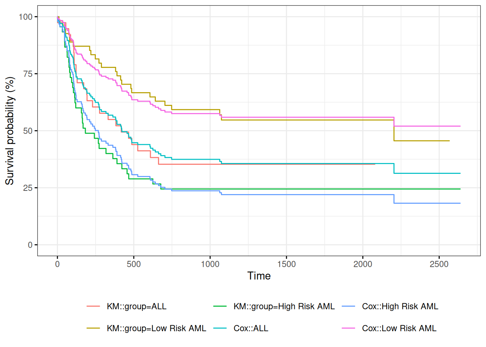](proportional-hazards-models_files/figure-html/unnamed-chunk-6-1.png "Figure 6: Survival Functions for Three Groups by KM and Cox Model")
>
> Figure 6: Survival Functions for Three Groups by KM and Cox Model

When we use [`survfit()`](https://rdrr.io/pkg/survival/man/survfit.html) with a [Cox model](#def-ph-model), we have to specify the covariate levels we are interested in; the argument `newdata` should include a `data.frame` with the same named columns as the [predictors](../chapters/Intro-to-GLMs.llms.md#def-predictors) in the Cox model and one or more levels of each.

From [`?survfit.coxph`](https://rdrr.io/pkg/survival/man/survfit.coxph.html):

> If the `newdata` argument is missing, a curve is produced for a single “pseudo” subject with covariate values equal to the means component of the fit. The resulting curve(s) almost never make sense, but the default remains due to an unwarranted attachment to the option shown by some users and by other packages. Two particularly egregious examples are factor variables and interactions. Suppose one were studying interspecies transmission of a virus, and the data set has a factor variable with levels (“pig”, “chicken”) and about equal numbers of observations for each. The “mean” covariate level will be 0.5 – is this a flying pig?

### 5.0.4 Examining `survfit`

Show R code

``` downlit
survfit(Surv(t2, d3) ~ group, data = bmt)
#> Call: survfit(formula = Surv(t2, d3) ~ group, data = bmt)
#> 
#>                      n events median 0.95LCL 0.95UCL
#> group=ALL           38     24    418     194      NA
#> group=Low Risk AML  54     25   2204     704      NA
#> group=High Risk AML 45     34    183     115     456
```

Show R code

``` downlit
survfit(Surv(t2, d3) ~ group, data = bmt) |> summary()
#> Call: survfit(formula = Surv(t2, d3) ~ group, data = bmt)
#> 
#>                 group=ALL 
#>  time n.risk n.event survival std.err lower 95% CI upper 95% CI
#>     1     38       1    0.974  0.0260        0.924        1.000
#>    55     37       1    0.947  0.0362        0.879        1.000
#>    74     36       1    0.921  0.0437        0.839        1.000
#>    86     35       1    0.895  0.0498        0.802        0.998
#>   104     34       1    0.868  0.0548        0.767        0.983
#>   107     33       1    0.842  0.0592        0.734        0.966
#>   109     32       1    0.816  0.0629        0.701        0.949
#>   110     31       1    0.789  0.0661        0.670        0.930
#>   122     30       2    0.737  0.0714        0.609        0.891
#>   129     28       1    0.711  0.0736        0.580        0.870
#>   172     27       1    0.684  0.0754        0.551        0.849
#>   192     26       1    0.658  0.0770        0.523        0.827
#>   194     25       1    0.632  0.0783        0.495        0.805
#>   230     23       1    0.604  0.0795        0.467        0.782
#>   276     22       1    0.577  0.0805        0.439        0.758
#>   332     21       1    0.549  0.0812        0.411        0.734
#>   383     20       1    0.522  0.0817        0.384        0.709
#>   418     19       1    0.494  0.0819        0.357        0.684
#>   466     18       1    0.467  0.0818        0.331        0.658
#>   487     17       1    0.439  0.0815        0.305        0.632
#>   526     16       1    0.412  0.0809        0.280        0.605
#>   609     14       1    0.382  0.0803        0.254        0.577
#>   662     13       1    0.353  0.0793        0.227        0.548
#> 
#>                 group=Low Risk AML 
#>  time n.risk n.event survival std.err lower 95% CI upper 95% CI
#>    10     54       1    0.981  0.0183        0.946        1.000
#>    35     53       1    0.963  0.0257        0.914        1.000
#>    48     52       1    0.944  0.0312        0.885        1.000
#>    53     51       1    0.926  0.0356        0.859        0.998
#>    79     50       1    0.907  0.0394        0.833        0.988
#>    80     49       1    0.889  0.0428        0.809        0.977
#>   105     48       1    0.870  0.0457        0.785        0.965
#>   211     47       1    0.852  0.0483        0.762        0.952
#>   219     46       1    0.833  0.0507        0.740        0.939
#>   248     45       1    0.815  0.0529        0.718        0.925
#>   272     44       1    0.796  0.0548        0.696        0.911
#>   288     43       1    0.778  0.0566        0.674        0.897
#>   381     42       1    0.759  0.0582        0.653        0.882
#>   390     41       1    0.741  0.0596        0.633        0.867
#>   414     40       1    0.722  0.0610        0.612        0.852
#>   421     39       1    0.704  0.0621        0.592        0.837
#>   481     38       1    0.685  0.0632        0.572        0.821
#>   486     37       1    0.667  0.0642        0.552        0.805
#>   606     36       1    0.648  0.0650        0.533        0.789
#>   641     35       1    0.630  0.0657        0.513        0.773
#>   704     34       1    0.611  0.0663        0.494        0.756
#>   748     33       1    0.593  0.0669        0.475        0.739
#>  1063     26       1    0.570  0.0681        0.451        0.720
#>  1074     25       1    0.547  0.0691        0.427        0.701
#>  2204      6       1    0.456  0.1012        0.295        0.704
#> 
#>                 group=High Risk AML 
#>  time n.risk n.event survival std.err lower 95% CI upper 95% CI
#>     2     45       1    0.978  0.0220        0.936        1.000
#>    16     44       1    0.956  0.0307        0.897        1.000
#>    32     43       1    0.933  0.0372        0.863        1.000
#>    47     42       2    0.889  0.0468        0.802        0.986
#>    48     40       1    0.867  0.0507        0.773        0.972
#>    63     39       1    0.844  0.0540        0.745        0.957
#>    64     38       1    0.822  0.0570        0.718        0.942
#>    74     37       1    0.800  0.0596        0.691        0.926
#>    76     36       1    0.778  0.0620        0.665        0.909
#>    80     35       1    0.756  0.0641        0.640        0.892
#>    84     34       1    0.733  0.0659        0.615        0.875
#>    93     33       1    0.711  0.0676        0.590        0.857
#>   100     32       1    0.689  0.0690        0.566        0.838
#>   105     31       1    0.667  0.0703        0.542        0.820
#>   113     30       1    0.644  0.0714        0.519        0.801
#>   115     29       1    0.622  0.0723        0.496        0.781
#>   120     28       1    0.600  0.0730        0.473        0.762
#>   157     27       1    0.578  0.0736        0.450        0.742
#>   162     26       1    0.556  0.0741        0.428        0.721
#>   164     25       1    0.533  0.0744        0.406        0.701
#>   168     24       1    0.511  0.0745        0.384        0.680
#>   183     23       1    0.489  0.0745        0.363        0.659
#>   242     22       1    0.467  0.0744        0.341        0.638
#>   268     21       1    0.444  0.0741        0.321        0.616
#>   273     20       1    0.422  0.0736        0.300        0.594
#>   318     19       1    0.400  0.0730        0.280        0.572
#>   363     18       1    0.378  0.0723        0.260        0.550
#>   390     17       1    0.356  0.0714        0.240        0.527
#>   422     16       1    0.333  0.0703        0.221        0.504
#>   456     15       1    0.311  0.0690        0.201        0.481
#>   467     14       1    0.289  0.0676        0.183        0.457
#>   625     13       1    0.267  0.0659        0.164        0.433
#>   677     12       1    0.244  0.0641        0.146        0.409
```

Show R code

``` downlit
survfit(bmt.cox)
#> Call: survfit(formula = bmt.cox)
#> 
#>        n events median 0.95LCL 0.95UCL
#> [1,] 137     83    422     268      NA
survfit(bmt.cox, newdata = tibble(group = unique(bmt$group)))
#> Call: survfit(formula = bmt.cox, newdata = tibble(group = unique(bmt$group)))
#> 
#>     n events median 0.95LCL 0.95UCL
#> 1 137     83    422     268      NA
#> 2 137     83     NA     625      NA
#> 3 137     83    268     162     467
```

Show R code

``` downlit
bmt.cox |>
  survfit(newdata = tibble(group = unique(bmt$group))) |>
  summary()
#> Call: survfit(formula = bmt.cox, newdata = tibble(group = unique(bmt$group)))
#> 
#>  time n.risk n.event survival1 survival2 survival3
#>     1    137       1     0.993     0.996     0.989
#>     2    136       1     0.985     0.992     0.978
#>    10    135       1     0.978     0.987     0.968
#>    16    134       1     0.970     0.983     0.957
#>    32    133       1     0.963     0.979     0.946
#>    35    132       1     0.955     0.975     0.935
#>    47    131       2     0.941     0.966     0.914
#>    48    129       2     0.926     0.957     0.893
#>    53    127       1     0.918     0.953     0.882
#>    55    126       1     0.911     0.949     0.872
#>    63    125       1     0.903     0.944     0.861
#>    64    124       1     0.896     0.940     0.851
#>    74    123       2     0.881     0.931     0.830
#>    76    121       1     0.873     0.926     0.819
#>    79    120       1     0.865     0.922     0.809
#>    80    119       2     0.850     0.913     0.788
#>    84    117       1     0.843     0.908     0.778
#>    86    116       1     0.835     0.903     0.768
#>    93    115       1     0.827     0.899     0.757
#>   100    114       1     0.820     0.894     0.747
#>   104    113       1     0.812     0.889     0.737
#>   105    112       2     0.797     0.880     0.717
#>   107    110       1     0.789     0.875     0.707
#>   109    109       1     0.782     0.870     0.697
#>   110    108       1     0.774     0.866     0.687
#>   113    107       1     0.766     0.861     0.677
#>   115    106       1     0.759     0.856     0.667
#>   120    105       1     0.751     0.851     0.657
#>   122    104       2     0.735     0.841     0.637
#>   129    102       1     0.727     0.836     0.627
#>   157    101       1     0.720     0.831     0.617
#>   162    100       1     0.712     0.826     0.607
#>   164     99       1     0.704     0.821     0.598
#>   168     98       1     0.696     0.815     0.588
#>   172     97       1     0.688     0.810     0.578
#>   183     96       1     0.680     0.805     0.568
#>   192     95       1     0.672     0.800     0.558
#>   194     94       1     0.664     0.794     0.549
#>   211     93       1     0.656     0.789     0.539
#>   219     92       1     0.648     0.783     0.530
#>   230     90       1     0.640     0.778     0.520
#>   242     89       1     0.632     0.773     0.511
#>   248     88       1     0.624     0.767     0.501
#>   268     87       1     0.616     0.761     0.492
#>   272     86       1     0.608     0.756     0.482
#>   273     85       1     0.600     0.750     0.473
#>   276     84       1     0.592     0.745     0.464
#>   288     83       1     0.584     0.739     0.454
#>   318     82       1     0.576     0.733     0.445
#>   332     81       1     0.568     0.727     0.436
#>   363     80       1     0.560     0.722     0.427
#>   381     79       1     0.552     0.716     0.418
#>   383     78       1     0.544     0.710     0.409
#>   390     77       2     0.528     0.698     0.392
#>   414     75       1     0.520     0.692     0.383
#>   418     74       1     0.512     0.686     0.374
#>   421     73       1     0.504     0.680     0.366
#>   422     72       1     0.496     0.674     0.357
#>   456     71       1     0.488     0.667     0.349
#>   466     70       1     0.480     0.661     0.340
#>   467     69       1     0.472     0.655     0.332
#>   481     68       1     0.464     0.649     0.324
#>   486     67       1     0.455     0.642     0.315
#>   487     66       1     0.447     0.636     0.307
#>   526     65       1     0.439     0.629     0.299
#>   606     63       1     0.431     0.623     0.291
#>   609     62       1     0.423     0.616     0.283
#>   625     61       1     0.415     0.609     0.275
#>   641     60       1     0.407     0.603     0.267
#>   662     59       1     0.399     0.596     0.260
#>   677     58       1     0.391     0.589     0.252
#>   704     57       1     0.383     0.582     0.244
#>   748     56       1     0.374     0.575     0.237
#>  1063     47       1     0.365     0.567     0.228
#>  1074     46       1     0.356     0.559     0.220
#>  2204      9       1     0.313     0.520     0.182
```

# 6 Adjustment for Ties (optional)

At each time $t_i$ at which more than one of the subjects has an event, let $d_i$ be the number of events at that time, $D_i$ the set of subjects with events at that time, and let $s_i$ be a [covariate vector](https://morrison-lab.github.io/sds/correlation-regression.html#def-slr-covariate-vector) for an artificial subject obtained by adding up the covariate values for the subjects with an event at time $t_i$. Let $$\overline{\Delta\eta}_i = \beta_1s_{i1}+\cdots+\beta_ps_{ip}$$ and $\bar\theta_i = {\operatorname{exp}\mathopen{}\left\{\overline{\Delta\eta}_i\right\}\mathclose{}}$.

Note that

$$\begin{aligned}
\overline{\Delta\eta}_i &=\sum_{j \in D_i}\beta_1x_{j1}+\cdots+\beta_px_{jp}\\
&= \beta_1s_{i1}+\cdots+\beta_ps_{ip}\\
\bar\theta_i &= {\operatorname{exp}\mathopen{}\left\{\overline{\Delta\eta}_i\right\}\mathclose{}}\\
&= \prod_{j \in D_i}\theta_i
\end{aligned}$$

#### Breslow’s method for ties

Breslow’s method estimates the [partial likelihood](#def-ph-partial-lik) as

$$\begin{aligned}
L(\beta|T) &=
\prod_i \frac{\bar\theta_i}{[\sum_{k \in R(t_i)} \theta_k]^{d_i}}\\
&= \prod_i \prod_{j \in D_i}\frac{\theta_j}{\sum_{k \in R(t_i)} \theta_k}
\end{aligned}$$

This method is equivalent to treating each event as distinct and using the non-ties formula. It works best when the number of ties is small. It is the default in many statistical packages, including PROC PHREG in SAS.

#### Efron’s method for ties

The other common method is Efron’s, which is the default in R.

$$L(\beta|T)=
\prod_i \frac{\bar\theta_i}{\prod_{j=1}^{d_i}[\sum_{k \in R(t_i)} \theta_k-\frac{j-1}{d_i}\sum_{k \in D_i} \theta_k]}$$ This Efron approximation is closer to the exact discrete partial likelihood when there are many ties.

The third option in R (and an option also in SAS as `discrete`) is the “exact” method, which is the same one used for matched logistic regression.

#### Example: Breslow’s method

Suppose as an example we have a time $t$ where there are 20 individuals at risk and three failures. Let the three individuals have risk parameters $\theta_1, \theta_2, \theta_3$ and let the sum of the risk parameters of the remaining 17 individuals be $\theta_R$. Then the factor in the partial likelihood at time $t$ using Breslow’s method is

$$\mathopen{}\left(\frac{\theta_1}{\theta_R+\theta_1+\theta_2+\theta_3}\right)\mathclose{}
\mathopen{}\left(\frac{\theta_2}{\theta_R+\theta_1+\theta_2+\theta_3}\right)\mathclose{}
\mathopen{}\left(\frac{\theta_3}{\theta_R+\theta_1+\theta_2+\theta_3}\right)\mathclose{}$$

If on the other hand, they had died in the order 1, 2, 3, then the contribution to the partial likelihood would be:

$$\mathopen{}\left(\frac{\theta_1}{\theta_R+\theta_1+\theta_2+\theta_3}\right)\mathclose{}
\mathopen{}\left(\frac{\theta_2}{\theta_R+\theta_2+\theta_3}\right)\mathclose{}
\mathopen{}\left(\frac{\theta_3}{\theta_R+\theta_3}\right)\mathclose{}$$

as the [risk set](../chapters/intro-to-survival-analysis.llms.md#def-risk-set) got smaller with each failure. The exact method roughly averages the results for the six possible orderings of the failures.

#### Example: Efron’s method

Because the exact failure order among tied event times is unobserved, rather than reducing the denominator by one risk coefficient at each step, Efron’s method reduces it by a uniform fractional amount.

$$\mathopen{}\left(\frac{\theta_1}{\theta_R+\theta_1+\theta_2+\theta_3}\right)\mathclose{}
\mathopen{}\left(\frac{\theta_2}{\theta_R+2(\theta_1+\theta_2+\theta_3)/3}\right)\mathclose{}
\mathopen{}\left(\frac{\theta_3}{\theta_R+(\theta_1+\theta_2+\theta_3)/3}\right)\mathclose{}$$

# 7 Building Cox Proportional Hazards Models

> **TIP:**
>
> David Rocke’s two Epi 204 lectures on *Model Building and Checking for Cox Models* ([part 1](https://dmrocke.ucdavis.edu/Class/EPI204-Spring-2021/EPI204-2021-05-11.mp4), [part 2](https://dmrocke.ucdavis.edu/Class/EPI204-Spring-2021/EPI204-2021-05-13.mp4); [slides](https://dmrocke.ucdavis.edu/Class/EPI204-Spring-2021/Lecture12SurvivalAnalysisModelBuilding.pdf)) use the `hodg` lymphoma data to cover Schoenfeld residuals and [`cox.zph()`](https://rdrr.io/pkg/survival/man/cox.zph.html), Cox-Snell and martingale residuals, influence diagnostics, and stratification [\[1\]](#ref-rocke2021epi204).

## 7.1 `hodg` Lymphoma Data Set from `KMsurv`

### 7.1.1 Participants

43 bone marrow transplant patients at Ohio State University (Avalos 1993)

### 7.1.2 Variables

- `dtype`: Disease type (Hodgkin’s or non-Hodgkins lymphoma)
- `gtype`: Bone marrow graft type:
- allogeneic: from HLA-matched sibling
- autologous: from self (prior to chemo)
- `time`: time to study exit
- `delta`: study exit reason (death/relapse vs [censored](../chapters/intro-to-survival-analysis.llms.md#def-right-censor))
- `wtime`: waiting time to transplant (in months)
- `score`: Karnofsky score:
- 80–100: Able to carry on normal activity and to work; no special care needed.
- 50–70: Unable to work; able to live at home and care for most personal needs; varying amount of assistance needed.
- 10–60: Unable to care for self; requires equivalent of institutional or hospital care; disease may be progressing rapidly.

### 7.1.3 Data

Show R code

``` downlit
library(dplyr)
library(survival)
library(survminer)
data(hodg, package = "KMsurv")
hodg2 <- hodg |>
  as_tibble() |>
  mutate(
    # We add factor labels to the categorical variables:
    gtype = gtype |>
      case_match(
        1 ~ "Allogenic",
        2 ~ "Autologous"
      ),
    dtype = dtype |>
      case_match(
        1 ~ "Non-Hodgkins",
        2 ~ "Hodgkins"
      ) |>
      factor() |>
      relevel(ref = "Non-Hodgkins"),
    delta = delta |>
      case_match(
        1 ~ "dead",
        0 ~ "alive"
      ),
    surv = Surv(
      time = time,
      event = delta == "dead"
    )
  )
hodg2 |> print()
#> # A tibble: 43 × 7
#>    gtype     dtype         time delta score wtime   surv
#>    <chr>     <fct>        <int> <chr> <int> <int> <Surv>
#>  1 Allogenic Non-Hodgkins    28 dead     90    24    28 
#>  2 Allogenic Non-Hodgkins    32 dead     30     7    32 
#>  3 Allogenic Non-Hodgkins    49 dead     40     8    49 
#>  4 Allogenic Non-Hodgkins    84 dead     60    10    84 
#>  5 Allogenic Non-Hodgkins   357 dead     70    42   357 
#>  6 Allogenic Non-Hodgkins   933 alive    90     9   933+
#>  7 Allogenic Non-Hodgkins  1078 alive   100    16  1078+
#>  8 Allogenic Non-Hodgkins  1183 alive    90    16  1183+
#>  9 Allogenic Non-Hodgkins  1560 alive    80    20  1560+
#> 10 Allogenic Non-Hodgkins  2114 alive    80    27  2114+
#> # ℹ 33 more rows
```

## 7.2 Proportional hazards model

> **NOTE:**
>
> Show R code
>
> ``` downlit
> hodg_cox1 <- coxph(
>   formula = surv ~ gtype * dtype + score + wtime,
>   data = hodg2
> )
>
> summary(hodg_cox1)
> #> Call:
> #> coxph(formula = surv ~ gtype * dtype + score + wtime, data = hodg2)
> #> 
> #>   n= 43, number of events= 26 
> #> 
> #>                                  coef exp(coef) se(coef)     z Pr(>|z|)    
> #> gtypeAutologous                0.6394    1.8953   0.5937  1.08   0.2815    
> #> dtypeHodgkins                  2.7603   15.8050   0.9474  2.91   0.0036 ** 
> #> score                         -0.0495    0.9517   0.0124 -3.98  6.8e-05 ***
> #> wtime                         -0.0166    0.9836   0.0102 -1.62   0.1046    
> #> gtypeAutologous:dtypeHodgkins -2.3709    0.0934   1.0355 -2.29   0.0220 *  
> #> ---
> #> Signif. codes:  0 '***' 0.001 '**' 0.01 '*' 0.05 '.' 0.1 ' ' 1
> #> 
> #>                               exp(coef) exp(-coef) lower .95 upper .95
> #> gtypeAutologous                  1.8953     0.5276    0.5920     6.068
> #> dtypeHodgkins                   15.8050     0.0633    2.4682   101.207
> #> score                            0.9517     1.0507    0.9288     0.975
> #> wtime                            0.9836     1.0167    0.9641     1.003
> #> gtypeAutologous:dtypeHodgkins    0.0934    10.7074    0.0123     0.711
> #> 
> #> Concordance= 0.776  (se = 0.059 )
> #> Likelihood ratio test= 32.1  on 5 df,   p=6e-06
> #> Wald test            = 27.2  on 5 df,   p=5e-05
> #> Score (logrank) test = 37.7  on 5 df,   p=4e-07
> ```
>
> Table 1: Summary of Proportional Hazards model for Hodgkins Lymphoma data

## 7.3 Diagnostic graphs for proportional hazards assumption

### 7.3.1 Analysis plan

- **[survival function](../chapters/intro-to-survival-analysis.llms.md#def-surv-fn)** for the four combinations of disease type and graft type.
- **observed (nonparametric) vs. expected (semiparametric) survival** functions.
- **complementary log-log survival** for the four groups.

### 7.3.2 Kaplan-Meier survival functions

Show R code

``` downlit
km_model <- survfit(
  formula = surv ~ dtype + gtype,
  data = hodg2
)

library(ggplot2)
library(ggfortify) # registers autoplot.survfit
km_model |>
  autoplot(conf.int = FALSE) +
  theme_bw() +
  theme(
    legend.position = "bottom",
    legend.title = element_blank(),
    legend.text = element_text(size = legend_text_size)
  ) +
  guides(col = guide_legend(ncol = 2)) +
  ylab("Survival probability, S(t)") +
  xlab("Time since transplant (days)")
```

> **NOTE:**
>
> [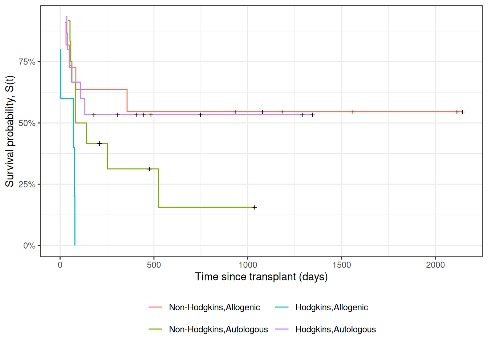](proportional-hazards-models_files/figure-html/fig-km-hodg2-1.png "Figure 7: Kaplan-Meier Survival Curves for HOD/NHL and Allo/Auto Grafts")
>
> Figure 7: Kaplan-Meier Survival Curves for HOD/NHL and Allo/Auto Grafts

### 7.3.3 Observed and expected survival curves

Show R code

``` downlit
# we need to create a tibble of covariate patterns;
# we will set score and wtime to mean values for disease and graft types:
means <- hodg2 |>
  summarize(
    .by = c(dtype, gtype),
    score = mean(score),
    wtime = mean(wtime)
  ) |>
  arrange(dtype, gtype) |>
  mutate(strata = paste(dtype, gtype, sep = ",")) |>
  as.data.frame()

# survfit.coxph() will use the rownames of its `newdata`
# argument to label its output:
rownames(means) <- means$strata

cox_model <-
  hodg_cox1 |>
  survfit(
    data = hodg2, # ggsurvplot() will need this
    newdata = means
  )
```

Show R code

``` downlit
# I couldn't find a good function to reformat `cox_model` for ggplot,
# so I made my own:
stack_surv_ph <- function(cox_model) {
  cox_model$surv |>
    as_tibble() |>
    mutate(time = cox_model$time) |>
    tidyr::pivot_longer(
      cols = -time,
      names_to = "strata",
      values_to = "surv"
    ) |>
    mutate(
      cumhaz = -log(.data$surv),
      model = "Cox PH"
    )
}

km_and_cph <-
  km_model |>
  fortify(surv.connect = TRUE) |>
  mutate(
    strata = trimws(strata),
    model = "Kaplan-Meier",
    cumhaz = -log(surv)
  ) |>
  bind_rows(stack_surv_ph(cox_model))
```

Show R code

``` downlit
km_and_cph |>
  ggplot(aes(x = time, y = surv, col = model)) +
  geom_step() +
  facet_wrap(~strata) +
  theme_bw() +
  ylab("Survival probability, S(t) = P(T>=t)") +
  xlab("Survival time (t, days)") +
  theme(legend.position = "bottom")
```

[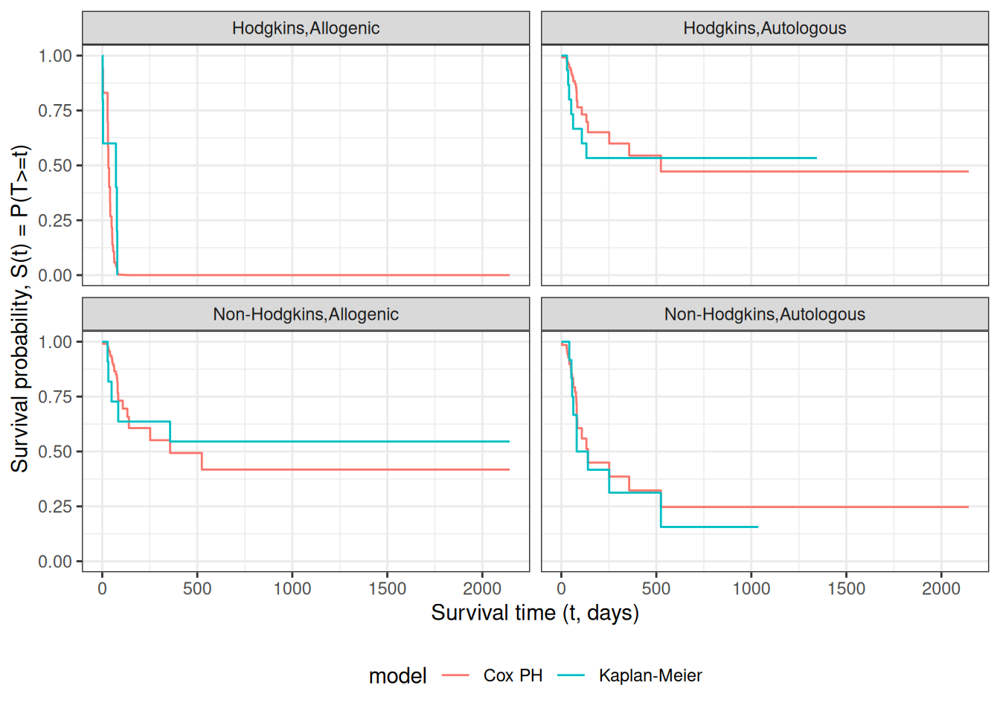](proportional-hazards-models_files/figure-html/unnamed-chunk-10-1.png "Observed and expected survival curves for hodg2 data")

Observed and expected survival curves for `hodg2` data

### 7.3.4 Cumulative hazard (log-scale) curves

Also known as “complementary log-log (clog-log) survival curves”.

Show R code

``` downlit
# draw cumulative hazard against time, both on log-spaced axes,
# so that the ticks are in days and in units of cumulative hazard
# rather than in the logs of those quantities:
# (`text_size` is the legend text size;
# 9 matches `legend_text_size` in r-config)
plot_cloglog <- function(curves, text_size = 9) {
  curves |>
    # log10(0) is not finite, so leave out the time-zero points
    filter(.data$time > 0, .data$cumhaz > 0) |>
    ggplot() +
    aes(x = .data$time, y = .data$cumhaz, col = .data$strata) +
    geom_step(linewidth = .5) +
    theme_bw() +
    scale_x_continuous(
      trans = "log10",
      labels = scales::label_number(drop0trailing = TRUE, big.mark = ","),
      name = "Time since transplant (days, log scale)"
    ) +
    scale_y_continuous(
      trans = "log10",
      labels = scales::label_number(drop0trailing = TRUE, big.mark = ","),
      name = "Cumulative hazard H(t) (log scale)"
    ) +
    theme(legend.position = "bottom", legend.title = element_blank()) +
    guides(
      col =
        guide_legend(
          ncol = 2,
          label.theme = element_text(size = text_size)
        )
    )
}

na_model <- survfit(
  formula = surv ~ dtype + gtype,
  data = hodg2,
  type = "fleming"
)

na_model |>
  fortify(fun = "cumhaz") |>
  # `fortify.survfit()` doesn't name cumhaz correctly:
  rename(cumhaz = surv) |>
  mutate(strata = trimws(strata)) |>
  plot_cloglog()
```

> **NOTE:**
>
> [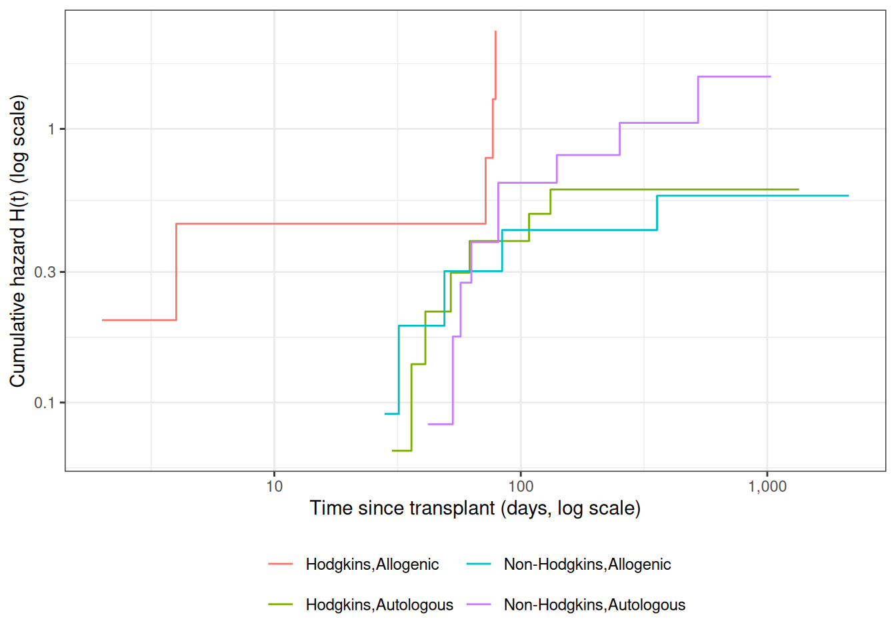](proportional-hazards-models_files/figure-html/fig-cloglog-na-1.png "Figure 8: Cumulative hazard curves, on log-spaced axes (complementary log-log survival curves) - Nelson-Aalen estimates")
>
> Figure 8: Cumulative hazard curves, on log-spaced axes (complementary log-log survival curves) - Nelson-Aalen estimates

Let’s compare these empirical (i.e., non-parametric) curves with the fitted curves from our [`coxph()`](https://rdrr.io/pkg/survival/man/coxph.html) model:

Show R code

``` downlit
cox_model |>
  stack_surv_ph() |>
  plot_cloglog()
```

> **NOTE:**
>
> [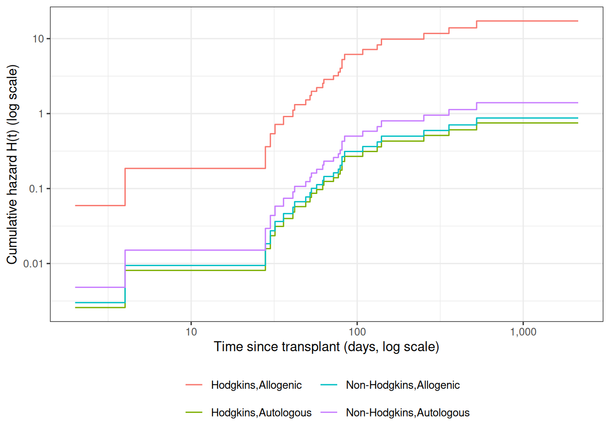](proportional-hazards-models_files/figure-html/fig-cloglog-ph-1.png "Figure 9: Cumulative hazard curves, on log-spaced axes (complementary log-log survival curves) - PH estimates")
>
> Figure 9: Cumulative hazard curves, on log-spaced axes (complementary log-log survival curves) - PH estimates

Now let’s overlay these [cumulative hazard](../chapters/intro-to-survival-analysis.llms.md#def-cuhaz) curves:

Show R code

``` downlit
na_and_cph <-
  na_model |>
  fortify(fun = "cumhaz") |>
  # `fortify.survfit()` doesn't name cumhaz correctly:
  rename(cumhaz = surv) |>
  mutate(
    surv = exp(-cumhaz),
    strata = trimws(strata)
  ) |>
  mutate(model = "Nelson-Aalen") |>
  bind_rows(stack_surv_ph(cox_model))

na_and_cph |>
  ggplot(
    aes(
      x = time,
      y = cumhaz,
      col = model
    )
  ) +
  geom_step() +
  facet_wrap(~strata) +
  theme_bw() +
  scale_y_continuous(
    trans = "log10",
    name = "Cumulative hazard, H(t) (log-scale)"
  ) +
  scale_x_continuous(
    trans = "log10",
    name = "Survival time (t, days, log-scale)"
  ) +
  theme(legend.position = "bottom")
```

> **NOTE:**
>
> [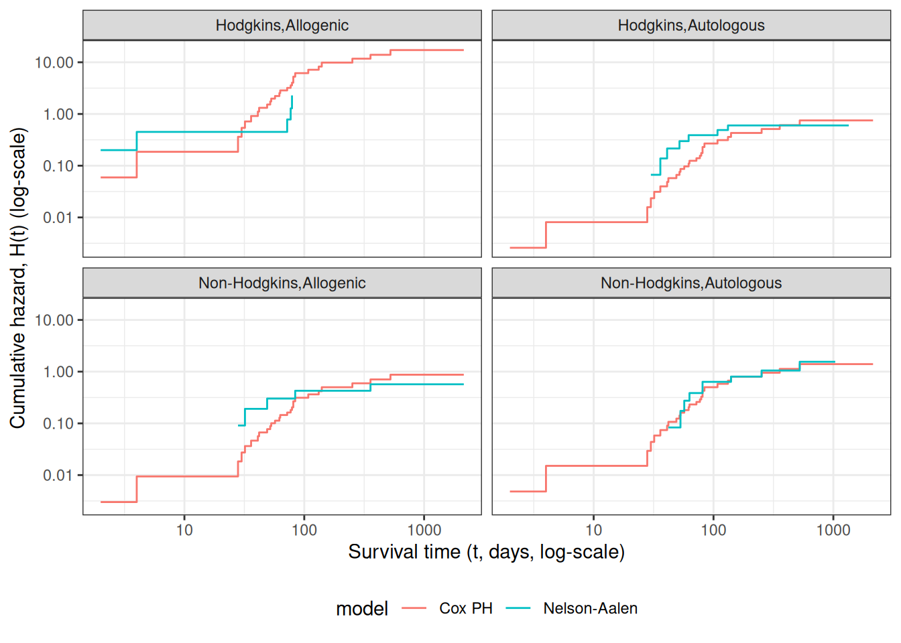](proportional-hazards-models_files/figure-html/fig-bmt-cumhaz-1.png "Figure 10: Observed and expected cumulative hazard curves for bmt data (cloglog format)")
>
> Figure 10: Observed and expected cumulative hazard curves for `bmt` data (cloglog format)

## 7.4 Predictions and Residuals

### 7.4.1 Review: Predictions in Linear Regression

- In [linear regression](../chapters/Linear-models-overview.llms.md#def-lm-general-form), we have a linear predictor for each data point $i$

$$\begin{aligned}
\eta_i &= \beta_0+\beta_1x_{1i}+\cdots+\beta_px_{pi}\\
\hat y_i &=\hat\eta_i = \hat\beta_0+\hat\beta_1x_{1i}+\cdots+\hat\beta_px_{pi}\\
y_i &\sim N(\eta_i,\sigma^2)
\end{aligned}$$

- $\hat y_i$ estimates the [conditional mean](https://morrison-lab.github.io/pds/expectation.html#def-cond-expectation) of $y_i$ given the covariate values $\mathord{\smash[b]{\underset{\raise.3ex\hbox{$\scriptstyle\sim$}}{x}}\vphantom{x}}_i$. This together with the [prediction error](https://morrison-lab.github.io/sds/prediction.html#def-prediction-error) says that we are predicting the distribution of values of $y$.

### 7.4.2 Review: Residuals in Linear Regression

- The usual [residual](../chapters/Linear-models-overview.llms.md#def-resid-fitted) is $r_i=y_i-\hat y_i$, the difference between the actual value of $y$ and a prediction of its mean.
- The residuals are also the quantities the sum of whose squares is being minimized by the [least squares](https://morrison-lab.github.io/sds/correlation-regression.html#def-ols)/[MLE](https://morrison-lab.github.io/sds/intro-MLEs.html#def-mle) estimation.

### 7.4.3 Predictions and Residuals in survival models

- In survival analysis, the equivalent of $y_i$ is the event time $t_i$, which is unknown for the [censored](../chapters/intro-to-survival-analysis.llms.md#def-right-censor) observations.
- The [expected](https://morrison-lab.github.io/pds/expectation.html#def-expectation) event time can be tricky to calculate:

$$\hat{\text{E}}[T|X=x] = \int_{t=0}^{\infty} \mathop{\hat{\operatorname{S}}}\nolimits(t)dt$$

### 7.4.4 Wide prediction intervals

The nature of time-to-event data results in very wide [prediction intervals](https://morrison-lab.github.io/sds/intro-MLEs.html#def-prediction-interval):

- Suppose a cancer patient is predicted to have a mean lifetime of 5 years after diagnosis and suppose the distribution is [exponential](https://morrison-lab.github.io/pds/random-variables.html#def-exponential).
- If we want a 95% interval for survival, the lower end is at the 0.025 [percentage point](https://morrison-lab.github.io/pds/random-variables.html#def-quantile-function) of the exponential which is `qexp(.025, rate = 1/5)` = 0.126589 years, or 1/40 of the mean lifetime.
- The upper end is at the 0.975 point which is `qexp(.975, rate = 1/5)` = 18.444397 years, or 3.7 times the mean lifetime.
- Saying that the survival time is somewhere between 6 weeks and 18 years does not seem very useful, but it may be the best we can do.
- For survival analysis, something is like a residual if it is small when the model is accurate or if the accumulation of them is in some way minimized by the estimation algorithm, but there is no exact equivalence to linear regression residuals.
- And if there is, they are mostly quite large!

### 7.4.5 Types of Residuals in Time-to-Event Models

- It is often hard to make a decision from graph appearances, though the process can reveal much.
- Some diagnostic tests are based on residuals as with other regression methods:
  - **[Schoenfeld residuals](#def-schoenfeld-residual)** (via `cox.zph`) for proportionality
  - **[Cox-Snell residuals](#def-CS-resid)** for goodness of fit ([Section 7.5](#sec-cox-snell))
  - **[martingale residuals](#def-martingale-residual)** for non-linearity
  - **[dfbeta](#def-dfbeta)** for influence.

> **NOTE:**
>
> **Definition 20 (Estimated Risk Score)** The risk score ${\theta_{{\lambda}}\mathopen{}\left(\mathord{\smash[b]{\underset{\raise.3ex\hbox{$\scriptstyle\sim$}}{x}}\vphantom{x}}\right)\mathclose{}}$ ([Definition 12](#def-risk-score)) depends on the true, unknown coefficient vector $\mathord{\smash[b]{\underset{\raise.3ex\hbox{$\scriptstyle\sim$}}{\beta}}\vphantom{\beta}}$. After fitting the model, we estimate it by the **estimated risk score**, which substitutes the fitted coefficients $\hat{\mathord{\smash[b]{\underset{\raise.3ex\hbox{$\scriptstyle\sim$}}{\beta}}\vphantom{\beta}}}$ for $\mathord{\smash[b]{\underset{\raise.3ex\hbox{$\scriptstyle\sim$}}{\beta}}\vphantom{\beta}}$:
>
> $${\hat{\theta}_{{\lambda}}\mathopen{}\left(\mathord{\smash[b]{\underset{\raise.3ex\hbox{$\scriptstyle\sim$}}{x}}\vphantom{x}}\right)\mathclose{}} \stackrel{\text{def}}{=}{\operatorname{exp}\mathopen{}\left\{\mathord{\smash[b]{\underset{\raise.3ex\hbox{$\scriptstyle\sim$}}{x}}\vphantom{x}} \cdot \hat{\mathord{\smash[b]{\underset{\raise.3ex\hbox{$\scriptstyle\sim$}}{\beta}}\vphantom{\beta}}}\right\}\mathclose{}}$$

### 7.4.6 Schoenfeld residuals

> **NOTE:**
>
> **Definition 21 (Schoenfeld Residual)** For each subject $i$ who experienced an event (not censored) and for each [predictor](../chapters/Intro-to-GLMs.llms.md#def-predictors) $k$, the **Schoenfeld residual** is defined as [\[5\]](#ref-grambsch1994proportional):
>
> $$r^S_{ik} =
> x_{ik}-\frac{\sum_{j\in {\mathcal{R}\mathopen{}\left(t_i\right)\mathclose{}}} x_{jk}\,{\hat{\theta}_{{\lambda}}\mathopen{}\left(\mathord{\smash[b]{\underset{\raise.3ex\hbox{$\scriptstyle\sim$}}{x}}\vphantom{x}}_j\right)\mathclose{}}}{\sum_{j\in {\mathcal{R}\mathopen{}\left(t_i\right)\mathclose{}}} {\hat{\theta}_{{\lambda}}\mathopen{}\left(\mathord{\smash[b]{\underset{\raise.3ex\hbox{$\scriptstyle\sim$}}{x}}\vphantom{x}}_j\right)\mathclose{}}}$$
>
> where ${\mathcal{R}\mathopen{}\left(t_i\right)\mathclose{}}$ is the [risk set](../chapters/intro-to-survival-analysis.llms.md#def-risk-set) at event time $t_i$ of subject $i$, $x_{jk}$ is the value of predictor $k$ for subject $j$, and ${\hat{\theta}_{{\lambda}}\mathopen{}\left(\mathord{\smash[b]{\underset{\raise.3ex\hbox{$\scriptstyle\sim$}}{x}}\vphantom{x}}_j\right)\mathclose{}}$ is the estimated risk score ([Definition 20](#def-estimated-risk-score)) for subject $j$.

Intuitively, $r^S_{ik}$ measures how unusual subject $i$’s covariate value is, relative to the risk-weighted average among those at risk when subject $i$ failed. If the [proportional hazards assumption](#def-pha) holds, these residuals should show no systematic trend over time. A trend signals non-proportionality.

We can test for such a trend with the [correlation](https://morrison-lab.github.io/pds/variance-covariance.html#def-correlation) between Schoenfeld residuals and a function of time. The default in [`cox.zph()`](https://rdrr.io/pkg/survival/man/cox.zph.html) uses the [KM survival curve](../chapters/intro-to-survival-analysis.llms.md#def-KM-estimator) as a transform, which handles censoring better than raw ranks. The [`cox.zph()`](https://rdrr.io/pkg/survival/man/cox.zph.html) function implements a score test proposed in Grambsch and Therneau [\[5\]](#ref-grambsch1994proportional).

Show R code

``` downlit
hodg_zph <- cox.zph(hodg_cox1)
print(hodg_zph)
#>               chisq df     p
#> gtype        0.5400  1 0.462
#> dtype        1.8012  1 0.180
#> score        3.8805  1 0.049
#> wtime        0.0173  1 0.895
#> gtype:dtype  4.0474  1 0.044
#> GLOBAL      13.7573  5 0.017
```

#### `gtype`

Show R code

``` downlit
ggcoxzph(hodg_zph, var = "gtype")
```

[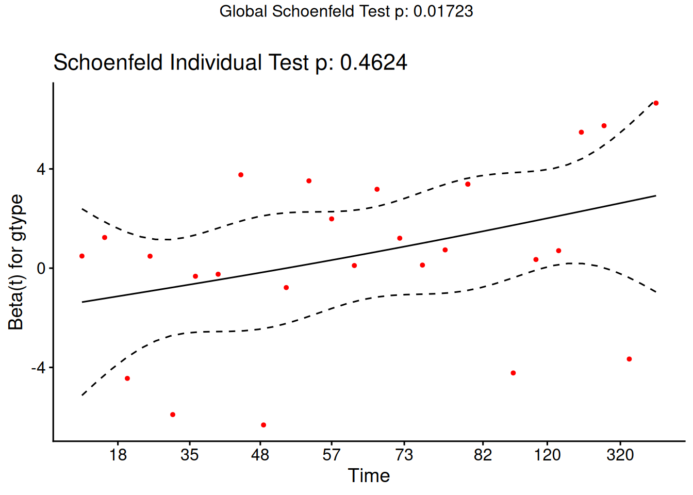](proportional-hazards-models_files/figure-html/unnamed-chunk-13-1.png)

#### `dtype`

Show R code

``` downlit
ggcoxzph(hodg_zph, var = "dtype")
```

[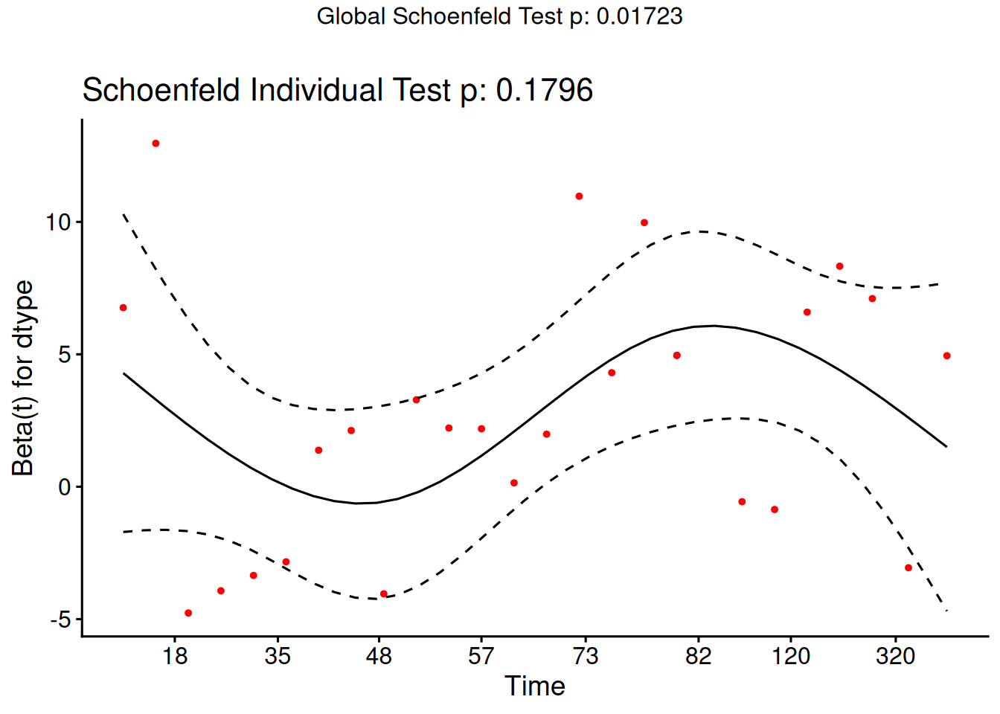](proportional-hazards-models_files/figure-html/unnamed-chunk-14-1.png)

#### `score`

Show R code

``` downlit
ggcoxzph(hodg_zph, var = "score")
```

[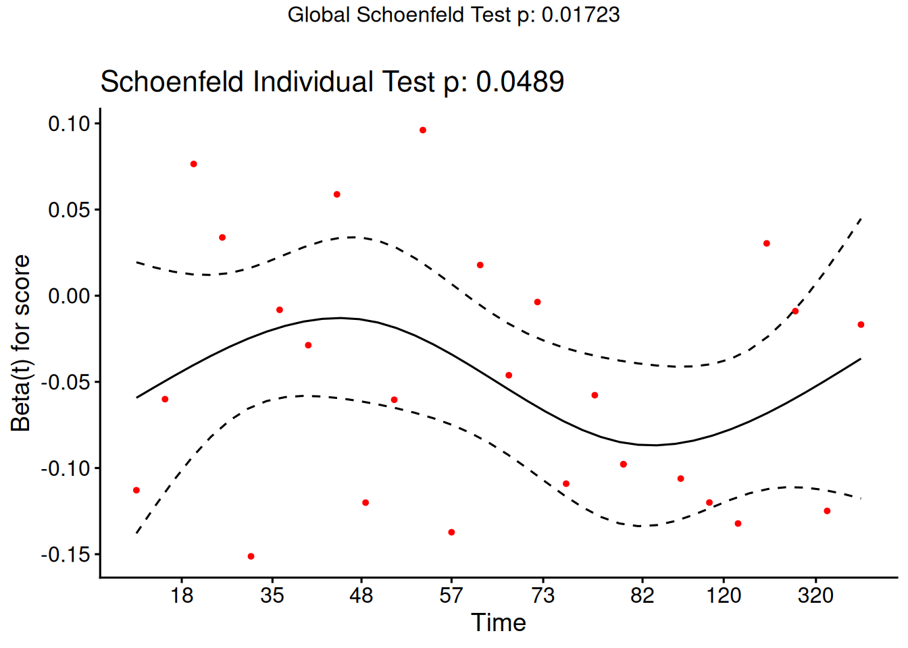](proportional-hazards-models_files/figure-html/unnamed-chunk-15-1.png)

#### `wtime`

Show R code

``` downlit
ggcoxzph(hodg_zph, var = "wtime")
```

[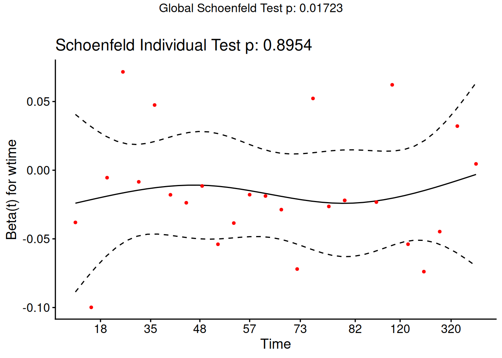](proportional-hazards-models_files/figure-html/unnamed-chunk-16-1.png)

#### `gtype:dtype`

Show R code

``` downlit
ggcoxzph(hodg_zph, var = "gtype:dtype")
```

[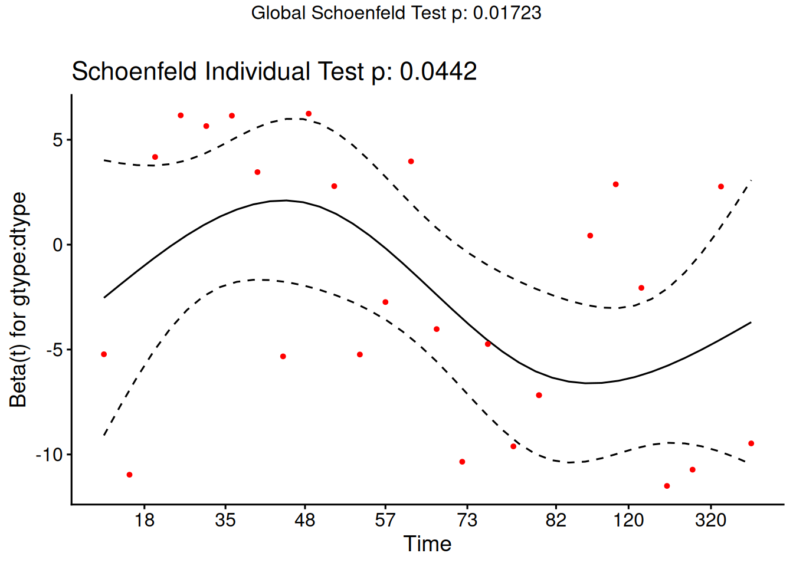](proportional-hazards-models_files/figure-html/unnamed-chunk-17-1.png)

#### Conclusions

- From the correlation test, the Karnofsky score and the interaction with graft type disease type induce modest but [statistically significant](https://morrison-lab.github.io/sds/inference.html#def-statistically-significant) non-proportionality.
- The sample size here is relatively small (26 events in 43 subjects). If the sample size is large, very small amounts of non-proportionality can induce a significant result.
- As time goes on, autologous grafts are over-represented at their own event times, but those from HOD patients become less represented.
- Both the statistical tests and the plots are useful.

## 7.5 Goodness of Fit using the Cox-Snell Residuals

(references: Klein and Moeschberger [\[3\]](#ref-klein2003survival), §11.2, and Dobson and Barnett [\[6\]](#ref-dobson4e), §10.6)

------------------------------------------------------------------------

Suppose that an individual has a survival time $T$ which has [survival function](../chapters/intro-to-survival-analysis.llms.md#def-surv-fn) $\operatorname{S}(t)$, meaning that $\Pr(T> t) = \operatorname{S}(t)$. Then $S(T)$ has a [uniform distribution](https://morrison-lab.github.io/pds/random-variables.html#def-uniform) on $(0,1)$:

$$\begin{aligned}
\Pr(S(T_i) \le u)
&= \Pr(T_i > S_i^{-1}(u))\\
&= S_i(S_i^{-1}(u))\\
&= u
\end{aligned}$$

------------------------------------------------------------------------

Also, if $U$ has a uniform distribution on $(0,1)$, then what is the distribution of $-\ln(U)$?

------------------------------------------------------------------------

$$\begin{aligned}
\Pr(-\ln(U) < x) &= \Pr(U>{\operatorname{exp}\mathopen{}\left\{-x\right\}\mathclose{}})\\
&= 1-e^{-x}
\end{aligned}$$

which is the [CDF](https://morrison-lab.github.io/pds/random-variables.html#def-cdf) of an [exponential distribution](https://morrison-lab.github.io/pds/random-variables.html#def-exponential) with parameter $\lambda=1$.

> **NOTE:**
>
> **Definition 22 (Cox-Snell generalized residuals)**  
>
> The **Cox-Snell generalized residuals** are defined as:
>
> $$r^{CS}_i \stackrel{\text{def}}{=}\hat {\Lambda}(t_i|\mathord{\smash[b]{\underset{\raise.3ex\hbox{$\scriptstyle\sim$}}{x}}\vphantom{x}}_i)$$

If the estimate $\hat S_i$ is accurate, $r^{CS}_i$ should have an exponential distribution with constant hazard $\lambda=1$, which means that these values should look like a censored sample from this exponential distribution.

------------------------------------------------------------------------

Show R code

``` downlit
hodg2 <- hodg2 |>
  mutate(cs = predict(hodg_cox1, type = "expected"))

surv_csr <- survfit(
  data = hodg2,
  formula = Surv(time = cs, event = delta == "dead") ~ 1,
  type = "fleming-harrington"
)

autoplot(surv_csr, fun = "cumhaz") +
  geom_abline(aes(intercept = 0, slope = 1), col = "red") +
  theme_bw()
```

> **NOTE:**
>
> [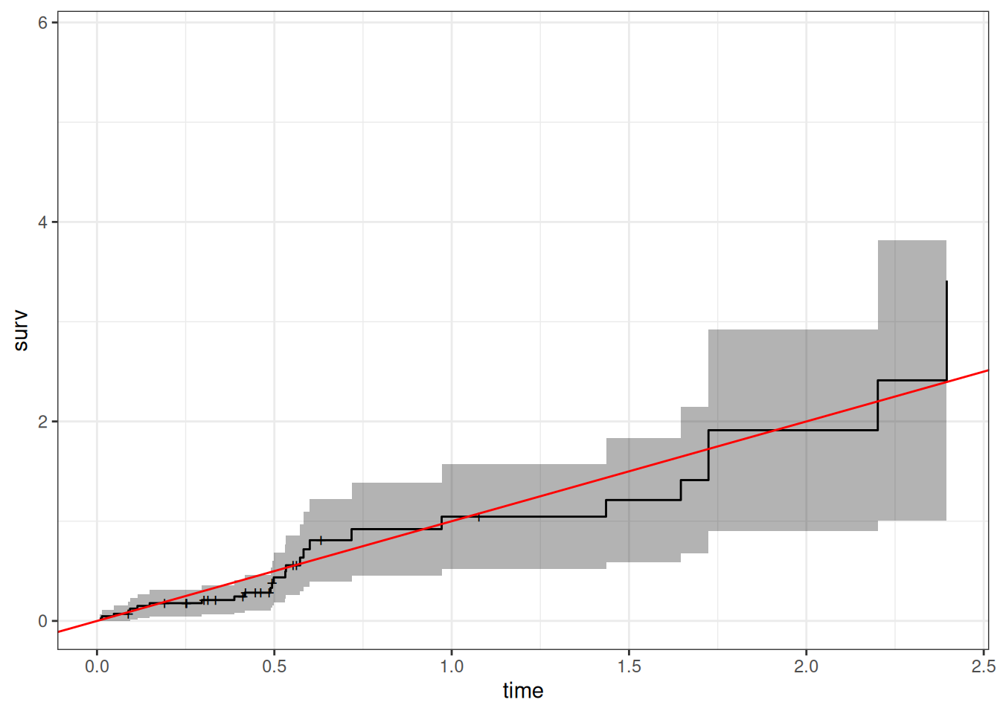](proportional-hazards-models_files/figure-html/fig-cox-snell-cuhaz-hodg2-1.png "Figure 11: Cumulative Hazard of Cox-Snell Residuals")
>
> Figure 11: Cumulative Hazard of Cox-Snell Residuals

The line with slope 1 and intercept 0 fits the curve relatively well, so we don’t see lack of fit using this procedure.

## 7.6 Martingale Residuals

> **NOTE:**
>
> **Definition 23 (Martingale Residual)** The **martingale residual** for subject $i$ is:
>
> $$r^M_i = \delta_i - r^{CS}_i$$
>
> where $\delta_i = 1$ if subject $i$ experienced the event ($0$ if censored) and $r^{CS}_i = \hat{{\Lambda}}(t_i \mid \mathord{\smash[b]{\underset{\raise.3ex\hbox{$\scriptstyle\sim$}}{x}}\vphantom{x}}_i)$ is the Cox-Snell residual ([Definition 22](#def-CS-resid)) [\[3, Sec. 11.3\]](#ref-klein2003survival).

> **NOTE:**
>
> Martingale residuals estimate the excess number of events in the data relative to what the model predicted. They are bounded above by $1$ (a subject who died very early has residual close to $1 - 0 = 1$) but unbounded below (a long-lived censored subject in a high-risk group can have a very large negative residual). This asymmetry makes it harder to spot unexpectedly early deaths, motivating the deviance residual.
>
> We will use martingale residuals to examine the functional forms of [continuous](https://morrison-lab.github.io/sds/data.html#def-continuous-var) covariates.

> **NOTE:**
>
> Originally, a martingale referred to a betting strategy where you bet \$1 on the first play, then you double the bet if you lose and continue until you win. This strategy seems like a sure thing, because at the end of each series when you finally win, you are up \$1. For example, $-1-2-4-8+16=1$. But this assumes that you have infinite resources. Really, you have a large probability of winning \$1, and a small probability of losing everything you have, kind of the opposite of a lottery.
>
> martingale  
> In probability, a **martingale** is a sequence of [random variables](https://morrison-lab.github.io/pds/random-variables.html#def-random-variable) such that the [expected value](https://morrison-lab.github.io/pds/expectation.html#def-expectation) of the next event at any time is the present observed value, and that no better predictor can be derived even with all past values of the series available. At least to a close approximation, the stock market is a martingale. Under the assumptions of the [proportional hazards model](#def-ph-model), the martingale residuals ordered in time form a martingale.

### 7.6.1 Using Martingale Residuals

Martingale residuals can be used to examine the functional form of a numeric variable.

- We fit the model without that variable and compute the martingale residuals.
- We then plot these martingale residuals against the values of the variable.
- We can see curvature, or a possible suggestion that the variable can be discretized.

Let’s use this to examine the `score` and `wtime` variables in the `wtime` data set.

#### Karnofsky score

Show R code

``` downlit
hodg2 <- hodg2 |>
  mutate(
    mres = hodg_cox1 |>
      update(. ~ . - score) |>
      residuals(type = "martingale")
  )

hodg2 |>
  ggplot(aes(x = score, y = mres)) +
  geom_point() +
  geom_smooth(method = "loess", aes(col = "loess")) +
  geom_smooth(method = "lm", aes(col = "lm")) +
  theme_classic() +
  xlab("Karnofsky Score") +
  ylab("Martingale Residuals") +
  guides(col = guide_legend(title = ""))
```

[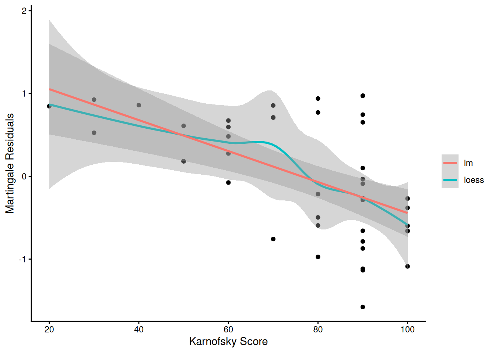](proportional-hazards-models_files/figure-html/unnamed-chunk-18-1.png "Martingale Residuals vs. Karnofsky Score")

Martingale Residuals vs. Karnofsky Score

The line is almost straight. It could be some modest transformation of the Karnofsky score would help, but it might not make much difference.

#### Waiting time

Show R code

``` downlit
hodg2$mres <-
  hodg_cox1 |>
  update(. ~ . - wtime) |>
  residuals(type = "martingale")

hodg2 |>
  ggplot(aes(x = wtime, y = mres)) +
  geom_point() +
  geom_smooth(method = "loess", aes(col = "loess")) +
  geom_smooth(method = "lm", aes(col = "lm")) +
  theme_classic() +
  xlab("Waiting Time") +
  ylab("Martingale Residuals") +
  guides(col = guide_legend(title = ""))
```

[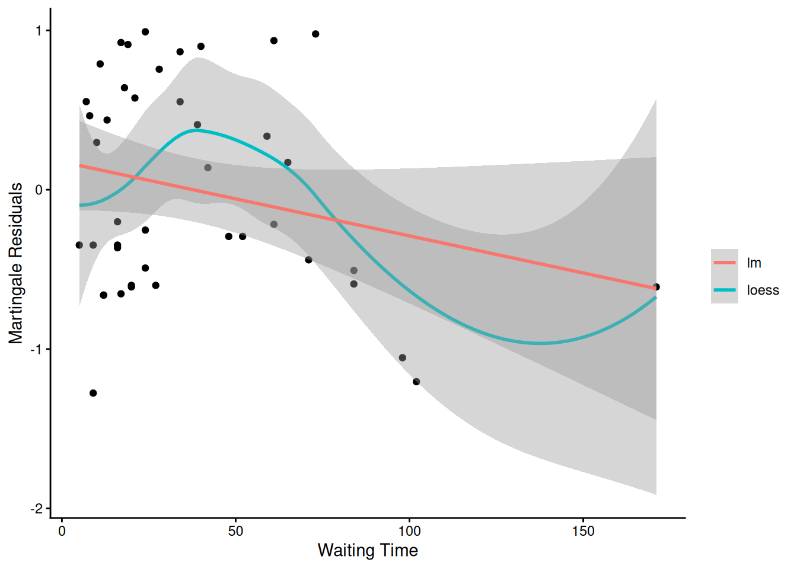](proportional-hazards-models_files/figure-html/unnamed-chunk-19-1.png "Martingale Residuals vs. Waiting Time")

Martingale Residuals vs. Waiting Time

The line could suggest a step function. To see where the drop is, we can look at the largest waiting times and the associated martingale residual.

The martingale residuals are all negative for `wtime` \>83 and positive for the next smallest value. A reasonable cut-point is 80 days.

#### Updating the model

Let’s reformulate the model with dichotomized `wtime`.

Show R code

``` downlit
hodg2 <-
  hodg2 |>
  mutate(
    wt2 = cut(
      wtime, c(0, 80, 200),
      labels = c("short", "long")
    )
  )

hodg_cox2 <-
  coxph(
    formula = Surv(time, event = delta == "dead") ~
      gtype * dtype + score + wt2,
    data = hodg2
  )
```

Show R code

``` downlit
hodg_cox1 |> drop1(test = "Chisq")
```

Model summary table with waiting time on continuous scale

Show R code

``` downlit
hodg_cox2 |> drop1(test = "Chisq")
```

Model summary table with dichotomized waiting time

The new model has better (lower) [AIC](../chapters/Linear-models-overview.llms.md#def-aic).

## 7.7 Checking for Outliers and Influential Observations

We will check for outliers using the [deviance residuals](#def-deviance-residual). The martingale residuals show excess events or the opposite, but highly skewed, with the maximum possible value being 1, but the smallest value can be very large negative. Martingale residuals can detect unexpectedly long-lived patients, but patients who die unexpectedly early show up only in the deviance residual. Influence will be examined using [dfbeta](#def-dfbeta) in a similar way to [linear regression](../chapters/Linear-models-overview.llms.md#def-lm-general-form), [logistic regression](../chapters/logistic-regression.llms.md#def-logistic-regression), or Poisson regression.

### 7.7.1 Deviance Residuals

> **NOTE:**
>
> **Definition 24 (Deviance Residual)** The **deviance residual** for subject $i$ is defined as [\[3, Sec. 11.3\]](#ref-klein2003survival):
>
> $$\begin{aligned}
> r_i^D &= {\operatorname{sign}\mathopen{}\left\{r_i^M\right\}\mathclose{}}\sqrt{-2\mathopen{}\left[r_i^M+\delta_i{\ln\mathopen{}\left(\delta_i-r_i^M\right)\mathclose{}}\right]\mathclose{}}\\
>       &= {\operatorname{sign}\mathopen{}\left\{r_i^M\right\}\mathclose{}}\sqrt{-2\mathopen{}\left[r_i^M+\delta_i{\ln\mathopen{}\left(r_i^{CS}\right)\mathclose{}}\right]\mathclose{}}
> \end{aligned}$$
>
> where ${\operatorname{sign}\mathopen{}\left\{\cdot\right\}\mathclose{}}$ is the sign function, $r_i^M$ is the martingale residual ([Definition 23](#def-martingale-residual)), and $r_i^{CS}$ is the Cox-Snell residual ([Definition 22](#def-CS-resid)).

Deviance residuals are roughly centered on 0 with approximate [standard deviation](https://morrison-lab.github.io/pds/variance-covariance.html#def-sd) 1. By symmetrizing the skewed martingale residuals, they make it equally easy to identify unexpectedly early events (large positive $r^D_i$) and unexpectedly long survival (large negative $r^D_i$).

### 7.7.2 Computing residuals

Show R code

``` downlit
hodg_mart <- residuals(hodg_cox2, type = "martingale")
hodg_dev <- residuals(hodg_cox2, type = "deviance")
hodg_dfb <- residuals(hodg_cox2, type = "dfbeta")
hodg_preds <- predict(hodg_cox2) # linear predictor
```

Show R code

``` downlit
data.frame(lp = hodg_preds, martingale = hodg_mart) |>
  ggplot(aes(x = lp, y = martingale)) +
  geom_point() +
  geom_hline(yintercept = 0, linetype = "dashed") +
  theme_bw() +
  xlab("Linear Predictor") +
  ylab("Martingale Residual")
```

> **NOTE:**
>
> [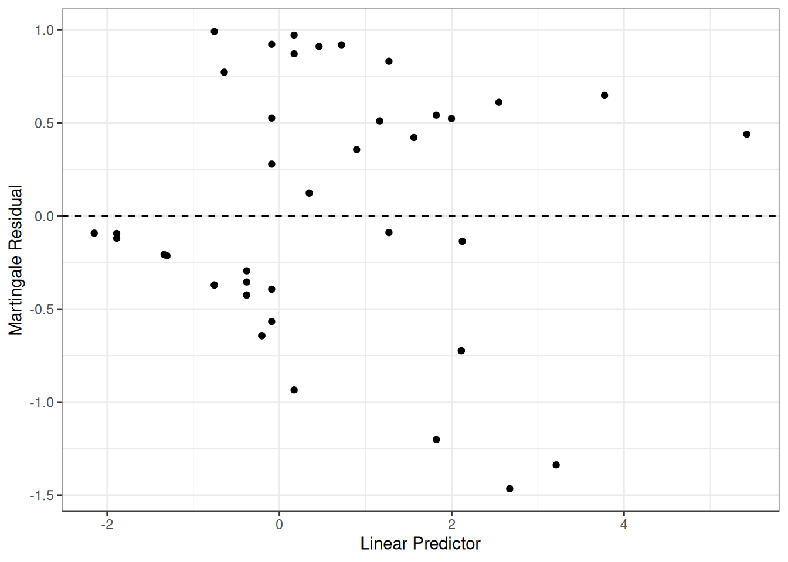](proportional-hazards-models_files/figure-html/fig-martingale-lp-1.png "Figure 12: Martingale Residuals vs. Linear Predictor")
>
> Figure 12: Martingale Residuals vs. Linear Predictor

The smallest three martingale residuals in order are observations 1, 29, and 18.

Show R code

``` downlit
data.frame(lp = hodg_preds, deviance = hodg_dev) |>
  ggplot(aes(x = lp, y = deviance)) +
  geom_point() +
  geom_hline(yintercept = 0, linetype = "dashed") +
  theme_bw() +
  xlab("Linear Predictor") +
  ylab("Deviance Residual")
```

> **NOTE:**
>
> [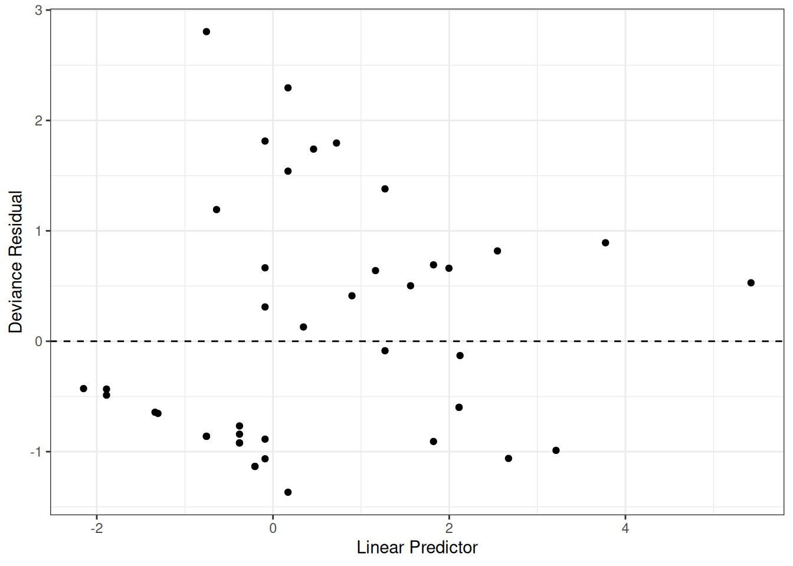](proportional-hazards-models_files/figure-html/fig-deviance-lp-1.png "Figure 13: Deviance Residuals vs. Linear Predictor")
>
> Figure 13: Deviance Residuals vs. Linear Predictor

The two largest deviance residuals are observations 1 and 29. Worth examining.

### 7.7.3 dfbeta

> **NOTE:**
>
> **Definition 25 (dfbeta)** The **dfbeta** for observation $i$ is the approximate change in the coefficient vector $\hat{\mathord{\smash[b]{\underset{\raise.3ex\hbox{$\scriptstyle\sim$}}{\beta}}\vphantom{\beta}}}$ if subject $i$ were removed from the data: $$\text{dfbeta}_i \approx \hat{\mathord{\smash[b]{\underset{\raise.3ex\hbox{$\scriptstyle\sim$}}{\beta}}\vphantom{\beta}}}- \hat{\mathord{\smash[b]{\underset{\raise.3ex\hbox{$\scriptstyle\sim$}}{\beta}}\vphantom{\beta}}}_{(-i)}$$ computed via a one-step [Newton](https://morrison-lab.github.io/sds/intro-MLEs.html#def-newton-raphson) approximation rather than a full refit [\[3, Sec. 11.4\]](#ref-klein2003survival).

> **NOTE:**
>
> **Definition 26 (dfbetas)** The **dfbetas** for observation $i$ standardizes the dfbeta ([Definition 25](#def-dfbeta)) by the estimated [standard error](https://morrison-lab.github.io/sds/estimation.html#def-SE) of each coefficient: $$\text{dfbetas}_{ik} = \text{dfbeta}_{ik} / {\mathop{\widehat{\operatorname{se}}}\nolimits\mathopen{}\left(\hat{\beta}_k\right)\mathclose{}}$$

A useful rule of thumb is to examine the observations whose dfbeta values stand out from the rest — those whose removal would shift a coefficient the most — analogous to influence diagnostics such as [Cook’s distance](../chapters/Linear-models-overview.llms.md#def-cooks-distance) in linear regression.

#### Graft type

Show R code

``` downlit
data.frame(obs = seq_len(nrow(hodg_dfb)), dfbeta = hodg_dfb[, 1]) |>
  ggplot(aes(x = obs, y = dfbeta)) +
  geom_point() +
  geom_hline(yintercept = 0, linetype = "dashed") +
  theme_bw() +
  xlab("Observation Index") +
  ylab("dfbeta for Graft Type")
```

> **NOTE:**
>
> [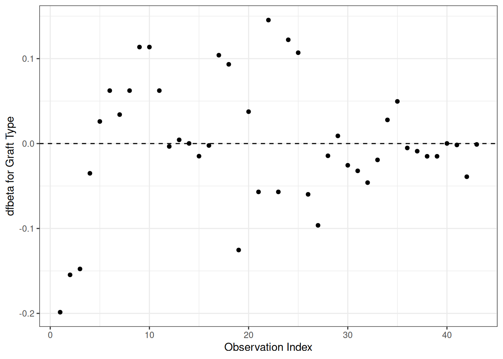](proportional-hazards-models_files/figure-html/fig-dfbeta-gtype-1.png "Figure 14: dfbeta Values by Observation Order for Graft Type")
>
> Figure 14: dfbeta Values by Observation Order for Graft Type

The smallest dfbeta for graft type is observation 1.

#### Disease type

Show R code

``` downlit
data.frame(obs = seq_len(nrow(hodg_dfb)), dfbeta = hodg_dfb[, 2]) |>
  ggplot(aes(x = obs, y = dfbeta)) +
  geom_point() +
  geom_hline(yintercept = 0, linetype = "dashed") +
  theme_bw() +
  xlab("Observation Index") +
  ylab("dfbeta for Disease Type")
```

> **NOTE:**
>
> [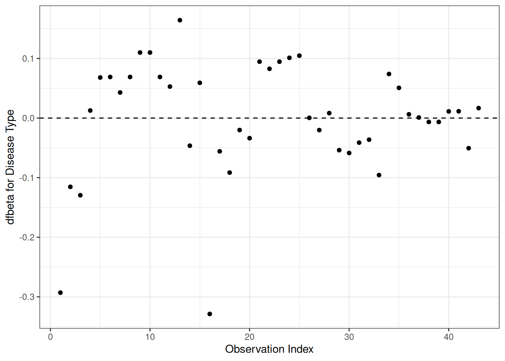](proportional-hazards-models_files/figure-html/fig-dfbeta-dtype-1.png "Figure 15: dfbeta Values by Observation Order for Disease Type")
>
> Figure 15: dfbeta Values by Observation Order for Disease Type

The smallest two dfbeta values for disease type are observations 1 and 16.

#### Karnofsky score

Show R code

``` downlit
data.frame(obs = seq_len(nrow(hodg_dfb)), dfbeta = hodg_dfb[, 3]) |>
  ggplot(aes(x = obs, y = dfbeta)) +
  geom_point() +
  geom_hline(yintercept = 0, linetype = "dashed") +
  theme_bw() +
  xlab("Observation Index") +
  ylab("dfbeta for Karnofsky Score")
```

> **NOTE:**
>
> [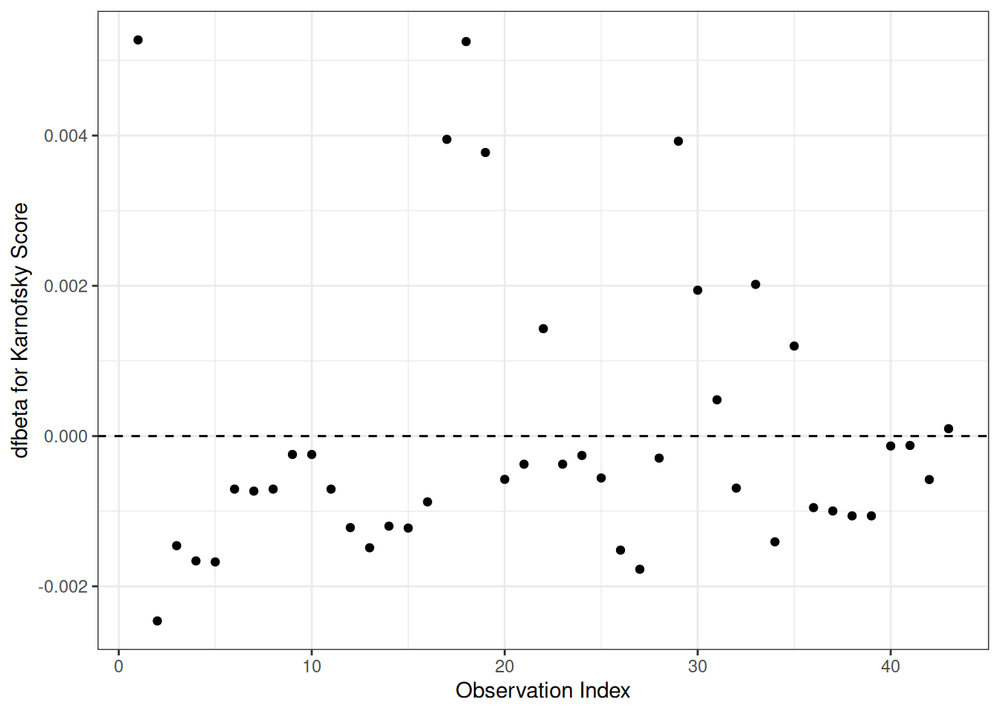](proportional-hazards-models_files/figure-html/fig-dfbeta-score-1.png "Figure 16: dfbeta Values by Observation Order for Karnofsky Score")
>
> Figure 16: dfbeta Values by Observation Order for Karnofsky Score

The two highest dfbeta values for score are observations 1 and 18. The next three are observations 17, 29, and 19. The smallest value is observation 2.

#### Waiting time (dichotomized)

Show R code

``` downlit
data.frame(obs = seq_len(nrow(hodg_dfb)), dfbeta = hodg_dfb[, 4]) |>
  ggplot(aes(x = obs, y = dfbeta)) +
  geom_point() +
  geom_hline(yintercept = 0, linetype = "dashed") +
  theme_bw() +
  xlab("Observation Index") +
  ylab("dfbeta for Waiting Time < 80")
```

> **NOTE:**
>
> [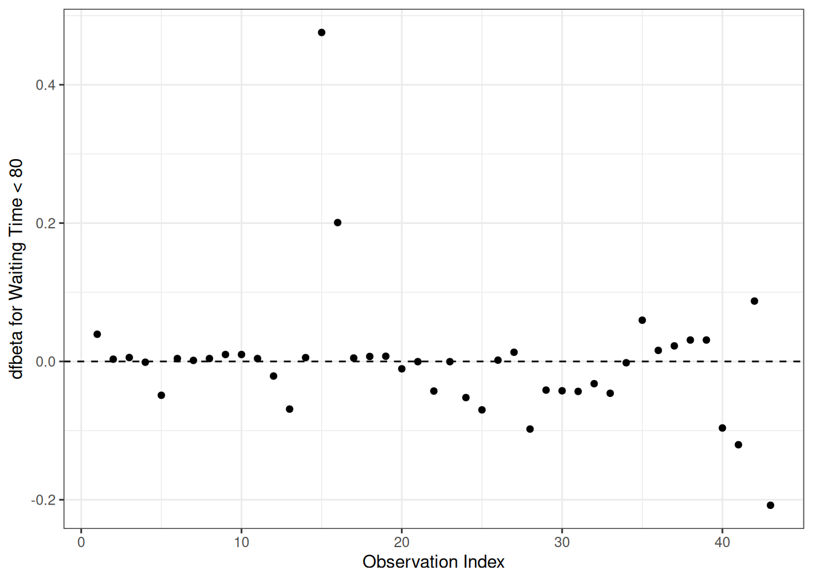](proportional-hazards-models_files/figure-html/fig-dfbeta-wt2-1.png "Figure 17: dfbeta Values by Observation Order for Waiting Time (dichotomized)")
>
> Figure 17: dfbeta Values by Observation Order for Waiting Time (dichotomized)

The two large values of dfbeta for dichotomized waiting time are observations 15 and 16. This behavior may have to do with the discretization of waiting time.

#### Interaction: graft type and disease type

Show R code

``` downlit
data.frame(obs = seq_len(nrow(hodg_dfb)), dfbeta = hodg_dfb[, 5]) |>
  ggplot(aes(x = obs, y = dfbeta)) +
  geom_point() +
  geom_hline(yintercept = 0, linetype = "dashed") +
  theme_bw() +
  xlab("Observation Index") +
  ylab("dfbeta for dtype:gtype")
```

> **NOTE:**
>
> [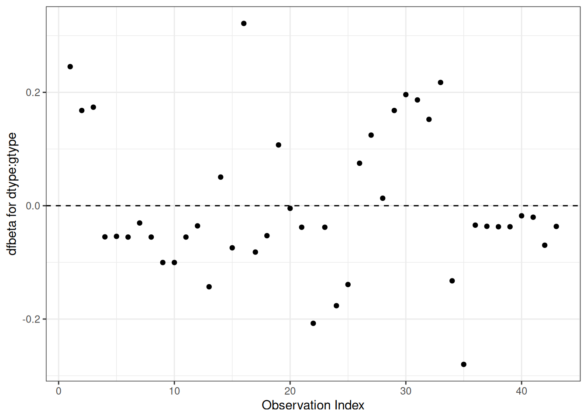](proportional-hazards-models_files/figure-html/fig-dfbeta-interaction-1.png "Figure 18: dfbeta Values by Observation Order for dtype:gtype")
>
> Figure 18: dfbeta Values by Observation Order for dtype:gtype

The two largest values are observations 1 and 16. The smallest value is observation 35.

> **NOTE:**
>
> | Diagnostic                 | Observations to Examine |
> |----------------------------|-------------------------|
> | Martingale Residuals       | 1, 29, 18               |
> | Deviance Residuals         | 1, 29                   |
> | Graft Type Influence       | 1                       |
> | Disease Type Influence     | 1, 16                   |
> | Karnofsky Score Influence  | 1, 18 (17, 29, 19)      |
> | Waiting Time Influence     | 15, 16                  |
> | Graft by Disease Influence | 1, 16, 35               |
>
> Table 2: Observations to Examine by Residuals and Influence

The most important observations to examine seem to be 1, 15, 16, 18, and 29.

### 7.7.4 Examining influential observations

Show R code

``` downlit
with(hodg, summary(time[delta == 1]))
#>    Min. 1st Qu.  Median    Mean 3rd Qu.    Max. 
#>     2.0    41.2    62.5    97.6    83.2   524.0
```

Show R code

``` downlit
with(hodg, summary(wtime))
#>    Min. 1st Qu.  Median    Mean 3rd Qu.    Max. 
#>     5.0    16.0    24.0    37.7    55.5   171.0
```

Show R code

``` downlit
with(hodg, summary(score))
#>    Min. 1st Qu.  Median    Mean 3rd Qu.    Max. 
#>    20.0    60.0    80.0    76.3    90.0   100.0
```

Show R code

``` downlit
hodg_cox2
#> Call:
#> coxph(formula = Surv(time, event = delta == "dead") ~ gtype * 
#>     dtype + score + wt2, data = hodg2)
#> 
#>                                  coef exp(coef) se(coef)     z       p
#> gtypeAutologous                0.6651    1.9447   0.5943  1.12  0.2631
#> dtypeHodgkins                  2.3273   10.2505   0.7332  3.17  0.0015
#> score                         -0.0550    0.9464   0.0123 -4.46 8.2e-06
#> wt2long                       -2.0598    0.1275   1.0507 -1.96  0.0499
#> gtypeAutologous:dtypeHodgkins -2.0668    0.1266   0.9258 -2.23  0.0256
#> 
#> Likelihood ratio test=35.5  on 5 df, p=1.21e-06
#> n= 43, number of events= 26
```

Show R code

``` downlit
hodg2[c(1, 15, 16, 18, 29), ] |>
  select(gtype, dtype, time, delta, score, wtime) |>
  mutate(
    comment =
      c(
        "early death, good score, low risk",
        "high risk grp, long wait, poor score",
        "high risk grp, short wait, poor score",
        "early death, good score, med risk grp",
        "early death, good score, med risk grp"
      )
  )
```

### 7.7.5 Action Items

- Unusual points may need checking, particularly if the data are not completely cleaned. In this case, observations 15 and 16 may show some trouble with the dichotomization of waiting time, but it still may be useful.
- The two largest residuals seem to be due to unexpectedly early deaths, but unfortunately this phenomenon can occur.
- If hazards don’t look [proportional](#def-pha), then we may need to use strata, between which the [base hazards](#def-base-hazard) are permitted to be different. For this problem, the natural strata are the two diseases, because they could need to be managed differently anyway.
- A main point that we want to be sure of is the relative risk difference by disease type and graft type.

Show R code

``` downlit
library(pander)
hodg_cox2 |>
  predict(
    reference = "zero",
    newdata = means |>
      mutate(
        wt2 = "short",
        score = 0
      ),
    type = "lp"
  ) |>
  data.frame("linear predictor" = _) |>
  pander()
```

|                         | linear.predictor |
|:-----------------------:|:----------------:|
| Non-Hodgkins,Allogenic  |        0         |
| Non-Hodgkins,Autologous |      0.6651      |
|   Hodgkins,Allogenic    |      2.327       |
|   Hodgkins,Autologous   |      0.9256      |

Linear Risk Predictors for Lymphoma {.caption-top .table .table-sm .table-striped .small}

For Non-Hodgkin’s, the allogenic graft is better. For Hodgkin’s, the autologous graft is much better.

## 7.8 Addressing Diagnostic Issues Through Model Modification

The diagnostic tests and plots reveal two key concerns:

1.  **Non-proportionality** of the `gtype:dtype` interaction and `score`, flagged by `cox.zph` on the original model `hodg_cox1`.
2.  **Influential observations** (from the `hodg_cox2` dfbeta diagnostics): subjects 1, 15, 16, 18, and 29 have large dfbeta values for specific coefficients.

This section illustrates how to address the non-proportionality finding and verifies that the revision actually helps.

### 7.8.1 Checking PH for `hodg_cox2`

Let’s verify whether non-proportionality persists in `hodg_cox2` (which already dichotomized `wtime`):

Show R code

``` downlit
hodg_cox2_zph <- cox.zph(hodg_cox2)
print(hodg_cox2_zph)
#>                chisq df     p
#> gtype        0.75420  1 0.385
#> dtype        1.61479  1 0.204
#> score        3.49389  1 0.062
#> wt2          0.00638  1 0.936
#> gtype:dtype  3.56165  1 0.059
#> GLOBAL      13.01172  5 0.023
```

Show R code

``` downlit
ggcoxzph(hodg_cox2_zph)
```

> **NOTE:**
>
> [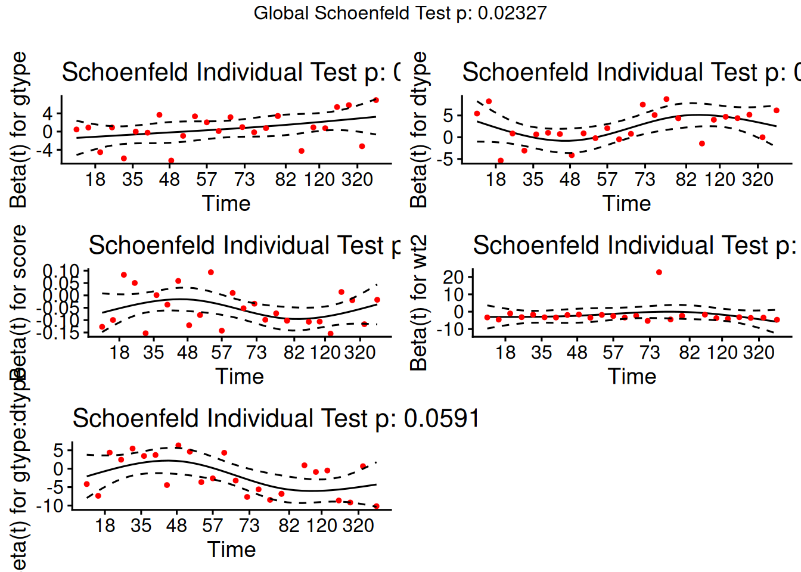](proportional-hazards-models_files/figure-html/fig-zph-hodg-cox2-1.png "Figure 19: Scaled Schoenfeld residuals for hodg_cox2")
>
> Figure 19: Scaled Schoenfeld residuals for hodg_cox2

### 7.8.2 Strategy: stratify by disease type

The diagnostics suggest that the [hazard-ratio](../chapters/intro-to-survival-analysis.llms.md#def-hazard-ratio) profile for disease type (and its interaction with graft type) is not constant over time. One remedy is a **stratified Cox model** that allows separate [baseline hazards](#def-base-hazard) for each disease type, absorbing between-disease trajectory differences into two free baseline functions, while still estimating proportional effects of graft type, Karnofsky score, and waiting time.

Show R code

``` downlit
hodg_cox3 <- coxph(
  formula = surv ~ gtype + score + wt2 + strata(dtype),
  data = hodg2
)
summary(hodg_cox3)
#> Call:
#> coxph(formula = surv ~ gtype + score + wt2 + strata(dtype), data = hodg2)
#> 
#>   n= 43, number of events= 26 
#> 
#>                    coef exp(coef) se(coef)     z Pr(>|z|)    
#> gtypeAutologous  0.0660    1.0683   0.4631  0.14     0.89    
#> score           -0.0569    0.9447   0.0125 -4.55  5.4e-06 ***
#> wt2long         -1.5150    0.2198   1.0422 -1.45     0.15    
#> ---
#> Signif. codes:  0 '***' 0.001 '**' 0.01 '*' 0.05 '.' 0.1 ' ' 1
#> 
#>                 exp(coef) exp(-coef) lower .95 upper .95
#> gtypeAutologous     1.068      0.936    0.4310     2.647
#> score               0.945      1.059    0.9218     0.968
#> wt2long             0.220      4.549    0.0285     1.695
#> 
#> Concordance= 0.77  (se = 0.056 )
#> Likelihood ratio test= 27.9  on 3 df,   p=4e-06
#> Wald test            = 23.6  on 3 df,   p=3e-05
#> Score (logrank) test = 32.4  on 3 df,   p=4e-07
```

### 7.8.3 Verifying the fix: `cox.zph` on the stratified model

Show R code

``` downlit
hodg_cox3_zph <- cox.zph(hodg_cox3)
print(hodg_cox3_zph)
#>        chisq df     p
#> gtype  4.921  1 0.027
#> score  1.307  1 0.253
#> wt2    0.132  1 0.717
#> GLOBAL 8.230  3 0.041
```

Show R code

``` downlit
ggcoxzph(hodg_cox3_zph)
```

> **NOTE:**
>
> [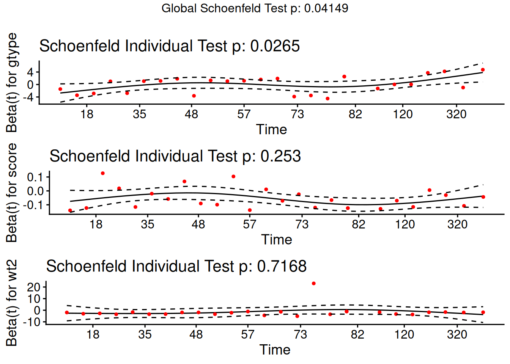](proportional-hazards-models_files/figure-html/fig-zph-hodg-cox3-1.png "Figure 20: Scaled Schoenfeld residuals for stratified model hodg_cox3")
>
> Figure 20: Scaled Schoenfeld residuals for stratified model hodg_cox3

Stratifying by disease type removes the between-disease baseline difference from the proportional-hazards stratum, so the remaining terms should satisfy PH more closely.

### 7.8.4 Verifying the fix: residual diagnostics

Show R code

``` downlit
hodg3_dev <- residuals(hodg_cox3, type = "deviance")
hodg3_dfb <- residuals(hodg_cox3, type = "dfbeta")
hodg3_lp  <- predict(hodg_cox3)
```

Show R code

``` downlit
data.frame(lp = hodg3_lp, deviance = hodg3_dev) |>
  ggplot(aes(x = lp, y = deviance)) +
  geom_point() +
  geom_hline(yintercept = 0, linetype = "dashed") +
  theme_bw() +
  xlab("Linear Predictor") +
  ylab("Deviance Residual")
```

> **NOTE:**
>
> [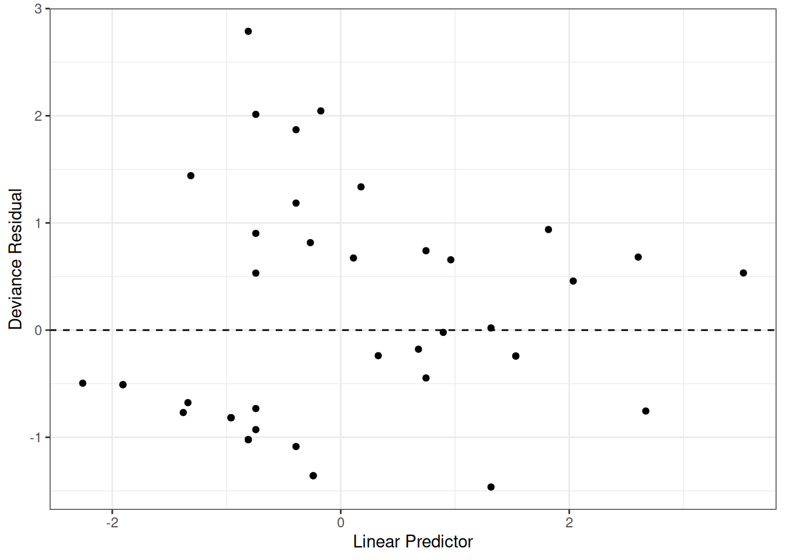](proportional-hazards-models_files/figure-html/fig-deviance-hodg3-1.png "Figure 21: Deviance residuals vs. linear predictor, hodg_cox3")
>
> Figure 21: Deviance residuals vs. linear predictor, `hodg_cox3`

Show R code

``` downlit
hodg3_dfb_mat <- as.matrix(hodg3_dfb)
colnames(hodg3_dfb_mat) <- names(coef(hodg_cox3))
data.frame(
  obs = rep(seq_len(nrow(hodg3_dfb_mat)), times = ncol(hodg3_dfb_mat)),
  coefficient = rep(colnames(hodg3_dfb_mat), each = nrow(hodg3_dfb_mat)),
  dfbeta = as.vector(hodg3_dfb_mat)
) |>
  ggplot(aes(x = obs, y = dfbeta)) +
  geom_point() +
  geom_hline(yintercept = 0, linetype = "dashed") +
  facet_wrap(~coefficient, scales = "free_y") +
  theme_bw() +
  xlab("Observation Index") +
  ylab("dfbeta")
```

> **NOTE:**
>
> [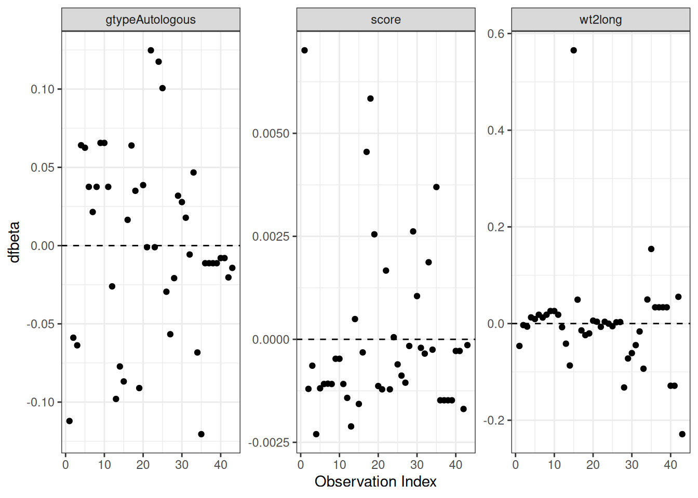](proportional-hazards-models_files/figure-html/fig-dfbeta-hodg3-1.png "Figure 22: dfbeta values for stratified model hodg_cox3")
>
> Figure 22: dfbeta values for stratified model hodg_cox3

Comparing these panels with the subjects flagged earlier from the `hodg_cox2` diagnostics (1, 15, 16, 18, and 29): subjects 1 and 18 remain the most influential observations for the Karnofsky `score` coefficient, and subject 15 is still the most influential for dichotomized waiting time, so stratifying by disease type did not neutralize their leverage on the terms that remain in the model. Subject 16, by contrast, is no longer prominent: its earlier influence acted largely through the graft-by-disease-type interaction, which the stratified model absorbs into the disease-specific baseline hazards.

### 7.8.5 Comparing models

Show R code

``` downlit
data.frame(
  Model = c(
    "hodg_cox2: gtype*dtype + score + wt2",
    "hodg_cox3: gtype + score + wt2 + strata(dtype)"
  ),
  Parameters = c(length(coef(hodg_cox2)), length(coef(hodg_cox3)))
) |>
  knitr::kable(digits = 2)
```

> **NOTE:**
>
> | Model                                          | Parameters |
> |:-----------------------------------------------|-----------:|
> | hodg_cox2: gtype\*dtype + score + wt2          |          5 |
> | hodg_cox3: gtype + score + wt2 + strata(dtype) |          3 |
>
> Table 3: Comparison of unstratified and stratified Cox PH models

We deliberately omit [log-likelihood](https://morrison-lab.github.io/sds/intro-MLEs.html#def-loglik) and [AIC](../chapters/Linear-models-overview.llms.md#def-aic) from this comparison: the [partial likelihood](#def-ph-partial-lik) of the stratified model `hodg_cox3` is computed within disease-type strata and excludes the between-stratum comparisons that `hodg_cox2`’s partial likelihood includes, so the two are not on a common scale and their AIC values are not comparable.

The stratified model resolves the PH violation by allowing disease-specific baseline hazards. The trade-off: we can no longer directly estimate a disease-type hazard ratio, as that effect is absorbed into the baseline functions. The graft-type coefficient remains interpretable as the within-stratum hazard ratio comparing autologous to allogeneic grafts.

## 7.9 Stratified survival models

> **TIP:**
>
> David Rocke’s Epi 204 lecture [*Stratified Cox Models*](https://dmrocke.ucdavis.edu/Class/EPI204-Spring-2021/EPI204-2021-05-18.mp4) ([slides](https://dmrocke.ucdavis.edu/Class/EPI204-Spring-2021/Lecture13StratifiedCoxModels.pdf)) covers the stratified Cox model for the `anderson` leukemia data, where the [proportional hazards assumption](#def-pha) fails for sex [\[1\]](#ref-rocke2021epi204).

### 7.9.1 Revisiting the leukemia dataset (`anderson`)

We will analyze remission survival times on 42 leukemia patients, half on new treatment, half on standard treatment.

This dataset is the same data as the `drug6mp` data from `KMsurv`, but with two other variables and without the pairing. This version comes from Kleinbaum and Klein [\[7\]](#ref-kleinbaum2012survival) (e.g., p281):

Show R code

``` downlit
anderson <-
  paste0(
    "http://web1.sph.emory.edu/dkleinb/allDatasets/",
    "surv2datasets/anderson.dta"
  ) |>
  haven::read_dta() |>
  dplyr::mutate(
    status = status |>
      case_match(
        1 ~ "relapse",
        0 ~ "censored"
      ),
    sex = sex |>
      case_match(
        0 ~ "female",
        1 ~ "male"
      ) |>
      factor() |>
      relevel(ref = "female"),
    rx = rx |>
      case_match(
        0 ~ "new",
        1 ~ "standard"
      ) |>
      factor() |>
      relevel(ref = "standard"),
    surv = Surv(
      time = survt,
      event = (status == "relapse")
    )
  )

print(anderson)
```

### 7.9.2 Cox semi-parametric proportional hazards model

Show R code

``` downlit
anderson_cox1 <- coxph(
  formula = surv ~ rx + sex + logwbc,
  data = anderson
)

summary(anderson_cox1)
#> Call:
#> coxph(formula = surv ~ rx + sex + logwbc, data = anderson)
#> 
#>   n= 42, number of events= 30 
#> 
#>           coef exp(coef) se(coef)     z Pr(>|z|)    
#> rxnew   -1.504     0.222    0.462 -3.26   0.0011 ** 
#> sexmale  0.315     1.370    0.455  0.69   0.4887    
#> logwbc   1.682     5.376    0.337  5.00  5.8e-07 ***
#> ---
#> Signif. codes:  0 '***' 0.001 '**' 0.01 '*' 0.05 '.' 0.1 ' ' 1
#> 
#>         exp(coef) exp(-coef) lower .95 upper .95
#> rxnew       0.222      4.498     0.090     0.549
#> sexmale     1.370      0.730     0.562     3.338
#> logwbc      5.376      0.186     2.779    10.398
#> 
#> Concordance= 0.851  (se = 0.041 )
#> Likelihood ratio test= 47.2  on 3 df,   p=3e-10
#> Wald test            = 33.5  on 3 df,   p=2e-07
#> Score (logrank) test = 48  on 3 df,   p=2e-10
```

#### Test the proportional hazards assumption

Show R code

``` downlit
cox.zph(anderson_cox1)
#>        chisq df    p
#> rx     0.036  1 0.85
#> sex    5.420  1 0.02
#> logwbc 0.142  1 0.71
#> GLOBAL 5.879  3 0.12
```

#### Graph the K-M survival curves

Show R code

``` downlit
anderson_km_model <- survfit(
  formula = surv ~ sex,
  data = anderson
)

anderson_km_model |>
  autoplot(conf.int = FALSE) +
  theme_bw() +
  theme(legend.position = "bottom")
```

[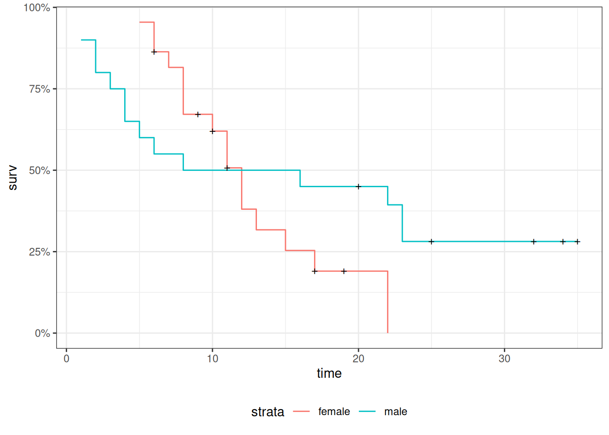](proportional-hazards-models_files/figure-html/unnamed-chunk-34-1.png)

The survival curves cross, which indicates a problem in the proportionality assumption by sex.

### 7.9.3 Graph the Nelson-Aalen cumulative hazard

We can also look at the log-hazard (“cloglog survival”) plots:

Show R code

``` downlit
anderson_na_model <- survfit(
  formula = surv ~ sex,
  data = anderson,
  type = "fleming"
)

anderson_na_model |>
  autoplot(
    fun = "cumhaz",
    conf.int = FALSE
  ) +
  theme_classic() +
  theme(legend.position = "bottom") +
  ylab("log(Cumulative Hazard)") +
  scale_y_continuous(
    trans = "log10",
    name = "Cumulative hazard (H(t), log scale)"
  ) +
  scale_x_continuous(
    breaks = c(1, 2, 5, 10, 20, 50),
    trans = "log"
  )
```

> **NOTE:**
>
> [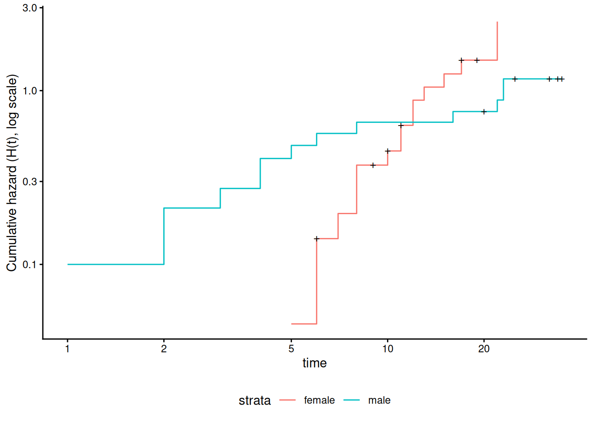](proportional-hazards-models_files/figure-html/fig-cuhaz-anderson-1.png "Figure 23: Cumulative hazard (cloglog scale) for anderson data")
>
> Figure 23: Cumulative hazard (cloglog scale) for `anderson` data

This issue can be fixed by using strata or possibly by other model alterations.

### 7.9.4 The Stratified Cox Model

- In a stratified Cox model, each stratum, defined by one or more factors, has its own [base survival function](#def-baseline-surv) ${\lambda}_0(t)$.
- But the coefficients for each variable not used in the strata definitions are assumed to be the same across strata.
- To check if this assumption is reasonable one can include interactions with strata and see if they are [significant](https://morrison-lab.github.io/sds/inference.html#def-statistically-significant) (this specification may generate a warning and NA lines, but these warnings and NA lines can be ignored).
- Since the `sex` variable shows possible non-proportionality, we try stratifying on `sex`.

Show R code

``` downlit
anderson_coxph_strat <-
  coxph(
    formula = surv ~ rx + logwbc + strata(sex),
    data = anderson
  )

summary(anderson_coxph_strat)
#> Call:
#> coxph(formula = surv ~ rx + logwbc + strata(sex), data = anderson)
#> 
#>   n= 42, number of events= 30 
#> 
#>          coef exp(coef) se(coef)     z Pr(>|z|)    
#> rxnew  -0.998     0.369    0.474 -2.11    0.035 *  
#> logwbc  1.454     4.279    0.344  4.22  2.4e-05 ***
#> ---
#> Signif. codes:  0 '***' 0.001 '**' 0.01 '*' 0.05 '.' 0.1 ' ' 1
#> 
#>        exp(coef) exp(-coef) lower .95 upper .95
#> rxnew      0.369      2.713     0.146     0.932
#> logwbc     4.279      0.234     2.180     8.398
#> 
#> Concordance= 0.812  (se = 0.059 )
#> Likelihood ratio test= 32.1  on 2 df,   p=1e-07
#> Wald test            = 22.8  on 2 df,   p=1e-05
#> Score (logrank) test = 30.8  on 2 df,   p=2e-07
```

Let’s compare this to a model fit only on the subset of males:

Show R code

``` downlit
anderson_coxph_male <-
  coxph(
    formula = surv ~ rx + logwbc,
    subset = sex == "male",
    data = anderson
  )

summary(anderson_coxph_male)
#> Call:
#> coxph(formula = surv ~ rx + logwbc, data = anderson, subset = sex == 
#>     "male")
#> 
#>   n= 20, number of events= 14 
#> 
#>          coef exp(coef) se(coef)     z Pr(>|z|)   
#> rxnew  -1.978     0.138    0.739 -2.68   0.0075 **
#> logwbc  1.743     5.713    0.536  3.25   0.0011 **
#> ---
#> Signif. codes:  0 '***' 0.001 '**' 0.01 '*' 0.05 '.' 0.1 ' ' 1
#> 
#>        exp(coef) exp(-coef) lower .95 upper .95
#> rxnew      0.138      7.227    0.0325     0.589
#> logwbc     5.713      0.175    1.9991    16.328
#> 
#> Concordance= 0.905  (se = 0.043 )
#> Likelihood ratio test= 29.2  on 2 df,   p=5e-07
#> Wald test            = 15.3  on 2 df,   p=5e-04
#> Score (logrank) test = 26.4  on 2 df,   p=2e-06
```

Show R code

``` downlit
anderson_coxph_female <-
  coxph(
    formula = surv ~ rx + logwbc,
    subset = sex == "female",
    data = anderson
  )

summary(anderson_coxph_female)
#> Call:
#> coxph(formula = surv ~ rx + logwbc, data = anderson, subset = sex == 
#>     "female")
#> 
#>   n= 22, number of events= 16 
#> 
#>          coef exp(coef) se(coef)     z Pr(>|z|)  
#> rxnew  -0.311     0.733    0.564 -0.55    0.581  
#> logwbc  1.206     3.341    0.503  2.40    0.017 *
#> ---
#> Signif. codes:  0 '***' 0.001 '**' 0.01 '*' 0.05 '.' 0.1 ' ' 1
#> 
#>        exp(coef) exp(-coef) lower .95 upper .95
#> rxnew      0.733      1.365     0.243      2.21
#> logwbc     3.341      0.299     1.245      8.96
#> 
#> Concordance= 0.692  (se = 0.085 )
#> Likelihood ratio test= 6.65  on 2 df,   p=0.04
#> Wald test            = 6.36  on 2 df,   p=0.04
#> Score (logrank) test = 6.74  on 2 df,   p=0.03
```

The coefficients of treatment look different. Are they statistically different?

Show R code

``` downlit
anderson_coxph_strat_intxn <-
  coxph(
    formula = surv ~ strata(sex) * (rx + logwbc),
    data = anderson
  )

anderson_coxph_strat_intxn |> summary()
#> Call:
#> coxph(formula = surv ~ strata(sex) * (rx + logwbc), data = anderson)
#> 
#>   n= 42, number of events= 30 
#> 
#>                          coef exp(coef) se(coef)     z Pr(>|z|)  
#> rxnew                  -0.311     0.733    0.564 -0.55    0.581  
#> logwbc                  1.206     3.341    0.503  2.40    0.017 *
#> strata(sex)male:rxnew  -1.667     0.189    0.930 -1.79    0.073 .
#> strata(sex)male:logwbc  0.537     1.710    0.735  0.73    0.465  
#> ---
#> Signif. codes:  0 '***' 0.001 '**' 0.01 '*' 0.05 '.' 0.1 ' ' 1
#> 
#>                        exp(coef) exp(-coef) lower .95 upper .95
#> rxnew                      0.733      1.365    0.2427      2.21
#> logwbc                     3.341      0.299    1.2452      8.96
#> strata(sex)male:rxnew      0.189      5.294    0.0305      1.17
#> strata(sex)male:logwbc     1.710      0.585    0.4048      7.23
#> 
#> Concordance= 0.797  (se = 0.058 )
#> Likelihood ratio test= 35.8  on 4 df,   p=3e-07
#> Wald test            = 21.7  on 4 df,   p=2e-04
#> Score (logrank) test = 33.1  on 4 df,   p=1e-06
```

Show R code

``` downlit
anova(
  anderson_coxph_strat_intxn,
  anderson_coxph_strat
)
```

We don’t have enough evidence to tell the difference between these two models.

### 7.9.5 Conclusions

- We chose to use a stratified model because of the apparent non-proportionality of the hazard for the sex variable.
- When we fit interactions with the strata variable, we did not get an improved model (via the [likelihood ratio test](../chapters/logistic-regression.llms.md#def-lrt)).
- So we use the stratifed model with coefficients that are the same across strata.

### 7.9.6 Another Modeling Approach

- We used an additive model without interactions and saw that we might need to stratify by sex.
- Instead, we could try to improve the model’s functional form - maybe the interaction of treatment and sex is real, and after fitting that we might not need separate [hazard functions](../chapters/intro-to-survival-analysis.llms.md#def-hazard).
- Either approach may work.

Show R code

``` downlit
anderson_coxph_intxn <-
  coxph(
    formula = surv ~ (rx + logwbc) * sex,
    data = anderson
  )

anderson_coxph_intxn |> summary()
#> Call:
#> coxph(formula = surv ~ (rx + logwbc) * sex, data = anderson)
#> 
#>   n= 42, number of events= 30 
#> 
#>                   coef exp(coef) se(coef)     z Pr(>|z|)  
#> rxnew          -0.3748    0.6874   0.5545 -0.68    0.499  
#> logwbc          1.0637    2.8971   0.4726  2.25    0.024 *
#> sexmale        -2.8052    0.0605   2.0323 -1.38    0.167  
#> rxnew:sexmale  -2.1782    0.1132   0.9109 -2.39    0.017 *
#> logwbc:sexmale  1.2303    3.4223   0.6301  1.95    0.051 .
#> ---
#> Signif. codes:  0 '***' 0.001 '**' 0.01 '*' 0.05 '.' 0.1 ' ' 1
#> 
#>                exp(coef) exp(-coef) lower .95 upper .95
#> rxnew             0.6874      1.455   0.23185     2.038
#> logwbc            2.8971      0.345   1.14730     7.315
#> sexmale           0.0605     16.531   0.00113     3.248
#> rxnew:sexmale     0.1132      8.830   0.01899     0.675
#> logwbc:sexmale    3.4223      0.292   0.99539    11.766
#> 
#> Concordance= 0.861  (se = 0.036 )
#> Likelihood ratio test= 57  on 5 df,   p=5e-11
#> Wald test            = 35.6  on 5 df,   p=1e-06
#> Score (logrank) test = 57.1  on 5 df,   p=5e-11
```

Show R code

``` downlit
cox.zph(anderson_coxph_intxn)
#>            chisq df    p
#> rx         0.136  1 0.71
#> logwbc     1.652  1 0.20
#> sex        1.266  1 0.26
#> rx:sex     0.149  1 0.70
#> logwbc:sex 0.102  1 0.75
#> GLOBAL     3.747  5 0.59
```

## 7.10 Time-varying covariates

> **TIP:**
>
> David Rocke’s Epi 204 lecture [*Time-Dependent Covariates and Multiple Events*](https://dmrocke.ucdavis.edu/Class/EPI204-Spring-2021/EPI204-2021-05-18.mp4) ([slides](https://dmrocke.ucdavis.edu/Class/EPI204-Spring-2021/Lecture14TimeDepVars.pdf)) covers time-dependent covariates in the `bmt` data with the counting-process formulation, and recurrent events in the bladder cancer data with robust variance estimates [\[1\]](#ref-rocke2021epi204).

(adapted from Klein and Moeschberger [\[3\]](#ref-klein2003survival), §9.2)

### 7.10.1 Motivating example: back to the leukemia dataset

``` downlit
# load the data:
data(bmt, package = "KMsurv")
bmt |>
  as_tibble() |>
  print(n = 5)
#> # A tibble: 137 × 22
#>   group    t1    t2    d1    d2    d3    ta    da    tc    dc    tp    dp    z1
#>   <int> <int> <int> <int> <int> <int> <int> <int> <int> <int> <int> <int> <int>
#> 1     1  2081  2081     0     0     0    67     1   121     1    13     1    26
#> 2     1  1602  1602     0     0     0  1602     0   139     1    18     1    21
#> 3     1  1496  1496     0     0     0  1496     0   307     1    12     1    26
#> 4     1  1462  1462     0     0     0    70     1    95     1    13     1    17
#> 5     1  1433  1433     0     0     0  1433     0   236     1    12     1    32
#> # ℹ 132 more rows
#> # ℹ 9 more variables: z2 <int>, z3 <int>, z4 <int>, z5 <int>, z6 <int>,
#> #   z7 <int>, z8 <int>, z9 <int>, z10 <int>
```

This dataset comes from the Copelan et al. [\[8\]](#ref-copelan1991treatment) study of allogenic bone marrow transplant therapy for acute myeloid leukemia (AML) and acute lymphoblastic leukemia (ALL).

#### Outcomes (endpoints)

- The main endpoint is disease-free survival (`t2` and `d3`) for the three risk groups, “ALL”, “AML Low Risk”, and “AML High Risk”.

#### Possible intermediate events

- graft vs. host disease (**GVHD**), an immunological rejection response to the transplant (bad)
- acute (**AGVHD**)
- chronic (**CGVHD**)
- platelet recovery, a return of platelet count to normal levels (good)

One or the other, both in either order, or neither may occur.

#### Covariates

- We are interested in possibly using the [covariates](../chapters/Intro-to-GLMs.llms.md#def-predictors) `z1`-`z10` to adjust for other factors.

- In addition, the time-varying covariates for acute GVHD, chronic GVHD, and platelet recovery may be useful.

#### Preprocessing

We reformat the data before analysis:

Show R code

``` downlit
# reformat the data:
bmt1 <-
  bmt |>
  as_tibble() |>
  mutate(
    # `id` will be used to connect multiple records for the same individual:
    id = dplyr::row_number(),

    group = group |>
      case_match(
        1 ~ "ALL",
        2 ~ "Low Risk AML",
        3 ~ "High Risk AML"
      ) |>
      factor(levels = c("ALL", "Low Risk AML", "High Risk AML")),
    `patient age` = z1,
    `donor age` = z2,
    `patient sex` = z3 |>
      case_match(
        0 ~ "Female",
        1 ~ "Male"
      ),
    `donor sex` = z4 |>
      case_match(
        0 ~ "Female",
        1 ~ "Male"
      ),
    `Patient CMV Status` = z5 |>
      case_match(
        0 ~ "CMV Negative",
        1 ~ "CMV Positive"
      ),
    `Donor CMV Status` = z6 |>
      case_match(
        0 ~ "CMV Negative",
        1 ~ "CMV Positive"
      ),
    `Waiting Time to Transplant` = z7,
    FAB = z8 |>
      case_match(
        1 ~ "Grade 4 Or 5 (AML only)",
        0 ~ "Other"
      ) |>
      factor() |>
      relevel(ref = "Other"),
    hospital = z9 |> # `z9` is hospital
      case_match(
        1 ~ "Ohio State University",
        2 ~ "Alferd",
        3 ~ "St. Vincent",
        4 ~ "Hahnemann"
      ) |>
      factor() |>
      relevel(ref = "Ohio State University"),
    MTX = (z10 == 1) # a prophylatic treatment for GVHD
  ) |>
  select(-(z1:z10)) # don't need these anymore

bmt1 |>
  select(group, id:MTX) |>
  print(n = 10)
#> # A tibble: 137 × 12
#>    group    id `patient age` `donor age` `patient sex` `donor sex`
#>    <fct> <int>         <int>       <int> <chr>         <chr>      
#>  1 ALL       1            26          33 Male          Female     
#>  2 ALL       2            21          37 Male          Male       
#>  3 ALL       3            26          35 Male          Male       
#>  4 ALL       4            17          21 Female        Male       
#>  5 ALL       5            32          36 Male          Male       
#>  6 ALL       6            22          31 Male          Male       
#>  7 ALL       7            20          17 Male          Female     
#>  8 ALL       8            22          24 Male          Female     
#>  9 ALL       9            18          21 Female        Male       
#> 10 ALL      10            24          40 Male          Male       
#> # ℹ 127 more rows
#> # ℹ 6 more variables: `Patient CMV Status` <chr>, `Donor CMV Status` <chr>,
#> #   `Waiting Time to Transplant` <int>, FAB <fct>, hospital <fct>, MTX <lgl>
```

### 7.10.2 Time-Dependent Covariates

- A **time-dependent covariate** (“**TDC**”) is a covariate whose value changes during the course of the study.
- For variables like age that change in a linear manner with time, we can just use the value at the start.
- But it may be plausible that when and if GVHD occurs, the risk of relapse or death increases, and when and if platelet recovery occurs, the risk decreases.

### 7.10.3 Analysis in R

- We form a variable `precovery` which is = 0 before platelet recovery and is = 1 after platelet recovery, if it occurs.
- For each subject where platelet recovery occurs, we set up multiple records (lines in the data frame); for example one from t = 0 to the time of platelet recovery, and one from that time to relapse, recovery, or death.
- We do the same for acute GVHD and chronic GVHD.
- For each record, the covariates are constant.

Show R code

``` downlit
bmt2 <- bmt1 |>
  # set up new long-format data set:
  tmerge(bmt1, id = id, tstop = t2) |>
  # the following three steps can be in any order,
  # and will still produce the same result:
  # add aghvd as tdc:
  tmerge(bmt1, id = id, agvhd = tdc(ta)) |>
  # add cghvd as tdc:
  tmerge(bmt1, id = id, cgvhd = tdc(tc)) |>
  # add platelet recovery as tdc:
  tmerge(bmt1, id = id, precovery = tdc(tp))

bmt2 <- bmt2 |>
  as_tibble() |>
  mutate(status = as.numeric((tstop == t2) & d3))
# status only = 1 if at end of t2 and not censored
```

Let’s see how we’ve rearranged the first row of the data:

Show R code

``` downlit
bmt1 |>
  dplyr::filter(id == 1) |>
  dplyr::select(id, t1, d1, t2, d2, d3, ta, da, tc, dc, tp, dp)
```

The event times for this individual are:

- `t` = 0 time of transplant
- `tp` = 13 platelet recovery
- `ta` = 67 acute GVHD onset
- `tc` = 121 chronic GVHD onset
- `t2` = 2081 end of study, patient not relapsed or dead

After converting the data to long-format, we have:

Show R code

``` downlit
bmt2 |>
  select(
    id,
    tstart,
    tstop,
    agvhd,
    cgvhd,
    precovery,
    status
  ) |>
  dplyr::filter(id == 1)
```

Note that `status` could have been `1` on the last row, indicating that relapse or death occurred; since it is false, the participant must have exited the study without experiencing relapse or death (i.e., they were [censored](../chapters/intro-to-survival-analysis.llms.md#def-right-censor)).

### 7.10.4 Event sequences

Let:

- A = acute GVHD
- C = chronic GVHD
- P = platelet recovery

Each of the eight possible combinations of A or not-A, with C or not-C, with P or not-P occurs in this data set.

- A always occurs before C, and P always occurs before C, if both occur.
- Thus there are ten event sequences in the data set: None, A, C, P, AC, AP, PA, PC, APC, and PAC.
- In general, there could be as many as $1+3+(3)(2)+6=16$ sequences, but our domain knowledge tells us that some are missing: CA, CP, CAP, CPA, PCA, PC, PAC
- Different subjects could have 1, 2, 3, or 4 intervals, depending on which of acute GVHD, chronic GVHD, and/or platelet recovery occurred.
- The final interval for any subject has `status` = 1 if the subject relapsed or died at that time; otherwise `status` = 0.
- Any earlier intervals have `status` = 0.
- Even though there might be multiple lines per ID in the dataset, there is never more than one event, so no alterations need be made in the estimation procedures or in the interpretation of the output.
- The function `tmerge` in the `survival` package eases the process of constructing the new long-format dataset.

### 7.10.5 Model with Time-Fixed Covariates

Show R code

``` downlit
bmt1 <-
  bmt1 |>
  mutate(surv = Surv(t2, d3))

bmt_coxph_TF <- coxph(
  formula = surv ~ group + `patient age` * `donor age` + FAB,
  data = bmt1
)
summary(bmt_coxph_TF)
#> Call:
#> coxph(formula = surv ~ group + `patient age` * `donor age` + 
#>     FAB, data = bmt1)
#> 
#>   n= 137, number of events= 83 
#> 
#>                                 coef exp(coef)  se(coef)     z Pr(>|z|)    
#> groupLow Risk AML          -1.090648  0.335999  0.354279 -3.08  0.00208 ** 
#> groupHigh Risk AML         -0.403905  0.667707  0.362777 -1.11  0.26555    
#> `patient age`              -0.081639  0.921605  0.036107 -2.26  0.02376 *  
#> `donor age`                -0.084587  0.918892  0.030097 -2.81  0.00495 ** 
#> FABGrade 4 Or 5 (AML only)  0.837416  2.310388  0.278464  3.01  0.00264 ** 
#> `patient age`:`donor age`   0.003159  1.003164  0.000951  3.32  0.00089 ***
#> ---
#> Signif. codes:  0 '***' 0.001 '**' 0.01 '*' 0.05 '.' 0.1 ' ' 1
#> 
#>                            exp(coef) exp(-coef) lower .95 upper .95
#> groupLow Risk AML              0.336      2.976     0.168     0.673
#> groupHigh Risk AML             0.668      1.498     0.328     1.360
#> `patient age`                  0.922      1.085     0.859     0.989
#> `donor age`                    0.919      1.088     0.866     0.975
#> FABGrade 4 Or 5 (AML only)     2.310      0.433     1.339     3.988
#> `patient age`:`donor age`      1.003      0.997     1.001     1.005
#> 
#> Concordance= 0.665  (se = 0.033 )
#> Likelihood ratio test= 32.8  on 6 df,   p=1e-05
#> Wald test            = 33  on 6 df,   p=1e-05
#> Score (logrank) test = 35.8  on 6 df,   p=3e-06
drop1(bmt_coxph_TF, test = "Chisq")
```

Show R code

``` downlit
bmt1$mres <-
  bmt_coxph_TF |>
  update(. ~ . - `donor age`) |>
  residuals(type = "martingale")

bmt1 |>
  ggplot(aes(x = `donor age`, y = mres)) +
  geom_point() +
  geom_smooth(method = "loess", aes(col = "loess")) +
  geom_smooth(method = "lm", aes(col = "lm")) +
  theme_classic() +
  xlab("Donor age") +
  ylab("Martingale Residuals") +
  guides(col = guide_legend(title = ""))
```

[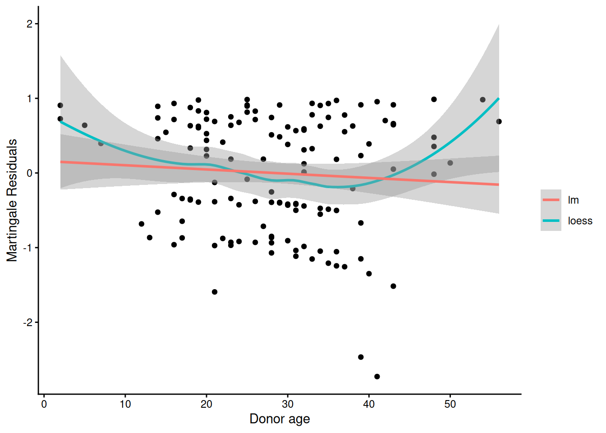](proportional-hazards-models_files/figure-html/unnamed-chunk-48-1.png "Martingale residuals for Donor age")

Martingale residuals for `Donor age`

A more complex functional form for `donor age` seems warranted; left as an exercise for the reader.

Now we will add the time-varying covariates:

Show R code

``` downlit
# add counting process formulation of Surv():
bmt2 <-
  bmt2 |>
  mutate(
    surv = Surv(
      time = tstart,
      time2 = tstop,
      event = status,
      type = "counting"
    )
  )
```

Let’s see how the data looks for patient 15:

Show R code

``` downlit
bmt1 |>
  dplyr::filter(id == 15) |>
  dplyr::select(tp, dp, tc, dc, ta, da, FAB, surv, t1, d1, t2, d2, d3)
```

Show R code

``` downlit
bmt2 |>
  dplyr::filter(id == 15) |>
  dplyr::select(id, agvhd, cgvhd, precovery, surv)
```

### 7.10.6 Model with Time-Dependent Covariates

Show R code

``` downlit
bmt_coxph_TV <- coxph(
  formula = surv ~
    group + `patient age` * `donor age` + FAB + agvhd + cgvhd + precovery,
  data = bmt2
)

summary(bmt_coxph_TV)
#> Call:
#> coxph(formula = surv ~ group + `patient age` * `donor age` + 
#>     FAB + agvhd + cgvhd + precovery, data = bmt2)
#> 
#>   n= 341, number of events= 83 
#> 
#>                                 coef exp(coef)  se(coef)     z Pr(>|z|)   
#> groupLow Risk AML          -1.038514  0.353980  0.358220 -2.90   0.0037 **
#> groupHigh Risk AML         -0.380481  0.683533  0.374867 -1.01   0.3101   
#> `patient age`              -0.073351  0.929275  0.035956 -2.04   0.0413 * 
#> `donor age`                -0.076406  0.926440  0.030196 -2.53   0.0114 * 
#> FABGrade 4 Or 5 (AML only)  0.805700  2.238263  0.284273  2.83   0.0046 **
#> agvhd                       0.150565  1.162491  0.306848  0.49   0.6237   
#> cgvhd                      -0.116136  0.890354  0.289046 -0.40   0.6878   
#> precovery                  -0.941123  0.390190  0.347861 -2.71   0.0068 **
#> `patient age`:`donor age`   0.002895  1.002899  0.000944  3.07   0.0022 **
#> ---
#> Signif. codes:  0 '***' 0.001 '**' 0.01 '*' 0.05 '.' 0.1 ' ' 1
#> 
#>                            exp(coef) exp(-coef) lower .95 upper .95
#> groupLow Risk AML              0.354      2.825     0.175     0.714
#> groupHigh Risk AML             0.684      1.463     0.328     1.425
#> `patient age`                  0.929      1.076     0.866     0.997
#> `donor age`                    0.926      1.079     0.873     0.983
#> FABGrade 4 Or 5 (AML only)     2.238      0.447     1.282     3.907
#> agvhd                          1.162      0.860     0.637     2.121
#> cgvhd                          0.890      1.123     0.505     1.569
#> precovery                      0.390      2.563     0.197     0.772
#> `patient age`:`donor age`      1.003      0.997     1.001     1.005
#> 
#> Concordance= 0.702  (se = 0.028 )
#> Likelihood ratio test= 40.3  on 9 df,   p=7e-06
#> Wald test            = 42.4  on 9 df,   p=3e-06
#> Score (logrank) test = 47.2  on 9 df,   p=4e-07
```

Platelet recovery is highly [significant](https://morrison-lab.github.io/sds/inference.html#def-statistically-significant).

Neither acute GVHD (`agvhd`) nor chronic GVHD (`cgvhd`) has a statistically significant effect here, nor are they significant in models with the other one removed.

Show R code

``` downlit
update(bmt_coxph_TV, . ~ . - agvhd) |> summary()
#> Call:
#> coxph(formula = surv ~ group + `patient age` + `donor age` + 
#>     FAB + cgvhd + precovery + `patient age`:`donor age`, data = bmt2)
#> 
#>   n= 341, number of events= 83 
#> 
#>                                 coef exp(coef)  se(coef)     z Pr(>|z|)   
#> groupLow Risk AML          -1.049870  0.349983  0.356727 -2.94   0.0032 **
#> groupHigh Risk AML         -0.417049  0.658988  0.365348 -1.14   0.2537   
#> `patient age`              -0.070749  0.931696  0.035477 -1.99   0.0461 * 
#> `donor age`                -0.075693  0.927101  0.030075 -2.52   0.0118 * 
#> FABGrade 4 Or 5 (AML only)  0.807035  2.241253  0.283437  2.85   0.0044 **
#> cgvhd                      -0.095393  0.909015  0.285979 -0.33   0.7387   
#> precovery                  -0.983653  0.373942  0.338170 -2.91   0.0036 **
#> `patient age`:`donor age`   0.002859  1.002863  0.000936  3.05   0.0023 **
#> ---
#> Signif. codes:  0 '***' 0.001 '**' 0.01 '*' 0.05 '.' 0.1 ' ' 1
#> 
#>                            exp(coef) exp(-coef) lower .95 upper .95
#> groupLow Risk AML              0.350      2.857     0.174     0.704
#> groupHigh Risk AML             0.659      1.517     0.322     1.349
#> `patient age`                  0.932      1.073     0.869     0.999
#> `donor age`                    0.927      1.079     0.874     0.983
#> FABGrade 4 Or 5 (AML only)     2.241      0.446     1.286     3.906
#> cgvhd                          0.909      1.100     0.519     1.592
#> precovery                      0.374      2.674     0.193     0.726
#> `patient age`:`donor age`      1.003      0.997     1.001     1.005
#> 
#> Concordance= 0.701  (se = 0.027 )
#> Likelihood ratio test= 40  on 8 df,   p=3e-06
#> Wald test            = 42.4  on 8 df,   p=1e-06
#> Score (logrank) test = 47.2  on 8 df,   p=1e-07
update(bmt_coxph_TV, . ~ . - cgvhd) |> summary()
#> Call:
#> coxph(formula = surv ~ group + `patient age` + `donor age` + 
#>     FAB + agvhd + precovery + `patient age`:`donor age`, data = bmt2)
#> 
#>   n= 341, number of events= 83 
#> 
#>                                 coef exp(coef)  se(coef)     z Pr(>|z|)   
#> groupLow Risk AML          -1.019638  0.360725  0.355311 -2.87   0.0041 **
#> groupHigh Risk AML         -0.381356  0.682935  0.374568 -1.02   0.3086   
#> `patient age`              -0.073189  0.929426  0.035890 -2.04   0.0414 * 
#> `donor age`                -0.076753  0.926118  0.030121 -2.55   0.0108 * 
#> FABGrade 4 Or 5 (AML only)  0.811716  2.251769  0.284012  2.86   0.0043 **
#> agvhd                       0.131621  1.140676  0.302623  0.43   0.6636   
#> precovery                  -0.946697  0.388021  0.347265 -2.73   0.0064 **
#> `patient age`:`donor age`   0.002904  1.002908  0.000943  3.08   0.0021 **
#> ---
#> Signif. codes:  0 '***' 0.001 '**' 0.01 '*' 0.05 '.' 0.1 ' ' 1
#> 
#>                            exp(coef) exp(-coef) lower .95 upper .95
#> groupLow Risk AML              0.361      2.772     0.180     0.724
#> groupHigh Risk AML             0.683      1.464     0.328     1.423
#> `patient age`                  0.929      1.076     0.866     0.997
#> `donor age`                    0.926      1.080     0.873     0.982
#> FABGrade 4 Or 5 (AML only)     2.252      0.444     1.291     3.929
#> agvhd                          1.141      0.877     0.630     2.064
#> precovery                      0.388      2.577     0.196     0.766
#> `patient age`:`donor age`      1.003      0.997     1.001     1.005
#> 
#> Concordance= 0.701  (se = 0.027 )
#> Likelihood ratio test= 40.1  on 8 df,   p=3e-06
#> Wald test            = 42.1  on 8 df,   p=1e-06
#> Score (logrank) test = 47.1  on 8 df,   p=1e-07
```

Let’s drop them both:

Show R code

``` downlit
bmt_coxph_TV2 <- update(bmt_coxph_TV, . ~ . - agvhd - cgvhd)
bmt_coxph_TV2 |> summary()
#> Call:
#> coxph(formula = surv ~ group + `patient age` + `donor age` + 
#>     FAB + precovery + `patient age`:`donor age`, data = bmt2)
#> 
#>   n= 341, number of events= 83 
#> 
#>                                 coef exp(coef)  se(coef)     z Pr(>|z|)   
#> groupLow Risk AML          -1.032520  0.356108  0.353202 -2.92   0.0035 **
#> groupHigh Risk AML         -0.413888  0.661075  0.365209 -1.13   0.2571   
#> `patient age`              -0.070965  0.931495  0.035453 -2.00   0.0453 * 
#> `donor age`                -0.076052  0.926768  0.030007 -2.53   0.0113 * 
#> FABGrade 4 Or 5 (AML only)  0.811926  2.252242  0.283231  2.87   0.0041 **
#> precovery                  -0.983505  0.373998  0.337997 -2.91   0.0036 **
#> `patient age`:`donor age`   0.002872  1.002876  0.000936  3.07   0.0021 **
#> ---
#> Signif. codes:  0 '***' 0.001 '**' 0.01 '*' 0.05 '.' 0.1 ' ' 1
#> 
#>                            exp(coef) exp(-coef) lower .95 upper .95
#> groupLow Risk AML              0.356      2.808     0.178     0.712
#> groupHigh Risk AML             0.661      1.513     0.323     1.352
#> `patient age`                  0.931      1.074     0.869     0.999
#> `donor age`                    0.927      1.079     0.874     0.983
#> FABGrade 4 Or 5 (AML only)     2.252      0.444     1.293     3.924
#> precovery                      0.374      2.674     0.193     0.725
#> `patient age`:`donor age`      1.003      0.997     1.001     1.005
#> 
#> Concordance= 0.7  (se = 0.027 )
#> Likelihood ratio test= 39.9  on 7 df,   p=1e-06
#> Wald test            = 42.2  on 7 df,   p=5e-07
#> Score (logrank) test = 47.1  on 7 df,   p=5e-08
```

## 7.11 Recurrent Events

(Adapted from Kleinbaum and Klein [\[7\]](#ref-kleinbaum2012survival), Ch 8)

- Sometimes an appropriate analysis requires consideration of recurrent events.
- A patient with arthritis may have more than one flareup. The same is true of many recurring-remitting diseases.
- In this case, we have more than one line in the data frame, but each line may have an event.
- We have to use a “robust” [variance](https://morrison-lab.github.io/pds/variance-covariance.html#def-variance) [estimator](https://morrison-lab.github.io/sds/estimation.html#def-estimator) to account for [correlation](https://morrison-lab.github.io/pds/variance-covariance.html#def-correlation) of time-to-events within a patient.

### 7.11.1 Bladder Cancer Data Set

The bladder cancer dataset from Kleinbaum and Klein [\[7\]](#ref-kleinbaum2012survival) contains recurrent event outcome information for eighty-six cancer patients followed for the recurrence of bladder cancer tumor after transurethral surgical excision (Byar and Green 1980). The exposure of interest is the effect of the drug treatment of thiotepa. Control variables are the initial number and initial size of tumors. The data layout is suitable for a counting processes approach.

This drug is still a possible choice for some patients. Another therapeutic choice is Bacillus Calmette-Guerin (BCG), a live bacterium related to cow tuberculosis.

#### Data dictionary

| Variable   | Definition                                         |
|------------|----------------------------------------------------|
| `id`       | Patient unique ID                                  |
| `status`   | for each time interval: 1 = recurred, 0 = censored |
| `interval` | 1 = first recurrence, etc.                         |
| `intime`   | \``tstop - tstart` (all times in months)           |
| `tstart`   | start of interval                                  |
| `tstop`    | end of interval                                    |
| `tx`       | treatment code, 1 = thiotepa                       |
| `num`      | number of initial tumors                           |
| `size`     | size of initial tumors (cm)                        |

Variables in the `bladder` dataset {.caption-top .table}

- There are 85 patients and 190 lines in the dataset, meaning that many patients have more than one line.
- Patient 1 with 0 observation time was removed.
- Of the 85 patients, 47 had at least one recurrence and 38 had none.
- 18 patients had exactly one recurrence.
- There were up to 4 recurrences in a patient.
- Of the 190 intervals, 112 terminated with a recurrence and 78 were [censored](../chapters/intro-to-survival-analysis.llms.md#def-right-censor).

#### Different intervals for the same patient are correlated.

- Is the effective sample size 47 or 112? This difference might narrow [confidence intervals](https://morrison-lab.github.io/sds/inference.html#def-confidence-interval) by as much as a factor of $\sqrt{112/47}=1.54$

- What happens if I have 5 treatment and 5 control values and want to do a [t-test](https://morrison-lab.github.io/sds/basic-statistical-methods.html#sec-two-sample-t-test) and I then duplicate the 10 values as if the sample size was 20? This falsely narrows confidence intervals by a factor of $\sqrt{2}=1.41$.

Show R code

``` downlit
bladder <-
  paste0(
    "http://web1.sph.emory.edu/dkleinb/allDatasets",
    "/surv2datasets/bladder.dta"
  ) |>
  read_dta() |>
  as_tibble()

bladder <- bladder[-1, ] # remove subject with 0 observation time
print(bladder)
```

Show R code

``` downlit
bladder <-
  bladder |>
  mutate(
    surv = Surv(
      time = start,
      time2 = stop,
      event = event,
      type = "counting"
    )
  )

bladder_cox1 <- coxph(
  formula = surv ~ tx + num + size,
  data = bladder
)

# results with biased variance-covariance matrix:
summary(bladder_cox1)
#> Call:
#> coxph(formula = surv ~ tx + num + size, data = bladder)
#> 
#>   n= 190, number of events= 112 
#> 
#>         coef exp(coef) se(coef)     z Pr(>|z|)    
#> tx   -0.4116    0.6626   0.1999 -2.06  0.03947 *  
#> num   0.1637    1.1778   0.0478  3.43  0.00061 ***
#> size -0.0411    0.9598   0.0703 -0.58  0.55897    
#> ---
#> Signif. codes:  0 '***' 0.001 '**' 0.01 '*' 0.05 '.' 0.1 ' ' 1
#> 
#>      exp(coef) exp(-coef) lower .95 upper .95
#> tx       0.663      1.509     0.448      0.98
#> num      1.178      0.849     1.073      1.29
#> size     0.960      1.042     0.836      1.10
#> 
#> Concordance= 0.624  (se = 0.032 )
#> Likelihood ratio test= 14.7  on 3 df,   p=0.002
#> Wald test            = 15.9  on 3 df,   p=0.001
#> Score (logrank) test = 16.2  on 3 df,   p=0.001
```

> **NOTE:**
>
> The [likelihood ratio](../chapters/logistic-regression.llms.md#def-lrt) and score tests assume [independence](https://morrison-lab.github.io/pds/independence.html#def-indpt) of observations within a cluster. The [Wald](https://morrison-lab.github.io/sds/intro-MLEs.html#def-wald-test) and robust score tests do not.

#### adding `cluster = id`

If we add `cluster= id` to the call to `coxph`, the coefficient estimates don’t change, but we get an additional column in the [`summary()`](https://rdrr.io/r/base/summary.html) output: `robust se`:

Show R code

``` downlit
bladder_cox2 <- coxph(
  formula = surv ~ tx + num + size,
  cluster = id,
  data = bladder
)

# unbiased though this reduces power:
summary(bladder_cox2)
#> Call:
#> coxph(formula = surv ~ tx + num + size, data = bladder, cluster = id)
#> 
#>   n= 190, number of events= 112 
#> 
#>         coef exp(coef) se(coef) robust se     z Pr(>|z|)   
#> tx   -0.4116    0.6626   0.1999    0.2488 -1.65   0.0980 . 
#> num   0.1637    1.1778   0.0478    0.0584  2.80   0.0051 **
#> size -0.0411    0.9598   0.0703    0.0742 -0.55   0.5799   
#> ---
#> Signif. codes:  0 '***' 0.001 '**' 0.01 '*' 0.05 '.' 0.1 ' ' 1
#> 
#>      exp(coef) exp(-coef) lower .95 upper .95
#> tx       0.663      1.509     0.407      1.08
#> num      1.178      0.849     1.050      1.32
#> size     0.960      1.042     0.830      1.11
#> 
#> Concordance= 0.624  (se = 0.031 )
#> Likelihood ratio test= 14.7  on 3 df,   p=0.002
#> Wald test            = 11.2  on 3 df,   p=0.01
#> Score (logrank) test = 16.2  on 3 df,   p=0.001,   Robust = 10.8  p=0.01
#> 
#>   (Note: the likelihood ratio and score tests assume independence of
#>      observations within a cluster, the Wald and robust score tests do not).
```

`robust se` is larger than `se`, and accounts for the repeated observations from the same individuals:

Show R code

``` downlit
round(bladder_cox2$naive.var, 4)
#>         [,1]    [,2]   [,3]
#> [1,]  0.0400 -0.0014 0.0000
#> [2,] -0.0014  0.0023 0.0007
#> [3,]  0.0000  0.0007 0.0049
round(bladder_cox2$var, 4)
#>         [,1]    [,2]    [,3]
#> [1,]  0.0619 -0.0026 -0.0004
#> [2,] -0.0026  0.0034  0.0013
#> [3,] -0.0004  0.0013  0.0055
```

These values are the ratios of correct confidence intervals to naive ones:

Show R code

``` downlit
with(bladder_cox2, diag(var) / diag(naive.var)) |> sqrt()
#> [1] 1.24449 1.22309 1.05576
```

We might try dropping the non-significant `size` variable:

Show R code

``` downlit
# remove non-significant size variable:
bladder_cox3 <- bladder_cox2 |> update(. ~ . - size)
summary(bladder_cox3)
#> Call:
#> coxph(formula = surv ~ tx + num, data = bladder, cluster = id)
#> 
#>   n= 190, number of events= 112 
#> 
#>        coef exp(coef) se(coef) robust se     z Pr(>|z|)   
#> tx  -0.4117    0.6625   0.2003    0.2515 -1.64   0.1017   
#> num  0.1700    1.1853   0.0465    0.0564  3.02   0.0026 **
#> ---
#> Signif. codes:  0 '***' 0.001 '**' 0.01 '*' 0.05 '.' 0.1 ' ' 1
#> 
#>     exp(coef) exp(-coef) lower .95 upper .95
#> tx      0.663      1.509     0.405      1.08
#> num     1.185      0.844     1.061      1.32
#> 
#> Concordance= 0.623  (se = 0.031 )
#> Likelihood ratio test= 14.3  on 2 df,   p=8e-04
#> Wald test            = 10.2  on 2 df,   p=0.006
#> Score (logrank) test = 15.8  on 2 df,   p=4e-04,   Robust = 10.6  p=0.005
#> 
#>   (Note: the likelihood ratio and score tests assume independence of
#>      observations within a cluster, the Wald and robust score tests do not).
```

## 7.12 Age as the time scale

See Canchola et al. [\[9\]](#ref-canchola2003cox).

# 8 Competing Risks

This section is adapted from [\[10, Ch. 6\]](#ref-vittinghoff2e).

### 8.0.1 What Are Competing Risks?

> **NOTE:**
>
> **Definition 27 (Competing Risks Data)** **Competing risks data** arise when multiple events can occur, and follow-up can end due to occurrence of one or more of those types of events, precluding observation of at least one of the other event types.

Competing risks are common in medical research. For example, in a study of bone fracture risk in elderly men, participants may:

- Experience the event of interest (fracture)
- Die before experiencing a fracture (competing event)
- Be lost to follow-up or reach the end of the study period ([censored](../chapters/intro-to-survival-analysis.llms.md#def-right-censor))

#### Why Competing Risks Matter

When analyzing time-to-event data, standard survival analysis methods make assumptions about censoring. The **independent censoring assumption** assumes that the future risk of censored observations can be represented by those who remain under follow-up.

This assumption is reasonable for:

- Administrative censoring (end of study)
- Loss to follow-up (if unrelated to outcome risk)

However, this assumption is questionable for competing events like death, because:

1.  We cannot extrapolate beyond participant lifetimes
2.  Death fundamentally alters the risk set for the primary outcome
3.  Projecting to a setting “without death” creates a hypothetical population

#### Approaches to Analyzing Competing Risks Data

Two main approaches exist for analyzing competing risks:

1.  **Elimination approach**: Extrapolates to a scenario where a competing event is not possible (appropriate for losses to follow-up)

2.  **Accommodation approach**: Acknowledges and allows for the competing risks in the analysis (appropriate for death and other true competing events)

### 8.0.2 Notation for Competing Risks

We denote competing risks outcome data using two variables:

- $Y$: time of the first observed event of any type
- $\delta = k$: if the $k$-th event type occurs first

where each of the $K$ possible types of failure are denoted by a numerical code.

**Example coding scheme:**

- 0: loss to follow-up (censored)
- 1: event of interest (e.g., fracture)
- 2: competing event (e.g., death)

A participant followed for 18 months who dies before experiencing a fracture would have $Y = 18$ months and $\delta = 2$.

### 8.0.3 Summaries for Competing Risks Data

#### Cause-Specific Hazard Functions

> **NOTE:**
>
> **Definition 28 (Cause-Specific Hazard Function)** The **cause-specific hazard function** for event type $k$, denoted $h_k(t)$, is the short-term rate at which participants experience the onset of the $k$-th event among those who have not yet experienced the event of interest or a competing event prior to time $t$.

**Key properties:**

- The numerator counts only events of type $k$
- The denominator includes all participants who could have developed the event by time $t$
- Reduces to the ordinary [hazard function](../chapters/intro-to-survival-analysis.llms.md#def-hazard) when there is only one failure type

**Estimation:**

To estimate and model cause-specific hazard functions:

1.  Set up data as ordinary survival data
2.  Define the $k$-th failure type as the only “event”
3.  Treat all competing causes (including death) as “censored”

You can then examine [predictor](../chapters/Intro-to-GLMs.llms.md#def-predictors) effects on the cause-specific hazard using standard [Cox proportional hazards models](#def-ph-model).

#### Cumulative Incidence Functions

> **NOTE:**
>
> **Definition 29 (Cumulative Incidence Function)** The **cumulative incidence function** (CIF) for cause type $k$ at time $t$, denoted $F_k(t)$, is the proportion of the population who have experienced the $k$-th event prior to time $t$.

The cumulative incidence function:

- Measures the prevalence of a particular event at each time $t$
- Accounts for all competing risks
- Differs from cause-specific hazards in how it treats competing events

**Interpretation (MrOS study):**

In the MrOS study, at 5 years of follow-up:

- 8% of men had experienced a hip fracture
- 9.3% had died without a fracture
- 82.7% remained alive without fracture

### 8.0.4 Estimation of Cumulative Incidence

The cumulative incidence at time $t$ is calculated as:

$$\hat{F}_k(t) = \sum_{t_i \le t} {\mathop{\hat{\operatorname{S}}}\nolimits_{\text{KM}}\mathopen{}\left(t_{i-1}\right)\mathclose{}} \times \frac{d_{ki}}{n_i}$$

where:

- $t_i$ are the ordered event times
- $d_{ki}$ is the number of type-$k$ events at time $t_i$
- $n_i$ is the [number at risk](../chapters/intro-to-survival-analysis.llms.md#def-number-at-risk) at time $t_i$
- ${\mathop{\hat{\operatorname{S}}}\nolimits_{\text{KM}}\mathopen{}\left(t_{i-1}\right)\mathclose{}}$ is the [Kaplan-Meier estimate](../chapters/intro-to-survival-analysis.llms.md#def-KM-estimator) of event-free survival just before time $t_i$

The estimation proceeds in steps:

1.  Calculate the overall event-free probability at each time point using the Kaplan-Meier method (combining all event types)
2.  For each time interval, calculate the probability of a new type-$k$ event as:
    - Probability of being event-free at the start of the interval
    - Times the rate of type-$k$ events during the interval
3.  The cumulative incidence is the cumulative sum of these time-specific probabilities

#### Numerical Example: MrOS Study

The `mros` dataset from the `rmb` package contains data from the Osteoporotic Fractures in Men (MrOS) study [\[11\]](#ref-orwoll2005design), a prospective cohort study of older men. The outcome variable is coded as:

- 0: censored (no fracture or death during follow-up)
- 1: hip fracture (event of interest)
- 2: death without fracture (competing event)

Show R code

``` downlit
ggplot(cif_df) +
  aes(x = time, y = cif, color = event) +
  geom_step() +
  labs(
    x       = "Years of follow-up",
    y       = "Cumulative incidence",
    color   = "Event type",
    caption = "Data: rmb::mros (MrOS study, Orwoll et al. 2005)"
  ) +
  scale_y_continuous(limits = c(0, 0.20)) +
  theme_bw() +
  theme(legend.position = "bottom")
```

> **NOTE:**
>
> [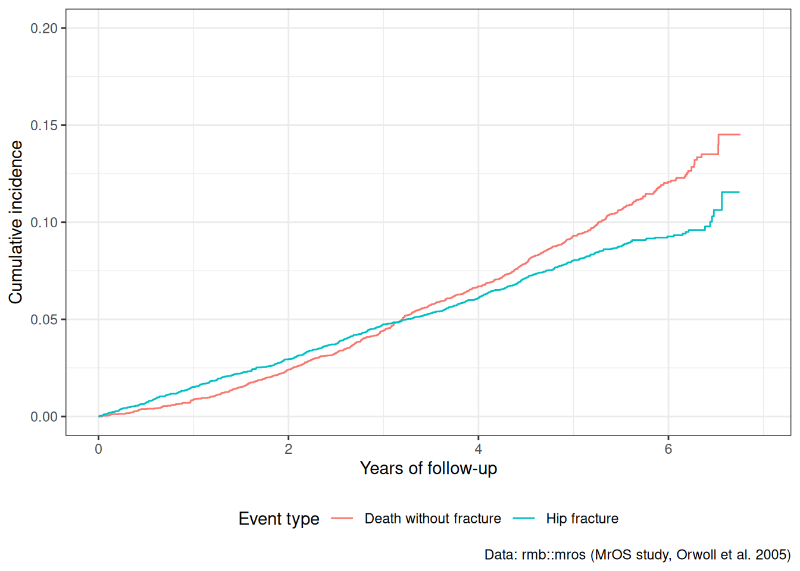](proportional-hazards-models_files/figure-html/fig-mros-cif-1.png "Figure 24: ")
>
> Figure 24

At approximately 5 years of follow-up:

- About 8% of men had experienced a hip fracture
- About 9.3% had died without a fracture

These two cumulative incidences sum to less than the overall event probability because many men are still event-free at 5 years.

#### Naive vs. Proper Cumulative Incidence

A naive approach treats competing events as censored and uses the standard Kaplan-Meier method: $1 - {\mathop{\hat{\operatorname{S}}}\nolimits_{\text{KM}}\mathopen{}\left(t\right)\mathclose{}}$. This naive Kaplan-Meier approach overestimates the true cumulative incidence because it assumes censored individuals (including those who died) have the same risk as those still event-free.

Show R code

``` downlit
# Naive KM estimate for fracture (treating death as censored)
km_naive <- survfit(
  Surv(years, status == 1) ~ 1,
  data = mros_data
)

naive_df <- tibble(
  time  = km_naive$time,
  cif   = 1 - km_naive$surv,
  method = "Naive KM (1 - S(t))"
)

proper_df <- fracture_cif |>
  mutate(method = "Proper CIF")

comparison_df <- bind_rows(naive_df, proper_df)

ggplot(comparison_df) +
  aes(x = time, y = cif, color = method) +
  geom_step() +
  labs(
    x     = "Years of follow-up",
    y     = "Estimated probability of fracture",
    color = "Method",
    caption = "Data: rmb::mros (MrOS study)"
  ) +
  scale_y_continuous(limits = c(0, 0.15)) +
  theme_bw() +
  theme(legend.position = "bottom")
```

> **NOTE:**
>
> [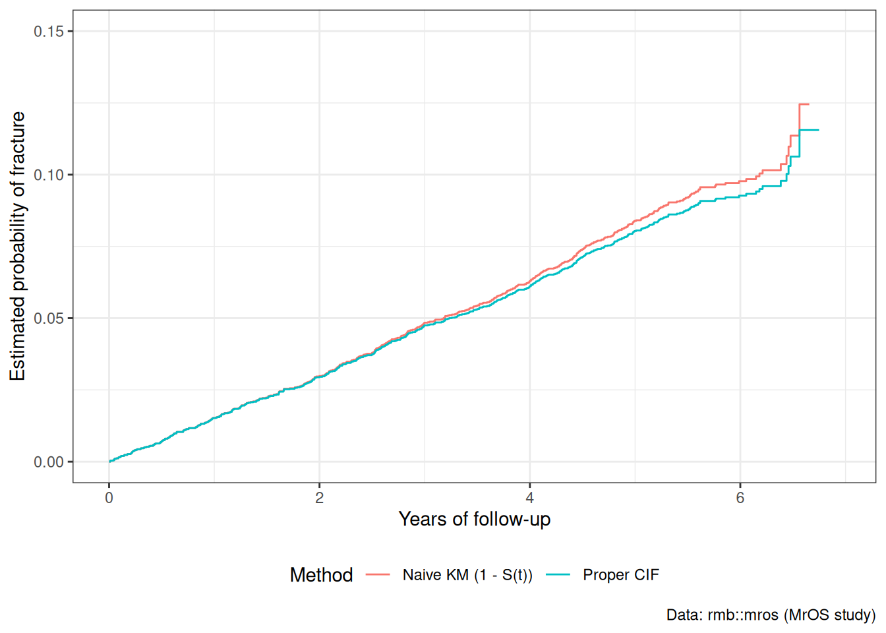](proportional-hazards-models_files/figure-html/fig-mros-cif-vs-naive-1.png "Figure 25: ")
>
> Figure 25

The naive KM curve overestimates the probability of fracture because it imagines a hypothetical world without competing mortality. The proper CIF curve represents the actual clinical probability of experiencing a fracture.

### 8.0.5 Modeling Competing Risks

When analyzing competing risks data with predictors, two main approaches are available:

#### Cause-Specific Hazards Models

Fit separate Cox models for each event type, treating other event types as censored:

**Advantages:**

- Standard software can be used
- Straightforward interpretation of [hazard ratios](../chapters/intro-to-survival-analysis.llms.md#def-hazard-ratio)
- Can assess effects on each failure type separately

**Limitations:**

- Results do not directly estimate cumulative incidence
- Interpretation can be challenging when effects differ across event types

#### Subdistribution Hazards Models (Fine-Gray Model)

An alternative approach directly models the cumulative incidence function using subdistribution hazards [\[12\]](#ref-fine1999proportional).

The Fine-Gray model:

- Directly estimates the effect on cumulative incidence
- Keeps participants who experience competing events in the risk set
- Requires specialized software (e.g., `cmprsk` package in R)

# References

\[1\]

D. M. Rocke, “Epi 204 lecture notes, Spring 2021.” University of California, Davis, 2021. Available: <https://dmrocke.ucdavis.edu/Class/EPI204-Spring-2021/EPI204-Spring-2021.html>

\[2\]

D. R. Cox, “Regression models and life-tables,” *Journal of the Royal Statistical Society: Series B (Methodological)*, vol. 34, no. 2, pp. 187–202, 1972.

\[3\]

J. P. Klein and M. L. Moeschberger, *Survival analysis: Techniques for censored and truncated data*, vol. 1230. Springer, 2003. Available: <https://link.springer.com/book/10.1007/b97377>

\[4\]

S. Johansen, “An extension of cox’s regression model,” *International Statistical Review / Revue Internationale de Statistique*, vol. 51, no. 2, pp. 165–174, 1983, doi: [10.2307/1402746](https://doi.org/10.2307/1402746).

\[5\]

P. M. Grambsch and T. M. Therneau, “Proportional hazards tests and diagnostics based on weighted residuals,” *Biometrika*, vol. 81, no. 3, pp. 515–526, 1994, Available: <https://doi.org/10.1093/biomet/81.3.515>

\[6\]

A. J. Dobson and A. G. Barnett, *An introduction to generalized linear models*, 4th ed. CRC press, 2018. Available: <https://doi.org/10.1201/9781315182780>

\[7\]

D. G. Kleinbaum and M. Klein, *Survival analysis: A self-learning text*, 3rd ed. Springer, 2012. Available: <https://link.springer.com/book/10.1007/978-1-4419-6646-9>

\[8\]

E. A. Copelan *et al.*, “Treatment for acute myelocytic leukemia with allogeneic bone marrow transplantation following preparation with BuCy2,” 1991, doi: [10.1182/blood.V78.3.838.838](https://doi.org/10.1182/blood.V78.3.838.838).

\[9\]

A. J. Canchola *et al.*, “Cox regression using different time-scales,” *Western Users of SAS Software*, 2003, Available: <https://www.lexjansen.com/wuss/2003/DataAnalysis/i-cox_time_scales.pdf>

\[10\]

E. Vittinghoff, D. V. Glidden, S. C. Shiboski, and C. E. McCulloch, *Regression methods in biostatistics: Linear, logistic, survival, and repeated measures models*, 2nd ed. Springer, 2012. Available: <https://doi.org/10.1007/978-1-4614-1353-0>

\[11\]

E. Orwoll *et al.*, “Design and baseline characteristics of the osteoporotic fractures in men (MrOS) study – a large observational study of the determinants of fracture in older men,” *Contemporary Clinical Trials*, vol. 26, no. 5, pp. 569–585, 2005, doi: [10.1016/j.cct.2005.04.005](https://doi.org/10.1016/j.cct.2005.04.005).

\[12\]

J. P. Fine and R. J. Gray, “A proportional hazards model for the subdistribution of a competing risk,” *Journal of the American Statistical Association*, vol. 94, no. 446, pp. 496–509, 1999, doi: [10.1080/01621459.1999.10474144](https://doi.org/10.1080/01621459.1999.10474144).

Back to top
